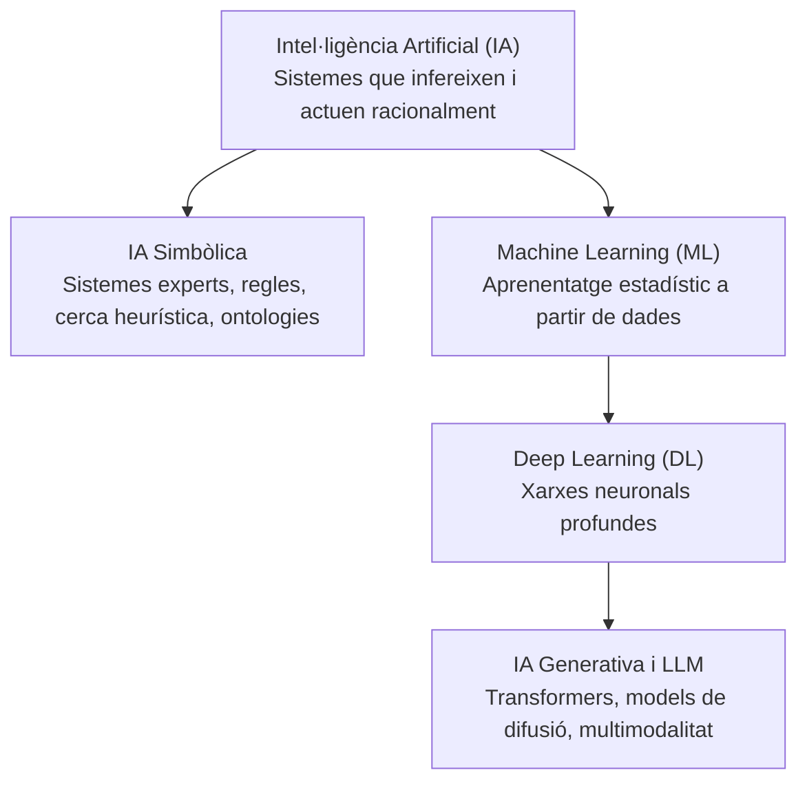
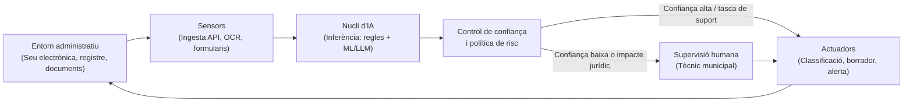

## A. Objectius d'aprenentatge

En completar aquesta lliçó, l'estudiant ha de ser capaç de:

1. **Explicar** què és la intel·ligència artificial (*Artificial Intelligence*, IA) des de la perspectiva científica, enginyeril i reguladora (incloent-hi la definició de sistema d'IA del Reglament europeu d'IA).
2. **Identificar** i distingir els principals paradigmes històrics i actuals de la IA: IA simbòlica, aproximació estadística / *Machine Learning* i aproximació conexionista / *Deep Learning*.
3. **Diferenciar** amb rigor els nivells de capacitat (IA feble o *Narrow AI*, IA general o *AGI*, i superintel·ligència) i els quatre enfocaments clàssics de Russell i Norvig (pensar/actuar com humans vs. pensar/actuar racionalment).
4. **Comparar** el funcionament d'un programari determinista convencional respecte d'un sistema d'IA basat en inferència o aprenentatge, i justificar quan convé (i quan no convé) aplicar IA en un procés administratiu.
5. **Implementar** un agent racional senzill amb bucle percepció-decisió-acció i analitzar-ne les limitacions en un entorn públic real.

---

## B. Explicació introductòria

Imagina dues maneres molt diferents de resoldre un problema quotidià a una oficina municipal de registre d'entrada: classificar milers de correus i instàncies que arriben cada setmana per derivar-les a l'àrea competent (Urbanisme, Tributs, Serveis Socials, Medi Ambient, Mobilitat).

- **Programació tradicional (determinista)**: una persona programa totes les regles a mà: *"Si el text conté la paraula 'IBI', envia a Tributs; si conté 'llicència d'obres', envia a Urbanisme"*. Funciona molt bé quan les regles són curtes, exactes i estables. Però què passa quan un ciutadà escriu *"Voldria fraccionar el rebut anual del pis perquè aquest mes no arribo"*? No apareix la sigla `IBI`, ni `tribut`, ni `impost`. Mantenir milers de regles manuals acaba sent fràgil i inabastable.
- **Intel·ligència artificial**: en lloc de codificar cada frase possible, construïm un sistema capaç d'interpretar el context, inferir relacions o aprendre patrons a partir de milers d'expedients històrics etiquetats (o de regles lògiques estructurades en un motor d'inferència) per proposar l'àrea de destí amb una puntuació de confiança.

Una analogia útil és la diferència entre una **calculadora** i un **tècnic junior entrenat**: la calculadora segueix instruccions rígides amb precisió absoluta en càlculs definits, mentre que la IA intenta resoldre tasques on les regles són complexes, incompletes, ambigües o canviants (llenguatge natural, imatges, predicció de demanda, detecció de frau).

:::callout-info Precisió terminològica essencial
La **intel·ligència artificial** és el camp general paraigua. Dins seu hi conviuen tècniques **simbòliques** (lògica, cerca heurística, sistemes experts), **aprenentatge automàtic (*Machine Learning*)**, **aprenentatge profund (*Deep Learning*)** i **IA generativa**. No tota la IA és *Machine Learning*, ni tot el *Machine Learning* és *Deep Learning*.
:::

---

## C. Explicació tècnica avançada

### 1. Definició formal i taxonomia clàssica

En la literatura acadèmica de referència (Stuart Russell i Peter Norvig, *Artificial Intelligence: A Modern Approach*), la IA s'organitza en quatre enfocaments segons dues dimensions (processos interns de raonament vs. comportament observable; fidelitat humana vs. racionalitat ideal):

1. **Pensar com els humans** (*enfocament cognitiu*): modelar processos mentals humans (ciència cognitiva).
2. **Actuar com els humans** (*enfocament del Test de Turing*): exhibir un comportament indistinguible del d'una persona (requereix NLP, representació del coneixement, raonament automatitzat i aprenentatge).
3. **Pensar racionalment** (*lleis del pensament*): formalitzar el raonament mitjançant lògica matemàtica i sil·logismes. Limitació: transformar coneixement incert del món real en lògica formal pura és sovint intractable.
4. **Actuar racionalment** (*enfocament d'agents racionals*): paradigma dominant en l'enginyeria moderna. Un **agent racional** percep l'entorn a través de sensors (APIs, formularis, documents, càmeres) i executa accions mitjançant actuadors per maximitzar una **mesura de rendiment esperada** donada la seva història de percepcions i el seu coneixement previ.

:::callout-legal Definició normativa de sistema d'IA (Reglament UE 2024/1689 — AI Act)
L'article 3, apartat 1, del Reglament (UE) 2024/1689 (AI Act) defineix un **sistema d'IA** com un *sistema basat en màquines dissenyat per operar amb diferents nivells d'autonomia i que pot mostrar capacitat d'adaptació després del desplegament, i que, per a objectius explícits o implícits, infereix, a partir de les dades d'entrada que rep, com generar resultats de sortida com ara prediccions, continguts, recomanacions o decisions que poden influir en entorns físics o virtuals*.

Aquesta definició exclou explícitament el programari tradicional que només executa regles estrictament preprogramades per humans sense capacitat d'inferència (vegeu el Mòdul 8 per al detall legal complet).
:::

### 2. Nivells de capacitat: ANI, AGI i ASI

- **IA feble o estreta (*Artificial Narrow Intelligence*, ANI)**: única categoria existent actualment en producció. Excel·leix en dominis delimitats (transcripció, classificació documental, traducció, generació de text condicionat), però no transfereix comprensió causal genuïna fora del seu domini ni posseeix consciència. Fins i tot els LLM més avançats continuen sent sistemes d'IA estreta d'ús general (*General-Purpose AI*, GPAI), no AGI.
- **IA general (*Artificial General Intelligence*, AGI)**: concepte teòric d'un sistema capaç d'aprendre i executar qualsevol tasca intel·lectual humana amb flexibilitat equivalent. No existeix actualment.
- **Superintel·ligència (*Artificial Superintelligence*, ASI)**: hipòtesi teòrica d'un sistema que superaria àmpliament la capacitat cognitiva humana en tots els àmbits.

### 3. Els grans paradigmes de la IA

| Paradigma | Període d'auge principal | Representació del coneixement | Motor principal | Fortaleses | Limitacions |
|---|---|---|---|---|---|
| **IA simbòlica (GOFAI)** | 1956–1980s | Símbols, regles `SI-LLAVORS`, ontologies, grafs de coneixement | Cerca en espais d'estats (A*, minimax), lògica, motors d'inferència | Alta explicabilitat, traçabilitat exacta, no requereix grans volums de dades | Fragilitat davant ambigüitat, alt cost de manteniment manual (coll d'ampolla del coneixement) |
| **IA estadística / ML clàssic** | 1990s–2010s | Vectors de característiques (*features*) dissenyats manualment | Optimització matemàtica (regressió, arbres, SVM, bayesians) | Excel·lent en dades tabulars, eficient en càlcul, bona interpretabilitat | Depèn molt de l'enginyeria manual de característiques (*feature engineering*) |
| **IA conexionista / Deep Learning** | 2012–actualitat | Representacions distribuïdes en tensors i pesos neuronals | Xarxes neuronals profundes (CNN, RNN, Transformers) entrenades amb *backpropagation* | Rendiment superior en dades no estructurades (text, imatge, àudio), aprenentatge de representacions | Caixa negra, elevada demanda de dades i còmput, risc d'al·lucinacions i biaixos |
| **IA híbrida / Neuro-simbòlica** | Actualitat (en expansió) | Combinació de models neuronals + regles/grafs/eines verificables | LLM o ML integrats amb motors de regles, bases de dades i validadors deterministes | Combina flexibilitat semàntica amb seguretat normativa i determinisme | Major complexitat arquitectònica i d'integració |

### 4. Propietats dels entorns d'un agent (Marc PEAS)

Per dissenyar qualsevol sistema d'IA abans de triar tecnologia, l'enginyeria d'agents especifica l'entorn mitjançant **PEAS**:
- **P (*Performance measure*)**: mètrica d'èxit (p. ex., F1-score d'encaminament, temps de tramitació, taxa d'errors crítics).
- **E (*Environment*)**: ecosistema on opera (seu electrònica, gestor d'expedients, registre d'entrada).
- **A (*Actuators*)**: sortides del sistema (proposta d'etiqueta, borrador de resposta, alerta de revisió humana).
- **S (*Sensors*)**: entrades percebudes (PDF, camps del formulari, metadades del registre).

Classificació de l'entorn:
- **Completament vs. parcialment observable**: en una sol·licitud ciutadana, l'entorn sol ser *parcialment observable* (el ciutadà omet dades o adjunta documents incomplerts).
- **Determinista vs. estocàstic**: els processos socials i documentals són *estocàstics* (incertesa inherent).
- **Estàtic vs. dinàmic**: la normativa municipal i els impostos canvien anualment (*dinàmic*).
- **Discret vs. continu**: les categories d'expedient són *discretes*; els imports tributaris o terminis són *continus*.

### 5. Avantatges, inconvenients, limitacions i errors habituals

- **Avantatges**: capacitat de processar informació no estructurada a gran escala, detecció de patrons subtils, reducció de càrrega administrativa repetitiva, disponibilitat 24/7 en tasques de suport.
- **Inconvenients i limitacions**: comportament probabilístic (mai 100% infal·lible), dependència directa de la qualitat de les dades (*garbage in, garbage out*), vulnerabilitat a derivacions estadístiques (*drift*), costos d'infraestructura i manteniment continu, opacitat en models complexos.
- **Mètriques d'avaluació**: depenen del paradigma i la tasca (exactitud, precisió, exhaustivitat, F1, latència, cost per inferència, explicabilitat i taxes d'intervenció humana). Es desenvolupen en detall a les lliçons 1.7, 1.8 i 1.11.
- **Errors habituals en projectes reals**:
  1. **Solucionisme tecnològic**: aplicar un LLM o Deep Learning a un problema resoluble amb una consulta SQL o 10 regles deterministes.
  2. **Confondre correlació amb causalitat**: un sistema d'IA detecta associacions estadístiques, no necessàriament relacions causa-efecte.
  3. **Menystenir la gestió del canvi i les dades**: el 70–80% de l'esforç real d'un projecte d'IA no és el model, sinó la governança de dades, la integració i el control humà.

---

## D. Diagrames i recursos visuals

### Relació jeràrquica dels camps de la intel·ligència artificial



### Arquitectura d'un agent racional en un entorn administratiu



### Comparativa: Programari tradicional vs. IA simbòlica vs. IA basada en dades (ML/DL)

| Criteri | Programari tradicional | IA simbòlica (sistemes experts) | IA basada en dades (ML / DL) |
|---|---|---|---|
| **Entrades del desenvolupament** | Dades + Algorisme explícit | Fets + Base de regles formals | Dades històriques (+ etiquetes) |
| **Sortida del procés** | Resultat exacte | Inferència lògica + traça | Model probabilístic entrenat |
| **Determinisme** | 100% determinista | Determinista (o amb factors de certesa) | Probabilístic / aproximat |
| **Explicabilitat nativa** | Total (codi font) | Molt alta (arbre de regles) | Variable (de mitjana a baixa en DL) |
| **Idoneïtat administrativa** | Càlcul de taxes, validació NIF, terminis legals | Comprovació de requisits normatius estables | Triatge de textos, OCR, detecció d'anomalies, cerca semàntica |

---

## E. Aplicació a l'Administració pública

En l'àmbit de la **Diputació de Barcelona** (suport tècnic, econòmic i tecnològic a 311 municipis, gestió tributària mitjançant l'ORGT, xarxa de biblioteques, acció social i gestió ambiental), la IA aporta valor real quan es desplega com a **sistema de suport a la decisió i a la tramitació**, i no com a substitut de la responsabilitat pública:

### Casos d'ús realistes

1. **Classificació i encaminament d'instàncies genèriques**: una instància ciutadana entra pel registre electrònic amb un text lliure; un sistema d'IA proposa el departament competent i el procediment associat, reduint errors de derivació i temps d'espera.
2. **Cerca intel·ligent de normativa i convenis**: tècnics municipals d'ajuntaments petits consulten ordenances tipus, subvencions o plecs de contractació en llenguatge natural.
3. **Detecció primerenca d'anomalies**: identificació de duplicats en factures, inconsistències en justificacions de subvencions o consums anòmals d'aigua/energia en equipaments municipals.
4. **Suport a l'atenció ciutadana omnicanal**: assistents que orienten sobre documentació necessària per a tràmits freqüents (padró, llicències, calendari fiscal) derivant sempre casos complexos a personal funcionari.

### Beneficis, riscos, limitacions i supervisió humana

- **Beneficis**: reducció de cues i tasques mecàniques, homogeneïtzació de la qualitat del servei entre municipis grans i petits, millora de l'accessibilitat informativa.
- **Riscos**: discriminació indirecta per biaixos històrics, decisions opaques incompatibles amb el deure de motivació dels actes administratius (art. 35 de la Llei 39/2015), filtració de dades personals, dependència tecnològica de proveïdors (*vendor lock-in*) i **biaix d'automatització** (que el personal aprovi automàticament les propostes del sistema sense revisar-les críticament).
- **Supervisió humana obligatòria**: en qualsevol actuació amb efectes jurídics sobre la ciutadania (concessió d'ajuts, sancions, liquidacions tributàries), la IA ha d'operar sota un esquema **Human-in-the-Loop (HITL)**: el sistema proposa, argumenta i assenyala evidències, però la resolució motivada correspon a l'òrgan administratiu competent (en línia amb l'art. 22 del RGPD, l'art. 41 de la Llei 40/2015 i l'art. 14 de l'AI Act).

---

## F. Exemple pràctic guiat

A continuació implementem en **Python pur** (sense dependències externes, 100% executable) una comparació directa entre:
1. Un **encaminador determinista rígid** (programació tradicional per paraules exactes).
2. Un **agent racional híbrid senzill** que combina puntuació basada en evidències, càlcul de confiança i derivació automàtica a **revisió humana** quan la incertesa supera un llindar (principi de seguretat administrativa).

```python
"""Exemple 1.1: Comparació entre encaminament determinista i agent racional amb control de confiança."""
from dataclasses import dataclass
import math
import re


@dataclass
class Instancia:
    id_registre: str
    text: str


# 1) Aproximació tradicional determinista (regles estrictes)
def encaminar_determinista(text: str) -> str:
    t = text.lower()
    if "ibi" in t or "plusvàlua" in t:
        return "TRIBUTS"
    if "llicència d'obres" in t:
        return "URBANISME"
    if "ajut" in t or "dependència" in t:
        return "SERVEIS_SOCIALS"
    return "DESCONEGUT"


# 2) Agent racional amb puntuació probabilística (softmax) i política d'escalada humana
PESOS_AREA: dict[str, dict[str, float]] = {
    "TRIBUTS": {
        "ibi": 3.0, "rebut": 2.0, "impost": 2.5, "fraccionar": 2.0,
        "tribut": 2.5, "cadastre": 1.8, "bonificació": 1.5,
    },
    "URBANISME": {
        "obra": 2.6, "obres": 2.6, "llicència": 1.8, "reforma": 2.2,
        "façana": 2.0, "permís": 1.4, "solar": 1.8,
    },
    "SERVEIS_SOCIALS": {
        "ajut": 2.4, "dependència": 2.8, "lloguer": 1.8, "emergència": 2.2,
        "família": 1.5, "beques": 2.0, "menjador": 2.2,
    },
}


def tokenitzar(text: str) -> list[str]:
    # Separa paraules sense englobar l'apòstrof (p. ex., "l'impost" -> ["l", "impost"])
    return re.findall(r"[a-zàèéíòóúïüç]+", text.lower())


def softmax(scores: dict[str, float]) -> dict[str, float]:
    max_s = max(scores.values())
    exps = {k: math.exp(v - max_s) for k, v in scores.items()}
    total = sum(exps.values())
    return {k: v / total for k, v in exps.items()}


def agent_racional_encaminar(instancia: Instancia, llindar_confianca: float = 0.65) -> dict:
    tokens = tokenitzar(instancia.text)
    scores = {}
    evidencies = {}

    for area, dicc in PESOS_AREA.items():
        hits = [tok for tok in tokens if tok in dicc]
        scores[area] = sum(dicc[tok] for tok in hits)
        evidencies[area] = hits

    # Si no hi ha cap evidència, no forcem una decisió arbitrària
    if max(scores.values()) == 0:
        return {
            "id": instancia.id_registre,
            "accio": "DERIVAR_REVISIO_HUMANA",
            "area_proposada": None,
            "confianca": 0.0,
            "evidencies": [],
        }

    probs = softmax(scores)
    millor_area = max(probs, key=probs.get)
    confianca = round(probs[millor_area], 3)

    accio = (
        "PROPOSAR_ENCAMINAMENT_SUPORT"
        if confianca >= llindar_confianca
        else "DERIVAR_REVISIO_HUMANA"
    )
    return {
        "id": instancia.id_registre,
        "accio": accio,
        "area_proposada": millor_area,
        "confianca": confianca,
        "evidencies": evidencies[millor_area],
    }


if __name__ == "__main__":
    instancies = [
        Instancia("REG-001", "Sol·licito fraccionar el rebut de l'impost del pis amb bonificació."),
        Instancia("REG-002", "Voldria fer una reforma a la façana del local i demano permís."),
        Instancia("REG-003", "Demano un ajut pel rebut de l'impost i per l'obra de la façana."),
        Instancia("REG-004", "Sol·licito reserva de la sala d'actes per a una xerrada veïnal."),
    ]

    for inst in instancies:
        det = encaminar_determinista(inst.text)
        ag = agent_racional_encaminar(inst)
        print(f"[{inst.id_registre}] Determinista: {det:15s} | Agent: {ag}")
```

### Interpretació pas a pas dels resultats (execució verificada)

1. **`REG-001`**: el sistema determinista retorna `DESCONEGUT` perquè no hi apareix literalment `"ibi"`. L'agent racional acumula evidències (`fraccionar`, `rebut`, `impost`, `bonificació`) i proposa `TRIBUTS` amb confiança `0.999`.
2. **`REG-002`**: el determinista falla perquè el ciutadà diu `"reforma a la façana"` i `"permís"` en lloc de `"llicència d'obres"`. L'agent racional proposa `URBANISME` amb confiança `0.993`.
3. **`REG-003`**: cas ambigu multiàrea que barreja evidències de `TRIBUTS` (`rebut`, `impost`, suma 4,5), `URBANISME` (`obra`, `façana`, suma 4,6) i `SERVEIS_SOCIALS` (`ajut`, suma 2,4). La probabilitat màxima queda al voltant de `0.497`, per sota del llindar `0.65`, i per tant l'agent activa `DERIVAR_REVISIO_HUMANA` en lloc d'equivocar-se silenciosament.
4. **`REG-004`**: tema fora de domini (reserva d'equipaments). Com que `max(scores) == 0`, l'agent reconeix explícitament que no té evidència i deriva a revisió humana amb confiança `0.0`.

> **Nota pedagògica**: en un sistema real d'IA (Mòduls 2 i 3), els pesos manuals de `PESOS_AREA` es substitueixen per models apresos automàticament (TF-IDF + Regressió Logística o *embeddings* contextuals), però l'arquitectura de **política de decisió amb llindar de confiança i escalada humana** continua sent idèntica i fonamental.

---

## G. Exercici pràctic per resoldre

### Enunciat
La Diputació de Barcelona vol avaluar quatre iniciatives digitals proposades per diversos ajuntaments de la província abans de decidir el pressupost tecnològic de l'any vinent. Com a tècnic/a especialista en IA, has d'analitzar cada iniciativa, determinar **si requereix IA o no**, quin **paradigma** és més adequat, definir-ne el **marc PEAS** quan correspongui i especificar els **controls humans i de risc**.

### Context professional
Els recursos d'enginyeria i infraestructura són limitats. Un error habitual dels ens locals és aprovar projectes d'IA generativa o *Deep Learning* per a problemes que s'haurien de resoldre amb programari determinista, incrementant costos, riscos normatius i opacitat sense aportar valor real.

### Objectius
- Aplicar criteris tècnics objectius per decidir entre programari determinista, IA simbòlica, ML clàssic i Deep Learning / IA generativa.
- Estructurar una especificació PEAS rigorosa per a un sistema d'IA pública.
- Identificar riscos de governança i punts d'intervenció humana obligatòria.

### Requisits funcionals i dades d'entrada
Analitza les quatre propostes següents:
1. **Proposta P1 — Càlcul de la quota de l'IBI**: calcular l'import exacte a pagar a partir del valor cadastral, el tipus de gravamen de l'ordenança fiscal i les bonificacions legals vigents (família nombrosa, plaques solars).
2. **Proposta P2 — Triatge d'incidències de via pública**: classificar automàticament 25.000 comunicacions ciutadanes anuals amb text lliure i fotografia (enllumenat, voreres, residus, parcs, mobilitat) per assignar-les a la brigada municipal corresponent.
3. **Proposta P3 — Avaluació automatitzada d'exclusió social per concedir o denegar ajuts d'emergència**: un sistema que, sense intervenció d'una treballadora social, resol automàticament si una família rep o no l'ajut econòmic.
4. **Proposta P4 — Comprovador de requisits formals d'una subvenció d'esports**: verificar si una entitat esportiva compleix 12 requisits binaris publicats a les bases (estar inscrita al registre, no tenir deutes tributaris, presentar memòria en termini, pressupost màxim, etc.).

### Resultat esperat
Un informe tècnic estructurat que contingui per a cada proposta (P1–P4):
- Decisió tecnològica justificada (Programari tradicional / IA simbòlica / ML / DL-multimodal / Rebutjar o redissenyar).
- Especificació PEAS per a la proposta on la IA sí que aporta valor alt.
- Riscos principals i mecanisme de supervisió humana.

### Restriccions
- Cap decisió administrativa amb efectes jurídics desfavorables pot delegar-se de manera totalment autònoma a un model probabilístic.
- Cal justificar els *trade-offs* (cost, explicabilitat, manteniment, precisió).

:::hint Pista 1 — Criteri de selecció tecnològica
Pregunta't sempre: *Les regles del problema són explícites, estables i exactes?* Si la resposta és **sí**, la IA probabilística sol ser pitjor opció que el programari determinista o un motor de regles.
:::

:::hint Pista 2 — Diferència entre P3 com a resolució autònoma vs. suport
Revisa la diferència entre rebutjar completament una tecnologia i **redissenyar-ne l'abast** (de decisió autònoma a sistema de suport amb revisió humana, avaluació de biaixos i compliment de l'AI Act / art. 22 RGPD).
:::

### Criteris d'avaluació
- **30%**: Encert en l'elecció del paradigma tecnològic per a P1, P2, P3 i P4 amb justificació rigorosa.
- **25%**: Qualitat i completesa del marc PEAS i de la caracterització de l'entorn per a P2.
- **25%**: Identificació correcta del risc legal/ètic de P3 i proposta de redisseny segur.
- **20%**: Claredat sobre *trade-offs* (determinisme vs. probabilisme, cost, explicabilitat).

### Errors habituals
- Proposar Machine Learning per a P1 (el càlcul fiscal ha de ser 100% exacte, determinista i reproduïble).
- Aprovar P3 tal qual argumentant que «estalvia temps», ignorant el risc d'alt impacte sobre drets fonamentals i la prohibició/restricció de decisions individuals automatitzades sense garanties.
- Confondre P4 amb un problema de Deep Learning quan és un cas canònic de motor de regles / programari determinista.

:::solution Solució completa comentada i alternatives
### Anàlisi per proposta

1. **P1 — Càlcul de la quota de l'IBI → Programari tradicional determinista (NO IA)**
   - **Justificació**: les fórmules tributàries estan fixades per ordenança i llei. Han de ser 100% exactes, reproduïbles i auditables al cèntim. Un model probabilístic introduiria errors inacceptables i vulneraria la seguretat jurídica.
   - **Alternativa complementària**: si es vol flexibilitat per actualitzar anualment les ordenances sense recompilar codi, un **motor de regles determinista** (BRMS / taules de decisió versionades).

2. **P2 — Triatge d'incidències de via pública → IA basada en dades (ML / DL multimodal) amb HITL per casos de baixa confiança**
   - **Justificació**: les entrades són dades no estructurades i altament variables (text col·loquial català/castellà + fotos fetes amb mòbil en condicions diverses). Les regles manuals fallen. És un cas d'ús de baix risc jurídic i alt retorn operatiu.
   - **Especificació PEAS de P2**:
     - **P (Performance)**: F1-score macro per categoria de brigada, taxa de re-encaminaments manuals, temps mitjà d'assignació, percentatge d'incidències crítiques (perill elèctric/estructural) detectades amb recall ≥ 98%.
     - **E (Environment)**: plataforma d'incidències municipals; parcialment observable, estocàstic, dinàmic (canvis estacionals/obres) i discret en les classes de sortida.
     - **A (Actuators)**: assignació proposada de brigada, etiqueta de prioritat preliminar, derivació a cua de revisió manual si la confiança < llindar.
     - **S (Sensors)**: text de la incidència, fotografia adjunta, geolocalització GPS, historial d'incidències a la zona.
   - **Supervisió humana**: derivació obligatòria a operador humà quan la confiança és baixa o quan es detecta risc per a la seguretat ciutadana; feedback periòdic de les brigades per reentrenar el model.

3. **P3 — Resolució autònoma d'ajuts d'emergència social → REBUTJAR en el format proposat; REDISSENYAR com a sistema de suport (HITL)**
   - **Justificació**: la concessió o denegació d'ajuts públics essencials impacta directament en drets fonamentals i es classifica com a sistema d'**alt risc** sota el Reglament europeu d'IA (Annex III, punt 5.a: accés a prestacions i serveis públics essencials). A més, les decisions únicament automatitzades amb efectes jurídics estan severament restringides per l'art. 22 del RGPD i exigeixen motivació administrativa (Llei 39/2015).
   - **Redisseny admissible**: limitar la IA a **tasques auxiliars** (comprovar si falta documentació, resumir l'expedient per a la treballadora social, alertar de terminis) mantenint la valoració i la resolució 100% en mans del personal tècnic de serveis socials, amb avaluació de biaixos, EIPD i registre d'auditoria.

4. **P4 — Comprovador de requisits formals de subvencions → Programari determinista o IA simbòlica (motor de regles explicable)**
   - **Justificació**: els 12 requisits són explícits, normatius i verificables mitjançant consultes a registres (Via Oberta, registre d'entitats, estat tributari). Un motor de regles declaratiu ofereix traçabilitat exacta (*«No compleix el requisit 4: certificat d'estar al corrent de pagament caducat»*).
   - **Alternativa híbrida**: combinar el motor de regles determinista amb un mòdul d'IDP/OCR (Mòdul 4) únicament per extreure camps dels PDF aportats quan no existeixi interoperabilitat directa, sempre amb validació humana davant discrepàncies.
:::

---

## H. Test individual

Completa el test següent de 10 preguntes (3 bàsiques, 4 intermèdies i 3 avançades) per validar el domini d'aquest concepte. Cada pregunta inclou la justificació detallada tant de la resposta correcta com dels tres distractors.

---

## I. Preguntes de desenvolupament

### Pregunta 1
Explica la diferència entre **IA simbòlica**, **Machine Learning** i **Deep Learning**, i il·lustra amb un exemple concret de l'Administració local en quin escenari seria preferible cadascun d'aquests tres enfocaments.

:::model-answer Resposta model i criteris de correcció (Pregunta 1)
**Resposta model**:
- La **IA simbòlica** representa el coneixement mitjançant regles explícites, lògica i ontologies definides per experts humans, aplicades per un motor d'inferència. És preferible quan les normes són explícites, estables i exigeixen explicabilitat exacta (p. ex., validar elegibilitat formal d'una subvenció segons les bases publicades).
- El **Machine Learning clàssic** aprèn patrons estadístics a partir de dades estructurades i característiques (*features*) dissenyades per humans (p. ex., arbres de decisió, regressió logística, *gradient boosting*). És ideal per a dades tabulars municipals amb volums moderats i necessitat d'interpretabilitat (p. ex., predir la demanda d'un servei municipal o detectar anomalies en facturació).
- El **Deep Learning** és un subconjunt del ML basat en xarxes neuronals profundes que aprenen automàticament representacions jeràrquiques directament a partir de dades crues no estructurades. És preferible per a text lliure complex, imatges, àudio o documents escanejats heterogenis (p. ex., OCR multimodal i classificació d'incidències amb text i fotografia).

**Criteris de correcció (10 punts)**:
- Relació jeràrquica correcta (DL ⊂ ML ⊂ IA; simbòlica ⊂ IA fora de ML): 3 punts.
- Caracterització rigorosa de representació, dades i explicabilitat de cada paradigma: 4 punts.
- Tres exemples administratius coherents i ben justificats: 3 punts.
:::

### Pregunta 2
Per què la definició de sistema d'IA del Reglament europeu d'IA (AI Act) posa l'èmfasi en la capacitat d'**inferència** i d'**autonomia**? Quina implicació pràctica té això per a un departament TIC d'una diputació?

:::model-answer Resposta model i criteris de correcció (Pregunta 2)
**Resposta model**:
- L'AI Act (art. 3.1) centra la definició en la **capacitat d'inferència** (deduir com generar sortides com prediccions, recomanacions o continguts a partir d'entrades, mitjançant ML o enfocaments basats en lògica i coneixement) i en un grau d'**autonomia**, precisament per establir una frontera jurídica clara respecte del programari tradicional determinista.
- **Implicació pràctica per a una diputació**: no tot algoritme o automatització (com un script SQL, una macro o una fórmula fiscal) queda subjecte a les obligacions de l'AI Act; en canvi, qualsevol sistema basat en ML, LLM o inferència avançada sí que exigeix ser inclòs a l'inventari de sistemes d'IA, classificar-ne el nivell de risc i aplicar-hi governança, transparència i supervisió humana adequades.

**Criteris de correcció (10 punts)**:
- Menció precisa dels elements clau de l'art. 3.1 (inferència, autonomia, generació de sortides): 4 punts.
- Distinció clara respecte al programari tradicional determinista: 3 punts.
- Impacte operatiu i de governança a l'Administració pública (inventari, classificació de risc, compliment): 3 punts.
:::

### Pregunta 3
Defineix el marc **PEAS** i explica per què dissenyar la política d'incertesa (llindars de confiança i derivació humana) és tan crític com triar l'algoritme en un sistema d'IA per a l'Administració pública.

:::model-answer Resposta model i criteris de correcció (Pregunta 3)
**Resposta model**:
- **PEAS** significa *Performance measure* (mesura de rendiment), *Environment* (entorn), *Actuators* (actuadors) i *Sensors* (sensors). Permet formalitzar el problema abans de seleccionar models, incloent-hi les propietats de l'entorn (parcialment observable, estocàstic, dinàmic).
- Com que els sistemes d'IA moderns operen sota incertesa i cometen errors (especialment en casos fora de distribució o ambigus), definir una **política de decisió amb llindars de confiança** evita que el sistema actuï silenciosament quan no té evidència suficient. A l'Administració pública, on regeixen els principis de legalitat, seguretat jurídica, igualtat i motivació dels actes, derivar els casos incerts o d'alt impacte a supervisió humana (HITL) redueix errors greus, protegeix els drets de la ciutadania i permet auditar la traçabilitat del procés.

**Criteris de correcció (10 punts)**:
- Definició correcta dels 4 components PEAS i relació amb les propietats de l'entorn: 4 punts.
- Justificació tècnica de la naturalesa probabilística i dels casos fora de distribució: 3 punts.
- Connexió amb principis administratius i supervisió humana (HITL): 3 punts.
:::

---

## J. Resum per memoritzar

### Conceptes clau
- **IA**: disciplina general que inclou tant enfocaments simbòlics (regles/lògica) com estadístics (ML) i conexionistes (DL/IA generativa).
- **Agent racional**: sistema que percep un entorn (sensors) i actua (actuadors) per maximitzar una mesura de rendiment esperada (marc **PEAS**).
- **ANI vs. AGI**: tota la IA desplegada actualment (inclosos els LLM) és **IA estreta (ANI)** o IA d'ús general (GPAI), no AGI.
- **Determinisme vs. probabilisme**: si un problema administratiu té regles exactes i estables (p. ex., càlcul d'impostos), **no s'ha d'aplicar IA probabilística**.
- **Regla d'or a l'Administració pública**: IA com a **suport a la tramitació**, amb traçabilitat i supervisió humana (*Human-in-the-Loop*) en qualsevol decisió amb efectes jurídics.

### Definicions essencials
- **Sistema d'IA (AI Act, art. 3.1)**: sistema basat en màquines amb nivells variables d'autonomia i possible adaptació postdesplegament que infereix com generar prediccions, continguts, recomanacions o decisions a partir d'entrades.
- **Marc PEAS**: especificació de *Performance*, *Environment*, *Actuators* i *Sensors* d'un agent.
- **Biaix d'automatització**: tendència humana a confiar acríticament en les sortides d'un sistema automatitzat, reduint l'eficàcia real de la supervisió humana.

### Errors conceptuals freqüents a evitar a l'examen
1. Creure que «IA» i «Machine Learning» són sinònims exactes (la IA simbòlica és IA però no és ML).
2. Afirmar que els LLM actuals ja són AGI perquè responen sobre molts temes.
3. Proposar IA per a càlculs normatius deterministes o decisions administratives autònomes sense supervisió humana.

### Possibles preguntes d'examen
- Quina relació d'inclusió existeix entre IA, ML, DL i IA generativa?
- Quins elements distingeixen un sistema d'IA del programari tradicional segons l'AI Act?
- Donat un escenari municipal concret, tria entre programari tradicional, sistema expert, ML clàssic o Deep Learning i justifica el *trade-off*.
- Quines propietats caracteritzen habitualment l'entorn d'un agent d'atenció ciutadana (parcialment observable, estocàstic, dinàmic)?
