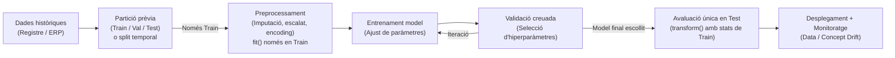
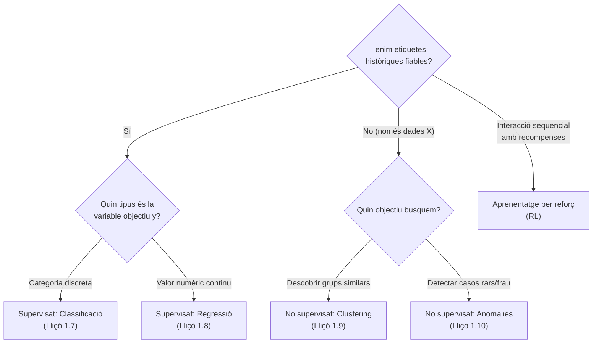

## A. Objectius d'aprenentatge

En completar aquesta lliçó, l'estudiant ha de ser capaç de:

1. **Definir** formalment l'aprenentatge automàtic (*Machine Learning*, ML) segons el marc de Tom Mitchell (*Tasca T, Experiència E, Mesura de rendiment P*) i explicar en què es diferencia de la programació basada en regles explícites.
2. **Distingir i comparar** els tres grans paradigmes d'aprenentatge —**supervisat**, **no supervisat** i **per reforç**— així com les variants intermèdies (semisupervisat i autosupervisat).
3. **Descriure** el cicle complet d'un pipeline de ML: formulació, preparació de dades, *feature engineering*, partició *train/validation/test*, entrenament, avaluació i desplegament.
4. **Identificar** les causes i símptomes del **sobreajustament (*overfitting*)**, l'**infraajustament (*underfitting*)** i la **fuga de dades (*data leakage*)** i aplicar estratègies per garantir la **generalització**.
5. **Implementar** un flux bàsic d'aprenentatge supervisat en Python (amb `numpy`) des de zero per comprendre què significa matemàticament «entrenar un model» i avaluar-lo fora de mostra.

---

## B. Explicació introductòria

Imagina que vols estimar quants dies trigarà un ajuntament a resoldre una llicència d'obres segons el tipus d'obra, els metres quadrats, si requereix informe patrimonial i el volum de cua actual.

Si ho fessis a mà, hauries d'inventar una fórmula arbitrària (*«20 dies base + 0,1 dies per m² + 30 si hi ha patrimoni»*) que probablement s'equivocaria molt quan la realitat canvia. En **Machine Learning**, en lloc d'escriure aquesta fórmula manualment, **ensenyem a l'ordinador milers d'expedients històrics** (dades d'entrada + temps real que van trigar) i deixem que un algoritme d'optimització ajusti automàticament els pesos matemàtics que minimitzen l'error de predicció.

Una altra manera d'entendre els tres grans tipus de Machine Learning és pensar com aprèn una persona nova en un arxiu municipal:

- **Aprenentatge supervisat (*Supervised Learning*)**: un supervisor li dóna 1.000 expedients ja classificats amb la carpeta correcta (etiquetes). Aprèn a imitar el criteri del supervisor per classificar expedients nous.
- **Aprenentatge no supervisat (*Unsupervised Learning*)**: li donen 1.000 expedients **sense cap etiqueta** i li demanen que els agrupi per semblança o que detecti quins semblen rars/anòmals.
- **Aprenentatge per reforç (*Reinforcement Learning*, RL)**: ningú li dóna les respostes correctes per endavant, però cada acció que pren sobre un entorn (p. ex., regular semàfors en temps real) rep una recompensa o penalització (menys o més embús), i aprèn per assaig i error una estratègia òptima.

---

## C. Explicació tècnica avançada

### 1. Definició formal (Tom Mitchell, 1997)

Es diu que un programa informàtic aprèn a partir d'una **experiència \(E\)** respecte d'una classe de **tasques \(T\)** i una **mesura de rendiment \(P\)**, si el seu rendiment en les tasques \(T\), mesurat per \(P\), millora amb l'experiència \(E\).

- Exemple administratiu:
  - \(T\): estimar si una sol·licitud de subvenció presenta documentació incompleta abans d'entrar a avaluació tècnica.
  - \(E\): històric de 15.000 expedients revisats pels tècnics amb resultat «complet» o «requereix esmena».
  - \(P\): F1-score i *Recall* sobre expedients que necessiten esmena.

Matemàticament, en aprenentatge supervisat busquem una funció \(\hat{f}_\theta: \mathcal{X} \rightarrow \mathcal{Y}\) dins d'una família d'hipòtesis \(\mathcal{H}\) parametritzada per \(\theta\), tal que minimitzi el **risc esperat** sobre la distribució real desconeguda \(P(X, Y)\):

\[
R(f) = \mathbb{E}_{(x, y) \sim P}[\mathcal{L}(f(x), y)]
\]

Com que no coneixem \(P(X, Y)\), minimitzem el **risc empíric** sobre un conjunt finit d'entrenament \(\mathcal{D}_{\text{train}} = \{(x_i, y_i)\}_{i=1}^N\) afegint sovint un terme de **regularització** \(\lambda \Omega(\theta)\) per controlar la complexitat del model i evitar el sobreajustament:

\[
\hat{\theta} = \arg\min_{\theta} \left( \frac{1}{N} \sum_{i=1}^{N} \mathcal{L}(f_\theta(x_i), y_i) + \lambda \Omega(\theta) \right)
\]

### 2. Paradigmes d'aprenentatge automàtic

| Paradigma | Dades d'entrada | Senyal d'aprenentatge | Tasques principals | Algoritmes representatius |
|---|---|---|---|---|
| **Supervisat** | Parells \((x_i, y_i)\) etiquetats | Error respecte a l'etiqueta \(y_i\) | Classificació, Regressió | Regressió logística/lineal, Arbres, Random Forest, XGBoost, SVM, MLP |
| **No supervisat** | Només \(x_i\) (sense etiquetes) | Estructura interna, distàncies, densitat | Clustering, reducció de dimensionalitat, detecció d'anomalies | K-Means, DBSCAN, PCA, UMAP, Isolation Forest, Autoencoders |
| **Per reforç (RL)** | Estats \(s_t\), accions \(a_t\) | Recompensa escalar \(r_t\) retardada | Control seqüencial, assignació dinàmica, alineament (RLHF) | Q-Learning, DQN, PPO, Actor-Critic |
| **Semisupervisat** | Pocs \((x_i, y_i)\) + molts \(x_j\) sense etiqueta | Pseudoetiquetes i consistència | Classificació quan etiquetar és car | Self-training, Label Propagation |
| **Autosupervisat (SSL)** | Grans corpus no etiquetats | Etiquetes derivades de les pròpies dades (predir següent token o paraula emmascarada) | Preentrenament de LLM i encoders | BERT (MLM), GPT/Llama (CLM) |

### 3. Conceptes estructurals del procés de ML

- **Característiques (*features*) i vector d'entrada \(x\)**: variables numèriques o categòriques codificades (p. ex., *one-hot encoding*, escalat estàndard) que descriuen cada observació. L'enginyeria de característiques (*feature engineering*) és sovint el factor més determinant en ML tabular.
- **Paràmetres vs. Hiperparàmetres**:
  - **Paràmetres (\(\theta\))**: s'aprenen automàticament durant l'entrenament (p. ex., els pesos \(w, b\) d'una regressió lineal o els punts de tall d'un arbre).
  - **Hiperparàmetres**: es fixen abans d'entrenar (p. ex., profunditat màxima d'un arbre, taxa d'aprenentatge \(\eta\), coeficient de regularització \(\lambda\)) i s'optimitzen mitjançant validació.
- **Partició de dades (*Train / Validation / Test*)**:
  - **Entrenament (*Train*, ~60–70%)**: ajusta els paràmetres \(\theta\).
  - **Validació (*Validation*, ~15–20% o *k-fold cross-validation*)**: selecciona algoritmes i hiperparàmetres.
  - **Prova (*Test*, ~15–20%)**: es reserva intacte fins al final per estimar imparcialment la **generalització** en dades no vistes.
- **Generalització, sobreajustament i infraajustament** (desenvolupament complet a la Lliçó 1.11):
  - **Infraajustament (*underfitting*)**: model massa simple → error alt tant en *train* com en *validation* (alt biaix).
  - **Sobreajustament (*overfitting*)**: model massa complex que memoritza soroll → error molt baix en *train* però alt en *validation* (alta variància).
  - **Generalització**: capacitat de mantenir un rendiment bo en dades futures no vistes.

:::callout-warning Error crític d'examen i de producció: Data Leakage (fuga de dades)
La **fuga de dades** ocorre quan informació del conjunt de validació/test o informació futura (no disponible en el moment real de la predicció) es filtra en l'entrenament. Exemples clàssics:
1. Calcular la mitjana i desviació estàndard per normalitzar **abans** de separar *train* i *test*.
2. Incloure com a *feature* un camp omplert *després* de la resolució de l'expedient (p. ex., «data d'arxiu») per predir si l'expedient s'aprovarà.
3. Fer partició aleatòria en sèries temporals en lloc de partició cronològica (*time-based split*).

El resultat és una mètrica artificialment excel·lent al laboratori seguida d'un fracàs complet en producció.
:::

### 4. Avantatges, inconvenients, alternatives i selecció d'algoritmes

- **Avantatges del ML clàssic**: excel·lent relació rendiment/cost en dades tabulars, entrenament ràpid en CPU, menor requeriment de dades que el Deep Learning, més facilitat d'explicació (coeficients, importància de variables, SHAP).
- **Inconvenients**: rendiment inferior en dades no estructurades complexes (imatge, àudio, text semàntic profund) si no s'extreuen prèviament *embeddings*; sensibilitat a dades brutes, valors faltants i *data drift*.
- **Principi *No Free Lunch*** (Wolpert): no existeix un únic algoritme de ML universalment millor per a tots els problemes. Sempre cal començar per un **baseline simple** (p. ex., regressió lineal/logística o arbre poc profund) i escalar complexitat només si la validació demostra una millora real.

---

## D. Diagrames i recursos visuals

### Cicle de vida complet d'un pipeline de Machine Learning sense *data leakage*



### Arbre de decisió per escollir paradigma de ML



---

## E. Aplicació a l'Administració pública

### Casos d'ús reals per paradigma

1. **Supervisat — Classificació**: predicció de la probabilitat que una sol·licitud de subvenció requereixi requeriment d'esmena documental per activar avisos preventius al ciutadà.
2. **Supervisat — Regressió**: previsió de la demanda d'afluència en oficines d'atenció ciutadana (OAC) o del consum energètic d'edificis provincials per dimensionar recursos.
3. **No supervisat — Clustering**: segmentació dels 311 municipis de la província de Barcelona segons perfil socioeconòmic i digitalització per dissenyar plans d'assistència tècnica diferenciats.
4. **No supervisat — Detecció d'anomalies**: identificació de factures o moviments comptables atípics per prioritzar la revisió d'intervenció i control intern.
5. **Aprenentatge per reforç**: aplicació molt més acotada en l'àmbit administratiu (p. ex., optimització dinàmica de xarxes semafòriques o gestió intel·ligent de climatització en equipaments), ja que aprendre per assaig i error directament sobre drets ciutadans és inacceptable.

### Riscos i governança específica

- **Biaix històric**: si les dades històriques reflecteixen desigualtats territorials o socioeconòmiques, un model supervisat les reproduirà i amplificarà.
- **Qualitat i silos de dades**: abans d'aplicar ML, sovint cal normalitzar catàlegs i codificacions entre municipis.
- **Supervisió humana**: totes les sortides del model han de presentar-se com a **indicadors de suport** (p. ex., nivell de risc o prioritat suggerida) amb explicació dels factors que hi han influït, mai com a resolucions automàtiques no motivades.

---

## F. Exemple pràctic guiat

Implementem en **Python + NumPy** un pipeline complet d'aprenentatge supervisat **des de zero** (regressió lineal mitjançant descens del gradient) per predir el **temps de tramitació (en dies)** d'expedients ficticis de llicències municipals, demostrant explícitament:
1. La separació correcta entre `train` i `test`.
2. L'ajust de l'escalador (`mitjana` i `desviació`) **exclusivament sobre `train`** (evitant *data leakage*).
3. La minimització de la funció de pèrdua (MSE) iteració a iteració.
4. L'avaluació final sobre `test` amb MAE (Error Absolut Mitjà).

```python
"""Exemple 1.2: Pipeline supervisat amb NumPy (descens del gradient sense data leakage)."""
import numpy as np


def generar_dades_expedients(n: int = 200, seed: int = 42) -> tuple[np.ndarray, np.ndarray]:
    rng = np.random.default_rng(seed)
    # Features: [superficie_m2, num_documents, te_informe_patrimoni (0/1), cua_actual]
    superficie = rng.uniform(30, 500, size=n)
    num_docs = rng.integers(3, 18, size=n)
    patrimoni = rng.binomial(1, 0.25, size=n)
    cua = rng.integers(5, 80, size=n)

    X = np.column_stack([superficie, num_docs, patrimoni, cua])
    # Relació real sintètica + soroll aleatori realista
    soroll = rng.normal(0, 3.5, size=n)
    y_dies = 10.0 + 0.04 * superficie + 1.1 * num_docs + 18.0 * patrimoni + 0.35 * cua + soroll
    return X, y_dies


def entrenar_regressio_lineal(
    X_train_std: np.ndarray, y_train: np.ndarray, lr: float = 0.05, epochs: int = 400
) -> tuple[np.ndarray, float]:
    n_samples, n_features = X_train_std.shape
    w = np.zeros(n_features)
    b = 0.0

    for _ in range(epochs):
        y_pred = X_train_std @ w + b
        error = y_pred - y_train
        grad_w = (2.0 / n_samples) * (X_train_std.T @ error)
        grad_b = (2.0 / n_samples) * np.sum(error)
        w -= lr * grad_w
        b -= lr * grad_b

    return w, b


if __name__ == "__main__":
    X, y = generar_dades_expedients(n=200, seed=42)

    # 1) Partició train (80%) / test (20%) ABANS de qualsevol preprocessament
    split = int(0.8 * len(X))
    X_train, X_test = X[:split], X[split:]
    y_train, y_test = y[:split], y[split:]

    # 2) Escalat fit() NOMÉS sobre X_train (evita data leakage)
    mu = X_train.mean(axis=0)
    sigma = X_train.std(axis=0)
    X_train_std = (X_train - mu) / sigma
    X_test_std = (X_test - mu) / sigma

    # 3) Entrenament (aprenentatge dels paràmetres w i b)
    w, b = entrenar_regressio_lineal(X_train_std, y_train, lr=0.05, epochs=400)

    # 4) Avaluació en train vs test per comprovar generalització
    mae_train = np.mean(np.abs((X_train_std @ w + b) - y_train))
    mae_test = np.mean(np.abs((X_test_std @ w + b) - y_test))

    print(f"Pesos apresos (sobre features estandarditzades): {np.round(w, 2)}")
    print(f"Terme independent (bias b): {b:.2f} dies")
    print(f"MAE Train: {mae_train:.2f} dies | MAE Test: {mae_test:.2f} dies")
```

### Interpretació dels resultats (execució verificada)

- Els pesos apresos en espai estandarditzat (`[5.46, 5.25, 7.85, 7.09]`) i el terme independent (`b = 51.44` dies) mostren la importància relativa de cada variable: l'informe patrimonial (`7,85`), la cua actual (`7,09`), la superfície (`5,46`) i el nombre de documents (`5,25`) determinen l'increment de dies.
- El `MAE Train` (`2,83` dies) i el `MAE Test` (`3,48` dies) són propers entre si i coherents amb el soroll intrínsec irreducible de les dades (`σ = 3,5` → MAE teòric mínim ≈ `3,5 × √(2/π) ≈ 2,79` dies). La petita diferència en un test de 40 expedients confirma una bona generalització sense sobreajustament greu.
- Si haguéssim calculat `mu` i `sigma` amb tot `X` abans del `split`, hauríem introduït *data leakage* (contaminació estadística del conjunt de prova).

---

## G. Exercici pràctic per resoldre

### Enunciat
Un equip tècnic d'un ens supramunicipal ha desenvolupat un model de Machine Learning per predir quins ajuntaments sol·licitaran una pròrroga en la justificació de subvencions anuals. L'informe intern afirma amb entusiasme: *«Hem aconseguit un 98,5% d'accuracy al conjunt de test!»*. Quan el model es posa en producció la convocatòria següent, però, la seva exactitud real cau al 54%.

Has de fer una **auditoria metodològica** del fragment de codi i de les decisions preses per l'equip, identificar **tots els errors de ML**, explicar per què cadascun infla artificialment el 98,5% i proposar el redisseny complet del pipeline.

### Context professional
Aquest tipus de diagnòstic és una de les proves pràctiques més habituals en oposicions i processos de selecció d'enginyeria de ML: detectar errors silenciosos de metodologia (*data leakage*, mala partició, desequilibri de classes o males mètriques) abans que un model defectuós arribi a producció.

### Objectius
- Detectar fuites de dades temporals, de preprocessament i de variables post-esdeveniment (*target leakage*).
- Proposar una estratègia de partició, selecció de característiques i mètriques robusta.

### Dades d'entrada (descripció del pipeline defectuós)
L'equip va fer exactament això sobre 4.000 expedients dels anys 2021–2025:
1. Va utilitzar les variables: `import_subvencio`, `poblacio_municipi`, `area_tematica`, `data_resolucio_prorroga_aprovada` (buida si no va demanar pròrroga), `num_expedients_oberts_any`.
2. Va imputar valors nuls amb la mitjana global de les 4.000 files i va aplicar estandardització sobre tota la taula.
3. Va fer un `train_test_split` aleatori 80/20 barrejant expedients de 2021 a 2025.
4. Va provar 40 combinacions d'hiperparàmetres sobre el mateix conjunt de `test` fins quedar-se amb la que maximitzava l'`accuracy`.
5. Només el 8% dels expedients demanen pròrroga realment.

### Requisits funcionals i resultat esperat
Redacta un diagnòstic tècnic estructurat amb:
- Llista numerada dels **5 errors metodològics** presents al pipeline.
- Explicació de l'impacte de cada error en la caiguda de 98,5% → 54%.
- Disseny del **pipeline corregit** (esquema + pseudocodi o Python).

### Restriccions
- El model en producció només pot utilitzar informació disponible **en el moment de la concessió** de la subvenció (3 mesos abans del termini de justificació).

:::hint Pista 1 — Revisa les variables d'entrada una per una
Hi ha una columna que només existeix **després** que l'ajuntament hagi demanat la pròrroga. Si la deixes al dataset, el model no aprèn a predir: simplement «llegeix la resposta».
:::

:::hint Pista 2 — Compta quants errors hi ha fora de les variables
Fixa't en: (1) ordre del preprocessament, (2) naturalesa temporal de les convocatòries anuals, (3) ús del conjunt de `test` per ajustar hiperparàmetres i (4) proporció de classes (92% vs. 8%) respecte a la mètrica escollida (`accuracy`).
:::

### Criteris d'avaluació
- **40%**: Identificació exacta dels 5 errors (target leakage, preprocessing leakage, split aleatori en dades temporals, sobreajustament al conjunt de test i mètrica inadequada per classes desequilibrades).
- **35%**: Proposta de pipeline corregit reproduïble (ús de `Pipeline`, split temporal, validació creuada temporal i mètriques PR-AUC / F1 / Recall).
- **25%**: Claredat argumental i consideracions d'ús en Administració pública.

### Errors habituals
- Detectar només el *target leakage* i passar per alt el *test-set overfitting* (ajustar hiperparàmetres mirant el test).
- Recomanar *oversampling* (SMOTE) aplicat abans de fer la partició *train/validation* (cosa que genera un nou *data leakage*).

:::solution Solució completa comentada i alternatives
### Diagnòstic dels 5 errors metodològics

1. ***Target leakage* (variable futura)**: `data_resolucio_prorroga_aprovada` només té valor quan ja s'ha demanat i resolt una pròrroga. En producció (3 mesos abans del venciment), aquesta dada NO existeix. Durant el laboratori, el model simplement aprenia «si la data no és nul·la → pròrroga = Sí», explicant el 98,5% artificial.
2. ***Preprocessing leakage***: imputar nuls i estandarditzar sobre les 4.000 files abans del `split` filtra estadístics del conjunt de prova dins l'entrenament.
3. **Partició aleatòria en dades temporals**: barrejar convocatòries de 2021–2025 permet que el model s'entreni amb expedients de 2025 (que comparteixen context normatiu o pressupostari) per predir expedients del mateix any o anteriors. Cal una **partició cronològica** (p. ex., *train* 2021–2023, *validation* 2024, *test* 2025).
4. **Sobreajustament al conjunt de *test* (*test-set contamination*)**: seleccionar entre 40 combinacions d'hiperparàmetres mirant el conjunt de `test` converteix el `test` en un conjunt de validació i invalida l'estimació de generalització. Cal fer *cross-validation* o un conjunt de *validation* separat, tocant el `test` una sola vegada al final.
5. **Mètrica enganyosa davant desequilibri de classes (92% / 8%)**: un classificador trivial que sempre predigui «No pròrroga» ja obté un 92% d'`accuracy` sense detectar cap pròrroga real. Cal avaluar amb **Precision, Recall, F1-score de la classe positiva i PR-AUC**.

### Pipeline corregit (pseudocodi Python / scikit-learn)

```python
# 1. Eliminar qualsevol variable post-concessió (data_resolucio_prorroga_aprovada)
features_valides = ["import_subvencio", "poblacio_municipi", "area_tematica", "num_expedients_oberts_any"]

# 2. Partició estrictament cronològica
train_df = df[df["any"] <= 2023]
val_df   = df[df["any"] == 2024]
test_df  = df[df["any"] == 2025]

# 3. Encapsular preprocessament + model dins un Pipeline
#    (així fit() només s'executa sobre cada partició d'entrenament)
# pipeline = Pipeline([
#     ("prep", ColumnTransformer(...)),
#     ("clf", RandomForestClassifier(class_weight="balanced", random_state=42))
# ])

# 4. Ajust d'hiperparàmetres sobre val_df (o TimeSeriesSplit sobre train+val) optimitzant PR-AUC / F1
# 5. Avaluació final ÚNICA sobre test_df (2025) informant Precision, Recall, F1 i matriu de confusió
```

### Alternatives justificades
- Si el volum històric per any és molt reduït, utilitzar **validació creuada temporal expansiva (*TimeSeriesSplit*)**: entrenar amb 2021→validar 2022; entrenar 2021–2022→validar 2023; entrenar 2021–2023→validar 2024; i reservar 2025 com a *hold-out test* intocable.
- En comptes d'una classificació binària rígida, retornar la **probabilitat calibrada** de pròrroga i ordenar els expedients per risc perquè els tècnics facin seguiment preventiu als 10–15% amb risc més alt.
:::

---

## H. Test individual

Completa el test següent de 10 preguntes sobre els fonaments del Machine Learning, els seus paradigmes, la generalització i la prevenció del *data leakage*.

---

## I. Preguntes de desenvolupament

### Pregunta 1
Explica la diferència entre **paràmetres** i **hiperparàmetres** d'un model de Machine Learning, posa dos exemples de cadascun i detalla quin conjunt de dades s'ha d'utilitzar per ajustar-los sense contaminar l'avaluació final.

:::model-answer Resposta model i criteris de correcció (Pregunta 1)
**Resposta model**:
- Els **paràmetres** (\(\theta\)) són els valors interns que el model aprèn automàticament de les dades durant l'entrenament minimitzant una funció de pèrdua (exemples: els pesos \(w\) i el biaix \(b\) d'una regressió lineal/logística, o els pesos sinàptics d'una xarxa neuronal). S'ajusten exclusivament sobre el conjunt d'**entrenament (*train*)**.
- Els **hiperparàmetres** són decisions de configuració externes fixades abans d'iniciar l'entrenament que governen la complexitat o el procés d'optimització (exemples: la taxa d'aprenentatge \(\eta\), la profunditat màxima d'un arbre de decisió, el nombre de clústers \(K\) o el coeficient de regularització \(\lambda\)). S'ajusten sobre un conjunt de **validació** separat o mitjançant **validació creuada (*k-fold cross-validation*)** dins del conjunt d'entrenament.
- El conjunt de **prova (*test*)** s'ha de mantenir completament aïllat fins a haver fixat el model i els hiperparàmetres definitius, per obtenir una estimació no esbiaixada de la generalització real.

**Criteris de correcció (10 punts)**:
- Definició precisa de paràmetres i hiperparàmetres: 4 punts.
- Dos exemples rigorosos per a cada categoria: 2 punts.
- Assignació correcta dels conjunts *train*, *validation* i *test* i justificació del per què: 4 punts.
:::

### Pregunta 2
Per què l'aprenentatge per reforç (*Reinforcement Learning*) té una aplicació molt més restringida a l'Administració pública en comparació amb l'aprenentatge supervisat i no supervisat? En quins contextos públics sí que tindria sentit?

:::model-answer Resposta model i criteris de correcció (Pregunta 2)
**Resposta model**:
- L'aprenentatge per reforç aprèn una política mitjançant **exploració i assaig-error** en un entorn dinàmic maximitzant una funció de recompensa. En procediments administratius que afecten drets de la ciutadania (ajuts, sancions, tributs, contractació), «explorar accions aleatòries» per veure quines funcionen vulneraria els principis de legalitat, igualtat i seguretat jurídica. A més, definir una funció de recompensa escalar que capturi l'interès general sense efectes perversos (*reward hacking*) és extremadament difícil.
- En canvi, sí que pot tenir sentit en **entorns físics o operatius simulables** de baix risc jurídic individual: optimització dinàmica de xarxes semafòriques, regulació de climatització/il·luminació en edificis públics per eficiència energètica o gestió de rutes de recollida de residus, sempre entrenat prèviament en simuladors i amb límits de seguretat deterministes.

**Criteris de correcció (10 punts)**:
- Explicació del mecanisme d'exploració/recompensa de l'RL: 3 punts.
- Arguments jurídics, ètics i tècnics que limiten el seu ús directe sobre ciutadans: 4 punts.
- Exemples realistes on sí que aporta valor (amb simulació i límits de seguretat): 3 punts.
:::

### Pregunta 3
Què és el *data leakage* (fuga de dades)? Descriu dues formes diferents com pot ocórrer en un projecte de Machine Learning d'una diputació i explica com prevenir-les arquitectònicament.

:::model-answer Resposta model i criteris de correcció (Pregunta 3)
**Resposta model**:
- El *data leakage* és la filtració d'informació del conjunt de prova o del futur dins del procés d'entrenament, cosa que produeix mètriques artificialment optimistes durant el desenvolupament però un rendiment pobre en producció.
- **Tipus 1 — *Target leakage* (variables post-esdeveniment)**: incloure columnes que només es coneixen després del moment en què s'hauria de fer la predicció (p. ex., utilitzar «import final liquidat» per predir en el registre d'entrada si una subvenció serà aprovada). Prevenció: auditar el moment temporal en què es genera cada variable (*point-in-time correctness*).
- **Tipus 2 — *Preprocessing / Split leakage***: aplicar imputació, escalat, selecció de característiques o SMOTE sobre tot el dataset abans de dividir *train/test*, o fer splits aleatoris quan hi ha dependència temporal o d'entitat (p. ex., múltiples expedients del mateix sol·licitant a *train* i *test*). Prevenció: encapsular totes les transformacions dins d'un objecte `Pipeline` (ajustat només en *train*) i utilitzar particions temporals (`TimeSeriesSplit`) o agrupades (`GroupKFold`).

**Criteris de correcció (10 punts)**:
- Definició clara i conseqüència en producció: 3 punts.
- Dos tipus diferenciats amb exemples administratius concrets: 4 punts.
- Mesures tècniques de prevenció (`Pipeline`, *point-in-time*, particions temporals/agrupades): 3 punts.
:::

---

## J. Resum per memoritzar

### Conceptes clau
- **Definició de ML (Mitchell)**: millorar el rendiment \(P\) en una tasca \(T\) mitjançant experiència \(E\).
- **Tres paradigmes clàssics**: supervisat (amb etiquetes), no supervisat (sense etiquetes) i per reforç (accions + recompenses). **Autosupervisat**: base del preentrenament dels LLM.
- **Partició sagrada**: `Train` (paràmetres) / `Validation` (hiperparàmetres i selecció) / `Test` (avaluació final única).
- **Regularització**: penalitza la complexitat del model per evitar *overfitting* i millorar la generalització.
- **No Free Lunch**: començar sempre per un *baseline* senzill i validar empíricament cada increment de complexitat.

### Definicions essencials
- **Risc empíric**: error mitjà del model sobre les dades d'entrenament observades.
- **Generalització**: capacitat del model de mantenir baix error sobre dades noves procedents de la distribució real.
- **Data leakage**: contaminació de l'entrenament amb informació del conjunt de prova o del futur.

### Errors conceptuals freqüents
1. Fer normalització o selecció de variables abans de separar *train* i *test*.
2. Confondre paràmetres (apresos en *train*) amb hiperparàmetres (seleccionats en *validation*).
3. Avaluar un problema molt desequilibrat exclusivament amb *accuracy*.
4. Usar partició aleatòria en dades amb dependència temporal.

### Possibles preguntes d'examen
- Diferencia els cinc paradigmes d'aprenentatge (supervisat, no supervisat, reforç, semisupervisat, autosupervisat) amb un exemple cadascun.
- Detecta el *data leakage* en un fragment de codi de preprocessament.
- Explica la diferència entre minimitzar el risc empíric i maximitzar la generalització.
