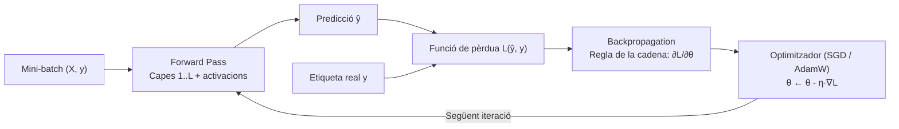
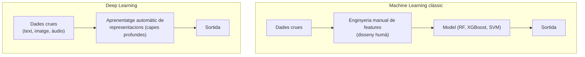

## A. Objectius d'aprenentatge

En completar aquesta lliçó, l'estudiant ha de ser capaç de:

1. **Explicar** què defineix l'aprenentatge profund (*Deep Learning*, DL) i en què es diferencia del *Machine Learning* clàssic respecte a l'**aprenentatge automàtic de representacions** (*representation learning*).
2. **Descriure** el mecanisme intern d'entrenament: propagació endavant (*forward pass*), càlcul de la **funció de pèrdua** (*loss function*), **retropropagació** (*backpropagation* mitjançant la regla de la cadena) i actualització amb **descens del gradient** (*SGD, Adam/AdamW*).
3. **Identificar** els principals reptes de profunditat (desaparició i explosió del gradient, costos computacionals, necessitat de dades) i les tècniques que els han resolt (ReLU, connexions residuals, normalització, *transfer learning*).
4. **Decidir** amb criteri enginyeril quan el Deep Learning supera el ML clàssic (dades no estructurades) i quan el ML clàssic continua sent preferible (dades tabulars estructurades de mida moderada).
5. **Implementar** un bucle d'entrenament complet amb propagació endavant, funció de pèrdua i retropropagació en NumPy per entendre la mecànica interna sense dependre de caixes negres.

---

## B. Explicació introductòria

En el *Machine Learning* clàssic, l'humà ha de fer la feina difícil de **dissenyar manualment les característiques** (*feature engineering*). Si volguessis detectar automàticament si una fotografia enviada per un ciutadà mostra un contenidor desbordat, amb ML clàssic hauries de programar detectors de colors, vores i textures a mà i passar aquests números a un classificador. Això funciona malament perquè la llum, l'angle i el fons canvien constantment.

El **Deep Learning** resol aquest límit apilant múltiples capes de transformacions matemàtiques no lineals (**xarxes neuronals profundes**). Cada capa aprèn automàticament un nivell d'abstracció superior a partir de l'anterior:
- Les **primeres capes** detecten patrons simples (vores, canvis de contrast en una imatge; o combinacions locals de subparaules en un text).
- Les **capes intermèdies** combinen aquests patrons en parts recognoscibles (tapes, bosses, estructures sintàctiques).
- Les **capes profundes** capturen conceptes semàntics d'alt nivell («contenidor desbordat», «sol·licitud de fraccionament tributari»).

Aquesta capacitat d'aprendre **representacions jeràrquiques directament de dades crues** (*end-to-end learning*) és el que ha permès els salts recents en visió per computador, reconeixement de veu, processament del llenguatge natural i models generatius.

---

## C. Explicació tècnica avançada

### 1. Definició formal i arquitectures canòniques

El **Deep Learning** és un subconjunt del *Machine Learning* basat en composicions profundes de funcions diferenciables parametritzades:

\[
\hat{y} = f_L(f_{L-1}(\dots f_2(f_1(x; \theta_1); \theta_2) \dots ; \theta_{L-1}); \theta_L)
\]

on cada capa \(l \in \{1, \dots, L\}\) aplica una transformació lineal o estructurada (densa, convolucional o d'atenció) seguida d'una **funció d'activació no lineal** \(\sigma\) (p. ex., ReLU, GELU). Sense no-linealitats, apilar \(L\) capes lineals col·lapsaria matemàticament en una única transformació lineal equivalent a una sola capa.

Principals famílies arquitectòniques (ampliades a la Lliçó 1.4 i al Mòdul 3):
- **MLP (*Multi-Layer Perceptron*)**: capes totalment connectades per a vectors tabulars o projeccions finals.
- **CNN (*Convolutional Neural Networks*)**: filtres espacials amb pesos compartits; referència en visió, imatges escanejades i detecció d'objectes.
- **RNN / LSTM / GRU**: xarxes recurrents per a seqüències temporals (històricament clau en NLP, avui majoritàriament substituïdes per Transformers en llenguatge).
- **Transformers**: basats en *self-attention* (paral·lelitzables en GPU); base dels LLM, encoders moderns (BERT/RoBERTa) i models multimodals (Vision Transformers).

### 2. Mecànica interna de l'entrenament

L'entrenament d'un model de Deep Learning repeteix quatre passos sobre lots de dades (*mini-batches*):

1. ***Forward pass* (propagació endavant)**: es calcula la predicció \(\hat{y}\) passant el *mini-batch* \(X\) capa per capa fins a la sortida.
2. **Funció de pèrdua (*Loss Function*, \(\mathcal{L}\))**: mesura l'error escalar diferenciable entre \(\hat{y}\) i la veritat \(y\):
   - Regressió: **MSE** (\(\frac{1}{N}\sum (y_i - \hat{y}_i)^2\)) o **Huber Loss** (menys sensible a *outliers*).
   - Classificació binària: **Binary Cross-Entropy (BCE)**: \(-[y \log \hat{p} + (1-y)\log(1-\hat{p})]\).
   - Classificació multiclasse / LLM: **Categorical Cross-Entropy**: \(-\sum_c y_c \log \hat{p}_c\).
3. ***Backpropagation* (retropropagació)**: aplica la **regla de la cadena** del càlcul diferencial des de la sortida fins a la primera capa per obtenir el gradient exacte \(\nabla_{\theta_l}\mathcal{L}\) de cada paràmetre respecte a la pèrdua.
4. **Optimitzador (actualització de pesos)**:
   - **SGD (*Stochastic Gradient Descent*)** amb *momentum*: \(\theta \leftarrow \theta - \eta \nabla_\theta \mathcal{L}\).
   - **Adam / AdamW**: mantenen mitjanes mòbils del primer i segon moment del gradient per adaptar automàticament el pas per paràmetre; **AdamW** desacobla la regularització *weight decay* i és l'estàndard actual en Transformers.

### 3. Reptes de les xarxes profundes i solucions modernes

| Repte | Causa matemàtica | Solució estàndard |
|---|---|---|
| **Desaparició del gradient (*Vanishing gradient*)** | Multiplicar derivades < 1 (com sigmoide/tanh) al llarg de moltes capes fa tendir el gradient a 0 a les capes inicials | Activacions **ReLU / GELU**, inicialització **He / Xavier**, **connexions residuals (*skip connections*)** i **BatchNorm / LayerNorm** |
| **Explosió del gradient (*Exploding gradient*)** | Producte de derivades > 1 dispara els pesos cap a `NaN` | ***Gradient clipping***, normalització de capes i *learning rate warmup* |
| **Escassetat de dades etiquetades** | Entrenar milions de paràmetres des de zero provoca *overfitting* sever | ***Transfer learning* i *fine-tuning*** a partir de models preentrenats + *data augmentation* + *dropout* |
| **Cost computacional elevat** | Multiplicacions matricials massives en FP32 | Acceleradors **GPU/TPU**, precisió mixta (**FP16/BF16**), quantització (**INT8/INT4**) i destil·lació |

### 4. Deep Learning vs. Machine Learning clàssic: criteris de selecció

- **Escull Deep Learning (preferiblement amb *transfer learning*)** quan:
  - Les dades són **no estructurades** (text lliure, PDFs escanejats, fotos, àudio).
  - Hi ha prou volum de dades o un model preentrenat adequat (p. ex., RoBERTa en català del projecte AINA, models d'OCR neuronal).
  - La capacitat de maquinari i el pressupost operatiu cobreixen la inferència i el monitoratge.
- **Escull ML clàssic (Random Forest, Gradient Boosting, Regressió Logística)** quan:
  - Les dades són **tabulars estructurades** (columnes numèriques/categòriques de bases de dades municipals).
  - El volum és petit o mitjà (centenars a desenes de milers de registres).
  - Es requereix alta interpretabilitat, baix cost d'execució en CPU i desplegament simple.

### 5. Errors habituals

- Entrenar una xarxa profunda des de zero amb 500 registres tabulars quan un *Gradient Boosting* o una regressió regularitzada dona millor resultat i més explicabilitat.
- Fixar una taxa d'aprenentatge (*learning rate*) massa alta (la pèrdua divergeix) o massa baixa (l'entrenament queda encallat).
- Oblidar desactivar `dropout` i posar el model en mode avaluació (`model.eval()` en PyTorch) durant la inferència.

---

## D. Diagrames i recursos visuals

### Bucle d'entrenament en Deep Learning (*Forward*, *Loss*, *Backprop*, *Update*)



### Comparativa: ML clàssic vs. Deep Learning



---

## E. Aplicació a l'Administració pública

1. **Processament intel·ligent de documents (IDP/OCR neuronal)**: lectura de formularis manuscrits, segells i factures escanejades en baixa qualitat on l'OCR tradicional falla (Mòdul 4).
2. **Classificació i extracció semàntica en català i castellà**: models Transformer preentrenats adaptats al domini administratiu (p. ex., models del projecte **AINA** del Barcelona Supercomputing Center / Generalitat de Catalunya) per analitzar instàncies, decrets i actes.
3. **Visió per computador en espai públic i territori**: anàlisi d'ortofotos (detecció de cobertes amb fibrociment, canvis urbanístics no declarats) o classificació d'incidències de via pública a partir de fotografies ciutadanes.
4. **Transcripció automàtica de plens municipals**: models d'àudio profunds (com Whisper executat localment) per generar esborranys d'actes i millorar l'accessibilitat.

### Limitacions i supervisió humana

- **Opacitat (*black box*)**: una xarxa profunda no pot justificar per si sola un acte administratiu. Cal complementar-la amb tècniques d'explicabilitat (atribució, mapes de rellevància, cites documentals) i revisió tècnica humana.
- **Sostenibilitat i sobirania tecnològica**: el cost energètic i de GPU recomana prioritzar models compactes, quantitzats i desplegables *on-premise* o en infraestructura pública controlada quan es tractin dades personals.

---

## F. Exemple pràctic guiat

Implementem en **Python + NumPy** una petita xarxa neuronal de 2 capes (entrada → capa oculta amb activació `ReLU` → sortida sigmoide) amb **propagació endavant, funció de pèrdua *Binary Cross-Entropy* i retropropagació exacta** per classificar un problema **no lineal** (una frontera que un model lineal simple no pot separar: expedients prioritaris només quan coincideixen risc alt d'import i urgència de termini, o bé anomalies extremes).

```python
"""Exemple 1.3: Forward pass, Binary Cross-Entropy i Backpropagation en NumPy pur."""
import numpy as np


def sigmoid(z: np.ndarray) -> np.ndarray:
    return 1.0 / (1.0 + np.exp(-np.clip(z, -30, 30)))


def relu(z: np.ndarray) -> np.ndarray:
    return np.maximum(0.0, z)


def binary_cross_entropy(y_true: np.ndarray, y_prob: np.ndarray) -> float:
    eps = 1e-12
    p = np.clip(y_prob, eps, 1.0 - eps)
    return float(-np.mean(y_true * np.log(p) + (1.0 - y_true) * np.log(1.0 - p)))


if __name__ == "__main__":
    rng = np.random.default_rng(7)
    # Dataset sintètic no lineal (patró tipus XOR suavitzat): 200 expedients
    X = rng.uniform(-1.0, 1.0, size=(200, 2))
    # Prioritari (1) si les dues característiques tenen signes oposats (no linealment separable)
    y = ((X[:, 0] * X[:, 1]) < 0).astype(float).reshape(-1, 1)

    X_train, y_train = X[:160], y[:160]
    X_test, y_test = X[160:], y[160:]

    # Inicialització He per a capa oculta ReLU (2 -> 12 -> 1)
    W1 = rng.normal(0.0, np.sqrt(2.0 / 2), size=(2, 12))
    b1 = np.zeros((1, 12))
    W2 = rng.normal(0.0, np.sqrt(1.0 / 12), size=(12, 1))
    b2 = np.zeros((1, 1))

    lr = 0.2
    for epoch in range(1, 601):
        # 1. Forward pass
        Z1 = X_train @ W1 + b1
        A1 = relu(Z1)
        Z2 = A1 @ W2 + b2
        y_hat = sigmoid(Z2)

        # 2. Loss
        loss = binary_cross_entropy(y_train, y_hat)

        # 3. Backpropagation (regla de la cadena)
        n = len(X_train)
        dZ2 = (y_hat - y_train) / n               # derivada combinada BCE + Sigmoid
        dW2 = A1.T @ dZ2
        db2 = np.sum(dZ2, axis=0, keepdims=True)

        dA1 = dZ2 @ W2.T
        dZ1 = dA1 * (Z1 > 0).astype(float)        # derivada de ReLU
        dW1 = X_train.T @ dZ1
        db1 = np.sum(dZ1, axis=0, keepdims=True)

        # 4. Actualització de paràmetres (Gradient Descent)
        W2 -= lr * dW2
        b2 -= lr * db2
        W1 -= lr * dW1
        b1 -= lr * db1

        if epoch in (1, 150, 600):
            print(f"Època {epoch:3d} | BCE Loss: {loss:.4f}")

    # Avaluació en test
    test_probs = sigmoid(relu(X_test @ W1 + b1) @ W2 + b2)
    test_acc = float(np.mean((test_probs >= 0.5) == y_test))
    print(f"Accuracy en test (problema no lineal): {test_acc:.3f}")
```

### Interpretació dels resultats (execució verificada)

- Un classificador lineal sobre aquest patró obtindria ~50% d'exactitud (atzar), perquè no existeix cap recta capaç de separar quadrants oposats.
- Gràcies a la capa oculta amb activació **ReLU**, la xarxa aprèn una representació intermèdia que sí que fa el problema linealment separable a la capa de sortida: la pèrdua *Binary Cross-Entropy* baixa de `0.7466` (època 1) a `0.2024` (època 150) i `0.0782` (època 600), assolint una exactitud en test de `0.950` (95,0%).
- Observa com `dZ2 = (y_hat - y_train) / n` simplifica elegantment la derivada de *Binary Cross-Entropy* combinada amb la sigmoide, i `dZ1 = dA1 * (Z1 > 0)` bloqueja el gradient a les neurones ReLU inactives.

---

## G. Exercici pràctic per resoldre

### Enunciat
L'Àrea de Transformació Digital d'una diputació ha d'escollir l'arquitectura d'entrenament i desplegament per a **dos casos d'ús reals** amb un pressupost de maquinari limitat (un únic servidor local amb 1 GPU de 24 GB de VRAM i diversos servidors CPU):

- **Cas A**: Predir la probabilitat d'impagament en fraccionaments tributaris a partir d'una taula relacional de 18.000 registres i 24 columnes numèriques/categòriques.
- **Cas B**: Classificar 40.000 fotografies enviades per la ciutadania en 12 categories d'incidències urbanes (brossa, vorera trencada, fanal apagat, grafits, etc.), de les quals només 2.400 estan etiquetades.

### Context professional
Un proveïdor extern proposa «entrenar des de zero una xarxa neuronal profunda de 50 capes per als dos casos». Has d'emetre un informe tècnic de criteri propi que avaluï la proposta del proveïdor i defineixi la solució òptima per a A i B.

### Objectius
- Argumentar amb rigor tècnic quan aplicar ML tabular vs. Deep Learning.
- Dissenyar una estratègia de *transfer learning* per a escassetat d'etiquetes.
- Preveure el dimensionament computacional (CPU vs. GPU), la regularització i el control d'estabilitat de l'entrenament.

### Requisits funcionals i restriccions
- Els dos sistemes han d'operar *on-premise* (sense enviar dades personals a APIs externes).
- El Cas A exigeix explicar els factors principals que han motivat cada puntuació de risc al personal gestor.
- El Cas B només disposa de 200 imatges etiquetades per classe (2.400 en total).

### Resultat esperat
Un dictamen tècnic que inclogui:
1. Valoració crítica de la proposta del proveïdor.
2. Arquitectura recomanada per al Cas A i per al Cas B.
3. Estratègia específica d'entrenament per al Cas B (hiperparàmetres, *transfer learning*, *data augmentation*, funció de pèrdua i gestió de VRAM).

:::hint Pista 1 — Dades tabulars vs. imatges
En dades tabulars de 18.000 files amb requisit d'explicabilitat (Cas A), recorda com rendeixen els ensembles d'arbres (*Gradient Boosting* / *Random Forest* + SHAP) en comparació amb una xarxa de 50 capes entrenada des de zero.
:::

:::hint Pista 2 — 200 imatges per classe en visió per computador
Entrenar una xarxa profunda de 50 capes des de zero amb 2.400 imatges provocarà un sobreajustament extrem. Quina tècnica permet aprofitar representacions visuals ja apreses sobre milions d'imatges?
:::

### Criteris d'avaluació
- **30%**: Refutació tècnica sòlida de la proposta del proveïdor (cost, overfitting, explicabilitat).
- **30%**: Disseny adequat per al Cas A (ML tabular en CPU + explicabilitat SHAP + supervisió humana).
- **40%**: Disseny complet de *transfer learning* per al Cas B (backbone preentrenat congelat → *fine-tuning* progressiu, *data augmentation*, Cross-Entropy, precisió mixta FP16/BF16, *early stopping*).

### Errors habituals
- Acceptar una xarxa profunda per al Cas A simplement perquè «Deep Learning és més modern».
- Proposar entrenar el Cas B des de zero sense *transfer learning* ni *data augmentation*.
- Oblidar la política de supervisió humana i les garanties de privacitat (p. ex., difuminar matrícules i rostres en fotografies de via pública).

:::solution Solució completa comentada i alternatives
### 1. Valoració de la proposta del proveïdor
La proposta d'entrenar des de zero una xarxa de 50 capes per als dos casos és **tècnicament inadequada i econòmicament ineficient**:
- Al **Cas A** (tabular, 18.000 files), una xarxa profunda pateix més risc de sobreajustament, requereix més esforç d'ajust i ofereix pitjor interpretabilitat que els models tabulars clàssics.
- Al **Cas B** (2.400 imatges etiquetades), entrenar 50 capes des de zero (desenes de milions de paràmetres) farà memoritzar el conjunt d'entrenament i fracassar en producció.

### 2. Arquitectura recomanada per al Cas A (ML tabular en CPU)
- **Model**: *Gradient Boosted Decision Trees* (LightGBM / XGBoost / HistGradientBoosting) comparat contra un *baseline* de Regressió Logística regularitzada.
- **Explicabilitat**: valors **SHAP** (*TreeSHAP*) per mostrar al gestor els factors concrets del risc (mai decisió automàtica d'embargament o denegació sense revisió humana).
- **Infraestructura**: entrenament i inferència en CPU convencional, amb latència de mil·lisegons i baix consum.

### 3. Arquitectura i estratègia d'entrenament per al Cas B (Deep Learning amb *Transfer Learning*)
- **Backbone preentrenat**: utilitzar una xarxa visual preentrenada oberta (p. ex., `ConvNeXt-Tiny`, `ResNet-50` o `EfficientNet-B0/B2` preentrenada en ImageNet) que ja sap extreure vores, textures i objectes.
- **Fases d'entrenament**:
  1. Substituir la capa final per un cap lineal de 12 sortides + `Categorical Cross-Entropy` (amb pesos de classe si hi ha desequilibri).
  2. **Fase 1 (feature extraction)**: congelar el *backbone* i entrenar només el cap classificador (5–10 èpoques, `AdamW`, `lr = 1e-3`).
  3. **Fase 2 (*fine-tuning* parcial)**: descongelar les últimes capes i reentrenar amb `lr` molt baix (`1e-4` o `5e-5`), *cosine schedule* i *early stopping* sobre validació.
- **Mitigació d'overfitting**: *data augmentation* realista (retalls, lleugeres rotacions, canvis de brillantor/contrast que simulen dia/nit/pluja) i *dropout*.
- **Optimització de la GPU de 24 GB**: entrenament en precisió mixta (`BF16/FP16`) i *batch size* moderat (32–64); després exportar a `ONNX` quantitzat per a inferència ràpida.
- **Privacitat**: afegir un pas previ de detecció i difuminat automàtic de rostres i matrícules abans d'emmagatzemar les imatges.

### Alternativa per aprofitar les 37.600 imatges no etiquetades del Cas B
Aplicar **aprenentatge actiu (*active learning*)** o **pseudoetiquetatge (*semi-supervised learning*)**: utilitzar el model inicial per seleccionar les imatges amb més incertesa i prioritzar-ne l'etiquetatge humà, augmentant ràpidament el rendiment amb el mínim esforç manual.
:::

---

## H. Test individual

Resol les 10 preguntes següents per consolidar el funcionament intern del Deep Learning, la retropropagació, les funcions de pèrdua i els criteris d'elecció tecnològica.

---

## I. Preguntes de desenvolupament

### Pregunta 1
Explica amb precisió què és el problema de la **desaparició del gradient (*vanishing gradient*)** en xarxes neuronals profundes i detalla tres innovacions tècniques que han permès entrenar xarxes amb desenes o centenars de capes.

:::model-answer Resposta model i criteris de correcció (Pregunta 1)
**Resposta model**:
- Durant la *backpropagation*, el gradient respecte a les capes inicials s'obté multiplicant les derivades locals de totes les capes posteriors (regla de la cadena). Si aquestes derivades són sistemàticament menors que 1 (com passa amb les zones saturades de funcions d'activació `sigmoid` —derivada màxima 0,25— o `tanh`), el producte decau exponencialment cap a zero i les primeres capes deixen d'aprendre.
- **Tres innovacions clau**:
  1. **Funcions d'activació no saturants en positiu (ReLU, GELU)**: tenen derivada 1 per a valors positius, preservant la magnitud del gradient.
  2. **Connexions residuals (*skip connections*, ResNet/Transformers)**: sumen l'entrada directa a la sortida del bloc (\(y = F(x) + x\)), creant una «autopista» de derivada 1 per on flueix el gradient sense atenuar-se.
  3. **Normalització interna (BatchNorm / LayerNorm / RMSNorm) i inicialització adequada (He / Xavier)**: mantenen la variància d'activacions i gradients en rangs estables al llarg de les capes.

**Criteris de correcció (10 punts)**:
- Explicació matemàtica correcta de la regla de la cadena i la saturació: 4 punts.
- Tres solucions tècniques ben explicades (no només enumerades): 6 punts.
:::

### Pregunta 2
Per què sense funcions d'activació no lineals una xarxa neuronal de 10 capes no aporta més capacitat expressiva que un model lineal d'una sola capa?

:::model-answer Resposta model i criteris de correcció (Pregunta 2)
**Resposta model**:
- Si cada capa només aplica una transformació afí \(h_l = W_l h_{l-1} + b_l\) sense cap funció d'activació no lineal, la composició de totes les capes és simplement un producte de matrius i suma de vectors:
  \(y = W_L(\dots (W_1 x + b_1)\dots) + b_L = W_{\text{eq}} x + b_{\text{eq}}\).
- Per tant, independentment de tenir 10 o 1.000 capes, tota la xarxa col·lapsaria en una única funció lineal incapaç d'aprendre fronteres de decisió no lineals (com el problema XOR o relacions complexes en imatges i llenguatge). Les funcions no lineals (ReLU, GELU, etc.) permeten aproximar funcions arbitràriament complexes (teorema d'aproximació universal).

**Criteris de correcció (10 punts)**:
- Demostració algebraica o raonament clar del col·lapse de composicions lineals: 6 punts.
- Paper de la no-linealitat en la representació de fronteres complexes: 4 punts.
:::

### Pregunta 3
Compara els avantatges i els *trade-offs* d'utilitzar ***transfer learning*** davant d'entrenar un model de Deep Learning des de zero en el context d'una administració local o provincial.

:::model-answer Resposta model i criteris de correcció (Pregunta 3)
**Resposta model**:
- El ***transfer learning*** parteix d'un model ja preentrenat sobre grans corpus generals i n'adapta les capes finals (o aplica *fine-tuning* lleuger) a les dades concretes de l'administració.
- **Avantatges**: redueix dràsticament la quantitat de dades etiquetades necessàries (de milions a milers/centenars), estalvia ordre de magnitud en GPU, temps i energia, i millora la generalització evitant sobreajustament.
- ***Trade-offs* i riscos**: dependència del model base (cal verificar-ne la llicència oberta, els possibles biaixos heretats del preentrenament i el rendiment específic en català/terminologia administrativa) i possible desajust de domini (*domain shift*) si el domini públic és molt allunyat de les dades de preentrenament.

**Criteris de correcció (10 punts)**:
- Explicació correcta del mecanisme de *transfer learning*: 3 punts.
- Avantatges operatius i de dades per a una administració pública: 4 punts.
- Riscos i *trade-offs* (biaixos heretats, llicència, idioma català, *domain shift*): 3 punts.
:::

---

## J. Resum per memoritzar

### Conceptes clau
- **Deep Learning**: xarxes neuronals amb múltiples capes que aprenen **representacions jeràrquiques automàticament** (*end-to-end*), reduint la necessitat de *feature engineering* manual.
- **4 passos d'entrenament**: *Forward pass* → *Loss* → *Backpropagation* (regla de la cadena) → Optimitzador (*SGD/AdamW*).
- **No-linealitat indispensable**: sense activacions no lineals (ReLU, GELU), apilar capes col·lapsa en una funció lineal.
- **Solucions a la profunditat**: ReLU/GELU, connexions residuals (*skip connections*), LayerNorm/BatchNorm, *gradient clipping*, *transfer learning*.
- **Regla pràctica**: DL brilla en dades **no estructurades** (text, imatge, àudio); en dades **tabulars estructurades**, el ML clàssic (Gradient Boosting, Random Forest) sol ser competitiu o superior, més barat i més explicable.

### Definicions essencials
- **Backpropagation**: algoritme eficient basat en la regla de la cadena per calcular els gradients de la funció de pèrdua respecte de tots els pesos de la xarxa.
- **Funció de pèrdua (*Loss*)**: mesura escalar diferenciable que quantifica l'error del model i guia l'optimització (MSE, Binary Cross-Entropy, Categorical Cross-Entropy).
- **Transfer Learning**: reutilització del coneixement après per un model preentrenat com a punt de partida per a una nova tasca amb menys dades.

### Errors conceptuals freqüents
1. Pensar que més capes sempre signifiquen millor rendiment (sense connexions residuals, dades i regularització, pot empitjorar).
2. Confondre la funció de pèrdua (diferenciable, per entrenar) amb la mètrica de negoci (p. ex., F1-score o *accuracy*, que sovint no és diferenciable).
3. Entrenar des de zero en lloc d'aplicar *transfer learning* quan hi ha poques etiquetes.

### Possibles preguntes d'examen
- Explica el paper de cada fase del bucle d'entrenament d'una xarxa profunda.
- Quina funció de pèrdua correspon a regressió, classificació binària i classificació multiclasse?
- Com resolen les connexions residuals i ReLU el problema del *vanishing gradient*?
- Per què un model tabular de Gradient Boosting pot ser preferible al Deep Learning en un projecte d'una diputació?
