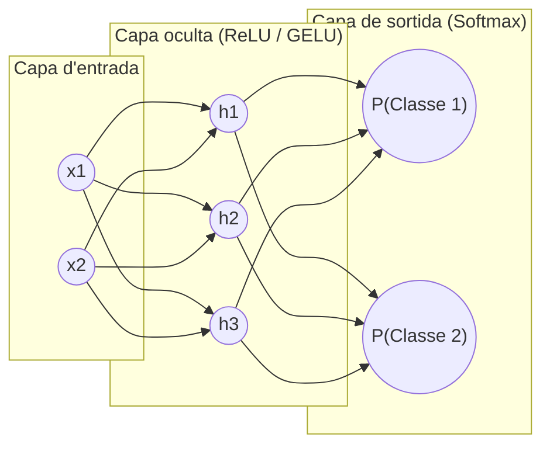
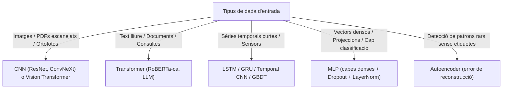

## A. Objectius d'aprenentatge

En completar aquesta lliçó, l'estudiant ha de ser capaç de:

1. **Explicar** l'estructura matemàtica d'una neurona artificial (perceptró), els seus pesos, el biaix (*bias*) i el paper de les funcions d'activació.
2. **Comparar** les principals funcions d'activació (`Sigmoid`, `Tanh`, `ReLU`, `Leaky ReLU`, `GELU`, `Softmax`) i identificar en quina capa (oculta vs. sortida) s'utilitza cadascuna.
3. **Diferenciar** les grans arquitectures de xarxes neuronals (**MLP**, **CNN**, **RNN/LSTM/GRU**, **Autoencoders** i **Transformers**) segons el tipus de dades i el biaix inductiu (*inductive bias*).
4. **Aplicar** tècniques de regularització específiques de xarxes neuronals (*Dropout*, *Batch/Layer Normalization*, *Weight Decay*, *Early Stopping*).
5. **Calcular** el nombre de paràmetres d'una arquitectura neuronal i interpretar-ne l'impacte en memòria, risc de sobreajustament i latència d'inferència.

---

## B. Explicació introductòria

Una **xarxa neuronal artificial** (*Artificial Neural Network*, ANN) s'inspira llunyanament en el cervell biològic, però des del punt de vista enginyeril no és res místic: és una **xarxa de petites unitats de càlcul (neurones)** organitzades en capes que combinen nombres d'entrada, els ponderen segons la seva importància i decideixen quanta senyal transmeten a la capa següent.

Pensa en un comitè tècnic d'una diputació que avalua si una obra municipal té risc de retard:
- Cada **neurona** escolta diversos indicadors (pressupost, complexitat tècnica, informes sectorials, temporada de pluges) i assigna a cadascun un **pes** (més alt si considera aquell indicador molt rellevant) més un llindar base (**biaix o *bias***).
- Si la suma ponderada supera un determinat llindar, la neurona «s'activa» (**funció d'activació**) i passa el seu veredicte parcial a la següent capa de revisors, que integren els veredictes parcials fins a emetre la predicció final.

El poder real no prové d'una sola neurona (que només pot traçar una frontera recta), sinó d'**interconnectar capes de neurones** capaces d'aprendre conjuntament fronteres corbes, patrons visuals, seqüències temporals i relacions semàntiques.

---

## C. Explicació tècnica avançada

### 1. El perceptró i la neurona artificial

Una neurona artificial rep un vector d'entrada \(x = (x_1, \dots, x_d)\), el multiplica per un vector de pesos \(w = (w_1, \dots, w_d)\), hi suma un biaix escalar \(b\) i aplica una funció d'activació no lineal \(\sigma\):

\[
z = \sum_{j=1}^{d} w_j x_j + b = w^\top x + b, \qquad a = \sigma(z)
\]

- **Limitació històrica del perceptró simple (Rosenblatt, 1958; Minsky & Papert, 1969)**: un perceptró d'una sola capa només pot resoldre problemes **linealment separables** (com AND o OR), però **no pot resoldre XOR**.
- **Perceptró multicapa (*Multi-Layer Perceptron*, MLP)**: afegeix una o més capes ocultes (*hidden layers*) amb activacions no lineals. El **Teorema d'Aproximació Universal** (Cybenko, Hornik) demostra que un MLP amb una sola capa oculta prou ampla i activació no lineal pot aproximar qualsevol funció contínua sobre un domini compacte (tot i que en la pràctica les xarxes profundes requereixen exponencialment menys paràmetres).

### 2. Funcions d'activació: propietats i ús

| Funció | Fórmula | Rang de sortida | Ús habitual | Avantatges / Limitacions |
|---|---|---|---|---|
| **Sigmoid** | \(\frac{1}{1+e^{-z}}\) | \((0, 1)\) | Capa de sortida en **classificació binària** o multietiqueta | Interpretable com a probabilitat; satura en extrems (vanishing gradient en capes ocultes) |
| **Tanh** | \(\frac{e^z - e^{-z}}{e^z + e^{-z}}\) | \((-1, 1)\) | Portes internes de RNN/LSTM | Centrada en zero (millor que sigmoid en capes ocultes), però també satura |
| **ReLU** | \(\max(0, z)\) | \([0, +\infty)\) | Capes ocultes en MLP i CNN | Molt ràpida, no satura en positiu; risc de «neurones mortes» (*dying ReLU*) si \(z < 0\) sempre |
| **Leaky ReLU** | \(\max(\alpha z, z)\), \(\alpha \approx 0.01\) | \((-\infty, +\infty)\) | Capes ocultes quan apareix *dying ReLU* | Manté un petit gradient negatiu, evitant neurones mortes |
| **GELU** | \(z \cdot \Phi(z)\) | \((-0.17, +\infty)\) | Capes ocultes en **Transformers** (BERT, GPT) | Suau i diferenciable arreu; millor convergència en models de llenguatge |
| **Softmax** | \(\frac{e^{z_k}}{\sum_j e^{z_j}}\) | \((0, 1)\), suma = 1 | Capa de sortida en **classificació multiclasse** | Converteix un vector de *logits* en distribució de probabilitat normalitzada |

### 3. Grans arquitectures de xarxes neuronals i biaix inductiu

Cada família arquitectònica incorpora un **biaix inductiu** (supòsit estructural sobre les dades) que la fa especialment eficient per a una modalitat:

1. **MLP (Dense / Feedforward)**: totes les neurones d'una capa es connecten amb totes les de la següent. Nombre de paràmetres d'una capa densa de \(n_{\text{in}}\) a \(n_{\text{out}}\): \((n_{\text{in}} \times n_{\text{out}}) + n_{\text{out}}\) (pesos + biaixos). Ideal per a vectors compactes; ineficient per a imatges grans perquè no aprofita la localitat espacial.
2. **CNN (*Convolutional Neural Network*)**: aplica filtres convolucionals petits (*kernels*, p. ex. \(3\times 3\)) amb **pesos compartits** al llarg de tota la imatge + capes de *pooling*. Biaix inductiu: **localitat espacial i invariància a translacions**. Base de la visió per computador i de l'anàlisi de documents escanejats.
3. **RNN / LSTM / GRU (*Recurrent Neural Networks*)**: mantenen un estat ocult \(h_t\) actualitzat pas a pas al llarg d'una seqüència (\(h_t = f(h_{t-1}, x_t)\)). **LSTM** (*Long Short-Term Memory*) i **GRU** afegeixen portes (*forget, input, output*) per mitigar la desaparició del gradient en seqüències llargues. Limitació: processament seqüencial no paral·lelitzable al llarg del temps i pèrdua de context a molt llarg termini.
4. **Autoencoders**: arquitectura simètrica `Encoder → coll d'ampolla latent (z) → Decoder` entrenada per reconstruir la pròpia entrada. Molt útil per reducció de dimensionalitat no lineal, eliminació de soroll i **detecció d'anomalies** (error de reconstrucció alt = anomalia).
5. **Transformers** (Mòdul 3): substitueixen la recurrència per **self-attention**, permetent paral·lelització total en GPU i modelatge directe de dependències a llarga distància.

### 4. Tècniques de regularització específiques

- **Dropout**: durant l'entrenament apaga aleatòriament una fracció \(p\) (p. ex., 0,2–0,5) de les neurones en cada pas, forçant la xarxa a no dependre de co-adaptacions fràgils (efecte similar a un *ensemble* implícit). **En inferència es desactiva** i les activacions s'escalen.
- **Batch Normalization vs. Layer Normalization**:
  - *BatchNorm* normalitza cada característica al llarg del *mini-batch* (molt usada en CNN; depèn de la mida del *batch*).
  - *LayerNorm* / *RMSNorm* normalitza totes les característiques dins de cada mostra individual (independent del *batch size*; estàndard en Transformers i seqüències).
- **Early Stopping**: atura l'entrenament quan la pèrdua de validació deixa de millorar durant `patience` èpoques i restaura els millors pesos guardats.
- **Weight Decay (L2)**: penalitza pesos excessivament grans.

### 5. Errors habituals

- Utilitzar `Softmax` en un problema **multietiqueta** (on un document pot tenir *simultàniament* l'etiqueta «Urbanisme» i «Medi Ambient»): en multietiqueta cal una `Sigmoid` independent per classe, no `Softmax` (que força la suma a 1 i fa les classes mútuament excloents).
- Calcular malament el nombre de paràmetres oblidant els termes de biaix (*bias*).
- No normalitzar les entrades numèriques abans d'alimentar un MLP (escales dispars com `[1..5]` vs. `[10000..500000]` fan la superfície de pèrdua molt allargada i alenteixen o inestabilitzen el descens del gradient).

---

## D. Diagrames i recursos visuals

### Anatomia d'un MLP (2 entrades → capa oculta de 3 neurones → 2 sortides)



### Guia visual de selecció d'arquitectura neuronal segons la modalitat



---

## E. Aplicació a l'Administració pública

1. **Classificació multietiqueta d'expedients complexos (MLP + Sigmoid sobre embeddings)**: una instància ciutadana pot afectar simultàniament Mobilitat i Medi Ambient (p. ex., zona de baixes emissions). Triar `Sigmoid` en lloc de `Softmax` a la capa de sortida evita perdre una de les dues àrees competents.
2. **Anàlisi visual del territori (CNN)**: detecció automàtica d'edificacions no declarades, piscines o teulades amb amiant sobre ortofotos aèries de l'Institut Cartogràfic i Geològic de Catalunya (ICGC) per donar suport a inspeccions urbanístiques i ambientals municipals.
3. **Detecció d'anomalies en consums o xarxes (Autoencoders / LSTM)**: monitoratge de lectures de comptadors d'aigua o sensors energètics en equipaments públics per detectar fuites o consums anòmals en temps quasi real.

### Riscos i supervisió humana

- Les xarxes neuronals poden emetre probabilitats **mal calibrades** (p. ex., informar 98% de confiança en una imatge borrosa fora de distribució). Cal aplicar **calibració de probabilitats** (*temperature scaling*) i derivar sempre qualsevol proposta amb impacte sancionador o tributari a inspecció tècnica humana.

---

## F. Exemple pràctic guiat

Aquest script executable en **Python + NumPy** implementa:
1. Un **comptador exacte de paràmetres** d'un MLP (molt preguntat en proves tècniques).
2. Una comparació directa entre sortida **`Softmax`** (multiclasse excloent) i sortida **`Sigmoid`** (multietiqueta independent) sobre els mateixos *logits* d'un expedient administratiu.

```python
"""Exemple 1.4: Càlcul de paràmetres d'un MLP i diferència entre Softmax i Sigmoid."""
import numpy as np


def comptar_parametres_mlp(capes: list[int]) -> int:
    """Calcula el total de paràmetres entrenables (pesos + biaixos) d'un MLP."""
    total = 0
    for n_in, n_out in zip(capes[:-1], capes[1:]):
        pesos = n_in * n_out
        biaixos = n_out
        total += pesos + biaixos
        print(f"Capa {n_in:3d} -> {n_out:3d}: {pesos:6d} pesos + {biaixos:3d} biaixos = {pesos + biaixos:6d}")
    return total


def softmax(logits: np.ndarray) -> np.ndarray:
    shifted = logits - np.max(logits)
    exps = np.exp(shifted)
    return exps / np.sum(exps)


def sigmoid(logits: np.ndarray) -> np.ndarray:
    return 1.0 / (1.0 + np.exp(-logits))


if __name__ == "__main__":
    arquitectura = [128, 64, 32, 5]  # p. ex., vector entrada 128 -> ocultes 64, 32 -> 5 àrees
    total = comptar_parametres_mlp(arquitectura)
    print(f"Total paràmetres entrenables: {total}\n")

    # Logits d'una instància que tracta ALHORA de Mobilitat (2.4) i Medi Ambient (2.1)
    etiquetes = ["Tributs", "Urbanisme", "Mobilitat", "Medi Ambient", "Serveis Socials"]
    logits = np.array([-1.8, -0.9, 2.4, 2.1, -2.5])

    p_softmax = softmax(logits)
    p_sigmoid = sigmoid(logits)

    print("Àrea            | Logit | Softmax (excloent) | Sigmoid (multietiqueta)")
    print("-" * 72)
    for nom, z, ps, pg in zip(etiquetes, logits, p_softmax, p_sigmoid):
        print(f"{nom:15s} | {z:5.1f} | {ps:18.3f} | {pg:23.3f}")
    print(f"Suma Softmax = {p_softmax.sum():.3f} | Etiquetes Sigmoid >= 0.5: "
          f"{[e for e, p in zip(etiquetes, p_sigmoid) if p >= 0.5]}")
```

### Interpretació dels resultats (execució verificada)

- Per a l'arquitectura `[128, 64, 32, 5]`:
  - Capa `128 → 64`: `128 × 64 + 64 = 8.256` paràmetres.
  - Capa `64 → 32`: `64 × 32 + 32 = 2.080` paràmetres.
  - Capa `32 → 5`: `32 × 5 + 5 = 165` paràmetres.
  - **Total: `10.501` paràmetres entrenables**.
- En comparar `Softmax` vs. `Sigmoid` sobre una instància transversal de Mobilitat i Medi Ambient:
  - **`Softmax`** obliga la suma a ser `1.000` i parteix la probabilitat entre `Mobilitat (0.556)` i `Medi Ambient (0.412)`. Si agaféssim només el màxim (`argmax`), perdríem Medi Ambient!
  - **`Sigmoid`** avalua cada àrea de manera independent i assigna `0.917` a Mobilitat i `0.891` a Medi Ambient, seleccionant correctament **ambdues àrees** per a la tramitació coordinada.

---

## G. Exercici pràctic per resoldre

### Enunciat
Un equip desenvolupa un classificador neuronal de documents municipals (que poden pertànyer simultàniament a 1, 2 o 3 de 6 àrees temàtiques) a partir d'un vector d'embedding de dimensió `384`. L'arquitectura proposada és:
- Entrada: `384`
- Capa oculta 1: `256` neurones amb activació `Sigmoid`
- Capa oculta 2: `128` neurones amb activació `Sigmoid`
- Sortida: `6` neurones amb activació `Softmax`
- Entrenament: 200 èpoques sense `Early Stopping`, sense `Dropout` i amb `BatchNorm` usant `batch_size = 2` (per falta de RAM).

Has de revisar l'arquitectura, calcular-ne el nombre exacte de paràmetres i corregir **tots els defectes de disseny** detectats.

### Context professional
En proves teoricopràctiques d'enginyeria d'IA és molt freqüent presentar una arquitectura neuronal amb diversos errors subtils (activació de sortida incompatible amb la tasca, *vanishing gradient*, incompatibilitat de `BatchNorm` amb `batch_size` molt petit, absència de regularització) perquè l'aspirant els diagnostiqui i proposi l'arquitectura corregida.

### Objectius
- Calcular exactament els paràmetres entrenables d'un MLP.
- Detectar 5 defectes arquitectònics i d'entrenament concrets.
- Proposar l'arquitectura corregida amb funció de pèrdua compatible.

### Requisits funcionals i dades d'entrada
- Tasca: classificació **multietiqueta** (de 1 a 3 àrees actives simultàniament sobre 6 possibles).
- Entrada: vector d'embedding normalitzat de dimensió `384`.
- Dataset: 3.000 documents etiquetats.
- Restricció de memòria: entrenament en CPU amb `batch_size` petit (p. ex., 8–16, o 2 en el pitjor cas).

### Resultat esperat
1. Càlcul detallat del nombre de paràmetres de les capes denses (`384 → 256 → 128 → 6`).
2. Diagnòstic dels 5 defectes i correcció justificada de cadascun.
3. Especificació final de l'arquitectura i funció de pèrdua.

:::hint Pista 1 — Fes el càlcul capa per capa sense oblidar els biaixos
Recorda la fórmula per a cada capa densa: `paràmetres = (n_in × n_out) + n_out`.
:::

:::hint Pista 2 — Revisa la sortida, les ocultes i la normalització
1) Si un document pot tenir **més d'una etiqueta a la vegada**, serveix `Softmax`?
2) Què passa amb `BatchNorm` quan `batch_size = 2`? Quina normalització no depèn de la mida del batch?
:::

### Criteris d'avaluació
- **20%**: Càlcul exacte de paràmetres (`132.230`).
- **50%**: Identificació i correcció dels 5 defectes (`Softmax`→`Sigmoid` + BCEWithLogitsLoss, `Sigmoid` oculta→`ReLU`/`GELU`, `BatchNorm` amb batch=2→`LayerNorm`, manca de `Dropout`/`Weight Decay`, manca d'`Early Stopping`).
- **30%**: Justificació rigorosa i coherència amb els 3.000 documents (evitar sobredimensionar la xarxa).

### Errors habituals
- Oblidar sumar els biaixos (`+256`, `+128`, `+6`) al càlcul de paràmetres.
- Mantenir `Categorical Cross-Entropy` després de canviar `Softmax` per `Sigmoid`.

:::solution Solució completa comentada i alternatives
### 1. Càlcul exacte de paràmetres (capes denses)
- Capa 1 (`384 → 256`): `384 × 256 + 256 = 98.304 + 256 = 98.560`
- Capa 2 (`256 → 128`): `256 × 128 + 128 = 32.768 + 128 = 32.896`
- Capa 3 (`128 → 6`): `128 × 6 + 6 = 768 + 6 = 774`
- **Total capes denses**: `98.560 + 32.896 + 774 = 132.230` paràmetres (sense comptar els paràmetres \(\gamma, \beta\) de les capes de normalització).

### 2. Diagnòstic dels 5 defectes i correccions
1. **Capa de sortida `Softmax` en tasca multietiqueta**: `Softmax` força que les 6 probabilitats sumin 1 (classes mútuament excloents). **Correcció**: utilitzar 6 sortides independents amb activació **`Sigmoid`** i funció de pèrdua **Binary Cross-Entropy per etiqueta (`BCEWithLogitsLoss`)**, amb un llindar calibrat per classe en validació.
2. **Activació `Sigmoid` a les capes ocultes**: afavoreix saturació i *vanishing gradient*, i no està centrada en zero. **Correcció**: substituir per **`GELU`** o **`ReLU`** (amb inicialització He).
3. **`BatchNorm` amb `batch_size = 2`**: estimar la mitjana i variància del *batch* amb només 2 mostres introdueix soroll extrem i inestabilitza l'entrenament. **Correcció**: substituir per **`LayerNorm`** (independent del *batch size*) i, en vectors de dimensió 384 (molt lleugers), augmentar `batch_size` a 32–64 sense problemes de RAM.
4. **Absència de regularització en un dataset petit (3.000 documents) amb >130.000 paràmetres**: risc molt alt de sobreajustament. **Correcció**: afegir **`Dropout(0.3)`** entre capes, `AdamW` amb **`weight_decay = 1e-2`** i valorar reduir la xarxa (p. ex., `384 → 128 → 6`, només ~50.000 paràmetres).
5. **200 èpoques fixes sense `Early Stopping`**: el model continuarà memoritzant *train* molt després del punt òptim de validació. **Correcció**: monitorar la pèrdua i l'F1-macro de validació amb **`Early Stopping`** (`patience = 8–10`) desant el millor *checkpoint*.

### Alternativa recomanada com a *baseline*
Abans fins i tot de l'MLP, provar una **Regressió Logística multietiqueta (One-vs-Rest amb regularització L2)** directament sobre els embeddings de dimensió 384 (només `384 × 6 + 6 = 2.310` paràmetres). Sovint iguala o supera un MLP sobre embeddings preentrenats amb menys *overfitting* i màxima estabilitat.
:::

---

## H. Test individual

Completa les 10 preguntes sobre neurones artificials, funcions d'activació, càlcul de paràmetres, arquitectures (MLP, CNN, RNN, Autoencoders) i regularització.

---

## I. Preguntes de desenvolupament

### Pregunta 1
Explica amb un exemple administratiu la diferència entre **classificació multiclasse** i **classificació multietiqueta**, indicant per a cadascuna quina funció d'activació de sortida i quina funció de pèrdua corresponen en una xarxa neuronal.

:::model-answer Resposta model i criteris de correcció (Pregunta 1)
**Resposta model**:
- **Classificació multiclasse (mútuament excloent)**: cada entrada pertany exactament a **una única classe** entre \(K\) possibles (p. ex., classificar el tipus documental principal d'un PDF: «Instància», «Factura», «Decret» o «Certificat»). Activació de sortida: **`Softmax`** (les probabilitats sumen 1). Funció de pèrdua: **Categorical Cross-Entropy**.
- **Classificació multietiqueta (no excloent)**: una mateixa entrada pot tenir **zero, una o diverses etiquetes actives simultàniament** (p. ex., etiquetar una consulta ciutadana amb tots els departaments implicats: «Mobilitat» + «Medi Ambient»). Activació de sortida: **`Sigmoid`** independent per a cada neurona de sortida. Funció de pèrdua: **Binary Cross-Entropy** aplicada a cada etiqueta (`BCEWithLogitsLoss`).

**Criteris de correcció (10 punts)**:
- Definició i exemple administratiu clar per a ambdues modalitats: 4 punts.
- Associació exacta d'activació (`Softmax` vs `Sigmoid`) i funció de pèrdua (`CCE` vs `BCE`): 6 punts.
:::

### Pregunta 2
Compara **Batch Normalization** i **Layer Normalization**, explicant com normalitza cadascuna i per què *Layer Normalization* s'ha imposat en les arquitectures Transformer i en escenaris amb *batch size* petit.

:::model-answer Resposta model i criteris de correcció (Pregunta 2)
**Resposta model**:
- **Batch Normalization** calcula la mitjana i la variància de cada característica/canal al llarg de totes les mostres del *mini-batch* actual. Funciona molt bé en CNN amb *batches* relativament grans, però la seva estimació es torna molt sorollosa amb *batch sizes* petits, requereix mantenir estadístics mòbils diferents entre entrenament i inferència, i gestiona malament seqüències de longitud variable.
- **Layer Normalization** calcula la mitjana i la variància a través de totes les característiques **dins de cada mostra (o token) individual**, independentment de la resta del *mini-batch*. Per això és completament invariant al *batch size*, es comporta idènticament en entrenament i inferència, i s'adapta naturalment a seqüències de longitud variable en Transformers i RNN.

**Criteris de correcció (10 punts)**:
- Explicació exacta de l'eix de normalització en cada mètode: 5 punts.
- Justificació de l'avantatge de LayerNorm en Transformers i *batches* petits: 5 punts.
:::

### Pregunta 3
Quin és el **biaix inductiu** d'una xarxa convolucional (CNN) i per què permet processar una imatge d'alta resolució amb ordres de magnitud menys paràmetres que un MLP?

:::model-answer Resposta model i criteris de correcció (Pregunta 3)
**Resposta model**:
- El biaix inductiu d'una CNN es basa en dues propietats estructurals de les imatges: **localitat espacial** (els píxels propers estan fortament correlacionats formant vores i textures) i **equivariància/invariància a translacions** (un patró visual és reconeixible aparegui a dalt a l'esquerra o a baix a la dreta).
- En comptes de connectar cada píxel d'una imatge (p. ex., \(224 \times 224 \times 3 = 150.528\) entrades) amb cada neurona de la primera capa (un MLP de 1.000 neurones requeriria >150 milions de paràmetres només a la primera capa!), una CNN fa lliscar petits filtres (p. ex., \(3 \times 3 \times 3\)) amb **pesos compartits** per tota la imatge: 64 filtres només requereixen \(64 \times (27 + 1) = 1.792\) paràmetres.

**Criteris de correcció (10 punts)**:
- Explicació de localitat espacial i compartició de pesos/invariància a translacions: 5 punts.
- Comparació quantitativa o argumentada del nombre de paràmetres CNN vs. MLP: 5 punts.
:::

---

## J. Resum per memoritzar

### Conceptes clau
- **Neurona artificial**: \(a = \sigma(w^\top x + b)\). Un perceptró simple només separa classes linealment separables (no resol XOR).
- **Càlcul de paràmetres capa densa**: \((n_{\text{in}} \times n_{\text{out}}) + n_{\text{out}}\).
- **Activacions clau**: `ReLU` / `GELU` en capes ocultes; `Sigmoid` per binària o multietiqueta; `Softmax` per multiclasse excloent.
- **Famílies**: MLP (vectors densos), CNN (imatges/localitat), RNN/LSTM (seqüències), Autoencoders (compressió/anomalies), Transformers (atenció paral·lelitzable).
- **Regularització**: *Dropout* (només actiu en *train*), *LayerNorm/BatchNorm*, *Weight Decay*, *Early Stopping*.

### Definicions essencials
- **Biaix inductiu (*inductive bias*)**: conjunt d'assumpcions estructurals incorporades a una arquitectura (com la localitat en CNN) que guien la generalització.
- **Dying ReLU**: fenomen en què neurones amb activació ReLU queden permanentment en regió negativa (sortida 0 i gradient 0) i deixen d'aprendre.
- **Autoencoder**: xarxa entrenada per reconstruir la seva pròpia entrada a través d'un coll d'ampolla de baixa dimensió.

### Errors conceptuals freqüents
1. Usar `Softmax` per a classificació multietiqueta en lloc de `Sigmoid`.
2. Oblidar els biaixos quan es compten els paràmetres d'una xarxa.
3. Deixar `Dropout` actiu durant la inferència o usar `BatchNorm` amb *batches* diminuts.

### Possibles preguntes d'examen
- Calcula el nombre total de paràmetres d'un MLP donades les mides de les seves capes.
- Quina funció d'activació i pèrdua escolliries per a classificació binària, multiclasse, multietiqueta i regressió?
- Per què un Autoencoder pot detectar anomalies sense tenir exemples d'anomalies etiquetats?
- Compara CNN, LSTM i Transformer pel que fa a paral·lelització i gestió de dependències llargues.
