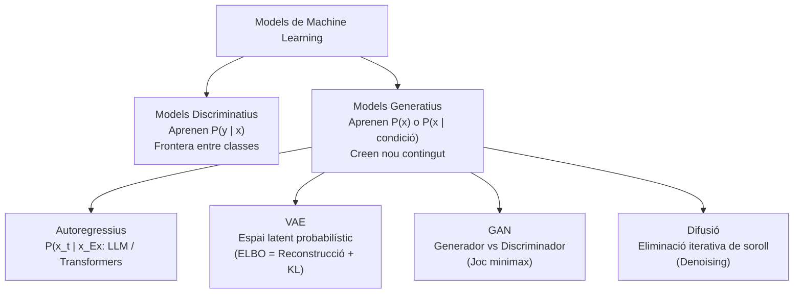
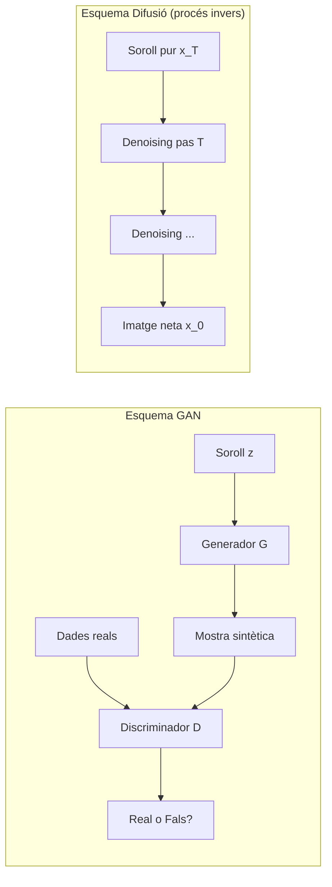

## A. Objectius d'aprenentatge

En completar aquesta lliçó, l'estudiant ha de ser capaç de:

1. **Diferenciar** matemàticament i pràcticament els **models discriminatius** (\(P(y \mid x)\)) dels **models generatius** (\(P(x, y)\) o \(P(x)\)).
2. **Explicar** el funcionament conceptual i els *trade-offs* de les quatre grans famílies modernes de models generatius profunds: **models autoregressius**, **autoencoders variacionals (VAE)**, **xarxes generatives antagòniques (GAN)** i **models de difusió**.
3. **Identificar** les principals mètriques d'avaluació (perplexitat, FID, avaluació humana) i les limitacions crítiques dels models generatius (al·lucinacions, col·lapse de mode, propietat intel·lectual, contingut sintètic enganyós o *deepfakes*).
4. **Distribuir** adequadament quan un problema administratiu requereix un model generatiu i quan és més segur i econòmic un model discriminatiu.
5. **Implementar** un model generatiu probabilístic senzill (cadena de Markov / model autoregressiu de n-grames amb mostreig per temperatura) en Python pur per comprendre com es genera seqüencialment nou contingut a partir d'una distribució apresa.

---

## B. Explicació introductòria

Imagina dues habilitats molt diferents davant d'un arxiu de decrets municipals:

- **Model discriminatiu (el crític o classificador)**: llegeix un decret i respon una pregunta concreta: *«Aquest document és de Contractació, d'Urbanisme o de Recursos Humans?»*. Només necessita aprendre la **frontera** que separa una categoria d'una altra.
- **Model generatiu (el redactor o creador)**: ha estudiat milers de decrets i ha après l'estructura interna, el vocabulari i les probabilitats de com s'escriu un decret; per tant, és capaç de **crear un esborrany nou** que no existia prèviament, o sintetitzar una imatge, un àudio o dades tabulars sintètiques realistes.

Aquesta distinció explica per què la **IA generativa** ha transformat l'atenció ciutadana, la redacció assistida i el resum documental, però també per què introdueix riscos nous: un classificador pot equivocar-se d'etiqueta, mentre que un model generatiu pot **inventar fets, cites legals o xifres plausibles però falses** (*al·lucinacions*).

> **Referència creuada**: en aquesta lliçó estudiem els fonaments probabilístics i les famílies de models generatius dins del Mòdul 1. Els **Large Language Models (LLM)**, el **Transformer**, el **RAG** i els **agents** s'estudien amb profunditat tècnica al **Mòdul 3**.

---

## C. Explicació tècnica avançada

### 1. Models discriminatius vs. Models generatius

Des del punt de vista de la probabilitat estadística:

- **Model discriminatiu**: aprèn directament la distribució condicional \(P(y \mid x)\) o una funció de decisió \(f(x) \rightarrow y\). Exemples: Regressió Logística, SVM, Random Forest, CNN classificadora, BERT *fine-tuned* per classificar. No sap generar noves mostres \(x\).
- **Model generatiu**: aprèn la **distribució de les dades** \(P(x)\) (en generació no condicionada), la distribució conjunta \(P(x, y) = P(x \mid y)P(y)\) (p. ex., Naive Bayes clàssic), o una distribució condicional generativa \(P(x \mid c)\) on \(c\) és un *prompt* o condició. En aprendre aquesta distribució, el model pot **mostrejar (*sample*)** nous objectes \(x_{\text{nou}} \sim P_\theta(x \mid c)\).

### 2. Famílies principals de models generatius profunds

| Família | Mecanisme intern | Fortaleses | Inconvenients / Riscos | Usos principals |
|---|---|---|---|---|
| **Autoregressius** (p. ex., GPT, Llama, Mistral, Salamandra) | Factoritzen la probabilitat conjunta pas a pas: \(P(x_1, \dots, x_T) = \prod_{t=1}^T P(x_t \mid x_{<t})\) | Qualitat excepcional en text i codi; funció de pèrdua estable (cross-entropy); versemblança exacta | Generació seqüencial lenta (token a token); al·lucinacions; cost alt en contextos llargs | LLM, generació de text, resum, codi, assistents |
| **VAE (*Variational Autoencoders*)** | Codifiquen \(x\) en una distribució latent gaussiana \(\mathcal{N}(\mu, \sigma^2)\) i maximitzen l'ELBO (reconstrucció + divergència KL) | Espai latent continu i estructurat; entrenament estable; útil per interpolació i anomalies | Les imatges generades solen ser més borroses que les de difusió o GAN | Dades sintètiques, compressió latent (p. ex., component intern de Stable Diffusion), anomalies |
| **GAN (*Generative Adversarial Networks*)** | Joc minimax entre un **Generador** \(G\) (crea mostres falses) i un **Discriminador** \(D\) (distingeix reals de falses) | Generació en un sol pas (*one-shot*), imatges molt nítides | Entrenament inestable; **col·lapse de mode** (*mode collapse*: el generador repeteix molt pocs tipus de sortides); difícil d'avaluar | Síntesi d'imatges ràpida, superresolució, dades tabulars sintètiques (CTGAN) |
| **Models de difusió (*Diffusion Models*)** | Procés directe afegeix soroll gaussià gradualment; la xarxa (U-Net / DiT) aprèn el procés invers de **eliminació de soroll (*denoising*)** | Màxima qualitat visual i diversitat; entrenament molt més estable que les GAN; condicionament flexible (text→imatge) | Inferència iterativa més lenta (desenes de passos, mitigat amb DDIM o destil·lació) | Generació d'imatges, vídeo, àudio i disseny gràfic |

### 3. Conceptes clau de mostreig i avaluació

- **Mostreig probabilístic i temperatura (\(T\))**: en un model autoregressiu, els *logits* \(z_i\) es transformen amb \(P_i = \frac{\exp(z_i / T)}{\sum_j \exp(z_j / T)}\).
  - \(T \to 0\) (o *greedy*): tria sempre el token més probable (determinista, repetitiu, menys creatiu).
  - \(T = 1\): respecta la distribució apresa.
  - \(T > 1\): aplana la distribució, augmenta la diversitat però dispara el risc d'incoherència i al·lucinacions.
- **Mètriques d'avaluació**:
  - **Text**: **Perplexitat (*Perplexity*, PPL)** \(= \exp(\text{Cross-Entropy})\) (més baixa = millor ajust al corpus; no garanteix veracitat factual), benchmarks de raonament, fidelitat factual i avaluació humana.
  - **Imatges**: **FID (*Fréchet Inception Distance*)** que compara la distribució de característiques d'imatges reals i generades (més baix = millor).
- **Limitacions estructurals**:
  1. **Al·lucinacions**: generar text fluent però factualment fals (el model optimitza versemblança estadística, no veritat jurídica).
  2. **Memorització i privacitat**: risc de regurgitar dades sensibles o protegides per drets d'autor presents en l'entrenament.
  3. **Biaixos i contingut sintètic enganyós (*deepfakes*)**: amplificació d'estereotips i risc de desinformació.

### 4. Errors habituals

- Utilitzar un model generatiu gran (LLM) per fer una classificació simple de 5 categories sobre 100.000 registres tabulars quan un classificador discriminatiu lleuger és 100× més barat, més ràpid i més controlable.
- Confondre «text gramaticalment impecable i convincent» amb «informació jurídicament verificada».

---

## D. Diagrames i recursos visuals

### Discriminatiu vs. Generatiu i taxonomia de famílies generatives



### Principi de funcionament d'una GAN vs. Model de Difusió



---

## E. Aplicació a l'Administració pública

### Casos d'ús de valor real

1. **Redacció assistida i lectura fàcil (*llenguatge clar*)**: transformar resolucions o cartes tributàries complexes en textos entenedors per a la ciutadania (dret a entendre l'Administració), sempre revisats per personal funcionari abans de la notificació.
2. **Síntesi d'expedients extensos i actes de plens**: generar esborranys de resums executius per agilitzar la feina tècnica.
3. **Generació de dades sintètiques per a proves i laboratoris**: crear datasets tabulars o formularis sintètics estadísticament realistes (p. ex., amb VAE o regles probabilístiques) per desenvolupar i provar programari **sense exposar dades personals reals** (complint minimització del RGPD).

### Riscos, obligacions i supervisió humana

- **Obligació de transparència (AI Act, art. 50)**: el contingut sintètic d'àudio, imatge, vídeo o text d'interès públic generat per IA ha d'identificar-se com a tal (marques d'aigua / metadades / avís clar a l'usuari), amb excepcions acotades si hi ha revisió editorial i responsabilitat humana.
- **Prohibició d'al·lucinació jurídica**: mai no s'ha de publicar ni notificar una resposta generada sense verificació contra normativa vigent (RAG verificable + revisió humana).

---

## F. Exemple pràctic guiat

Implementem en **Python pur** un **model generatiu autoregressiu senzill (model de bigrames de Markov)** entrenat sobre frases administratives sintètiques, incorporant **temperatura \(T\)** per observar exactament com canvia el mostreig entre \(T\) baixa (determinista/conservador) i \(T\) alta (divers/arriscat).

```python
"""Exemple 1.5: Model generatiu autoregressiu (bigrama) amb temperatura en Python pur."""
from collections import Counter, defaultdict
import math
import random

CORPUS = [
    "la persona sol·licitant presenta la instància al registre electrònic",
    "la persona interessada presenta la documentació al registre general",
    "l'òrgan competent revisa la documentació i emet un informe tècnic",
    "el servei de tributs revisa la instància i notifica la resolució",
    "la resolució administrativa requereix motivació i supervisió humana",
]


def entrenar_model_bigrama(corpus: list[str]) -> dict[str, Counter]:
    transicions: dict[str, Counter] = defaultdict(Counter)
    for frase in corpus:
        tokens = ["<BOS>"] + frase.split() + ["<EOS>"]
        for actual, seguent in zip(tokens[:-1], tokens[1:]):
            transicions[actual][seguent] += 1
    return transicions


def mostrejar_amb_temperatura(comptes: Counter, temperatura: float, rng: random.Random) -> str:
    paraules = list(comptes.keys())
    # Convertim freqüències en log-probabilitats (logits) i escalem per temperatura
    total = sum(comptes.values())
    logits = [math.log(comptes[w] / total) / max(temperatura, 1e-4) for w in paraules]
    max_l = max(logits)
    pesos = [math.exp(l - max_l) for l in logits]
    suma = sum(pesos)
    probs = [p / suma for p in pesos]
    return rng.choices(paraules, weights=probs, k=1)[0]


def generar_text(model: dict[str, Counter], temperatura: float, seed: int = 10, max_tokens: int = 14) -> str:
    rng = random.Random(seed)
    actual = "<BOS>"
    sortida: list[str] = []
    for _ in range(max_tokens):
        if actual not in model:
            break
        seguent = mostrejar_amb_temperatura(model[actual], temperatura, rng)
        if seguent == "<EOS>":
            break
        sortida.append(seguent)
        actual = seguent
    return " ".join(sortida)


if __name__ == "__main__":
    model = entrenar_model_bigrama(CORPUS)
    for temp in (0.1, 1.0, 2.5):
        print(f"T={temp:3.1f} -> {generar_text(model, temperatura=temp, seed=42)}")
```

### Interpretació dels resultats (execució verificada)

- Amb **`T = 0.1`** (gairebé *greedy*), el model sempre escull la continuació més freqüent del corpus (`la persona ...`) de manera molt previsible.
- Amb **`T = 1.0`**, segueix fidelment la distribució de probabilitats empíriques i pot combinar fragments plausibles de frases diferents (p. ex., començar amb una frase i enllaçar-la amb la continuació d'una altra compartint la paraula `la` o `revisa`).
- Amb **`T = 2.5`**, la distribució s'aplana i apareixen transicions menys probables, il·lustrant com una temperatura elevada incrementa la diversitat però també la probabilitat de generar combinacions incoherents o fora de context.
- Un **LLM modern** utilitza exactament aquest mateix principi autoregressiu \(P(x_t \mid x_{<t})\) i el mateix reescalat per temperatura, però condicionat a milers de tokens previs mitjançant un Transformer amb milers de milions de paràmetres.

---

## G. Exercici pràctic per resoldre

### Enunciat
L'Oficina de Dades d'una diputació rep tres encàrrecs interns:
1. **Encàrrec E1**: Generar un conjunt de 10.000 registres tabulars **sintètics** d'ajuts socials (conservant correlacions estadístiques però sense cap persona real) perquè un equip extern pugui desenvolupar un quadre de comandament sense accedir a dades reals protegides pel RGPD.
2. **Encàrrec E2**: Classificar 80.000 factures electròniques rebudes cada any en 15 partides pressupostàries fixes amb latència inferior a 10 ms per factura i cost mínim en CPU.
3. **Encàrrec E3**: Redactar automàticament una primera versió en «llenguatge clar» de les notificacions d'ordenances municipals a partir del text jurídic oficial, amb revisió obligatòria del servei jurídic.

### Context professional
Triar un model generatiu on correspon un model discriminatiu dispara costos i riscos; i a l'inrevés, intentar resoldre tasques de síntesi o redacció amb models discriminatius és inviable.

### Objectius
- Seleccionar per a E1, E2 i E3 si correspon un **model discriminatiu** o una **família específica de model generatiu** (autoregressiu, VAE/GAN tabular, difusió).
- Especificar riscos tècnics, mètriques d'avaluació i garanties de privacitat/supervisió per a cada encàrrec.

### Requisits funcionals i restriccions
- Per a E1, cal verificar que el model generatiu no hagi **memoritzat** ni filtrat cap registre real (risc de reidentificació).
- Per a E2, el pressupost de còmput no inclou GPU dedicada.
- Per a E3, no es poden alterar requisits legals ni terminis del text original.

:::hint Pista 1 — Identifica la naturalesa de la sortida en cada encàrrec
En E2 la sortida és una etiqueta d'un conjunt tancat de 15 partides amb restricció de `<10 ms` en CPU. Quin tipus de model encaixa aquí: discriminatiu o generatiu?
:::

:::hint Pista 2 — Dades sintètiques i privacitat (E1)
Les dades sintètiques generades per un VAE o GAN tabular (p. ex., TVAE/CTGAN) encara poden memoritzar casos extrems (*outliers*) reals. Com es verifica i mitiga aquest risc?
:::

### Criteris d'avaluació
- **35%**: Selecció tecnològica encertada per a E1, E2 i E3.
- **35%**: Definició rigorosa de riscos i controls (reidentificació/privacitat diferencial en E1; supervisió i fidelitat normativa en E3).
- **30%**: Mètriques d'avaluació apropiades per a cada cas.

### Errors habituals
- Proposar un LLM per a E2 incomplint la latència `<10 ms` en CPU i incrementant costos innecessàriament.
- Assumir que «dades sintètiques = anonimització automàtica garantida» sense proves de distància al veí més proper ni privacitat diferencial.

:::solution Solució completa comentada i alternatives
### Decisions per encàrrec

1. **E1 (10.000 registres tabulars sintètics) → Model generatiu tabular (VAE tabular / TVAE, CTGAN o difusió tabular) amb controls de privacitat**
   - **Per què generatiu**: cal aprendre la distribució conjunta \(P(X)\) de les variables (edat, municipi, import, tipus d'ajut) i mostrejar registres nous que preservin correlacions sense correspondre a persones reals.
   - **Mètriques**: fidelitat estadística (comparació de distribucions marginals via test KS / distància de Wasserstein i matrius de correlació) + utilitat (*Train on Synthetic, Test on Real*).
   - **Control de risc crític**: mesurar **Distance to Closest Record (DCR)** i atacs d'inferència de pertinença (*membership inference*) per comprovar que el model no ha memoritzat registres reals ni casos rars; si el risc és alt, aplicar **privacitat diferencial** (*Differential Privacy*) o supressió d'*outliers* abans d'entrenar.

2. **E2 (80.000 factures en 15 partides, <10 ms en CPU) → Model DISCRIMINATIU (NO generatiu)**
   - **Per què discriminatiu**: és un problema clàssic de classificació supervisada amb classes tancades. Un model discriminatiu (TF-IDF + Regressió Logística / Linear SVM o LightGBM sobre metadades + descripció) executa inferència en <2 ms en CPU, costa ordres de magnitud menys que un LLM i no pateix al·lucinacions.
   - **Mètriques**: F1-macro, Precision/Recall per partida crítica i calibració de confiança per derivar casos dubtosos a Intervenció.

3. **E3 (Adaptació a llenguatge clar d'ordenances) → Model generatiu AUTOREGRESSIU (LLM) amb temperatura baixa i revisió jurídica obligatòria (HITL)**
   - **Per què generatiu**: requereix produir text nou en català ben redactat i adaptat a un nivell de lectura accessible.
   - **Controls**: usar temperatura baixa (\(T \approx 0.1\text{–}0.3\)), restringir la generació exclusivament al text font aportat (sense coneixement extern), exigir preservació exacta de xifres, articles i terminis (verificables automàticament amb expressions regulars) i establir aprovació explícita del servei jurídic abans de publicar.
   - **Mètriques**: avaluació humana de fidelitat jurídica (0 distorsions legals), índexs de llegibilitat i revisió comparativa de xifres/terminis.
:::

---

## H. Test individual

Resol les 10 preguntes sobre models generatius vs. discriminatius, famílies generatives (autoregressius, VAE, GAN, difusió), temperatura, col·lapse de mode i ús responsable.

---

## I. Preguntes de desenvolupament

### Pregunta 1
Explica la diferència fonamental entre un **model discriminatiu** i un **model generatiu** des del punt de vista probabilístic i il·lustra amb un exemple concret de l'Administració pública per què sovint no convé substituir un bon model discriminatiu per un model generatiu.

:::model-answer Resposta model i criteris de correcció (Pregunta 1)
**Resposta model**:
- Un **model discriminatiu** estima directament la probabilitat condicional \(P(y \mid x)\) o la frontera de decisió que separa classes, sense modelar com es distribueixen les dades d'entrada \(x\). Un **model generatiu** modela la distribució de les dades \(P(x)\) o la conjunta \(P(x, y)\) (o condicional \(P(x \mid c)\)), fet que li permet generar noves mostres sintètiques.
- En tasques de classificació tancada o puntuació sobre grans volums estructurats (p. ex., classificar 100.000 factures en 15 partides pressupostàries), un model discriminatiu (Regressió Logística, LightGBM, encoder classificatori) és molt més eficient en CPU, té latència mil·lisegons, probabilitats millor calibrades i no pot inventar categories o dades fora de l'esquema (al·lucinacions), a diferència d'un LLM generatiu.

**Criteris de correcció (10 punts)**:
- Formulació probabilística rigorosa (\(P(y \mid x)\) vs \(P(x)\) / \(P(x,y)\)): 4 punts.
- Exemple administratiu concret i argumentació clara de *trade-offs* (cost, latència, determinisme, al·lucinacions): 6 punts.
:::

### Pregunta 2
Compara les **GAN (*Generative Adversarial Networks*)** i els **Models de Difusió** pel que fa al mecanisme d'entrenament, estabilitat, diversitat de sortides i velocitat d'inferència.

:::model-answer Resposta model i criteris de correcció (Pregunta 2)
**Resposta model**:
- **GAN**: entrenen simultàniament un Generador i un Discriminador en un joc minimax antagònic. Ofereixen **inferència molt ràpida en un sol pas**, però el seu entrenament és delicat i propens a inestabilitats i al **col·lapse de mode (*mode collapse*)**, on el generador produeix poca diversitat de mostres.
- **Models de difusió**: afegeixen soroll gaussià progressivament a les dades i entrenen una xarxa per predir i revertir aquest soroll pas a pas. Tenen un **entrenament molt més estable**, alta fidelitat visual i molta **més diversitat** (sense col·lapse de mode típic), però tradicionalment requereixen **més passos en inferència** (més lents, tot i que s'ha mitigat amb tècniques de mostreig accelerat o destil·lació).

**Criteris de correcció (10 punts)**:
- Explicació exacta dels dos mecanismes: 4 punts.
- Comparació explícita en els 4 eixos demanats (entrenament, estabilitat, diversitat/mode collapse, inferència): 6 punts.
:::

### Pregunta 3
Quin paper té el paràmetre de **temperatura (\(T\))** en el mostreig d'un model generatiu autoregressiu i quin risc comporta generar dades sintètiques tabulars a partir de registres reals de ciutadans sense controls addicionals de privacitat?

:::model-answer Resposta model i criteris de correcció (Pregunta 3)
**Resposta model**:
- La **temperatura \(T\)** escala els *logits* abans del `softmax` (\(z_i / T\)). Valors baixos (\(T \to 0\)) concentren la probabilitat en el token més probable (sortides més deterministes i conservadores, adequades per a tasques administratives precises); valors alts (\(T > 1\)) aplanen la distribució, incrementant diversitat/creativitat però també risc d'errors i al·lucinacions.
- Pel que fa a les **dades sintètiques**: un model generatiu potent pot **memoritzar registres reals** (especialment casos atípics o rars), permetent atacs d'inferència de pertinença o reidentificació. Per tant, generar dades sintètiques no garanteix automàticament l'anonimització RGPD; cal validar amb mètriques de proximitat (DCR) i aplicar tècniques com la privacitat diferencial o la supressió de casos singulars.

**Criteris de correcció (10 punts)**:
- Explicació matemàtica i pràctica de la temperatura: 5 punts.
- Identificació del risc de memorització/reidentificació en dades sintètiques i mesures de mitigació: 5 punts.
:::

---

## J. Resum per memoritzar

### Conceptes clau
- **Discriminatiu** \(P(y \mid x)\): separa classes / prediu etiquetes. **Generatiu** \(P(x)\) o \(P(x, y)\): aprèn la distribució de les dades per crear noves mostres.
- **4 grans famílies generatives**: Autoregressius (LLM, token a token), VAE (espai latent + ELBO), GAN (Generador vs Discriminador), Difusió (eliminació iterativa de soroll).
- **Temperatura (\(T\))**: baixa = conservador/determinista; alta = divers/arriscat.
- **Riscos clau**: al·lucinacions (versemblança ≠ veritat), memorització de dades reals, biaixos, *deepfakes*.
- **AI Act (art. 50)**: obligacions de transparència i marcatge per a contingut sintètic generat per IA.

### Definicions essencials
- **Col·lapse de mode (*Mode collapse*)**: fallada típica de les GAN on el generador produeix només uns pocs tipus de sortides repetitives ignorant la diversitat real de les dades.
- **Perplexitat (PPL)**: \(\exp(\text{Cross-Entropy})\); mesura com de «sorprès» està un model de llenguatge davant d'un text de prova (més baixa = millor ajust estadístic).
- **Al·lucinació**: generació de contingut fluent i plausible però factualment o jurídicament fals.

### Errors conceptuals freqüents
1. Creure que una perplexitat baixa garanteix absència d'al·lucinacions factuals.
2. Usar un model generatiu costós per a tasques simples de classificació tabular on un model discriminatiu és molt superior.
3. Assumir que qualsevol dataset sintètic generat per IA és automàticament anònim sota el RGPD.

### Possibles preguntes d'examen
- Diferencia models discriminatius i generatius amb fórmules i exemples.
- Compara Autoregressius, VAE, GAN i Difusió (avantatges, inconvenients i casos d'ús).
- Què és el *mode collapse* i a quina família generativa s'associa clàssicament?
- Com afecta la temperatura a la distribució Softmax dels logits?
