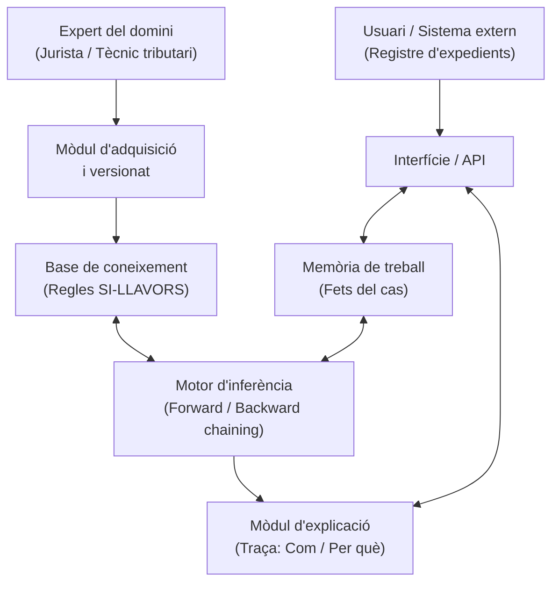
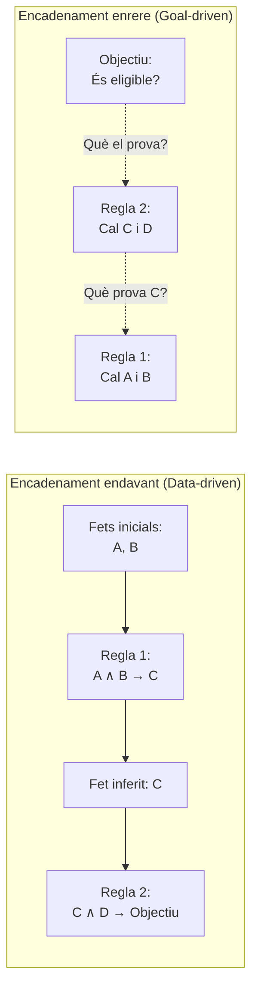

## A. Objectius d'aprenentatge

En completar aquesta lliçó, l'estudiant ha de ser capaç de:

1. **Definir** què és un **sistema expert** (*Expert System*) dins de la IA simbòlica i identificar-ne l'arquitectura modular clàssica.
2. **Explicar** el funcionament intern dels components: **base de coneixement** (fets i regles), **memòria de treball**, **motor d'inferència**, **mòdul d'explicació** i **mòdul d'adquisició de coneixement**.
3. **Diferenciar** l'**encadenament endavant (*forward chaining*)** de l'**encadenament enrere (*backward chaining*)**, així com el tractament bàsic de la incertesa (factors de certesa i lògica difusa).
4. **Comparar** sistemes experts clàssics, motors de regles de negoci moderns (**BRMS / DMN**) i models de **Machine Learning**, justificant quan convé combinar-los en arquitectures híbrides.
5. **Implementar** en Python un motor d'inferència amb encadenament endavant i traça explicativa completa per avaluar l'elegibilitat d'una bonificació municipal.

---

## B. Explicació introductòria

Abans que el *Machine Learning* i els LLM dominessin la IA, els anys 70 i 80 van viure l'auge dels **sistemes experts** (com *MYCIN* per a diagnòstic d'infeccions bacterianes o *DENDRAL* en química). La idea era molt directa i intuïtiva: entrevistar experts humans reconeguts, traduir el seu coneixement a un conjunt estructurat de regles del tipus **`SI <condicions> LLAVORS <conclusió>`**, i deixar que un programa raonés automàticament combinant aquestes regles sobre un cas nou.

Pensa en un secretari o tècnic jurídic municipal que revisa si una família té dret a una bonificació de l'IBI:
- *Regla 1*: SI l'habitatge és domicili habitual I s'hi han instal·lat plaques solars homologades → `compleix_requisit_energetic = cert`.
- *Regla 2*: SI `compleix_requisit_energetic = cert` I està al corrent de pagament amb l'ajuntament → `proposta_bonificacio_50% = cert`.

El gran atractiu d'un sistema expert per a l'Administració pública és que **pot explicar exactament per què ha arribat a una conclusió** (*«S'ha proposat la bonificació perquè s'han activat la Regla 1 i la Regla 2 amb els fets A, B i C»*), cosa fonamental per motivar actes administratius. La seva gran debilitat és el **cost de manteniment**: quan el món és ambigu o les regles creixen a milers, codificar-les i mantenir-les coherents esdevé extremadament difícil.

---

## C. Explicació tècnica avançada

### 1. Arquitectura clàssica d'un sistema expert

Un sistema expert **separa explícitament el coneixement del domini de l'algoritme de raonament** (a diferència d'un programa convencional on els `if/else` estan barrejats dins del codi font):

1. **Base de coneixement (*Knowledge Base*)**: emmagatzema el coneixement declaratiu del domini en forma de **regles de producció** (`SI antecedents LLAVORS conseqüent`), fets generals, marcs (*frames*) o ontologies.
2. **Memòria de treball (*Working Memory* / Base de fets)**: conté les dades específiques del cas concret que s'està avaluant i els fets nous inferits durant el raonament.
3. **Motor d'inferència (*Inference Engine*)**: algoritme genèric que emparella els fets de la memòria de treball amb les regles de la base de coneixement, resol conflictes quan múltiples regles són aplicables (*conflict resolution*: prioritat, especificitat, ordre) i dedueix conclusions noves (en motors eficients històrics s'utilitza l'**algoritme Rete** per evitar reavaluar totes les regles a cada pas).
4. **Mòdul d'explicació (*Explanation Facility*)**: respon preguntes del tipus *«Per què?»* (mostrant la cadena exacta de regles activades) i *«Com?»* (justificant quins fets han demostrat una conclusió).
5. **Mòdul d'adquisició de coneixement i interfície d'usuari**: permet a l'enginyer de coneixement i als experts del domini introduir, versionar i validar regles sense modificar el motor d'inferència.

### 2. Estratègies de raonament: *Forward* vs. *Backward Chaining*

| Dimensió | Encadenament endavant (*Forward Chaining*) | Encadenament enrere (*Backward Chaining*) |
|---|---|---|
| **Direcció** | **Dirigit per les dades** (*data-driven*): parteix dels fets coneguts i aplica regles fins inferir totes les conclusions possibles | **Dirigit per l'objectiu** (*goal-driven*): parteix d'una hipòtesi/objectiu i busca cap enrere quines regles i fets cal demostrar per provar-la |
| **Avantatges** | Ideal quan arriben moltes dades d'entrada i volem veure tot el que se'n deriva (monitoratge, validació d'expedients) | Només pregunta o consulta els fets estrictament necessaris per comprovar l'objectiu (eficient en diagnòstic interactiu) |
| **Inconvenients** | Pot disparar moltes regles irrellevants per a la pregunta final | Poc adequat si hi ha molts objectius possibles no coneguts a priori |
| **Exemple administratiu** | Donades totes les dades d'una sol·licitud, deduir totes les incompatibilitats, bonificacions i documents requerits | Comprovar específicament si un sol·licitant compleix l'objectiu «Eligible per a renda garantida» demanant només les dades que faltin |

### 3. Gestió de la incertesa en sistemes experts

Els sistemes experts purs basats en lògica booleana són rígids (`Cert`/`Fals`). Per introduir matisos es van desenvolupar extensions:
- **Factors de certesa (*Certainty Factors*, MYCIN)**: valors en \([-1, +1]\) que combinen evidència a favor i en contra.
- **Lògica difusa (*Fuzzy Logic*)**: graus de pertinença continus en \([0, 1]\) (p. ex., «renda baixa» = 0,7) amb regles lingüístiques i desfussificació.
- **Xarxes bayesianes**: raonament probabilístic rigorós basat en el teorema de Bayes i grafs acíclics dirigits.

### 4. Limitacions històriques i evolució moderna (BRMS / DMN)

- **Coll d'ampolla de l'adquisició de coneixement (*Knowledge Acquisition Bottleneck*)**: sovint els experts humans tenen coneixement tàcit difícil de formalitzar en regles exactes.
- **Fragilitat (*Brittleness*)**: davant d'un cas lleugerament fora de les regles previstes, el sistema falla bruscament sense degradació suau ni aprenentatge automàtic.
- **Explosió combinatòria i conflictes**: amb centenars o milers de regles, detectar contradiccions o bucles esdevé complex i exigeix tests de consistència formals.
- **Evolució actual**: tot i que el terme «sistema expert» és clàssic, el seu llegat viu plenament en els **motors de regles de negoci (BRMS, com Drools)**, l'estàndard **DMN (*Decision Model and Notation*)** i les **arquitectures híbrides neuro-simbòliques** (Mòdul 6, Lliçó 6.2), on ML/LLM extreuen dades estructurades de documents no estructurats i un motor de regles determinista aplica la normativa oficial.

---

## D. Diagrames i recursos visuals

### Arquitectura modular d'un sistema expert clàssic



### Comparació visual: *Forward Chaining* vs. *Backward Chaining*



---

## E. Aplicació a l'Administració pública

Els sistemes experts i els seus successors moderns (motors de regles DMN/BRMS) tenen una **encaixabilitat excel·lent en l'Administració pública** sempre que les regles provenen de **normativa explícita** (lleis, ordenances fiscals, bases reguladores de subvencions):

1. **Verificació d'elegibilitat i barems de subvencions**: aplicació transparent i idèntica per a tots els sol·licitants dels criteris objectius publicats al BOPB/DOGC, amb generació automàtica de la justificació detallada en cas d'exclusió o requeriment.
2. **Assistents de tramitació guiada (*Backward Chaining*)**: a la seu electrònica, el ciutadà selecciona el tràmit que vol fer (objectiu) i el sistema li fa **només les preguntes mínimes necessàries** per determinar quina documentació ha d'aportar o a quines bonificacions pot optar.
3. **Validació normativa en pipelines híbrids (ML + Regles)**: primer un model d'IDP/NLP extreu camps d'una sol·licitud en PDF; després un motor de regles comprova tots els requisits legals (terminis, límits d'import, incompatibilitats).

### Riscos i supervisió humana

- **Obsolescència normativa**: si canvia una ordenança municipal i no s'actualitza la base de regles versionada per data de vigència, el sistema aplicarà dret derogat de manera sistemàtica i massiva. Cal governança de versions amb dates d'entrada en vigor i proves de regressió unitàries per a cada regla.
- **Interpretació jurídica de conceptes indeterminats**: conceptes com «interès públic rellevant» o «situació de vulnerabilitat sobrevinguda» no es poden reduir a regles rígides i requereixen valoració tècnica humana.

---

## F. Exemple pràctic guiat

Implementem en **Python pur** un **motor d'inferència amb encadenament endavant (*forward chaining*) i mòdul d'explicació complet** que separa la base de coneixement (regles declaratives d'una ordenança fictícia de bonificació d'IBI) del motor de raonament.

```python
"""Exemple 1.6: Sistema expert amb forward chaining i traça explicativa en Python pur."""
from dataclasses import dataclass
from typing import Callable


@dataclass(frozen=True)
class Regla:
    id: str
    descripcio: str
    condicio: Callable[[dict], bool]
    accio_clau: str
    accio_valor: object


# Base de coneixement declarativa (separada del motor d'inferència)
BASE_CONEIXEMENT: list[Regla] = [
    Regla(
        id="R1",
        descripcio="Habitatge habitual amb plaques fotovoltaiques homologades -> requisit energètic complert",
        condicio=lambda f: f.get("habitatge_habitual") is True and f.get("plaques_homologades") is True,
        accio_clau="requisit_energetic",
        accio_valor=True,
    ),
    Regla(
        id="R2",
        descripcio="Sense deutes tributaris i dins termini -> situació formal vàlida",
        condicio=lambda f: f.get("deutes_tributaris") is False and f.get("dins_termini") is True,
        accio_clau="situacio_formal_valida",
        accio_valor=True,
    ),
    Regla(
        id="R3",
        descripcio="Requisit energètic + situació formal vàlida -> proposta bonificació IBI 50%",
        condicio=lambda f: f.get("requisit_energetic") is True and f.get("situacio_formal_valida") is True,
        accio_clau="proposta_bonificacio_ibi",
        accio_valor="50% (3 anys)",
    ),
    Regla(
        id="R4",
        descripcio="Requisit energètic complert però amb deutes tributaris -> requeriment de regularització",
        condicio=lambda f: f.get("requisit_energetic") is True and f.get("deutes_tributaris") is True,
        accio_clau="proposta_bonificacio_ibi",
        accio_valor="DENEGACIO_PROVISIONAL_DEUTES",
    ),
]


def motor_forward_chaining(fets_inicials: dict, regles: list[Regla]) -> tuple[dict, list[str]]:
    memoria = dict(fets_inicials)
    traca_explicacio: list[str] = []
    disparades: set[str] = set()

    canvi = True
    while canvi:
        canvi = False
        for r in regles:
            if r.id in disparades:
                continue
            if r.condicio(memoria):
                memoria[r.accio_clau] = r.accio_valor
                disparades.add(r.id)
                traca_explicacio.append(f"[{r.id}] {r.descripcio} => {r.accio_clau}={r.accio_valor}")
                canvi = True

    return memoria, traca_explicacio


if __name__ == "__main__":
    casos = {
        "EXP-101": {
            "habitatge_habitual": True,
            "plaques_homologades": True,
            "deutes_tributaris": False,
            "dins_termini": True,
        },
        "EXP-102": {
            "habitatge_habitual": True,
            "plaques_homologades": True,
            "deutes_tributaris": True,
            "dins_termini": True,
        },
    }

    for exp_id, fets in casos.items():
        resultat, traca = motor_forward_chaining(fets, BASE_CONEIXEMENT)
        print(f"=== {exp_id} => Proposta: {resultat.get('proposta_bonificacio_ibi')} ===")
        for pas in traca:
            print("  ", pas)
```

### Interpretació dels resultats (execució verificada)

- En **`EXP-101`**, el motor dispara seqüencialment `R1` (infereix `requisit_energetic=True`), `R2` (infereix `situacio_formal_valida=True`) i, en la iteració següent del bucle `while`, detecta que ja es compleixen les premisses de `R3` i dedueix `proposta_bonificacio_ibi='50% (3 anys)'`.
- En **`EXP-102`**, es dispara `R1`, no es dispara `R2`, i es dispara `R4`, proposant `DENEGACIO_PROVISIONAL_DEUTES`.
- En tots dos casos, la **`traca_explicacio`** proporciona una motivació determinista, reproduïble i auditable pas per pas, apta per integrar-se en una proposta de resolució revisada per un tècnic tributari.

---

## G. Exercici pràctic per resoldre

### Enunciat
Un organisme tributari local gestiona la comprovació d'exempcions de l'Impost sobre Vehicles de Tracció Mecànica (IVTM) per a persones amb mobilitat reduïda (requisits legals clars: grau de discapacitat ≥ 33%, titularitat del vehicle, ús exclusiu, límit d'un vehicle per persona). Alhora, rep les sol·licituds mitjançant PDFs escanejats heterogenis amb certificats mèdics i fitxes tècniques de formats molt variats.

Has de dissenyar una **arquitectura híbrida** que combini **ML/Deep Learning** amb un **sistema expert / motor de regles**, detallant:
1. Quines tasques s'assignen a ML/DL i quines al motor de regles.
2. Si el motor de regles ha d'operar preferentment amb *forward chaining* o *backward chaining* en dos escenaris: (a) tramitació en lot d'expedients entrats per registre i (b) assistent interactiu previ a la seu electrònica.
3. Com gestionar la **resolució de conflictes**, el **versionat normatiu anual** i la **supervisió humana**.

### Context professional
Saber delimitar on acaba el ML probabilístic i on comença el motor de regles determinista és una competència clau en transformació digital de l'Administració pública.

### Objectius
- Integrar IA simbòlica i IA basada en dades en un flux realista sense sobreenginyeria.
- Justificar l'elecció entre *forward* i *backward chaining*.
- Establir mecanismes de governança normativa per a bases de coneixement.

### Restriccions
- Les ordenances fiscals poden variar d'un municipi a un altre entre els 311 municipis de la província i d'un exercici fiscal a l'altre.
- Qualsevol denegació requereix motivació explícita i revisió humana.

:::hint Pista 1 — Dades no estructurades vs. aplicació normativa
Quin component gestiona millor llegir PDFs escanejats heterogenis (OCR + extracció d'entitats)? I quin component garanteix exactitud del 100% i explicabilitat en aplicar els requisits legals de l'ordenança?
:::

:::hint Pista 2 — Multi-municipi i multi-exercici
Pensa en com emmagatzemar la base de regles parametritzada per `(codi_municipi, exercici_fiscal, data_vigencia)` en lloc de duplicar codi font per a cada ajuntament.
:::

### Criteris d'avaluació
- **30%**: Separació encertada de responsabilitats entre capa perceptiva (OCR/ML) i capa normativa (sistema expert / BRMS).
- **25%**: Elecció justificada de *forward chaining* (lot d'expedients) i *backward chaining* (assistent interactiu).
- **25%**: Disseny del versionat normatiu multi-municipi i proves de regressió de regles.
- **20%**: Controls de confiança, gestió d'excepcions i supervisió humana (HITL).

### Errors habituals
- Delegar el càlcul d'elegibilitat jurídica a un LLM o a un Random Forest en lloc del motor de regles.
- No separar els fets extrets amb baixa confiança OCR (que han d'anar a validació humana abans d'entrar al motor de regles).

:::solution Solució completa comentada i alternatives
### 1. Arquitectura híbrida proposada
1. **Capa perceptiva (IDP / ML / DL)**: OCR + classificació del tipus de document adjunt (fitxa tècnica, certificat de discapacitat, declaració responsable) + extracció estructurada de camps (`grau_discapacitat`, `matricula`, `nif_titular`) amb **puntuació de confiança per camp**.
2. **Punt de control humà intermedi (validació d'extracció)**: si qualsevol camp crític té confiança inferior al llindar (p. ex., < 0,95) o hi ha inconsistència amb registres interoperables (Via Oberta / DGT), es deriva a revisió humana abans d'aplicar les regles.
3. **Capa normativa (Sistema expert / Motor de regles DMN-BRMS)**: rep els fets verificats + consulta al padró de vehicles (per comprovar que no gaudeix ja d'una altra exempció) i aplica les regles exactes de l'ordenança fiscal, generant una **proposta motivada** amb la llista exacta d'articles i regles disparades.
4. **Supervisió humana final**: el tècnic tributari revisa la proposta i la traça explicativa abans d'emetre la resolució administrativa (especialment obligatori en tota proposta de denegació o requeriment).

### 2. Forward vs. Backward chaining
- **Tramitació en lot d'expedients registrats → *Forward chaining***: ja disposem de tots els fets de l'expedient i volem inferir automàticament totes les conseqüències (exempció aplicable, documentació mancant, incompatibilitat amb un segon vehicle).
- **Assistent previ a la seu electrònica → *Backward chaining***: el ciutadà selecciona l'objectiu («Vull demanar exempció IVTM») i el sistema només li pregunta els fets estrictament necessaris; si en la primera pregunta respon que té discapacitat < 33%, s'atura immediatament sense fer-li perdre temps ni demanar documents innecessaris.

### 3. Governança multi-municipi i resolució de conflictes
- **Versionat declaratiu**: taules de decisió DMN o fitxers de regles versionats en Git amb metadades `(municipi_id, exercici, vigent_des_de, vigent_fins_a)` i un conjunt de casos de prova automatitzats (*unit tests* jurídics) que s'executen abans de publicar qualsevol canvi d'ordenança.
- **Resolució de conflictes**: ordenar regles per **especificitat** (les excepcions locals prevalen sobre la regla general) i detectar contradiccions en temps de desplegament mitjançant anàlisi estàtica de taules de decisió (comprovant compleció i absència de solapaments contradictoris).
:::

---

## H. Test individual

Resol les 10 preguntes sobre l'arquitectura dels sistemes experts, encadenament endavant i enrere, incertesa, coll d'ampolla del coneixement i arquitectures híbrides.

---

## I. Preguntes de desenvolupament

### Pregunta 1
Descriu els cinc components bàsics d'un sistema expert clàssic i explica per què la separació entre la **base de coneixement** i el **motor d'inferència** aporta un avantatge clau de manteniment respecte del programari tradicional.

:::model-answer Resposta model i criteris de correcció (Pregunta 1)
**Resposta model**:
- Els cinc components són: (1) **Base de coneixement** (regles declaratives i fets del domini), (2) **Memòria de treball** (fets del cas actual i fets inferits), (3) **Motor d'inferència** (algoritme de raonament i resolució de conflictes), (4) **Mòdul d'explicació** (traça de regles activades) i (5) **Mòdul d'adquisició de coneixement / interfície**.
- **Avantatge de la separació**: permet modificar, afegir o versionar regles normatives (p. ex., una nova ordenança fiscal anual) sense reescriure el motor d'inferència ni la resta d'infraestructura de l'aplicació; a més, facilita que juristes i tècnics del domini revisin i auditen les regles en un format declaratiu llegible.

**Criteris de correcció (10 punts)**:
- Identificació i descripció precisa dels 5 components: 5 punts.
- Explicació clara dels beneficis de manteniment, auditabilitat i governança normativa: 5 punts.
:::

### Pregunta 2
Explica les diferències entre ***forward chaining*** i ***backward chaining***, i justifica amb dos casos reals de l'Administració pública quin mètode convé a cadascun.

:::model-answer Resposta model i criteris de correcció (Pregunta 2)
**Resposta model**:
- ***Forward chaining* (dirigit per dades)**: parteix dels fets disponibles a la memòria de treball i dispara iterativament totes les regles aplicables fins a deduir totes les conclusions. És ideal en **validació en lot d'expedients** rebuts pel registre, on ja tenim les dades i volem detectar totes les bonificacions, incompatibilitats o mancances.
- ***Backward chaining* (dirigit per objectius)**: parteix d'una hipòtesi o meta i busca enrere les regles que la proven, demanant només els fets estrictament necessaris. És ideal en **assistents guiats de seu electrònica** on el ciutadà pregunta si té dret a un ajut concret i el sistema minimitza les preguntes.

**Criteris de correcció (10 punts)**:
- Diferenciació tècnica rigorosa (*data-driven* vs *goal-driven*): 5 punts.
- Dos casos administratius realistes i ben justificats: 5 punts.
:::

### Pregunta 3
Quines són les tres limitacions principals dels sistemes experts clàssics que van motivar l'auge del *Machine Learning*, i per què tot i així continuen sent rellevants en arquitectures modernes?

:::model-answer Resposta model i criteris de correcció (Pregunta 3)
**Resposta model**:
- **Tres limitacions principals**: (1) **Coll d'ampolla de l'adquisició de coneixement** (difícil formalitzar coneixement tàcit i percepció), (2) **Fragilitat (*brittleness*)** i incapacitat d'aprendre automàticament de noves dades davant text lliure o imatges ambigües, i (3) **Cost de manteniment i conflictes** quan la base creix a milers de regles interdependents.
- **Vigent en arquitectures modernes**: en forma de motors de regles (BRMS/DMN) integrats en **sistemes híbrids neuro-simbòlics**, aporten el que el Deep Learning no garanteix per si sol: determinisme exacte, compliment normatiu estricte i explicabilitat completa amb traça legal.

**Criteris de correcció (10 punts)**:
- Explicació rigorosa de les tres limitacions: 6 punts.
- Justificació de la seva vigència actual en arquitectures híbrides: 4 punts.
:::

---

## J. Resum per memoritzar

### Conceptes clau
- **Sistema expert**: sistema d'IA simbòlica que separa la **base de coneixement** (regles `SI-LLAVORS`) del **motor d'inferència** i incorpora un **mòdul d'explicació**.
- ***Forward chaining***: dirigit per dades (fets → conclusions). ***Backward chaining***: dirigit per objectius (objectiu → fets necessaris).
- **Algoritme Rete**: algoritme eficient d'emparellament de patrons usat en motors de regles per evitar reavaluar totes les regles a cada cicle.
- **Limitacions**: coll d'ampolla del coneixement, fragilitat, no aprèn de dades i difícil manteniment a gran escala.
- **Evolució moderna**: motors de regles **BRMS / DMN** combinats amb ML/LLM (IA híbrida).

### Definicions essencials
- **Memòria de treball**: conjunt dinàmic de fets inicials i inferits corresponents al cas que s'està avaluant.
- **Resolució de conflictes**: mecanisme del motor d'inferència per decidir quina regla aplicar primer quan diverses regles tenen les premisses satisfetes simultàniament.
- **Coll d'ampolla del coneixement**: dificultat i cost d'extreure i formalitzar en regles explícites el coneixement tàcit dels experts humans.

### Errors conceptuals freqüents
1. Pensar que un sistema expert «aprèn automàticament» de noves dades (sense intervenció humana que actualitzi la base de regles, no aprèn).
2. Confondre la direcció de *forward chaining* (dades → conclusions) amb *backward chaining* (objectiu → fets).
3. Creure que els sistemes basats en regles estan obsolets a l'Administració pública (són essencials per aplicar normativa determinista).

### Possibles preguntes d'examen
- Dibuixa i explica els components d'un sistema expert.
- Quan triaries *forward chaining* vs. *backward chaining*?
- Per què una arquitectura híbrida (OCR/NLP + motor de regles) supera tant un sistema expert pur com un LLM pur en tramitació administrativa?
