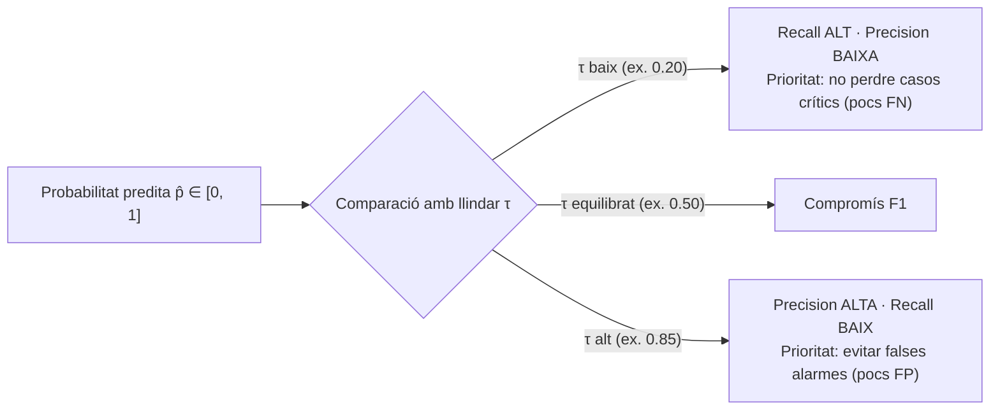
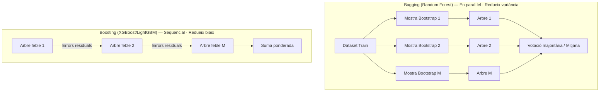

## A. Objectius d'aprenentatge

En completar aquesta lliçó, l'estudiant ha de ser capaç de:

1. **Diferenciar** classificació **binària**, **multiclasse** i **multietiqueta**, i triar l'algoritme adequat (Regressió Logística, Arbres de Decisió, Random Forest, Gradient Boosting, SVM, k-NN).
2. **Construir i interpretar** una **matriu de confusió** (TP, FP, TN, FN) i calcular manualment *Accuracy*, *Precision*, *Recall* (sensibilitat), *Specificity* i *F1-score*.
3. **Explicar** el compromís (*trade-off*) entre *Precision* i *Recall* en variar el **llindar de decisió (*threshold*)**, així com el significat de les corbes **ROC-AUC** i **PR-AUC** (*Precision-Recall AUC*).
4. **Gestionar** problemes de **classes desequilibrades** (pesos de classe, ajust de llindar, PR-AUC, estratificació) sense caure en la trampa de l'*accuracy*.
5. **Implementar** en Python/NumPy una Regressió Logística, calcular la matriu de confusió i optimitzar el llindar de decisió segons el cost administratiu dels falsos negatius vs. falsos positius.

---

## B. Explicació introductòria

La **classificació** és la tasca supervisada d'assignar cada nou exemple a una o més **categories discretes** predefinides. És, amb diferència, la tasca de Machine Learning més desplegada en l'Administració pública:

- **Classificació binària** (2 classes): aquesta factura és sospitosa d'irregularitat (*Sí / No*)? Aquesta sol·licitud té documentació completa (*Completa / Incompleta*)?
- **Classificació multiclasse** (3 o més classes excloents): a quina de les 10 àrees municipals pertany aquesta instància?
- **Classificació multietiqueta** (múltiples etiquetes simultànies): quins ODS (*Objectius de Desenvolupament Sostenible*) o departaments estan implicats en aquest projecte municipal?

Imagina un control de qualitat previ en un registre d'entrada:
- Si el model marca una sol·licitud vàlida com a «incompleta» (**Fals Positiu, FP**), un tècnic hi fa una revisió ràpida de 30 segons i la valida. Cost baix.
- Si el model deixa passar una sol·licitud amb un defecte greu sense avisar (**Fals Negatiu, FN**), l'expedient queda aturat setmanes més tard i cal obrir un requeriment formal. Cost molt alt.

Entendre aquesta **asimetria de costos** entre FP i FN és la clau per escollir la mètrica correcta i ajustar el llindar de decisió del classificador.

---

## C. Explicació tècnica avançada

### 1. Principals algoritmes de classificació

| Algoritme | Idea matemàtica | Fortaleses | Limitacions |
|---|---|---|---|
| **Regressió Logística** | Modela \(P(y=1\mid x) = \sigma(w^\top x + b)\) minimitzant *log-loss* (Binary Cross-Entropy) | Molt ràpida, probabilitats ben calibrades, fàcilment interpretable (coeficients), excel·lent *baseline* | Frontera lineal (requereix *features* o interaccions manuals per a patrons no lineals) |
| **Arbre de Decisió (*Decision Tree*)** | Particiona recursivament l'espai minimitzant impuresa (**Gini** o **Entropia**) | Captura no-linealitats, no necessita escalat, altament interpretable si és poc profund | Molt propens a **overfitting** i inestable davant petits canvis en les dades |
| **Random Forest (*Bagging*)** | Entrena molts arbres independents sobre submostres *bootstrap* i subconjunts aleatoris de *features* i fa votació/mitjana | Redueix dràsticament la **variància**, robust a soroll i *outliers*, fàcil d'ajustar | Menys interpretable que un sol arbre, models pesats en RAM si té molts arbres profunds |
| **Gradient Boosting (XGBoost, LightGBM, CatBoost)** | Construeix arbres **seqüencialment**, on cada nou arbre corregeix els errors (gradients residuals) dels anteriors | **Estat de l'art en dades tabulars**, gestiona bé interaccions complexes i valors nuls | Més sensible a hiperparàmetres i al sobreajustament si no es regularitza (`learning_rate`, `max_depth`, `early_stopping`) |
| **SVM (*Support Vector Machine*)** | Troba l'hiperplà que maximitza el **marge** entre classes; amb *kernel trick* (RBF) crea fronteres no lineals | Molt eficaç en alta dimensió (p. ex., text TF-IDF amb Linear SVM) | No escala bé a milions de files amb *kernels* no lineals; requereix escalat obligatori; probabilitats requereixen calibració (Platt) |
| **k-NN (*k-Nearest Neighbors*)** | Classifica per votació dels \(k\) veïns més propers segons una distància | Zero temps d'entrenament, intuïtiu | Inferència lenta en grans datasets, molt sensible a l'escalat i a la **maledicció de la dimensionalitat** |

### 2. La Matriu de Confusió i les mètriques essencials

Per a classificació binària (classe positiva = 1, negativa = 0):

| | **Predicció = Positiu (1)** | **Predicció = Negatiu (0)** |
|---|---|---|
| **Real = Positiu (1)** | **TP** (*True Positive*) | **FN** (*False Negative*, Error Tipus II) |
| **Real = Negatiu (0)** | **FP** (*False Positive*, Error Tipus I) | **TN** (*True Negative*) |

Fórmules imprescindibles d'examen:

- **Exactitud (*Accuracy*)**: \(\frac{TP + TN}{TP + TN + FP + FN}\) → **Enganyosa amb classes desequilibrades!**
- **Precisió (*Precision*)**: \(\frac{TP}{TP + FP}\) → *De tot allò que el model ha marcat com a positiu, quin % ho era realment?* (clau quan els **FP** són molt cars, p. ex., enviar una inspecció presencial).
- **Exhaustivitat (*Recall* / Sensibilitat / TPR)**: \(\frac{TP}{TP + FN}\) → *De tots els positius reals que existien, quin % hem aconseguit detectar?* (clau quan els **FN** són molt cars, p. ex., detectar frau o risc de seguretat).
- **Especificitat (*Specificity* / TNR)**: \(\frac{TN}{TN + FP}\) → taxa de negatius ben classificats.
- **F1-score**: mitjana harmònica de *Precision* i *Recall*:
  \[
  F_1 = 2 \cdot \frac{\text{Precision} \cdot \text{Recall}}{\text{Precision} + \text{Recall}}
  \]
  (Més generalment, \(F_\beta = (1+\beta^2)\frac{P \cdot R}{\beta^2 P + R}\): amb \(\beta = 2\) pesa més el *Recall*, amb \(\beta = 0.5\) pesa més la *Precision*.)

### 3. Llindar de decisió, ROC-AUC i PR-AUC

Un classificador probabilístic retorna \(\hat{p} = P(y=1 \mid x) \in [0, 1]\). Per defecte prediu `1` si \(\hat{p} \ge 0.5\), però **0,5 rarament és el llindar òptim**:
- **Baixar el llindar** (p. ex., a 0,25) → augmenta el **Recall** (es detecten més positius reals), però disminueix la **Precision** (més falses alarmes).
- **Pujar el llindar** (p. ex., a 0,80) → augmenta la **Precision** (quan alerta, gairebé sempre té raó), però disminueix el **Recall** (se n'escapen més).

Per avaluar la capacitat discriminativa **independentment d'un únic llindar**:
- **ROC-AUC**: àrea sota la corba *TPR (Recall)* vs. *FPR (\(\frac{FP}{FP+TN}\))*. 0,5 = atzar, 1,0 = perfecte. **Precaució**: amb desequilibri sever (p. ex., 99% negatius, 1% positius), el ROC-AUC pot semblar molt alt (0,95) encara que la *Precision* sigui pèssima perquè \(TN\) domina el denominador de FPR.
- **PR-AUC (*Average Precision*)**: àrea sota la corba *Precision* vs. *Recall*. **Mètrica recomanada en classes molt desequilibrades** perquè ignora els \(TN\) i reflecteix directament la qualitat sobre la classe minoritària.

### 4. Mitjanes en classificació multiclasse: Macro vs. Micro vs. Weighted

- **Macro-F1**: mitjana aritmètica simple de l'F1 de cada classe (totes les classes pesen igual, **fins i tot les minoritàries**). Ideal quan no volem que classes petites quedin invisibilitzades.
- **Weighted-F1**: ponderada pel suport (nombre d'exemples) de cada classe.
- **Micro-F1**: agrega tots els TP, FP i FN globalment (en multiclasse excloent coincideix amb l'*Accuracy*).

### 5. Tractament de classes desequilibrades

1. Partició **estratificada** (`StratifiedKFold`, `stratify=y`).
2. Funció de pèrdua ponderada (`class_weight="balanced"` o `scale_pos_weight`).
3. **Ajust del llindar** de decisió sobre el conjunt de validació optimitzant \(F_\beta\) o cost esperat.
4. Remostreig (*oversampling* / SMOTE o *undersampling*) aplicat **exclusivament dins del conjunt d'entrenament de cada plec (*fold*)** per evitar *data leakage*.

---

## D. Diagrames i recursos visuals

### Compromís entre llindar de decisió, Precision i Recall



### Bagging (Random Forest) vs. Boosting (XGBoost / LightGBM)



---

## E. Aplicació a l'Administració pública

1. **Triatge de risc d'esmena documental (classificació binària orientada a Recall)**: predir si una instància tindrà defectes formals abans de passar a instrucció; convé un llindar més baix (alt *Recall*) perquè un avís preventiu té baix cost.
2. **Classificació multiclasse d'expedients i queixes ciutadanes**: usar **Macro-F1** per assegurar que serveis amb menys volum (p. ex., Patrimoni o Igualtat) no tinguin un rendiment pèssim ocult darrere d'un 92% d'*accuracy* dominat per Tributs i Via Pública.
3. **Selecció de candidats per a inspecció tributària (orientada a Precision@k)**: els inspectors tenen capacitat limitada (p. ex., 50 inspeccions/mes); interessa maximitzar la **Precision** en el *top-k* d'alertes (pocs falsos positius).

### Supervisió humana i calibració

- Les probabilitats d'un classificador només serveixen per ordenar o prioritzar el treball dels tècnics si estan **ben calibrades** (p. ex., entre els expedients amb probabilitat 0,70, aproximadament el 70% pertanyen realment a la classe positiva). Cal comprovar-ho amb **Brier Score** o corbes de calibració i aplicar *Platt Scaling* o *Isotonic Regression* si cal.

---

## F. Exemple pràctic guiat

Implementem en **Python + NumPy** un classificador de **Regressió Logística binària** sobre expedients sintètics desequilibrats (~15% d'expedients amb deficiència crítica), calculant la **matriu de confusió**, *Accuracy*, *Precision*, *Recall*, *F1* i comparant dos llindars (`0.50` vs. `0.25`) per demostrar quantitativament el compromís *Precision-Recall*.

```python
"""Exemple 1.7: Regressió Logística, Matriu de Confusió i ajust de llindar en NumPy."""
import numpy as np


def sigmoid(z: np.ndarray) -> np.ndarray:
    return 1.0 / (1.0 + np.exp(-np.clip(z, -30, 30)))


def metriques_classificacio(y_true: np.ndarray, y_pred: np.ndarray) -> dict[str, float]:
    tp = int(np.sum((y_true == 1) & (y_pred == 1)))
    fp = int(np.sum((y_true == 0) & (y_pred == 1)))
    tn = int(np.sum((y_true == 0) & (y_pred == 0)))
    fn = int(np.sum((y_true == 1) & (y_pred == 0)))

    acc = (tp + tn) / len(y_true)
    prec = tp / (tp + fp) if (tp + fp) > 0 else 0.0
    rec = tp / (tp + fn) if (tp + fn) > 0 else 0.0
    f1 = (2 * prec * rec / (prec + rec)) if (prec + rec) > 0 else 0.0
    return {"TP": tp, "FP": fp, "TN": tn, "FN": fn, "Acc": acc, "Prec": prec, "Rec": rec, "F1": f1}


if __name__ == "__main__":
    rng = np.random.default_rng(123)
    n = 500
    # Features: [dies_restants_termini, manca_annex_score, historial_esmenes]
    X = rng.normal(0, 1, size=(n, 3))
    logits_reals = -2.2 + 1.4 * X[:, 0] + 1.6 * X[:, 1] - 0.8 * X[:, 2]
    y = (rng.uniform(0, 1, size=n) < sigmoid(logits_reals)).astype(int)

    # Split 80/20
    X_train, X_test = X[:400], X[400:]
    y_train, y_test = y[:400], y[400:]

    # Entrenament de Regressió Logística (Binary Cross-Entropy + L2)
    w = np.zeros(3)
    b = 0.0
    lr, l2 = 0.2, 0.01
    for _ in range(500):
        p = sigmoid(X_train @ w + b)
        grad_w = (X_train.T @ (p - y_train)) / len(y_train) + l2 * w
        grad_b = float(np.mean(p - y_train))
        w -= lr * grad_w
        b -= lr * grad_b

    probs_test = sigmoid(X_test @ w + b)
    print(f"Proporció positius reals en test: {y_test.mean():.2%}")

    for llindar in (0.50, 0.25):
        preds = (probs_test >= llindar).astype(int)
        m = metriques_classificacio(y_test, preds)
        print(
            f"Llindar={llindar:.2f} | TP={m['TP']:2d} FP={m['FP']:2d} FN={m['FN']:2d} TN={m['TN']:2d} | "
            f"Acc={m['Acc']:.3f} Prec={m['Prec']:.3f} Rec={m['Rec']:.3f} F1={m['F1']:.3f}"
        )
```

### Interpretació dels resultats (execució verificada)

- En el conjunt de test de 100 expedients hi ha un `24%` d'expedients positius (24 casos reals).
- Amb **llindar `0.50`**, la *Precision* és elevada (`0.864`), l'*Accuracy* arriba a `0.920` i l'*F1* a `0.826`, però el *Recall* es queda en `0.792` (`TP=19, FN=5`: s'escapen 5 casos crítics).
- En baixar el **llindar a `0.25`**, el *Recall* salta fins a `0.958` (`TP=23, FN=1`: es detecten 23 de 24 casos crítics, reduint els falsos negatius de 5 a només 1), a canvi d'acceptar més falsos positius (`12` en lloc de `3`, amb *Precision* `0.657` i *F1* `0.780`).
- Aquest exemple demostra que **ajustar el llindar en validació** és una palanca decisiva per alinear el model amb els costos asimètrics reals de l'Administració.

---

## G. Exercici pràctic per resoldre

### Enunciat
Un organisme tributari avalua dos models candidats (Model A i Model B) sobre un conjunt de prova de **1.000 declaracions** on només **50** presenten una irregularitat real (5% positius, 95% negatius):

- **Model A**: `TP = 40`, `FP = 40`, `FN = 10`, `TN = 910`.
- **Model B**: `TP = 10`, `FP = 5`, `FN = 40`, `TN = 945`.
- **Classificador trivial (sempre prediu 0)**: `TP = 0`, `FP = 0`, `FN = 50`, `TN = 950`.

Has de:
1. Calcular **exactament** *Accuracy*, *Precision*, *Recall*, *Specificity* i *F1-score* per als tres classificadors.
2. Explicar per què l'*Accuracy* duu a una decisió errònia.
3. Seleccionar el model adequat en **dos escenaris operatius diferents**:
   - **Escenari 1**: L'equip només pot revisar 20 expedients al mes i cada falsa alarma provoca queixes i un cost elevat d'auditoria innecessària.
   - **Escenari 2**: El sistema només envia un avís automàtic intern de «revisió ràpida» de 2 minuts i no detectar una irregularitat implica una pèrdua recaptatòria molt alta.

### Objectius i restriccions
- Dominar el càlcul ràpid i exacte de mètriques de classificació (molt freqüent a la prova teòrica i pràctica).
- Vincular la selecció de model i mètrica (\(F_{0.5}\) vs. \(F_2\) / *Precision* vs. *Recall*) a la funció de cost real.

:::hint Pista 1 — Recorda les fórmules clau
`Precision = TP / (TP + FP)` | `Recall = TP / (TP + FN)` | `F1 = 2 * P * R / (P + R)` | `Specificity = TN / (TN + FP)`.
:::

:::hint Pista 2 — Compara l'Accuracy del trivial amb la del Model A
El classificador trivial que NO detecta cap irregularitat té un `95,0%` d'accuracy — igual que el Model A (`95,0%`) i inferior al Model B (`95,5%`)! Mira què passa en canvi amb el Recall i l'F1.
:::

### Criteris d'avaluació
- **40%**: Càlculs numèrics exactes de les 5 mètriques per als tres classificadors.
- **30%**: Explicació clara de la paradoxa de l'*accuracy* en dades desequilibrades.
- **30%**: Selecció coherent i argumentada per als Escenaris 1 i 2 (mencionant també l'alternativa de rànquing per probabilitat / *Precision@k*).

### Errors habituals
- Intercanviar els denominadors de *Precision* (`TP+FP`) i *Recall* (`TP+FN`).
- Triar el Model B en l'Escenari 2 només perquè té una *accuracy* superior (`95,5%` vs `95,0%`).

:::solution Solució completa comentada i alternatives
### 1. Taula de càlculs exactes

| Mètrica | Model A (`TP=40, FP=40, FN=10, TN=910`) | Model B (`TP=10, FP=5, FN=40, TN=945`) | Trivial (`TP=0, FP=0, FN=50, TN=950`) |
|---|---|---|---|
| **Accuracy** | \((40+910)/1000 = \mathbf{95,0\%}\) | \((10+945)/1000 = \mathbf{95,5\%}\) | \(950/1000 = \mathbf{95,0\%}\) |
| **Precision** | \(40/(40+40) = \mathbf{50,0\%}\) | \(10/(10+5) = \mathbf{66,7\%}\) | Indefinida (\(0/0\)) → \(0\%\) |
| **Recall** | \(40/(40+10) = \mathbf{80,0\%}\) | \(10/(10+40) = \mathbf{20,0\%}\) | \(0/50 = \mathbf{0,0\%}\) |
| **Specificity** | \(910/(910+40) = \mathbf{95,8\%}\) | \(945/(945+5) = \mathbf{99,5\%}\) | \(950/950 = \mathbf{100\%}\) |
| **F1-score** | \(2 \cdot \frac{0,5 \cdot 0,8}{0,5+0,8} = \mathbf{61,5\%}\) | \(2 \cdot \frac{0,667 \cdot 0,2}{0,667+0,2} = \mathbf{30,8\%}\) | \(\mathbf{0,0\%}\) |

### 2. Per què l'Accuracy enganya
Amb un 95% de classe negativa, predir sempre `0` aconsegueix un 95% d'*accuracy* sense detectar ni una sola irregularitat. Encara pitjor, el Model B obté més *accuracy* (95,5%) que el Model A (95,0%) malgrat perdre el 80% de les irregularitats reals i tenir la meitat d'F1-score (30,8% vs. 61,5%).

### 3. Selecció segons escenari operatiu
- **Escenari 1 (capacitat limitada de 20 revisions, FP molt cars) → Model B (o encara millor: Model A ordenant per probabilitat i revisant el Top-20)**
  - Entre els dos punts d'operació fixos, el Model B genera només 15 alertes (dins la capacitat de 20) amb una *Precision* del 66,7% i només 5 falses alarmes (vs. 80 alertes del Model A que saturarien l'equip).
  - **Solució superior**: avaluar la corba **PR-AUC** i provar d'apujar el llindar del Model A per veure si en el Top-15/Top-20 supera el 66,7% de precisió del Model B!
- **Escenari 2 (revisió barata, FN molt cars) → Model A**
  - El Model A captura el **80% de les irregularitats** (`Recall = 80%`, només 10 FN) amb una càrrega de 80 revisions ràpides (80 × 2 min < 3 hores de feina), multiplicant per 4 la detecció del Model B.
:::

---

## H. Test individual

Resol les 10 preguntes sobre algoritmes de classificació, matriu de confusió, mètriques (*Precision, Recall, F1, ROC-AUC, PR-AUC*) i classes desequilibrades.

---

## I. Preguntes de desenvolupament

### Pregunta 1
Explica les diferències entre **Bagging (Random Forest)** i **Boosting (XGBoost / LightGBM)** pel que fa a com construeixen els arbres, quin component de l'error redueixen principalment (biaix vs. variància) i els seus riscos d'ajust.

:::model-answer Resposta model i criteris de correcció (Pregunta 1)
**Resposta model**:
- **Bagging (Random Forest)**: entrena molts arbres profunds en **paral·lel i de manera independent** sobre mostres *bootstrap* i subconjunts aleatoris de *features*, combinant-los per votació o mitjana. Com que promitja predictors independents d'alta variància i baix biaix, redueix dràsticament la **variància** i és molt resistent al sobreajustament.
- **Boosting (XGBoost / LightGBM)**: entrena arbres poc profunds (*weak learners*) de manera **seqüencial**, on cada nou arbre ajusta els errors (gradients residuals) comesos pel conjunt anterior. Redueix principalment el **biaix** (i també la variància amb *shrinkage* / submostreig), acostumant a assolir major precisió en dades tabulars, però és més propens a sobreajustar-se al soroll si no es controlen `learning_rate`, profunditat, regularització i *early stopping*.

**Criteris de correcció (10 punts)**:
- Mecànica paral·lela vs seqüencial: 4 punts.
- Relació exacta amb variància (Bagging) i biaix (Boosting): 3 punts.
- *Trade-offs* d'ajust, sobreajustament i cost: 3 punts.
:::

### Pregunta 2
Per què la corba **PR-AUC (*Precision-Recall AUC*)** és més informativa que la corba **ROC-AUC** quan avaluem un classificador sobre un dataset molt desequilibrat (p. ex., 0,5% de frau i 99,5% de casos legítims)?

:::model-answer Resposta model i criteris de correcció (Pregunta 2)
**Resposta model**:
- La corba **ROC** enfronta \(TPR = \frac{TP}{TP+FN}\) contra \(FPR = \frac{FP}{FP+TN}\). Quan el nombre de veritables negatius (\(TN\)) és enorme respecte als positius, generar un gran nombre absolut de falsos positius (\(FP\)) gairebé no altera l'\(FPR\) perquè el denominador \(FP+TN\) és gegantí; així, el ROC-AUC pot donar un valor optimista (p. ex., 0,96) malgrat que la majoria d'alertes siguin falses.
- La corba **PR** enfronta *Precision* (\(\frac{TP}{TP+FP}\)) contra *Recall* (\(\frac{TP}{TP+FN}\)). Cap de les dues mètriques inclou \(TN\), de manera que qualsevol augment de falsos positius penalitza immediatament la *Precision* i el PR-AUC, reflectint fidelment la utilitat operativa sobre la classe minoritària.

**Criteris de correcció (10 punts)**:
- Fórmules de TPR, FPR, Precision i Recall: 4 punts.
- Demostració clara del paper dominant de \(TN\) en FPR vs absència en PR: 6 punts.
:::

### Pregunta 3
En un classificador multiclasse de 12 àrees municipals molt desiguals en volum (unes tenen 5.000 instàncies/any i altres només 80), explica la diferència entre **Macro-F1**, **Weighted-F1** i **Micro-F1**, i indica quina prioritzaries per auditar la qualitat del servei públic.

:::model-answer Resposta model i criteris de correcció (Pregunta 3)
**Resposta model**:
- **Micro-F1** agrega tots els TP, FP i FN globalment (en multiclasse excloent equival a *Accuracy*), quedant dominada per les àrees amb 5.000 instàncies.
- **Weighted-F1** pondera l'F1 de cada classe pel seu volum, suavitzant però mantenint el domini de les classes grans.
- **Macro-F1** fa la mitjana simple sense ponderar de l'F1 de les 12 àrees: una àrea petita (80 instàncies) pesa exactament igual (1/12) que una gran.
- **Recomanació**: reportar sempre **Macro-F1** juntament amb el desglossament per classe (matriu de confusió), ja que garanteix equitat entre serveis municipals i impedeix que un rendiment catastròfic en àrees minoritàries quedi amagat sota una bona mitjana global.

**Criteris de correcció (10 punts)**:
- Definició exacta de Macro, Weighted i Micro F1: 6 punts.
- Justificació de l'elecció en el context d'equitat dels serveis públics: 4 punts.
:::

---

## J. Resum per memoritzar

### Conceptes clau
- **Modalitats**: binària, multiclasse (excloent), multietiqueta (múltiples alhora).
- **Algoritmes estrella**: Regressió Logística (*baseline* calibrat), Random Forest (*bagging*, baixa variància), Gradient Boosting / XGBoost / LightGBM (*boosting*, estat de l'art tabular), Linear SVM (text TF-IDF).
- **Precision vs. Recall**: *Precision* penalitza **FP** (falses alarmes); *Recall* penalitza **FN** (casos escapats). *F1* és la mitjana harmònica.
- **Llindar \(\tau\)**: baixar-lo puja *Recall* i baixa *Precision*; pujar-lo fa l'inrevés.
- **Classes desequilibrades**: mai confiar només en *Accuracy* ni només en *ROC-AUC*; usar **PR-AUC**, **Macro-F1** i `StratifiedKFold`.

### Definicions essencials
- **Precision**: \(TP / (TP + FP)\).
- **Recall (Sensibilitat)**: \(TP / (TP + FN)\).
- **F1-score**: \(2 \cdot \frac{\text{Precision} \cdot \text{Recall}}{\text{Precision} + \text{Recall}}\).
- **Calibració**: grau en què les probabilitats predites coincideixen amb les freqüències empíriques reals.

### Errors conceptuals freqüents
1. Confondre el denominador de *Precision* (`TP+FP`) amb el de *Recall* (`TP+FN`).
2. Aplicar SMOTE/oversampling abans de dividir *train* i *validation* (genera *data leakage* sever).
3. Deixar el llindar fix en 0,50 quan els costos de FP i FN són molt asimètrics.

### Possibles preguntes d'examen
- Calcula *Accuracy*, *Precision*, *Recall* i *F1* a partir d'una matriu de confusió 2×2.
- Quan triaries *PR-AUC* en lloc de *ROC-AUC*?
- Diferencia *Bagging* i *Boosting* respecte al compromís biaix-variància.
- Quina diferència hi ha entre *Macro-F1* i *Micro-F1* en classes desequilibrades?
