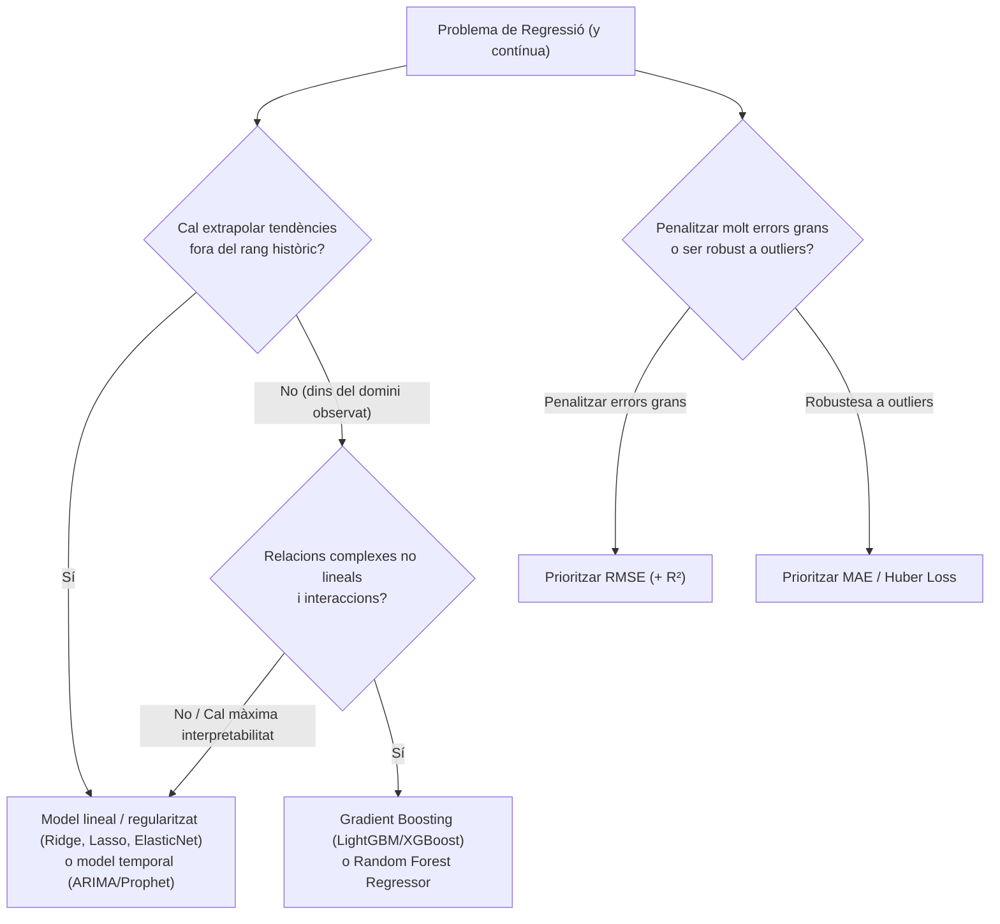

## A. Objectius d'aprenentatge

En completar aquesta lliçó, l'estudiant ha de ser capaç de:

1. **Formular** problemes de **regressió supervisada** (predicció d'una variable numèrica contínua) i distingir-los de la classificació.
2. **Explicar** el funcionament de la regressió lineal (OLS), la regressió polinòmica, els models regularitzats (**Ridge L2**, **Lasso L1**, **ElasticNet**) i els models no lineals (arbres de regressió, Random Forest Regressor, Gradient Boosting Regressor).
3. **Calcular i interpretar** rigorosament les mètriques clau: **MAE**, **MSE**, **RMSE**, **MAPE** i **\(R^2\)** (i \(R^2\) ajustat), justificant quina penalitza més els valors extrems (*outliers*).
4. **Diagnosticar** problemes habituals en regressió: multicol·linealitat, heteroscedasticitat, *outliers*, extrapolació perillosa fora del rang entrenat i efectes de la regularització L1 vs. L2.
5. **Implementar** en Python/NumPy una comparativa entre OLS i **Regressió Ridge (L2)** i avaluar-ne els residus i les mètriques MAE, RMSE i \(R^2\).

---

## B. Explicació introductòria

Mentre que la classificació respon preguntes de categoria (*«Quin departament?»*, *«Sí o No?»*), la **regressió** respon preguntes de **quantitat contínua** (*«Quant?»*):
- Quants **dies** trigarà a tramitar-se aquest expedient de llicència?
- Quants **kWh** d'energia consumirà aquesta biblioteca municipal el mes vinent?
- Quin **volum d'ingressos** o d'afluència ciutadana s'espera a les oficines de l'ORGT durant la campanya de l'IBI?

La intuïció bàsica és traçar una recta (o superfície no lineal) que passi el més a prop possible del núvol de punts històrics, minimitzant la distància vertical (**residu** = valor real menys valor predit) entre les observacions reals i la nostra funció de predicció.

---

## C. Explicació tècnica avançada

### 1. Regressió lineal ordinària (OLS) i regressió polinòmica

La **regressió lineal múltiple** modela la sortida com una combinació lineal de les característiques:

\[
\hat{y} = \beta_0 + \beta_1 x_1 + \beta_2 x_2 + \dots + \beta_p x_p = X\beta
\]

El mètode dels **Mínims Quadrats Ordinaris (*Ordinary Least Squares*, OLS)** busca \(\beta\) que minimitzi la suma d'errors quadràtics (equació normal \(\hat{\beta} = (X^\top X)^{-1} X^\top y\) o descens del gradient quan \(p\) o \(n\) són grans).

- **Regressió polinòmica**: afegeix potències i interaccions de les variables (\(x^2, x^3, x_1 x_2\)) per capturar curvatures mantenint la linealitat en els paràmetres \(\beta\). **Perill**: graus polinòmics alts provoquen *overfitting* sever i oscil·lacions salvatges en extrapolar fora del rang observat.
- **Multicol·linealitat**: quan dues o més variables d'entrada estan fortament correlacionades (p. ex., `poblacio_municipi` i `nombre_habitatges`), la matriu \(X^\top X\) és quasi singular, els coeficients \(\beta\) es tornen inestables i amb signes oposats arbitraris.

### 2. Regularització: Ridge (L2), Lasso (L1) i ElasticNet

Per combatre la multicol·linealitat i el sobreajustament, afegim una penalització sobre la magnitud dels coeficients (requereix **escalat previ** de les variables!):

| Model | Funció objectiu | Efecte sobre els coeficients \(\beta\) | Quan utilitzar-lo |
|---|---|---|---|
| **Ridge (L2)** | \(\text{MSE} + \alpha \sum_{j=1}^p \beta_j^2\) | Encongeix tots els coeficients cap a zero de manera suau, però **rarament els fa exactament 0** | Quan moltes variables contribueixen i existeix **multicol·linealitat** |
| **Lasso (L1)** | \(\text{MSE} + \alpha \sum_{j=1}^p |\beta_j|\) | Produeix solucions **disperses (*sparse*)**: porta coeficients irrellevants **exactament a 0** | Quan es vol **selecció automàtica de variables** i un model compacte i interpretable |
| **ElasticNet (L1 + L2)** | \(\text{MSE} + \alpha \rho \|\beta\|_1 + \alpha \frac{1-\rho}{2}\|\beta\|_2^2\) | Combina selecció de variables de Lasso amb estabilitat de Ridge davant grups de variables correlacionades | Escenari d'alta dimensió amb grups de *features* correlacionades |

### 3. Models no lineals de regressió

- **Arbres de regressió / Random Forest Regressor / Gradient Boosting Regressor (LightGBM, XGBoost)**: capturen relacions no lineals complexes i interaccions automàtiques.
- **Limitació crítica dels arbres en regressió**: un arbre (o *Random Forest* / *XGBoost*) **NO pot extrapolar** més enllà del rang màxim/mínim de \(y\) observat en l'entrenament (prediu la mitjana de les fulles). Si una sèrie temporal té una tendència creixent (p. ex., pressupostos o població en augment), un model basat en arbres quedarà «encallat» al sostre històric!

### 4. Mètriques d'avaluació de regressió

Siguin \(y_i\) els valors reals, \(\hat{y}_i\) les prediccions i \(\bar{y}\) la mitjana de \(y\):

- **MAE (*Mean Absolute Error*)**: \(\frac{1}{n}\sum_{i=1}^n |y_i - \hat{y}_i|\).
  - Mateixes unitats que \(y\) (p. ex., dies o euros).
  - Tracta tots els errors linealment → **més robusta davant *outliers***.
- **MSE (*Mean Squared Error*)**: \(\frac{1}{n}\sum_{i=1}^n (y_i - \hat{y}_i)^2\).
  - Unitats al quadrat (menys intuïtiva directament, però diferenciable arreu i ideal com a funció de pèrdua).
- **RMSE (*Root Mean Squared Error*)**: \(\sqrt{\text{MSE}}\).
  - Mateixes unitats que \(y\), però **penalitza molt més els errors grans** (ja que els eleva al quadrat abans de promitjar). Sempre \(\text{RMSE} \ge \text{MAE}\). Si \(\text{RMSE} \gg \text{MAE}\), indica presència d'errors puntuals molt grans (*outliers*).
- **\(R^2\) (Coeficient de determinació)**:
  \[
  R^2 = 1 - \frac{\sum (y_i - \hat{y}_i)^2}{\sum (y_i - \bar{y})^2}
  \]
  - Proporció de la variància de \(y\) explicada pel model. `1.0` = perfecte; `0.0` = equivalent a predir sempre la mitjana \(\bar{y}\); **negatiu (`< 0`)** = pitjor que predir la mitjana!
  - **\(R^2\) ajustat**: penalitza afegir variables inútils (l'\(R^2\) clàssic mai baixa en afegir columnes en *train*).
- **MAPE (*Mean Absolute Percentage Error*)**: útil en percentatges, però **explota o és indefinit quan \(y_i = 0\)** (o molt proper a zero).

### 5. Anàlisi de residus i errors habituals

Analitzar els residus \(e_i = y_i - \hat{y}_i\) en validació revela si el model ha omès estructura:
- Residus amb forma de corba → falta una relació no lineal o variable clau.
- Residus que s'eixamplen en embut en augmentar \(\hat{y}\) (**heteroscedasticitat**) → sovint convé transformar la variable objectiu (p. ex., \(\log(1 + y)\) en imports econòmics asimètrics).
- **Errors habituals**: usar MSE quan hi ha *outliers* extrems sense revisar (o usar MAPE amb zeros); oblidar escalar abans de Ridge/Lasso; fer servir Random Forest per extrapolar tendències creixents fora de rang.

---

## D. Diagrames i recursos visuals

### Guia de selecció d'algoritme i mètrica en regressió



### Comparativa visual dels efectes de regularització L1 vs. L2

| Criteri | OLS (sense regularització) | Ridge (L2) | Lasso (L1) | ElasticNet (L1 + L2) |
|---|---|---|---|---|
| **Selecció de variables (\(\beta_j = 0\))** | No | No (s'apropen a 0) | **Sí** | **Sí** |
| **Comportament amb multicol·linealitat** | Coeficients inestables | **Molt estable** (reparteix pes) | Tria una variable del grup i anul·la la resta | **Estable** amb grups correlacionats |
| **Escalat previ de *features*** | Recomanat per interpretació | **Obligatori** | **Obligatori** | **Obligatori** |

---

## E. Aplicació a l'Administració pública

1. **Predicció de terminis de tramitació**: estimar els dies de resolució d'una llicència d'obres o d'un expedient de contractació per informar amb transparència la ciutadania i detectar colls d'ampolla als serveis.
2. **Previsió de demanda i dimensionament de recursos**: estimar el nombre diari de cites presencials en oficines d'atenció ciutadana (OAC) o la demanda d'aigua/energia en equipaments provincials.
3. **Estimació pressupostària i suport a valoracions**: predir costos de manteniment de carreteres provincials segons quilometratge, trànsit i climatologia.

### Limitacions i supervisió humana

- Una predicció puntual (p. ex., «34 dies») sense **interval de predicció** (p. ex., «entre 25 i 45 dies al 90% de confiança») genera falses expectatives ciutadanes. En l'Administració convé complementar la regressió puntual amb **regressió quantílica** o intervals conformals (*conformal prediction*) i supervisió tècnica abans d'assumir compromisos pressupostaris.

---

## F. Exemple pràctic guiat

Aquest script executable en **Python + NumPy** demostra l'impacte real de la **multicol·linealitat** en OLS respecte de la **Regressió Ridge (L2)** (forma tancada exactament resolta), i compara `MAE`, `RMSE` i `R²` sobre un cas sintètic d'estimació de despesa energètica anual d'equipaments municipals.

```python
"""Exemple 1.8: OLS vs. Regressió Ridge (L2) davant multicol·linealitat + MAE, RMSE i R²."""
import numpy as np


def metriques_regressio(y_true: np.ndarray, y_pred: np.ndarray) -> dict[str, float]:
    err = y_true - y_pred
    mae = float(np.mean(np.abs(err)))
    rmse = float(np.sqrt(np.mean(err ** 2)))
    ss_res = float(np.sum(err ** 2))
    ss_tot = float(np.sum((y_true - np.mean(y_true)) ** 2))
    r2 = 1.0 - (ss_res / ss_tot)
    return {"MAE": mae, "RMSE": rmse, "R2": r2}


def ajustar_ridge(X_std: np.ndarray, y: np.ndarray, alpha: float) -> tuple[np.ndarray, float]:
    """Forma tancada de Ridge: beta = (X^T X + alpha I)^-1 X^T (y - mean(y))."""
    y_mean = float(np.mean(y))
    n_feat = X_std.shape[1]
    A = X_std.T @ X_std + alpha * np.eye(n_feat)
    beta = np.linalg.solve(A, X_std.T @ (y - y_mean))
    return beta, y_mean


if __name__ == "__main__":
    rng = np.random.default_rng(2026)
    n = 150
    # Dues variables gairebé col·lineals: superfície m² i superfície climatitzada m²
    sup_total = rng.uniform(200, 3000, size=n)
    sup_clima = sup_total * 0.92 + rng.normal(0, 8.0, size=n)  # correlació ~0.9999!
    hores_obertura = rng.uniform(1500, 3500, size=n)

    X = np.column_stack([sup_total, sup_clima, hores_obertura])
    # Consum real (MWh/any) amb soroll realista
    y = 15.0 + 0.08 * sup_total + 0.025 * hores_obertura + rng.normal(0, 12.0, size=n)

    X_tr, X_te = X[:100], X[100:]
    y_tr, y_te = y[:100], y[100:]

    # Escalat OBLIGATORI abans de Ridge (fit només en train)
    mu, sigma = X_tr.mean(axis=0), X_tr.std(axis=0)
    X_tr_std = (X_tr - mu) / sigma
    X_te_std = (X_te - mu) / sigma

    for nom, alpha in [("OLS (alpha=0)", 0.0), ("Ridge (alpha=5.0)", 5.0)]:
        beta, intercept = ajustar_ridge(X_tr_std, y_tr, alpha=alpha)
        preds = X_te_std @ beta + intercept
        m = metriques_regressio(y_te, preds)
        print(
            f"{nom:18s} | beta={np.round(beta, 2)} | "
            f"MAE={m['MAE']:.2f} MWh | RMSE={m['RMSE']:.2f} MWh | R2={m['R2']:.4f}"
        )
```

### Interpretació dels resultats (execució verificada)

- En **OLS (`alpha = 0`)**, a causa de la multicol·linealitat extrema entre `sup_total` i `sup_clima`, els coeficients surten molt desequilibrats (`[40.21, 16.53, 14.64]`, tot i que en el procés generador `sup_clima` no tenia efecte independent), amb alta variància d'estimació davant petites pertorbacions de la mostra (`MAE=10.15, RMSE=13.38, R²=0.9597`).
- En **Ridge (`alpha = 5.0`)**, la penalització L2 estabilitza i equilibra els pesos entre les dues variables correlacionades (`[27.64, 27.62, 13.77]`), reduint dràsticament la variància dels coeficients tot mantenint una capacitat predictiva pràcticament idèntica (`MAE=10.60, RMSE=13.93, R²=0.9563`).
- Observa també que en tots dos casos `RMSE > MAE` (propietat matemàtica garantida per la desigualtat de Cauchy-Schwarz / Jensen).

---

## G. Exercici pràctic per resoldre

### Enunciat
L'Àrea d'Infraestructures d'una diputació entrena un model de regressió per estimar el **cost de licitació (en milers d'euros)** d'obres de rehabilitació d'edificis municipals a partir de 25 variables (superfície, antiguitat, eficiència energètica, comarca, tipus d'equipament, etc.).

En revisar l'informe d'avaluació d'un primer model (Random Forest Regressor entrenat sobre expedients 2018–2023), observes tres resultats inquietants:
1. En el conjunt de test (obres de 2024–2025, després de l'inflació de materials), l'**MAE és de 45 k€**, però l'**RMSE és de 190 k€**.
2. Les 12 obres més grans de 2024–2025 (més cares que qualsevol obra de 2018–2023) tenen totes exactament la mateixa predicció màxima congelada, molt per sota del cost real.
3. En una categoria d'obres menors on hi ha 5 expedients amb cost subvencionable = `0 €` (actuacions fetes amb mitjans propis), el script falla amb `inf` en calcular el **MAPE**.

Has de diagnosticar cada un dels tres fenòmens i proposar el redisseny complet del model de regressió.

### Objectius
- Interpretar la bretxa `RMSE >> MAE` com a indicador d'errors extrems / asimetria.
- Comprendre la limitació d'extrapolació dels models basats en arbres en regressió.
- Aplicar transformacions d'escala (\(\log\)), ajust per índexs d'inflació i elecció robusta de mètriques.

:::hint Pista 1 — Què vol dir `RMSE = 190` quan `MAE = 45`?
Recorda que l'RMSE eleva els errors al quadrat abans de fer la mitjana. Una ràtio `RMSE / MAE > 4` només passa quan uns quants expedients tenen un error gegantí (molt probablement les 12 obres més grans on el model no sap extrapolar, o *outliers* de distribució asimètrica).
:::

:::hint Pista 2 — Com resoldre la manca d'extrapolació dels arbres?
Hi ha dues vies complementàries: (a) modelar el **cost per metre quadrat (€/m²)** en lloc del cost total (així una obra més gran escala linealment en multiplicar per `m²`!) i deflactar els costos històrics amb un índex de preus de construcció; o (b) usar un model lineal/regularitzat sobre \(\log(\text{cost})\) o un híbrid lineal + arbre sobre residus.
:::

### Criteris d'avaluació
- **35%**: Diagnòstic exacte dels 3 fenòmens (errors extrems/asimetria, incapacitat d'extrapolació dels arbres, divisió per zero en MAPE).
- **40%**: Redisseny tècnic eficaç (normalització per m² i índex de preus, transformació logarítmica, Huber/MAE o Ridge/ElasticNet, revisió de *concept drift* per inflació).
- **25%**: Definició d'intervals de predicció i supervisió humana per a licitacions.

### Errors habituals
- Proposar «afegir més arbres al Random Forest» per resoldre el problema d'extrapolació (afegir arbres no resol mai la incapacitat d'extrapolar fora del rang de `y_train`).
- Eliminar les 12 obres grans del conjunt de test per fer «pujar» l'R² (falsificació de l'avaluació).

:::solution Solució completa comentada i alternatives
### Diagnòstic dels 3 fenòmens
1. **`RMSE = 190 k€ >> MAE = 45 k€`**: indica una forta presència d'errors extrems en un subconjunt reduït d'expedients (distribució asimètrica de costos + errors massius en les obres grans).
2. **Predicció congelada en les 12 obres més cares**: els arbres de decisió (i per extensió Random Forest i Gradient Boosting) només prediuen mitjanes de les mostres d'entrenament dins cada fulla; **no poden extrapolar** per sobre del màxim de `y_train`, ni compensar el *concept drift* causat per la inflació de 2024–2025.
3. **`inf` en calcular MAPE**: la fórmula \(\frac{1}{n}\sum \left|\frac{y_i - \hat{y}_i}{y_i}\right|\) divideix per `y_i = 0`, generant `inf` o `NaN`.

### Redisseny tècnic proposat
1. **Canvi de variable objectiu i correcció per inflació**:
   - Deflactar els costos històrics 2018–2023 a euros constants mitjançant l'índex oficial de preus de construcció (mitigant el *concept drift*).
   - Predir el **cost unitari (€/m²)** en lloc del cost absolut (o aplicar transformació **\(\log(\text{cost})\)**), i reconstruir el cost total multiplicant \(\widehat{\text{€/m²}} \times \text{m²}\). Així fins i tot un arbre pot escalar correctament a edificis més grans que els històrics!
2. **Model alternatiu o híbrid**:
   - Comparar **Ridge/ElasticNet** (o *Generalized Linear Model* amb família Gamma i enllaç logarítmic, molt utilitzat en costos) contra **LightGBM entrenat sobre €/m²** (o un esquema híbrid: regressió lineal per la tendència + LightGBM sobre els residus).
   - Utilitzar **Huber Loss** o **MAE** si hi ha obres singulars atípiques que distorsionen l'MSE.
3. **Mètriques robustes**:
   - Substituir MAPE per **MAE**, **RMSE**, **\(R^2\)** i **WAPE** (\(\frac{\sum |y_i - \hat{y}_i|}{\sum |y_i|}\), que mai no divideix per un sol registre zero) o **sMAPE**.
   - Excloure les actuacions de cost `0 €` fetes amb mitjans propis mitjançant una regla determinista prèvia (no són licitacions!).
4. **Supervisió humana**: entregar sempre la predicció amb un **interval de confiança (quantils P10–P90)** com a referència orientativa per a l'arquitecte/enginyer municipal que signa el pressupost base de licitació.
:::

---

## H. Test individual

Resol les 10 preguntes sobre regressió lineal, regularització (Ridge, Lasso, ElasticNet), mètriques (MAE, MSE, RMSE, R², MAPE), multicol·linealitat i extrapolació.

---

## I. Preguntes de desenvolupament

### Pregunta 1
Compara la regularització **Ridge (L2)** i **Lasso (L1)** pel que fa a la seva formulació, efecte sobre els coeficients, gestió de la multicol·linealitat i requisit de preprocessament.

:::model-answer Resposta model i criteris de correcció (Pregunta 1)
**Resposta model**:
- **Ridge (L2)** afegeix \(\alpha \sum \beta_j^2\) a la pèrdua MSE. Encongeix tots els coeficients cap a zero però no els anul·la exactament; estabilitza molt bé els pesos quan existeix multicol·linealitat repartint la contribució entre variables correlacionades.
- **Lasso (L1)** afegeix \(\alpha \sum |\beta_j|\). A causa de la geometria amb vèrtexs de la norma L1, força molts coeficients a ser **exactament zero**, realitzant **selecció automàtica de variables** (*sparsity*). Davant variables fortament correlacionades, però, tendeix a triar-ne una arbitràriament i anul·lar les altres (motiu pel qual sovint es combina en **ElasticNet**).
- **Preprocessament obligatori**: ambdós mètodes requereixen **escalar les variables d'entrada** (`StandardScaler` ajustat només en *train*), ja que altrament la penalització castigaria injustament variables expressades en unitats petites (que necessiten coeficients numèricament més grans).

**Criteris de correcció (10 punts)**:
- Fórmules i efecte sobre coeficients (sparsity L1 vs contracció suau L2): 4 punts.
- Comportament davant multicol·linealitat i menció d'ElasticNet: 3 punts.
- Justificació de l'escalat obligatori de variables: 3 punts.
:::

### Pregunta 2
Explica les diferències entre **MAE**, **RMSE** i **\(R^2\)** en un problema de regressió, indicant què podem diagnosticar quan observem `RMSE >> MAE` o `R² < 0` sobre el conjunt de test.

:::model-answer Resposta model i criteris de correcció (Pregunta 2)
**Resposta model**:
- **MAE** mesura l'error absolut mitjà en les mateixes unitats de \(y\), ponderant tots els errors linealment (més robusta a *outliers*).
- **RMSE** és l'arrel de l'error quadràtic mitjà, també en les unitats de \(y\), però eleva els errors al quadrat abans de promitjar, penalitzant desproporcionadament els errors grans.
- **\(R^2\)** mesura la fracció de variància de \(y\) explicada pel model respecte d'un *baseline* constant igual a la mitjana \(\bar{y}\).
- **Diagnòstics**:
  - **`RMSE >> MAE`**: indica que, tot i que l'error típic és moderat, existeixen uns quants casos amb errors molt grans (*outliers*, asimetria o errors d'extrapolació).
  - **`R² < 0` en test**: significa que el model comet més error quadràtic que predir constantment la mitjana de \(y\) (indici greu d'*overfitting*, *drift* sever o error greu de pipeline).

**Criteris de correcció (10 punts)**:
- Definició i propietats de MAE, RMSE i \(R^2\): 5 punts.
- Interpretació diagnòstica exacta de `RMSE >> MAE` i `R² < 0`: 5 punts.
:::

### Pregunta 3
Per què un **Random Forest Regressor** o un **XGBoost Regressor** falla en intentar predir valors futurs que superen el màxim històric d'entrenament, i quines solucions d'enginyeria es poden aplicar?

:::model-answer Resposta model i criteris de correcció (Pregunta 3)
**Resposta model**:
- Els models basats en arbres particionen l'espai de característiques en regions rectangulars i assignen a cada fulla la **mitjana** (o suma ponderada) dels valors `y_train` que hi van caure. Per tant, la seva predicció queda matemàticament acotada dins de l'interval \([\min(y_{\text{train}}), \max(y_{\text{train}})]\) i **no poden extrapolar** tendències creixents o mides mai vistes.
- **Solucions**: (1) reformular la variable objectiu com una ràtio o increment relatiu (p. ex., €/m² o variació percentual respecte del període anterior), (2) usar models lineals/regularitzats o sèries temporals capaces d'extrapolar la tendència, o (3) construir una arquitectura híbrida (model lineal per la tendència + arbre sobre els residus).

**Criteris de correcció (10 punts)**:
- Explicació exacta del mecanisme de fulles i acotació del rang: 5 punts.
- Almenys dues solucions pràctiques rigoroses: 5 punts.
:::

---

## J. Resum per memoritzar

### Conceptes clau
- **Regressió**: predicció d'una variable numèrica contínua \(y\).
- **Regularització (requereix escalat!)**: **Ridge (L2)** controla multicol·linealitat sense anul·lar pesos; **Lasso (L1)** selecciona variables (\(\beta_j = 0\)); **ElasticNet** combina L1 + L2.
- **Mètriques**: **MAE** (robusta a *outliers*), **RMSE** (penalitza molt errors grans, sempre \(\ge \text{MAE}\)), **\(R^2\)** (pot ser negatiu en test!), **MAPE** (evitar amb zeros → usar **WAPE**).
- **Límit crític dels arbres**: Random Forest i XGBoost **no extrapolen** fora del rang de `y_train`.
- **Anàlisi de residus**: comprova no-linealitats no capturades i heteroscedasticitat (sovint resolta amb \(\log(1+y)\)).

### Definicions essencials
- **Multicol·linealitat**: alta correlació lineal entre variables predictores que fa inestables els coeficients d'OLS.
- **Heteroscedasticitat**: variància dels residus no constant al llarg del rang de prediccions.
- **\(R^2\) ajustat**: versió d'\(R^2\) que penalitza l'addició de variables que no aporten poder explicatiu real.

### Errors conceptuals freqüents
1. Creure que \(R^2\) sempre està entre 0 i 1 (en un conjunt de test pot ser negatiu!).
2. Aplicar Ridge o Lasso sense estandarditzar prèviament les variables d'entrada.
3. Usar Random Forest per predir una sèrie amb tendència creixent sense treure la tendència ni normalitzar la variable objectiu.

### Possibles preguntes d'examen
- Diferencia Ridge (L2), Lasso (L1) i ElasticNet.
- Què indica que `RMSE` sigui tres vegades superior a `MAE`?
- Pot \(R^2\) ser negatiu en el conjunt de test? Què significa?
- Per què els arbres de regressió no extrapolen i com es resol?
