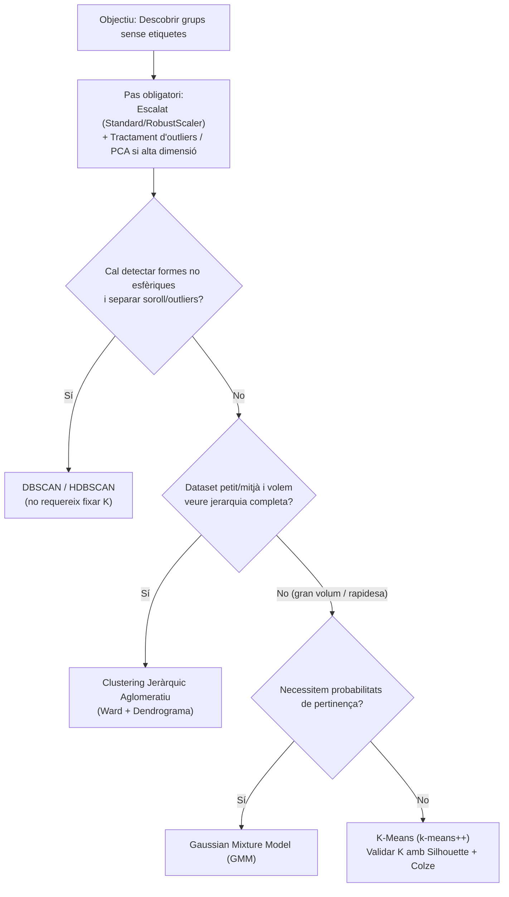

## A. Objectius d'aprenentatge

En completar aquesta lliçó, l'estudiant ha de ser capaç de:

1. **Definir** el **clustering** (agrupament) dins l'aprenentatge no supervisat i explicar el principi d'**alta cohesió intraclúster i alta separació interclúster**.
2. **Comparar** els tres algoritmes fonamentals de clustering: **K-Means**, **clustering jeràrquic aglomeratiu** i **DBSCAN**, detallant com funcionen, els seus hiperparàmetres i les seves limitacions geomètriques.
3. **Aplicar** mètriques d'avaluació interna (**inèrcia / mètode del colze**, **Silhouette Score**, **Davies-Bouldin**) i externa (**ARI**, **NMI**) per seleccionar el nombre de clústers i validar la qualitat de la partició.
4. **Justificar** la importància crítica de l'**escalat de variables**, l'elecció de la **mètrica de distància** (euclidiana vs. cosinus) i la **reducció de dimensionalitat** (PCA / UMAP) abans del clustering.
5. **Implementar** en Python/NumPy l'algoritme **K-Means** i el càlcul del **Silhouette Score** sobre un perfil sintètic de municipis.

---

## B. Explicació introductòria

Imagina que la Diputació de Barcelona vol dissenyar plans d'assistència tècnica diferenciats per als 311 municipis de la província. No hi ha cap etiqueta prèvia que digui «aquest municipi pertany al grup 1 o al grup 3», però disposem d'indicadors de cada ajuntament (població, pressupost per habitant, nivell de tramitació electrònica, ràtio de personal tècnic, superfície forestal).

El **clustering** analitza aquestes dades **sense etiquetes** i descobreix grups naturals (*clústers*) de manera que:
- Els municipis **dins d'un mateix grup** s'assemblin molt entre si (cohesió).
- Els municipis **de grups diferents** siguin tan diferents com sigui possible (separació).

Això permet descobrir perfils operatius (p. ex., *micromunicipis rurals amb baixa digitalització*, *ciutats metropolitanes denses*, *municipis costaners turístics amb forta estacionalitat*) i dissenyar polítiques públiques més eficients.

---

## C. Explicació tècnica avançada

### 1. Principals algoritmes de clustering

| Algoritme | Paradigma | Hiperparàmetres clau | Fortaleses | Limitacions |
|---|---|---|---|---|
| **K-Means** | Basat en centroides (particional) | \(K\) (nombre de clústers), inicialització (`k-means++`) | Molt ràpid \(O(n \cdot K \cdot d \cdot t)\), fàcil d'interpretar, escala a grans volums | Assumeix clústers **esfèrics/convexos** de mida similar; molt sensible a *outliers* i a la inicialització; requereix fixar \(K\) a priori |
| **Jeràrquic aglomeratiu** | Basat en connectivitat (arbre / **dendrograma**) | Criteri d'enllaç (*linkage*: `Ward`, `complete`, `average`, `single`) i punt de tall | No cal fixar \(K\) abans d'executar; el dendrograma mostra l'estructura multinivell | Cost alt \(O(n^2 \text{ a } n^3)\) en memòria i temps; inviable per a centenars de milers de files |
| **DBSCAN** | Basat en densitat | \(\varepsilon\) (radi de veïnatge), `min_samples` (mínim de punts per ser punt nucli) | Descobreix clústers de **formes arbitràries** (no esfèriques), **no requereix fixar \(K\)**, identifica explícitament el **soroll / *outliers*** (etiqueta `-1`) | Pateix quan els clústers tenen **densitats molt diferents** (mitigat amb **HDBSCAN**); sensible a l'elecció de \(\varepsilon\) en alta dimensió |
| **GMM (*Gaussian Mixture Models*)** | Probabilístic (algoritme EM) | \(K\) components, tipus de covariància | **Clustering tou (*soft clustering*)**: assigna probabilitats de pertinença a cada clúster i admet formes el·líptiques | Més paràmetres, pot convergir a òptims locals |

### 2. Funcionament intern de K-Means

K-Means minimitza la **inèrcia** (suma de distàncies quadràtiques de cada punt al seu centroide assignat, *Within-Cluster Sum of Squares*, WCSS):

\[
J = \sum_{k=1}^{K} \sum_{x_i \in C_k} \| x_i - \mu_k \|_2^2
\]

Itera alternativament dos passos (cas particular d'*Expectation-Maximization*) fins a la convergència:
1. **Assignació**: cada punt \(x_i\) s'assigna al centroide \(\mu_k\) més proper.
2. **Actualització**: cada centroide \(\mu_k\) es recalcula com la mitjana dels punts assignats a \(C_k\).

Per evitar òptims locals dolents per inicialització aleatòria, s'utilitza **`k-means++`** (tria els centroides inicials separats probabilísticament proporcional a \(D(x)^2\)) i múltiples reinicis (`n_init`).

### 3. Avaluació sense etiquetes i selecció de \(K\)

1. **Mètode del colze (*Elbow Method*)**: representa la inèrcia \(J\) en funció de \(K\). La inèrcia **sempre disminueix** en augmentar \(K\) (arriba a 0 quan \(K = n\)); busquem el punt d'inflexió («colze») on el guany marginal s'aplana.
2. **Silhouette Score** (\(s \in [-1, +1]\)): per a cada punt \(i\), compara la distància mitjana als punts del seu propi clúster (\(a_i\), cohesió) amb la distància mitjana al clúster veí més proper (\(b_i\), separació):
   \[
   s(i) = \frac{b_i - a_i}{\max(a_i, b_i)}
   \]
   - Proper a **+1**: punt molt ben assignat i separat.
   - Proper a **0**: punt a la frontera entre dos clústers.
   - **Negatiu (< 0)**: punt probablement assignat al clúster equivocat.
3. **Índex de Davies-Bouldin**: ràtio entre dispersió interna i separació entre centroides (més baix = millor).
4. **Mètriques externes** (només si excepcionalment disposem d'etiquetes de referència per a validació): **ARI (*Adjusted Rand Index*)** i **NMI (*Normalized Mutual Information*)**.

### 4. Requisits crítics de preprocessament i alta dimensió

- **Escalat obligatori**: tots els algoritmes basats en distància euclidiana (K-Means, DBSCAN, jeràrquic) queden completament distorsionats si una columna està en euros (`0..10.000.000`) i una altra en percentatges (`0..100`). Cal aplicar `StandardScaler` o `RobustScaler` (si hi ha *outliers*).
- **Maledicció de la dimensionalitat**: en espais d'alta dimensió (p. ex., embeddings de 768 dimensions o taules de 150 columnes), les distàncies euclidianes entre tots els parells de punts tendeixen a igualar-se. Solucions: usar **similitud cosinus** (o vectors normalitzats L2) en text/embeddings, i aplicar **reducció de dimensionalitat** (**PCA** lineal o **UMAP** no lineal) abans de DBSCAN/HDBSCAN.

---

## D. Diagrames i recursos visuals

### Guia de selecció d'algoritme de clustering



---

## E. Aplicació a l'Administració pública

1. **Segmentació territorial i municipal**: agrupar els municipis d'una diputació segons necessitats de suport tecnològic, envelliment poblacional i capacitat fiscal per dissenyar catàlegs de serveis supramunicipals a mida.
2. **Descoberta temàtica en queixes i consultes ciutadanes (*Topic Discovery*)**: aplicar embeddings de text + UMAP + HDBSCAN sobre milers de suggeriments ciutadans sense etiquetar per descobrir nous problemes emergents al territori que no existien al catàleg oficial.
3. **Agrupament de perfils de mobilitat o consum energètic**: identificar patrons horaris d'ús d'equipaments públics per optimitzar horaris i climatització.

### Riscos i supervisió humana

- **Interpretació humana obligatòria**: el clustering retorna etiquetes arbitràries (`Clúster 0, 1, 2`); sempre cal un tècnic de domini per analitzar els perfils mitjans de cada clúster, comprovar que tenen sentit administratiu real i evitar que els clústers es facin servir per estigmatitzar col·lectius o barris (risc de biaix indirecte).

---

## F. Exemple pràctic guiat

Implementem en **Python + NumPy** l'algoritme **K-Means** des de zero i el càlcul exacte del **Silhouette Score** sobre un conjunt sintètic de 90 municipis descrits per tres indicadors (`poblacio_milers`, `digitalitzacio_pct`, `pressupost_per_hab`), avaluant \(K \in \{2, 3, 4\}\) per seleccionar el nombre òptim de perfils.

```python
"""Exemple 1.9: K-Means i Silhouette Score en NumPy pur sobre perfils municipals sintètics."""
import numpy as np


def kmeans_numpy(X: np.ndarray, k: int, seed: int = 42, max_iter: int = 50) -> tuple[np.ndarray, np.ndarray, float]:
    rng = np.random.default_rng(seed)
    centroides = X[rng.choice(len(X), size=k, replace=False)].copy()
    etiquetes = np.zeros(len(X), dtype=int)

    for _ in range(max_iter):
        dists = np.linalg.norm(X[:, None, :] - centroides[None, :, :], axis=2)
        noves = np.argmin(dists, axis=1)
        if np.array_equal(noves, etiquetes):
            break
        etiquetes = noves
        for c in range(k):
            punts = X[etiquetes == c]
            if len(punts) > 0:
                centroides[c] = punts.mean(axis=0)

    inercia = float(np.sum((X - centroides[etiquetes]) ** 2))
    return etiquetes, centroides, inercia


def silhouette_score_numpy(X: np.ndarray, etiquetes: np.ndarray) -> float:
    n = len(X)
    dists = np.linalg.norm(X[:, None, :] - X[None, :, :], axis=2)
    scores = np.zeros(n)
    cl_unics = np.unique(etiquetes)

    for i in range(n):
        c_i = etiquetes[i]
        mateix = (etiquetes == c_i)
        mateix[i] = False
        a_i = float(np.mean(dists[i, mateix])) if np.any(mateix) else 0.0
        b_i = min(float(np.mean(dists[i, etiquetes == c])) for c in cl_unics if c != c_i)
        scores[i] = (b_i - a_i) / max(a_i, b_i) if max(a_i, b_i) > 0 else 0.0

    return float(np.mean(scores))


if __name__ == "__main__":
    rng = np.random.default_rng(99)
    # 3 perfils sintètics de municipis: rurals petits, mitjans, urbans grans
    g1 = rng.normal([2.0, 40.0, 1400.0], [0.8, 8.0, 150.0], size=(30, 3))
    g2 = rng.normal([20.0, 72.0, 1100.0], [4.0, 7.0, 120.0], size=(30, 3))
    g3 = rng.normal([120.0, 88.0, 1350.0], [18.0, 5.0, 140.0], size=(30, 3))
    X_raw = np.vstack([g1, g2, g3])

    # Escalat OBLIGATORI abans de K-Means
    X_std = (X_raw - X_raw.mean(axis=0)) / X_raw.std(axis=0)

    for k in (2, 3, 4):
        labels, _, inertia = kmeans_numpy(X_std, k=k, seed=42)
        sil = silhouette_score_numpy(X_std, labels)
        print(f"K={k} | Inèrcia={inertia:6.2f} | Silhouette Score={sil:.3f}")
```

### Interpretació dels resultats (execució verificada)

- En provar \(K = 2, 3, 4\) sobre les dades estandarditzades, la inèrcia cau dràsticament de `130.69` (`K=2`) a `44.56` (`K=3`) i tot just baixa a `37.80` (`K=4`) (**colze nítid en `K=3`**), mentre que el **Silhouette Score assoleix el seu màxim clar en `K=3`** (`0.640` enfront de `0.513` en `K=2` i `0.524` en `K=4`).
- Si s'hagués executat K-Means **sense escalar**, la columna `pressupost_per_hab` (rang `900..1700`) hauria dominat completament les distàncies euclidianes ofegant `poblacio_milers` i `digitalitzacio_pct`, produint una segmentació errònia.

---

## G. Exercici pràctic per resoldre

### Enunciat
Un equip d'anàlisi territorial vol agrupar les **120.000 incidències geolocalitzades** (latitud, longitud) registrades en un any a l'àrea metropolitana per detectar **zones d'acumulació irregular d'incidències** (que segueixen formes allargades al llarg de rieres, polígons industrials i eixos viaris) i descartar incidències aïllades puntuals.

Un analista junior proposa aplicar **K-Means amb `K = 10`** directament sobre `[latitud, longitud, cost_reparacio_euros]`.

Has de criticar tècnicament la proposta, identificar **4 defectes** i dissenyar la solució adequada.

### Objectius i restriccions
- Identificar les limitacions geomètriques de K-Means (clústers no esfèrics, soroll/outliers, elecció arbitrària de `K`).
- Triar l'algoritme, la distància i el preprocessament òptims per a dades geoespacials amb soroll.

:::hint Pista 1 — Formes allargades i soroll aïllat
Quin algoritme de clustering basat en **densitat** detecta formes allargades (com una riera o un carrer), no obliga a fixar `K` per endavant i etiqueta automàticament les incidències aïllades com a soroll (`-1`)?
:::

:::hint Pista 2 — Escala i distància geogràfica
Barrejar `latitud`/`longitud` (graus, rang ~0,3) amb `cost_reparacio_euros` (rang `50..50.000`) sense escalat destrueix la geometria. A més, en coordenades geogràfiques sobre la superfície terrestre, quina distància és més rigorosa que l'euclidiana?
:::

### Criteris d'avaluació
- **40%**: Detecció dels 4 defectes (formes no esfèriques en K-Means, inclusió de soroll dins clústers, barreja d'escales/cost en coordenades, `K=10` arbitrari).
- **40%**: Disseny correcte amb **DBSCAN / HDBSCAN** usant **distància Haversine** (en radians) o projecció mètrica UTM (`EPSG:25831` per Catalunya), separant el cost com a anàlisi posterior per clúster.
- **20%**: Criteri d'ajust de \(\varepsilon\) (gràfic de distància al *k*-èsim veí) i supervisió humana operativa.

### Errors habituals
- Proposar clustering jeràrquic aglomeratiu sobre 120.000 punts (requeriria una matriu de distàncies \(120.000 \times 120.000\) que col·lapsaria la memòria RAM!).

:::solution Solució completa comentada i alternatives
### 1. Diagnòstic dels 4 defectes de la proposta
1. **Formes no esfèriques**: K-Means crea particions convexes (diagrama de Voronoi) al voltant de centroides; trencaria una riera o un eix viari en trossos artificials i uniria punts de barris diferents.
2. **Incapacitat de descartar soroll**: K-Means obliga a assignar **totes** les incidències aïllades a algun clúster, desplaçant els centroides i contaminant les zones crítiques.
3. **Barreja d'escales i dimensions heterogènies**: combinar graus de latitud/longitud (variació ~0,2) amb `cost_reparacio_euros` (milers d'euros) sense escalat farà que K-Means agrupi només per cost i ignori la ubicació geogràfica!
4. **Elecció arbitrària `K = 10`**: no coneixem a priori quantes zones crítiques existeixen al territori.

### 2. Disseny recomanat
- **Algoritme**: **DBSCAN** (o **HDBSCAN** si hi ha diferències grans de densitat entre nuclis urbans densos i polígons perifèrics).
- **Representació espacial rigorosa**: projectar `(lat, lon)` a coordenades mètriques planes **ETRS89 / UTM zona 31N (`EPSG:25831`)** per treballar directament en metres amb distància euclidiana (o usar DBSCAN amb `metric='haversine'` sobre coordenades en radians).
- **Tractament del cost**: fer el clustering espacial només sobre les coordenades per detectar els punts negres geogràfics, i posteriorment **agregar el cost total i mitjà dins de cada clúster** descobert per prioritzar les inversions municipals.
- **Selecció d'hiperparàmetres**: fixar `min_samples` segons criteri operatiu (p. ex., mínim 25 incidències per considerar una zona crítica) i determinar \(\varepsilon\) (radi en metres) mitjançant el **gràfic k-distance** (ordenant la distància al *k*-èsim veí més proper i buscant el colze).
- **Alternativa escalable**: si DBSCAN amb Haversine/UTM resulta lent en 120.000 punts, indexar els punts amb un **BallTree / KDTree** espacial (suportat nativament per scikit-learn), mantenint memòria controlada i temps de segons.
:::

---

## H. Test individual

Completa les 10 preguntes sobre K-Means, clustering jeràrquic, DBSCAN, mètode del colze, Silhouette Score i preprocessament per a clustering.

---

## I. Preguntes de desenvolupament

### Pregunta 1
Compara **K-Means** i **DBSCAN** pel que fa a: requisit de fixar el nombre de clústers, tipus de formes geomètriques que detecten, tractament d'*outliers* i comportament davant clústers de densitat desigual.

:::model-answer Resposta model i criteris de correcció (Pregunta 1)
**Resposta model**:
- **Nombre de clústers**: K-Means exigeix especificar \(K\) abans d'executar; DBSCAN determina el nombre de clústers automàticament a partir de \(\varepsilon\) i `min_samples`.
- **Formes geomètriques**: K-Means només troba clústers convexos/esfèrics; DBSCAN descobreix formes arbitràries (corbes, allargades, concèntriques).
- ***Outliers* / soroll**: K-Means assigna tots els punts a algun clúster i els *outliers* desplacen els centroides; DBSCAN etiqueta explícitament els punts aïllats de baixa densitat com a soroll (`-1`).
- **Densitats desiguals**: DBSCAN amb un únic \(\varepsilon\) global falla quan uns clústers són molt densos i altres molt dispersos (cosa que resol la seva extensió jeràrquica **HDBSCAN**).

**Criteris de correcció (10 punts)**:
- Comparació precisa en cadascun dels 4 eixos (2,5 punts per eix).
:::

### Pregunta 2
Explica què mesura el **Silhouette Score** (\(s(i) = \frac{b_i - a_i}{\max(a_i, b_i)}\)), quin és el seu rang de valors i per què el mètode del colze basat en la inèrcia no pot utilitzar simplement «la inèrcia mínima» per triar \(K\).

:::model-answer Resposta model i criteris de correcció (Pregunta 2)
**Resposta model**:
- El **Silhouette Score** compara per a cada punt \(i\) la seva cohesió interna (\(a_i\), distància mitjana als punts del mateix clúster) amb la separació respecte al clúster veí més proper (\(b_i\)). Pren valors a \([-1, +1]\): proper a +1 indica assignació molt ben cohesionada i separada; proper a 0 indica frontera ambigua; negatiu indica probable assignació errònia.
- La **inèrcia (WCSS)** disminueix monòtonament sempre que augmenta \(K\) fins a valer 0 quan \(K = n\) (cada punt és el seu propi clúster). Per tant, minimitzar la inèrcia sense criteri portaria sempre al cas degenerat \(K = n\); el mètode del colze busca el punt on afegir un clúster més ja gairebé no redueix la inèrcia, combinat sempre amb Silhouette i interpretabilitat del domini.

**Criteris de correcció (10 punts)**:
- Explicació exacta de \(a_i\), \(b_i\), rang \([-1, 1]\) i interpretació: 5 punts.
- Demostració de la monotonia decreixent de la inèrcia fins a \(K=n\) i funció del colze: 5 punts.
:::

### Pregunta 3
Per què en agrupar documents textuals representats mitjançant *embeddings* d'alta dimensió (p. ex., 768 dimensions) sovint es combina **reducció de dimensionalitat (UMAP/PCA)** o **similitud cosinus** abans d'aplicar clustering?

:::model-answer Resposta model i criteris de correcció (Pregunta 3)
**Resposta model**:
- En alta dimensió opera la **maledicció de la dimensionalitat**: el volum de l'espai creix exponencialment i les distàncies euclidianes entre qualsevol parell de punts es tornen molt similars entre si, fent perdre poder discriminatiu a algoritmes com K-Means o DBSCAN.
- A més, en representacions textuals la similitud semàntica depèn de l'**angle** entre vectors (**similitud cosinus**, equivalent a distància euclidiana sobre vectors normalitzats L2) més que de la norma. Reduir prèviament la dimensionalitat (p. ex., PCA o UMAP a 5–15 dimensions) elimina soroll, accelera el càlcul i permet a HDBSCAN descobrir clústers temàtics coherents (base de pipelines com BERTopic).

**Criteris de correcció (10 punts)**:
- Explicació de la maledicció de la dimensionalitat sobre distàncies: 4 punts.
- Paper de la similitud cosinus / normalització L2 en text: 3 punts.
- Paper de PCA/UMAP + HDBSCAN en pipelines reals: 3 punts.
:::

---

## J. Resum per memoritzar

### Conceptes clau
- **Clustering**: aprenentatge no supervisat que maximitza cohesió intraclúster i separació interclúster.
- **K-Means**: ràpid, requereix \(K\), només clústers esfèrics, sensible a *outliers* (usar `k-means++`).
- **DBSCAN / HDBSCAN**: basat en densitat, troba formes arbitràries, no requereix \(K\) i marca soroll (`-1`).
- **Jeràrquic**: produeix un dendrograma però no escala a datasets molt grans (\(O(n^2)\)).
- **Validació**: mètode del colze (inèrcia) + **Silhouette Score** \(\in [-1, +1]\) + validació qualitativa amb experts del domini.
- **Preprocessament obligatori**: **escalar sempre** abans de clustering basat en distància; en alta dimensió usar normalització L2/cosinus i PCA/UMAP.

### Definicions essencials
- **Inèrcia (WCSS)**: suma de distàncies quadràtiques de cada punt al centroide del seu clúster.
- **Silhouette Score**: \(\frac{b_i - a_i}{\max(a_i, b_i)}\), balanç entre cohesió \(a_i\) i separació \(b_i\).
- **Dendrograma**: diagrama en arbre que mostra les fusions successives del clustering jeràrquic.

### Errors conceptuals freqüents
1. Executar K-Means sobre variables en escales diferents sense estandarditzar.
2. Triar \(K\) minimitzant absolutament la inèrcia (sempre guanyaria \(K=n\)).
3. Aplicar K-Means per detectar formes geogràfiques allargades o datasets amb molt soroll.

### Possibles preguntes d'examen
- Diferencia K-Means, clustering jeràrquic i DBSCAN.
- Què significa un Silhouette Score negatiu per a un punt?
- Per què `k-means++` millora la inicialització aleatòria?
- Quin efecte té la maledicció de la dimensionalitat en el clustering?
