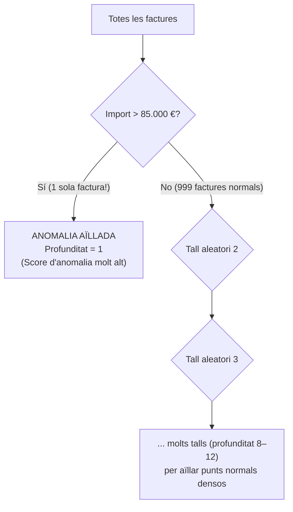
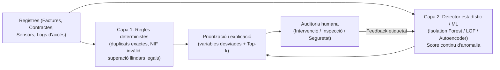

## A. Objectius d'aprenentatge

En completar aquesta lliçó, l'estudiant ha de ser capaç de:

1. **Classificar** els tres tipus d'anomalies (**puntuals**, **contextuals** i **col·lectives**) i distingir entre **detecció d'outliers** (no supervisada amb contaminació) i **detecció de novetat** (*novelty detection*, semisupervisada sobre dades netes).
2. **Explicar** el funcionament intern dels mètodes estadístics clàssics (**Z-score**, **MAD/IQR**) i dels algoritmes de ML/DL especialitzats (**Isolation Forest**, **Local Outlier Factor — LOF**, **One-Class SVM** i **Autoencoders**).
3. **Avaluar** detectors d'anomalies en contextos de desequilibri extrem utilitzant **PR-AUC**, **Precision@k**, **Recall@k** i revisió humana de mostres, evitant la trampa de l'*accuracy*.
4. **Dissenyar** un sistema d'alertes d'anomalies per a control intern, contractació o tributs a l'Administració pública amb gestió de **fatiga d'alertes** i **supervisió humana estricta**.
5. **Implementar** un detector d'anomalies en Python/NumPy combinant mètode robust (**MAD / Modified Z-score**) i aïllament per particions aleatòries (principi d'*Isolation Forest*) sobre factures municipals sintètiques.

---

## B. Explicació introductòria

Una **anomalia** (o valor atípic / *outlier*) és una observació que s'allunya tant del patró habitual que fa sospitar que ha estat generada per un mecanisme diferent: un error de tecleig, una fallada de sensor, un frau, un ciberatac o una irregularitat administrativa.

A l'Administració pública, la detecció d'anomalies actua com un **radar de suport per a Intervenció, Inspecció i Seguretat**:
- Per què una factura de manteniment habitual de ~1.200 € apareix aquest mes per **120.000 €** (error de coma decimal o irregularitat)?
- Per què un proveïdor presenta **14 contractes menors** en tres mesos tots d'imports entre `14.500 €` i `14.990 €` (just per sota del llindar legal de 15.000 € — possible fraccionament)?
- Per què un edifici municipal tancat un diumenge a les 3:00 h registra un pic de consum d'aigua de 4.000 litres/hora (fuita greu)?

A diferència de la classificació supervisada convencional, en detecció d'anomalies sovint **no tenim prou exemples etiquetats de tots els tipus possibles d'irregularitats futures** (les anomalies són rares i canvien de forma constantment). Per això molts detectors aprenen què és **normal** i alerten sobre tot allò que se n'aparta.

---

## C. Explicació tècnica avançada

### 1. Taxonomia de les anomalies

1. **Anomalia puntual (*Point Anomaly*)**: una observació individual és extrema respecte a la resta (p. ex., una factura d'import 50 vegades superior a la mediana del seu capítol pressupostari).
2. **Anomalia contextual (*Contextual Anomaly*)**: el valor és normal en un context però anòmal en un altre (p. ex., un consum elèctric de 40 kW és normal un dimarts a les 11:00 h, però altament anòmal un diumenge de matinada). Requereix incloure variables de context (hora, dia laborable, estació, mida del municipi).
3. **Anomalia col·lectiva (*Collective Anomaly*)**: cada registre individual sembla normal aïlladament, però **el conjunt o seqüència** és anòmal (p. ex., 12 contractes menors seguits al mateix proveïdor per 14.800 € cadascun, o una seqüència ràpida de 500 consultes d'un mateix usuari intern al padró d'habitants).

### 2. Règims d'entrenament

- **No supervisat (*Outlier Detection*)**: les dades d'entrenament no tenen etiquetes i poden contenir ja una petita fracció d'anomalies (hiperparàmetre `contamination`, p. ex. 1%). L'algoritme aïlla els punts que no encaixen en les regions denses.
- **Semisupervisat (*Novelty Detection*)**: el conjunt d'entrenament conté **exclusivament dades normals verificades**; qualsevol patró nou que surti de la frontera apresa s'assenyala com a novetat/anomalia (ex.: *One-Class SVM*, *Autoencoders* entrenats en dades normals).
- **Supervisat (classes molt desequilibrades)**: quan sí disposem d'un històric ric i representatiu d'anomalies etiquetades (tractat com a classificació desequilibrada, Lliçó 1.7). Limitació: no detecta tipologies noves mai vistes (*zero-day anomalies*).

### 3. Algoritmes principals

| Mètode | Principi intern | Fortaleses | Limitacions |
|---|---|---|---|
| **Z-score / IQR / MAD** | Estadístics univariants: \(z = \frac{x-\mu}{\sigma}\); **MAD (*Median Absolute Deviation*)** i **IQR** usen mediana i quartils (robustos) | Molt ràpids, 100% explicables, zero entrenament complex | Univariants (no detecten anomalies multivariants on cada variable per separat sembla normal) |
| **Isolation Forest** | Construeix arbres de particions aleatòries: **les anomalies són poc freqüents i diferents, per tant queden aïllades en molt pocs talls** (camí mitjà curt des de l'arrel) | **Referència en dades tabulars**; escala linealment \(O(n)\), no requereix distàncies ni escalat, funciona bé en dimensió mitjana/alta | Menys eficaç en anomalies locals subtils dins clústers de densitats molt dispars; interpretabilitat indirecta |
| **LOF (*Local Outlier Factor*)** | Compara la **densitat local** d'un punt amb la densitat local dels seus \(k\) veïns més propers; LOF \(\gg 1\) = anomalia local | Excel·lent per detectar **anomalies locals** en datasets amb clústers de densitats diferents | Cost elevat \(O(n^2)\) en datasets molt grans; sensible a l'escalat i a la maledicció de la dimensionalitat |
| **One-Class SVM** | Aprèn una frontera estreta (hiperesfera o hiperplà en espai *kernel* RBF) que envolta les dades normals | Potent per a *novelty detection* en dades netes de dimensió moderada | Molt sensible a *outliers* en entrenament, a l'escalat i als hiperparàmetres \(\nu, \gamma\); no escala bé a milions de files |
| **Autoencoders** | Xarxa neuronal entrenada per reconstruir dades normals; **error de reconstrucció alt = anomalia** | Captura relacions no lineals complexes, sèries temporals, imatges i dades d'alta dimensió | Requereix més dades i còmput; baixa explicabilitat nativa (tot i que l'error per variable dona pistes) |

### 4. Mètriques, calibració del volum d'alertes i fatiga d'alertes

En producció real, el principal enemic d'un detector d'anomalies és la **fatiga d'alertes (*alert fatigue*)**: si el sistema genera 500 alertes setmanals i el 95% són falsos positius, els auditors deixaran de mirar-les.

- **Avaluació quantitativa** (sobre un conjunt de validació auditat per experts): **PR-AUC** (mètrica global) i **Precision@k / Recall@k** (p. ex., *entre les 30 factures més anòmales del mes que pot revisar Intervenció, quantes tenen una incidència real?*).
- **Disseny de llindar per pressupost d'auditoria**: en lloc d'un llindar arbitrari, fixar una cua acotada (p. ex., Top-20 setmanals + regles dures per a casos crítics) i incorporar un **bucle de retroalimentació humana** on l'auditor marca «anomalia real / fals positiu explicat» per refinar regles i models.

---

## D. Diagrames i recursos visuals

### Principi d'Isolation Forest: per què una anomalia s'aïlla en menys talls



### Arquitectura de detecció d'anomalies amb supervisió humana a l'Administració



---

## E. Aplicació a l'Administració pública

1. **Control intern i prevenció d'errors en facturació i contractació**: detectar factures duplicades amb lleugeres variacions, imports atípics respecte l'històric del proveïdor o possibles fraccionaments de contractes menors (anomalia col·lectiva).
2. **Ciberseguretat i protecció de dades (ENS / RGPD)**: detectar accessos anòmals de personal intern a bases de dades sensibles (p. ex., consultes massives al padró fora d'horari laboral) — anomalia contextual i col·lectiva.
3. **Manteniment predictiu i eficiència hídrica/energètica**: detecció de fuites d'aigua o consums nocturns anòmals en escoles, biblioteques i xarxes municipals.
4. **Control tributari i subvencions**: priorització d'expedients amb incoherències respecte a perfils comparables per a revisió d'inspecció.

### Garanties legals i presumpció de legalitat

:::callout-legal Principi absolut en detecció d'anomalies al sector públic
Una **anomalia estadística NO equival a frau ni a il·legalitat**. Una factura pot ser estadísticament atípica simplement perquè correspon a una obra extraordinària o a una urgència climàtica. Per tant, un detector d'anomalies **mai no pot imposar sancions, bloquejar pagaments definitivament ni denegar drets de manera autònoma**: actua estrictament com a **senyal de priorització per a revisió humana motivada**, amb registre d'auditoria i dret a explicació.
:::

---

## F. Exemple pràctic guiat

Implementem en **Python + NumPy** un comparador entre:
1. **Z-score clàssic** (basat en mitjana i desviació estàndard, vulnerable a quedar contaminat per un *outlier* extrem — fenomen anomenat *masking*).
2. **Modified Z-score basat en MAD (*Median Absolute Deviation*)** (molt més robust!).
3. Una versió educativa minimalista del principi d'**aïllament per talls aleatoris (Isolation Trees)** per comprovar com els punts anòmals queden aïllats a menor profunditat mitjana.

```python
"""Exemple 1.10: Z-score vs. Modified Z-score (MAD) i principi d'aïllament (Isolation Tree) en NumPy."""
import numpy as np


def zscore_classic(x: np.ndarray) -> np.ndarray:
    return np.abs((x - np.mean(x)) / np.std(x))


def modified_zscore_mad(x: np.ndarray) -> np.ndarray:
    """Modified Z-score (Iglewicz & Hoaglin): robust davant outliers extrems."""
    mediana = np.median(x)
    mad = np.median(np.abs(x - mediana))
    if mad == 0:
        return np.zeros_like(x)
    return 0.6745 * np.abs(x - mediana) / mad


def profunditat_aillament(X: np.ndarray, idx: int, rng: np.random.Generator, max_depth: int = 8) -> int:
    """Calcula la profunditat necessària per aïllar el punt `idx` mitjançant talls aleatoris."""
    actius = np.arange(len(X))
    for depth in range(1, max_depth + 1):
        if len(actius) <= 1:
            return depth - 1
        col = int(rng.integers(0, X.shape[1]))
        vals = X[actius, col]
        vmin, vmax = float(vals.min()), float(vals.max())
        if vmin == vmax:
            return depth
        tall = float(rng.uniform(vmin, vmax))
        if X[idx, col] < tall:
            actius = actius[X[actius, col] < tall]
        else:
            actius = actius[X[actius, col] >= tall]
        if len(actius) == 1:
            return depth
    return max_depth


if __name__ == "__main__":
    rng = np.random.default_rng(7)
    # 28 factures normals (~1.200 €) + 2 anomalies: una moderada (4.500 €) i una extrema (95.000 €)
    normals = rng.normal(1200.0, 180.0, size=28)
    imports = np.append(normals, [4500.0, 95000.0])

    z_std = zscore_classic(imports)
    z_mad = modified_zscore_mad(imports)

    print("Comparació Z-score clàssic vs. Modified Z-score (MAD) [llindar habitual > 3.5]:")
    for idx in (0, 28, 29):
        print(f"  Factura #{idx:2d} ({imports[idx]:8.1f} €) | Z-clàssic={z_std[idx]:5.2f} | Z-MAD={z_mad[idx]:7.2f}")

    # Principi d'Isolation Forest (profunditat mitjana en 60 arbres aleatoris)
    X_2d = np.column_stack([imports, np.append(rng.normal(10, 2, size=28), [11, 12])])
    print("\nProfunditat mitjana d'aïllament (menys profunditat = més anòmal):")
    for idx in (0, 28, 29):
        prof = np.mean([profunditat_aillament(X_2d, idx, rng) for _ in range(60)])
        print(f"  Factura #{idx:2d} ({imports[idx]:8.1f} €) | Profunditat mitjana = {prof:.2f}")
```

### Interpretació dels resultats (execució verificada)

- **Efecte *masking* del Z-score clàssic**: l'*outlier* extrem de `95.000 €` infla enormement la mitjana i la desviació estàndard (`σ > 16.000 €`). Com a conseqüència, la factura anòmala `#28` de `4.500 €` (gairebé 4 vegades el preu habitual!) obté un Z-score clàssic de només **`0.01`**, quedant completament **emmascarada** (mentre la factura extrema `#29` marca `Z = 5.38`).
- **Robustesa de MAD**: el *Modified Z-score* (basat en mediana i MAD) no es deixa contaminar pel `95.000 €` i detecta immediatament **ambdues anomalies** (`#28` de `4.500 €` amb `Z-MAD = 21.53` i `#29` de `95.000 €` amb `Z-MAD = 603.78`), mentre que la factura normal `#0` (`1.200,2 €`) queda en `Z-MAD = 0.30`.
- **Principi d'aïllament**: en 60 arbres aleatoris, la factura de `95.000 €` queda aïllada gairebé sempre en **profunditat ~1–2**, la de `4.500 €` en profunditat baixa (~2–3) i la factura normal `#0` requereix molta més profunditat (~6–7).

---

## G. Exercici pràctic per resoldre

### Enunciat
L'Interventor General d'una diputació vol implantar un sistema de detecció d'anomalies sobre els **60.000 pagaments anuals a proveïdors** per donar suport a la funció de control financer. S'han identificat tres patrons d'interès:
- **Patró P1**: errors de tecleig o factures individuals d'import desproporcionat per a aquell tipus de despesa.
- **Patró P2**: possibles fraccionaments de contractes menors (múltiples factures al mateix NIF en un trimestre que individualment queden per sota de 15.000 €, però la suma agregada supera el llindar legal).
- **Patró P3**: combinacions atípiques multivariants (p. ex., proveïdor nou creat fa 2 mesos + import alt + tramitació d'urgència en divendres a la tarda).

L'equip d'auditoria només disposa de capacitat per revisar **40 alertes al mes**.

Dissenya la solució completa classificant P1, P2 i P3 segons la taxonomia d'anomalies, especificant quines capes (regles vs. ML) resolen cada patró, quines *features* cal construir, com evitar la fatiga d'alertes i quines garanties legals cal aplicar.

### Objectius i restriccions
- Combinar regles deterministes (per a llindars legals coneguts) amb ML no supervisat (per a patrons multivariants complexos).
- Seleccionar mètriques orientades a la capacitat real d'auditoria (`Precision@40`).

:::hint Pista 1 — Identifica la tipologia d'anomalia de P1, P2 i P3
P1 = puntual; P2 = **col·lectiva** (cal agregar per `(proveidor_nif, trimestre, objecte_contractual)`!); P3 = **contextual / multivariant**.
:::

:::hint Pista 2 — Cal ML per detectar P2?
Comprovar si la suma trimestral de contractes menors d'un mateix proveïdor i codi CPV supera 15.000 € és una **regla determinista SQL/BRMS exacta**! Reserva Isolation Forest / LOF per a P3 (i combinacions desconegudes).
:::

### Criteris d'avaluació
- **30%**: Classificació exacta de P1 (puntual), P2 (col·lectiva) i P3 (multivariant/contextual).
- **35%**: Arquitectura en dues capes (regles deterministes per P2 i duplicats + Isolation Forest / MAD per P1/P3 + enginyeria de *features* agregades).
- **35%**: Control de fatiga d'alertes (`Precision@40`, explicació de variables desviades, feedback humà) i compliment legal (cap bloqueig/sanció automàtica sense intervenció humana).

### Errors habituals
- Intentar detectar P2 passant només factures individuals a Isolation Forest sense crear variables agregades per proveïdor i finestra temporal.
- Generar 800 alertes mensuals sense ordenació per risc ni explicabilitat.

:::solution Solució completa comentada i alternatives
### 1. Classificació de patrons i arquitectura en dues capes
- **P1 (Anomalia puntual)**: detectar mitjançant **Modified Z-score (MAD)** agrupat per partida pressupostària / codi CPV + **Isolation Forest**.
- **P2 (Anomalia col·lectiva)**: **NO resoldre amb ML opac**; aplicar **regles deterministes sobre agregacions temporals** (agrupar per `nif_proveidor`, `codi_cpv`, `organisme`, finestra mòbil de 12 mesos / exercici pressupostari i alertar si la suma acumulada supera o s'acosta al llindar legal de contracte menor de serveis/subministraments o obres, segons LCSP).
- **P3 (Anomalia contextual / multivariant)**: construir *features* enriquides (`antiguitat_proveidor`, `ratio_import_vs_mediana_cpv`, `num_factures_90d`, `es_urgencia`, `hora_registre`, `canvi_compte_iban`) i aplicar **Isolation Forest** (escalable en CPU, robust) complementat amb **LOF** sobre subgrups homogenis si es vol sensibilitat local.

### 2. Gestió de la capacitat (40 alertes/mes) i explicabilitat
- **Cua prioritzada**: assignar prioritat màxima a les alertes de regles legals (P2 i canvis recents d'IBAN) i completar el cupo mensual de 40 revisions amb el **Top-k d'Isolation Forest** ordenat per `anomaly_score × impacte_economic`.
- **Explicació obligatòria per alerta**: cada alerta presentada a Intervenció inclou les 3 variables que més han contribuït a l'aïllament (p. ex., SHAP sobre Isolation Forest o desviació MAD per camp) per permetre una comprovació ràpida.
- **Mètrica de seguiment**: **Precision@40** mensual auditada per Intervenció + registre de falsos positius justificats (p. ex., proveïdors d'emergències) per afinar excepcions.

### 3. Garanties jurídiques i supervisió humana
- El sistema funciona exclusivament com a **eina de mostreig basat en risc** per a control intern.
- Cap pagament queda anul·lat ni cap proveïdor rep conseqüències jurídiques per una puntuació estadística: tota actuació requereix verificació documental i informe motivat de l'òrgan d'intervenció.
:::

---

## H. Test individual

Resol les 10 preguntes sobre taxonomia d'anomalies, Z-score vs. MAD, Isolation Forest, LOF, One-Class SVM, Autoencoders i avaluació sense fatiga d'alertes.

---

## I. Preguntes de desenvolupament

### Pregunta 1
Explica el mecanisme intern d'**Isolation Forest** i justifica per què, a diferència d'altres mètodes clàssics, aïlla les anomalies en lloc de construir un perfil complet de la normalitat.

:::model-answer Resposta model i criteris de correcció (Pregunta 1)
**Resposta model**:
- **Isolation Forest** parteix de dues propietats pròpies de les anomalies: són **escasses** (pocs punts) i tenen valors **molt diferents** dels normals.
- En comptes de calcular distàncies o densitats entre tots els punts, construeix un bosc d'arbres binaris fent **talls aleatoris** (tria una característica a l'atzar i un punt de tall aleatori dins del seu rang) fins a aïllar cada observació.
- Els punts **anòmals** cauen en regions buides lluny del gruix de dades i queden aïllats en **molt pocs talls** (profunditat mitjana petita des de l'arrel), mentre que els punts normals en regions denses requereixen molts més talls. Aquest enfocament té complexitat lineal \(O(n)\), baix consum de memòria i no exigeix escalar les dades.

**Criteris de correcció (10 punts)**:
- Explicació exacta dels talls aleatoris i la relació inversa entre profunditat i grau d'anomalia: 6 punts.
- Avantatges d'escalabilitat i absència de càlcul de distàncies: 4 punts.
:::

### Pregunta 2
Distingeix entre **anomalia puntual**, **anomalia contextual** i **anomalia col·lectiva**, aportant un exemple concret de l'Administració pública per a cadascuna.

:::model-answer Resposta model i criteris de correcció (Pregunta 2)
**Resposta model**:
- **Anomalia puntual**: una única observació s'allunya clarament de la distribució global (p. ex., una factura individual de 150.000 € en una partida on les factures habituals són de 1.500 €).
- **Anomalia contextual**: un valor és normal en determinades condicions però anòmal en el seu context temporal o espacial (p. ex., un consum d'aigua de 3.000 L/h en un poliesportiu municipal a les 3:30 h de la matinada quan està tancat).
- **Anomalia col·lectiva**: un conjunt o seqüència d'observacions que individualment semblen normals però agregadament revelen un patró atípic (p. ex., 10 contractes menors al mateix proveïdor de 14.700 € cadascun dins el mateix exercici, o 300 consultes consecutives al padró des d'un mateix compte d'usuari en 10 minuts).

**Criteris de correcció (10 punts)**:
- Definició rigorosa dels tres tipus: 5 punts.
- Tres exemples administratius realistes i diferenciats: 5 punts.
:::

### Pregunta 3
Què és l'efecte d'emmascarament (*masking*) en la detecció d'anomalies amb el **Z-score clàssic** i per què el **Modified Z-score basat en MAD** resol aquest problema?

:::model-answer Resposta model i criteris de correcció (Pregunta 3)
**Resposta model**:
- El Z-score clàssic utilitza la mitjana (\(\mu\)) i la desviació estàndard (\(\sigma\)), dos estadístics **no robustos** (punt de ruptura 0%): un sol valor extrem molt gran (p. ex., una factura de 95.000 € entre factures de 1.200 €) dispara \(\sigma\) fins a valors enormes. Això fa que altres anomalies reals però menys extremes (p. ex., 4.500 €) obtinguin Z-scores baixos i quedin ocultes (*masking*).
- El **Modified Z-score** substitueix la mitjana per la **mediana** i \(\sigma\) per la **MAD (*Median Absolute Deviation*)** (amb punt de ruptura del 50%), de manera que els valors extrems no contaminen l'escala de referència i totes les anomalies reals destaquen clarament.

**Criteris de correcció (10 punts)**:
- Explicació de la sensibilitat de \(\mu\) i \(\sigma\) i definició de *masking*: 5 punts.
- Explicació de mediana + MAD i robustesa estadística: 5 punts.
:::

---

## J. Resum per memoritzar

### Conceptes clau
- **3 tipus d'anomalies**: puntual (valor extrem aïllat), contextual (anòmal segons hora/lloc/perfil), col·lectiva (conjunt/seqüència atípica).
- **Outlier detection** (no supervisat, dades amb contaminació) vs. **Novelty detection** (entrenat només amb dades normals).
- **Mètodes clau**: MAD/IQR (univariant robust), **Isolation Forest** (talls aleatoris, profunditat curta = anomalia; rei en tabular), **LOF** (densitat local vs veïns), **One-Class SVM** (frontera de novetat), **Autoencoders** (error de reconstrucció).
- **Avaluació i operació**: **PR-AUC** i **Precision@k** adaptada a la capacitat real d'auditoria per evitar **fatiga d'alertes**.
- **Regla jurídica**: anomalia estadística ≠ frau; sempre suport a revisió humana motivada.

### Definicions essencials
- **MAD (*Median Absolute Deviation*)**: \(\text{mediana}(|x_i - \text{mediana}(x)|)\); mesura robusta de dispersió.
- **Efecte *masking***: ocultació d'anomalies moderades causada per la distorsió que produeix una anomalia extrema sobre la mitjana i desviació estàndard.
- **Fatiga d'alertes**: pèrdua d'eficàcia de la supervisió humana provocada per un excés de falsos positius.

### Errors conceptuals freqüents
1. Usar Z-score clàssic sense adonar-se que els *outliers* extrems contaminen \(\mu\) i \(\sigma\).
2. Esperar que Isolation Forest detecti anomalies col·lectives sense crear prèviament variables agregades temporals o per entitat.
3. Confondre «alerta d'anomalia» amb «decisió sancionadora automàtica».

### Possibles preguntes d'examen
- Explica com assigna la puntuació d'anomalia l'algoritme Isolation Forest.
- Quan triaries LOF en lloc d'Isolation Forest?
- Com mesuraries l'èxit d'un detector d'anomalies si l'equip auditor només pot revisar 30 casos al mes?
- Diferencia detecció d'*outliers* vs. detecció de novetat (*novelty detection*).
