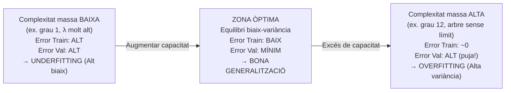
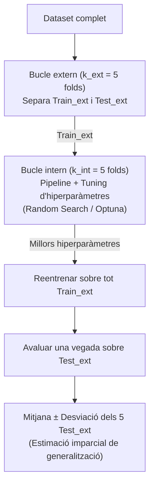

## A. Objectius d'aprenentatge

En completar aquesta lliçó transversal del Mòdul 1, l'estudiant ha de ser capaç de:

1. **Explicar** formalment la **descomposició biaix-variància (*Bias-Variance Tradeoff*)** i diagnosticar amb precisió **infraajustament (*underfitting*)** vs. **sobreajustament (*overfitting*)** a partir de corbes d'aprenentatge i validació.
2. **Distingir** entre **funció de pèrdua (*loss function*)** (diferenciable, optimitzada en entrenament) i **mètrica d'avaluació** (alineada amb l'objectiu de negoci/administratiu).
3. **Seleccionar** l'estratègia correcta de **validació creuada (*cross-validation*)** segons l'estructura de les dades: `KFold`, `StratifiedKFold`, `GroupKFold`, `TimeSeriesSplit` i **validació creuada niuada (*Nested CV*)**.
4. **Comparar** estratègies de cerca d'**hiperparàmetres**: *Grid Search*, *Random Search*, optimització bayesiana (*Optuna/TPE*) i *Successive Halving / Hyperband*.
5. **Implementar** una validació creuada *k-fold* en Python/NumPy per seleccionar el grau polinòmic òptim i visualitzar numèricament la transició d'*underfitting* → generalització òptima → *overfitting*.

---

## B. Explicació introductòria

Imagina un opositor que prepara un examen tipus test fent sempre el mateix simulacre de 50 preguntes una vegada i una altra:
- Si només estudia 10 minuts un resum massa curt (**infraajustament / *underfitting***), suspendrà tant el simulacre com l'examen real perquè no ha captat ni els conceptes bàsics.
- Si memoritza literalment l'ordre de les lletres `A, C, B, D...` d'aquelles 50 preguntes sense entendre la teoria (**sobreajustament / *overfitting***), traurà un `10/10` en el simulacre conegut, però suspendrà l'examen oficial quan canviïn l'enunciat.
- Si estudia comprenent els principis fonamentals i practica amb exàmens variats (**generalització**), traurà una nota alta i estable en preguntes mai vistes.

En Machine Learning passa exactament el mateix: l'objectiu **no és mai minimitzar l'error sobre les dades d'entrenament**, sinó **maximitzar la generalització** sobre expedients futurs no vistos. Aquesta lliçó consolida les eines metodològiques transversals per aconseguir-ho.

---

## C. Explicació tècnica avançada

### 1. Descomposició Biaix-Variància (*Bias-Variance Tradeoff*)

En regressió sota error quadràtic esperat, l'error de generalització d'un model \(\hat{f}(x)\) sobre un punt nou es descompon en tres termes:

\[
\mathbb{E}\left[(y - \hat{f}(x))^2\right] = \underbrace{\text{Bias}[\hat{f}(x)]^2}_{\text{Infraajustament}} + \underbrace{\text{Var}[\hat{f}(x)]}_{\text{Sobreajustament}} + \underbrace{\sigma^2}_{\text{Soroll irreducible}}
\]

- **Biaix (*Bias*)**: error sistemàtic derivat d'assumpcions massa simples sobre la funció real (p. ex., ajustar una recta a una relació parabòlica). **Alt biaix = *underfitting***.
- **Variància (*Variance*)**: sensibilitat excessiva del model a petites fluctuacions aleatòries del conjunt d'entrenament (p. ex., un arbre de profunditat 30 que memoritza cada punt). **Alta variància = *overfitting***.
- **Soroll irreducible (\(\sigma^2\))**: incertesa intrínseca del fenomen real o variables no observables; cap model pot reduir l'error per sota de \(\sigma^2\).

### 2. Diagnòstic i accions correctores: *Underfitting* vs. *Overfitting*

| Símptoma observat | Diagnòstic | Accions correctores efectives | Què NO funciona (error típic) |
|---|---|---|---|
| Error alt en `Train` **i** error alt en `Val` | **Infraajustament (Alt biaix)** | Model més expressiu (més profunditat, no-linealitats, *boosting*), afegir millors *features*, reduir regularització (\(\lambda\)), entrenar més èpoques | Afegir més files idèntiques o augmentar regularització (empitjora l'underfitting!) |
| Error molt baix en `Train` **però** error alt en `Val` (bretxa gran) | **Sobreajustament (Alta variància)** | Més dades d'entrenament, augmentar regularització (L1/L2, *Dropout*, limitar `max_depth`), *Bagging* (Random Forest), *Early Stopping*, eliminar *features* sorolloses | Afegir més capes o reduir regularització |

### 3. Funcions de pèrdua vs. Mètriques d'avaluació

| Tasca | Funció de pèrdua (*Loss*, entrenament) | Mètriques d'avaluació (validació/negoci) |
|---|---|---|
| Regressió sensible a errors grans | MSE | RMSE, \(R^2\) |
| Regressió robusta a *outliers* | MAE (L1) o **Huber Loss** (suau prop de 0, lineal en extrems) | MAE, WAPE, quantils |
| Classificació binària | Binary Cross-Entropy (Log-Loss) / Focal Loss (desequilibri) | PR-AUC, F1, Precision, Recall, Brier Score |
| Classificació multiclasse | Categorical Cross-Entropy | Macro-F1, Weighted-F1, Matriu de confusió |
| Generació de text (LLM) | Next-token Cross-Entropy | Perplexitat, fidelitat RAG, avaluació humana |

**Per què difereixen?** Moltes mètriques de negoci (`Accuracy`, `F1`, `Precision@k`) són esglaonades i **no diferenciables**, per tant no es poden optimitzar directament amb descens del gradient; s'entrena amb una pèrdua diferenciable substitutòria (*surrogate loss* com Cross-Entropy) i després s'ajusten hiperparàmetres i llindars optimitzant la mètrica real en validació.

### 4. Estratègies de validació creuada (*Cross-Validation*)

La validació creuada \(k\)-fold divideix les dades de desenvolupament en \(k\) particions (habitualment \(k = 5\) o \(k = 10\)), entrena \(k\) models usant \(k-1\) particions i avalua en la partició restant, retornant la mitjana i desviació estàndard. **L'elecció del tipus de split és crítica**:

| Tipus de CV | Quan és OBLIGATORI utilitzar-lo | Error que evita |
|---|---|---|
| **`KFold`** | Dades independents i idènticament distribuïdes (i.i.d.) en regressió | Variància d'una sola partició aleatòria |
| **`StratifiedKFold`** | **Classificació** (especialment classes desequilibrades) | Que algun fold quedi sense exemples (o proporció distorsionada) de la classe minoritària |
| **`GroupKFold`** | Quan diverses files pertanyen a una mateixa entitat (p. ex., **múltiples expedients del mateix municipi o ciutadà**) i en producció arribaran entitats noves | *Entity leakage*: memoritzar un municipi/ciutadà present tant a *train* com a *val* |
| **`TimeSeriesSplit`** | Sèries temporals o convocatòries anuals ordenades en el temps | *Temporal leakage*: usar el futur per predir el passat |
| ***Nested Cross-Validation*** | Datasets petits on volem **alhora** optimitzar hiperparàmetres (bucle intern) i obtenir una estimació imparcial de generalització (bucle extern) | Biaix optimista de selecció d'hiperparàmetres (*selection bias*) |

### 5. Optimització d'hiperparàmetres (*Hyperparameter Tuning*)

1. ***Grid Search***: avalua exhaustivament totes les combinacions d'una graella discreta. Pateix explosió combinatòria (\(5^6 = 15.625\) entrenaments!) i malgasta avaluacions en hiperparàmetres poc influents.
2. ***Random Search*** (Bergstra & Bengio, 2012): mostreja combinacions aleatòries en distribucions (sovint logarítmiques per a `lr` o `alpha`). Amb el mateix pressupost, explora molts més valors diferents dels hiperparàmetres realment importants i sol superar *Grid Search*.
3. **Optimització Bayesiana (TPE / Optuna / Processos Gaussians)**: construeix un model probabilístic substitut (*surrogate*) de l'historial de proves per triar intel·ligentment les següents combinacions equilibrant exploració i explotació.
4. ***Successive Halving* / *Hyperband***: descarta aviat les configuracions que rendeixen malament amb pocs recursos (poques èpoques o submostra) i concentra el pressupost en les millors candidates.

---

## D. Diagrames i recursos visuals

### Corbes de complexitat: Underfitting vs. Generalització òptima vs. Overfitting



### Arquitectura de *Nested Cross-Validation* (sense contaminació de test)



---

## E. Aplicació a l'Administració pública

1. **Equitat territorial entre els 311 municipis (`GroupKFold`)**: si entrenem un model amb expedients de 250 municipis per desplegar-lo a tota la província (inclosos 61 municipis que no han participat en el pilot), avaluar amb `GroupKFold(groups=codi_municipi)` mesura de veritat si el model generalitza a ajuntaments nous en lloc de memoritzar peculiaritats locals.
2. **Validació temporal per exercicis pressupostaris (`TimeSeriesSplit`)**: imprescindible en models de tributs, subvencions o consums afectats per canvis legislatius anuals i inflació.
3. **Estalvi computacional i sostenibilitat**: substituir *Grid Search* exhaustiu per *Random Search* o *Optuna* amb poda (*pruning*) redueix hores de GPU/CPU, costos i petjada energètica en la infraestructura pública.

---

## F. Exemple pràctic guiat

Implementem en **Python + NumPy** una **validació creuada 5-fold** completa que avalua models polinòmics de graus `1, 2, 3, 5, 9` sobre una relació no lineal sintètica (corba d'afluència horària en una oficina ciutadana), mesurant `RMSE Train` vs. `RMSE CV (5-fold)` per observar quantitativament la transició exacta: **Underfitting (grau 1) → Òptim (grau 3) → Overfitting sever (grau 9)**.

```python
"""Exemple 1.11: Validació creuada 5-fold en NumPy per diagnosticar Underfitting vs Overfitting."""
import numpy as np


def construir_matriu_polinomica(x: np.ndarray, grau: int) -> np.ndarray:
    return np.column_stack([x ** p for p in range(grau + 1)])


def avaluar_grau_cv(x: np.ndarray, y: np.ndarray, grau: int, k_folds: int = 5) -> tuple[float, float]:
    n = len(x)
    fold_size = n // k_folds
    train_rmses: list[float] = []
    val_rmses: list[float] = []

    for f in range(k_folds):
        inici, fi = f * fold_size, (f + 1) * fold_size
        mask_val = np.zeros(n, dtype=bool)
        mask_val[inici:fi] = True

        X_tr = construir_matriu_polinomica(x[~mask_val], grau)
        y_tr = y[~mask_val]
        X_va = construir_matriu_polinomica(x[mask_val], grau)
        y_va = y[mask_val]

        # Ajust OLS per mínims quadrats (lstsq numèricament estable)
        beta, *_ = np.linalg.lstsq(X_tr, y_tr, rcond=None)
        rmse_tr = float(np.sqrt(np.mean((y_tr - X_tr @ beta) ** 2)))
        rmse_va = float(np.sqrt(np.mean((y_va - X_va @ beta) ** 2)))
        train_rmses.append(rmse_tr)
        val_rmses.append(rmse_va)

    return float(np.mean(train_rmses)), float(np.mean(val_rmses))


if __name__ == "__main__":
    rng = np.random.default_rng(11)
    n = 50
    x = rng.uniform(-1.0, 1.0, size=n)
    # Relació real cúbica suau + soroll aleatori (sigma = 0.25)
    y = 1.5 - 2.0 * (x ** 2) + 1.2 * (x ** 3) + rng.normal(0.0, 0.25, size=n)

    print("Grau | RMSE Train | RMSE 5-Fold CV | Diagnòstic")
    print("-" * 58)
    for grau in (1, 2, 3, 5, 9):
        r_tr, r_cv = avaluar_grau_cv(x, y, grau=grau, k_folds=5)
        if grau == 1:
            diag = "Underfitting (alt biaix)"
        elif grau == 3:
            diag = "Òptim (millor generalització)"
        elif grau == 9:
            diag = "Overfitting (alta variància)"
        else:
            diag = "Intermedi"
        print(f"  {grau:2d} | {r_tr:10.4f} | {r_cv:14.4f} | {diag}")
```

### Interpretació dels resultats (execució verificada)

- **Grau 1 (recta)**: tant `RMSE Train` (`0.6578`) com `RMSE CV` (`0.6744`) són molt alts → **infraajustament** (una recta no pot modelar una corba cúbica).
- **Grau 2**: millora forta (`RMSE Train = 0.2635`, `RMSE CV = 0.2899`), però encara deixa fora el terme cúbic.
- **Grau 3**: assoleix el mínim global en validació creuada (**`RMSE CV = 0.2632`**, pràcticament igual al soroll irreducible `σ = 0.25`, amb `RMSE Train = 0.2298`) → **generalització òptima**.
- **Grau 5 i Grau 9**: `RMSE Train` continua baixant artificialment (`0.2259` → `0.2159`) perquè el polinomi s'ondula per memoritzar el soroll, mentre que **`RMSE CV` empitjora progressivament (`0.2734` → `0.3301`)** → **sobreajustament** (alta variància).

---

## G. Exercici pràctic per resoldre

### Enunciat
Tens l'encàrrec de validar i ajustar els hiperparàmetres d'un classificador **LightGBM** que prediu quines escoles municipals (de 180 centres distribuïts en 60 municipis) tindran sobredemanda de beques menjador el curs vinent. Disposes de dades dels 4 últims cursos (`2022–2025`, 720 files totals, amb un 14% de casos positius).

Un company et demana consell sobre quatre decisions crítiques de disseny:
1. Quina estratègia de validació creuada triar: `KFold`, `StratifiedKFold`, `GroupKFold` o `TimeSeriesSplit` (o quina combinació)?
2. Com buscar hiperparàmetres (`num_leaves`, `learning_rate`, `min_child_samples`, `reg_lambda`) amb un pressupost limitat de 40 proves: *Grid Search* o *Random Search / Optuna*?
3. En observar les corbes d'aprenentatge d'un primer intent: `PR-AUC Train = 0,98` i `PR-AUC Val = 0,52`. Quin diagnòstic fas i quins 3 hiperparàmetres de LightGBM ajustaries primer?
4. Com garantir que l'estimació final de rendiment reportada a Direcció no tingui biaix optimista de selecció d'hiperparàmetres?

### Objectius i restriccions
- Combinar coneixement de particions temporals/agrupades, diagnòstic biaix-variància i cerca eficient d'hiperparàmetres en un dataset petit (`n = 720`).

:::hint Pista 1 — Pensa en què canvia en producció el curs 2026
En producció el model predirà un **curs futur nou (2026)** sobre les mateixes escoles (i possiblement alguna escola nova). Quina dimensió domina el risc de fuga de dades: la temporal!
:::

:::hint Pista 2 — `Train = 0,98` vs `Val = 0,52` amb només 720 files
És un **sobreajustament sever** típic de LightGBM amb `num_leaves = 31` (valor per defecte) sobre un dataset petit de 500–700 files!
:::

### Criteris d'avaluació
- **30%**: Selecció justificada d'estratègia temporal (`TimeSeriesSplit` per curs) + comprovació de generalització per municipis si es vol desplegar a municipis nous (`GroupKFold`).
- **25%**: Elecció justificada de *Random Search* o *Optuna (TPE)* sobre *Grid Search* per a 4 hiperparàmetres continus/discrets amb pressupost de 40 proves.
- **25%**: Diagnòstic exacte d'*overfitting* i ajust concret dels hiperparàmetres de LightGBM (`min_child_samples`↑, `num_leaves`↓ / `max_depth`↓, `reg_lambda`/`reg_alpha`↑, `colsample_bytree`/`subsample`↓, `early_stopping`).
- **20%**: Prevenció del biaix de selecció mitjançant *hold-out* temporal final (curs 2025 intocable fins al final) o *Nested CV*.

### Errors habituals
- Usar `KFold` aleatori barrejant cursos 2022–2025 (filtraria informació del curs 2025 dins de l'entrenament de 2024).
- Recomanar *Grid Search* de 4×4×4×4 = 256 combinacions incomplint el pressupost de 40 proves.

:::solution Solució completa comentada i alternatives
### 1. Estratègia de validació creuada
- **Eix principal — Validació temporal per cursos (`TimeSeriesSplit` / *rolling origin*)**: com que volem predir el curs futur `2026`, cal entrenar sempre en el passat i validar en el curs següent:
  - *Split 1*: Train `2022` → Val `2023`
  - *Split 2*: Train `2022–2023` → Val `2024`
  - **Hold-out final (Test intocable)**: reentrenar amb `2022–2024` i avaluar una sola vegada sobre `2025`.
- **Complement territorial (`GroupKFold` per `municipi_id`)**: si el model s'ha d'estendre a municipis no inclosos en els 60 històrics, executar addicionalment una anàlisi de sensibilitat agrupada per municipi per mesurar la generalització geogràfica.

### 2. Cerca d'hiperparàmetres amb 40 proves
- Escollir **Optimització Bayesiana (Optuna / TPE)** o ***Random Search*** en escala logarítmica per `learning_rate` i `reg_lambda`. Amb 4 hiperparàmetres i només 40 avaluacions, una graella *Grid Search* només podria provar ~2 valors per hiperparàmetre (\(2^4 = 16\) o \(3^3\)), deixant grans forats sense explorar.

### 3. Diagnòstic de `PR-AUC Train = 0,98` vs. `Val = 0,52` i correcció en LightGBM
- **Diagnòstic**: **sobreajustament sever (alta variància)** agreujat per un dataset petit (~540 files d'entrenament) amb paràmetres massa flexibles.
- **Ajustos prioritaris**:
  1. Reduir la capacitat dels arbres: baixar **`num_leaves`** (p. ex., a `4–10` en lloc de `31`) i limitar **`max_depth`** (`3–4`).
  2. Augmentar **`min_child_samples`** (p. ex., a `25–50`) perquè cap fulla memoritzi grups diminuts d'escoles.
  3. Incrementar la regularització (**`reg_lambda`**, **`reg_alpha`**), afegir submostreig (**`subsample = 0.8`**, **`colsample_bytree = 0.8`**), baixar `learning_rate` (`0.03–0.05`) amb **`early_stopping`** i contrastar contra un **baseline de Regressió Logística regularitzada** (que amb 720 files sovint supera un GBDT!).

### 4. Prevenció del biaix optimista
- No tocar el curs **2025** durant les 40 iteracions d'Optuna (usar només 2022→2023 i 2022–2023→2024). Un cop fixat el model i els hiperparàmetres definitius, avaluar **una única vegada** sobre `2025` i reportar a Direcció el `PR-AUC`, `Recall` i `Precision` reals d'aquest test temporal (juntament amb la variabilitat entre cursos).
:::

---

## H. Test individual

Resol les 10 preguntes sobre el compromís biaix-variància, *overfitting* vs. *underfitting*, funcions de pèrdua, estratègies de validació creuada (`Stratified`, `Group`, `TimeSeries`, `Nested`) i cerca d'hiperparàmetres.

---

## I. Preguntes de desenvolupament

### Pregunta 1
Explica la **descomposició biaix-variància** de l'error de generalització i descriu com utilitzaries les corbes d'error en entrenament i validació per decidir si necessites més dades, més regularització o un model més complex.

:::model-answer Resposta model i criteris de correcció (Pregunta 1)
**Resposta model**:
- L'error quadràtic esperat en dades noves es descompon en \(\text{Biaix}^2 + \text{Variància} + \sigma^2\) (soroll irreducible).
- **Cas 1 (Alt biaix / *Underfitting*)**: l'error en `Train` i l'error en `Val` són tots dos alts i propers entre si. Afegir més files del mateix tipus no ho resol; cal augmentar la capacitat del model, millorar les *features* o reduir la regularització.
- **Cas 2 (Alta variància / *Overfitting*)**: l'error en `Train` és molt baix però existeix una bretxa gran respecte de l'error alt en `Val`. Aquí sí que ajuda recollir més dades, augmentar la regularització (L1/L2, Dropout, podar arbres), fer *Bagging* o eliminar variables irrellevants.

**Criteris de correcció (10 punts)**:
- Fórmula i explicació dels 3 termes (biaix, variància, soroll irreducible): 4 punts.
- Diagnòstic precís i accions diferenciades per als dos casos: 6 punts.
:::

### Pregunta 2
Compara `StratifiedKFold`, `GroupKFold` i `TimeSeriesSplit`, indicant amb un exemple concret de l'Administració pública quin risc de *data leakage* evita cadascun.

:::model-answer Resposta model i criteris de correcció (Pregunta 2)
**Resposta model**:
- **`StratifiedKFold`**: manté idèntica la proporció de classes en cada fold. Imprescindible en classificació desequilibrada (p. ex., 2% de factures amb irregularitat) per evitar folds sense o amb molt pocs positius.
- **`GroupKFold`**: garanteix que totes les observacions d'una mateixa entitat (p. ex., tots els expedients d'un mateix ajuntament o ciutadà) caiguin íntegrament a *train* o íntegrament a *val*. Evita que el model memoritzi l'entitat i sobrestimi la generalització a entitats noves.
- **`TimeSeriesSplit`**: respecta estrictament la cronologia entrenant sempre amb períodes anteriors i validant en el període posterior (p. ex., convocatòries anuals de subvencions 2021–2025). Evita la fuga temporal del futur al passat.

**Criteris de correcció (10 punts)**:
- Explicació rigorosa i exemple administratiu per a cadascuna de les 3 estratègies (~3,3 punts cadascuna).
:::

### Pregunta 3
Per què *Random Search* i l'optimització bayesiana solen superar *Grid Search* en la cerca d'hiperparàmetres, i per què cal utilitzar *Nested Cross-Validation* (o un conjunt *hold-out* independent) per estimar la qualitat final del model seleccionat?

:::model-answer Resposta model i criteris de correcció (Pregunta 3)
**Resposta model**:
- *Grid Search* avalua una graella cartesiana rígida que creix exponencialment amb el nombre d'hiperparàmetres i repeteix els mateixos valors dels hiperparàmetres clau mentre varia paràmetres poc influents. *Random Search* explora molts més valors diferents de les dimensions importants amb el mateix pressupost, i l'optimització bayesiana aprofita els resultats previs mitjançant un model substitut per concentrar les proves en zones prometedores.
- Pel que fa a l'estimació final: si seleccionem la millor combinació entre 50 proves sobre una única CV i reportem aquella mateixa puntuació màxima com a estimació de generalització, introduïm un **biaix optimista de selecció** (hem escollit el guanyador també pel soroll favorable del fold). Un conjunt *test hold-out* intocable o una **Nested CV** (bucle intern per tuning, bucle extern per avaluació imparcial) elimina aquest biaix.

**Criteris de correcció (10 punts)**:
- Avantatge geomètric/computacional de Random Search i Optimització Bayesiana vs Grid Search: 5 punts.
- Explicació del biaix de selecció i funció del *hold-out* / *Nested CV*: 5 punts.
:::

---

## J. Resum per memoritzar

### Conceptes clau
- **Error esperat** \(= \text{Biaix}^2 + \text{Variància} + \sigma^2\).
- ***Underfitting*** = error alt en *train* i *val* (augmentar capacitat / *features*). ***Overfitting*** = error baix en *train*, alt en *val* (més dades / regularització / *early stopping*).
- **Loss vs. Mètrica**: la *loss* ha de ser diferenciable per entrenar; la mètrica avalua l'impacte real (i pot ajustar-se amb llindars).
- **CV correcta segons dades**: `StratifiedKFold` (classificació desequilibrada), `GroupKFold` (entitats repetides), `TimeSeriesSplit` (ordre temporal), `Nested CV` (tuning + estimació imparcial).
- **Tuning eficient**: *Random Search* o Optimització Bayesiana (Optuna) + *Early Stopping* superen *Grid Search* en espais multidimensionals.

### Definicions essencials
- **Biaix de selecció (*Selection bias*)**: sobrestimació del rendiment que es produeix en reportar la mètrica màxima obtinguda durant la cerca d'hiperparàmetres sobre el mateix conjunt de validació.
- **Soroll irreducible (\(\sigma^2\))**: límit inferior teòric de l'error degut a aleatorietat intrínseca o informació absent a les dades.
- **Huber Loss**: funció de pèrdua híbrida per a regressió (quadràtica per a errors petits, lineal per a errors grans → diferenciable i robusta a *outliers*).

### Errors conceptuals freqüents
1. Afegir més files per corregir un problema d'*underfitting* (cal augmentar expressivitat o millorar *features*).
2. Usar `KFold` estàndard en sèries temporals o dades amb múltiples registres del mateix municipi/ciutadà.
3. Aplicar transformacions (`StandardScaler`, selecció de variables, `SMOTE`) fora del `Pipeline` abans de la validació creuada.

### Possibles preguntes d'examen
- Diagnostica si un model pateix *underfitting* o *overfitting* a partir d'una taula d'errors *train/val* i proposa 3 accions.
- Tria entre `StratifiedKFold`, `GroupKFold` i `TimeSeriesSplit` per a un supòsit pràctic concret.
- Explica per què existeix el biaix de selecció i com el resol la *Nested Cross-Validation*.
- Compara *Grid Search*, *Random Search* i optimització bayesiana.
