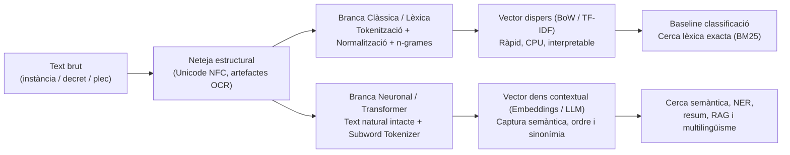

## A. Objectius d'aprenentatge

En acabar aquesta lliçó, l'estudiant ha de ser capaç de:

1. **Definir** el Processament del Llenguatge Natural (*Natural Language Processing*, **NLP**) i distingir els seus nivells d'anàlisi lingüística: lèxic/morfològic, sintàctic, semàntic i pragmàtic.
2. **Explicar** l'evolució històrica dels paradigmes d'NLP: regles simbòliques → models estadístics i vectors dispersos (**Bag of Words**, **TF-IDF**) → xarxes neuronals i **Transformers**.
3. **Diferenciar** les operacions clàssiques de preprocessament textual (normalització, eliminació de *stopwords*, *stemming*, lematització) i saber quan aplicar-les i quan evitar-les (especialment amb models neuronals moderns i en llengua catalana).
4. **Calcular** i interpretar representacions **Bag of Words (BoW)** i **TF-IDF** sobre un corpus administratiu en Python.
5. **Identificar** les particularitats del NLP en **català i bilingüisme administratiu** (català/castellà, pronoms febles, apòstrofs, diacrítics i llenguatge jurídic-administratiu).

---

## B. Explicació introductòria

Gran part de l'activitat quotidiana d'una administració pública és **text no estructurat**: instàncies ciutadanes, actes de ple, resolucions d'alcaldia, plecs de contractació, informes jurídics, queixes o consultes de registre. Els ordinadors, però, només operen amb nombres.

El **Processament del Llenguatge Natural (NLP)** és la branca de la intel·ligència artificial i la lingüística computacional que permet als sistemes informàtics **representar, analitzar, comprendre i generar llenguatge humà**.

Per entendre per què el llenguatge humà és tan difícil per a una màquina, pensa en la frase administrativa:
> *"El consistori va denegar la subvenció a l'associació perquè no havia presentat el certificat."*

Un humà entén immediatament qui és el subjecte de *"havia presentat"* (l'associació, no el consistori), que *"consistori"* és sinònim d'*"ajuntament"*, i que la conseqüència és desfavorable. Per a un algorisme tradicional basat en paraules clau, sense representacions adequades, aquesta frase és només una seqüència de caràcters plena d'ambigüitat.

---

## C. Explicació tècnica avançada

### 1. Nivells d'anàlisi lingüística en NLP

| Nivell | Objecte d'anàlisi | Exemple administratiu | Dificultat principal |
|---|---|---|---|
| **Lèxic i morfològic** | Caràcters, paraules, lemes, flexió (gènere, nombre, temps verbal) | `sol·licituds` → lema `sol·licitud`; `d'obres` → `de` + `obres` | Apòstrofs, ela geminada (`l·l`), pronoms febles (`tramitar-ho`) |
| **Sintàctic** | Estructura gramatical, categories (POS tagging), dependències | Subjecte vs. complement directe en una clàusula de plec | Oracions subordinades llargues pròpies del llenguatge jurídic |
| **Semàntic** | Significat literal, sinonímia, polisèmia, entitats i relacions | *"recurs"* (impugnació jurídica vs. mitjà econòmic/tècnic) | Polisèmia i sinònims (*taxa*, *tribut*, *impost*) |
| **Pragmàtic i discursiu** | Intenció comunicativa, context, correferència entre frases | *"Aquest import"* referit a una xifra de la pàgina anterior | Ironia, el·lipsi, referències implícites a normativa vigent |

### 2. Preprocessament textual: quan sí i quan NO

En el NLP clàssic (BoW, TF-IDF, cerca lèxica) el preprocessament redueix la dispersió del vocabulari:
- **Normalització Unicode (NFC/NFKC)** i minúscules (*lowercasing*): unifica caràcters accentuats i evita duplicar `Subvenció` i `subvenció`. *(Atenció: en NER les majúscules són un senyal fort de nom propi!)*
- **Eliminació de *stopwords***: treu paraules funcionals molt freqüents (`el`, `la`, `de`, `que`). *(Atenció: eliminar `"no"` o `"sense"` inverteix completament la polaritat o un requisit legal!)*
- ***Stemming*** (arrelament heurístic, p. ex. Snowball): retalla sufixos de forma aproximada (`administració`, `administratiu` → `administr`). Ràpid però imprecís i genera arrels no reals.
- **Lematització** (morfològica, p. ex. spaCy `ca_core_news_md` o Freeling): redueix cada mot al seu lema de diccionari (`van tramitar` → `tramitar`, `resolucions` → `resolució`). Més precisa en català que el *stemming*.

:::callout-warning Important en NLP modern (Transformers i LLMs)
En models preentrenats moderns (BERT, RoBERTa, Mistral, Llama, models d'embeddings), **NO s'ha d'aplicar *stemming*, lematització ni eliminació de *stopwords***: els seus tokenitzadors de subparaules ja esperen text natural intacte, i eliminar puntuació o paraules funcionals destrueix el context sintàctic i semàntic! Sí que convé fer neteja estructural (normalització Unicode, eliminació de capçaleres/peus de pàgina repetits o artefactes d'OCR).
:::

### 3. Representacions vectorials disperses: Bag of Words (BoW) i TF-IDF

#### Bag of Words (Bossa de paraules)
Representa cada document \(d\) com un vector de longitud \(|V|\) (mida del vocabulari) amb el recompte de cada terme (o n-grama).
- **Avantatges**: molt ràpid, interpretable, fàcil de combinar amb classificadors lineals.
- **Limitacions**: vectors molt dispersos (*sparse*, >99% zeros), **perd completament l'ordre** (*"l'ajuntament paga al proveïdor"* = *"el proveïdor paga a l'ajuntament"*, mitigat parcialment amb **n-grames** de 2 o 3 mots), i no captura sinonímia (*"ajut"* i *"subvenció"* són dimensions ortogonals).

#### TF-IDF (*Term Frequency – Inverse Document Frequency*)
Pondera cada terme \(t\) en el document \(d\) dins d'un corpus de \(N\) documents penalitzant els termes que apareixen a gairebé tots els documents i premiant els termes discriminatius:

\[
\text{TF-IDF}(t, d) = \text{TF}(t, d) \times \text{IDF}(t), \qquad \text{IDF}(t) = \ln\left(\frac{1 + N}{1 + \text{df}(t)}\right) + 1
\]

(Fórmula suavitzada de `scikit-learn` amb `smooth_idf=True`, habitualment seguida de normalització L2 per compensar longituds diferents de document.)
- Un terme com `"expedient"` o `"ajuntament"` present al 95% dels documents tindrà un \(\text{IDF}\) baix.
- Un terme específic com `"amiant"` o `"plusvàlua"` present només al 2% dels documents tindrà un \(\text{IDF}\) alt i dominarà el vector.

### 4. Particularitats del català i del bilingüisme administratiu

A la Diputació de Barcelona i els ens locals de Catalunya, els textos reals presenten trets específics:
1. **Alternança lingüística (*code-switching*)**: instàncies en català que citen articles en castellà del BOE o rebuts mixtos.
2. **Contraccions, apòstrofs i ela geminada**: `l'ajuntament`, `d'obres`, `sol·licitud`, `parcel·la`. Un regex ingenu com `\w+` pot trencar `sol·licitud` en `["sol", "licitud"]` si no contempla el punt volat (`·`)!
3. **Diacrítics i normalització**: confondre `ò`/`ó` o treure accents en cerca pot ajudar a tolerar faltes d'ortografia ciutadanes, però en anàlisi fina convé conservar el text original per als models neuronals.
4. **Recursos oberts en català**: projecte **AINA** (Barcelona Supercomputing Center — BSC), models **RoBERTa-ca**, **Salamandra**, corpus públics i eines morfològiques per a català.

---

## D. Diagrames i recursos visuals

### Evolució i selecció del pipeline d'NLP segons la representació



### Comparativa ràpida: BoW vs. TF-IDF vs. Embeddings contextuals

| Característica | Bag of Words | TF-IDF (+ bigrames) | Embeddings contextuals (Transformer) |
|---|---|---|---|
| **Tipus de vector** | Dispers (*sparse*, dim = \(|V|\)) | Dispers (*sparse*, dim = \(|V|\)) | Dens (*dense*, dim = 384–1536) |
| **Penalitza termes comuns** | No | Sí (mitjançant IDF) | Implícitament per atenció contextual |
| **Captura ordre** | No (només local amb n-grames) | Parcialment amb n-grames | Sí (codificació posicional + *self-attention*) |
| **Captura sinonímia / bilingüisme** | No (`ajut` ≠ `subvenció`) | No | Sí (en models multilingües) |
| **Cost computacional** | Molt baix (CPU) | Molt baix (CPU) | Moderat/Alt (GPU o ONNX/CPU optimitzat) |

---

## E. Aplicació a l'Administració pública

1. **Triage automàtic de registre d'entrada**: un baseline TF-IDF + Regressió Logística sovint assoleix >85% d'F1 en classificació temàtica d'instàncies amb latència inferior a 5 ms en CPU, servint com a punt de referència obligatori abans d'introduir models més costosos.
2. **Normalització respectuosa amb el català**: en cercadors municipals, tractar correctament `l·l`, apòstrofs (`l'IBI` → `IBI`) i formes flexionades evita pèrdues silencioses de recuperació (*Recall*).
3. **Principi de simplicitat i proporcionalitat**: no sempre cal un LLM de 70B paràmetres; per comptar incidències recurrents, detectar paraules clau normatives o filtrar spam de formularis, el NLP clàssic és més barat, determinista, auditable i sostenible.

---

## F. Exemple pràctic guiat

Implementem en **Python + NumPy** un motor complet de **tokenització conscient del català (respectant `l·l` i apòstrofs)** i càlcul de **matriu TF-IDF normalitzada L2** sobre 4 documents administratius curts, comparant la similitud entre una consulta i cada document.

```python
"""Exemple 2.1: Preprocessament conscient del català i TF-IDF en Python + NumPy."""
import math
import re
import numpy as np

STOPWORDS_CA = {"el", "la", "els", "les", "un", "una", "de", "del", "dels", "a", "al", "per", "en", "i", "que"}


def tokenitzar_catala(text: str) -> list[str]:
    """Tokenitza conservant l'ela geminada (l·l) i separant prefixos apostrofats (l', d', s')."""
    text = text.lower()
    # Separem articles/preposicions apostrofats inicials: l'ajuntament -> ajuntament
    text = re.sub(r"\b[ldsmnt]'", " ", text)
    # Capturem paraules incloent accents catalans i punt volat (·)
    tokens = re.findall(r"[a-zàèéíïòóúüç]+(?:·[a-zàèéíïòóúüç]+)*", text)
    return [t for t in tokens if t not in STOPWORDS_CA and len(t) > 1]


def calcular_tfidf(docs_tokens: list[list[str]]) -> tuple[list[str], np.ndarray]:
    vocab = sorted({t for doc in docs_tokens for t in doc})
    idx = {t: i for i, t in enumerate(vocab)}
    n_docs = len(docs_tokens)

    # Document frequency (df)
    df = np.zeros(len(vocab), dtype=float)
    for doc in docs_tokens:
        for t in set(doc):
            df[idx[t]] += 1.0

    # IDF suavitzat (estil scikit-learn)
    idf = np.log((1.0 + n_docs) / (1.0 + df)) + 1.0

    matriu = np.zeros((n_docs, len(vocab)), dtype=float)
    for r, doc in enumerate(docs_tokens):
        for t in doc:
            matriu[r, idx[t]] += 1.0
        matriu[r] *= idf
        norma = float(np.linalg.norm(matriu[r]))
        if norma > 0:
            matriu[r] /= norma
    return vocab, matriu


if __name__ == "__main__":
    documents = [
        "Sol·licitud de subvenció per a l'enllumenat públic municipal.",
        "Sol·licitud de llicència d'obres menors en parcel·la urbana.",
        "Reclamació de l'impost de plusvàlua i revisió del cadastre municipal.",
        "Consulta sobre subvenció d'eficiència energètica i enllumenat solar.",
    ]
    docs_tok = [tokenitzar_catala(d) for d in documents]
    vocab, X = calcular_tfidf(docs_tok)

    print("Tokens Doc 0:", docs_tok[0])
    print("Tokens Doc 1:", docs_tok[1])
    print(f"Mida del vocabulari: {len(vocab)} termes")

    # Similitud cosinus entre Doc 0 i la resta (com que estan normalitzats L2, és el producte escalar)
    sims = X @ X[0]
    for i, s in enumerate(sims):
        print(f"Similitud(Doc 0, Doc {i}) = {s:.4f}")
```

### Interpretació dels resultats (execució verificada)

- Observa com `tokenitzar_catala` conserva intactes **`sol·licitud`** i **`parcel·la`** (sense partir-los pel punt volat!) i neteja els prefixos apostrofats **`l'enllumenat` → `enllumenat`**, **`d'obres` → `obres`** i **`l'impost` → `impost`**.
- En la similitud cosinus sobre TF-IDF: **Doc 0** (*subvenció enllumenat públic*) obté una similitud més alta amb **Doc 3** (*subvenció eficiència energètica i enllumenat solar*, que comparteixen dos termes específics d'alt IDF: `subvenció` i `enllumenat`) que amb **Doc 1** (que només comparteix `sol·licitud`) o **Doc 2** (que només comparteix `municipal`).

---

## G. Exercici pràctic per resoldre

### Enunciat
L'equip d'atenció ciutadana vol analitzar **40.000 queixes i consultes** presentades en català i castellà per classificar-les en 12 àrees municipals i detectar si el ciutadà expressa **conformitat o rebuig** (p. ex., *"no estic conforme amb la sanció"* vs. *"estic conforme amb el fraccionament"*).

Un desenvolupador proposa aplicar aquest preprocessament únic per a tots els models (tant un classificador TF-IDF com un model RoBERTa-ca):
1. Aplicar `re.findall(r"\w+", text.lower())` per tokenitzar.
2. Eliminar totes les *stopwords* incloent `"no"`, `"ni"`, `"sense"`.
3. Aplicar un *stemmer* anglès (Porter) a tot el corpus.

Analitza els **4 errors greus** d'aquest disseny i proposa dos pipelines diferenciats i correctes (un per al baseline TF-IDF i un per al model Transformer).

### Objectius i restriccions
- Demostrar domini dels efectes reals del preprocessament en català, en negacions i en architectures neuronals vs. clàssiques.

:::hint Pista 1 — Què fa `\w+` amb `sol·licitud` i què fa eliminar `"no"`?
El punt volat `·` no és un caràcter `\w` en expressions regulars ASCII/Python estàndard, i eliminar negacions (`no`, `sense`) converteix *"no estic conforme"* en *"estic conforme"*!
:::

:::hint Pista 2 — Cal el mateix preprocessament per a TF-IDF que per a RoBERTa-ca?
No! RoBERTa-ca espera text natural amb majúscules, puntuació i *stopwords* intactes.
:::

### Criteris d'avaluació
- **40%**: Identificació precisa dels 4 errors (`\w+` i `l·l`/apòstrofs; eliminació de negacions; stemmer anglès sobre català/castellà; aplicar preprocés destructiu a RoBERTa).
- **40%**: Disseny correcte dels dos pipelines separats (TF-IDF amb bigrames + negacions conservades vs. RoBERTa amb neteja mínima).
- **20%**: Consideració del bilingüisme català/castellà (model multilingüe o detecció d'idioma).

### Errors habituals
- Proposar el mateix pipeline destructiu per a TF-IDF i Transformers.
- Oblidar que les paraules de negació formen part de moltes llistes de *stopwords* per defecte!

:::solution Solució completa comentada i alternatives
### Els 4 errors greus detectats
1. **Regex `\w+` trenca el català**: parteix l'ela geminada (`sol·licitud` → `sol`, `licitud`) i separa els apòstrofs de manera inconsistent (`l'IBI` → `l`, `ibi`), embrutant el vocabulari.
2. **Eliminar negacions destrueix la polaritat i el significat jurídic**: treure `"no"`, `"ni"`, `"sense"` fa indistinguibles *"no estic conforme"* i *"estic conforme"*, o *"sense llicència"* i *"amb llicència"*.
3. **Stemmer anglès (Porter) sobre català/castellà**: les regles de sufixos anglesos (`-ing`, `-ed`, `-ies`) mutilen arbitràriament paraules catalanes i castellanes sense reduir la seva flexió real.
4. **Aplicar *stemming* i eliminació de *stopwords* abans de RoBERTa**: els Transformers estan preentrenats amb text natural; treure majúscules, puntuació o connectors empitjora el seu rendiment i desajusta el tokenitzador de subparaules.

### Dos pipelines correctes
- **Pipeline A (Baseline TF-IDF + Regressió Logística / LinearSVC)**:
  1. Normalització Unicode NFC + neteja d'HTML/espais.
  2. Tokenitzador conscient del català/castellà (conserva `l·l`, separa prefixos apostrofats).
  3. Llista curada de *stopwords* catalanes i castellanes **excloent-ne explícitament les negacions** (`no`, `ni`, `sense`, `sin`, `mai`, `nunca`, `cap`).
  4. **Unigrames + bigrames (`ngram_range=(1, 2)`)** perquè `"no conforme"` o `"sense llicència"` tinguin una característica pròpia.
  5. Sublinear TF (`sublinear_tf=True`) + normalització L2.
- **Pipeline B (Transformer multilingüe: `xlm-roberta-base` o `mDeBERTa-v3` per cobrir català + castellà)**:
  1. Només neteja estructural (Unicode NFC, eliminar capçaleres automàtiques repetides i anonimitzar PII).
  2. Passar el text natural directament al tokenitzador natiu del model.
:::

---

## H. Test individual

Resol les 10 preguntes sobre nivells d'anàlisi lingüística, preprocessament, BoW, TF-IDF, n-grames i particularitats del NLP en català.

---

## I. Preguntes de desenvolupament

### Pregunta 1
Explica la fórmula i la intuïció de **TF-IDF**, indicant per què supera Bag of Words simple en la representació de documents administratius i quines dues limitacions estructurals comparteixen ambdós mètodes.

:::model-answer Resposta model i criteris de correcció (Pregunta 1)
**Resposta model**:
- **TF-IDF** combina la freqüència local d'un terme en un document (\(\text{TF}\)) amb la inversa de la seva freqüència documental al corpus (\(\text{IDF} = \ln\frac{1+N}{1+\text{df}(t)} + 1\)).
- Supera BoW perquè redueix el pes de mots genèrics omnipresents en un corpus administratiu (`ajuntament`, `expedient`, `article`) i destaca termes altament discriminatius (`plusvàlua`, `amiant`, `escola bressol`). Normalitzar el vector per norma L2 evita que documents molt llargs dominin per simple acumulació de mots.
- **Dues limitacions compartides**: (1) **No capturen semàntica ni sinonímia** (`ajut` i `subvenció` són dimensions totalment ortogonals) i (2) **perden l'ordre sintàctic global** (només mitigat parcialment amb n-grames curts) i generen vectors d'alta dimensionalitat dispersa.

**Criteris de correcció (10 punts)**:
- Fórmula i intuïció correcta de TF, IDF i normalització: 5 punts.
- Avantatge sobre BoW aplicat a corpus administratiu: 2 punts.
- Dues limitacions estructurals ben raonades: 3 punts.
:::

### Pregunta 2
Distingeix entre **stemming** i **lematització**, posant un exemple en català, i justifica per què en models Transformer moderns NO s'ha d'aplicar cap dels dos ni eliminar *stopwords*.

:::model-answer Resposta model i criteris de correcció (Pregunta 2)
**Resposta model**:
- ***Stemming*** aplica regles heurístiques de retall de sufixos sense anàlisi gramatical (`sol·licituds`, `sol·licitant` → `sol·licit`), ràpid però imprecís i sovint genera arrels inexistents o fusiona paraules de significat diferent.
- **Lematització** usa diccionaris i anàlisi morfosintàctica per obtenir la forma canònica real (`van tramitar` → `tramitar`; `millors` → `bo`), molt més adequada per a llengües morfològicament riques com el català.
- En **Transformers (BERT, RoBERTa, LLMs)** no s'apliquen perquè el seu tokenitzador de subparaules ja gestiona la flexió morfològica, i el mecanisme de *self-attention* necessita el text intacte (incloses preposicions, negacions, conjugacions i puntuació) tal com el model el va veure durant el preentrenament.

**Criteris de correcció (10 punts)**:
- Diferència clara entre stemming i lematització amb exemple en català: 5 punts.
- Justificació tècnica de per què evitar-los en Transformers: 5 punts.
:::

### Pregunta 3
Quins reptes específics introdueix el tractament de documentació en **català i entorns bilingües català/castellà** en projectes d'NLP d'una diputació, i quines decisions tècniques prendries per mitigar-los?

:::model-answer Resposta model i criteris de correcció (Pregunta 3)
**Resposta model**:
- **Reptes**: (1) alternança lingüística (*code-switching*) dins d'un mateix expedient o frase; (2) grafies específiques del català (`l·l`, apòstrofs `l'`, `d'`, pronoms febles amb guionet, diacrítics); (3) menor volum de dades de preentrenament en català en models generalistes centrats en l'anglès; (4) llenguatge jurídic-administratiu arcaic i frases molt llargues.
- **Mitigacions**: usar tokenitzadors i models entrenats específicament en català o multilingües d'alta qualitat (p. ex., models del projecte **AINA/BSC** com Salamandra/RoBERTa-ca, o XLM-RoBERTa/E5 multilingüe); avaluar mètriques desagregades per idioma (català vs. castellà) per detectar biaixos de rendiment; adaptar expressions regulars i llistes de *stopwords* al català en pipelines clàssics.

**Criteris de correcció (10 punts)**:
- Identificació d'almenys 3 reptes lingüístics/tècnics reals: 5 punts.
- Proposta concreta de mitigacions tècniques i d'avaluació desagregada per idioma: 5 punts.
:::

---

## J. Resum per memoritzar

### Conceptes clau
- **4 nivells d'NLP**: lèxic/morfològic → sintàctic → semàntic → pragmàtic/discursiu.
- **BoW** compta termes; **TF-IDF** pondera per especificitat al corpus (`IDF`) i sol normalitzar-se amb L2.
- **N-grames** (bigrames/trigrames) capturen ordre local (p. ex., `"no conforme"`), però augmenten la dispersió.
- **Preprocés destructiu** (*stemming*, treure *stopwords*) només en NLP clàssic — i **mai eliminar negacions** (`no`, `sense`) ni aplicar-ho a Transformers!
- **Català**: vigilar `l·l`, apòstrofs, bilingüisme català/castellà i avaluar mètriques separades per idioma.

### Definicions essencials
- **TF-IDF**: ponderació estadística que assigna pes alt a termes freqüents en un document però rars en el conjunt del corpus.
- **Lematització**: reducció morfosintàctica d'una paraula flexionada a la seva forma canònica de diccionari (lema).
- **Polisèmia**: fenomen pel qual una mateixa paraula té significats diferents segons el context (p. ex., *"recurs"*).

### Errors conceptuals freqüents
1. Eliminar les negacions (`no`, `sense`, `ni`) com a *stopwords* en classificació de sentiments o compliment.
2. Aplicar *stemming* o *lowercasing* agressiu abans d'alimentar un model Transformer o un sistema NER.
3. Assumir que un model entrenat principalment en anglès rendirà igual de bé en català sense avaluar-lo específicament en català.

### Possibles preguntes d'examen
- Calcula a mà o interpreta el valor TF-IDF d'un terme omnipresent vs. un terme rar.
- Explica quan escolliries TF-IDF + model lineal en lloc d'un LLM per classificar textos administratius.
- Identifica errors en un pipeline de preprocessament sobre textos bilingües català/castellà.
