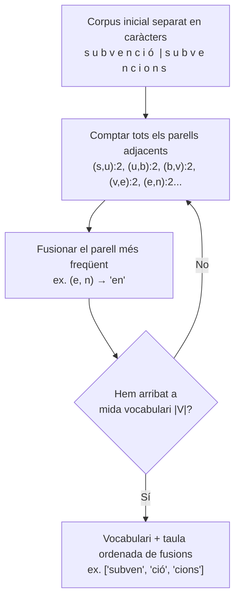

## A. Objectius d'aprenentatge

En completar aquesta lliçó, l'estudiant ha de ser capaç de:

1. **Definir** què és un **token** i explicar el paper crític del tokenitzador en qualsevol pipeline d'NLP i en els *Large Language Models* (LLM).
2. **Comparar** les tres grans famílies de tokenització: per **paraules**, per **caràcters** i per **subparaules** (**BPE**, **WordPiece**, **Unigram / SentencePiece**).
3. **Explicar** pas a pas l'algorisme **Byte-Pair Encoding (BPE)** i comprendre com resol el problema de les paraules fora de vocabulari (**OOV**, *Out-Of-Vocabulary*).
4. **Analitzar** l'impacte directe de la **fertilitat del tokenitzador** (*tokens per paraula*) sobre el cost econòmic, la latència i la finestra de context en **català** respecte de l'anglès.
5. **Implementar** un mini-entrenador **BPE** en Python pur per observar com aprèn fusions de subparaules sobre un corpus administratiu català.

---

## B. Explicació introductòria

Abans que una xarxa neuronal pugui llegir una frase, el text s'ha de trossejar en peces discretes anomenades **tokens**, i cada token s'assigna a un identificador enter (`token_id`) dins d'un vocabulari fix (per exemple, de 32.000 a 128.000 entrades).

Si trossegem només per **espais en blanc** (paraules completes), el vocabulari explota en llengües amb molta flexió com el català (`tramitar`, `tramitant`, `tramitat`, `tramitació`, `tramitacions`...), i qualsevol mot nou o error tipogràfic (`tramitacó`) es perd com a `<UNK>` (*desconegut*). Si trossegem per **caràcters individuals**, no hi ha mai desconeguts, però les seqüències es tornen 5–7 vegades més llargues i costoses.

La solució moderna que fa funcionar gairebé tots els Transformers i LLMs és la **tokenització per subparaules (*subword tokenization*)**: els mots freqüents es mantenen sencers (`ajuntament`), mentre que els mots rars o compostos es divideixen en fragments amb sentit (`re` + `habilit` + `ació`), eliminant el problema dels desconeguts amb una mida de vocabulari compacta.

---

## C. Explicació tècnica avançada

### 1. Comparativa de paradigmes de tokenització

| Paradigma | Exemple sobre `"inconstitucionalitat"` | Mida vocabulari | Problema OOV (`<UNK>`) | Longitud seqüència | Ús principal |
|---|---|---|---|---|---|
| **Per paraules** | `["<UNK>"]` si no era al corpus | Molt gran (>500k) | Alt (greu en mots nous/errors) | Curta | NLP clàssic (BoW/TF-IDF) |
| **Per caràcters** | `["i","n","c","o",...,"t"]` (20 tokens) | Molt petita (~100) | Cap | Molt llarga (cost \(O(L^2)\) en Transformer!) | Alguns models morfològics/OCR |
| **Per subparaules** | `["in", "constitucional", "itat"]` | Equilibrada (32k–128k) | Cap (amb byte-fallback) | Curta-moderada | **Estàndard en BERT, RoBERTa, GPT, Llama, Mistral, Salamandra** |

### 2. Els tres algorismes dominants de subparaules

1. **BPE (*Byte-Pair Encoding*)** — usat per GPT-2/3/4 (`tiktoken`), RoBERTa, Llama 3, Qwen:
   - Comença amb el vocabulari base de caràcters (o **bytes UTF-8** en *Byte-Level BPE*, que garanteix 0 `<UNK>` per a qualsevol idioma o emoji!).
   - En cada iteració, compta el **parell de tokens adjacents més freqüent** al corpus i el fusiona en un nou token.
   - Repeteix fins assolir la mida objectiu del vocabulari \(|V|\).
2. **WordPiece** — usat per BERT, DistilBERT, mBERT:
   - Similar a BPE en construcció *bottom-up*, però en lloc de triar el parell més freqüent absolutament, escull el parell \((a, b)\) que **maximitza la versemblança** (proporcional a \(\frac{\text{freq}(a, b)}{\text{freq}(a)\cdot\text{freq}(b)}\)). Marca les continuacions de paraula amb `##` (`["subven", "##ció"]`).
3. **Unigram Language Model + SentencePiece** — usat per T5, XLNet, ALBERT, XLM-RoBERTa, Mistral/Llama 1–2, Salamandra:
   - **Unigram** treballa *top-down*: comença amb un vocabulari enorme i va eliminant iterativament les subparaules que menys redueixen la versemblança del corpus.
   - **SentencePiece** tracta el text com un flux brut de caràcters incloent l'espai en blanc com un símbol especial (`▁`, *metaspace*), de manera que és **100% reversible** (*lossless*) i independent de si l'idioma usa espais (com el japonès o el xinès).

### 3. Tokens especials de control

Els tokenitzadors moderns reserven identificadors especials que estructuren l'entrada del model:
- `[CLS]` / `<s>` (*BOS*, *Beginning of Sequence*): inici de seqüència (en encoders BERT, la seva representació resumeix la frase).
- `[SEP]` / `</s>` (*EOS*, *End of Sequence*): separador de segments o senyal de parada de generació.
- `[PAD]`: farciment per igualar longituds dins d'un *batch* (ignorat per la màscara d'atenció!).
- `[MASK]`: token emmascarat durant preentrenament MLM (BERT/RoBERTa).
- **Tokens de xat (*Chat Templates*)**: `<|system|>`, `<|user|>`, `<|assistant|>`, `<|eot_id|>` que separen rols en LLMs instructius (fonamentals per prevenir confusions de rol i injeccions!).

### 4. Fertilitat del tokenitzador i «taxa lingüística» en català

La **fertilitat** d'un tokenitzador en un idioma és el **nombre mitjà de tokens generats per cada paraula**.
- En un LLM entrenat majoritàriament en anglès, l'anglès sol tenir una fertilitat d'`~1,2–1,3 tokens/paraula`, mentre que el **català** pot arribar a `~1,8–2,3 tokens/paraula` (p. ex., `sol·licitud` fragmentada en 4–5 peces!).
- **Conseqüències operatives directes**:
  1. **Cost API fins a ~1,6x més alt** en models de pagament per token.
  2. **Latència més alta** (més passos autoregressius per generar la mateixa resposta).
  3. **Finestra de context efectiva més petita** (hi caben menys pàgines d'un plec administratiu).
  4. **Pitjor qualitat en aritmètica, codis d'expedient i lletreig**: números com `2026/004512` es trossegen de forma arbitrària segons el tokenitzador.

---

## D. Diagrames i recursos visuals

### Procés iteratiu d'entrenament de Byte-Pair Encoding (BPE)



---

## E. Aplicació a l'Administració pública

1. **Pressupost i dimensionament de plataformes LLM/RAG**: en estimar el cost i la capacitat de context d'un assistent normatiu en català, **mai s'ha d'aplicar la regla aproximada anglesa ("1 token ≈ 0,75 paraules")**; cal mesurar la fertilitat real sobre una mostra de documents propis (decrets, plecs, instàncies en català) amb el tokenitzador exacte del model candidat.
2. **Avantatge de models amb vocabulari adaptat al català**: models com **Salamandra** (projecte AINA/BSC) o tokenitzadors multilingües moderns de gran vocabulari (128k–256k tokens) redueixen dràsticament la fragmentació del català, accelerant la generació i encabint més context normatiu.
3. **Chunking en RAG mesurat en tokens, no en caràcters**: definir fragments de `512 tokens` (amb el tokenitzador del model d'embeddings) evita truncaments silenciosos que tallarien l'últim article d'una resolució.

---

## F. Exemple pràctic guiat

Implementem un algorisme **Byte-Pair Encoding (BPE)** complet en Python pur (sense dependències externes) i l'entrenem sobre un petit vocabulari administratiu català per veure exactament quines subparaules descobreix i com redueix la longitud de la seqüència.

```python
"""Exemple 2.2: Implementació educativa de Byte-Pair Encoding (BPE) en Python pur."""
from collections import Counter


def obtenir_parells(vocab: dict[tuple[str, ...], int]) -> Counter[tuple[str, str]]:
    parells: Counter[tuple[str, str]] = Counter()
    for paraula, freq in vocab.items():
        for i in range(len(paraula) - 1):
            parells[(paraula[i], paraula[i + 1])] += freq
    return parells


def fusionar_parell(
    parell: tuple[str, str],
    vocab: dict[tuple[str, ...], int],
) -> dict[tuple[str, ...], int]:
    nou_vocab: dict[tuple[str, ...], int] = {}
    a, b = parell
    fusionat = a + b
    for paraula, freq in vocab.items():
        nova: list[str] = []
        i = 0
        while i < len(paraula):
            if i < len(paraula) - 1 and paraula[i] == a and paraula[i + 1] == b:
                nova.append(fusionat)
                i += 2
            else:
                nova.append(paraula[i])
                i += 1
        nou_vocab[tuple(nova)] = freq
    return nou_vocab


if __name__ == "__main__":
    # Vocabulari de freqüències d'un corpus administratiu sintètic (amb marca </w> de final de mot)
    corpus_freqs = {
        "tramitacio": 6,
        "tramitar": 5,
        "tramit": 4,
        "resolucio": 5,
        "sol·licitud": 4,
    }
    vocab = {tuple(list(mot) + ["</w>"]): freq for mot, freq in corpus_freqs.items()}

    tokens_inicials = sum(len(p) * f for p, f in vocab.items())
    fusions: list[tuple[str, str]] = []

    for pas in range(1, 9):
        parells = obtenir_parells(vocab)
        millor, freq = parells.most_common(1)[0]
        vocab = fusionar_parell(millor, vocab)
        fusions.append(millor)
        print(f"Pas {pas}: fusió {millor} -> '{millor[0] + millor[1]}' (freq={freq})")

    tokens_finals = sum(len(p) * f for p, f in vocab.items())
    print(f"\nTotal tokens al corpus: {tokens_inicials} -> {tokens_finals} (reducció {(1 - tokens_finals/tokens_inicials):.1%})")
    for p, f in vocab.items():
        print(f"  {f}x : {list(p)}")
```

### Interpretació dels resultats (execució verificada)

- En només 8 fusions, BPE descobreix automàticament l'arrel morfològica dominant **`tramit`** / **`tramita`** (present en `tramitacio`, `tramitar` i `tramit`) i la subparaula **`cio`** (`tramitacio`, `resolucio`), **sense cap regla lingüística programada manualment**.
- El nombre total de tokens del corpus cau de **237 a 125 tokens (reducció del 47,3%)**, il·lustrant el compromís òptim entre mida del vocabulari i longitud de seqüència.

---

## G. Exercici pràctic per resoldre

### Enunciat
Una diputació està avaluant dos LLMs candidats per desplegar un assistent de resum de plecs administratius en **català** (10.000 plecs/any, mitjana de **12.000 paraules** per plec):
- **Model A**: preu `1,50 €` per milió de tokens d'entrada; fertilitat mesurada en català = **`2,15 tokens/paraula`**; finestra de context = `32.768 tokens`.
- **Model B**: preu `1,80 €` per milió de tokens d'entrada; fertilitat mesurada en català = **`1,35 tokens/paraula`**; finestra de context = `32.768 tokens`.

Calcula i respon:
1. Quants tokens ocupa un plec mitjà de 12.000 paraules en el Model A vs. en el Model B? Hi caben tots dos plecs sencers dins la finestra de `32.768 tokens` (reservant `4.000 tokens` per al *system prompt* i la resposta)?
2. Quin dels dos models és **més econòmic** a l'any malgrat que el Model B té un preu per milió de tokens més alt?
3. Si el Model B hagués de generar un resum de 500 paraules en català, quin dels dos models faria menys passos autoregressius (i per tant menor latència de generació a igual velocitat de tokens/segon)?

### Objectius i restriccions
- Demostrar càlcul quantitatiu de fertilitat, finestra de context i cost real en català.

:::hint Pista 1 — Multiplica paraules × fertilitat
Per al Model A: `12.000 × 2,15 = 25.800 tokens`. Per al Model B: `12.000 × 1,35 = 16.200 tokens`.
:::

:::hint Pista 2 — Cost real = (Tokens anuals / 1.000.000) × Preu_per_milió
No comparis només el preu nominal per token; compara el cost per **paraula real en català**!
:::

### Criteris d'avaluació
- **35%**: Càlcul exacte de tokens per plec i anàlisi de marge dins la finestra de 32.768 tokens (incloent plecs més llargs que la mitjana).
- **40%**: Càlcul exacte del cost anual de tots dos models i conclusió correcta.
- **25%**: Anàlisi de passos autoregressius i latència de sortida (675 vs. 1.075 passos per a 500 paraules).

### Errors habituals
- Triar el Model A mirant només el preu nominal (`1,50 €` < `1,80 €`) sense multiplicar per la fertilitat.

:::solution Solució completa comentada i alternatives
### 1. Tokens per plec i finestra de context
- **Model A**: `12.000 paraules × 2,15 = 25.800 tokens` d'entrada. Sumant `4.000 tokens` (prompt + sortida) = `29.800 tokens` (entra just al límit del 91% de la finestra de 32.768; qualsevol plec de >13.400 paraules desbordaria la finestra!).
- **Model B**: `12.000 paraules × 1,35 = 16.200 tokens` d'entrada. Sumant `4.000 tokens` = `20.200 tokens` (només el 61,6% de la finestra, permetent processar plecs de fins a ~21.300 paraules sense truncament ni *chunking*).

### 2. Cost anual d'entrada (10.000 plecs/any)
- **Model A**: `10.000 × 25.800 = 258.000.000 tokens = 258 M tokens` → `258 × 1,50 € = 387,00 € / any`.
- **Model B**: `10.000 × 16.200 = 162.000.000 tokens = 162 M tokens` → `162 × 1,80 € = 291,60 € / any`.
- **Conclusió**: el **Model B és un 24,7% més econòmic** (`95,40 €` d'estalvi anual en entrada, i encara més si incloem els tokens de sortida!) malgrat tenir un preu per token un 20% superior.

### 3. Passos autoregressius de generació (resum de 500 paraules)
- **Model A**: `500 × 2,15 = 1.075 tokens` (1.075 passades del decodificador).
- **Model B**: `500 × 1,35 = 675 tokens` (675 passades → **~37% menys latència** a igual velocitat de `tokens/s`).
:::

---

## H. Test individual

Resol les 10 preguntes sobre tokenització per paraules, caràcters i subparaules (BPE, WordPiece, Unigram/SentencePiece), tokens especials i fertilitat en català.

---

## I. Preguntes de desenvolupament

### Pregunta 1
Explica com resol la **tokenització per subparaules** els problemes de la tokenització per paraules i per caràcters, i compara breument **BPE**, **WordPiece** i **Unigram (SentencePiece)**.

:::model-answer Resposta model i criteris de correcció (Pregunta 1)
**Resposta model**:
- La tokenització per paraules genera vocabularis immensos i falla amb mots fora de vocabulari (OOV / `<UNK>`) i flexió morfològica; la de caràcters elimina OOV però allarga 5–7x les seqüències, disparant el cost quadràtic de l'atenció. Les subparaules mantenen sencers els mots freqüents i descomponen els rars en fragments reutilitzables amb un vocabulari compacte (32k–128k).
- **BPE**: construeix el vocabulari *bottom-up* fusionant iterativament el parell de tokens adjacents més freqüent (en versió *Byte-Level* garanteix 0 `<UNK>`).
- **WordPiece**: també *bottom-up*, però selecciona fusions que maximitzen la versemblança (`freq(a,b)/(freq(a)·freq(b))`), marcant continuacions amb `##`.
- **Unigram + SentencePiece**: *top-down* (poda un vocabulari gran minimitzant la pèrdua de versemblança) i tracta els espais com a caràcter especial `▁`, fent la decodificació 100% reversible i independent de l'idioma.

**Criteris de correcció (10 punts)**:
- Compromís subparaules vs. paraules/caràcters: 4 punts.
- Diferències precises entre BPE, WordPiece i Unigram/SentencePiece: 6 punts.
:::

### Pregunta 2
Defineix la **fertilitat d'un tokenitzador** i explica tres conseqüències pràctiques que té una fertilitat alta en català dins d'un projecte d'IA de la Diputació de Barcelona.

:::model-answer Resposta model i criteris de correcció (Pregunta 2)
**Resposta model**:
- La **fertilitat** és el nombre mitjà de tokens en què un tokenitzador divideix cada paraula d'un idioma donat.
- Tres conseqüències d'una fertilitat alta en català (p. ex. >2,0 vs. 1,2 en anglès):
  1. **Increment directe del cost** per petició/document en APIs facturades per token.
  2. **Augment de la latència** de generació (calen més passos autoregressius per produir la mateixa resposta).
  3. **Reducció efectiva de la finestra de context** (hi caben menys pàgines de normativa o expedients dins el límit màxim de tokens), a més de major fragmentació de mots catalans amb diacrítics o `l·l`.

**Criteris de correcció (10 punts)**:
- Definició exacta de fertilitat: 2,5 punts.
- Tres conseqüències operatives ben argumentades: 7,5 punts (2,5 cadascuna).
:::

### Pregunta 3
Quina funció tenen els **tokens especials** (`[CLS]`, `[SEP]`, `[PAD]`, `</s>`, `<|system|>`, `<|user|>`) i quin risc de seguretat o qualitat apareix si es manipulen incorrectament les plantilles de xat (*chat templates*)?

:::model-answer Resposta model i criteris de correcció (Pregunta 3)
**Resposta model**:
- Els tokens especials delimiten l'estructura de l'entrada i controlen el comportament del model: `[CLS]` resumeix la seqüència en encoders, `[SEP]` separa parells de frases, `[PAD]` iguala longituds de *batch* (sempre emmascarat a l'atenció), `</s>` (EOS) atura la generació autoregressiva, i `<|system|>`/`<|user|>`/`<|assistant|>` separen rols conversacionals.
- Si una aplicació concatena text de l'usuari sense aplicar correctament la plantilla de xat o permet que l'usuari injecti tokens especials literals de control, pot degradar greument la qualitat de resposta (el model no reconeix quan acabar) o facilitar atacs de **prompt injection** suplantant el rol de sistema.

**Criteris de correcció (10 punts)**:
- Funció correcta dels tokens estructurals i de control: 6 punts.
- Impacte en qualitat i seguretat (prompt injection / bucles sense EOS): 4 punts.
:::

---

## J. Resum per memoritzar

### Conceptes clau
- **Token ≠ Paraula**: en models moderns, els tokens són **subparaules** (o bytes) indexades en un vocabulari fix de ~32k–256k entrades.
- **3 algorismes clau**: **BPE** (fusions per freqüència, GPT/Llama), **WordPiece** (fusions per versemblança, `##`, BERT), **Unigram/SentencePiece** (poda *top-down* + espai `▁`, XLM-R/Mistral/Salamandra).
- **Byte-Level BPE**: opera sobre bytes UTF-8 → **zero tokens `<UNK>`** per a qualsevol idioma o símbol.
- **Fertilitat en català**: mesurar-la sempre sobre documents reals abans de pressupostar o fixar límits de *chunking*.

### Definicions essencials
- **OOV (*Out-Of-Vocabulary*)**: paraula absent del vocabulari d'un model que, sense subparaules, es col·lapsa en `<UNK>` perdent informació.
- **Fertilitat**: ràtio mitjana de tokens generats per paraula en un idioma concret.
- **Metaspace (`▁`)**: caràcter usat per SentencePiece per representar explícitament els espais en blanc i garantir decodificació reversible.

### Errors conceptuals freqüents
1. Assumir que 1 token = 1 paraula o aplicar la ràtio anglesa (`0,75 paraules/token`) al català sense mesurar-ho.
2. Mesurar la mida dels *chunks* d'un RAG en caràcters i patir truncaments silenciosos en superar el límit de tokens del model d'embeddings.
3. Oblidar emmascarar els tokens `[PAD]` en l'*attention mask*.

### Possibles preguntes d'examen
- Compara BPE, WordPiece i Unigram/SentencePiece.
- Calcula el cost real i l'ocupació de finestra de context de dos LLMs amb fertilitat diferent en català.
- Explica per què els LLMs sovint fallen en tasques de comptar lletres d'una paraula (perquè operen sobre tokens de subparaules, no caràcters!).
