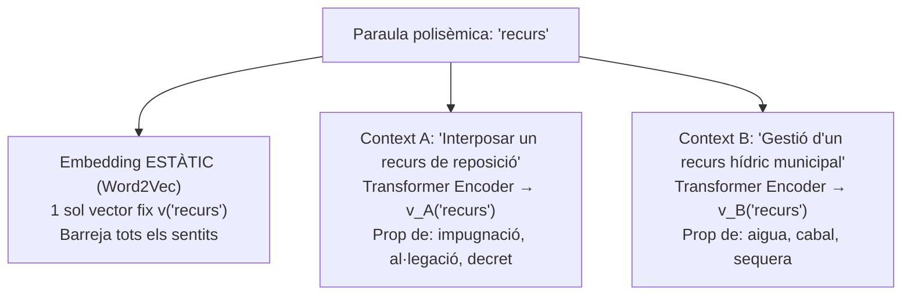

## A. Objectius d'aprenentatge

En acabar aquesta lliçó, l'estudiant ha de ser capaç de:

1. **Explicar** la **hipòtesi distribucional** (*"coneixeràs una paraula per la companyia que freqüenta"*) i com els **embeddings** transformen paraules o frases en vectors densos continus on la proximitat geomètrica codifica similitud semàntica.
2. **Distingir** clarament els **embeddings estàtics** (**Word2Vec**, **GloVe**, **FastText**) dels **embeddings contextuals** (**BERT**, **RoBERTa**, **E5**, **BGE-M3**), especialment davant la **polisèmia**.
3. **Calcular** i comparar les tres mètriques vectorials habituals: **similitud cosinus**, **producte escalar (*dot product*)** i **distància euclidiana (L2)**, entenent la seva equivalència exacta sobre vectors normalitzats L2.
4. **Comprendre** com s'obtenen **sentence embeddings** (mitjana amb màscara / *mean pooling*, token `[CLS]`, entrenament contrastiu amb **Sentence-Transformers**).
5. **Aplicar** embeddings en casos reals de l'Administració (agrupació de consultes, detecció de duplicats, cerca bilingüe català-castellà) coneixent-ne els biaixos i limitacions.

---

## B. Explicació introductòria

En la lliçó 2.1 hem vist que en Bag of Words o TF-IDF les paraules `"subvenció"` i `"ajut"` ocupen dues columnes diferents i completament perpendiculars: per a TF-IDF, `"subvenció"` està igual de lluny d'`"ajut"` que de `"semàfor"`.

Els **embeddings** resolen aquest salt representant cada paraula, frase o document com un **vector dens de nombres reals** de mida moderada (per exemple, `384`, `768` o `1.024` dimensions), après automàticament a partir de milers de milions de textos. En aquest espai geomètric:
- Paraules o frases amb significats semblants (`"subvenció municipal"`, `"ajut econòmic de l'ajuntament"`, `"subvención local"`) cauen **molt a prop** en l'espai vectorial.
- Les direccions de l'espai codifiquen fins i tot relacions semàntiques i morfològiques (`alcalde - home + dona ≈ alcaldessa`).

---

## C. Explicació tècnica avançada

### 1. Embeddings estàtics vs. Embeddings contextuals

| Dimensió | Embeddings estàtics (Word2Vec, GloVe, FastText) | Embeddings contextuals (BERT, RoBERTa, E5, BGE-M3) |
|---|---|---|
| **Vectors per paraula** | **Un únic vector fix** al diccionari per a cada paraula | **Un vector diferent cada vegada** segons les paraules que l'envolten |
| **Polisèmia** (`"recurs"`, `"banc"`) | ❌ Confon tots els significats en una mitjana borrosa | ✅ Separa *"recurs contenciós administratiu"* de *"recurs hídric"* |
| **Paraules noves / faltes** | Word2Vec/GloVe fallen (`OOV`); **FastText** ho mitiga usant n-grames de caràcters | ✅ Tokenització de subparaules + context global |
| **Unitat habitual** | Nivell de paraula (*word embedding*) | Nivell de token, frase o paràgraf (*sentence/passage embedding*) |
| **Cost computacional** | Molt baix (taula de cerca `O(1)` en CPU) | Moderat (passada *forward* per un Transformer encoder) |

#### Detall clau dels models clàssics (estàtics)
- **Word2Vec** (Mikolov et al., 2013): dues arquitectures auto-supervisades: **CBOW** (prediu la paraula central a partir del context veí) i **Skip-gram** (prediu el context veí a partir de la paraula central, millor per a mots rars).
- **GloVe** (Pennington et al., 2014): factoritza la matriu global de coocurrències del corpus combinant estadística global i context local.
- **FastText** (Bojanowski et al., 2017): representa cada paraula com la suma dels seus **n-grames de caràcters** (`<su`, `sub`, `ubv`, ...), excel·lent per a llengües amb molta flexió morfològica com el català i resilient a faltes tipogràfiques.

### 2. D'embeddings de tokens a *Sentence Embeddings* (Bi-Encoders)

Un encoder Transformer pur com BERT retorna un vector per cada token. Fer servir directament el vector `[CLS]` o una mitjana simple de BERT sense entrenament específic produeix un espai **anisotròpic** (totes les frases acaben en un con estret amb similitud cosinus artificialment alta).

Per obtenir *sentence embeddings* d'alta qualitat (com **Sentence-BERT / SBERT**, **multilingual-e5**, **BGE-M3**, **paraphrase-multilingual**), els encoders s'ajusten mitjançant **aprenentatge contrastiu (*contrastive learning*)** (p. ex., *InfoNCE / Multiple Negatives Ranking Loss*):
- Apropa parells positius (consulta i paràgraf rellevant, o frase catalana i traducció castellana).
- Allunya parells negatius (altres passatges del *batch* i **negatius difícils / *hard negatives***, que comparteixen paraules però no responen la pregunta).
- Agrega els tokens de sortida mitjançant ***mean pooling*** (mitjana ponderada per la màscara d'atenció) i sovint aplica **normalització L2**.

### 3. Mètriques de similitud i distància

Donats dos vectors \(\mathbf{u}, \mathbf{v} \in \mathbb{R}^d\):

\[
\text{Similitud cosinus}(\mathbf{u}, \mathbf{v}) = \frac{\mathbf{u} \cdot \mathbf{v}}{\|\mathbf{u}\|_2 \, \|\mathbf{v}\|_2} \in [-1, 1]
\]

- **Similitud cosinus**: mesura només l'**angle** entre vectors (invariant a la magnitud). És la mètrica estàndard en NLP.
- **Producte escalar (*Dot product*, \(\mathbf{u}\cdot\mathbf{v}\))**: depèn de l'angle i de les normes. Quan els vectors estan **normalitzats L2 (\(\|\mathbf{u}\|_2 = \|\mathbf{v}\|_2 = 1\))**, el producte escalar és **matemàticament idèntic** a la similitud cosinus (i molt ràpid de calcular en matrius!).
- **Distància euclidiana (L2, \(\|\mathbf{u}-\mathbf{v}\|_2\))**: per a vectors normalitzats L2, compleix \(\|\mathbf{u}-\mathbf{v}\|_2^2 = 2(1 - \cos(\mathbf{u},\mathbf{v}))\), de manera que l'**ordenació de veïns més propers és idèntica** a la de la similitud cosinus!

### 4. Limitacions i riscos dels embeddings

1. **Biaixos socials heretats**: els embeddings absorbeixen estereotips presents als corpus històrics (p. ex., associar professions directives amb un gènere).
2. **Negació i matisos numèrics**: les frases *"El termini és de 10 dies"* i *"El termini NO és de 10 dies"* comparteixen gairebé totes les paraules i sovint reben una similitud cosinus altíssima (`>0,90`)!
3. **Desajust de domini i codis exactes**: un codi d'expedient `EXP-2026-00412` o un article concret (`art. 41 LRJSP`) pot no tenir una representació semàntica discriminativa en un embedding generalista (per això en recuperació cal **cerca híbrida** amb BM25!).

---

## D. Diagrames i recursos visuals

### Resolució de la polisèmia: estàtics vs. contextuals



---

## E. Aplicació a l'Administració pública

1. **Detecció d'instàncies duplicades o temàtiques similars**: projectar les queixes ciutadanes en un espai d'embeddings multilingüe permet agrupar automàticament una queixa en català (*"fanal fos al carrer Major"*) i una altra en castellà (*"farola apagada en calle Mayor"*) dins el mateix incident operatiu.
2. **Enllaç semàntic al catàleg de tràmits**: ajuda el ciutadà que escriu en llenguatge col·loquial (*"vull posar una terrassa al bar"*) a trobar el procediment administratiu oficial (*"Llicència d'ocupació de via pública amb taules i cadires"*).
3. **Alineació amb el Mòdul 3**: aquesta lliçó fixa els fonaments lingüístics i vectorials; al Mòdul 3 (`m03-06-embeddings-rag`) s'aprofundirà en la selecció de models d'embeddings per a RAG, truncament *Matryoshka* i quantització vectorial.

---

## F. Exemple pràctic guiat

Implementem en **Python + NumPy** una demostració completa sobre vectors normalitzats L2 que verifica:
1. L'equivalència exacta entre **similitud cosinus**, **producte escalar** i **ordenació per distància euclidiana** (\(\|\mathbf{u}-\mathbf{v}\|_2^2 = 2(1-\cos)\)).
2. Com un model d'embeddings **multilingüe/semàntic** resol la sinonímia i el bilingüisme (`"ajut enllumenat"` ↔ `"subvención alumbrado"`) allà on TF-IDF dona similitud `0.0`.

```python
"""Exemple 2.3: Similitud cosinus, producte escalar, distància L2 i equivalència en NumPy."""
import numpy as np


def normalitzar_l2(M: np.ndarray) -> np.ndarray:
    normes = np.linalg.norm(M, axis=1, keepdims=True)
    return M / np.maximum(normes, 1e-12)


if __name__ == "__main__":
    # Espai semàntic sintètic de 4 dimensions: [ajuts_econ, energia, urbanisme, tributs]
    etiquetes = [
        "Doc0 (CA): Subvenció d'eficiència energètica municipal",
        "Doc1 (ES): Ayuda económica para placas solares en edificios",
        "Doc2 (CA): Llicència d'obres menors en façana",
        "Doc3 (CA): Reclamació de l'impost de plusvàlua",
    ]
    # Embeddings bruts (no normalitzats)
    E_brut = np.array([
        [2.4, 2.2, 0.2, 0.1],
        [1.5, 1.4, 0.1, 0.0],
        [0.1, 0.2, 3.0, 0.2],
        [0.2, 0.0, 0.3, 2.8],
    ], dtype=float)
    E = normalitzar_l2(E_brut)

    # Consulta col·loquial en català (sense compartir paraules exactes amb Doc1 en castellà)
    q = normalitzar_l2(np.array([[1.8, 1.7, 0.0, 0.1]], dtype=float))[0]

    cos_sims = E @ q  # Com que estan normalitzats L2, producte escalar == cosinus
    l2_dists = np.linalg.norm(E - q, axis=1)
    l2_teoric = np.sqrt(np.maximum(0.0, 2.0 * (1.0 - cos_sims)))

    ordre = np.argsort(-cos_sims)
    print("Rànquing semàntic per a la consulta: 'diners per estalviar llum a l'escola'")
    for r in ordre:
        print(
            f"  {etiquetes[r]:<58} | cos={cos_sims[r]:.4f} | "
            f"L2={l2_dists[r]:.4f} (teòric={l2_teoric[r]:.4f})"
        )
```

### Interpretació dels resultats (execució verificada)

- Com que tots els vectors tenen norma unitària (\(\|\mathbf{v}\|_2 = 1\)), `cos_sims` calculat mitjançant el producte escalar `E @ q` coincideix exactament amb la similitud cosinus, i `l2_dists` coincideix fins al 4t decimal amb \(\sqrt{2(1 - \cos)}\).
- Tant `Doc0 (CA)` com `Doc1 (ES)` queden al capdamunt amb similitud `> 0.99`, superant el desajust lèxic i lingüístic entre català i castellà, mentre que els documents d'urbanisme (`Doc2`) i tributs (`Doc3`) queden lluny (`< 0.12`).

---

## G. Exercici pràctic per resoldre

### Enunciat
L'equip de desenvolupament d'un cercador d'ordenances municipals ha provat d'indexar tots els articles usant **embeddings estàtics Word2Vec** promitjant els vectors de totes les paraules de cada article, i detecta tres problemes greus en producció:
1. Cercar *"recurs hídric"* retorna articles sobre *"recurs administratiu d'alçada"*.
2. Cercar *"no es permet instal·lar rètols lluminosos"* retorna al primer lloc l'article *"es permet instal·lar rètols lluminosos en zona comercial"*.
3. Cercar un codi exacte d'ordenança (`OF-014-2026`) no retorna l'ordenança corresponent entre els primers 10 resultats.

Explica la **causa tècnica exacta** de cadascun dels 3 problemes i proposa una **arquitectura millorada** que els resolgui tots tres.

### Objectius i restriccions
- Connectar teoria d'embeddings (estàtics vs. contextuals, sensibilitat a negació, limitació en codis exactes) amb decisions d'arquitectura reals.

:::hint Pista 1 — Tres problemes, tres causes diferents
Problema 1 = polisèmia en embeddings estàtics. Problema 2 = insensibilitat dels bi-encoders/promitjos a la partícula de negació. Problema 3 = codis alfanumèrics arbitraris que no tenen semàntica generalista.
:::

:::hint Pista 2 — Com resoldre els 3 alhora?
Substituir Word2Vec per **embeddings contextuals multilingües** + **cerca híbrida (BM25 + vectorial)** + **reranker (*cross-encoder*)** per als top-K candidats!
:::

### Criteris d'avaluació
- **45%**: Diagnòstic tècnic exacte dels 3 problemes (15% cadascun).
- **40%**: Proposta arquitectònica coherent (encoder contextual multilingüe + cerca híbrida BM25/vectorial + *cross-encoder* reranker).
- **15%**: Mètriques de validació proposades (MRR / nDCG / Recall@k sobre conjunt de consultes reals en català i castellà).

### Errors habituals
- Pensar que canviar Word2Vec per BERT resol automàticament el problema dels codis exactes (`OF-014-2026`) o de la negació sense cerca híbrida ni *reranking*.

:::solution Solució completa comentada i alternatives
### Causes tècniques dels 3 problemes
1. **Polisèmia no resolta (`recurs hídric` vs `recurs administratiu`)**: Word2Vec assigna un únic vector estàtic a `"recurs"` i fer la mitjana simple de totes les paraules dilueix el context; a més, si `"recurs administratiu"` domina el corpus, el vector estàtic de `"recurs"` apunta gairebé exclusivament al domini jurídic.
2. **Insensibilitat a la negació**: tant la mitjana d'embeddings com els *bi-encoders* d'embeddings tendeixen a produir vectors quasi idèntics per a dues frases que només difereixen en la paraula `"no"`, perquè totes les paraules de contingut (`permet`, `instal·lar`, `rètols`, `lluminosos`) coincideixen.
3. **Codis alfanumèrics arbitraris (`OF-014-2026`)**: en Word2Vec aquest codi és directament `OOV` (ignorat!); i fins i tot en embeddings neuronals moderns, un identificador numèric nou no té semàntica prèvia apresa i queda fragmentat en subtokens poc informatius.

### Arquitectura millorada
1. **Embeddings contextuals multilingües** (p. ex., `BGE-M3` o `multilingual-e5-large`) entrenats contrastivament → resolen la polisèmia (Problema 1) i el bilingüisme català/castellà.
2. **Cerca híbrida (BM25 lèxic + Vectorial dens, fusionats amb RRF)** → el component **BM25** garanteix coincidència exacta immediata per a `OF-014-2026`, NIFs o números d'article (resol el Problema 3).
3. ***Cross-Encoder Reranker*** (o verificació final amb LLM en RAG) sobre els top-20 candidats → en processar consulta i article conjuntament mitjançant atenció creuada (*cross-attention*), capta amb molta més precisió la presència del `"no"` i condicions d'excepció (mitiga el Problema 2).
:::

---

## H. Test individual

Resol les 10 preguntes sobre hipòtesi distribucional, Word2Vec/GloVe/FastText, embeddings contextuals, aprenentatge contrastiu i mètriques vectorials.

---

## I. Preguntes de desenvolupament

### Pregunta 1
Explica la diferència entre **embeddings estàtics** i **embeddings contextuals**, utilitzant un exemple de paraula polisèmica de l'àmbit administratiu i indicant també quin paper juga **FastText** davant la morfologia del català.

:::model-answer Resposta model i criteris de correcció (Pregunta 1)
**Resposta model**:
- Els **embeddings estàtics** (Word2Vec, GloVe, FastText) associen un únic vector fix a cada paraula del vocabulari, independentment de la frase on aparegui. Això barreja significats diferents d'una paraula polisèmica (p. ex., `"recurs"` com a impugnació jurídica vs. `"recurs"` econòmic/hídric, o `"estat"` com a situació d'un expedient vs. Administració de l'Estat).
- Els **embeddings contextuals** (BERT, RoBERTa, E5, BGE-M3) calculen el vector dinàmicament mitjançant *self-attention* en funció de totes les paraules veïnes, produint vectors ben separats per a cada accepció.
- **FastText** continua sent una extensió molt enginyosa dins dels estàtics perquè suma embeddings d'**n-grames de caràcters**, cosa que li permet construir vectors raonables per a paraules no vistes o flexions morfològiques riques del català (`subvencionable`, `subvencionarien`) i tolerar faltes tipogràfiques.

**Criteris de correcció (10 punts)**:
- Diferència estàtics vs. contextuals amb exemple administratiu de polisèmia: 6 punts.
- Explicació precisa de FastText i els n-grames de caràcters en català: 4 punts.
:::

### Pregunta 2
Demostra matemàticament la relació entre **similitud cosinus**, **producte escalar** i **distància euclidiana (L2)** quan els vectors d'embeddings estan normalitzats amb norma unitària (\(\|\mathbf{u}\|_2 = \|\mathbf{v}\|_2 = 1\)), i explica quin avantatge pràctic aporta aquesta normalització en un motor de cerca.

:::model-answer Resposta model i criteris de correcció (Pregunta 2)
**Resposta model**:
- Si \(\|\mathbf{u}\|_2 = \|\mathbf{v}\|_2 = 1\):
  1. \(\cos(\mathbf{u}, \mathbf{v}) = \frac{\mathbf{u}\cdot\mathbf{v}}{\|\mathbf{u}\|_2\|\mathbf{v}\|_2} = \mathbf{u}\cdot\mathbf{v}\) (el producte escalar és exactament la similitud cosinus).
  2. \(\|\mathbf{u}-\mathbf{v}\|_2^2 = \|\mathbf{u}\|_2^2 + \|\mathbf{v}\|_2^2 - 2(\mathbf{u}\cdot\mathbf{v}) = 2 - 2\cos(\mathbf{u},\mathbf{v}) = 2(1 - \cos(\mathbf{u},\mathbf{v}))\).
- **Avantatge pràctic**: en pre-normalitzar tots els vectors un sol cop en temps d'indexació, la consulta en temps real es redueix a un producte matricial/escalar pur (sense calcular normes ni arrels quadrades a cada comparació), accelerant la cerca en índexs vectorials (FAISS/HNSW/pgvector) i garantint el mateix rànquing tant si l'índex usa producte interior com distància L2.

**Criteris de correcció (10 punts)**:
- Derivació exacta de les dues igualtats: 6 punts.
- Implicació pràctica en indexació i rendiment de cerca: 4 punts.
:::

### Pregunta 3
Explica dues limitacions conegudes dels embeddings textuals (per exemple, negació, codis exactes o biaixos socials) i com les gestionaries en una aplicació d'atenció ciutadana de la Diputació.

:::model-answer Resposta model i criteris de correcció (Pregunta 3)
**Resposta model**:
- **Limitació 1 (Codis exactes i terminologia normativa estricta)**: identificadors d'expedients, referències cadastrals o números de decret no tenen semàntica general i es perden en cerca purament densa. *Mitigació*: arquitectura de **cerca híbrida** combinant BM25 (lèxic exacte) amb embeddings densos.
- **Limitació 2 (Negació i matisos lògics)**: frases oposades amb les mateixes paraules de contingut obtenen similituds molt altes. *Mitigació*: etapa de ***reranking* amb *cross-encoder*** i/o validació contextual amb cites verificables i revisió humana.
- *(Alternativa vàlida)* **Biaixos socials**: auditar similituds i resultats sobre subgrups demogràfics/lingüístics (català vs. castellà) i no utilitzar mai similituds d'embeddings com a decisió automàtica sense supervisió humana.

**Criteris de correcció (10 punts)**:
- Explicació rigorosa de dues limitacions reals: 5 punts.
- Mesures de mitigació concretes i aplicables a l'Administració pública: 5 punts.
:::

---

## J. Resum per memoritzar

### Conceptes clau
- **Hipòtesi distribucional**: paraules que apareixen en contextos semblants tenen significats semblants.
- **Estàtics** (Word2Vec, GloVe, FastText) = 1 vector fix per paraula (no resolen polisèmia). **Contextuals** (BERT, E5, BGE-M3) = vector dinàmic segons el context.
- **Aprenentatge contrastiu**: entrena *sentence embeddings* acostant parells positius i allunyant negatius (i *hard negatives*).
- **Sobre vectors normalitzats L2**: \(\cos(\mathbf{u},\mathbf{v}) = \mathbf{u}\cdot\mathbf{v}\) i \(\|\mathbf{u}-\mathbf{v}\|_2^2 = 2(1-\cos(\mathbf{u},\mathbf{v}))\).
- **Límits**: febles en negacions, xifres/codis exactes i susceptibles a biaixos de corpus.

### Definicions essencials
- **Anisotropia**: tendència dels embeddings crus de Transformers no entrenats contrastivament a concentrar-se en un con estret de l'espai, inflant artificialment les similituds cosinus.
- **Hard negative**: document falsament semblant lèxicament a la consulta però que NO respon la pregunta; clau per entrenar embeddings discriminatius.

### Errors conceptuals freqüents
1. Confondre `[-1, +1]` (similitud cosinus) amb `[0, 1]` o creure que `cos = 0,7` té el mateix significat en tots els models (cada model té la seva escala pròpia!).
2. Barrejar vectors produïts per **dos models d'embeddings diferents** en la mateixa base de dades (els seus espais vectorials són completament incompatibles!).

### Possibles preguntes d'examen
- Compara Word2Vec, FastText i embeddings contextuals davant polisèmia i OOV.
- Demostra l'equivalència d'ordenació entre cosinus, producte escalar i L2 en vectors unitaris.
- Per què dos documents oposats per un `"no"` poden tenir similitud cosinus molt alta?
