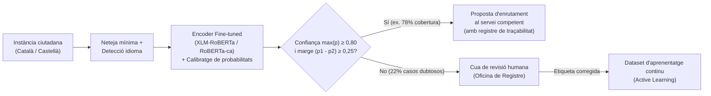

## A. Objectius d'aprenentatge

En completar aquesta lliçó, l'estudiant ha de ser capaç de:

1. **Distingir** les modalitats de classificació textual: **binària**, **multiclasse** (una sola categoria) i **multietiqueta (*multi-label*)** (múltiples etiquetes simultànies per document).
2. **Comparar** les quatre grans famílies d'arquitectures per a classificació de textos: **TF-IDF + Lineal/SVM**, **Embeddings + capçal lineal / SetFit**, ***Fine-tuning* d'encoder Transformer** (RoBERTa-ca / XLM-R) i **LLM *zero-shot / few-shot***.
3. **Seleccionar** l'enfocament òptim segons volum de dades etiquetades, nombre de classes, latència, cost, privacitat i requeriments de desplegament *on-premise*.
4. **Dissenyar** un sistema de classificació d'instàncies ciutadanes amb **gestió de baixa confiança (classe «revisió manual»)** i mètriques adequades (**Macro-F1**, *Micro-F1*, *Hamming Loss*).
5. **Implementar** en Python + NumPy un classificador textual **Multinomial Naive Bayes** amb suavitzat de Laplace per categoritzar instàncies municipals.

---

## B. Explicació introductòria

Quan una ciutadana presenta una instància genèrica al registre electrònic d'un ajuntament (*"Bon dia, voldria demanar la bonificació de l'IBI per família nombrosa i consultar l'estat del rebut de brosses"*), el primer pas operatiu és **enrutar-la al servei competent** (Hisenda, Urbanisme, Serveis Socials, Mobilitat, Medi Ambient...).

La **classificació de textos** automatitza aquesta assignació d'etiquetes predefinides a documents no estructurats. Fixa't en l'exemple anterior: una mateixa instància pot tractar **dos temes alhora** (IBI i taxa de residus) — això il·lustra per què en l'Administració sovint cal decidir conscientment entre classificació **multiclasse** (un únic departament destinatari principal) i **multietiqueta** (diverses etiquetes temàtiques simultànies).

---

## C. Explicació tècnica avançada

### 1. Modalitats i funcions d'activació / pèrdua

| Modalitat | Exemple administratiu | Activació sortida | Funció de pèrdua | Mètriques clau |
|---|---|---|---|---|
| **Binària** | Urgència alta vs. normal; queixa vs. consulta | 1 Sigmoid | Binary Cross-Entropy | PR-AUC, Recall, F1 |
| **Multiclasse** (excloent) | Assignar 1 servei responsable entre 15 àrees | Softmax (suma = 1) | Categorical Cross-Entropy | **Macro-F1** (equitat entre àrees grans i petites), Weighted-F1 |
| **Multietiqueta** (no excloent) | Etiquetar un plec amb `["sostenibilitat", "obres", "fons_europeus"]` | \(K\) Sigmoids independents | BCE amb logits per etiqueta | Macro-F1, Micro-F1, Subset Accuracy, Hamming Loss |

### 2. Matriu de decisió d'arquitectures per a classificació de textos

| Enfocament | Dades etiquetades necessàries | Latència / Cost inferència | Rendiment en català/bilingüe | Quan triar-lo |
|---|---|---|---|---|
| **1. TF-IDF + LogisticRegression / LinearSVC / Naive Bayes** | 500 – 50.000+ | **< 2 ms (CPU)**, cost gairebé nul | Bo si vocabulari estable | **Sempre com a baseline**; producció si ja compleix objectiu i cal màxima interpretabilitat |
| **2. Embeddings + Lineal / SetFit (contrastiu *few-shot*)** | **10 – 200 per classe** | ~15–40 ms (CPU/GPU) | Molt bo amb encoder multilingüe (BGE-M3 / E5) | Poques etiquetes, classes noves freqüents, prototipat ràpid |
| **3. *Fine-tuning* d'Encoder Transformer** (`RoBERTa-ca`, `XLM-RoBERTa`, `mDeBERTa-v3`) | 500 – 50.000+ | ~10–30 ms (GPU o ONNX quantitzat) | **Excel·lent** (estat de l'art en precisió/cost) | **Estàndard de producció** en alt volum amb dades històriques etiquetades |
| **4. LLM *Zero-shot / Few-shot*** (sortida JSON estructurada) | **0 – 10 exemples** | 300–2.000 ms (alt cost / GPU gran) | Molt bo, flexible | Arrencada en fred (*cold start*), taxonomies canviants, **generació de dades per destil·lar cap a un encoder petit** |

### 3. Gestió d'etiquetes desequilibrades, textos llargs i zona gris

1. **Classes minoritàries**: en un ajuntament, Mobilitat i Tributs poden tenir 10.000 instàncies/any mentre Patrimoni Històric només en té 45. Optimitzar *Accuracy* ignoraria Patrimoni Històric! Cal utilitzar **Macro-F1**, `class_weight="balanced"` (o *Focal Loss*) i validació creuada **`StratifiedKFold`**.
2. **Textos més llargs de 512 tokens** (plecs o decrets): un encoder estàndard trunca a 512 tokens. Solucions pràctiques: **Head + Tail truncation** (primers 256 tokens + últims 256 tokens, on solen estar l'assumpte i la resolució!), *sliding window* amb agregació (*max/mean pooling* de logits), o encoders de context llarg (`ModernBERT`, `Longformer`, `BGE-M3`).
3. **Classificació selectiva (*abstention* / zona gris)**: en operació administrativa, no cal forçar una predicció dubtosa. Si la probabilitat calibrada màxima és inferior a un llindar \(\tau\) (p. ex. `< 0,75`) o el marge entre les dues primeres classes és petit, el sistema deriva l'expedient a la cua de **revisió humana** (*triage assistit*), aconseguint alta precisió en la fracció automatitzada (*coverage vs. accuracy tradeoff*).

---

## D. Diagrames i recursos visuals

### Pipeline de classificació d'instàncies amb zona gris i destil·lació



---

## E. Aplicació a l'Administració pública

1. **Patró «LLM com a professor → Encoder com a alumne» (destil·lació)**: quan una àrea crea una taxonomia nova sense històric etiquetat, un LLM local pot pre-etiquetar 2.000 expedients revisats per mostreig humà, i amb aquest corpus s'entrena un encoder compacte (`RoBERTa-ca` o `XLM-R`) que corre 100× més ràpid i barat a producció.
2. **Privacitat i RGPD**: les instàncies ciutadanes contenen noms, DNI, adreces i sovint dades especials (salut, situació socioeconòmica). Executar classificadors locals compactes (*on-premise*) evita transferir dades personals a APIs externes.
3. **Active Learning**: prioritzar la revisió humana sobre els casos de baixa confiança (entropia alta) maximitza el valor de cada hora del personal tècnic que etiqueta nous exemples.

---

## F. Exemple pràctic guiat

Implementem des de zero en **Python + NumPy** un classificador **Multinomial Naive Bayes amb suavitzat de Laplace (\(\alpha = 1\))** en espai logarítmic (per evitar *underflow* numèric) i lògica d'**abstenció per baixa confiança**, sobre instàncies municipals sintètiques de 3 àrees (`tributs`, `urbanisme`, `serveis_socials`).

```python
"""Exemple 2.4: Classificador Multinomial Naive Bayes en NumPy amb abstenció per confiança."""
import re
import numpy as np


def tokenitzar(text: str) -> list[str]:
    text = re.sub(r"\b[ldsmnt]'", " ", text.lower())
    return re.findall(r"[a-zàèéíïòóúüç]+(?:·[a-zàèéíïòóúüç]+)*", text)


class MultinomialNB:
    def __init__(self, alpha: float = 1.0) -> None:
        self.alpha = alpha
        self.classes: list[str] = []
        self.vocab: dict[str, int] = {}
        self.log_prior: np.ndarray = np.array([])
        self.log_lik: np.ndarray = np.array([])

    def fit(self, textos: list[str], etiquetes: list[str]) -> "MultinomialNB":
        docs = [tokenitzar(t) for t in textos]
        self.classes = sorted(set(etiquetes))
        vocab_llista = sorted({tok for d in docs for tok in d})
        self.vocab = {tok: i for i, tok in enumerate(vocab_llista)}
        n_c, n_v = len(self.classes), len(self.vocab)

        counts_c = np.zeros(n_c, dtype=float)
        counts_wc = np.zeros((n_c, n_v), dtype=float)
        for doc, y in zip(docs, etiquetes):
            ci = self.classes.index(y)
            counts_c[ci] += 1.0
            for tok in doc:
                counts_wc[ci, self.vocab[tok]] += 1.0

        self.log_prior = np.log(counts_c / len(textos))
        # Suavitzat de Laplace: evita log(0) davant mots no vistos en una classe
        numerador = counts_wc + self.alpha
        denominador = counts_wc.sum(axis=1, keepdims=True) + self.alpha * n_v
        self.log_lik = np.log(numerador / denominador)
        return self

    def predict_proba(self, text: str) -> dict[str, float]:
        log_post = self.log_prior.copy()
        for tok in tokenitzar(text):
            if tok in self.vocab:
                log_post += self.log_lik[:, self.vocab[tok]]
        # Softmax numèricament estable (log-sum-exp trick)
        log_post -= np.max(log_post)
        probs = np.exp(log_post)
        probs /= np.sum(probs)
        return {c: float(p) for c, p in zip(self.classes, probs)}


if __name__ == "__main__":
    train_x = [
        "Sol·licitud bonificació impost IBI família nombrosa",
        "Reclamació rebut taxa residus i plusvàlua municipal",
        "Fraccionament pagament impost vehicles cadastre",
        "Llicència obres menors reforma cuina i façana",
        "Permís ocupació via pública bastida rehabilitació edifici",
        "Consulta planejament urbanístic parcel·la edificable",
        "Ajut urgència social lloguer i pobresa energètica",
        "Sol·licitud beca menjador escolar i servei dependència",
        "Atenció domiciliària gent gran i prestació social",
    ]
    train_y = [
        "tributs", "tributs", "tributs",
        "urbanisme", "urbanisme", "urbanisme",
        "serveis_socials", "serveis_socials", "serveis_socials",
    ]

    clf = MultinomialNB(alpha=1.0).fit(train_x, train_y)
    proves = [
        "Vull demanar un fraccionament del rebut de l'IBI",
        "Necessito permís per posar una bastida d'obres a la façana",
        "Voldria sol·licitar informació general sobre horaris",
    ]
    llindar = 0.65
    for text in proves:
        probs = clf.predict_proba(text)
        millor_c = max(probs, key=probs.get)
        conf = probs[millor_c]
        accio = f"ENRUTAR -> {millor_c}" if conf >= llindar else "DERIVAR A REVISIÓ HUMANA"
        print(f"[{conf:.3f}] {accio:<28} | Text: {text}")
```

### Interpretació dels resultats (execució verificada)

- Les dues primeres instàncies (`IBI / fraccionament` → `tributs`; `bastida / obres / façana` → `urbanisme`) superen amb escreix el llindar (`0.65`) i s'enruten automàticament amb confiança alta.
- La tercera instància (`"informació general sobre horaris"`), sense paraules discriminatives de cap dels tres serveis, obté probabilitats quasi uniformes (`~0.33` per classe, per sota de `0.65`) i s'envia automàticament a **revisió humana**, evitant un error d'enrutament forçat.

---

## G. Exercici pràctic per resoldre

### Enunciat
L'Àrea de Cultura i Participació Ciutadana rep **35.000 formularis anuals** de propostes i consultes (en català i castellà), alguns molt breus (1 frase) i d'altres llargs (2 pàgines), que poden pertànyer a **una o vàries** de 18 etiquetes temàtiques (p. ex., una proposta pot ser alhora `accessibilitat`, `infància` i `parcs_jardins`). Disposes d'un històric de **6.000 registres etiquetats**, però 4 de les 18 etiquetes només tenen entre 25 i 40 exemples cadascuna.

Dissenya la solució tècnica responent a 4 decisions:
1. Quina modalitat de classificació, funció d'activació final i funció de pèrdua corresponen?
2. Quin pipeline de models (baseline + model principal) triaries i com gestionaries els textos llargs >512 tokens?
3. Quina mètrica principal utilitzaries per avaluar el sistema i com gestionaries les 4 etiquetes minoritàries?
4. Com incorporaries la supervisió humana i la millora contínua (*Active Learning*)?

### Objectius i restriccions
- Dissenyar una arquitectura de classificació **multietiqueta bilingüe** realista, robusta al desequilibri i amb *human-in-the-loop*.

:::hint Pista 1 — Una proposta pot tenir 3 etiquetes alhora
És classificació **multietiqueta (*multi-label*)**! Per tant, MAI Softmax: calen **18 Sigmoids independents** amb **Binary Cross-Entropy (`BCEWithLogitsLoss`)** i llindars independents per etiqueta!
:::

:::hint Pista 2 — 6.000 etiquetats + bilingüe català/castellà
Baseline ràpid: `TF-IDF (1,2) + OneVsRest(LogisticRegression(class_weight='balanced'))`. Model principal: *fine-tuning* d'`xlm-roberta-base` o `mDeBERTa-v3-base` amb *Head+Tail* per a textos >512 tokens i `pos_weight` per a les 4 classes rares.
:::

### Criteris d'avaluació
- **25%**: Identificació exacta de *multi-label* + 18 Sigmoids + `BCEWithLogitsLoss` + llindars per etiqueta.
- **30%**: Selecció justificada del baseline TF-IDF + encoder multilingüe (*on-premise*) + estratègia *Head+Tail / sliding window* per a textos llargs.
- **25%**: Mètrica **Macro-F1** (juntament amb Micro-F1), `MultilabelStratifiedKFold`, `pos_weight` i anàlisi per idioma.
- **20%**: Cua de revisió humana per baixa confiança + *Active Learning* enfocat a les 4 classes rares.

### Errors habituals
- Proposar Softmax en un problema multietiqueta (forçaria que les probabilitats sumin 1 i impediria assignar 3 etiquetes amb alta probabilitat alhora!).

:::solution Solució completa comentada i alternatives
### 1. Modalitat, activació i funció de pèrdua
- **Classificació multietiqueta (*multi-label*)** amb 18 sortides binàries independents.
- **Sortida**: **18 funcions Sigmoid** (mai Softmax!), perquè una proposta pot activar `accessibilitat = 0,92`, `infància = 0,88` i `parcs_jardins = 0,95` simultàniament.
- **Pèrdua**: **`BCEWithLogitsLoss`** amb paràmetre **`pos_weight`** inversament proporcional a la prevalença de cada etiqueta (o *Asymmetric Loss*) per donar pes a les 4 etiquetes minoritàries.

### 2. Arquitectura i textos llargs (>512 tokens)
- **Baseline obligatori**: `TF-IDF (unigrames + bigrames, sublinear_tf=True)` + `OneVsRest(LogisticRegression(class_weight='balanced'))` (execució instantània en CPU per validar etiquetes i fixar marca base).
- **Model principal**: *fine-tuning* local d'un encoder multilingüe català/castellà (**`xlm-roberta-base`** o **`mDeBERTa-v3-base`**), exportable a ONNX INT8 per baixa latència *on-premise*.
- **Textos >512 tokens**: aplicar truncament ***Head + Tail*** (primers 256 + últims 256 tokens) o *sliding window* amb *max-pooling* de logits per fragment (si una etiqueta apareix en qualsevol paràgraf del document, el màxim l'activa!).

### 3. Mètriques i gestió de desequilibri
- **Mètrica principal**: **Macro-F1** (dona el mateix pes a les 4 classes rares que a les majoritàries), complementada amb **Micro-F1** (rendiment global sobre el volum) i desagregació **català vs. castellà**.
- **Partició**: `MultilabelStratifiedKFold` (iterativa) per preservar totes les combinacions d'etiquetes en train/val/test.
- **Optimització de llindars**: ajustar un llindar \(\tau_k\) específic per a cada etiqueta \(k \in \{1..18\}\) en validació (no deixar `0,50` fix per a les etiquetes rares!).

### 4. Supervisió humana i Active Learning
- Si cap etiqueta supera el seu llindar o alguna etiqueta cau en una banda d'incertesa (p. ex. `[0,35, 0,65]`), derivar a revisió manual.
- **Active Learning dirigit**: prioritzar la revisió i re-etiquetatge de documents amb probabilitat intermèdia en les **4 etiquetes minoritàries** (o complementar-les amb exemples sintètics verificats / *SetFit* per enriquir ràpidament aquestes 4 classes).
:::

---

## H. Test individual

Resol les 10 preguntes sobre classificació binària/multiclasse/multietiqueta, elecció d'arquitectures (TF-IDF, SetFit, Transformer *fine-tuned*, LLM), textos llargs, suavitzat de Laplace i zona gris.

---

## I. Preguntes de desenvolupament

### Pregunta 1
Compara les quatre grans opcions per classificar textos administratius (**TF-IDF + lineal**, **Embeddings/SetFit**, **Encoder Transformer *fine-tuned*** i **LLM *zero-shot***) en funció del volum de dades etiquetades, el cost d'inferència i la privacitat.

:::model-answer Resposta model i criteris de correcció (Pregunta 1)
**Resposta model**:
- **TF-IDF + Lineal/SVM**: ideal com a baseline i en producció quan el vocabulari és estable i hi ha centenars/milers d'etiquetes; latència <2 ms en CPU, màxima interpretabilitat i 100% *on-premise*.
- **Embeddings + Lineal / SetFit**: excel·lent amb **poques etiquetes** (10–200/classe) gràcies a representacions semàntiques multilingües; cost moderat en CPU/GPU local.
- **Encoder *fine-tuned* (`RoBERTa-ca`, `XLM-R`)**: millor relació qualitat/cost en producció d'alt volum quan disposem de ≥500–1.000 exemples; corre localment en seguretat total i captura matisos sintàctics i bilingüisme.
- **LLM *zero-shot/few-shot***: útil quan no hi ha etiquetes (*cold start*) o la taxonomia canvia contínuament, però molt més lent i car en inferència i requereix allotjament local (o anonimització/DPA rigorós) si hi ha dades personals. Sovint s'usa com a professor per etiquetar i destil·lar cap a un encoder petit.

**Criteris de correcció (10 punts)**:
- Comparativa precisa de les 4 arquitectures pels 3 criteris (dades, cost/latència, privacitat): 8 punts.
- Menció del patró de destil·lació LLM → Encoder o selecció gradual: 2 punts.
:::

### Pregunta 2
Explica la diferència entre classificació **multiclasse** i **multietiqueta**, detallant la funció d'activació de sortida, la funció de pèrdua i l'ajust de llindars en cada cas.

:::model-answer Resposta model i criteris de correcció (Pregunta 2)
**Resposta model**:
- En **multiclasse**, les \(K\) classes són mútuament excloents (cada document pertany a una sola classe). La capa de sortida aplica **Softmax** (les \(K\) probabilitats sumen 1) i s'entrena amb **Categorical Cross-Entropy**.
- En **multietiqueta (*multi-label*)**, un document pot activar simultàniament \(0, 1, \dots, K\) etiquetes. La sortida aplica **\(K\) funcions Sigmoid independents** (cada probabilitat en `[0,1]` sense sumar 1) i s'entrena amb **Binary Cross-Entropy** per etiqueta (`BCEWithLogitsLoss`). A més, convé optimitzar un llindar independent \(\tau_k\) per a cada etiqueta en validació, especialment quan les prevalences són molt diferents.

**Criteris de correcció (10 punts)**:
- Distinció conceptual i exemple clar: 3 punts.
- Activació (Softmax vs. K Sigmoids) i pèrdua (CCE vs. BCE): 5 punts.
- Llindars per etiqueta i gestió de desequilibri: 2 punts.
:::

### Pregunta 3
Què és la **classificació selectiva (gestió de zona gris / abstenció)** en un sistema de *triage* d'expedients administratius i com es combina amb ***Active Learning*** per millorar el model en producció?

:::model-answer Resposta model i criteris de correcció (Pregunta 3)
**Resposta model**:
- La classificació selectiva defineix un llindar de confiança (i opcionalment de marge entre les dues millors classes) sobre probabilitats calibrades: el model només enruta automàticament els casos d'alta confiança (*coverage*) i deriva els dubtosos a revisió humana, elevant la precisió efectiva en els casos automatitzats i evitant errors greus.
- Combinat amb ***Active Learning***, les correccions fetes pel personal en aquesta cua de casos dubtosos (que són precisament els més informatius per a la frontera de decisió del model) s'emmagatzemen amb traçabilitat i es reincorporen als cicles de reentrenament, reduint progressivament la taxa d'abstenció amb el mínim esforç d'etiquetatge humà.

**Criteris de correcció (10 punts)**:
- Mecanisme d'abstenció i compromís *coverage* vs. *accuracy*: 5 punts.
- Integració del bucle *Human-in-the-Loop* + *Active Learning*: 5 punts.
:::

---

## J. Resum per memoritzar

### Conceptes clau
- **Multiclasse** = Softmax + Categorical Cross-Entropy (1 etiqueta). **Multietiqueta** = \(K\) Sigmoids + BCE (0..K etiquetes).
- **Escala d'arquitectures**: TF-IDF+Lineal (baseline obligatori) → SetFit/Embeddings (poques dades) → Encoder *fine-tuned* (producció òptima) → LLM *zero-shot* (*cold start* / destil·lació).
- **Textos >512 tokens**: *Head + Tail truncation*, *sliding window* amb *max/mean pooling*, o encoders de context llarg.
- **Desequilibri**: usar **Macro-F1** (no Accuracy!), `class_weight`/`pos_weight` i ajust de llindars per classe.
- **Zona gris**: derivar baixa confiança a revisió humana i aprofitar les correccions via *Active Learning*.

### Definicions essencials
- **Suavitzat de Laplace (\(\alpha\))**: suma d'una constant positiva als recomptes de paraules en Naive Bayes per evitar probabilitats iguals a zero davant mots no vistos en una classe.
- **Destil·lació de coneixement (*Knowledge Distillation*)**: entrenar un model petit i ràpid (encoder) imitant les prediccions/etiquetes generades per un model gran (LLM) validades per mostreig humà.

### Errors conceptuals freqüents
1. Fer servir **Softmax** en un problema **multietiqueta**.
2. Optimitzar *Accuracy* en classificació de 15–20 departaments amb volums molt desiguals.
3. No truncar intel·ligentment (*Head+Tail*) textos llargs on la resolució o petició concreta apareix al final del document.

### Possibles preguntes d'examen
- Tria entre TF-IDF, SetFit, RoBERTa *fine-tuned* i LLM per a un escenari concret amb restriccions de dades, latència i RGPD.
- Dissenya la sortida, pèrdua i mètriques d'un classificador multietiqueta amb classes molt desequilibrades.
- Explica per què Naive Bayes usa suma de log-probabilitats i suavitzat de Laplace.
