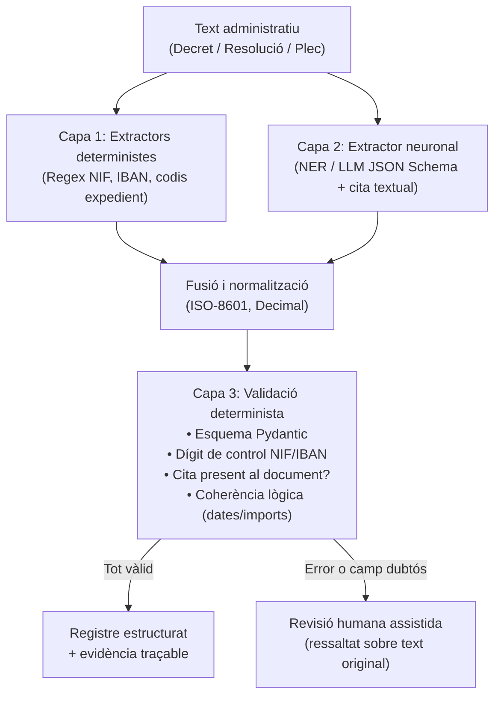

## A. Objectius d'aprenentatge

En acabar aquesta lliçó, l'estudiant ha de ser capaç de:

1. **Definir** l'**Extracció d'Informació (*Information Extraction*, IE)** i les seves subtasques principals: extracció de camps estructurats (*slot filling*), extracció de relacions, extracció d'esdeveniments i resolució de correferències.
2. **Combinar** estratègies **deterministes** (expressions regulars, gramàtiques i validadors algorítmics com el dígit de control del NIF/IBAN) amb estratègies **neuronals** (NER, *Question Answering* extractiu i LLMs amb **sortida estructurada / *JSON Schema***).
3. **Dissenyar** pipelines híbrids d'extracció amb **validació d'esquema (Pydantic / JSON Schema)**, **comprovació de cita textual (*grounding*)** i **derivació humana** davant absència o ambigüitat de dades.
4. **Aplicar** IE per a la **pseudonimització i anonimització automatitzada** de resolucions administratives abans de publicar-les o enviar-les a models d'IA.
5. **Implementar** un extractor híbrid en Python que extreu i valida camps clau (número d'expedient, NIF amb comprovació algorítmica de lletra, import normalitzat i data ISO) d'un text administratiu no estructurat.

---

## B. Explicació introductòria

Mentre la classificació de textos respon *"De què tracta aquest document?"*, l'**Extracció d'Informació (IE)** respon *"Quines dades concretes conté aquest document i com les passo a una base de dades estructurada?"*.

Imagina un decret d'alcaldia en PDF que diu:
> *"Es resol concedir a l'entitat Associació Cultural del Montseny (NIF G08123456) una subvenció per import de 4.250,50 € en el marc de l'expedient SUB-2026-0148, amb termini de justificació fins al 30/11/2026."*

L'objectiu d'IE és transformar aquest paràgraf en un registre JSON net, tipat i verificat (`beneficiari`, `nif`, `import_eur: 4250.5`, `expedient: "SUB-2026-0148"`, `data_limit: "2026-11-30"`), a punt per alimentar el gestor d'expedients o el portal de transparència sense picatge manual repetitiu.

---

## C. Explicació tècnica avançada

### 1. Subtasques de l'Extracció d'Informació

| Subtasca | Què extreu | Exemple administratiu |
|---|---|---|
| **NER** (Lliçó 2.6) | Mencions d'entitats (`PER`, `ORG`, `LOC`, `DATA`, `IMPORT`) | `Associació Cultural del Montseny` (`ORG`) |
| **Extracció de relacions (RE)** | Vincles semàntics entre parells d'entitats `(e1, relació, e2)` | `(Associació X, beneficiària_de, SUB-2026-0148)` |
| **Extracció d'esdeveniments** | Acció disparadora + arguments (qui, què, quant, quan) | Esdeveniment `Adjudicació`: licitador, import, lot, data |
| ***Slot Filling* / Extracció estructurada** | Plantilla JSON amb camps predefinits (acceptant `null` si no existeix!) | `{ "import_eur": 4250.50, "termini_dies": null }` |
| **Resolució de correferències** | Vincula pronoms o àlies amb la mateixa entitat real | `"l'adjudicatària"` → `"Obres del Vallès, SL"` |

### 2. Quatre paradigmes tècnics d'extracció (i com combinar-los)

1. **Expressions regulars (*Regex*) + validadors deterministes**:
   - **Quan brillen**: patrons altament estructurats (DNI/NIE/NIF, IBAN, codis d'expedient, matrícules, dates, imports). Velocitat instantània, 100% explicables i deterministes.
   - **Limitació**: fràgils davant la variabilitat del llenguatge natural (p. ex., distingir si una data és la *data de sol·licitud*, la *data de resolució* o la *data límit de justificació*!).
2. **Models d'etiquetatge de seqüències (NER / Span Extraction)** i ***Extractive QA*** (p. ex., RoBERTa-ca ajustat sobre preguntes com *"Quina és la data límit de justificació?"*):
   - Retorna **índexs exactes `[start_char, end_char]`** dins el text original → **zero risc d'inventar text nou**, ràpid i *on-premise*.
3. **LLMs amb Sortida Estructurada (*Structured Outputs / Constrained Decoding* + JSON Schema / Pydantic)**:
   - Flexibilitat màxima per extreure estructures niuades (p. ex. llista d'articles o lots d'un plec) i normalitzar formats (`"quatre mil euros"` → `4000.0`).
   - **Requisit crític**: incloure sempre l'opció `null` en camps opcionals (evitar que l'LLM inventi dades absents!) i demanar el camp **`cita_textual`** (*evidence span*) per verificar programàticament que la dada apareix realment al document font!
4. **Arquitectura Híbrida (Recomanada en producció)**:
   - *Regex/Validadors* per a identificadors normalitzats + *NER/LLM estructurat* per a camps semàntics i relacions + **capa de validació determinista** (Pydantic, suma d'imports, dígit de control NIF/IBAN, coherència de dates: `data_resolucio >= data_solicitud`).

### 3. Mètriques d'avaluació en Extracció d'Informació

- **Exact Match (EM)** per camp: coincidència exacta després de normalització (p. ex. `4250.5` == `4250.50`).
- **Precision, Recall i F1 per camp i per esquema**: especialment crític separar **falsos positius per al·lucinació** (extreure un valor quan el camp era `null`) de **falsos negatius** (retornar `null` quan el camp hi era).
- **Normalització de dades (Canonicalització)**: convertir `"30 de novembre de 2026"` → `"2026-11-30"` (ISO-8601) i `"4.250,50 EUR"` → `4250.50` (`float`/`Decimal`, preferiblement `Decimal` per a comptabilitat pública!).

---

## D. Diagrames i recursos visuals

### Pipeline híbrid d'extracció d'informació amb verificació de *grounding*



---

## E. Aplicació a l'Administració pública

1. **Anonimització / Pseudonimització per al Portal de Transparència (RGPD / Llei 19/2014)**: abans de publicar actes o resolucions, un pipeline híbrid (regex per DNI/telèfons/IBAN + NER per noms propis i adreces + revisió humana) emmascara dades personals minimitzant el risc de filtració accidental.
2. **Alimentació del Registre de Subvencions i Contractació**: extreure automàticament beneficiaris, imports, lots i terminis de centenars de decrets i plecs reduint errors humans de transcripció.
3. **Principi comptable**: utilitzar sempre `Decimal` (mai coma flotant binària `float`) i comprovar regles aritmètiques (`base_imposable + iva == total`) com a tallafocs automàtic contra errors d'OCR o al·lucinacions.

---

## F. Exemple pràctic guiat

Implementem en **Python pur** un extractor híbrid verificable sobre un fragment de decret administratiu que extreu: número d'expedient, **DNI/NIF amb verificació algorítmica del dígit de control**, import convertit a `Decimal` i data normalitzada a ISO-8601, retornant incidències de validació si algun camp falla.

```python
"""Exemple 2.5: Extractor estructurat amb validació algorítmica (NIF, Decimal, ISO-8601)."""
import re
from decimal import Decimal

LLETRES_DNI = "TRWAGMYFPDXBNJZSQVHLCKE"


def validar_dni(dni: str) -> bool:
    dni = dni.upper().replace("-", "").strip()
    if not re.fullmatch(r"\d{8}[A-Z]", dni):
        return False
    return LLETRES_DNI[int(dni[:8]) % 23] == dni[8]


def extreure_camps_resolucio(text: str) -> dict[str, object]:
    avisos: list[str] = []

    m_exp = re.search(r"\b([A-Z]{2,5}-\d{4}-\d{3,6})\b", text)
    expedient = m_exp.group(1) if m_exp else None

    m_dni = re.search(r"\b(\d{8}[A-Za-z])\b", text)
    dni = m_dni.group(1).upper() if m_dni else None
    dni_valid = validar_dni(dni) if dni else False
    if dni and not dni_valid:
        avisos.append(f"Dígit de control de DNI invàlid: {dni}")

    # Import europeu: 4.250,50 € -> Decimal('4250.50')
    m_imp = re.search(r"(\d{1,3}(?:\.\d{3})*,\d{2})\s*(?:€|EUR)", text)
    import_eur = Decimal(m_imp.group(1).replace(".", "").replace(",", ".")) if m_imp else None

    # Data DD/MM/AAAA -> AAAA-MM-DD (ISO-8601)
    m_data = re.search(r"\b(\d{2})/(\d{2})/(\d{4})\b", text)
    data_iso = f"{m_data.group(3)}-{m_data.group(2)}-{m_data.group(1)}" if m_data else None

    return {
        "expedient": expedient,
        "dni": dni,
        "dni_valid": dni_valid,
        "import_eur": str(import_eur) if import_eur is not None else None,
        "data_iso": data_iso,
        "requereix_revisio_humana": bool(avisos) or any(v is None for v in (expedient, dni, import_eur, data_iso)),
        "avisos": avisos,
    }


if __name__ == "__main__":
    # Dades 100% sintètiques (12345678 % 23 == 14 -> 'Z')
    doc_valid = (
        "Resolucio expedient SUB-2026-0148: s'atorga a persona ficticia amb DNI 12345678Z "
        "un ajut de 4.250,50 € amb data limit de justificacio 30/11/2026."
    )
    doc_ocr_error = (
        "Resolucio expedient SUB-2026-0149: s'atorga a persona ficticia amb DNI 12345678A "
        "un ajut de 1.800,00 € amb data limit 15/12/2026."
    )
    print("Doc vàlid   :", extreure_camps_resolucio(doc_valid))
    print("Doc amb error:", extreure_camps_resolucio(doc_ocr_error))
```

### Interpretació dels resultats (execució verificada)

- En `doc_valid`, el sistema extreu tots els camps, valida que la lletra `Z` correspon al residu `12345678 % 23 = 14`, converteix l'import exactament a `Decimal('4250.50')` i la data a `2026-11-30`, marcant `requereix_revisio_humana = False`.
- En `doc_ocr_error` (on un error d'OCR ha llegit `A` en lloc de `Z`), el validador determinista intercepta immediatament l'anomalia (`dni_valid = False`) i activa `requereix_revisio_humana = True` abans que la dada errònia entri a la base de dades!

---

## G. Exercici pràctic per resoldre

### Enunciat
Necessites extreure automàticament **6 camps** d'un arxiu de **5.000 resolucions de subvencions** en PDF ja convertit a text:
1. `codi_expedient` (format `SUB-AAAA-NNNN`)
2. `nif_beneficiari`
3. `nom_entitat_beneficiaria`
4. `import_concedit_eur` (compte: el text cita sovint **dos imports**: l'*import sol·licitat* i l'*import concedit*!)
5. `data_resolucio` vs. `data_limit_justificacio` (també apareixen múltiples dates al text!)
6. `condicions_especials` (camp opcional: en el 70% de les resolucions no n'hi ha)

Un company suggereix resoldre-ho tot únicament amb 6 expressions regulars. Explica per què **regex sol fallarà** en els camps 3, 4, 5 i 6, i dissenya un **pipeline híbrid amb validació i grounding** que resolgui els 6 camps amb alta fiabilitat.

### Objectius i restriccions
- Combinar correctament determinisme (regex/regles) i extracció semàntica (LLM estructurat / NER / QA) amb verificació anti-al·lucinació.

:::hint Pista 1 — Ambigüitat semàntica de múltiples dates i imports
Un regex pot trobar totes les dates i imports del text, però NO sap amb fiabilitat quina és la *sol·licitada* i quina és la *concedida* quan canvia la redacció entre decrets!
:::

:::hint Pista 2 — Com evitar que un LLM inventi `condicions_especials` en el 70% dels casos on no existeixen?
Definir l'esquema JSON amb `Optional[str] = None`, instruir explícitament *"retorna null si no apareix explícitament al text"* i exigir el camp `cita_literal` verificat després per subcadena sobre el text original!
:::

### Criteris d'avaluació
- **30%**: Diagnòstic precís de per què regex falla en camps semàntics/ambigus (`import_concedit` vs `sol·licitat`, `data_resolucio` vs `data_limit`, `nom_entitat`, `condicions_especials`).
- **40%**: Arquitectura híbrida completa (esquema Pydantic/JSON Schema amb tipus estrictes + `null` permès + `cita_literal` per camp + validadors deterministes NIF/dates/imports).
- **30%**: Regles de coherència automàtica (`import_concedit <= import_sollicitat`, `data_limit > data_resolucio`) i derivació humana per excepcions.

### Errors habituals
- Usar un LLM sense `null` permès ni verificació de cita textual, provocant al·lucinacions en el 70% de resolucions sense condicions especials.

:::solution Solució completa comentada i alternatives
### Per què regex sol falla en els camps 3, 4, 5 i 6
- `nom_entitat_beneficiaria` (camp 3): variabilitat sintàctica infinita (denominacions llargues, sigles, majúscules irregulars, altres entitats esmentades a l'expedient).
- `import_concedit_eur` i les dues dates (camps 4 i 5): apareixen **múltiples xifres i dates** al mateix text (import pressupostat, sol·licitat, concedit; data d'entrada, d'informe, de decret, de justificació); distingir-ne el rol requereix comprensió contextual.
- `condicions_especials` (camp 6): redacció completament lliure i sovint absent.

### Pipeline híbrid recomanat
1. **Extracció semàntica estructurada**: LLM local (*on-premise*, `temperature = 0`) amb *Structured Outputs* (JSON Schema / Pydantic) que retorna per a cada camp: `{ "valor": ..., "cita_literal": ... }`, permetent explícitament `null` per a `condicions_especials` i instruint no inferir ni inventar res absent del document.
2. **Validació i enriquiment determinista (Capa Pydantic + Regex)**:
   - Verificar format regex de `codi_expedient` (`SUB-\d{4}-\d{4}`).
   - Validar el **dígit de control** de `nif_beneficiari` (DNI/NIE/CIF).
   - Comprovar que cada `cita_literal` no nul·la existeix realment al text font (normalitzant espais) → tallafocs contra al·lucinacions!
   - Verificar regles de negoci deterministes: `0 < import_concedit <= import_sollicitat` (si s'extreu també el sol·licitat) i `data_limit_justificacio > data_resolucio`, usant `Decimal` i `ISO-8601`.
3. **Derivació humana selectiva**: qualsevol resolució que falli una regla de validació o de *grounding* passa a una interfície de revisió amb la `cita_literal` ressaltada sobre el PDF original.
:::

---

## H. Test individual

Resol les 10 preguntes sobre extracció d'informació, *slot filling*, extracció de relacions, arquitectura híbrida regex + LLM estructurat, *grounding* i anonimització.

---

## I. Preguntes de desenvolupament

### Pregunta 1
Explica com dissenyaries un **pipeline híbrid d'extracció d'informació** que combini expressions regulars, models neuronals (NER o LLM amb sortida estructurada) i validació determinista per extreure dades crítiques de resolucions administratives.

:::model-answer Resposta model i criteris de correcció (Pregunta 1)
**Resposta model**:
- **Capa 1 (Determinista / Regex)**: captura candidats d'estructura rígida (NIF, IBAN, codis d'expedient, imports, dates) i executa validacions algorítmiques (dígit de control NIF/IBAN).
- **Capa 2 (Semàntica / Neuronal)**: un model NER/Extractive QA o un LLM local amb *JSON Schema* (*constrained decoding*, `temperature=0`) assigna cada valor al seu rol semàntic correcte (distingint p. ex. data de sol·licitud vs. data límit), admetent `null` quan el camp no hi és i retornant la **`cita_literal`** (*evidence span*).
- **Capa 3 (Validació i *Grounding*)**: valida l'esquema amb Pydantic, normalitza dates (ISO-8601) i imports (`Decimal`), comprova que la `cita_literal` existeix al text original i verifica invariants lògics (`base + IVA == total`, `data_fi > data_inici`). Les incidències es deriven a revisió humana amb el fragment ressaltat.

**Criteris de correcció (10 punts)**:
- Combinació ben articulada de capa determinista + neuronal: 4 punts.
- Verificació de *grounding* (`cita_literal`), `null` permès i invariants de negoci: 4 punts.
- Normalització (`Decimal`, ISO-8601) i derivació humana: 2 punts.
:::

### Pregunta 2
Per què la **sortida estructurada (*Structured Outputs / Constrained Decoding*)** amb JSON Schema en LLMs és molt superior a demanar simplement *"retorna un JSON"* en text lliure, i quina limitació NO resol per si sola?

:::model-answer Resposta model i criteris de correcció (Pregunta 2)
**Resposta model**:
- La sortida estructurada restringeix dinàmicament els tokens permesos durant la decodificació segons una gramàtica derivada del JSON Schema, **garantint sintàcticament** JSON vàlid, claus exactes, tipus de dades i enumerats sense errors de parseig ni text conversacional afegit (*"Aquí tens el JSON:"*).
- **Què NO resol per si sola**: la validesa **sintàctica** no garanteix la veracitat **semàntica**! Un LLM pot generar un JSON 100% conforme a l'esquema però amb un import inventat o una data confosa. Per això cal permetre `null`, exigir `cita_literal` verificable i aplicar regles deterministes de validació posterior.

**Criteris de correcció (10 punts)**:
- Explicació de com funciona el *constrained decoding* / JSON Schema i els seus beneficis sintàctics: 5 punts.
- Distinció nítida entre validesa sintàctica i veracitat semàntica + mitigacions: 5 punts.
:::

### Pregunta 3
Com aplicaries tècniques d'Extracció d'Informació per construir un sistema d'**anonimització de resolucions administratives** abans de publicar-les al portal de transparència, i quina mètrica prioritzaries (Precision o Recall)?

:::model-answer Resposta model i criteris de correcció (Pregunta 3)
**Resposta model**:
- Es combina un detector determinista (regex + validadors per DNI/NIE, IBAN, telèfons, correus, matrícules) amb un model NER contextual (noms i cognoms de persones físiques, adreces postals, referències a dades de salut), substituint les mencions per marcadors pseudonimitzats coherents (`[PERSONA_1]`, `[DNI_1]`).
- **Mètrica prioritària**: el **Recall (sensibilitat) molt alt (~99%+)**, perquè un **fals negatiu** (deixar publicat el DNI o nom d'una persona vulnerable al portal públic) constitueix una bretxa de seguretat i una infracció greu del RGPD/LOPDGDD, mentre que un fals positiu (emmascarar un nom d'un càrrec públic o carrer que es podia deixar visible) és reversible durant la **revisió humana final obligatòria**.

**Criteris de correcció (10 punts)**:
- Arquitectura híbrida regex + NER + revisió humana: 5 punts.
- Priorització justificada del Recall sobre Precision des del punt de vista del risc RGPD: 5 punts.
:::

---

## J. Resum per memoritzar

### Conceptes clau
- **IE** transforma text lliure en dades estructurades, tipades i normalitzades (`ISO-8601`, `Decimal`).
- **Arquitectura guanyadora**: Regex/Validadors + NER/LLM amb *JSON Schema* (`temperature=0`, `null` permès, `cita_literal`) + Validació determinista (Pydantic + invariants de negoci) + Revisió humana.
- **Validesa sintàctica ≠ veracitat semàntica**: el *constrained decoding* garanteix JSON vàlid, però cal verificar el *grounding* contra el text font.
- **Anonimització**: prioritzar **Recall** extrem per evitar filtracions de PII + revisió humana final.

### Definicions essencials
- ***Constrained Decoding***: restricció en temps d'inferència dels logits del vocabulari d'un LLM perquè només pugui generar tokens conformes a una gramàtica o JSON Schema.
- ***Slot Filling***: ompliment estructurat d'una plantilla fixa de camps a partir d'un text no estructurat.
- ***Evidence Span* (Cita literal)**: fragment exacte del document original que sustenta el valor extret, utilitzat per a verificació automàtica i auditoria humana.

### Errors conceptuals freqüents
1. Intentar distingir rols semàntics (data de decret vs. data límit) únicament amb expressions regulars.
2. Usar `float` en lloc de `Decimal` per a imports comptables o pressupostaris.
3. No permetre `null` en l'esquema JSON, forçant l'LLM a inventar valors per a camps absents.

### Possibles preguntes d'examen
- Dissenya un pipeline híbrid d'extracció per a resolucions o factures i explica com controles les al·lucinacions.
- Diferencia validesa sintàctica (JSON Schema) de validesa semàntica (*grounding* i regles de negoci).
- Quina mètrica (Precision o Recall) prioritzes en anonimització documental i per què?
