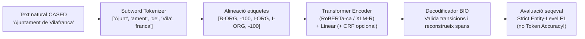

## A. Objectius d'aprenentatge

En completar aquesta lliçó, l'estudiant ha de ser capaç de:

1. **Definir** el **Reconeixement d'Entitats Anomenades (*Named Entity Recognition*, NER)** com una tasca d'**etiquetatge de seqüències (*sequence labeling / token classification*)**.
2. **Aplicar** els esquemes d'etiquetatge **BIO (IOB2)** i **BIOES (BILOU)** i explicar per què calen les marques `B-` i `I-` per delimitar entitats multiparaula adjacents.
3. **Comparar** les arquitectures d'NER: regles/gazetteers, **CRF** (*Conditional Random Fields*), **BiLSTM-CRF**, **Transformer *Token Classification*** (`RoBERTa-ca`, `XLM-R`) i **Zero-shot NER** (`GLiNER`, LLMs).
4. **Explicar** l'**alineació de subparaules (*subword alignment*)** en Transformers i avaluar models d'NER correctament mitjançant **F1 estricte a nivell d'entitat (*span-level F1 / seqeval*)** en lloc de *token-level accuracy*.
5. **Implementar** en Python un decodificador BIO amb validació de transicions i càlcul exacte de **Precision, Recall i F1 a nivell d'entitat (*span-level*)**.

---

## B. Explicació introductòria

En una acta de ple o una instància ciutadana, abans de poder anonimitzar el document o indexar-lo per persones, entitats, municipis i normatives, cal localitzar exactament **on comença i on acaba cada entitat** i **quin tipus té**:

> *"La `[Diputació de Barcelona]ORG` atorga una subvenció a `[Marta Puig i Soler]PER` resident a `[Vilafranca del Penedès]LOC` segons la `[Llei 39/2015]LAW`."*

El **Reconeixement d'Entitats (NER)** identifica aquests fragments (*spans*) dins el text. Fixa't que moltes entitats tenen **múltiples paraules** (`Diputació de Barcelona`, `Vilafranca del Penedès`) i que una mateixa paraula canvia de categoria segons el context (`"Barcelona"` pot ser `LOC` com a ciutat o part d'`ORG` dins `"Ajuntament de Barcelona"`).

---

## C. Explicació tècnica avançada

### 1. Esquemes d'etiquetatge: BIO (IOB2) i BIOES

Per convertir la detecció de *spans* en una classificació token a token, s'utilitza l'esquema **BIO** (*Begin, Inside, Outside*):
- **`B-TIPUS`**: primer token d'una entitat de tipus `TIPUS`.
- **`I-TIPUS`**: token de continuació dins de la mateixa entitat.
- **`O`**: token fora de qualsevol entitat.

Exemple sobre `"Diputació de Barcelona atorga a Marta Puig"`:
`[Diputació: B-ORG] [de: I-ORG] [Barcelona: I-ORG] [atorga: O] [a: O] [Marta: B-PER] [Puig: I-PER]`

**Per què `B-` és indispensable?** Si dues entitats del mateix tipus apareixen seguides (p. ex. `"Marta Puig Joan Serra"` en un llistat sense comes), `B-PER I-PER B-PER I-PER` les separa clarament en dues persones diferents, cosa que un esquema simple `IO` fusionaria erròniament en una sola persona!
- **BIOES / BILOU** afegeix `E-` (*End*, final d'entitat multiparaula) i `S-` (*Single*, entitat d'una sola paraula), donant encara més senyal estructural a models CRF.

### 2. Evolució d'arquitectures NER

| Arquitectura | Com funciona | Avantatges | Limitacions |
|---|---|---|---|
| **Gazetteers + Regles** | Llistes de municipis/organismes + patrons sintàctics | Determinista, ràpid, 100% precís en catàlegs tancats | No generalitza a noms nous ni resol ambigüitat contextual |
| **CRF (*Conditional Random Fields*)** | Model gràfic probabilístic sobre característiques manuals + **matriu de transicions** (evita `O → I-PER`!) | Ràpid en CPU, entrena amb pocs exemples, respecta restriccions BIO | Depèn d'enginyeria de característiques manuals |
| **Transformer Token Classification** (`RoBERTa-ca`, `XLM-R`, opcionalment + capa CRF) | Projecció lineal sobre cada token de sortida del Transformer | **Estat de l'art** en precisió contextual i català/castellà; ràpid *on-premise* | Requereix corpus etiquetat en BIO i gestionar alineació de subparaules |
| **Zero-Shot NER (`GLiNER`) / LLM** | Encoder bidireccional que emparella *spans* amb descripcions d'etiquetes noves sense reentrenar | Excel·lent per a **etiquetes noves a mida** (`NUM_EXP`, `PARCEL·LA`, `ORDENANCA`) amb 0 exemples | Més lent que un encoder *fine-tuned* especialitzat |

### 3. Dos detalls d'enginyeria crítics en NER amb Transformers

1. **Alineació de subparaules (*Subword Alignment*)**:
   - Un tokenitzador BPE/WordPiece pot partir `"Vilafranca"` en `["Vila", "##franca"]`.
   - Durant l'entrenament, només s'etiqueta el **primer subtoken** (`B-LOC`) i als subtokens restants (i tokens especials `[CLS]`, `[SEP]`, `[PAD]`) se'ls assigna l'índex **`-100`** perquè `CrossEntropyLoss(ignore_index=-100)` els ignori en el càlcul de la pèrdua (o bé se'ls propaga `I-LOC` consistentment).
2. **NO fer *lowercasing* en NER**:
   - Les majúscules inicials són un dels senyals més forts per distingir noms propis (`"Plaça Major"`, `"Marta Serra"`) de noms comuns (`"plaça"`, `"serra"`). Cal utilitzar sempre models ***cased*** (`xlm-roberta-base`, `roberta-base-ca-v2`), mai *uncased*!

### 4. Avaluació correcta: *Span-level F1* (`seqeval`) vs. *Token-level Accuracy*

- **ERROR CLÀSSIC**: mesurar *Token-level Accuracy*. En textos administratius, el **85%–92% dels tokens són `O`**! Un model inútil que prediu sempre `O` treu un `90%` d'Accuracy però un `0%` d'F1!
- **ESTÀNDARD CORRECTE (`seqeval` / CoNLL strict entity-level F1)**: una entitat predita només compta com a **TP** si coincideixen **exactament** els tres elements: **inici del span**, **final del span** i **tipus d'entitat**. Si el real era `[Diputació de Barcelona]ORG` i el model prediu `[Diputació]ORG`, compta com a **1 FP + 1 FN** (error complet d'entitat!).

---

## D. Diagrames i recursos visuals

### Pipeline d'entrenament i avaluació d'NER amb Transformer + alineació de subtokens



---

## E. Aplicació a l'Administració pública

1. **Taxonomia d'entitats administratives pròpies**: més enllà de `PER`, `ORG`, `LOC`, els projectes de la Diputació necessiten sovint entitats de domini com `NORMATIVA` (`Llei 39/2015`), `EXPEDIENT`, `ORGAN_DECISORI` (`Junta de Govern Local`), `IMPORT`, `DATA` o `PARCEL·LA_CADASTRAL` (combinable amb `GLiNER` o *fine-tuning* de `RoBERTa-ca`).
2. **Anonimització i compliment RGPD**: combinar NER contextual (`PER`, `LOC`-adreça) amb expressions regulars (`DNI`, `IBAN`, `TEL`) per protegir dades personals en actes i expedients.
3. **Diferència amb el Mòdul 4 (`m04-04`)**: aquí estudiem NER sobre text net; al Mòdul 4 abordarem l'NER en documents escanejats amb soroll OCR i posició espacial 2D (*LayoutLM*).

---

## F. Exemple pràctic guiat

Implementem en **Python pur** un decodificador d'etiquetes **BIO** i un avaluador estricte a nivell d'entitat (**`seqeval`-style Span-Level Precision, Recall i F1**), comparant-lo amb el resultat enganyós de la *Token-level Accuracy*.

```python
"""Exemple 2.6: Decodificador BIO i càlcul d'F1 estricte a nivell d'entitat (span-level)."""


def bio_a_spans(etiquetes: list[str]) -> set[tuple[str, int, int]]:
    """Converteix una seqüència BIO en conjunt de tuples (tipus, inici, fi_exclusiu)."""
    spans: set[tuple[str, int, int]] = set()
    tipus_act: str | None = None
    inici_act = -1

    for i, tag in enumerate(etiquetes):
        if tag.startswith("B-"):
            if tipus_act is not None:
                spans.add((tipus_act, inici_act, i))
            tipus_act = tag[2:]
            inici_act = i
        elif tag.startswith("I-"):
            tipus = tag[2:]
            if tipus_act != tipus:
                # Transició invàlida (ex. O -> I-ORG): tanquem l'anterior i obrim nou span
                if tipus_act is not None:
                    spans.add((tipus_act, inici_act, i))
                tipus_act = tipus
                inici_act = i
        else:  # 'O'
            if tipus_act is not None:
                spans.add((tipus_act, inici_act, i))
                tipus_act = None
    if tipus_act is not None:
        spans.add((tipus_act, inici_act, len(etiquetes)))
    return spans


def avaluar_ner(y_true: list[str], y_pred: list[str]) -> dict[str, float]:
    token_acc = sum(a == b for a, b in zip(y_true, y_pred)) / len(y_true)
    true_spans = bio_a_spans(y_true)
    pred_spans = bio_a_spans(y_pred)

    tp = len(true_spans & pred_spans)
    fp = len(pred_spans - true_spans)
    fn = len(true_spans - pred_spans)

    prec = tp / (tp + fp) if (tp + fp) > 0 else 0.0
    rec = tp / (tp + fn) if (tp + fn) > 0 else 0.0
    f1 = (2 * prec * rec / (prec + rec)) if (prec + rec) > 0 else 0.0
    return {"token_acc": token_acc, "tp": tp, "fp": fp, "fn": fn, "prec": prec, "rec": rec, "span_f1": f1}


if __name__ == "__main__":
    # Frase: "La Diputació de Barcelona atorga ajut a Marta Puig de Mataró ."
    y_true = ["O", "B-ORG", "I-ORG", "I-ORG", "O", "O", "O", "B-PER", "I-PER", "O", "B-LOC", "O"]
    # Predicció parcialment errònia: talla "Diputació de Barcelona" en "Diputació", però encerta PER i LOC
    y_pred = ["O", "B-ORG", "O", "O", "O", "O", "O", "B-PER", "I-PER", "O", "B-LOC", "O"]
    # Model trivial que només prediu 'O'
    y_zero = ["O"] * len(y_true)

    print("Spans reals :", sorted(bio_a_spans(y_true)))
    print("Spans pred  :", sorted(bio_a_spans(y_pred)))
    print("Model real  :", {k: round(v, 3) for k, v in avaluar_ner(y_true, y_pred).items()})
    print("Model tot-O :", {k: round(v, 3) for k, v in avaluar_ner(y_true, y_zero).items()})
```

### Interpretació dels resultats (execució verificada)

- En el **model real**: tot i que falla només 2 tokens de 12 (`token_acc = 0.833`), tallar `Diputació de Barcelona` en `Diputació` produeix **1 FP** (`('ORG', 1, 2)`) i **1 FN** (`('ORG', 1, 4)`), baixant el **`span_f1` a `0.667`** (2 de 3 entitats exactes).
- En el **model trivial tot-`O`**: obté una *token accuracy* enganyosa del **`50%`** (en documents reals supera el 85%–90%), mentre el **`span_f1` revela immediatament el `0.000`**!

---

## G. Exercici pràctic per resoldre

### Enunciat
L'equip d'analítica vol entrenar un model NER en català (`RoBERTa-ca`) per detectar 5 entitats (`PER`, `ORG`, `LOC`, `NORMATIVA`, `EXPEDIENT`) sobre 3.000 decrets municipals. En la primera iteració, un desenvolupador comet **4 errors de disseny**:
1. Converteix tots els decrets a **minúscules** abans de tokenitzar.
2. Assigna l'etiqueta `B-PER` a **tots els subtokens** en què el tokenitzador parteix una paraula (p. ex. `"Puigdomènech"` → `["Puig", "dom", "ènech"]` etiquetats `[B-PER, B-PER, B-PER]`).
3. Avalua el model reportant només **`token_accuracy = 94,2%`** i el dona per llest per a producció.
4. No inclou cap validació de transicions il·legals (`O → I-ORG`) ni cap *gazetteer* dels 311 municipis de la província.

Identifica l'impacte de cada error i proposa les correccions exactes.

### Objectius i restriccions
- Demostrar rigor tècnic en *subword alignment*, models *cased*, avaluació `seqeval` i integració de coneixement institucional.

:::hint Pista 1 — Què provoca posar `[B-PER, B-PER, B-PER]` a un sol cognom?
El decodificador BIO interpretarà que hi ha **tres entitats `PER` separades** dins d'un únic cognom!
:::

:::hint Pista 2 — Quin índex ignora `CrossEntropyLoss` en PyTorch?
`-100` per als subtokens de continuació (i tokens especials)!
:::

### Criteris d'avaluació
- **25%**: Explicació de la pèrdua de senyal ortogràfic en fer *lowercasing* i ús de model *cased*.
- **25%**: Correcció exacta de l'alineació de subtokens (`[B-PER, -100, -100]` o `[B-PER, I-PER, I-PER]`, mai repetir `B-`!).
- **25%**: Substitució de *token accuracy* per **strict entity-level F1 (`seqeval`)** desagregat per tipus d'entitat (especialment `PER` si s'usa per anonimització).
- **25%**: Capa CRF / postprocés de transicions BIO + integració híbrida amb *gazetteer* oficial de municipis i regex per a `EXPEDIENT`.

### Errors habituals
- Pensar que propagar `B-PER` als subtokens és equivalent a propagar `I-PER` o `-100`.

:::solution Solució completa comentada i alternatives
### Diagnòstic i correcció dels 4 errors
1. ***Lowercasing* destructiu**: en català i en textos jurídics, les majúscules distingeixen `Marta Serra` (`PER`) de `serra` (`O`), o `Llei` (`NORMATIVA`) de `llei` genèric. **Solució**: conservar majúscules originals i usar un model *cased* (`roberta-base-ca-v2` o `xlm-roberta-base`).
2. **Repetició de `B-PER` en subtokens**: etiquetar `["Puig", "dom", "ènech"]` com `[B-PER, B-PER, B-PER]` ensenya al model a fragmentar un cognom en 3 entitats diferents i enfonsa l'F1 estricte. **Solució**: etiquetar el primer subtoken amb `B-PER` i assignar **`-100`** als subtokens de continuació (ignorats a la pèrdua i reagrupats per `word_ids()` en inferència) — o alternativament propagar `I-PER` als subtokens interns.
3. ***Token accuracy* de 94,2% enganyosa**: en decrets llargs, >90% dels tokens són `O`. El model podria tenir un F1 real del 55% en `NORMATIVA` i `EXPEDIENT`! **Solució**: avaluar sempre amb **`seqeval` (Strict Entity-Level Precision, Recall i F1)** global i **desagregat per cada una de les 5 classes**.
4. **Manca de restriccions BIO i coneixement determinista**: afegir una **capa CRF** (o decodificador amb restricció de transicions BIO) per impedir seqüències impossibles (`O → I-ORG`), i combinar en postprocés/híbrid el model amb **regex** per a `EXPEDIENT` i el **catàleg oficial dels 311 municipis** per normalitzar `LOC` sense perdre el context (evitant marcar `Barcelona` dins `Diputació de Barcelona` com a `LOC` independent).
:::

---

## H. Test individual

Resol les 10 preguntes sobre esquemes BIO/BIOES, CRF, Transformers *cased*, alineació de subparaules, GLiNER i avaluació *span-level* (`seqeval`).

---

## I. Preguntes de desenvolupament

### Pregunta 1
Explica l'esquema d'etiquetatge **BIO (IOB2)**, demostra amb un exemple concret per què la marca `B-` és indispensable enfront d'un esquema simple `IO`, i descriu què aporta afegir una capa **CRF** damunt d'un encoder neuronal.

:::model-answer Resposta model i criteris de correcció (Pregunta 1)
**Resposta model**:
- **BIO** assigna `B-TIPUS` al primer token de cada entitat, `I-TIPUS` als tokens interns/de continuació i `O` als tokens fora d'entitat.
- **Necessitat de `B-`**: si apareixen dues entitats del mateix tipus consecutives sense separador (`"Marta Puig Joan Serra"`), `B-PER I-PER B-PER I-PER` les delimita en dues persones diferents; en un esquema `IO` (`I-PER I-PER I-PER I-PER`) es fusionarien erròniament en una única entitat de quatre paraules.
- **Aportació d'una capa CRF**: en lloc de classificar cada token independentment, aprèn una **matriu de puntuacions de transició** entre etiquetes consecutives i decodifica la seqüència globalment òptima (algorisme de Viterbi), penalitzant o prohibint transicions invàlides com `O → I-ORG` o `B-PER → I-LOC`.

**Criteris de correcció (10 punts)**:
- Explicació de BIO i demostració exacta amb entitats adjacents: 5 punts.
- Funció de la matriu de transicions i decodificació global del CRF: 5 punts.
:::

### Pregunta 2
Per què la **Token-level Accuracy** és una mètrica enganyosa en NER i com calcula l'F1 estricte a nivell d'entitat (**`seqeval`**) un error de frontera parcial?

:::model-answer Resposta model i criteris de correcció (Pregunta 2)
**Resposta model**:
- En documents administratius reals, entre el 85% i el 95% dels tokens no són entitats (`O`). Un classificador degenerat que prediu `O` sempre aconsegueix ~90% de *token accuracy* sense detectar ni una sola entitat.
- L'avaluació **estricta a nivell d'entitat (`seqeval`)** reconstrueix els *spans* complets `(tipus, inici, fi)` i exigeix coincidència exacta en els tres camps per comptar un **TP**. Si l'entitat real és `[Ajuntament de Mataró]ORG` i el model prediu `[Ajuntament]ORG`, es penalitza doblement com a **1 FP** (entitat predita incorrecta) i **1 FN** (entitat real no trobada), reflectint fidelment l'impacte real sobre anonimització o indexació.

**Criteris de correcció (10 punts)**:
- Explicació del biaix de classe `O` en token accuracy: 4 punts.
- Càlcul exacte d'FP i FN davant un error parcial de frontera en *span-level F1*: 6 punts.
:::

### Pregunta 3
Com es gestiona l'**alineació de subparaules (*subword alignment*)** en entrenar un model Transformer com `RoBERTa-ca` per a NER, i per què convé utilitzar models ***cased***?

:::model-answer Resposta model i criteris de correcció (Pregunta 3)
**Resposta model**:
- Els datasets d'NER venen anotats a nivell de **paraula** (o *span* de caràcters), però el tokenitzador BPE/WordPiece divideix paraules llargues en múltiples subtokens (p. ex., `Vilafranca` → `Vila`, `franca`). Usant el mapatge `word_ids()`, s'assigna l'etiqueta BIO real (`B-LOC`) al **primer subtoken** de cada paraula i l'etiqueta especial **`-100`** als subtokens de continuació i als tokens especials (`<s>`, `</s>`, `<pad>`), de manera que `CrossEntropyLoss(ignore_index=-100)` no els comptabilitza (i mai es repeteix `B-` als subtokens interns!).
- Els models ***cased*** (sensibles a majúscules) són fonamentals en NER perquè l'ortografia de majúscula inicial és un senyal fortíssim per diferenciar noms propis (`Plaça Catalunya`, `Joan Pons`) de substantius comuns.

**Criteris de correcció (10 punts)**:
- Explicació correcta d'alineació de subtokens (`word_ids`, primer subtoken + `-100`): 6 punts.
- Justificació de models *cased* en NER: 4 punts.
:::

---

## J. Resum per memoritzar

### Conceptes clau
- **NER** = etiquetatge de seqüències (*token classification*) amb esquema **BIO** (`B-`, `I-`, `O`) o **BIOES**.
- **`B-`** és obligatori per separar dues entitats adjacents del mateix tipus.
- **Transformers en NER**: usar sempre models ***cased*** (no *lowercasing*!) i alinear subtokens posant **`-100`** (o `I-`) als subtokens de continuació, **mai repetint `B-`**.
- **Avaluació obligatòria**: **Strict Entity-Level F1 (`seqeval`)** per tipus d'entitat (mai *token accuracy*!).
- **Zero-Shot NER (`GLiNER`)**: permet detectar etiquetes noves de domini administratiu sense reentrenar.

### Definicions essencials
- **CRF (*Conditional Random Field*)**: capa probabilística que modela transicions entre etiquetes consecutives i decodifica la seqüència globalment òptima (Viterbi).
- **Alineació de subparaules**: correspondència entre les etiquetes anotades per paraula i els subtokens generats per BPE/WordPiece.

### Errors conceptuals freqüents
1. Reportar *token accuracy* (inflat per la majoria de tokens `O`).
2. Aplicar *lowercasing* abans d'un model NER.
3. Repetir l'etiqueta `B-` en tots els subtokens d'una mateixa paraula.

### Possibles preguntes d'examen
- Etiqueta en esquema BIO una frase administrativa i explica què fallaria amb un esquema `IO`.
- Calcula el *span-level* Precision, Recall i F1 quan el model retalla parcialment una entitat multiparaula.
- Explica la diferència entre NER amb encoder *fine-tuned*, CRF i *Zero-Shot NER* (`GLiNER`).
