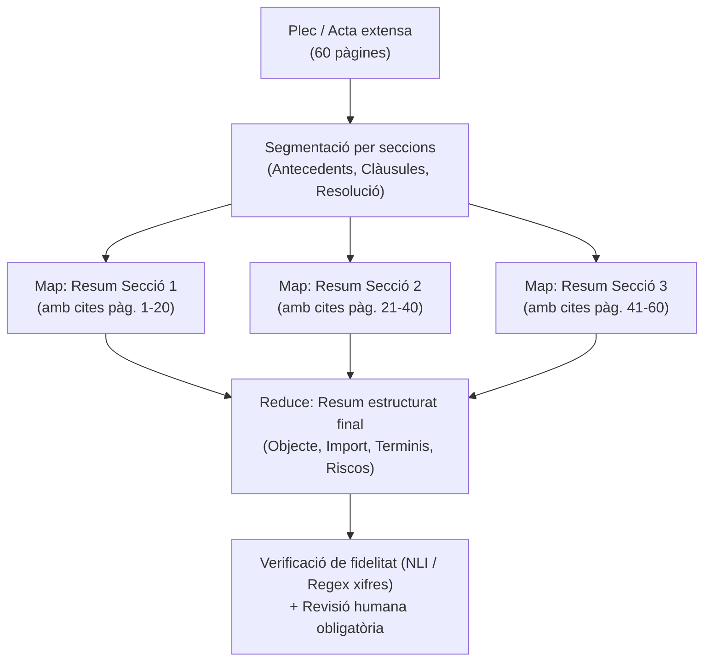

## A. Objectius d'aprenentatge

En acabar aquesta lliçó, l'estudiant ha de ser capaç de:

1. **Distingir** entre **resum extractiu** (selecció literal de frases clau del text original) i **resum abstractiu** (síntesi i paràfrasi generada per un model seq2seq o LLM).
2. **Explicar** estratègies de resum de **documents molt llargs** (plecs de 150 pàgines, actes de ple): *Map-Reduce*, *Refine (iteratiu)*, *Hierarchical Summarization* i models de context llarg.
3. **Comparar** les mètriques d'avaluació de resums: **ROUGE-1 / ROUGE-2 / ROUGE-L**, **BERTScore**, verificació de **fidelitat factual (NLI / SummaC / LLM-as-a-Judge)** i avaluació humana.
4. **Identificar** els riscos crítics del resum abstractiu en l'Administració pública (omissió de condicions d'excepció, alteració de xifres/terminis, al·lucinacions extrínseques) i les seves mitigacions.
5. **Implementar** en Python + NumPy un resumidor **extractiu basat en graf estil TextRank** i el càlcul exacte de **ROUGE-1 F1**.

---

## B. Explicació introductòria

Un regidor o tècnic municipal ha de revisar en un matí un plec administratiu de 90 pàgines, 4 informes jurídics i l'acta d'una sessió plenària de 3 hores. El **resum automàtic (*Automatic Text Summarization*)** comprimeix un o diversos documents en una versió més breu que **preserva la informació essencial** segons l'audiència (p. ex., resum executiu per a direcció vs. versió en lectura fàcil per a la ciutadania).

Hi ha dues maneres fonamentals de resumir, igual que fan les persones:
- **Resum extractiu**: agafar un retolador fluorescent i subratllar les 3 o 4 frases més importants literals del document. **No inventa mai res**, però pot sonar poc fluid o deixar referències penjades (*"Aquest import..."*).
- **Resum abstractiu**: llegir el document i redactar una síntesi pròpia amb paraules noves. És **molt més llegible i natural**, però introdueix el risc d'alterar un matís jurídic, ometre una excepció o **al·lucinar** una xifra inexistent.

---

## C. Explicació tècnica avançada

### 1. Resum extractiu vs. Resum abstractiu

| Dimensió | Resum extractiu (TextRank, LexRank, BERTSum-Ext) | Resum abstractiu (mBART, mT5, LLMs instructius) |
|---|---|---|
| **Mecanisme** | Puntua i selecciona frases literals existents al text font | Genera noves frases autoregressivament parafrasejant i sintetitzant |
| **Fidelitat factual** | Molt alta en frases aïllades (zero paraules inventades), però pot treure frases de context | Risc d'**al·lucinacions intrínseques** (barrejar dues xifres del text) o **extrínseques** (inventar dades externes) |
| **Fluïdesa i adaptació** | Moderada; no adapta registre ni combina dades disperses | Excel·lent; permet resum estructurat (punts clau, taules, lectura fàcil) |
| **Cost computacional** | Molt baix (CPU) | Moderat/Alt (GPU / LLM) |
| **Risc en l'Administració** | Tallar una clàusula d'excepció de la frase següent | Suavitzar un «obligatori» a «recomanable» o alterar una data límit |

### 2. Estratègies per a documents administratius llargs (multi-pàgina)

Quan un expedient supera la finestra efectiva del model (o per mitigar el fenomen ***Lost in the Middle***, on els LLMs atenen menys els paràgrafs centrals d'un context molt llarg):
1. ***Stuffing*** (context directe): passar el document sencer si cap còmodament en el model (avui viable fins a ~32k–128k tokens, però sempre validant que no perdi detalls del centre!).
2. ***Map-Reduce***: dividir el document per seccions lògiques (antecedents, fonaments de dret, part dispositiva), resumir cada secció en paral·lel (*Map*) i sintetitzar els resums parcials en un resum final (*Reduce*). Molt paral·lelitzable, però pot perdre relacions creuades entre seccions.
3. ***Refine* (iteratiu)**: actualitzar seqüencialment un resum acumulat a mesura que es llegeix cada nova secció. Manté coherència global, però és seqüencial (més lent) i pot donar massa pes a les últimes seccions.
4. **Híbrid extractiu + abstractiu (*Select-then-Summarize*)**: seleccionar prèviament els fragments clau (p. ex., per seccions o consulta guiada) i generar un resum abstractiu estructurat **amb cites per paràgraf/pàgina**.

### 3. Mètriques d'avaluació de resums

| Mètrica | Què mesura | Punt fort | Limitació clau |
|---|---|---|---|
| **ROUGE-1 / ROUGE-2** | Solapament d'unigrames / bigrames entre resum generat i resum humà de referència | Ràpida, determinista, estàndard històric | Penalitza sinònims vàlids i **NO detecta contradiccions ni errors de xifres**! |
| **ROUGE-L** | Subseqüència comuna més llarga (*Longest Common Subsequence*) | Captura ordre de paraules a nivell de frase | Mateixa ceguesa semàntica i factual que ROUGE-1/2 |
| **BERTScore** | Similitud cosinus òptima entre embeddings contextuals dels tokens | Tolera paràfrasi i sinonímia | No detecta fiablements canvis subtils de xifres o negacions |
| **Fidelitat factual (NLI / QAG / LLM-as-a-Judge)** | Verifica si cada afirmació atòmica del resum es dedueix lògicament del document font (*entailment*) | **Crítica en l'Administració** per detectar al·lucinacions i distorsions jurídiques | Major cost computacional; cal calibrar el jutge amb validació humana |

---

## D. Diagrames i recursos visuals

### Arquitectures de resum per a documents llargs i verificació de fidelitat



---

## E. Aplicació a l'Administració pública

1. **Comunicació clara i lectura fàcil**: generar esborranys en llenguatge planer de bases de subvencions o ordenances per apropar l'Administració a la ciutadania (sempre amb validació tècnica/jurídica abans de publicar).
2. **Resums estructurats orientats a tasca (no resums genèrics)**: en lloc de demanar *"resumeix aquest plec"*, exigir una plantilla fixa (`Objecte del contracte`, `Pressupost base de licitació`, `Termini d'execució`, `Criteris d'adjudicació`, `Clàusules socials/ambientals`) amb la **referència de pàgina/clàusula** al costat de cada punt.
3. **Resum sense valor jurídic substitutiu**: cal indicar explícitament a la interfície que el resum automàtic és un suport a la lectura i **mai no substitueix el text oficial aprovat o publicat al BOPB**.

---

## F. Exemple pràctic guiat

Implementem en **Python + NumPy** un resumidor **extractiu estil TextRank** (basat en similitud TF-IDF entre frases i càlcul del vector propi principal / PageRank per iteració de potències) juntament amb el càlcul exacte de **ROUGE-1 Precision, Recall i F1**.

```python
"""Exemple 2.7: Resum extractiu estil TextRank i càlcul de ROUGE-1 en Python + NumPy."""
import re
import numpy as np


STOP_CA = {"la", "el", "els", "les", "un", "una", "de", "del", "dels", "a", "al", "per", "en", "i", "es", "va"}


def tokenitzar(frase: str, filtrar_stop: bool = False) -> list[str]:
    toks = re.findall(r"[a-zàèéíïòóúüç0-9]+(?:·[a-zàèéíïòóúüç]+)*", frase.lower())
    return [t for t in toks if not (filtrar_stop and t in STOP_CA)]


def textrank_extractiu(frases: list[str], top_k: int = 2, damping: float = 0.85) -> list[int]:
    docs = [tokenitzar(f, filtrar_stop=True) for f in frases]
    vocab = sorted({t for d in docs for t in d})
    idx = {t: i for i, t in enumerate(vocab)}
    n = len(frases)

    # Vectors binaris normalitzats L2 per mesurar similitud cosinus entre frases
    M = np.zeros((n, len(vocab)), dtype=float)
    for r, d in enumerate(docs):
        for t in d:
            M[r, idx[t]] += 1.0
        norma = float(np.linalg.norm(M[r]))
        if norma > 0:
            M[r] /= norma

    S = M @ M.T
    np.fill_diagonal(S, 0.0)
    # Normalitzem per files per construir matriu de transició de Markov
    row_sums = S.sum(axis=1, keepdims=True)
    P = np.divide(S, row_sums, out=np.zeros_like(S), where=row_sums > 0)

    scores = np.ones(n, dtype=float) / n
    for _ in range(30):
        scores = (1.0 - damping) / n + damping * (P.T @ scores)

    # Retornem els top_k índexs en el seu ordre original del document
    top_idx = sorted(np.argsort(-scores)[:top_k].tolist())
    return top_idx


def rouge_1_f1(candidat: str, referencia: str) -> tuple[float, float, float]:
    c_toks = tokenitzar(candidat)
    r_toks = tokenitzar(referencia)
    # Solapament amb multiplicitat (multiset intersection)
    c_set: dict[str, int] = {}
    for t in c_toks:
        c_set[t] = c_set.get(t, 0) + 1
    solap = 0
    for t in r_toks:
        if c_set.get(t, 0) > 0:
            solap += 1
            c_set[t] -= 1
    prec = solap / len(c_toks) if c_toks else 0.0
    rec = solap / len(r_toks) if r_toks else 0.0
    f1 = (2 * prec * rec / (prec + rec)) if (prec + rec) > 0 else 0.0
    return prec, rec, f1


if __name__ == "__main__":
    document = [
        "La sessió ordinària del ple municipal va començar puntualment a les sis de la tarda.",
        "El ple aprova una subvenció municipal de 120.000 euros per a l'eficiència energètica d'escoles públiques.",
        "Els ajuts d'eficiència energètica finançaran plaques solars i renovació d'enllumenat a les escoles del municipi.",
        "Finalment es va llegir l'ordre del dia de la propera comissió informativa de cultura.",
    ]
    seleccionats = textrank_extractiu(document, top_k=2)
    resum_ext = " ".join(document[i] for i in seleccionats)
    referencia = "El ple aprova subvencions de 120.000 euros per a plaques solars i eficiència energètica en escoles."

    p, r, f1 = rouge_1_f1(resum_ext, referencia)
    print(f"Frases seleccionades (índexs): {seleccionats}")
    print(f"Resum extractiu: {resum_ext}")
    print(f"ROUGE-1 -> Precision={p:.3f}, Recall={r:.3f}, F1={f1:.3f}")
```

### Interpretació dels resultats (execució verificada)

- **TextRank** identifica automàticament les frases **`[1, 2]`** (les dues frases centrals sobre la subvenció d'eficiència energètica en escoles, que tenen màxima centralitat semàntica entre si) i descarta la frase protocol·lària inicial (`0`) i el tancament (`3`).
- El resum extractiu conserva intactes totes les xifres (`120.000 euros`) i termes exactes sense cap risc d'al·lucinació, assolint una puntuació `ROUGE-1` alta respecte de la referència humana.

---

## G. Exercici pràctic per resoldre

### Enunciat
Un equip avalua un LLM que genera resums executius d'informes d'intervenció pressupostària. En la validació, el sistema obté un **`ROUGE-1 F1 = 0,68`** (molt alt per a resums abstractius), però un auditor humà revisa 20 resums i descobreix **3 errors greus**:
- En un resum, el text original deia *"Informe DESFAVORABLE per insuficiència de crèdit de 45.000 €"*, i el resum deia *"Informe favorable amb crèdit de 45.000 €"*.
- En un altre resum, el plec tenia 80 pàgines i la clàusula de penalització de la pàgina 42 no apareixia al resum.
- En un tercer resum, el model va afegir *"d'acord amb el Reial decret 2025/999"* que no apareixia enlloc de l'informe original.

Respon:
1. Per què `ROUGE-1 = 0,68` NO va detectar el primer error (`favorable` vs. `desfavorable`)?
2. Com s'anomenen tècnicament els tres fenòmens observats (error 1, error 2 i error 3)?
3. Quin protocol d'avaluació i arquitectura de mitigació implantaries abans de posar el resumidor en producció?

### Objectius i restriccions
- Relacionar límits de ROUGE, *Lost in the Middle*, al·lucinació intrínseca/extrínseca i controls de fidelitat factual.

:::hint Pista 1 — Quantes paraules difereixen entre «Informe desfavorable per crèdit de 45.000 €» i «Informe favorable amb crèdit de 45.000 €»?
Gairebé cap! La majoria d'unigrames (`informe`, `crèdit`, `de`, `45.000`, `€`) coincideixen exactament, disparant un ROUGE-1 molt alt malgrat invertir completament el sentit jurídic!
:::

:::hint Pista 2 — Classifica les 3 fallades
Error 1 = **al·lucinació intrínseca / contradicció factual**; Error 2 = ***Lost in the Middle* / omissió per context llarg**; Error 3 = **al·lucinació extrínseca** (invenció d'una norma externa no present al document).
:::

### Criteris d'avaluació
- **30%**: Explicació exacta de per què ROUGE-1 falla davant contradiccions que comparteixen gairebé tot el vocabulari.
- **30%**: Classificació precisa dels 3 fenòmens (al·lucinació intrínseca, *Lost in the Middle*, al·lucinació extrínseca).
- **40%**: Mitigació completa (resum estructurat per seccions/Map-Reduce, cites literals obligatòries amb pàgina, verificació NLI/QAG + comprovació determinista de xifres/normatives citades i revisió humana).

### Errors habituals
- Proposar substituir ROUGE-1 per ROUGE-2 o BERTScore com a única solució (cap dels tres garanteix detecció fiable de contradiccions ni de lleis inventades!).

:::solution Solució completa comentada i alternatives
### 1. Per què ROUGE-1 no va detectar `favorable` vs. `desfavorable`
ROUGE-1 només compta solapament superficial d'unigrames. Canviar una sola paraula (`desfavorable` → `favorable`) tot conservant `Informe`, `crèdit`, `de`, `45.000`, `€` manté un solapament d'unigrames >75%, ocultant una inversió jurídica catastròfica.

### 2. Classificació tècnica dels 3 fenòmens
- **Error 1 (`favorable` vs `desfavorable`)**: **al·lucinació intrínseca** (contradicció directa respecte dels fets del document font).
- **Error 2 (omissió de la pàg. 42 en un plec de 80 pàgines)**: degradació d'atenció en contextos llargs (***Lost in the Middle***) o límit de compressió sense guia estructural.
- **Error 3 (invenció del RD 2025/999)**: **al·lucinació extrínseca** (introducció d'informació externa inexistent al text font, típica de memòria paramètrica de l'LLM).

### 3. Protocol d'avaluació i arquitectura de mitigació
1. **Arquitectura *Map-Reduce* / estructurada per seccions**: dividir el plec per apartats reals i resumir amb plantilla fixa (`Sentit de l'informe: FAVORABLE | DESFAVORABLE | CONDICIONAT`, `Imports`, `Penalitzacions`, `Normativa citada`), exigint per a cada punt la **referència de pàgina i cita literal**.
2. **Verificació automatitzada de fidelitat (post-check)**:
   - **Comprovador determinista d'entitats/xifres/lleis**: verificar amb regex que tota norma (`Llei X/Y`, `RD X/Y`) i tota xifra numèrica del resum apareix al document font (interceptaria immediatament l'Error 3!).
   - **Model NLI (*Natural Language Inference* / SummaC) o *Claim-by-Claim Grounding***: comprovar que cada frase del resum és implicada (*entailed*) i no contradiu (*contradiction*) el fragment citat (interceptaria l'Error 1!).
3. **Avaluació humana sobre conjunt *golden* + avís legal**: validar sobre 100 informes reals amb rúbrica de *fidelitat*, *completitud* i *omissions crítiques*, i mostrar sempre l'avís de suport a la lectura amb enllaç directe a la pàgina original.
:::

---

## H. Test individual

Resol les 10 preguntes sobre resum extractiu vs. abstractiu, TextRank, Map-Reduce vs. Refine, *Lost in the Middle*, ROUGE, BERTScore i fidelitat factual.

---

## I. Preguntes de desenvolupament

### Pregunta 1
Compara el **resum extractiu** i el **resum abstractiu** des del punt de vista de l'enginyeria i del risc jurídic-administratiu, indicant en quin cas d'ús públic triaries cadascun (o una combinació híbrida).

:::model-answer Resposta model i criteris de correcció (Pregunta 1)
**Resposta model**:
- **Extractiu** (TextRank, LexRank, BERTSum): selecciona frases literals del document. Avantatges: baix cost (CPU), zero invenció de paraules/normes. Riscos: menor fluïdesa, referències anafòriques trencades i possible pèrdua d'una clàusula d'excepció de la frase contigua. Ideal per ressaltar paràgrafs clau o alimentar un resum posterior.
- **Abstractiu** (mT5, LLMs): redacta una síntesi nova adaptada al lector (p. ex., resum executiu o lectura fàcil). Avantatges: alta llegibilitat, síntesi multi-document i format estructurat. Riscos: al·lucinacions intrínseques (contradiccions, xifres barrejades) i extrínseques (dades inventades).
- **Híbrid recomanat en l'Administració**: extractiu/estructurat per seccions + síntesi abstractiva amb plantilla fixa, cites literals amb número de pàgina, verificació automàtica de fidelitat i revisió humana abans de qualsevol ús oficial.

**Criteris de correcció (10 punts)**:
- Comparativa equilibrada extractiu vs. abstractiu (tècnica i jurídica): 6 punts.
- Casos d'ús públics i enfocament híbrid amb salvaguardes: 4 punts.
:::

### Pregunta 2
Explica les diferències entre les estratègies **Stuffing**, **Map-Reduce** i **Refine** per resumir documents extensos (p. ex., un plec de 100 pàgines), mencionant el fenomen ***Lost in the Middle***.

:::model-answer Resposta model i criteris de correcció (Pregunta 2)
**Resposta model**:
- ***Stuffing***: passar el document sencer en una única crida. Simple i manté visió global, però limitat per la finestra de context, car i afectat per ***Lost in the Middle*** (els LLMs tendeixen a recordar millor el principi i el final del context i ometre detalls importants del tram intermedi).
- ***Map-Reduce***: segmenta el document per seccions, resumeix cada bloc en paral·lel (*Map*) i sintetitza els resums parcials (*Reduce*). Alta escalabilitat i menor latència per paral·lelisme, i obliga a prestar atenció a les seccions intermedies; pot perdre connexions subtils entre blocs allunyats.
- ***Refine***: genera un resum del bloc 1 i el refina iterativament amb cada bloc següent. Preserva millor el fil narratiu, però és estrictament seqüencial (més lent) i pot sobreponderar els últims blocs.

**Criteris de correcció (10 punts)**:
- Explicació clara de les 3 estratègies i els seus avantatges/desavantatges: 7 punts.
- Explicació rigorosa de *Lost in the Middle*: 3 punts.
:::

### Pregunta 3
Per què les mètriques clàssiques **ROUGE** i **BERTScore** són insuficients per validar un resumidor d'expedients administratius, i com avaluaries la **fidelitat factual** d'un resum?

:::model-answer Resposta model i criteris de correcció (Pregunta 3)
**Resposta model**:
- **ROUGE** només mesura solapament lèxic d'n-grames o subseqüències respecte d'una referència humana: penalitza paràfrasis vàlides i és cega a inversions de polaritat o errors numèrics (`favorable` vs. `desfavorable`, `10 dies` vs. `100 dies`). **BERTScore** millora la tolerància a sinònims via embeddings, però tampoc detecta de manera fiable contradiccions lògiques ni fets inventats.
- **Avaluació de fidelitat factual**: (1) descompondre el resum en afirmacions atòmiques i comprovar implicació lògica (*entailment* vs. *contradiction*) contra el document font amb models **NLI** (estil SummaC) o *LLM-as-a-Judge* calibrat; (2) verificació determinista de xifres, dates i normes citades contra el text original; (3) avaluació humana amb rúbrica sobre una mostra representativa (*fidelitat*, *completitud*, *omissions crítiques*).

**Criteris de correcció (10 punts)**:
- Limitacions exactes de ROUGE i BERTScore: 5 punts.
- Protocol rigorós d'avaluació de fidelitat factual (NLI + verificació d'entitats/xifres + revisió humana): 5 punts.
:::

---

## J. Resum per memoritzar

### Conceptes clau
- **Extractiu** = frases literals (TextRank/LexRank; zero invenció, menys fluid). **Abstractiu** = generació nova (LLMs/mT5; molt fluid, risc d'al·lucinacions).
- **Documents llargs**: *Stuffing* (risc *Lost in the Middle*), ***Map-Reduce*** (paral·lel per seccions), ***Refine*** (seqüencial iteratiu).
- **Al·lucinació intrínseca** = contradiu o barreja fets del document font. **Extrínseca** = inventa fets o lleis inexistents al document.
- **ROUGE-1/2/L** (solapament n-grames/LCS) i **BERTScore** (embeddings) NO garanteixen fidelitat factual → cal **verificació NLI + comprovació de xifres/cites + revisió humana**.

### Definicions essencials
- ***Lost in the Middle***: fenomen empíric pel qual els LLMs presenten pitjor recuperació i atenció sobre la informació situada a la meitat d'un context molt llarg respecte de l'inici i el final.
- **TextRank**: algorisme no supervisat de resum extractiu basat en PageRank sobre el graf de similitud entre frases.

### Errors conceptuals freqüents
1. Confiar únicament en un `ROUGE` alt sense mesurar fidelitat factual ni contradiccions.
2. Demanar resums genèrics sense plantilla estructurada ni cites de pàgina/clàusula.
3. Presentar un resum automàtic sense avís clar que no substitueix el document oficial.

### Possibles preguntes d'examen
- Diferencia al·lucinació intrínseca i extrínseca en resum automàtic amb un exemple administratiu.
- Explica per què ROUGE falla en detectar un canvi de `favorable` a `desfavorable`.
- Compara *Map-Reduce*, *Refine* i *Stuffing* per resumir un plec de 120 pàgines.
