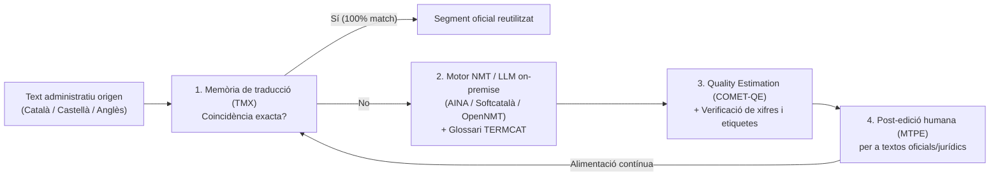

## A. Objectius d'aprenentatge

En completar aquesta lliçó, l'estudiant ha de ser capaç de:

1. **Explicar** l'evolució de la traducció automàtica: basada en regles (**RBMT**), estadística (**SMT**), neuronal (**NMT** amb *Encoder-Decoder Transformer*) i traducció assistida per **LLMs** amb glossaris injectats.
2. **Distingir** i aplicar correctament les mètriques d'avaluació de traducció automàtica: **BLEU**, **chrF / chrF++**, **TER** i mètriques neuronals modernes (**COMET**), comprenent-ne les fortaleses i limitacions.
3. **Analitzar** el paper estratègic de la traducció automàtica en el context de la **Diputació de Barcelona** (català, castellà, aranès/occità, anglès/francès en projectes europeus i llengües de nova ciutadania), respectant la **terminologia administrativa oficial** (TERMCAT) i la confidencialitat (RGPD).
4. **Dissenyar** un flux de **post-edició humana (*MTPE*)** i **adaptació de domini** mitjançant memòries de traducció (TMX) i glossaris controlats.
5. **Implementar** en Python el càlcul exacte de **BLEU amb precisió d'n-grames retallada (*clipped precision*) i penalització per brevetat (*brevity penalty*)** i de **chrF** a nivell de caràcters.

---

## B. Explicació introductòria

Les administracions catalanes operen diàriament en entorns multilingües: convocatòries i portals bilingües català/castellà, relacions amb institucions europees en anglès i francès, atenció a ciutadania nouvinguda en múltiples idiomes (àrab, urdú, xinès, romanès...) i comunicació en occità/aranès.

La **Traducció Automàtica (*Machine Translation*, MT)** tradueix textos d'una llengua origen a una llengua destí de forma automatitzada. Avui dia, gràcies a l'arquitectura **Transformer** (creada originalment precisament per a traducció automàtica el 2017!), la traducció neuronal (**NMT**) aconsegueix una fluïdesa sorprenent — però aquesta mateixa fluïdesa pot ser **perillosa** si un text jurídic traduït sona impecable mentre conté un fals amic o un error terminològic greu!

---

## C. Explicació tècnica avançada

### 1. Evolució dels paradigmes de Traducció Automàtica

| Paradigma | Mecanisme | Exemples històrics / actuals | Punts forts i límits |
|---|---|---|---|
| **RBMT** (*Rule-Based MT*) | Diccionaris bilingües + regles gramaticals i de transferència morfosintàctica | **Apertium** (excel·lent en parells molt propers: català↔castellà, català↔occità) | Molt ràpid, determinista, 0 al·lucinacions, fàcil d'afegir glossaris; menys natural en parells llunyans |
| **SMT** (*Statistical MT*) | Models de traducció per frases (*phrase tables*) + model de llenguatge n-grama | Moses (històric) | Superat gairebé del tot per NMT |
| **NMT** (*Neural MT*, Transformer Encoder-Decoder) | Codificador bidireccional de la frase origen + decodificador autoregressiu amb *cross-attention* | **Softcatalà / OpenNMT**, **NLLB-200**, **MarianMT**, **Projecte AINA (BSC)** | Alta fluïdesa i qualitat en context de frase; desplegable **100% *on-premise*** amb baix cost |
| **LLM-based MT** | Models generatius multilingües instruïts amb *prompt* + **glossari terminològic** + context de document | **Salamandra**, Gemma/Qwen/Mistral locals | Captura context de **document complet** (gènere, tractament vostè/tu) i segueix glossaris dinàmicament; més costós i risc d'omissió o paràfrasi excessiva |

### 2. Mètriques d'avaluació en Traducció Automàtica

1. **BLEU (*Bilingual Evaluation Understudy*)**:
   - Calcula la mitjana geomètrica de les **precisions retallades (*clipped n-gram precisions*)** d'n-grames (\(n = 1..4\)) entre traducció candidata i referència, multiplicada per una **penalització per brevetat (*Brevity Penalty*, BP)** per impedir que traduccions d'1 sola paraula obtinguin precisió 100%:
   \[
   \text{BLEU} = \text{BP} \cdot \exp\left(\sum_{n=1}^{4} \frac{1}{4} \ln p_n\right), \qquad \text{BP} = \begin{cases} 1 & \text{si } c > r \\ e^{1 - r/c} & \text{si } c \le r \end{cases}
   \]
   - **Limitacions**: no té en compte sinonímia ni morfologia rica (en català, canviar una terminació verbal penalitza el mot sencer!).
2. **chrF / chrF++ (*Character n-gram F-score*)**:
   - Calcula l'F-score sobre **n-grames de caràcters** (habitualment fins a 6 caràcters). Molt millor que BLEU per a llengües amb rica flexió morfològica com el català i altament correlacionada amb judicis humans.
3. **TER (*Translation Edit Rate*)**:
   - Mesura el mínim nombre d'edicions (insercions, eliminacions, substitucions, desplaçaments) necessàries perquè un humà corregeixi la traducció → estima directament l'esforç de **post-edició (MTPE)**.
4. **COMET / MetricX (mètriques neuronals)**:
   - Models Transformer preentrenats sobre avaluacions humanes (MQM / DA) que reben **(origen, traducció candidata, referència)** — o fins i tot sense referència (*Quality Estimation*, COMET-QE) — i aconsegueixen la **màxima correlació actual amb avaluadors humans**.

### 3. Adaptació de domini, terminologia i post-edició (MTPE)

- **Falsos amics i terminologia jurídica català/castellà**: traduir literalment *"resolució ferma"*, *"plec de clàusules administratives particulars"* o *"secretari interventor"* exigeix coherència amb els criteris del **TERMCAT** i el llibre d'estil corporatiu.
- **Tècniques d'adaptació**:
  1. **Glossaris forçats / *lexical constraints*** o injecció de termes al prompt (LLM).
  2. **Memòries de traducció (TMX)**: reutilitzar segments oficials ja validats (*exact/fuzzy match*) abans d'invocar la MT.
  3. **Post-edició humana (MTPE)**: obligatòria per a textos amb validesa jurídica, ordenances, resolucions i comunicació institucional oficial (l'ús de MT crua només és acceptable per a comprensió interna ràpida — *gisting*).

---

## D. Diagrames i recursos visuals

### Flux professional de Traducció Automàtica institucional (TM + Glossari + NMT/LLM + MTPE)



---

## E. Aplicació a l'Administració pública

1. **Sobirania tecnològica i RGPD**: **mai s'han d'enganxar informes confidencials, resolucions amb dades personals ni esborranys de contractació en traductors web públics gratuïts** que puguin emmagatzemar o reutilitzar els textos per entrenar models! Cal desplegar motors *on-premise* (com models oberts d'**AINA/BSC**, **Softcatalà**, **MarianMT** o **Salamandra** en infraestructura pròpia).
2. **Qualitat en català i llengües de nova ciutadania**: en parells com `català ↔ castellà` la qualitat NMT és excel·lent (però vigilar falsos amics i castellanismes sintàctics); en parells amb menys recursos (`català ↔ urdú` o `amazic`), cal validar específicament si passar per una llengua pivot (`anglès`/`castellà`) introdueix errors acumulats.
3. **Preservació d'estructura i etiquetes**: en traduir documents XML, HTML, formularis o PDFs, el sistema ha de preservar intactes els marcadors, codis d'expedient i imports.

---

## F. Exemple pràctic guiat

Implementem en **Python pur** el càlcul exacte de **BLEU-2 (amb *clipped precision* i *Brevity Penalty*)** i **chrF-3 (a nivell de caràcters)** per comprovar quantitativament per què una traducció curta enganya la precisió simple i per què **chrF** valora millor petites variacions morfològiques del català que BLEU.

```python
"""Exemple 2.8: Càlcul de BLEU (amb clipped precision i Brevity Penalty) i chrF en Python pur."""
import math
from collections import Counter


def ngrams(seq: list[str] | str, n: int) -> Counter:
    return Counter(tuple(seq[i : i + n]) for i in range(len(seq) - n + 1))


def bleu_n(candidat: str, referencia: str, max_n: int = 2) -> tuple[float, float, list[float]]:
    c_toks = candidat.lower().split()
    r_toks = referencia.lower().split()
    c_len, r_len = len(c_toks), len(r_toks)
    bp = 1.0 if c_len > r_len else math.exp(1.0 - r_len / max(c_len, 1))

    precisions: list[float] = []
    for n in range(1, max_n + 1):
        c_ng = ngrams(c_toks, n)
        r_ng = ngrams(r_toks, n)
        clipped = sum(min(cnt, r_ng[ng]) for ng, cnt in c_ng.items())
        total = max(sum(c_ng.values()), 1)
        # Suavitzat mínim (add-epsilon) només si clipped == 0
        precisions.append(clipped / total if clipped > 0 else 1e-9)

    score = bp * math.exp(sum(math.log(p) for p in precisions) / max_n)
    return score, bp, precisions


def chrf_score(candidat: str, referencia: str, max_n: int = 3, beta: float = 2.0) -> float:
    c_str = candidat.lower().replace(" ", "")
    r_str = referencia.lower().replace(" ", "")
    precs, recs = [], []
    for n in range(1, max_n + 1):
        c_ng = ngrams(c_str, n)
        r_ng = ngrams(r_str, n)
        overlap = sum(min(cnt, r_ng[ng]) for ng, cnt in c_ng.items())
        precs.append(overlap / max(sum(c_ng.values()), 1))
        recs.append(overlap / max(sum(r_ng.values()), 1))
    avg_p = sum(precs) / max_n
    avg_r = sum(recs) / max_n
    if avg_p + avg_r == 0:
        return 0.0
    return (1 + beta**2) * avg_p * avg_r / (beta**2 * avg_p + avg_r)


if __name__ == "__main__":
    ref = "l'ajuntament aprova les subvencions municipals"
    cand_curt = "l'ajuntament aprova"  # Molt curt: precisió 100%, però falta meitat de la frase!
    cand_morf = "l'ajuntament aprovà la subvenció municipal"  # Quasi idèntica semànticament, canvi flexió!

    for nom, cand in [("Tradució massa curta", cand_curt), ("Variació morfològica", cand_morf)]:
        b, bp, ps = bleu_n(cand, ref, max_n=2)
        cf = chrf_score(cand, ref, max_n=3)
        print(f"{nom:<22} | BP={bp:.3f} p1={ps[0]:.3f} p2={ps[1]:.3f} | BLEU-2={b:.3f} | chrF-3={cf:.3f}")
```

### Interpretació dels resultats (execució verificada)

- En la **traducció massa curta** (`"l'ajuntament aprova"`): les precisions `p1` i `p2` són `1.000` (totes les paraules generades apareixen a la referència!), però la **Brevity Penalty (`BP = 0.223`)** la castiga severament baixant el `BLEU-2` a `0.223` (mentre `chrF-3 = 0.469`).
- En la **variació morfològica** (`aprovà / la subvenció municipal` vs. `aprova / les subvencions municipals`): **BLEU-2** s'enfonsa a `0.000` (`p1 = 0.200, p2 = 0.000`) perquè cap bigrama coincideix exactament en forma flexionada, mentre que **`chrF-3 = 0.786`** captura la similitud de les arrels a nivell de caràcters i reflecteix molt millor la qualitat real en català!

---

## G. Exercici pràctic per resoldre

### Enunciat
Un ens local necessita traduir **3 tipus de documents** entre català, castellà i anglès:
- **Tipus A**: 200 ordenances fiscals i plecs de contractació oficials amb validesa jurídica (inclouen terminologia estricta del TERMCAT i es publiquen al BOPB).
- **Tipus B**: 5.000 informes interns confidencials amb dades personals de ciutadans (salut i serveis socials) que un equip tècnic necessita entendre ràpidament.
- **Tipus C**: 15.000 textos repetitius de notificacions i fitxes de tràmits del portal web.

Proposa per a cada tipus:
1. El **desplegament i privacitat** adequats (API externa vs. motor *on-premise*).
2. L'ús de **Memòries de Traducció (TMX) + Glossaris** i **Post-edició humana (MTPE)**.
3. Quines mètriques automàtiques i humanes aplicaries per controlar la qualitat del servei.

### Objectius i restriccions
- Combinar criteri tècnic (NMT/LLM, TMX, COMET/chrF) amb compliment normatiu (RGPD art. 9 en dades especials i seguretat jurídica).

:::hint Pista 1 — Dades de salut i serveis socials (Tipus B)
Són **categories especials de dades personals (RGPD art. 9)**: queda completament prohibit enviar-les a traductors web públics; cal motor **100% *on-premise*** (p. ex., NMT local d'AINA/Softcatalà o LLM local en servidor propi).
:::

:::hint Pista 2 — Diferencia `gisting` (Tipus B) de publicació jurídica oficial (Tipus A) i alta repetitivitat (Tipus C)
Tipus A exigeix **MTPE completa** per traductors jurídics + glossari TERMCAT. Tipus C es beneficia enormement de **Memòries de Traducció (TMX)** per reutilitzar traduccions validades.
:::

### Criteris d'avaluació
- **35%**: Decisió correcta de desplegament *on-premise* i protecció RGPD per als tres tipus (especialment Tipus B).
- **35%**: Ús adequat de TMX (Tipus C i A), glossaris TERMCAT i nivell de post-edició humana (MTPE obligatòria en Tipus A vs. *gisting* en Tipus B).
- **30%**: Selecció justificada de mètriques (**COMET / chrF++ / TER** + revisió humana MQM sobre mostra).

### Errors habituals
- Proposar enviar els informes confidencials de Tipus B a un traductor cloud gratuït o publicar les ordenances de Tipus A sense post-edició humana.

:::solution Solució completa comentada i alternatives
### Pla diferenciat per als 3 tipus de documents
- **Tipus A (Ordenances i plecs oficials — BOPB)**:
  - **Motor**: NMT *on-premise* o LLM local amb **glossari TERMCAT/corporatiu injectat** + **Memòria de Traducció (TMX)** per mantenir coherència entre articles i exercicis anteriors.
  - **Post-edició**: **MTPE completa obligatòria** per personal lingüístic/jurídic qualificat (cap text amb efectes jurídics es publica sense revisió humana).
- **Tipus B (Informes confidencials amb dades especials RGPD art. 9)**:
  - **Motor**: **estrictament *on-premise* en xarxa interna aïllada** (p. ex. models oberts NMT del projecte AINA/Softcatalà o MarianMT/Salamandra local), zero sortida a APIs externes, registre d'accés ENS i retenció nul·la de textos en memòria temporal.
  - **Post-edició**: *gisting* (comprensió interna ràpida) amb avís explícit que és traducció automàtica de suport; post-edició només en fragments que passin a un informe formal.
- **Tipus C (15.000 notificacions i fitxes repetitives)**:
  - **Motor**: **TMX en primer nivell** (molts segments tindran *100% match* o *fuzzy match* >85%) + NMT *on-premise* amb preservació d'etiquetes HTML/variables (`{{nom_ciutada}}`, `{{import}}`) + MTPE lleugera o per mostreig sobre segments nous.

### Mètriques de control de qualitat
- **Automàtiques**: **COMET** (o **COMET-QE** sense referència en producció per senyalitzar segments dubtosos), **chrF++** (millor que BLEU per al català), **TER** (per mesurar l'esforç real de post-edició i l'estalvi del motor) i verificador determinista de **xifres, dates i codis d'article** preservats.
- **Humanes**: avaluació periòdica **MQM** (*Multidimensional Quality Metrics*: precisió, terminologia, fluïdesa, omissions/addicions crítiques) sobre mostra estratificada.
:::

---

## H. Test individual

Resol les 10 preguntes sobre RBMT/SMT/NMT/LLM-MT, BLEU (*clipped precision* i *Brevity Penalty*), chrF, TER, COMET, adaptació terminològica i privacitat.

---

## I. Preguntes de desenvolupament

### Pregunta 1
Explica com es calcula **BLEU** (incloent la *clipped precision* i la *Brevity Penalty*) i raona per què **chrF** i **COMET** solen preferir-se avui per avaluar traducció automàtica cap al català.

:::model-answer Resposta model i criteris de correcció (Pregunta 1)
**Resposta model**:
- **BLEU** calcula la mitjana geomètrica de les precisions d'n-grames (\(n=1..4\)) **retallades** (*clipped*: cada n-grama només es compta tantes vegades com apareix a la referència, evitant inflar la nota repetint `"el el el"`), multiplicada per la **Brevity Penalty (BP)** (\(e^{1-r/c}\) si \(c \le r\)) que castiga traduccions artificialment curtes.
- **Per què chrF i COMET són superiors per al català**: BLEU tracta cada paraula flexionada com una unitat atòmica (penalitzant al màxim petites variacions de gènere, nombre o temps verbal) i no entén sinònims. **chrF** opera sobre n-grames de caràcters, capturant la riquesa morfològica del català, i **COMET** utilitza un model Transformer entrenat amb judicis humans que avalua equivalència semàntica real comparant origen, traducció i referència.

**Criteris de correcció (10 punts)**:
- Explicació exacta de *clipped precision* i *Brevity Penalty* en BLEU: 5 punts.
- Avantatges tècnics de chrF (morfologia) i COMET (semàntica i correlació humana): 5 punts.
:::

### Pregunta 2
Compara l'ús d'un **motor NMT especialitzat (*Encoder-Decoder*)** enfront d'un **LLM instructiu multilingüe** per a un servei corporatiu de traducció a la Diputació de Barcelona.

:::model-answer Resposta model i criteris de correcció (Pregunta 2)
**Resposta model**:
- **NMT especialitzat** (OpenNMT/MarianMT/AINA/Softcatalà): arquitectura *encoder-decoder* compacta (desenes o pocs centenars de milions de paràmetres), molt ràpida i barata *on-premise*, baix risc de divagació o afegir comentaris conversacionals, però tradicionalment tradueix frase a frase (menys context documental) i requereix mecanismes específics per forçar glossaris.
- **LLM instructiu multilingüe** (p. ex., Salamandra local): pot traduir a nivell de **document complet** mantenint coherència de gènere i tractament formal (`vostè`), accepta dinàmicament **glossaris TERMCAT i instruccions d'estil al prompt**, però té un cost computacional i latència superiors i exigeix controls contra omissions o paràfrasi excessiva en textos jurídics.

**Criteris de correcció (10 punts)**:
- Contrast rigorós en arquitectura, cost/latència, context documental, glossaris i riscos: 10 punts.
:::

### Pregunta 3
Quin risc específic planteja la **fluïdesa elevada de la traducció automàtica neuronal (NMT/LLM)** en textos jurídics i administratius, i quines mesures organitzatives i tècniques (TMX, glossaris, MTPE, privacitat) exigeix un desplegament responsable?

:::model-answer Resposta model i criteris de correcció (Pregunta 3)
**Resposta model**:
- A diferència dels sistemes antics on els errors eren gramaticalment evidents, la NMT moderna produeix frases **gramaticalment impecables i naturals fins i tot quan contenen errors greus de sentit** (falsos amics jurídics, inversions de negació, xifres alterades o omissions de clàusules), creant un **biaix d'automatització** perillós en el revisor.
- **Mesures**: (1) desplegament ***on-premise*** per protegir dades personals (RGPD) i informació confidencial; (2) **TMX** i **glossaris oficials (TERMCAT)** per coherència terminològica; (3) verificadors automàtics de xifres, dates i *Quality Estimation* (COMET-QE); (4) **MTPE humana obligatòria** per a qualsevol document oficial o amb efectes jurídics.

**Criteris de correcció (10 punts)**:
- Explicació del risc de fluïdesa enganyosa i biaix d'automatització: 4 punts.
- Mesures tècniques i organitzatives (on-premise/RGPD, TMX/glossari, QE, MTPE): 6 punts.
:::

---

## J. Resum per memoritzar

### Conceptes clau
- **Evolució**: RBMT (Apertium) → SMT → **NMT (*Encoder-Decoder Transformer*, AINA/Softcatalà/NLLB)** → **LLM-MT** (context documental + glossaris al prompt).
- **BLEU**: precisió retallada d'n-grames (1..4) × **Brevity Penalty** (feble davant morfologia del català i sinònims).
- **chrF/chrF++**: n-grames de caràcters (ideal per a llengües flexionades). **TER**: esforç de post-edició. **COMET**: mètrica neuronal de màxima correlació humana.
- **Administració**: motors ***on-premise*** (mai traductors web públics amb dades RGPD!) + **TMX** + **glossari TERMCAT** + **MTPE obligatòria** en documents oficials.

### Definicions essencials
- ***Clipped precision***: recompte d'n-grames coincidents limitat al màxim de vegades que cada n-grama apareix a la referència (evita trampes per repetició).
- **MTPE (*Machine Translation Post-Editing*)**: revisió i correcció humana professional d'una sortida de traducció automàtica fins assolir qualitat publicable.
- **COMET-QE (*Quality Estimation*)**: estimació neuronal de la qualitat d'una traducció **sense necessitat de traducció humana de referència**, útil per prioritzar la revisió humana en producció.

### Errors conceptuals freqüents
1. Enganxar expedients amb dades personals en traductors públics gratuïts.
2. Evaluar traducció al català només amb BLEU ignorant la flexió morfològica i la terminologia jurídica.
3. Confondre un text traduït molt fluid amb un text jurídicament fidel.

### Possibles preguntes d'examen
- Explica per què BLEU necessita tant *clipped precision* com *Brevity Penalty*.
- Per què `chrF` i `COMET` superen `BLEU` en traducció al català?
- Dissenya el flux segur de traducció per a documents oficials vs. informes confidencials en una diputació.
