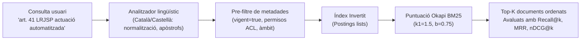

## A. Objectius d'aprenentatge

En completar aquesta lliçó, l'estudiant ha de ser capaç de:

1. **Explicar** l'arquitectura clàssica d'un sistema de **Recuperació d'Informació (*Information Retrieval*, IR)**: anàlisi textual, **índex invertit (*inverted index*)**, filtres de metadades i funció de puntuació (*scoring*).
2. **Formular** i interpretar l'algorisme **Okapi BM25** (saturació de freqüència de terme \(k_1\) i normalització per longitud de document \(b\)) i explicar per què supera TF-IDF estàndard.
3. **Calcular** i interpretar les mètriques estàndard d'avaluació de recuperació: **Precision@k**, **Recall@k**, **MRR (*Mean Reciprocal Rank*)**, **MAP** i **nDCG@k (*Normalized Discounted Cumulative Gain*)**.
4. **Identificar** quan la cerca lèxica (BM25 + filtres estructurats) és insubstituïble en l'Administració pública (codis d'expedient, NIF, articles de llei, termes tècnics exactes).
5. **Implementar** en Python pur un **índex invertit amb puntuació BM25** i un avaluador de **Recall@k, MRR i nDCG@k** sobre normativa municipal sintètica.

---

## B. Explicació introductòria

Quan cerques a l'arxiu del BOPB o a la seu electrònica *"Llei 39/2015 article 21 termini resolució"*, el motor no llegeix linealment els 500.000 documents un per un; consulta una estructura anomenada **índex invertit** (com l'índex alfabètic del final d'un llibre) que retorna en mil·lisegons els documents candidats ordenats per rellevància.

La **Recuperació d'Informació (IR)** és la disciplina que estudia com indexar, cercar i ordenar (*ranking*) col·leccions documentals davant una consulta d'usuari. Tot i l'auge dels LLMs i els embeddings, la recuperació lèxica moderna (**BM25** dins motors com Elasticsearch, OpenSearch, Tantivy o PostgreSQL Full-Text Search) continua sent un **pilar insubstituïble** tant per a cercadors corporatius com per a la branca lèxica dels sistemes **RAG híbrids**.

---

## C. Explicació tècnica avançada

### 1. L'índex invertit (*Inverted Index*)

Un índex invertit mapeja cada terme del vocabulari a una **llista d'ocurrències (*postings list*)** amb els identificadors de document (`doc_id`), freqüències de terme (`tf`) i opcionalment posicions (per a cerques de frase exacta com `"contracte menor"`):

```
"plusvàlua"  → [(doc_12, tf=3), (doc_89, tf=1)]
"subvenció"  → [(doc_04, tf=2), (doc_12, tf=1), (doc_51, tf=4)]
```

Combinat amb **filtres estructurats de metadades** (p. ex., `any = 2026`, `municipi = 'Mataró'`, `vigent = true`, `permis_usuari IN rols`), permet reduir en microsegons el conjunt de cerca abans de puntuar.

### 2. Okapi BM25: l'estàndard d'or de la recuperació lèxica

**BM25 (*Best Matching 25*)** millora TF-IDF en dos aspectes fonamentals: **saturació de la freqüència de terme** (que un mot aparegui 50 vegades no és 50 vegades més rellevant que 5 vegades) i **normalització suau per longitud del document** respecte de la longitud mitjana del corpus (\(\text{avgdl}\)):

\[
\text{BM25}(q, d) = \sum_{t \in q} \text{IDF}(t) \cdot \frac{f(t, d) \cdot (k_1 + 1)}{f(t, d) + k_1 \cdot \left(1 - b + b \cdot \frac{|d|}{\text{avgdl}}\right)}
\]

on habitualment \(\text{IDF}(t) = \ln\left(\frac{N - n(t) + 0.5}{n(t) + 0.5} + 1\right)\) (variant Lucene/Elasticsearch no negativa), i els dos hiperparàmetres clau són:
- **\(k_1 \in [1.2, 2.0]\)** (per defecte `1.2`–`1.5`): controla la **saturació de `tf`**. Com més baix, abans se satura el guany de repetir la mateixa paraula.
- **\(b \in [0, 1]\)** (per defecte `0.75`): controla la **penalització per longitud de document**. Si \(b = 0\), s'ignora la longitud; si \(b = 1\), normalització lineal completa.

### 3. Mètriques d'avaluació de recuperació i rànquing

En IR no només importa **si** hem trobat el document correcte, sinó **en quina posició** apareix!

| Mètrica | Fórmula / Definició | Rellevància binària o graduada? | Quan és la mètrica prioritària |
|---|---|---|---|
| **Precision@k** | Fracció dels `k` primers resultats que són rellevants | Binària | Cercadors on l'usuari només mira els top-3/5 resultats |
| **Recall@k** | Fracció de **tots** els documents rellevants recuperats dins els `k` primers | Binària | **Primera etapa d'un RAG o reranker** (si el fragment bo no entra al top-k, l'LLM no el podrà respondre mai!) |
| **MRR** (*Mean Reciprocal Rank*) | Mitjana d'\(1 / \text{posició del primer resultat rellevant}\) | Binària | Preguntes amb **una sola resposta canònica** (FAQ, recerca d'un decret o article concret) |
| **nDCG@k** (*Normalized Discounted Cumulative Gain*) | \(\text{DCG@k} = \sum_{i=1}^{k} \frac{2^{\text{rel}_i} - 1}{\log_2(i+1)}\), normalitzada pel rànquing ideal (\(\text{IDCG@k}\)) | **Graduada** (ex. `0, 1, 2, 3`) | **Estàndard complet de rànquing**: premia molt més col·locar documents altament rellevants (`rel=3`) a les primeres posicions |

---

## D. Diagrames i recursos visuals

### Arquitectura d'un motor de recuperació lèxica (Índex invertit + Filtres + BM25)



---

## E. Aplicació a l'Administració pública

1. **Cerca jurídica i de codis exactes**: en cerca sobre el BOPB, acords de ple o expedients, l'usuari sovint escriu **`Decret 2026/0412`**, **`art. 41 LRJSP`**, **`CPV 45233140`** o **`Llei 39/2015`**. BM25 localitza aquests termes rars amb una precisió quasi perfecta (`IDF` altíssim), allà on els embeddings densos sols solen fracassar.
2. **Filtratge estricte per vigència i control d'accés (ACL)**: abans de mostrar o passar a un LLM cap document recuperat, el motor IR ha d'aplicar filtres deterministes de **vigència normativa** (no recuperar una ordenança derogada del 2018!) i **permisos d'usuari** (*document-level security*).
3. **Relació amb el Mòdul 2.10 i Mòdul 3.8**: dominar Recall@k, MRR i nDCG@k és essencial per avaluar tant la cerca semàntica/híbrida com el *retriever* de qualsevol sistema **RAG**.

---

## F. Exemple pràctic guiat

Implementem en **Python pur** un motor **BM25** complet (amb índex invertit i paràmetres `k1=1.5, b=0.75`) sobre 5 documents normatius sintètics i calculem les mètriques **Recall@2, MRR i nDCG@3**.

```python
"""Exemple 2.9: Motor Okapi BM25 i mètriques IR (Recall@k, MRR, nDCG@k) en Python pur."""
import math
import re
from collections import Counter


def tokenitzar(text: str) -> list[str]:
    text = re.sub(r"\b[ldsmnt]'", " ", text.lower())
    return re.findall(r"[a-zàèéíïòóúüç0-9]+(?:[·/-][a-zàèéíïòóúüç0-9]+)*", text)


class MotorBM25:
    def __init__(self, docs: list[str], k1: float = 1.5, b: float = 0.75) -> None:
        self.k1 = k1
        self.b = b
        self.docs_tok = [tokenitzar(d) for d in docs]
        self.n = len(docs)
        self.doc_lens = [len(d) for d in self.docs_tok]
        self.avgdl = sum(self.doc_lens) / max(self.n, 1)
        self.tf = [Counter(d) for d in self.docs_tok]
        self.df: Counter[str] = Counter()
        for c in self.tf:
            for terme in c:
                self.df[terme] += 1

    def idf(self, terme: str) -> float:
        n_t = self.df.get(terme, 0)
        return math.log((self.n - n_t + 0.5) / (n_t + 0.5) + 1.0)

    def cercar(self, consulta: str) -> list[tuple[int, float]]:
        q_toks = tokenitzar(consulta)
        resultats: list[tuple[int, float]] = []
        for i in range(self.n):
            score = 0.0
            dl = self.doc_lens[i]
            for t in q_toks:
                f = self.tf[i].get(t, 0)
                if f == 0:
                    continue
                denom = f + self.k1 * (1.0 - self.b + self.b * (dl / self.avgdl))
                score += self.idf(t) * (f * (self.k1 + 1.0) / denom)
            resultats.append((i, score))
        return sorted(resultats, key=lambda x: -x[1])


def ndcg_at_k(ranking_ids: list[int], rels: dict[int, int], k: int) -> float:
    dcg = sum((2 ** rels.get(doc_id, 0) - 1) / math.log2(pos + 2) for pos, doc_id in enumerate(ranking_ids[:k]))
    ideals = sorted(rels.values(), reverse=True)[:k]
    idcg = sum((2 ** r - 1) / math.log2(pos + 2) for pos, r in enumerate(ideals))
    return dcg / idcg if idcg > 0 else 0.0


if __name__ == "__main__":
    corpus = [
        "Llei 40/2015 article 41: definició d'actuació administrativa automatitzada i segell electrònic.",
        "Ordenança fiscal reguladora de l'impost de béns immobles (IBI) i bonificacions.",
        "Guia interna sobre actuació administrativa automatitzada, auditoria del codi font i responsables.",
        "Bases reguladores de subvencions per a biblioteques municipals de la província.",
        "Llei 39/2015 del procediment administratiu comú: terminis de resolució i notificació electrònica.",
    ]
    motor = MotorBM25(corpus)
    consulta = "Llei 40/2015 article 41 actuació administrativa automatitzada"
    ranquing = motor.cercar(consulta)

    for pos, (doc_id, sc) in enumerate(ranquing[:3], start=1):
        print(f"#{pos} Doc {doc_id} (BM25={sc:.3f}): {corpus[doc_id]}")

    # Rellevància graduada real: Doc 0 = molt rellevant (3), Doc 2 = parcialment rellevant (2), resta = 0
    rels = {0: 3, 2: 2}
    ids_ord = [doc_id for doc_id, _ in ranquing]
    recall_2 = len(set(ids_ord[:2]) & set(rels)) / len(rels)
    mrr = 1.0 / (ids_ord.index(0) + 1)
    ndcg_3 = ndcg_at_k(ids_ord, rels, k=3)
    print(f"Mètriques -> Recall@2={recall_2:.3f}, MRR={mrr:.3f}, nDCG@3={ndcg_3:.3f}")
```

### Interpretació dels resultats (execució verificada)

- BM25 col·loca **Doc 0** (`Llei 40/2015 article 41...`) en `#1` i **Doc 2** (`Guia sobre actuació administrativa automatitzada...`) en `#2`, assolint **`Recall@2 = 1.000`, `MRR = 1.000` i `nDCG@3 = 1.000`**!
- Observa com el regex `[a-z...0-9]+(?:[·/-][a-z...0-9]+)*` conserva íntegre el token **`40/2015`** (i `39/2015`), detall decisiu en cerca jurídica perquè no es separi en `"40"` i `"2015"`.

---

## G. Exercici pràctic per resoldre

### Enunciat
Estàs avaluant un cercador documental de decrets municipals davant **2 consultes de prova**, amb rellevància graduada (`3 = exacte`, `2 = parcial`, `0 = irrellevant`):
- **Consulta Q1** (només `Doc A` és rellevant amb `rel=3`): el motor retorna `[Doc X (0), Doc A (3), Doc Y (0)]`.
- **Consulta Q2** (`Doc B` té `rel=3` i `Doc C` té `rel=1`): el motor retorna `[Doc C (1), Doc B (3), Doc Z (0)]`.

Calcula exactament (mostrant les fórmules):
1. El **Reciprocal Rank** de Q1 i Q2, i l'**MRR** mitjà de les dues consultes.
2. El **Recall@2** de Q1 i Q2.
3. El **DCG@2, IDCG@2 i nDCG@2** de **Q2** (recorda que \(\log_2(2) = 1\) i \(\log_2(3) \approx 1,585\)).
4. Explica per què **MRR** i **Recall@2** no detecten l'error d'ordenació en Q2, mentre que **nDCG@2** sí que el penalitza!

### Objectius i restriccions
- Dominar el càlcul manual i la interpretació pràctica de les mètriques clau d'avaluació de recuperació.

:::hint Pista 1 — MRR en Q2
En Q2, `Doc C` (rellevant, encara que només `rel=1`) apareix en posició `#1` → en rellevància binària, el primer rellevant és a la posició 1 (`RR = 1/1 = 1,0`), amagant que el millor document (`rel=3`) ha quedat segon!
:::

:::hint Pista 2 — Fórmula de DCG@2 en Q2
Posició 1 (`rel=1`): \((2^1 - 1)/\log_2(2) = 1 / 1 = 1,000\). Posició 2 (`rel=3`): \((2^3 - 1)/\log_2(3) = 7 / 1,585 \approx 4,416\). Compara-ho amb l'ideal `[3, 1]`!
:::

### Criteris d'avaluació
- **25%**: Càlcul exacte de RR(Q1), RR(Q2) i MRR.
- **20%**: Càlcul exacte de Recall@2 per a Q1 i Q2.
- **35%**: Càlcul exacte de DCG@2, IDCG@2 i nDCG@2 de Q2.
- **20%**: Interpretació clara de per què nDCG@k és superior quan existeixen nivells diferents de rellevància.

### Errors habituals
- Usar \(\log_2(i)\) en lloc de \(\log_2(i+1)\) per a posicions 1-indexades (posició 1 divideix per \(\log_2(2) = 1\), posició 2 divideix per \(\log_2(3) \approx 1,585\)).

:::solution Solució completa comentada i alternatives
### 1. Reciprocal Rank i MRR
- **Q1**: el primer document rellevant (`Doc A`) és a la posició `2` → \(\text{RR}(Q1) = 1/2 = 0,500\).
- **Q2**: el primer document rellevant (`Doc C`, `rel=1 > 0`) és a la posició `1` → \(\text{RR}(Q2) = 1/1 = 1,000\).
- **MRR** = \((0,500 + 1,000) / 2 = \mathbf{0,750}\).

### 2. Recall@2
- **Q1**: 1 de 1 document rellevant dins el top-2 → \(\text{Recall@2} = \mathbf{1,000}\).
- **Q2**: 2 de 2 documents rellevants (`Doc C` i `Doc B`) dins el top-2 → \(\text{Recall@2} = \mathbf{1,000}\).

### 3. DCG@2, IDCG@2 i nDCG@2 de Q2
- **Rànquing obtingut `[rel=1, rel=3]`**:
  - \(\text{DCG@2} = \frac{2^1 - 1}{\log_2(2)} + \frac{2^3 - 1}{\log_2(3)} = \frac{1}{1} + \frac{7}{1,58496} = 1 + 4,4165 = \mathbf{5,4165}\).
- **Rànquing ideal `[rel=3, rel=1]`**:
  - \(\text{IDCG@2} = \frac{2^3 - 1}{\log_2(2)} + \frac{2^1 - 1}{\log_2(3)} = \frac{7}{1} + \frac{1}{1,58496} = 7 + 0,6309 = \mathbf{7,6309}\).
- **nDCG@2** = \(5,4165 / 7,6309 = \mathbf{0,7098}\) (`~0,710`).

### 4. Conclusió interpretativa
Tant `Recall@2` (`1,0`) com `RR` (`1,0`) donen la puntuació màxima a Q2 perquè són **mètriques binàries** que no distingeixen entre un document parcialment rellevant (`rel=1`) i el decret exacte (`rel=3`). **nDCG@2 (`0,710`)** reflecteix fidelment la penalització d'haver situat el document més rellevant en segon lloc en lloc del primer!
:::

---

## H. Test individual

Resol les 10 preguntes sobre índex invertit, BM25 (\(k_1\) i \(b\)), saturació de termes, filtres de metadades/ACL i mètriques d'avaluació (Precision@k, Recall@k, MRR, nDCG@k).

---

## I. Preguntes de desenvolupament

### Pregunta 1
Explica com funciona l'**índex invertit** i per què **Okapi BM25** millora TF-IDF clàssic a través dels paràmetres \(k_1\) i \(b\).

:::model-answer Resposta model i criteris de correcció (Pregunta 1)
**Resposta model**:
- L'**índex invertit** associa cada terme del vocabulari a una llista de documents (*postings list*) on apareix, juntament amb la freqüència i posicions, permetent recuperar candidats en mil·lisegons sense escanejar tot el corpus linealment.
- **BM25** supera TF-IDF bàsic amb dos mecanismes:
  1. **Saturació de freqüència de terme (\(k_1\))**: la contribució d'un terme creix de forma sublineal i tendeix a una asímptota \((k_1+1)\) en lloc de créixer il·limitadament, evitant que un document que repeteix 40 vegades una paraula eclipsi un altre document que cobreix tots els termes de la consulta.
  2. **Normalització suau per longitud (\(b\))**: penalitza documents molt més llargs que la mitjana (`avgdl`) de manera regulable (`b = 0.75` per defecte), evitant que textos enormes guanyin només per tenir més paraules.

**Criteris de correcció (10 punts)**:
- Explicació clara de l'índex invertit: 3 punts.
- Explicació rigorosa de saturació (\(k_1\)) i normalització per longitud (\(b\)) en BM25: 7 punts.
:::

### Pregunta 2
Compara **Recall@k**, **MRR** i **nDCG@k**, indicant quina prioritzaries per avaluar el *retriever* d'un sistema RAG administratiu i quina per a un cercador general de normativa ordenat per rellevància.

:::model-answer Resposta model i criteris de correcció (Pregunta 2)
**Resposta model**:
- **Recall@k**: proporció de tots els documents rellevants recuperats dins els `k` primers. **Prioritària en la primera etapa d'un RAG o abans d'un *reranker***, perquè si el fragment normatiu necessari no entra dins del top-k recuperat, l'LLM mai podrà generar una resposta correcta.
- **MRR (*Mean Reciprocal Rank*)**: mitjana de \(1/\text{posició del primer resultat rellevant}\). Ideal quan hi ha una única resposta correcta (p. ex., cercar un expedient o pregunta FAQ concreta).
- **nDCG@k**: suporta **rellevància graduada** (`0..3`) i aplica descompte logarítmic per posició, normalitzat respecte del rànquing ideal. **Prioritària en cercadors generals de normativa/documentació** on importa que els documents més complets i vigents apareguin als primers llocs.

**Criteris de correcció (10 punts)**:
- Definició exacta de les 3 mètriques: 6 punts.
- Assignació justificada a RAG (*Recall@k*) vs. cercador general (*nDCG@k*) vs. resposta única (*MRR*): 4 punts.
:::

### Pregunta 3
Per què en un motor de cerca documental de l'Administració pública és tan important combinar **filtres estructurats de metadades** (vigència, àmbit territorial, control d'accés ACL) amb la puntuació textual (BM25)?

:::model-answer Resposta model i criteris de correcció (Pregunta 3)
**Resposta model**:
- La similitud textual per si sola no coneix la validesa jurídica ni els permisos de seguretat d'un document: una ordenança fiscal derogada del 2018 pot tenir una puntuació BM25 gairebé idèntica a la vigent del 2026!
- Aplicar **pre-filtres deterministes de metadades** (`estat = 'VIGENT'`, `data_inici <= avui`, `municipi_id`, `permisos_usuari`) garanteix que: (1) mai es retorni normativa derogada com si fos vigent; (2) es compleixi el control d'accés de l'ENS i el RGPD a nivell de document (evitant fuites d'expedients restringits); (3) es redueixi l'espai de cerca accelerant les consultes.

**Criteris de correcció (10 punts)**:
- Vigència normativa i seguretat jurídica: 4 punts.
- Control d'accés ACL (RGPD/ENS) a nivell de document: 4 punts.
- Benefici d'eficiència en pre-filtratge: 2 punts.
:::

---

## J. Resum per memoritzar

### Conceptes clau
- **Índex invertit**: mapeja `terme → postings list` (cerca en ms + suport de filtres deterministes ACL/vigència).
- **BM25**: estàndard d'or lèxic; millora TF-IDF amb **saturació de `tf` (\(k_1 \approx 1.2–1.5\))** i **normalització de longitud (\(b \approx 0.75\))**.
- **Força de BM25**: invencible en **codis exactes** (`40/2015`, `EXP-2026-0148`, NIF, CPV, noms propis rars).
- **Mètriques IR**:
  - **Recall@k** → clau en recuperació per a RAG / primera etapa abans de *reranking*.
  - **MRR** → posició del primer encert (resposta única).
  - **nDCG@k** → rellevància graduada + descompte logarítmic per posició.

### Definicions essencials
- **Postings list**: llista ordenada d'identificadors de documents (i freqüències/posicions) on apareix un terme dins d'un índex invertit.
- **IDCG@k**: *Discounted Cumulative Gain* del rànquing ideal possible fins a la posició `k`, usat com a denominador per normalitzar nDCG@k entre `0` i `1`.

### Errors conceptuals freqüents
1. Evaluar un cercador només amb `Precision@10` o `Recall@10` ignorant l'ordre intern dels resultats (per això cal MRR/nDCG).
2. Oblidar pre-filtres de **vigència normativa** i **permisos ACL** abans de puntuar documents.
3. Deixar que el tokenitzador trenqui referències jurídiques com `40/2015` o `SUB-2026-0148`.

### Possibles preguntes d'examen
- Explica el paper dels paràmetres \(k_1\) i \(b\) en BM25.
- Calcula a mà `Recall@k`, `MRR` i `nDCG@k` per a una llista petita de resultats amb rellevància graduada.
- Per què BM25 continua sent indispensable malgrat l'existència d'embeddings neuronals?
