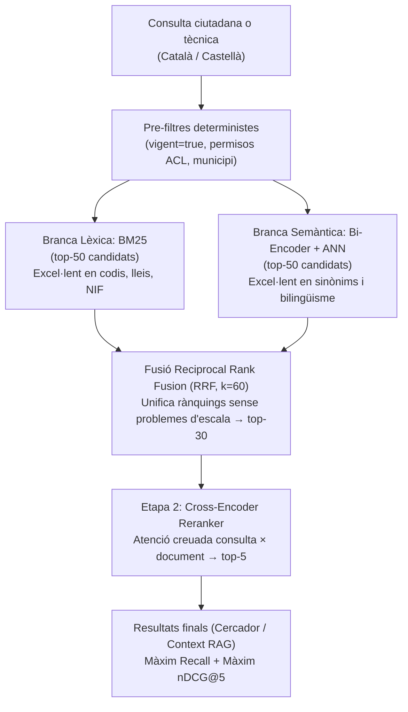

## A. Objectius d'aprenentatge

En completar aquesta lliçó final del Mòdul 2, l'estudiant ha de ser capaç de:

1. **Comparar** en profunditat la **cerca lèxica (BM25)**, la **cerca semàntica densa (embeddings)** i la **cerca híbrida**, justificant per què la **cerca híbrida + *reranking*** és l'arquitectura de referència en producció.
2. **Distingir** l'arquitectura ***Bi-Encoder*** (codificació independent de consulta i document, indexable i escalable a milions de documents) de l'arquitectura ***Cross-Encoder*** (atenció creuada conjunta consulta+document, molt més precisa però no pre-indexable).
3. **Aplicar** mètodes de fusió de rànquings, especialment **RRF (*Reciprocal Rank Fusion*)**, explicant per què evita problemes d'incompatibilitat d'escales entre BM25 i similitud cosinus.
4. **Dissenyar** un pipeline complet de recuperació en dues etapes (*Retrieve & Re-rank*) adaptat a entorns bilingües català/castellà de l'Administració pública.
5. **Implementar** en Python + NumPy un motor de **cerca híbrida amb Reciprocal Rank Fusion (RRF)** que supera tant BM25 pur com la cerca vectorial pura.

---

## B. Explicació introductòria

Imagina una ciutadana que escriu al portal municipal: *"Em poden rebaixar la contribució de la casa perquè tinc tres fills?"*. L'ordenança oficial, però, no fa servir les paraules *"rebaixar"*, *"contribució"*, *"casa"* ni *"tres fills"*, sinó: *"Bonificació de la quota íntegra de l'Impost sobre Béns Immobles (IBI) per a titulars de família nombrosa"*.

Un cercador **lèxic pur (BM25)** no troba coincidència de paraules i retorna zero resultats útils! En canvi, la **cerca semàntica** tradueix consulta i documents a **embeddings contextuals** i busca per proximitat de **significat**, connectant immediatament el llenguatge col·loquial ciutadà amb el llenguatge jurídic oficial — i fins i tot travessant fronteres lingüístiques entre català i castellà.

Ara bé, com hem vist a la lliçó 2.9, si un tècnic cerca `OF-014-2026` o `art. 41 LRJSP`, la cerca purament semàntica flaqueja i **BM25** és invencible. La resposta d'enginyeria madura és combinar tots dos mons: **cerca híbrida + *reranking***.

---

## C. Explicació tècnica avançada

### 1. Cerca lèxica vs. Cerca semàntica vs. Cerca híbrida

| Criteri | Cerca lèxica (BM25) | Cerca semàntica densa (Bi-Encoder) | Cerca híbrida (BM25 + Dens + RRF + Reranker) |
|---|---|---|---|
| **Sinònims i llenguatge col·loquial** | ❌ Falla (*vocabulary mismatch*) | ✅ Excel·lent | ✅ Excel·lent |
| **Cerca bilingüe (`ca ↔ es`)** | ❌ Només si coincideixen cognats | ✅ Excel·lent amb encoder multilingüe | ✅ Excel·lent |
| **Codis exactes (`EXP-2026`, `art. 41`, NIF)** | ✅ Immillorable | ❌ Dèbil / imprecís | ✅ Immillorable |
| **Negacions i matisos lògics** | ⚠️ Parcial | ❌ Febles en bi-encoder | ✅ Molt millor gràcies al *Cross-Encoder* |
| **Cost i latència** | Molt baix (<5 ms CPU) | Baix (HNSW ~10–30 ms) | Moderat (~50–150 ms per tot el pipeline) |

### 2. *Bi-Encoder* vs. *Cross-Encoder* (Arquitectura *Retrieve & Re-rank*)

1. ***Bi-Encoder*** (p. ex., `BGE-M3`, `multilingual-e5-large`, `Sentence-BERT`):
   - Codifica els \(N\) documents **un sol cop *offline*** en vectors \(\mathbf{e}_d\) i els guarda en un índex vectorial aproximat (**ANN / HNSW**, vegeu Mòdul 3.7).
   - En temps de consulta, només codifica la consulta \(\mathbf{e}_q\) (1 sola passada neuronal) i cerca els `top-50` veïns més propers en mil·lisegons.
   - **Limitació**: com que consulta i document no s'han «vist» mai mútuament durant la codificació (*zero cross-attention*), es perden interaccions fines entre paraules (com negacions o condicions d'excepció).
2. ***Cross-Encoder* (*Reranker*)** (p. ex., `bge-reranker-v2-m3`, `jina-reranker-v2-base-multilingual`):
   - Concatena `[CLS] consulta [SEP] document_candidat [SEP]` i aplica ***self-attention* completa entre tots els tokens de la consulta i del document** per produir una puntuació de rellevància molt precisa.
   - **Limitació**: impossible d'executar sobre 1 milió de documents en temps real (requeriria 1 milió de passades Transformer per consulta!).
3. **Arquitectura *Retrieve & Re-rank* (2 etapes)**:
   - **Etapa 1 (*Retrieve*, alta velocitat, maximitzar `Recall@50`)**: BM25 (top-50) + Bi-Encoder vectorial (top-50) → fusió híbrida → top-30 candidats.
   - **Etapa 2 (*Re-rank*, alta precisió, maximitzar `nDCG@5` / `MRR`)**: el *Cross-Encoder* avalua només aquells 30 candidats en ~40–100 ms i entrega els **top-5** definitius a l'usuari o a l'LLM del RAG!

### 3. Fusió híbrida: **RRF (*Reciprocal Rank Fusion*)**

Com combinem una puntuació **BM25** (rang no acotat, p. ex. `[0, 28.4]`) amb una **similitud cosinus** (rang `[0.35, 0.88]`)? Sumar-les directament fallaria perquè les escales i distribucions són incompatibles!

**RRF** (Cormack et al., 2009) ignora les puntuacions crues i combina únicament les **posicions (*ranks*)** que cada document obté en cada cercador \(s \in S\):

\[
\text{RRF}(d) = \sum_{s \in S} \frac{w_s}{k + \text{rank}_s(d)}
\]

on habitualment la constant suavitzadora és **\(k = 60\)** (redueix la dominància excessiva d'un sol resultat `#1` atípic) i \(w_s\) permet ponderar cada branca (per defecte \(w_s = 1\)).
- Un document que surt amunt **en ambdós cercadors** (lèxic i semàntic) suma dues contribucions i puja automàticament al capdamunt.
- Un codi exacte que només troba BM25 en posició `#1` obté \(1/61 \approx 0,0164\) i sobreviu dins dels top candidats per passar al *reranker*!

---

## D. Diagrames i recursos visuals

### Pipeline de referència: Cerca híbrida + RRF + Cross-Encoder Reranking



---

## E. Aplicació a l'Administració pública

1. **Cercador unificat del catàleg de tràmits i BOPB**: cobreix simultàniament els **dos perfils d'usuari reals**: la ciutadania (que pregunta en llenguatge planer i sovint en castellà) i el personal tècnic/jurídic (que cerca per números d'expedient, CPV, decrets i articles concrets).
2. **Qualitat multilingüe *on-premise***: models oberts com **`BGE-M3`** (suporta en un únic model embeddings densos, dispersos tipus SPLADE i multi-vector ColBERT en >100 idiomes inclòs català!) combinats amb **`bge-reranker-v2-m3`** permeten desplegar cerca híbrida d'estat de l'art 100% dins la infraestructura de la Diputació.
3. **Pont directe cap al Mòdul 3**: aquest pipeline de cerca híbrida + *reranking* és exactament el motor de recuperació que alimenta qualsevol sistema **RAG** de producció (`m03-08-rag`).

---

## F. Exemple pràctic guiat

Implementem en **Python pur** la fusió **Reciprocal Rank Fusion (RRF, `k=60`)** sobre els resultats de dues branques (BM25 lèxic i Bi-Encoder semàntic) davant una consulta híbrida que combina un codi normatiu (`OF-014`) i llenguatge col·loquial (`rebaixar contribució família nombrosa`), demostrant com RRF eleva el document perfecte al `#1`.

```python
"""Exemple 2.10: Fusió de cerca híbrida amb Reciprocal Rank Fusion (RRF, k=60)."""


def reciprocal_rank_fusion(
    ranquings: list[list[str]],
    k: int = 60,
    pesos: list[float] | None = None,
) -> list[tuple[str, float]]:
    if pesos is None:
        pesos = [1.0] * len(ranquings)
    scores: dict[str, float] = {}
    for ranquing, w in zip(ranquings, pesos):
        for pos, doc_id in enumerate(ranquing, start=1):
            scores[doc_id] = scores.get(doc_id, 0.0) + w / (k + pos)
    return sorted(scores.items(), key=lambda x: -x[1])


if __name__ == "__main__":
    # Consulta: "OF-014 rebaixar contribució casa tres fills"
    # Doc_IBI_OF014 conté tant el codi OF-014 com la bonificació d'IBI per família nombrosa.
    # BM25 encerta el codi exacte però confon altres ordenances amb "OF-014" esmentat en un annex.
    bm25_top = ["Doc_Annex_OF014", "Doc_IBI_OF014", "Doc_Taxa_Residus", "Doc_Habitatge_Lloguer"]
    # El Bi-Encoder capta molt bé "família nombrosa / bonificació habitatge", però no distingeix el codi OF-014.
    dense_top = ["Doc_Beques_Families", "Doc_IBI_OF014", "Doc_Habitatge_Lloguer", "Doc_Subvencio_Solar"]

    hibrid = reciprocal_rank_fusion([bm25_top, dense_top], k=60)

    print("Top BM25 (lèxic)     :", bm25_top)
    print("Top Dense (semàntic) :", dense_top)
    print("\nRànquing Híbrid RRF (k=60):")
    for pos, (doc_id, score) in enumerate(hibrid, start=1):
        print(f"  #{pos} {doc_id:<22} | RRF = {score:.6f}")
```

### Interpretació dels resultats (execució verificada)

- Ni BM25 (`#2`) ni el Bi-Encoder sol (`#2`) havien situat `Doc_IBI_OF014` en primera posició, perquè cadascun només captava la meitat del senyal (codi exacte vs. significat col·loquial).
- En fusionar-los amb **RRF (`k=60`)**, `Doc_IBI_OF014` rep `1/62 + 1/62 = 0.032258` i puja automàticament al **`#1` absolut**, superant tant `Doc_Habitatge_Lloguer` (`0.031498`) com els falsos `#1` individuals (`0.016393`), **sense necessitar cap normalització manual d'escales entre BM25 i cosinus**!

---

## G. Exercici pràctic per resoldre

### Enunciat
La Diputació vol construir un **cercador intel·ligent per a 250.000 documents** (ordenances, decrets, actes de ple i fitxes de tràmits en català i castellà) amb un requisit estricte de latència màxima de **`250 ms` p95** per consulta i pressupost de servidor limitat (1 GPU mitjana *on-premise*).

Un consultor extern proposa dues idees contraposades i et demana criteri tècnic:
- **Proposta 1**: Eliminar l'índex vectorial i passar directament els 250.000 documents per un ***Cross-Encoder*** en cada consulta perquè és molt més precís que un *Bi-Encoder*.
- **Proposta 2**: Usar només un ***Bi-Encoder*** i normalitzar a mà `score = BM25_score + cosine_score` si més endavant s'hi afegeix BM25.

Analitza per què **ambdues propostes tenen errors greus d'enginyeria** i dissenya l'arquitectura exacta que compleix els `< 250 ms p95` maximitzant tant `Recall@k` com `nDCG@5`.

### Objectius i restriccions
- Demostrar domini d'escalabilitat (*Bi-Encoder* vs *Cross-Encoder*), fusió híbrida (*RRF*) i arquitectura *Retrieve & Re-rank* amb pre-filtres de seguretat.

:::hint Pista 1 — Què tardaria un Cross-Encoder sobre 250.000 documents?
A ~2 ms per parell en GPU, 250.000 passades serien `500 segons` (>8 minuts!) per a UNA sola consulta!
:::

:::hint Pista 2 — Què passa si sumes `BM25_score + cosine_score`?
`BM25` pren valors com `18,5` mentre `cosine` pren valors entre `0,4` i `0,85` → `BM25` esclafaria completament el senyal semàntic!
:::

### Criteris d'avaluació
- **30%**: Refutació quantitativa de la Proposta 1 (impossibilitat de pre-indexar el *Cross-Encoder* i cost `O(N)` per consulta).
- **25%**: Refutació de la Proposta 2 (incompatibilitat d'escales `BM25` vs `cosinus` i solució via **RRF**).
- **35%**: Arquitectura *Retrieve & Re-rank* completa (pre-filtres ACL/vigència → BM25 top-50 + Bi-Encoder HNSW top-50 → RRF top-25 → Cross-Encoder reranker → top-5) dins els `250 ms`.
- **10%**: Mesura de qualitat end-to-end (`Recall@50` etapa 1, `nDCG@5` i `MRR` etapa 2, latència p95).

### Errors habituals
- Pensar que es poden pre-calcular els embeddings del *Cross-Encoder* offline (no es pot, perquè el *Cross-Encoder* necessita la consulta de l'usuari concatenada amb el document abans d'executar l'atenció!).

:::solution Solució completa comentada i alternatives
### Refutació de les dues propostes
1. **Error de la Proposta 1 (Cross-Encoder sobre 250.000 docs)**: un *Cross-Encoder* concatena `[consulta, document]` i no es pot pre-indexar; avaluar 250.000 parells per consulta costaria minuts de GPU, violant en 3 ordres de magnitud el requisit de `250 ms`.
2. **Error de la Proposta 2 (Suma directa `BM25 + cosine`)**: BM25 no està acotat (`[0, 30+]`), mentre el cosinus es mou sovint en `[0,4, 0,85]`. Sumar-los directament fa que BM25 domini quasi al 100% i anul·li la cerca semàntica.

### Arquitectura òptima (< 250 ms p95)
1. **Pre-filtres deterministes de metadades** (`vigent=true`, `permisos_acl`, `municipi_id`, `tipus_doc`) → ~2 ms.
2. **Etapa 1 — Recuperació híbrida en paral·lel (`~25–40 ms`)**:
   - **Branca A (BM25)** sobre índex invertit (Elasticsearch/OpenSearch/PostgreSQL) → top-50.
   - **Branca B (Bi-Encoder multilingüe *on-premise*, p. ex. `BGE-M3` o `multilingual-e5`)** codificant només la consulta (1 passada ~15 ms) + cerca **ANN HNSW** sobre els 250k vectors pre-indexats (~10 ms) → top-50.
3. **Fusió sense escales (`< 1 ms`)**: **Reciprocal Rank Fusion (RRF, `k=60`)** sobre els dos rànquings → selecció dels **top-25 candidats** únics.
4. **Etapa 2 — Reranking precís (`~60–100 ms` en 1 batch GPU)**: **`bge-reranker-v2-m3` (*Cross-Encoder*)** sobre els 25 parells `(consulta, candidat)` → entrega dels **top-5 / top-10** definitius.
5. **Latència total esperada**: `~100–160 ms p95` (molt per sota dels `250 ms`), maximitzant `Recall@25` a l'Etapa 1 i `nDCG@5`/`MRR` a l'Etapa 2 tant en català com en castellà.
:::

---

## H. Test individual

Resol les 10 preguntes sobre cerca lèxica vs. semàntica vs. híbrida, *Bi-Encoder* vs. *Cross-Encoder*, *Retrieve & Re-rank* i Reciprocal Rank Fusion (RRF).

---

## I. Preguntes de desenvolupament

### Pregunta 1
Explica la diferència arquitectònica i computacional entre un ***Bi-Encoder*** i un ***Cross-Encoder***, i justifica per què el patró de producció estàndard els combina en dues etapes (*Retrieve & Re-rank*).

:::model-answer Resposta model i criteris de correcció (Pregunta 1)
**Resposta model**:
- ***Bi-Encoder***: codifica consulta i document **per separat** en dos vectors independents i els compara amb similitud cosinus / producte escalar. Permet pre-calcular i indexar tots els documents *offline* (cerca ANN en ms sobre milions de documents), però no modela interaccions token-a-token entre consulta i document (menor precisió en negacions i condicions subtils).
- ***Cross-Encoder***: concatena `[consulta, document]` en una única seqüència i executa ***self-attention* creuada** entre tots els tokens de tots dos textos, assolint una precisió de rellevància molt superior; però com que depèn de la consulta en temps real, no es pot pre-indexar (`O(N)` passades Transformer).
- **Combinació *Retrieve & Re-rank***: el *Bi-Encoder* (juntament amb BM25) filtra milions de documents fins a ~20–50 candidats en mil·lisegons (maximitzant `Recall`), i el *Cross-Encoder* reordena només aquells 20–50 candidats en ~50–100 ms (maximitzant `nDCG@5` i `MRR`).

**Criteris de correcció (10 punts)**:
- Diferència arquitectònica i de pre-indexabilitat: 6 punts.
- Justificació del pipeline en dues etapes i mètriques associades: 4 punts.
:::

### Pregunta 2
Per què la **cerca híbrida (BM25 + Embeddings densos)** supera tant la cerca lèxica pura com la cerca semàntica pura en una administració pública, i com resol **RRF (*Reciprocal Rank Fusion*)** el problema de combinar les dues puntuacions?

:::model-answer Resposta model i criteris de correcció (Pregunta 2)
**Resposta model**:
- BM25 domina en coincidències exactes (números d'expedient, articles de llei, NIF, CPV, noms propis rars) però falla en sinònims, llenguatge col·loquial ciutadà i consultes bilingües català↔castellà (*vocabulary mismatch*). Els embeddings densos fan exactament el contrari: brillen en semàntica i bilingüisme però fallen en codis exactes. La cerca híbrida captura tots dos senyals.
- **RRF** evita sumar directament puntuacions incompatibles (BM25 no acotat `[0, 30+]` vs. cosinus `[0.4, 0.9]`) substituint-les per la suma dels inversos de la posició: \(\sum w_s / (k + \text{rank}_s(d))\) amb `k=60`. És senzilla, robusta, sense hiperparàmetres de calibratge d'escala i premia els documents ben posicionats en ambdues branques.

**Criteris de correcció (10 punts)**:
- Complementarietat BM25 + densos amb exemples administratius: 5 punts.
- Fórmula i justificació tècnica de RRF: 5 punts.
:::

### Pregunta 3
Com dissenyaries l'avaluació fora de línia (*offline*) d'un nou sistema de cerca semàntica/híbrida abans de substituir el cercador lèxic actual d'un portal municipal?

:::model-answer Resposta model i criteris de correcció (Pregunta 3)
**Resposta model**:
- Construir un **conjunt de referència (*golden evaluation set*)** de 150–300 consultes reals (anonimitzades dels logs del cercador + casos creats per tècnics) estratificades en: (a) consultes ciutadanes col·loquials en català i castellà, (b) cerques de codis/lleis exactes, (c) consultes amb negacions/excepcions i (d) consultes sense resposta vigent.
- Anotar rellevància graduada (`0..3`) per als documents candidats (*pooling* dels resultats de BM25, dens i híbrid) i comparar **BM25 vs. Dens vs. Híbrid RRF vs. Híbrid + Reranker** mesurant `Recall@20`, `MRR`, `nDCG@5` (desagregats per idioma i tipus de consulta) juntament amb **latència p95** i **cost computacional**.

**Criteris de correcció (10 punts)**:
- Disseny estratificat del *golden set* (idiomes, col·loquial, codis exactes): 5 punts.
- Comparativa controlada d'ablacions + mètriques de qualitat i rendiment: 5 punts.
:::

---

## J. Resum per memoritzar

### Conceptes clau
- **Cerca híbrida = BM25 (exactitud lèxica/codis) + Bi-Encoder (semàntica/bilingüisme) + RRF + Cross-Encoder Reranker**.
- ***Bi-Encoder***: codifica consulta i document per separat → pre-indexable, ràpid (ms), alta escalabilitat (`Recall@50`).
- ***Cross-Encoder***: concatena `[consulta, document]` amb atenció creuada → no pre-indexable, molt precís, s'aplica només als top-20/50 candidats (`nDCG@5`, `MRR`).
- **RRF**: \(\sum \frac{w_s}{k + \text{rank}_s(d)}\) (`k=60`) → fusiona rànquings sense calibrar escales incompatibles entre BM25 i cosinus.

### Definicions essencials
- ***Retrieve & Re-rank***: patró en dues etapes que combina recuperació ràpida (BM25/Bi-Encoder) sobre tot el corpus amb reordenació precisa (*Cross-Encoder*) sobre un subconjunt reduït de candidats.
- **RRF (*Reciprocal Rank Fusion*)**: mètode de fusió basat únicament en les posicions obtingudes per cada document en múltiples cercadors.

### Errors conceptuals freqüents
1. Intentar executar un *Cross-Encoder* sobre tots els documents del corpus en temps real.
2. Sumar directament puntuacions crues de BM25 i similitud cosinus sense normalització o RRF.
3. Desplegar cerca purament vectorial en un portal jurídic oblidant que falla en codis d'expedient i números d'article.

### Possibles preguntes d'examen
- Compara *Bi-Encoder* vs. *Cross-Encoder* en precisió, latència i indexabilitat.
- Calcula a mà la puntuació RRF (`k=60`) de dos documents presents en un rànquing BM25 i un rànquing vectorial.
- Dissenya una arquitectura completa de cerca híbrida per a 250.000 documents municipals complint latència p95 i permisos ACL.
