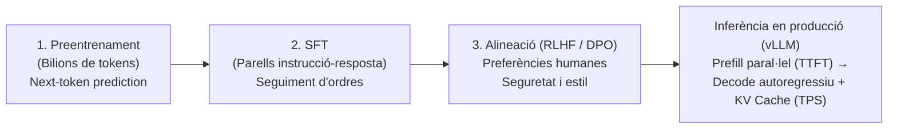

## A. Objectius d'aprenentatge

En completar aquesta lliçó, l'estudiant ha de ser capaç de:

1. **Explicar** el cicle complet d'entrenament d'un **Large Language Model (LLM)** modern: **preentrenament autosupervisat (*next-token prediction*)** → **SFT (*Supervised Fine-Tuning*)** → **alineació de preferències (RLHF / DPO)**.
2. **Distingir** clarament els paràmetres operatius d'inferència: **finestra de context**, **KV Cache** (prefill vs. decode), **temperatura**, **top-p (*nucleus*)**, **top-k**, **`max_tokens`** i penalitzacions de repetició.
3. **Analitzar** les causes estructurals de les **al·lucinacions** i del **tall de coneixement (*knowledge cutoff*)** i explicar per què un LLM no és una base de dades factual fiable per si sol.
4. **Comparar** models **propietaris via API** enfront de models ***open-weights* autoallotjats** (*on-premise*: Ollama, vLLM, Llama, Mistral, Qwen, **Salamandra-BSC**) segons sobirania de dades, cost, latència i compliment RGPD/ENS.
5. **Estimar** en Python el consum de memòria **VRAM dels pesos i de la KV Cache** d'un LLM per dimensionar correctament un servidor *on-premise* de la Diputació.

---

## B. Explicació introductòria

Un **Large Language Model (LLM)** és una xarxa neuronal basada en l'arquitectura *Transformer* (habitualment *Decoder-only*) entrenada sobre bilions de tokens de text per predir probabilísticament **quin és el següent token més plausible** donat un context anterior.

Aquesta tasca aparentment senzilla (*completar text*), escalada a milers de milions de paràmetres i refinada amb instruccions humanes, fa emergir capacitats generals impressionants: redactar esborranys, resumir expedients, extreure JSON estructurat, traduir, programar o invocar eines externes. Ara bé, comprendre que un LLM és un **estimador estadístic del token següent** —i no un motor lògic omniscient ni una base de dades jurídica actualitzada— és la clau per dissenyar sistemes públics segurs i fiables.

---

## C. Explicació tècnica avançada

### 1. Les tres fases de construcció d'un LLM instructiu

1. **Preentrenament (*Pre-training*, model base)**:
   - Aprenentatge autosupervisat sobre bilions de tokens (*web*, llibres, codi, documentació) minimitzant la *cross-entropy* de predicció del següent token (*Causal Language Modeling*).
   - Resultat: un **model base (*base model*)** que sap continuar textos però no sap seguir ordres ni dialogar de manera segura.
2. **Ajust supervisat d'instruccions (*SFT — Supervised Fine-Tuning*)**:
   - Entrenament sobre desenes de milers de parells `(instrucció, resposta ideal)` elaborats o curats per humans.
   - Resultat: el model aprèn el format conversacional (`system` / `user` / `assistant`) i a obeir consignes.
3. **Alineació de preferències (*Alignment*: RLHF / DPO / GRPO)**:
   - **RLHF (*Reinforcement Learning from Human Feedback*)**: s'entrena un *Reward Model* a partir de comparacions humanes (`resposta A > resposta B`) i s'ajusta l'LLM amb PPO penalitzant la divergència KL respecte del model SFT.
   - **DPO (*Direct Preference Optimization*)**: simplifica RLHF optimitzant directament la política de l'LLM sobre parells `(preferida, rebutjada)` sense necessitar un *Reward Model* separat ni un bucle RL inestable.
   - **Models de raonament (*Reasoning / Test-Time Compute*)**: entrenats amb aprenentatge per reforç sobre tasques verificables (matemàtiques, codi, lògica) per generar cadenes de pensament internes abans de la resposta final.

### 2. Inferència eficient: *Prefill*, *Decode* i **KV Cache**

La generació d'una resposta té dues fases amb colls d'ampolla completament diferents:
- ***Prefill* (processament del prompt)**: tots els tokens d'entrada es processen **en paral·lel** → limitat per còmput GPU (*compute-bound*). Determina el **TTFT (*Time To First Token*)**.
- ***Decode* (generació autoregressiva token a token)**: cada nou token depèn de l'anterior → limitat per amplada de banda de memòria VRAM (*memory-bandwidth bound*). Determina els **tokens/segon (TPS)**.
- **KV Cache (*Key-Value Cache*)**: per no recalcular les matrius \(K\) i \(V\) de tots els tokens anteriors en cada nou pas de generació, es guarden en VRAM. La seva memòria creix **linealment** amb la longitud de seqüència \(L\), el nombre de capes, la mida del *batch* i el nombre de capçals KV (d'aquí la importància de **GQA** i **PagedAttention** en motors com **vLLM**!).

### 3. Paràmetres de decodificació i control de sortida

| Paràmetre | Efecte | Valor recomanat en Administració pública |
|---|---|---|
| **`temperature`** | Escala els logits (`z / T`) abans de Softmax | **`0.0 – 0.2`** en RAG, extracció JSON i classificació; `0.5 – 0.7` en esborranys comunicatius |
| **`top_p`** (*nucleus*) | Retalla la cua de tokens fora del conjunt mínim amb probabilitat acumulada \(p\) | `0.9`–`0.95` (o `1.0` quan `temperature = 0`) |
| **`max_tokens`** | Límit màxim de tokens generats | Fixar sempre un sostre raonable per controlar cost, latència i bucles infinits |
| **`seed`** | Llavor pseudoaleatòria (millora reproductibilitat, tot i que en GPU no garanteix determinisme absolut al 100% per operacions paral·leles) | Fixar-lo sempre en proves i avaluacions |

### 4. Models propietaris (API) vs. Models *Open-Weights* (*On-Premise*)

| Criteri | API Propietària (cloud comercial) | *Open-Weights* autoallotjat (vLLM / Ollama: Salamandra, Mistral, Llama, Qwen) |
|---|---|---|
| **Privacitat i RGPD / ENS** | Requereix DPA, residència UE, política *zero data retention* i avaluació de riscos; no recomanat per a dades especials sense garanties contractuals plenes | **Control total *on-premise***: les dades mai no surten de la xarxa de la Diputació |
| **Estabilitat i versionat** | El proveïdor pot deprecar o actualitzar pesos silenciosament | **Pesos congelats i auditables** indefinidament |
| **Cost** | Pagament per token (OPEX, ideal en baix volum/prototips) | Inversió GPU/infraestructura (CAPEX/hosting, molt rendible en alt volum sostingut) |
| **Capacitat màxima** | Models frontera molt grans (multimodalitat i raonament extrem) | Models 7B–70B excel·lents per a RAG, IE, resum i classificació corporativa |

---

## D. Diagrames i recursos visuals

### Cicle de vida d'un LLM i inferència amb KV Cache



---

## E. Aplicació a l'Administració pública

1. **Tall de coneixement (*Knowledge Cutoff*) i normativa canviant**: un LLM entrenat fins al 2025 **desconeix** l'ordenança fiscal aprovada pel ple el 2026! Mai no s'ha de confiar en la memòria paramètrica de l'LLM per a dades normatives vigents: cal **RAG** (Lliçó 3.8).
2. **Ecosistema públic català**: el model **Salamandra** (2B / 7B, desenvolupat pel Barcelona Supercomputing Center dins el projecte **AINA** amb llicència oberta Apache 2.0 i entrenat extensament en català i llengües europees) és una peça estratègica per a desplegaments *on-premise* eficients en català.
3. **Principi de mida mínima suficient**: per a tasques delimitades (extracció JSON, resum per seccions, RAG sobre normativa), un model **7B–14B quantitzat a INT4/FP8 en local** sol complir els requisits de qualitat amb una fracció del cost, energia i risc de privacitat d'un model gegant extern.

---

## F. Exemple pràctic guiat

Implementem en **Python pur** un **calculador de dimensionament VRAM** per a un servidor GPU *on-premise* que estima la memòria exacta dels **pesos del model** (FP16 vs. INT4) i de la **KV Cache** en funció del nombre de capes, capçals KV (GQA), longitud de context i usuaris concurrents (*batch size*).

```python
"""Exemple 3.1: Estimador de VRAM (pesos + KV Cache) per dimensionar un LLM on-premise."""


def estimar_vram_gb(
    parametres_b: float,
    bytes_per_pes: float,
    n_capes: int,
    n_kv_heads: int,
    head_dim: int,
    context_tokens: int,
    batch_size: int,
    bytes_kv: float = 2.0,  # FP16/BF16 per defecte a la KV Cache
) -> dict[str, float]:
    # 1. Memòria dels pesos (10^9 paràmetres * bytes_per_pes) / 1024^3
    pesos_gb = (parametres_b * 1e9 * bytes_per_pes) / (1024**3)
    # 2. KV Cache: 2 tensors (K i V) * capes * kv_heads * head_dim * tokens * batch * bytes_kv
    kv_bytes = 2 * n_capes * n_kv_heads * head_dim * context_tokens * batch_size * bytes_kv
    kv_gb = kv_bytes / (1024**3)
    # 3. Marge operatiu d'activacions i runtime (~15% sobre pesos + 1 GB base)
    overhead_gb = 1.0 + 0.15 * pesos_gb
    total_gb = pesos_gb + kv_gb + overhead_gb
    return {"pesos_gb": pesos_gb, "kv_gb": kv_gb, "overhead_gb": overhead_gb, "total_gb": total_gb}


if __name__ == "__main__":
    # Model tipus 8B modern amb GQA (32 capes, 8 kv_heads, head_dim=128)
    escenaris = [
        ("8B FP16 | ctx=8k  | batch=1 ", 8.0, 2.0, 32, 8, 128, 8192, 1),
        ("8B INT4 | ctx=8k  | batch=8 ", 8.0, 0.55, 32, 8, 128, 8192, 8),
        ("8B INT4 | ctx=32k | batch=16", 8.0, 0.55, 32, 8, 128, 32768, 16),
    ]
    for nom, *args in escenaris:
        r = estimar_vram_gb(*args)
        print(
            f"{nom} -> Pesos={r['pesos_gb']:5.2f} GB | KV={r['kv_gb']:5.2f} GB | "
            f"Total~={r['total_gb']:5.2f} GB"
        )
```

### Interpretació dels resultats (execució verificada)

- Un model `8B` en **FP16** ocupa `~14.9 GB` només en pesos (`~19.1 GB` totals amb 1 sessió de 8k), entrant just en una GPU de 24 GB.
- En quantitzar pesos a **INT4** (`~0.55 bytes/pes` comptant escales de quantització), els pesos baixen a `~4.10 GB`, permetent servir **8 usuaris concurrents a 8k tokens** en només `~13.7 GB` (`GPU 16–24 GB`)!
- Però atenció a l'últim escenari: amb **16 usuaris concurrents a 32k tokens**, la **KV Cache sola es dispara a `64.00 GB`**, superant en més de 15 vegades la mida dels propis pesos del model! Això demostra per què en producció la KV Cache (i tècniques com **GQA**, **FP8 KV Cache** i **PagedAttention** en vLLM) és el factor dominant de dimensionament.

---

## G. Exercici pràctic per resoldre

### Enunciat
La Diputació vol desplegar un assistent intern per a 400 tècnics municipals que consulta expedients amb dades personals (nom, DNI, situació econòmica) i ajuda a redactar propostes d'informes en català.
Un proveïdor proposa utilitzar un model propietari en API pública amb `temperature = 0.9` i sense RAG (*"el model ja es coneix totes les lleis espanyoles i catalanes"*).

Identifica **4 riscos greus** d'aquesta proposta i defineix una especificació tècnica alternativa segura (*on-premise* o cloud sobirà) indicant model, paràmetres de decodificació, gestió de coneixement actualitzat i requisits de GPU/servidor.

### Objectius i restriccions
- Integrar coneixement d'arquitectura LLM, decodificació, al·lucinacions, KV Cache i compliment RGPD/ENS.

:::hint Pista 1 — Analitza els 4 pilars que fallen
1) Privacitat RGPD/ENS (API pública amb PII); 2) *Knowledge cutoff* + al·lucinació sense RAG (les ordenances locals no són al preentrenament!); 3) `temperature = 0.9` massa alta per a informes tècnics rigorosos; 4) Dependència de canvis silenciosos de versió en API externa.
:::

:::hint Pista 2 — Alternativa sòlida
Model *open-weights* amb bon català (`Salamandra-7B` o `Qwen/Mistral` 14B–32B quantitzat en `vLLM` *on-premise*), `temperature = 0.1–0.2`, RAG híbrid sobre normativa vigent amb cites obligatòries i revisió humana.
:::

### Criteris d'avaluació
- **40%**: Identificació argumentada dels 4 riscos (RGPD/fuga de PII, *knowledge cutoff* i al·lucinacions sense RAG, `temperature=0.9` excessiva, falta d'auditabilitat/versionat de pesos).
- **40%**: Alternativa tècnica concreta (servei *on-premise* amb vLLM, model *open-weights* amb català validat, `temperature` baixa, RAG amb cites).
- **20%**: Criteri de dimensionament VRAM (pesos + KV Cache per concurrència real) i supervisió humana.

### Errors habituals
- Creure que *fine-tuning* sol substitueix el RAG per mantenir les ordenances locals al dia.

:::solution Solució completa comentada i alternatives
### Els 4 riscos greus de la proposta
1. **Incompliment RGPD / ENS**: enviar DNI i situació econòmica ciutadana a una API pública sense garanties *on-premise* o DPA amb residència UE i zero retenció exposa dades sensibles.
2. **Al·lucinacions i *knowledge cutoff***: el model no coneix les ordenances locals vigents de cada un dels 311 municipis ni les modificacions recents del BOPB; sense RAG inventarà articles plausibles però falsos.
3. **`temperature = 0.9` inapropiada**: dispara l'aleatorietat i la probabilitat d'inventar xifres o cites en informes tècnics que exigeixen rigor i reproductibilitat.
4. **Manca de control de versions**: una API externa pot actualitzar silenciosament els pesos i alterar el comportament de l'assistent sense avís ni auditoria.

### Especificació alternativa recomanada
- **Infraestructura i motor**: desplegament ***on-premise*** en servidor GPU corporatiu servit amb **vLLM** (PagedAttention + *continuous batching* per optimitzar la KV Cache).
- **Model *open-weights***: avaluar models amb fort rendiment en català (p. ex., **Salamandra-7B** o un model multilingüe **14B–32B** quantitzat FP8/INT4 en 1–2 GPUs de 48–80 GB VRAM, dimensionant explícitament la KV Cache per als pics d'usuaris concurrents).
- **Paràmetres d'inferència**: `temperature = 0.1–0.2`, `top_p = 0.9`, `max_tokens` acotat i sortida estructurada quan calgui.
- **Coneixement vigent**: arquitectura **RAG híbrida** (BM25 + embeddings multilingües + *reranker*) sobre la base normativa vigent amb cites literals obligatòries i revisió humana del tècnic abans de signar qualsevol informe.
:::

---

## H. Test individual

Resol les 10 preguntes sobre preentrenament, SFT, RLHF/DPO, *Prefill/Decode*, KV Cache, paràmetres de decodificació, al·lucinacions i models *open-weights* vs. comercials.

---

## I. Preguntes de desenvolupament

### Pregunta 1
Descriu les **tres fases de construcció d'un LLM instructiu** (Preentrenament, SFT i Alineació RLHF/DPO), explicant què aprèn el model en cada fase i per què **DPO** ha guanyat popularitat enfront de RLHF clàssic.

:::model-answer Resposta model i criteris de correcció (Pregunta 1)
**Resposta model**:
1. **Preentrenament**: entrenament autosupervisat (*next-token prediction*) sobre bilions de tokens; el model adquireix coneixement lingüístic, gramàtica, patrons del món i capacitat de continuació, però no obeeix instruccions.
2. **SFT (*Supervised Fine-Tuning*)**: ajust supervisat amb exemples `(instrucció, resposta)` curats; el model aprèn a dialogar, seguir consignes i estructurar respostes.
3. **Alineació (RLHF / DPO)**: ajusta el model a preferències humanes d'utilitat, veracitat i seguretat. **RLHF** requereix entrenar un *Reward Model* separat i optimitzar amb PPO (complex, costós i inestable en memòria/hiperparàmetres). **DPO (*Direct Preference Optimization*)** deriva matemàticament una funció de pèrdua supervisada directa sobre parells `(resposta preferida, resposta rebutjada)` sense necessitar *Reward Model* ni bucle RL, sent molt més estable i econòmic.

**Criteris de correcció (10 punts)**:
- Explicació rigorosa de les 3 fases: 6 punts.
- Comparativa tècnica RLHF vs. DPO: 4 punts.
:::

### Pregunta 2
Explica la diferència entre les fases de ***Prefill*** i ***Decode*** en la inferència d'un LLM, el paper de la **KV Cache**, i per què la KV Cache pot esdevenir el principal coll d'ampolla de memòria VRAM en un desplegament corporatiu.

:::model-answer Resposta model i criteris de correcció (Pregunta 2)
**Resposta model**:
- ***Prefill*** processa tots els tokens del prompt simultàniament en paral·lel (operació matricial densa *compute-bound*) i determina el **TTFT** (*Time To First Token*).
- ***Decode*** genera un token darrere l'altre autoregressivament (*memory-bandwidth bound*) i determina els **tokens/segon (TPS)**.
- La **KV Cache** emmagatzema en VRAM els vectors Key (\(K\)) i Value (\(V\)) de cada capa per a tots els tokens ja processats per evitar recalcular-los a cada pas.
- **Coll d'ampolla**: la seva mida creix linealment amb `batch_size × longitud_context × n_capes × n_kv_heads × head_dim`. Amb contextos llargs (32k tokens) i desenes d'usuaris concurrents, la KV Cache supera fàcilment la mida dels propis pesos del model. Es mitiga amb **GQA** (*Grouped-Query Attention*), **PagedAttention (vLLM)**, quantització FP8 de la KV Cache i *prefix caching*.

**Criteris de correcció (10 punts)**:
- Distinció Prefill (TTFT, compute-bound) vs. Decode (TPS, memory-bound): 4 punts.
- Funció i fórmula de creixement de la KV Cache + mitigacions (GQA, vLLM): 6 punts.
:::

### Pregunta 3
Quins criteris tècnics, legals i econòmics avaluaries per decidir entre una **API comercial** i un **LLM *open-weights* desplegat *on-premise*** en un projecte de la Diputació de Barcelona?

:::model-answer Resposta model i criteris de correcció (Pregunta 3)
**Resposta model**:
- **Legals i seguretat (RGPD/ENS)**: presència de dades personals o especials (art. 9 RGPD), sobirania de dades, absència de transferències internacionals no emparades, política de zero retenció i registre d'auditoria ENS. En dades sensibles, *on-premise* elimina riscos de fuga externa.
- **Tècnics**: qualitat verificada en **català** (p. ex. Salamandra/Qwen/Mistral en català), fertilitat del tokenitzador, necessitat d'estabilitat de pesos congelats (auditabilitat) i latència/disponibilitat.
- **Econòmics**: volum sostingut de consultes (en baix volum o prototip, l'API OPEX pot ser més barata; en alt volum continuat, el desplegament *on-premise* amortitza la GPU i evita costos variables creixents).

**Criteris de correcció (10 punts)**:
- Cobertura equilibrada dels 3 eixos (legal/RGPD/ENS, tècnic/català/versionat, econòmic CAPEX vs OPEX): 10 punts.
:::

---

## J. Resum per memoritzar

### Conceptes clau
- **3 fases d'un LLM**: Preentrenament (*next-token*) → **SFT** (instruccions) → **Alineació** (RLHF / **DPO**).
- **Inferència**: ***Prefill*** (paral·lel, *compute-bound*, marca TTFT) vs. ***Decode*** (seqüencial, *memory-bandwidth bound*, marca TPS).
- **KV Cache**: guarda \(K, V\) en VRAM per no recalcular-los; creix linealment amb `batch × context` i domina la VRAM en alta concurrència (mitigat amb **GQA** i **vLLM PagedAttention**).
- **Decodificació en Administració**: `temperature = 0.0–0.2` per a RAG, extracció JSON i classificació.
- **Al·lucinacions i *knowledge cutoff***: mai usar un LLM com a base de dades jurídica vigent sense **RAG**.

### Definicions essencials
- **TTFT (*Time To First Token*)**: latència des que s'envia el prompt fins que l'usuari rep el primer token generat (dominada pel *Prefill*).
- **DPO (*Direct Preference Optimization*)**: algorisme d'alineació que optimitza directament parells `(preferida, rebutjada)` sense necessitar un *Reward Model* separat ni PPO.
- **Open-Weights**: models els pesos dels quals són públics i es poden descarregar i executar en infraestructura pròpia (cal revisar sempre la llicència: Apache 2.0 vs. restriccions comercials).

### Errors conceptuals freqüents
1. Dimensionar una GPU comptant només la mida dels pesos i oblidant la **KV Cache** en concurrència.
2. Creure que `temperature = 0` elimina completament les al·lucinacions (només elimina l'aleatorietat del mostreig!).
3. Confondre «model *open-weights*» amb «llicència 100% open-source OSI» sense revisar-ne els termes i les dades d'entrenament.

### Possibles preguntes d'examen
- Explica les 3 fases d'entrenament d'un LLM i la diferència entre RLHF i DPO.
- Calcula aproximadament quanta VRAM necessita un model 8B en FP16 vs. INT4 i per què la KV Cache pot saturar la GPU amb 16 usuaris a 32k tokens.
- Per què un LLM al·lucina articles de llei encara que `temperature = 0`?
