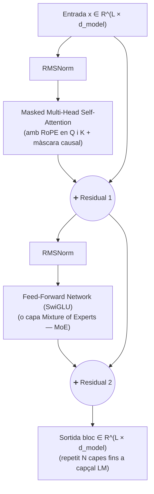

## A. Objectius d'aprenentatge

En completar aquesta lliçó, l'estudiant ha de ser capaç de:

1. **Explicar** per què l'arquitectura **Transformer** (*Vaswani et al., 2017 — "Attention Is All You Need"*) va substituir les RNN/LSTM en NLP i IA generativa (paral·lelització total en entrenament i captura directa de dependències a llarga distància).
2. **Distingir** les tres grans famílies d'arquitectures Transformer (**Encoder-only**, **Decoder-only** i **Encoder-Decoder**) i associar cada família amb les tasques òptimes de l'Administració pública.
3. **Detallar** cada bloc intern d'una capa Transformer moderna: **Embeddings + Codificació Posicional (Sinusoïdal / RoPE)**, **Pre-LayerNorm / RMSNorm**, **Multi-Head Self-Attention**, **Connexions Residuals** i **Feed-Forward Network (MLP / SwiGLU)**.
4. **Explicar** el funcionament de **Mixture of Experts (MoE)** (paràmetres totals vs. paràmetres actius per token) i el seu impacte en velocitat i memòria.
5. **Implementar** en Python + NumPy un bloc **Pre-Norm Transformer** (amb RMSNorm, codificació posicional rotacional simplificada / sinusoïdal, connexions residuals i MLP) verificant el flux exacte de dimensions.

---

## B. Explicació introductòria

Abans del 2017, els models de llenguatge (RNN i LSTM) llegien el text **paraula per paraula en ordre seqüencial**, guardant la memòria en un únic estat ocult comprimit. Això tenia dos problemes greus: era **impossible paral·lelitzar** la lectura d'una frase llarga en GPU, i la informació del principi d'un decret es difuminava abans d'arribar al final (*vanishing gradients*).

El **Transformer** va trencar aquesta barrera eliminant completament la recurrència: processa **tots els tokens de la seqüència alhora en paral·lel**, connectant directament qualsevol paraula amb qualsevol altra mitjançant el mecanisme d'**atenció** (Lliçó 3.3). Com que ja no hi ha un bucle seqüencial, però, el Transformer necessita injectar explícitament la noció d'ordre mitjançant **codificació posicional**.

---

## C. Explicació tècnica avançada

### 1. Les tres famílies arquitectòniques del Transformer

| Família | Màscara d'atenció | Objectiu de preentrenament | Models representatius | Tasques òptimes |
|---|---|---|---|---|
| **Encoder-only** | **Bidireccional** (cada token veu tota la frase, esquerra i dreta) | MLM (*Masked Language Modeling*: predir `[MASK]`) | BERT, **RoBERTa-ca**, XLM-R, DeBERTa, BGE-M3 | Classificació de textos, **NER**, **Embeddings** i **Cross-Encoder Rerankers** |
| **Decoder-only** | **Causal / Unidireccional** (cada token només veu els anteriors) | CLM (*Causal LM*: predir el següent token) | GPT, Claude, Llama, Mistral, Qwen, **Salamandra** | **LLMs generatius**, xat, RAG, extracció estructurada, codi, agents |
| **Encoder-Decoder** | Encoder bidireccional + Decoder causal amb *cross-attention* cap a l'encoder | *Span corruption* / Traducció seq2seq | Transformer original (2017), T5, mT5, BART, MarianMT, Whisper | **Traducció automàtica (NMT)**, transcripció d'àudio, resum seq2seq especialitzat |

### 2. Anatomia d'un bloc Transformer modern (estil Llama / Mistral / Salamandra)

A diferència del Transformer original de 2017 (*Post-LN* + posicional sinusoïdal + ReLU), els LLMs moderns utilitzen quatre refinaments estàndard per a màxima estabilitat i rendiment:

1. **Codificació posicional rotacional — RoPE (*Rotary Position Embedding*)**:
   - Sense codificació posicional, el Transformer seria **invariant a permutacions** (una bossa de paraules!).
   - En lloc de sumar vectors sinusoïdals fixos a l'entrada, **RoPE** aplica una rotació dependent de la posició \(m\) directament sobre els vectors Query (\(Q\)) i Key (\(K\)) en cada capa d'atenció, de manera que el producte escalar \(Q_m \cdot K_n\) depèn únicament de la **distància relativa \((m - n)\)** i facilita l'extensió de la finestra de context (p. ex., fins a 128k tokens amb YaRN).
2. **Pre-Norm + RMSNorm (*Root Mean Square Normalization*)**:
   - Aplicar normalització **abans** de cada subcapa (**Pre-Norm**: \(x + \text{Subcapa}(\text{Norm}(x))\)) manté una autopista neta de gradients a través de les **connexions residuals** permetent entrenar 80+ capes sense inestabilitat.
   - **RMSNorm** simplifica `LayerNorm` ometent el càlcul de la mitjana (només reescala per la mitjana quadràtica \(\sqrt{\frac{1}{d}\sum x_i^2 + \varepsilon}\)), sent més ràpid amb igual qualitat.
3. **Subcapa Feed-Forward amb activació *SwiGLU***:
   - Cada token passa independentment per una MLP amb porta multiplicativa (*Gated Linear Unit*): \(\text{SwiGLU}(x) = (\text{SiLU}(xW_1) \odot xW_3) W_2\), on es concentra gran part del coneixement factual/associatiu emmagatzemat pel model.
4. **Mixture of Experts (MoE)** (p. ex., Mixtral 8×7B, DeepSeek-V3, Qwen-MoE):
   - Substitueix la FFN densa per \(E\) xarxes expertes i un ***router* lleuger** que activa només els **top-\(k\) experts** (p. ex., 2 de 8) per a cada token!
   - **Propietat clau**: **molts paràmetres totals** (alta capacitat de coneixement, requereixen **tota la VRAM** per carregar-los) però **pocs paràmetres actius per token** (latència i FLOPs d'inferència molt baixos!).

---

## D. Diagrames i recursos visuals

### Anatomia d'un bloc Decoder-only modern (Pre-RMSNorm + RoPE + Residual + SwiGLU)



---

## E. Aplicació a l'Administració pública

1. **Triar la família correcta evita sobrecostos**:
   - Per **classificar expedients**, fer **NER** o generar **embeddings** → **Encoder-only** (`RoBERTa-ca`, `XLM-R`, `BGE-M3`): més petit, bidireccional i 10–50× més barat que un LLM!
   - Per **traducció automàtica d'alt volum** → **Encoder-Decoder** (MarianMT/NLLB/AINA).
   - Per **RAG generatiu, resum flexible, xat i extracció JSON complexa** → **Decoder-only** (`Salamandra`, `Mistral`, `Qwen`, `Llama`).
2. **Models MoE en servidors públics**: compte a l'hora de comprar GPUs! Un model MoE com `8×7B` (`47B` paràmetres totals, `13B` actius) respon molt ràpid (velocitat d'un 13B), però **exigeix VRAM per als 47B paràmetres complets**!

---

## F. Exemple pràctic guiat

Implementem en **Python + NumPy** els blocs fonamentals d'una arquitectura Transformer moderna: **Codificació Posicional Sinusoïdal**, **RMSNorm**, **FFN SwiGLU** i les **connexions residuals**, comprovant que totes les dimensions `(L, d_model)` es conserven exactament a través del bloc i verificant l'efecte d'estabilització de RMSNorm.

```python
"""Exemple 3.2: Components d'un bloc Transformer modern (Positional Encoding, RMSNorm, SwiGLU) en NumPy."""
import numpy as np


def codificacio_posicional_sinusoidal(seq_len: int, d_model: int) -> np.ndarray:
    pos = np.arange(seq_len)[:, None]
    i = np.arange(0, d_model, 2)[None, :]
    angles = pos / np.power(10000.0, i / d_model)
    pe = np.zeros((seq_len, d_model), dtype=float)
    pe[:, 0::2] = np.sin(angles)
    pe[:, 1::2] = np.cos(angles)
    return pe


def rms_norm(x: np.ndarray, gamma: np.ndarray, eps: float = 1e-6) -> np.ndarray:
    rms = np.sqrt(np.mean(x ** 2, axis=-1, keepdims=True) + eps)
    return (x / rms) * gamma


def silu(x: np.ndarray) -> np.ndarray:
    return x / (1.0 + np.exp(-np.clip(x, -30.0, 30.0)))


def swiglu_ffn(x: np.ndarray, W1: np.ndarray, W3: np.ndarray, W2: np.ndarray) -> np.ndarray:
    return (silu(x @ W1) * (x @ W3)) @ W2


if __name__ == "__main__":
    rng = np.random.default_rng(42)
    L, d_model, d_ff = 6, 16, 48

    # Embeddings d'entrada simulats (6 tokens, dimensió 16)
    x_emb = rng.normal(0.0, 2.0, size=(L, d_model))
    pe = codificacio_posicional_sinusoidal(L, d_model)
    h = x_emb + pe

    gamma = np.ones(d_model)
    h_norm = rms_norm(h, gamma)

    W1 = rng.normal(0.0, 0.2, size=(d_model, d_ff))
    W3 = rng.normal(0.0, 0.2, size=(d_model, d_ff))
    W2 = rng.normal(0.0, 0.2, size=(d_ff, d_model))

    # Subcapa Pre-Norm + SwiGLU + Connexió residual
    out = h + swiglu_ffn(h_norm, W1, W3, W2)

    print(f"Forma entrada h        : {h.shape}")
    print(f"Forma sortida bloc     : {out.shape}")
    print(f"RMS mitjà abans RMSNorm: {np.mean(np.sqrt(np.mean(h**2, axis=-1))):.4f}")
    print(f"RMS mitjà després Norm : {np.mean(np.sqrt(np.mean(h_norm**2, axis=-1))):.4f}")
    print(f"Similitud cos PE[0],PE[1] vs PE[0],PE[5]: "
          f"{float(pe[0] @ pe[1] / (np.linalg.norm(pe[0])*np.linalg.norm(pe[1]))):.3f} vs "
          f"{float(pe[0] @ pe[5] / (np.linalg.norm(pe[0])*np.linalg.norm(pe[5]))):.3f}")
```

### Interpretació dels resultats (execució verificada)

- Les dimensions `(6, 16)` es mantenen estrictament invariants d'entrada a sortida, fet que permet apilar \(N\) blocs Transformer idèntics i sumar la connexió residual `h + sublayer(rms_norm(h))`.
- **RMSNorm** reescala automàticament l'arrel quadràtica mitjana de cada token des de `1.6478` fins a exactament `1.0000`, estabilitzant l'entrenament profund.
- En la codificació posicional, tokens propers (`pos 0` i `pos 1`) tenen una similitud cosinus molt més alta (`0.936`) que tokens allunyats (`pos 0` i `pos 5`, `0.767`), proporcionant un senyal geomètric suau d'ordre al model.

---

## G. Exercici pràctic per resoldre

### Enunciat
Un arquitecte d'IA ha d'escollir la família Transformer més adient per a **4 projectes independents** d'una diputació i resoldre una qüestió d'infraestructura sobre un model MoE:
1. **Projecte A**: Reconeixement d'entitats (`PER`, `ORG`, `LOC`, `NORMATIVA`) per anonimitzar 50.000 actes de ple l'any.
2. **Projecte B**: Assistent RAG normatiu que redacta respostes amb cites per als tècnics municipals.
3. **Projecte C**: Motor de traducció automàtica massiva català ↔ castellà i català ↔ anglès per al portal web.
4. **Projecte D**: Reranker de precisió per als top-30 candidats d'un cercador híbrid.
5. **Qüestió d'infraestructura**: Per al Projecte B, algú suggereix desplegar un model **MoE `8×7B` (`47B` paràmetres totals, `13B` actius per token)** en FP16 dins una única GPU de `32 GB` de VRAM argumentant *"com que només activa 13B paràmetres, en FP16 només ocuparà ~26 GB"*. És cert o fals? Justifica-ho numèricament!

### Objectius i restriccions
- Assignar exactament cada tasca a la família Transformer òptima i refutar un error molt habitual sobre MoE i VRAM.

:::hint Pista 1 — Emparellament de famílies
NER i Reranker necessiten context bidireccional complet → **Encoder-only**. RAG generatiu → **Decoder-only**. Traducció massiva → **Encoder-Decoder** (o Decoder-only si cal context de document complet + glossari).
:::

:::hint Pista 2 — Quants paràmetres d'un MoE han d'estar carregats en VRAM?
**TOTS els 47B!** Perquè el *router* pot enviar cada token d'una mateixa frase a experts diferents en microsegons!
:::

### Criteris d'avaluació
- **50%**: Assignació correcta i justificada dels 4 projectes (A: Encoder-only; B: Decoder-only; C: Encoder-Decoder NMT; D: Encoder-only Cross-Encoder).
- **50%**: Refutació numèrica exacta de l'error MoE (`47B × 2 bytes ≈ 87,5 GB > 32 GB`) i solucions pràctiques (quantització INT4 ≈ 26 GB o model dens 7B–14B o multi-GPU).

### Errors habituals
- Pensar que els experts inactius d'un MoE no ocupen memòria VRAM.

:::solution Solució completa comentada i alternatives
### Assignació de famílies Transformer
1. **Projecte A (NER d'anonimització)** → **Encoder-only** (`RoBERTa-ca` / `XLM-R`): atenció bidireccional (veu el context abans i després de cada mot), ràpid i molt econòmic en alt volum *on-premise*.
2. **Projecte B (Assistent RAG generatiu)** → **Decoder-only** (`Salamandra`, `Mistral`, `Qwen`, `Llama`): generació autoregressiva flexible amb seguiment d'instruccions i cites.
3. **Projecte C (Traducció massiva)** → **Encoder-Decoder** (models NMT especialitzats com AINA/Softcatalà/MarianMT/NLLB-200): ràpids, compactes, estables i entrenats específicament per a parells seq2seq.
4. **Projecte D (Reranker top-30)** → **Encoder-only Cross-Encoder** (`bge-reranker-v2-m3`): atenció bidireccional completa entre consulta i candidat.

### Refutació sobre el model MoE `47B` en GPU de `32 GB`
- **L'afirmació és FALSA!** En un model **Mixture of Experts**, el *router* selecciona 2 experts diferents per a **cada token individual**; per tant, **tots els 8 experts (els `47B` paràmetres complets) han d'estar residents en VRAM** simultàniament.
- **Càlcul en FP16**: \(47 \times 10^9 \times 2 \text{ bytes} / 1024^3 \approx \mathbf{87,5\text{ GB}}\) només en pesos (+ KV Cache), completament impossible en una GPU de `32 GB`!
- **El que sí que redueix el MoE** són els **FLOPs i la latència de generació** (equivalents a un model dens `13B`).
- **Solucions reals per a 1 GPU de 32 GB**: quantitzar el MoE a INT4 (~26 GB, just per a baix *batch*) o, preferiblement per a concurrència estable, desplegar un **model dens 8B–14B quantitzat INT4/FP8** (deixant ample marge de VRAM per a la KV Cache!).
:::

---

## H. Test individual

Resol les 10 preguntes sobre Encoder-only vs. Decoder-only vs. Encoder-Decoder, codificació posicional (sinusoïdal/RoPE), Pre-Norm/RMSNorm, connexions residuals, SwiGLU i Mixture of Experts (MoE).

---

## I. Preguntes de desenvolupament

### Pregunta 1
Compara les tres famílies de l'arquitectura Transformer (**Encoder-only**, **Decoder-only** i **Encoder-Decoder**) pel que fa al tipus d'atenció, objectiu d'entrenament i tasques administratives òptimes.

:::model-answer Resposta model i criteris de correcció (Pregunta 1)
**Resposta model**:
- **Encoder-only** (BERT, RoBERTa-ca, XLM-R, BGE-M3): atenció **bidireccional** completa, preentrenat amb *Masked Language Modeling* (MLM). Òptim per a tasques discriminatives i de representació: classificació d'instàncies, NER d'anonimització, embeddings i *Cross-Encoder rerankers*.
- **Decoder-only** (Llama, Mistral, Qwen, Salamandra, GPT): atenció **causal** (cada token només veu el passat), preentrenat amb predicció del següent token (CLM). Òptim per a generació de text, RAG, resum estructurat, xat i agents.
- **Encoder-Decoder** (T5, BART, MarianMT, NLLB): codificador bidireccional del text origen + decodificador causal connectat mitjançant *cross-attention*. Òptim per a transformacions seqüència-a-seqüència especialitzades com traducció automàtica massiva (NMT) o transcripció (Whisper).

**Criteris de correcció (10 punts)**:
- Caracterització tècnica precisa de les 3 famílies (atenció + preentrenament): 6 punts.
- Exemples de tasques administratives adequades per a cadascuna: 4 punts.
:::

### Pregunta 2
Per què els Transformers requereixen **codificació posicional** i quin avantatge aporta **RoPE (*Rotary Position Embedding*)** respecte dels embeddings posicionals absoluts tradicionals?

:::model-answer Resposta model i criteris de correcció (Pregunta 2)
**Resposta model**:
- A diferència de les RNN, el mecanisme de *self-attention* opera sobre conjunts de tokens en paral·lel i és inherentment **invariant a permutacions**: sense informació posicional, *"l'ajuntament sanciona l'empresa"* i *"l'empresa sanciona l'ajuntament"* produirien exactament la mateixa sortida.
- **RoPE** codifica la posició aplicant una matriu de rotació en plans 2D als vectors \(Q\) i \(K\) dins cada capa d'atenció. El seu avantatge clau és que el producte escalar \(Q_m \cdot K_n\) passa a dependre únicament de la **distància relativa \((m - n)\)**, decau naturalment amb la distància i permet estendre finestres de context llargues (32k–128k tokens) mitjançant escalat de freqüències (p. ex. YaRN) molt millor que els embeddings posicionals absoluts apresos.

**Criteris de correcció (10 punts)**:
- Justificació de la invariància a permutacions del Transformer: 4 punts.
- Mecanisme i avantatges de RoPE (posició relativa i extensió de context): 6 punts.
:::

### Pregunta 3
Explica què és una arquitectura **Mixture of Experts (MoE)** en un Transformer modern, diferenciant **paràmetres totals** i **paràmetres actius**, i indica'n el principal avantatge i el principal repte de desplegament *on-premise*.

:::model-answer Resposta model i criteris de correcció (Pregunta 3)
**Resposta model**:
- En un Transformer MoE, la subcapa FFN densa se substitueix per múltiples subxarxes expertes (\(E\)) i un ***router*** lleuger que, per a cada token, només activa els top-\(k\) experts (p. ex., 2 de 8).
- **Paràmetres totals** = suma de tots els experts + capes d'atenció (determinen la capacitat d'emmagatzematge de coneixement i la **VRAM total necessària**). **Paràmetres actius** = només els usats per processar 1 token (determinen els **FLOPs i la velocitat de generació**).
- **Avantatge**: qualitat pròxima a un model molt gran amb latència i cost de còmput d'un model petit. **Repte *on-premise***: exigeix carregar **tots els paràmetres totals en VRAM**, complicant el desplegament en GPUs modestes si no s'aplica quantització o multi-GPU.

**Criteris de correcció (10 punts)**:
- Mecanisme del router i experts: 4 punts.
- Distinció exacta paràmetres totals (VRAM) vs. actius (FLOPs/latència) + implicació *on-premise*: 6 punts.
:::

---

## J. Resum per memoritzar

### Conceptes clau
- **Transformer (2017)**: elimina la recurrència → paral·lelització massiva + connexió directa entre qualsevol parell de tokens.
- **3 famílies**: **Encoder-only** (bidireccional → classificació, NER, embeddings, rerankers), **Decoder-only** (causal → LLMs generatius, RAG, agents), **Encoder-Decoder** (seq2seq → traducció NMT).
- **Bloc modern**: **Pre-RMSNorm** + **Connexions residuals** + **Attention amb RoPE** + **FFN SwiGLU** (o **MoE**).
- **MoE**: **molts paràmetres totals** (requereixen tota la VRAM!) però **pocs paràmetres actius** (generació molt ràpida).

### Definicions essencials
- **RoPE (*Rotary Position Embedding*)**: codificació posicional rotacional aplicada a \(Q\) i \(K\) que fa que l'atenció depengui de la distància relativa entre tokens.
- **Pre-Norm**: col·locació de LayerNorm/RMSNorm abans de la subcapa dins la branca residual per estabilitzar el flux de gradients en models molt profunds.

### Errors conceptuals freqüents
1. Creure que un model MoE només necessita VRAM per als paràmetres actius.
2. Usar un LLM Decoder-only gegant per a NER o embeddings quan un Encoder-only petit és més precís i 20× més barat.
3. Oblidar per què el Transformer necessita codificació posicional (invariància a permutacions).

### Possibles preguntes d'examen
- Assigna 4 tasques reals d'NLP a Encoder-only, Decoder-only o Encoder-Decoder justificant el tipus d'atenció.
- Explica la diferència entre paràmetres totals i actius en un MoE i el seu impacte en VRAM vs. latència.
- Quina funció tenen les connexions residuals i Pre-RMSNorm en un Transformer de 64 capes?
