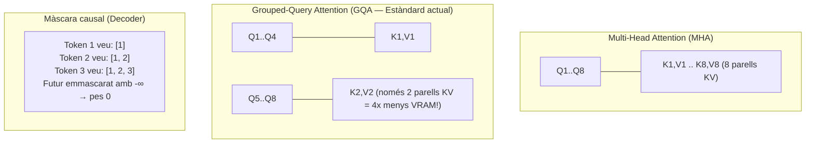

## A. Objectius d'aprenentatge

En acabar aquesta lliçó, l'estudiant ha de ser capaç de:

1. **Derivar i explicar** intuïtivament i matemàticament la **Scaled Dot-Product Attention**: \(\text{Attention}(Q, K, V) = \text{softmax}\left(\frac{QK^\top}{\sqrt{d_k}} + M\right)V\).
2. **Justificar** exactament per què cal el **factor d'escala \(\frac{1}{\sqrt{d_k}}\)** (estabilitat de la variància dels logits i prevenció de la saturació de Softmax).
3. **Explicar** el funcionament de **Multi-Head Attention (MHA)**, la **màscara causal** (triangular superior amb \(-\infty\)) en decoders i la **cross-attention** en encoder-decoders.
4. **Analitzar** la complexitat quadràtica \(O(L^2)\) de la *self-attention* i les optimitzacions modernes d'enginyeria: **GQA (*Grouped-Query Attention*)**, **MQA** i **FlashAttention** (càlcul *IO-aware* per blocs en SRAM sense materialitzar la matriu \(L \times L\) en HBM!).
5. **Implementar** des de zero en **Python + NumPy** la **Scaled Dot-Product Self-Attention amb màscara causal** i comprovar la diferència numèrica amb i sense l'escala \(\sqrt{d_k}\).

---

## B. Explicació introductòria

Torna a la frase administrativa de la lliçó 2.1:
> *"El consistori va denegar la subvenció a l'associació perquè **no havia presentat** el certificat."*

Quan llegim *"havia presentat"*, el nostre cervell dirigeix automàticament l'**atenció** cap a *"l'associació"* (i no cap a *"el consistori"* ni *"el certificat"*), connectant la paraula actual amb els termes més rellevants de la frase independentment de la distància que els separi.

El mecanisme de ***self-attention*** formalitza aquesta idea mitjançant una analogia de **cerca suau en un diccionari**:
- Cada token emet una **Query (\(Q\))** (*"Quina informació estic buscant?"*).
- Cada token ofereix una **Key (\(K\))** (*"Quina informació represento jo?"*).
- Cada token ofereix un **Value (\(V\))** (*"Quin contingut vectorial entregaré si m'atens?"*).

Com més alineada està la *Query* del token \(i\) amb la *Key* del token \(j\), més pes d'atenció rep el *Value* del token \(j\) en la nova representació contextual del token \(i\)!

---

## C. Explicació tècnica avançada

### 1. Scaled Dot-Product Attention

Donada una matriu d'entrada \(X \in \mathbb{R}^{L \times d_{\text{model}}}\), es projecten linealment \(Q = XW_Q\), \(K = XW_K\) i \(V = XW_V\) (amb dimensió per capçal \(d_k\)):

\[
\text{Attention}(Q, K, V) = \text{softmax}\left(\frac{QK^\top}{\sqrt{d_k}} + M\right) V
\]

- **Per què dividim per \(\sqrt{d_k}\)?**
  Si les components de \(q\) i \(k\) tenen mitjana `0` i variància `1`, el seu producte escalar \(q \cdot k = \sum_{r=1}^{d_k} q_r k_r\) té variància **`d_k`** (desviació estàndard \(\sqrt{d_k}\)). Per a \(d_k = 128\), els logits tindrien magnituds molt grans, empenyent **Softmax a regions saturades** (un 1 i la resta 0) amb **gradients quasi nuls**! Dividir per \(\sqrt{d_k}\) retorna la variància exactament a `1`.
- **La màscara \(M\)**:
  - **Padding mask**: posa \(-\infty\) a les columnes de tokens `[PAD]` perquè ningú hi atengui (\(\text{softmax}(-\infty) = 0\)).
  - **Màscara causal (*Look-ahead mask*, en Decoder-only)**: matriu triangular superior amb \(-\infty\) per sobre de la diagonal (\(j > i\)), garantint que el token en posició \(i\) **mai no pugui veure tokens futurs** durant l'entrenament paral·lel!

### 2. Multi-Head Attention (MHA), MQA i GQA

En lloc d'una sola atenció de dimensió \(d_{\text{model}}\), **Multi-Head Attention** divideix la dimensió en \(h\) capçals paral·lels (\(d_k = d_{\text{model}} / h\)), permetent que cada capçal s'especialitzi simultàniament en relacions diferents (un capçal segueix subjecte-verb, un altre correferències, un altre puntuació o negacions), concatena totes les sortides i aplica una projecció final \(W_O\).

Per reduir dràsticament la mida de la **KV Cache** (Lliçó 3.1), els LLMs moderns evolucionen així:

| Variant | Capçals Q | Capçals K i V | Mida KV Cache | Qualitat | Models exemples |
|---|---|---|---|---|---|
| **MHA** (*Multi-Head*) | \(h\) | \(h\) | 100% (màxima) | Referència | GPT-2/3, Llama 1 |
| **MQA** (*Multi-Query*) | \(h\) | **1** (compartit) | \(1/h\) (mínima) | Lleugera degradació | Falcon, PaLM |
| **GQA** (*Grouped-Query*) | \(h\) | \(g\) grups (p. ex. 8 per 32 Q) | \(g/h\) (p. ex. **4× menor!**) | **Pràcticament idèntica a MHA** | **Llama 3, Mistral, Qwen 2.5, Salamandra** |

### 3. Complexitat quadràtica \(O(L^2)\) i **FlashAttention**

La matriu d'atenció \(QK^\top\) té mida **\(L \times L\)**:
- Duplicar la longitud del document \(L\) multiplica per **4×** el còmput i la memòria de la matriu d'atenció! (Per a `L = 32.768`, una sola matriu d'atenció d'un capçal en FP16 ocuparia `2 GB`!).
- **FlashAttention (Dao et al., 2022–2024)** resol el coll d'ampolla de memòria **sense aproximar el resultat (és matemàticament exacte!)**: divideix \(Q, K, V\) en blocs petits (*tiling*) que caben dins la memòria ultraràpida **SRAM on-chip** de la GPU, calcula Softmax de forma incremental (*online softmax*) i **mai no escriu la matriu gegant \(L \times L\) a la memòria HBM** → redueix la memòria d'\(O(L^2)\) a **\(O(L)\)** i accelera 2–4× l'entrenament i el *Prefill*!

---

## D. Diagrames i recursos visuals

### Comparativa visual: MHA vs. GQA vs. MQA i màscara causal



---

## E. Aplicació a l'Administració pública

1. **Cost real de contextos llargs en expedients**: tot i que FlashAttention redueix la memòria de \(O(L^2)\) a \(O(L)\), el **còmput del *Prefill* continua sent \(O(L^2)\)**! Passar un plec sencer de 60.000 tokens en cada pregunta en lloc d'usar **RAG** (recuperant els 5 fragments clau de 2.500 tokens) multiplica latència, consum elèctric i cost per ordres de magnitud.
2. **Interpretabilitat dels pesos d'atenció (precaució científica)**: tot i que visualitzar els mapes d'atenció pot donar pistes intuïtives, la recerca (*Jain & Wallace, 2019*) ha demostrat que **els pesos d'atenció per si sols NO constitueixen una explicació causal fiable** de la decisió del model; en transparència administrativa cal recolzar-se en **cites verificables (RAG)** i tècniques d'atribució/auditoria rigoroses (Mòdul 8).

---

## F. Exemple pràctic guiat

Implementem des de zero en **Python + NumPy** la **Scaled Dot-Product Self-Attention amb màscara causal**, verificant:
1. Que els pesos d'atenció sumen exactament `1.0` per fila i són estrictament **`0.0` per a tots els tokens futurs** (\(j > i\)).
2. Com, en dimensió alta (`d_k = 128`), **ometre `/ sqrt(d_k)` satura Softmax** (entropia quasi zero), mentre que escalar per `sqrt(d_k)` manté una distribució saludable per a l'aprenentatge.

```python
"""Exemple 3.3: Scaled Dot-Product Self-Attention amb màscara causal i efecte de sqrt(d_k) en NumPy."""
import numpy as np


def softmax(x: np.ndarray) -> np.ndarray:
    x_shift = x - np.max(x, axis=-1, keepdims=True)
    exps = np.exp(x_shift)
    return exps / np.sum(exps, axis=-1, keepdims=True)


def causal_self_attention(
    Q: np.ndarray,
    K: np.ndarray,
    V: np.ndarray,
    escalar: bool = True,
) -> tuple[np.ndarray, np.ndarray]:
    L, d_k = Q.shape
    scores = Q @ K.T
    if escalar:
        scores = scores / np.sqrt(d_k)

    # Màscara causal: -inf per sobre de la diagonal (j > i)
    mask = np.triu(np.full((L, L), -1e9), k=1)
    weights = softmax(scores + mask)
    output = weights @ V
    return output, weights


if __name__ == "__main__":
    rng = np.random.default_rng(7)
    L, d_k = 4, 128
    Q = rng.normal(0.0, 1.0, size=(L, d_k))
    K = rng.normal(0.0, 1.0, size=(L, d_k))
    V = rng.normal(0.0, 1.0, size=(L, d_k))

    out_ok, w_ok = causal_self_attention(Q, K, V, escalar=True)
    _, w_no_scale = causal_self_attention(Q, K, V, escalar=False)

    print("Pesos d'atenció causal AMB escala 1/sqrt(d_k):")
    print(np.round(w_ok, 4))
    print("\nPesos d'atenció causal SENSE escala (saturació de Softmax!):")
    print(np.round(w_no_scale, 4))
    print(f"\nSortida forma={out_ok.shape} | Suma files={np.round(w_ok.sum(axis=-1), 4)}")
    print(f"Màxim pes en posicions futures (j > i): {float(np.max(np.triu(w_ok, k=1))):.6f}")
```

### Interpretació dels resultats (execució verificada)

- Tots els elements per sobre de la diagonal (`j > i`) són estrictament `0.0000` (el token `i` mai no mira el futur!) i cada fila suma `1.0000`.
- Amb **`d_k = 128`** i **sense `/ sqrt(d_k)`**, la variància dels productes escalars explota (~128) i Softmax col·lapsa cap a distribucions quasi one-hot (`~0.999` o `1.000` en una sola posició), destruint els gradients. En dividir per \(\sqrt{128} \approx 11.31\), els pesos queden suaus i ben distribuïts per aprendre eficientment.

---

## G. Exercici pràctic per resoldre

### Enunciat
Un equip tècnic investiga per què un prototip d'assistent normatiu basat en un LLM *open-weights* tarda **`11 segons`** a començar a escriure el primer token (`TTFT = 11 s`) quan s'hi enganxa un plec sencer de `32.000 tokens`, i només **`0,4 segons`** quan es fa servir un pipeline RAG que passa únicament els `2.000 tokens` dels fragments recuperats.

Respon tècnicament:
1. Quina és la relació teòrica entre el còmput d'atenció de `32.000 tokens` i el de `2.000 tokens`?
2. Si activen **FlashAttention-2**, quin recurs redueix d'\(O(L^2)\) a \(O(L)\) (la **memòria** de la matriu d'atenció o el **nombre total d'operacions FLOPs**)?
3. Com ajuden **GQA** i el ***Prefix Caching*** (reutilitzar la KV Cache d'un document fix consultat repetidament) en un entorn on 20 tècnics fan preguntes diferents sobre el **mateix plec**?

### Objectius i restriccions
- Connectar teoria de complexitat \(O(L^2)\), FlashAttention, GQA i *Prefix Caching* amb un cas real de rendiment en producció.

:::hint Pista 1 — Relació quadràtica `(32.000 / 2.000)²`
`32.000 / 2.000 = 16` → `16² = 256×` més operacions de producte d'atenció \(QK^\top\)!
:::

:::hint Pista 2 — Què fa FlashAttention?
FlashAttention redueix la **memòria** en HBM d'\(O(L^2)\) a \(O(L)\) (i accelera molt eliminant lectures/escriptures HBM), però el nombre d'operacions aritmètiques FLOPs continua sent \(O(L^2)\) perquè calcula exactament la mateixa atenció completa!
:::

### Criteris d'avaluació
- **30%**: Càlcul exacte de la ràtio quadràtica (\(16^2 = 256\times\)) en l'atenció del *Prefill*.
- **35%**: Distinció exacta de FlashAttention (memòria \(O(L)\) + *IO-aware* sense aproximació, però FLOPs \(O(L^2)\)).
- **35%**: Explicació precisa de GQA (redueix VRAM de KV Cache) i ***Prefix Caching*** (vLLM calcula el *Prefill* del plec un sol cop i totes les preguntes següents sobre el mateix plec reutilitzen la KV Cache amb TTFT < 0,5 s!).

### Errors habituals
- Afirmar que FlashAttention és una aproximació dispersa o que redueix els FLOPs a \(O(L)\).

:::solution Solució completa comentada i alternatives
### 1. Ràtio quadràtica de l'atenció
En passar de `2.000` a `32.000 tokens` (\(16\times\) més llarg), el còmput de la matriu \(QK^\top\) creix com \(16^2 = \mathbf{256\times}\) (i les projeccions lineals/FFN creixen \(16\times\)), explicant el salt dràstic del TTFT durant el *Prefill*.

### 2. Què optimitza FlashAttention-2
- FlashAttention-2 és **matemàticament exacte** (no aproxima ni descarta tokens!).
- Redueix la **memòria HBM** de \(O(L^2)\) a **\(O(L)\)** processant blocs dins la memòria ràpida SRAM de la GPU, cosa que redueix els accessos a memòria i accelera 2–4× el *Prefill*. Però els **FLOPs continuen sent \(O(L^2)\)**, per tant un context de 32k sempre costarà molt més còmput que un de 2k.

### 3. Com optimitzar quan 20 tècnics consulten el mateix plec
- **GQA**: redueix 4×–8× la VRAM que ocupa la KV Cache del plec compartit.
- ***Automatic Prefix Caching* (vLLM / SGLang)**: com que els primers 32.000 tokens (system prompt + plec) són idèntics per a les 20 preguntes, el motor calcula el *Prefill* i la KV Cache del plec **una única vegada**; les 19 consultes posteriors només fan *Prefill* dels ~50 tokens nous de la pregunta, reduint el TTFT d'`11 s` a `< 0,3 s`!
- **Complement amb RAG**: per a consultes sobre milers de documents diferents (on no hi ha prefix compartit), RAG continua sent l'opció més ràpida, barata i sostenible.
:::

---

## H. Test individual

Resol les 10 preguntes sobre *Scaled Dot-Product Attention*, \(1/\sqrt{d_k}\), màscara causal, Multi-Head vs. GQA vs. MQA, complexitat \(O(L^2)\) i FlashAttention.

---

## I. Preguntes de desenvolupament

### Pregunta 1
Escriu la fórmula de la **Scaled Dot-Product Attention** i demostra per què és imprescindible el factor d'escala \(\frac{1}{\sqrt{d_k}}\) quan \(d_k\) és gran (p. ex. `64` o `128`).

:::model-answer Resposta model i criteris de correcció (Pregunta 1)
**Resposta model**:
- Fórmula: \(\text{Attention}(Q, K, V) = \text{softmax}\left(\frac{QK^\top}{\sqrt{d_k}} + M\right)V\).
- **Demostració estadística**: si les components \(q_r, k_r\) són independents amb mitjana `0` i variància `1`, cada producte \(q_r k_r\) té mitjana `0` i variància `1`. La suma \(q \cdot k = \sum_{r=1}^{d_k} q_r k_r\) té mitjana `0` i variància **`d_k`** (desviació estàndard \(\sqrt{d_k}\)).
- Per a \(d_k = 128\), els logits tindrien una dispersió ~11,3× més gran, empenyent Softmax a regions saturades (un pes ≈ 1 i la resta ≈ 0) on la derivada de Softmax tendeix a zero (*vanishing gradients*), bloquejant l'aprenentatge. Dividir per \(\sqrt{d_k}\) restaura la variància a `1`.

**Criteris de correcció (10 punts)**:
- Fórmula exacta amb dimensions i màscara: 3 punts.
- Demostració de la variància \(d_k\) i explicació de la saturació de Softmax/gradients: 7 punts.
:::

### Pregunta 2
Explica què és **Grouped-Query Attention (GQA)** en comparació amb **MHA** i **MQA**, i per què s'ha convertit en l'estàndard dels LLMs *open-weights* moderns.

:::model-answer Resposta model i criteris de correcció (Pregunta 2)
**Resposta model**:
- En **MHA** clàssica, cada capçal de Query té el seu propi capçal de Key i Value (\(h_q = h_{kv}\)), generant una KV Cache molt gran en inferència.
- En **MQA** (*Multi-Query Attention*), tots els capçals de Query comparteixen un únic parell \(K, V\) (\(h_{kv} = 1\)), reduint al màxim la KV Cache però amb certa pèrdua de qualitat i estabilitat.
- **GQA** (*Grouped-Query Attention*) és el punt òptim intermedi: agrupa els \(h_q\) capçals de Query en \(g\) grups (p. ex., 32 Q compartint 8 parells KV), **reduint 4×–8× la mida i l'amplada de banda de la KV Cache** (accelerant el *Decode* i augmentant el *batch* concurrent) tot conservant una qualitat pràcticament indistingible de MHA.

**Criteris de correcció (10 punts)**:
- Comparativa precisa MHA vs. MQA vs. GQA: 6 punts.
- Impacte directe en VRAM de KV Cache, *Decode* i concurrència: 4 punts.
:::

### Pregunta 3
Explica què resol **FlashAttention** enfront de la implementació estàndard d'atenció, aclarint si és exacte o aproximat i quina és la seva complexitat en **memòria** i en **FLOPs**.

:::model-answer Resposta model i criteris de correcció (Pregunta 3)
**Resposta model**:
- En la implementació estàndard, la GPU calcula i escriu la matriu gegant \(QK^\top\) (\(L \times L\)) a la memòria principal HBM (lenta), la torna a llegir per aplicar Softmax, l'escriu de nou i la torna a llegir per multiplicar per \(V\), quedant limitada per memòria HBM i amplada de banda.
- **FlashAttention** és un algorisme ***IO-aware* matemàticament exacte** (no fa cap aproximació!) que particiona \(Q, K, V\) en blocs (*tiling*) dins la memòria ràpida SRAM on-chip de la GPU i aplica *online softmax* en una sola passada fusionada sense materialitzar mai la matriu \(L \times L\) en HBM.
- **Complexitat**: redueix la **memòria** de \(O(L^2)\) a **\(O(L)\)** i accelera 2–4× el temps real, tot i que el nombre d'operacions aritmètiques (**FLOPs**) continua sent **\(O(L^2)\)**.

**Criteris de correcció (10 punts)**:
- Explicació del coll d'ampolla HBM vs. SRAM i *tiling/online softmax*: 5 punts.
- Exactitud matemàtica + distinció clara memòria \(O(L)\) vs. FLOPs \(O(L^2)\): 5 punts.
:::

---

## J. Resum per memoritzar

### Conceptes clau
- **Fórmula**: \(\text{Attention}(Q,K,V) = \text{softmax}\left(\frac{QK^\top}{\sqrt{d_k}} + M\right)V\).
- **\(\frac{1}{\sqrt{d_k}}\)**: manté variància = 1 i evita saturació de Softmax / gradients nuls.
- **Màscara causal (\(M\))**: posa \(-\infty\) per sobre de la diagonal (\(j > i\)) perquè un Decoder no vegi el futur.
- **GQA**: comparteix \(K, V\) per grups de capçals \(Q\) → **4×–8× menys KV Cache** amb qualitat de MHA.
- **FlashAttention**: exacte, *IO-aware* (SRAM tiling) → **memòria \(O(L)\)**, però **FLOPs \(O(L^2)\)**.
- **Transparència**: els pesos d'atenció per si sols NO són explicacions causals fiables.

### Definicions essencials
- ***Cross-Attention***: mecanisme on les Queries (\(Q\)) provenen d'una seqüència (p. ex. el Decoder) i les Keys/Values (\(K, V\)) provenen d'una altra (p. ex. l'Encoder en traducció).
- ***Prefix Caching***: reutilització de la KV Cache d'un prefix comú (system prompt o document extens) entre múltiples consultes consecutives per eliminar el cost repetit del *Prefill*.

### Errors conceptuals freqüents
1. Confondre FlashAttention amb una atenció aproximada o pensar que fa els FLOPs \(O(L)\).
2. Oblidar que en la màscara causal s'ha de posar **`-∞` abans de Softmax** (posar `0` després sense renormalitzar o posar `0` abans de Softmax donaria `exp(0) = 1`, filtrant el futur!).
3. Assumir que un mapa de calor d'atenció demostra causalment per què el model ha decidit una classe.

### Possibles preguntes d'examen
- Per què es divideix \(QK^\top\) per \(\sqrt{d_k}\)?
- Per què la màscara causal posa \(-\infty\) abans de Softmax i no `0`?
- Compara MHA, GQA i MQA, i explica què redueix exactament FlashAttention.
