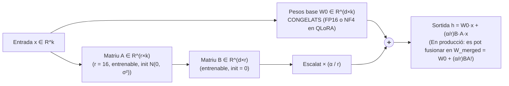

## A. Objectius d'aprenentatge

En completar aquesta lliçó, l'estudiant ha de ser capaç de:

1. **Distingir** entre ***Full Fine-Tuning*** (actualitzar el 100% dels pesos) i **PEFT (*Parameter-Efficient Fine-Tuning*)**, explicant matemàticament el funcionament de **LoRA** (\(\Delta W = B \cdot A\) de rang baix \(r\)) i **QLoRA** (pesos base congelats en 4-bit NF4 + adaptadors LoRA en BF16).
2. **Explicar** els fonaments de la **quantització de models** (FP16/BF16 → FP8 / INT8 / INT4: AWQ, GPTQ, GGUF, NF4) i el seu compromís entre VRAM, velocitat i qualitat.
3. **Aplicar** una **matriu de decisió rigorosa entre Prompting, RAG i Fine-Tuning** (regla d'or: **RAG per a coneixement canviant/factual amb cites; Fine-Tuning per a estil, format, comportament, domini lingüístic i reducció de cost/latència**).
4. **Identificar** i mitigar riscos crítics del *fine-tuning*: **oblit catastròfic (*catastrophic forgetting*)**, **sobreajustament a poques dades** i **memorització/filtració de dades personals (RGPD)** dins dels pesos del model!
5. **Implementar** en Python + NumPy una capa lineal amb **adaptador LoRA** (incloent inicialització \(A \sim \mathcal{N}\), \(B = 0\), escalat \(\alpha/r\) i fusió *zero-latency* \(W_{\text{merged}} = W_0 + \frac{\alpha}{r}BA\)) i calcular el percentatge real de paràmetres entrenables.

---

## B. Explicació introductòria

Quan una organització adopta un LLM *open-weights*, sovint sorgeix el dubte: *"Hem de fer fine-tuning amb totes les nostres ordenances i expedients?"*. En el 80% dels casos d'actualització de normativa, la resposta tècnica correcta és **NO — això es resol amb RAG!**

El ***Fine-Tuning*** consisteix a **modificar els paràmetres (pesos)** d'un model preentrenat continuant el seu entrenament sobre un conjunt de dades especialitzat. A diferència del *prompting* (que només actua dins la finestra de context temporal), el *fine-tuning* grava de forma permanent **hàbits, estil institucional, terminologia catalana específica, formats complexos o habilitats de classificació/extracció** dins un model més petit, ràpid i barat de servir.

---

## C. Explicació tècnica avançada

### 1. *Full Fine-Tuning* vs. **LoRA** vs. **QLoRA**

Entrenar tots els pesos d'un model de `8B` paràmetres amb AdamW en precisió mixta requereix ~16 bytes/paràmetre (pesos + gradients + 2 estats d'Adam + còpia mestre FP32) ≈ **128 GB de VRAM**!

#### LoRA (*Low-Rank Adaptation*, Hu et al., 2021)
Congela completament la matriu de pesos preentrenada \(W_0 \in \mathbb{R}^{d \times k}\) i aprèn únicament una actualització de **rang baix** factoritzada en dues matrius petites \(A \in \mathbb{R}^{r \times k}\) i \(B \in \mathbb{R}^{d \times r}\) (amb \(r \ll \min(d, k)\), p. ex. \(r = 8, 16, 32\)):

\[
W = W_0 + \Delta W = W_0 + \frac{\alpha}{r} \, B A
\]

- **Inicialització crítica**: \(A\) s'inicialitza amb soroll gaussià petit i **\(B = 0\)** → a l'inici de l'entrenament \(\Delta W = 0\), de manera que el model comença comportant-se **exactament igual** que el model base sense pertorbacions!
- **Paràmetres entrenables**: només entre **0,1% i 2%** del total, reduint dràsticament VRAM, temps i risc d'oblit catastròfic.
- **Fusió *zero-latency***: un cop entrenat, es pot sumar \(W_{\text{merged}} = W_0 + \frac{\alpha}{r}BA\) → **zero cost extra de latència en inferència!** O bé mantenir adaptadors separats (20–100 MB cadascun) per servir múltiples tasques (*multi-LoRA* en vLLM) compartint un únic model base en VRAM!

#### QLoRA (*Quantized LoRA*, Dettmers et al., 2023)
- Carrega els pesos base congelats \(W_0\) quantitzats en **4-bit NormalFloat (NF4)** amb doble quantització i *paged optimizers*, i entrena únicament els adaptadors LoRA en BF16.
- Permet fer *fine-tuning* d'un model **7B–8B en una sola GPU de 12–16 GB** (o d'un 70B en una sola GPU de 48 GB!) amb una qualitat pràcticament equivalent al *fine-tuning* de 16 bits.

### 2. Quantització de models (Inferència eficient *on-premise*)

La **quantització** redueix la precisió numèrica dels pesos (i opcionalment activacions/KV Cache) de 16 bits (`FP16`/`BF16`) a 8 bits (`FP8`/`INT8`) o 4 bits (`INT4`):
- **PTQ (*Post-Training Quantization*)**: **AWQ** (*Activation-aware Weight Quantization*, protegeix l'1% de pesos més sensibles segons activacions de calibratge), **GPTQ** i **GGUF** (`Q4_K_M`, `Q5_K_M`, `Q8_0` per a `llama.cpp`/Ollama).
- **Compromís empíric**: quantitzar un model `8B–70B` a **FP8 o INT4 (AWQ / Q4_K_M)** redueix la VRAM fins a **3,5–4×** i accelera el *Decode* (que és *memory-bandwidth bound*!), amb una pèrdua mínima de qualitat (<1–2%) sempre que es validi sobre el conjunt *golden* en **català**!

### 3. Matriu de decisió definitiva: **Prompting vs. RAG vs. Fine-Tuning**

| Necessitat del projecte | Prompting | RAG | Fine-Tuning (LoRA/SFT) |
|---|---|---|---|
| **Coneixement normatiu canviant** (ordenances 2026, BOPB, convocatòries) | ❌ No | **✅ OBLIGATORI** | ❌ Mal enfocament (es desactualitza i no dóna cites auditables) |
| **Cites verificables i control d'accés ACL per document** | ❌ No | **✅ OBLIGATORI** | ❌ Impossible fer ACL dins els pesos! |
| **Reduir cost/latència destil·lant un prompt gegant cap a un model 3B–8B** | ❌ Prompt llarg car | Parcial | **✅ IDEAL** |
| **Adaptar estil administratiu català, to institucional o format JSON molt complex** | Parcial (few-shot) | No | **✅ IDEAL** |
| **Classificació / NER especialitzat d'alt volum (encoders)** | Lent/car en LLM | No | **✅ IDEAL** (*fine-tuning* de `RoBERTa-ca`/`XLM-R`) |
| **Combinació avançada**: RAG + Fine-Tuning | — | **✅ Fonts vigents** | **✅ Aprèn a citar millor i a dir «No consta»** |

### 4. Riscos crítics en *Fine-Tuning*: Oblit catastròfic i RGPD

1. **Oblit catastròfic (*Catastrophic Forgetting*)**: si entrenem massa èpoques o amb una taxa d'aprenentatge massa alta només sobre un format estret, el model perd capacitats generals (raonament, català general o alineació de seguretat!). *Mitigació*: LoRA, taxa d'aprenentatge baixa (`1e-4` a `2e-5`), poques èpoques (1–3), barrejar 10–20% de dades generals d'instruccions (*replay*) i avaluar tant la tasca objectiu com benchmarks generals.
2. **Privacitat i RGPD (Dret de supressió — art. 17 RGPD)**: un LLM *fine-tuned* pot **memoritzar i regurgitar** dades personals presents al dataset d'entrenament! I **no es pot esborrar una persona dels pesos neuronals** fàcilment (*machine unlearning* és encara immadur). **Regla d'or absoluta**: **MAI fer *fine-tuning* sobre expedients amb dades personals reals sense anonimització irreversible prèvia o dades sintètiques!**

---

## D. Diagrames i recursos visuals

### Mecanisme intern de LoRA (\(\Delta W = \frac{\alpha}{r}BA\)) i opció de fusió *zero-latency*



---

## E. Aplicació a l'Administració pública

1. **Multi-LoRA en un sol servidor GPU de la Diputació**: amb una única instància de `Salamandra-7B` o `Qwen-14B` en vLLM, es poden carregar dinàmicament adaptadors LoRA minúsculs (~40 MB cadascun): `lora_estil_administratiu_ca`, `lora_extraccio_subvencions`, `lora_lectura_facil`, compartint la mateixa GPU!
2. **Prohibició de PII en datasets de *fine-tuning***: mentre en un sistema RAG pots esborrar un document de la base vectorial en 1 segon (complint el dret de supressió del RGPD), en els pesos d'un model *fine-tuned* la dada queda incrustada. Per això les dades d'entrenament han de ser sempre **anonimitzades de forma robusta o sintètiques**.
3. **Començar sempre per Prompting + RAG**: el *fine-tuning* només s'ha d'abordar quan ja existeix una avaluació quantitativa que demostra que Prompting + RAG no assoleixen la qualitat, estil o cost/latència requerits.

---

## F. Exemple pràctic guiat

Implementem en **Python + NumPy** una capa lineal preentrenada amb **adaptador LoRA** (`d=4096, k=4096, r=16, alpha=32`) que verifica:
1. L'estalvi massiu de paràmetres entrenables (`0.78%` del total!).
2. Que amb `B = 0` inicialment la sortida és **idèntica** a la capa base (`error = 0.0`).
3. Que després de l'entrenament, la **fusió de pesos** `W_merged = W0 + (alpha/r) * (B @ A)` dona exactament el mateix resultat numèric que la doble branca, amb **zero latència addicional**.

```python
"""Exemple 3.5: Adaptador LoRA (inicialització, comptatge de paràmetres i fusió zero-latency) en NumPy."""
import numpy as np


if __name__ == "__main__":
    rng = np.random.default_rng(35)
    d_out, d_in, r, alpha = 4096, 4096, 16, 32.0
    escala = alpha / r

    # Pesos base congelats W0 (en pràctica vindrien del model preentrenat)
    W0 = rng.normal(0.0, 0.02, size=(d_out, d_in))
    # Adaptadors LoRA: A amb init gaussiana, B = 0
    A = rng.normal(0.0, 0.01, size=(r, d_in))
    B = np.zeros((d_out, r), dtype=float)

    params_base = W0.size
    params_lora = A.size + B.size
    print(f"Paràmetres base W0  : {params_base:,}")
    print(f"Paràmetres LoRA A+B : {params_lora:,} ({params_lora / params_base:.2%} del total!)")

    x = rng.normal(0.0, 1.0, size=(d_in,))
    y_base = W0 @ x
    y_init = (W0 @ x) + escala * (B @ (A @ x))
    print(f"Diferència màxima a l'inici (B=0): {float(np.max(np.abs(y_base - y_init))):.1e}")

    # Simulem B entrenat (no nul) i comprovem equivalència exacta amb W_merged
    B_entrenat = rng.normal(0.0, 0.01, size=(d_out, r))
    y_branca = (W0 @ x) + escala * (B_entrenat @ (A @ x))
    W_merged = W0 + escala * (B_entrenat @ A)
    y_merged = W_merged @ x
    print(f"Diferència màxima branca vs W_merged: {float(np.max(np.abs(y_branca - y_merged))):.2e}")
```

### Interpretació dels resultats (execució verificada)

- En una projecció típica de `4096 × 4096` (`16.777.216` paràmetres), LoRA amb rang `r = 16` només entrena **`131.072` paràmetres (`0.78%`)** — una reducció de **128×** en paràmetres entrenables i estats d'optimitzador!
- A l'inici (`B = 0`), la diferència amb el model base és exactament `0.0e+00`, i un cop entrenat, fusionar `W_merged = W0 + (alpha/r) * (B @ A)` coincideix fins a precisió de màquina (`~1e-15`) eliminant tota sobrecàrrega d'inferència.

---

## G. Exercici pràctic per resoldre

### Enunciat
L'equip de sistemes de la Diputació planteja **dos projectes** i et demana decidir en cadascun si cal **RAG**, **Fine-Tuning (LoRA/QLoRA)** o **tots dos**, i identificar possibles riscos RGPD:
1. **Cas 1**: Assistent que respon dubtes dels ajuntaments sobre les bases reguladores vigents de 120 línies de subvencions que s'actualitzen cada any i requereixen citar l'article exacte. Algunes bases són només visibles per a municipis de menys de 20.000 habitants.
2. **Cas 2**: Eina interna que transforma esborranys tècnics densos en textos en **lectura fàcil i llenguatge planer en català** seguint estrictament la guia d'estil corporativa (500 parells històrics excel·lents redactats per lingüistes, 100% anònims) i ha de córrer en un servidor local modest amb 1 sola GPU de 16 GB de VRAM.

Respon de forma estructurada per a cada cas i justifica també per què **no s'han d'incloure expedients ciutadans sense anonimitzar** en un procés de *fine-tuning*.

### Objectius i restriccions
- Aplicar la matriu RAG vs. Fine-Tuning, dimensionament QLoRA/INT4 i compliment del dret de supressió del RGPD.

:::hint Pista 1 — Cas 1 = coneixement canviant + cites + permisos ACL
Això és **100% RAG** (amb filtres de metadades per vigència i població del municipi)! Fer *fine-tuning* aquí seria un error arquitectònic greu.
:::

:::hint Pista 2 — Cas 2 = canvi d'estil/registre lingüístic + 500 parells anònims + GPU de 16 GB
Això és un cas de manual per a **QLoRA** sobre un model `7B–8B` amb bon català (p. ex. `Salamandra-7B`), fusionant l'adaptador i servint-lo quantitzat a INT4 (`~4,5 GB` de pesos, còmode dins 16 GB)!
:::

### Criteris d'avaluació
- **35%**: Decisió correcta per al Cas 1 (**RAG híbrid amb filtres ACL/metadades**, descartant *fine-tuning* per actualització anual, cites i control d'accés).
- **35%**: Decisió correcta per al Cas 2 (**QLoRA** sobre model 7B–8B en català amb validació d'oblit catastròfic i desplegament quantitzat INT4 dins 16 GB VRAM).
- **30%**: Explicació rigorosa del risc RGPD (memorització de PII en pesos vs. impossibilitat pràctica d'executar el dret de supressió art. 17 RGPD).

### Errors habituals
- Recomanar *fine-tuning* per al Cas 1 (cada any caldria reentrenar, no garantia cites ni podia aplicar filtres d'accés per població!).

:::solution Solució completa comentada i alternatives
### Cas 1 — Assistent de 120 línies de subvencions vigents
- **Decisió**: **RAG híbrid (BM25 + embeddings multilingües + reranker) amb pre-filtres de metadades** (`vigent = true`, `max_habitants >= poblacio_municipi`).
- **Per què NO *fine-tuning***: (1) les bases canvien cada any (en RAG s'actualitzen en segons reindexant, sense reentrenar); (2) el RAG garanteix cites literals d'article i pàgina; (3) els permisos de visibilitat per mida del municipi només es poden fer complir deterministament en el *retriever* del RAG, mai dins els pesos neuronals.
- *(Opcional avançat)*: només si el model tingués problemes d'estil de citació després d'optimitzar el prompt, es podria afegir un LoRA lleuger per ensenyar-li **com citar i abstenir-se**, mai per memoritzar les bases!

### Cas 2 — Adaptació a lectura fàcil / llenguatge planer en català (GPU 16 GB)
- **Decisió**: ***Fine-Tuning* amb QLoRA** (pesos base 4-bit NF4 + adaptador LoRA `r=16`, entrenable en la pròpia GPU de 16 GB!) sobre un model `7B` amb fort català (p. ex., **Salamandra-7B-Instruct**), començant primer per un baseline *few-shot* per verificar quant guany real aporta QLoRA.
- **Control de qualitat**: reservar 100 dels 500 parells com a conjunt de validació/test (no tocar!), barrejar ~15% d'exemples generals en català per prevenir **oblit catastròfic**, validar fidelitat factual (que la lectura fàcil no alteri terminis ni imports!) i servir el model fusionat quantitzat (`AWQ/GGUF Q4_K_M`, ~4,5–5 GB VRAM).

### Risc RGPD en *fine-tuning* sobre expedients reals
- Els LLMs poden **memoritzar seqüències poc freqüents** (noms complets, DNIs, adreces, diagnòstics) i reproduir-les davant prompts semblants (*training data extraction*). A diferència d'una base de dades o índex RAG on un registre s'esborra immediatament, **no existeix un mecanisme fiable per esborrar una sola persona dels pesos d'un LLM** (art. 17 RGPD, dret de supressió). Per tant, tot dataset de *fine-tuning* ha d'estar **prèviament anonimitzat de manera irreversible o ser 100% sintètic**.
:::

---

## H. Test individual

Resol les 10 preguntes sobre *Full FT* vs. LoRA vs. QLoRA, rang \(r\), inicialització \(B=0\), fusió *zero-latency*, quantització, RAG vs. Fine-Tuning, oblit catastròfic i RGPD.

---

## I. Preguntes de desenvolupament

### Pregunta 1
Explica el funcionament matemàtic de **LoRA** (\(W = W_0 + \frac{\alpha}{r}BA\)), justifica per què \(B\) s'inicialitza a zero, i descriu què afegeix **QLoRA** per entrenar models grans en una sola GPU.

:::model-answer Resposta model i criteris de correcció (Pregunta 1)
**Resposta model**:
- **LoRA** congela els pesos preentrenats \(W_0 \in \mathbb{R}^{d\times k}\) i entrena únicament dues matrius de rang baix \(A \in \mathbb{R}^{r\times k}\) i \(B \in \mathbb{R}^{d\times r}\) (\(r \ll d, k\)), reduint els paràmetres entrenables a <1–2% i permetent fusionar \(W_{\text{merged}} = W_0 + \frac{\alpha}{r}BA\) sense latència extra en inferència.
- **Per què \(B = 0\)**: garanteix que en el pas 0 de l'entrenament \(\Delta W = BA = 0\), de manera que el model arrenca exactament des del punt preentrenat sense soroll inicial, mentre que \(A \neq 0\) evita la simetria nul·la i permet que els gradients flueixin immediatament cap a \(B\).
- **QLoRA** afegeix quantització **4-bit NormalFloat (NF4)** als pesos base congelats \(W_0\), doble quantització de les constants d'escala i *paged optimizers* (descarregant pics de memòria a RAM), reduint la VRAM necessària ~4× sense degradar la qualitat de l'adaptador LoRA (que es calcula en BF16).

**Criteris de correcció (10 punts)**:
- Fórmula, dimensions i reducció de paràmetres de LoRA + fusió *zero-latency*: 4 punts.
- Justificació exacta d'inicialitzar \(B = 0\) i \(A \sim \mathcal{N}\): 3 punts.
- Mecanismes de QLoRA (NF4, doble quantització, paged optimizers): 3 punts.
:::

### Pregunta 2
Formula una **guia de decisió tècnica** per a una diputació que distingiu clarament quan cal utilitzar **Prompting**, quan **RAG** i quan **Fine-Tuning**, incloent un exemple on convingui combinar RAG + Fine-Tuning.

:::model-answer Resposta model i criteris de correcció (Pregunta 2)
**Resposta model**:
- **Prompting (1a opció sempre)**: tasques generals, prototipat ràpid, validació de viabilitat sense cost d'entrenament.
- **RAG**: obligatori per a **coneixement factual dinàmic, normativa local vigent, expedients privats, cites verificables i control d'accés ACL per document**.
- **Fine-Tuning (LoRA/SFT)**: indicat per a **comportament, estil institucional català, lectura fàcil, formats estructurats complexos o destil·lació** cap a un model més petit/ràpid/barat (*on-premise*).
- **Combinació RAG + Fine-Tuning**: un assistent jurídic RAG on la normativa canviant resideix a l'índex RAG, però el model 7B local ha rebut un *fine-tuning* LoRA per respectar estrictament l'estil català administratiu, citar articles en format corporatiu i dir sempre «No consta» quan els fragments recuperats no són suficients.

**Criteris de correcció (10 punts)**:
- Criteris precisos per als 3 enfocaments: 7 punts.
- Exemple convincent de combinació RAG + Fine-Tuning: 3 punts.
:::

### Pregunta 3
Què és l'**oblit catastròfic (*catastrophic forgetting*)** en *fine-tuning*, i quin risc específic de **protecció de dades (RGPD)** apareix si s'entrena un model generatiu amb expedients ciutadans sense anonimitzar?

:::model-answer Resposta model i criteris de correcció (Pregunta 3)
**Resposta model**:
- **Oblit catastròfic**: pèrdua de coneixement general, capacitats lingüístiques o alineació de seguretat adquirides durant el preentrenament quan el model es sobreajusta a un dataset especialitzat petit o amb taxa d'aprenentatge alta. Es mitiga usant LoRA (pesos base congelats), *learning rate* baix, poques èpoques (1–3), mescla de dades generals (*replay*) i avaluació en benchmarks generals i de seguretat.
- **Risc RGPD**: els models generatius poden **memoritzar i regurgitar dades personals** presents en el conjunt d'entrenament, violant la confidencialitat i fent pràcticament inviable atendre el **dret de supressió (art. 17 RGPD)** sense reentrenar el model sencer des de zero. Per això els datasets de *fine-tuning* han d'estar sempre anonimitzats de forma robusta o ser sintètics.

**Criteris de correcció (10 punts)**:
- Explicació i mitigacions de l'oblit catastròfic: 5 punts.
- Memorització de PII i impacte en el dret de supressió (art. 17 RGPD): 5 punts.
:::

---

## J. Resum per memoritzar

### Conceptes clau
- **Regla d'or**: **RAG = coneixement vigent, cites i ACL**; **Fine-Tuning = estil, format, comportament i destil·lació** (començar sempre per Prompting → RAG → Fine-Tuning).
- **LoRA**: congela \(W_0\) i entrena \(B \cdot A\) de rang baix \(r\) (<1–2% paràmetres); **\(B=0\) inicial**; **fusió *zero-latency*** (\(W_0 + \frac{\alpha}{r}BA\)) o *multi-LoRA* compartint GPU.
- **QLoRA**: \(W_0\) congelat en **4-bit NF4** + adaptadors LoRA en BF16 → entrena models 7B–8B en 1 GPU de 16 GB.
- **Quantització inferència**: AWQ, GPTQ, GGUF (`Q4_K_M`), FP8 → 3,5–4× menys VRAM i *Decode* més ràpid (validar sempre en català!).
- **RGPD absolut**: **MAI fer *fine-tuning* amb PII real sense anonimitzar** (risc de memorització i incompliment de l'art. 17 RGPD).

### Definicions essencials
- **PEFT (*Parameter-Efficient Fine-Tuning*)**: família de tècniques (com LoRA/QLoRA) que adapten un model gran entrenant només una fracció mínima dels seus paràmetres.
- **Oblit catastròfic**: degradació de capacitats generals o de seguretat d'un model preentrenat en ajustar-lo massa agressivament a una tasca estreta.

### Errors conceptuals freqüents
1. Intentar fer *fine-tuning* d'un LLM per "ensenyar-li" ordenances que canvien cada any (cal RAG!).
2. Posar expedients amb DNIs i noms reals al dataset de *fine-tuning*.
3. Oblidar validar el model quantitzat (INT4) en català i en tasques d'extracció estricta.

### Possibles preguntes d'examen
- Calcula quants paràmetres entrena LoRA (`r=16`) en una capa `4096 × 4096` vs. *Full Fine-Tuning*.
- Justifica per què \(B\) s'inicialitza a zero en LoRA i com s'aconsegueix *zero-latency* en inferència.
- Decideix raonadament entre Prompting, RAG i Fine-Tuning davant dos casos reals de la Diputació.
