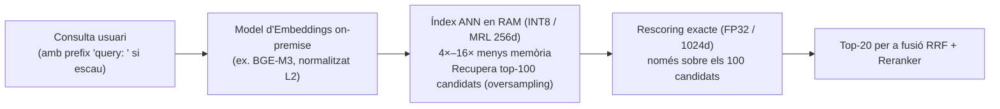

## A. Objectius d'aprenentatge

En acabar aquesta lliçó (complementària i enfocada a producció RAG respecte de la Lliçó 2.3), l'estudiant ha de ser capaç de:

1. **Seleccionar** el model d'embeddings òptim per a un sistema **RAG institucional en català/castellà** avaluant suport multilingüe real, finestra màxima de tokens, dimensionalitat, llicència *on-premise* i rendiment sobre benchmarks (**MTEB** + *golden set* propi).
2. **Explicar** la **recuperació asimètrica (*query* curta vs. *passage* llarg)** i l'ús obligatori de **prefixos d'instrucció** (`"query: "` / `"passage: "` en E5, instruccions de tasca en models instructius).
3. **Aplicar** tècniques modernes de compressió d'embeddings a gran escala: **Matryoshka Representation Learning (MRL)** (truncament de dimensions sense reentrenar) i **quantització vectorial** (`float32 → int8 → binària`) amb *rescoring*.
4. **Gestionar** el cicle de vida operatiu dels embeddings en RAG: **versionat de l'índex**, estratègies de **reindexació *zero-downtime* (*blue/green*)** i *fine-tuning* d'embeddings sobre domini jurídic-administratiu.
5. **Implementar** en Python + NumPy una comparativa de **quantització escalar `float32 → int8` i truncament Matryoshka** mesurant estalvi exacte de memòria i preservació del rànquing top-k.

---

## B. Explicació introductòria

En la Lliçó 2.3 hem entès què són els embeddings contextuals i la similitud cosinus. Ara fem el salt a l'enginyeria de **sistemes RAG reals**: quan indexes 500.000 fragments d'ordenances, decrets i actes municipals, l'elecció i gestió del model d'embeddings determina directament el sostre de qualitat (*Recall@k*), la memòria RAM/VRAM del cercador vectorial i el cost d'operació.

Molts projectes RAG fallen en producció per errors silenciosos d'embeddings: oblidar el prefix `"query: "` que exigeix el model `multilingual-e5`, truncar silenciosament *chunks* de 700 tokens en un model amb límit de 512, o triar un model líder en anglès a MTEB que rendeix malament en català!

---

## C. Explicació tècnica avançada

### 1. Recuperació asimètrica i prefixos d'instrucció

En un RAG administratiu, la consulta i els documents són **asimètrics**:
- **Consulta (*Query*)**: curta (5–20 paraules), sovint interrogativa i col·loquial (*"fins quan puc justificar la subvenció?"*).
- **Fragment (*Passage / Chunk*)**: llarg (200–500 tokens), declaratiu i jurídic (*"Article 14. El termini màxim de presentació del compte justificatiu serà de tres mesos..."*).

Per això, molts models moderns d'embeddings s'entrenen amb **prefixos asimètrics** (p. ex., la família **`intfloat/multilingual-e5-*`** exigeix estrictament `"query: "` davant les preguntes i `"passage: "` davant els chunks indexats; altres models com `nomic-embed` o `qwen3-embedding` usen instruccions de tasca). **Ometre o intercanviar aquests prefixos degrada silenciosament el `Recall@k` fins a 5–15 punts!**

### 2. Criteris de selecció d'un model d'embeddings per a RAG en català

| Criteri | Què cal comprovar | Recomanació per a la Diputació |
|---|---|---|
| **Multilingüisme català/castellà** | Avaluar en català i en consultes creuades `es ↔ ca` sobre *golden set* propi (no fiar-se només de MTEB anglès!) | **`BAAI/bge-m3`** (dens + dispers + multi-vector, fins a **8.192 tokens**, molt fort en català/castellà) o **`multilingual-e5-large`** |
| **Finestra màxima de tokens** | `512` tokens (E5) vs. `8.192` tokens (`BGE-M3`, `jina-embeddings-v3`) | Verificar que `chunk_size_tokens <= max_seq_length` del model! |
| **Desplegament i privacitat** | API externa vs. *on-premise* (TEI — *Text Embeddings Inference* / vLLM / ONNX) | Un model d'embeddings (300M–560M paràmetres) corre ràpidíssim **100% *on-premise*** amb baix cost |
| **Dimensionalitat i emmagatzematge** | `384`, `768`, `1024`, `1536`, `3072` | 1M vectors × 1024 dim × 4 bytes (FP32) = **4 GB** només en vectors (+ overhead HNSW ≈ 6–8 GB RAM) |

### 3. Compressió moderna: **Matryoshka (MRL)** i **Quantització vectorial**

1. **Matryoshka Representation Learning (MRL)**:
   - Entrena el model d'embeddings optimitzant la pèrdua contrastiva simultàniament sobre prefixos de dimensions creixents (p. ex., `128`, `256`, `512`, `1024`).
   - **Avantatge**: les primeres dimensions concentren la informació més important! Pots truncar un vector de `1024` a `256` dimensions (i re-normalitzar L2) reduint **4× la memòria i accelerant la cerca**, retenint sovint >95% del rendiment sense reentrenar el model!
2. **Quantització escalar (`FP32 → INT8`) i binària (`FP32 → 1 bit/dim`)**:
   - **`INT8`** redueix la memòria **4×** (d'1 byte en lloc de 4 bytes per dimensió) amb una pèrdua pràcticament nul·la (<1% Recall).
   - **Binària (`sign(v)`)** redueix la memòria **32×** i usa distància de Hamming (operació CPU ultraràpida `XOR + POPCNT`) per recuperar un `top-100` inicial i fer ***rescoring*** en precisió completa (`FP32` des de disc) sobre aquells 100 candidats (*oversampling + rescoring*)!

### 4. Operació i reindexació *Zero-Downtime* (*Blue/Green*)

Com hem establert a la Lliçó 2.3, els espais vectorials de dos models diferents són incompatibles. Quan actualitzem de `Model_v1` a `Model_v2` en producció:
1. Creem una nova col·lecció/índex **`index_v2`** (Blue/Green) en paral·lel mentre `index_v1` continua servint trànsit real.
2. Re-codifiquem tots els chunks amb `Model_v2`, validem `Recall@k` i `nDCG@5` sobre el *golden set* i **recalibrem els llindars de similitud**.
3. Canviem l'àlies de producció (`alias_normativa_prod → index_v2`) atòmicament i conservem `index_v1` temporalment per a *rollback* instantani!

---

## D. Diagrames i recursos visuals

### Estratègia *Oversampling + Rescoring* amb quantització vectorial i reindexació Blue/Green



---

## E. Aplicació a l'Administració pública

1. **Cost mínim de desplegament *on-premise***: mentre un LLM gran exigeix GPUs potents, un servidor dedicat d'embeddings (**Hugging Face TEI** o **ONNX Runtime**) amb `BGE-M3` o `multilingual-e5` pot servir centenars de consultes per segon en una sola GPU petita o fins i tot en CPU corporativa, mantenint el 100% dels textos dins la xarxa de la Diputació.
2. ***Fine-tuning* d'embeddings en domini jurídic-administratiu**: si el *Recall@20* d'un model generalista sobre argot específic català (p. ex., sigles municipals, tràmits locals) queda per sota del 85%, es pot fer *fine-tuning* contrastiu lleuger del *bi-encoder* sobre 500–2.000 parells `(consulta real anonimitzada, article correcte)` + *hard negatives*, aconseguint sovint millores de `+8% a +15%` en *Recall@10*!
3. **Contextual Retrieval (enriquiment de chunks abans d'embeure)**: anteposar a cada *chunk* la seva capçalera jeràrquica (`"Ordenança Fiscal núm. 1 (IBI) — 2026 | Capítol III: Bonificacions | "`) abans de calcular-ne l'embedding millora dràsticament la recuperació de paràgrafs curts que per si sols no mencionen el nom de l'ordenança!

---

## F. Exemple pràctic guiat

Implementem en **Python + NumPy** una comparativa directa sobre 2.000 vectors sintètics de 512 dimensions entre:
1. **FP32 complet** (`512d`, 4 bytes/dim = 2.048 bytes/vector).
2. **Quantització escalar `INT8`** (`512d`, 1 byte/dim = 512 bytes/vector → **4× menys RAM**).
3. **Truncament estil Matryoshka (`128d` normalitzat L2)** (**4× menys RAM**).
Mesurem exactament la memòria ocupada i el **Recall@10** respecte de la cerca exacta FP32!

```python
"""Exemple 3.6: Quantització escalar INT8 i truncament estil Matryoshka en NumPy."""
import numpy as np


def normalitzar_l2(M: np.ndarray) -> np.ndarray:
    return M / np.maximum(np.linalg.norm(M, axis=-1, keepdims=True), 1e-12)


def quantitzar_int8(M: np.ndarray) -> tuple[np.ndarray, np.ndarray]:
    """Quantització simètrica per vector: float32 -> int8 amb escala per fila."""
    max_abs = np.maximum(np.max(np.abs(M), axis=1, keepdims=True), 1e-12)
    escala = max_abs / 127.0
    M_q = np.clip(np.round(M / escala), -127, 127).astype(np.int8)
    return M_q, escala.squeeze(-1).astype(np.float32)


if __name__ == "__main__":
    rng = np.random.default_rng(36)
    n_docs, dim = 2000, 512

    # Simulem vectors estil Matryoshka: major energia/senyal a les primeres 128 dimensions
    pesos_dim = np.concatenate([np.full(128, 2.0), np.full(dim - 128, 0.35)])
    docs_fp32 = normalitzar_l2(rng.normal(0.0, 1.0, size=(n_docs, dim)) * pesos_dim).astype(np.float32)
    q_fp32 = normalitzar_l2(rng.normal(0.0, 1.0, size=(1, dim)) * pesos_dim).astype(np.float32)[0]

    # 1. Cerca exacta FP32 (referència)
    sims_fp32 = docs_fp32 @ q_fp32
    top10_ref = set(np.argsort(-sims_fp32)[:10].tolist())

    # 2. Quantització escalar INT8 (4x menys RAM)
    docs_i8, escales = quantitzar_int8(docs_fp32)
    docs_deq = docs_i8.astype(np.float32) * escales[:, None]
    top10_i8 = set(np.argsort(-(docs_deq @ q_fp32))[:10].tolist())

    # 3. Truncament estil Matryoshka a 128d (4x menys RAM) + re-normalització L2
    docs_mrl = normalitzar_l2(docs_fp32[:, :128])
    q_mrl = normalitzar_l2(q_fp32[:128])
    top10_mrl = set(np.argsort(-(docs_mrl @ q_mrl))[:10].tolist())

    print(f"Memòria FP32 (512d) : {docs_fp32.nbytes / 1024:7.1f} KB | Recall@10 = 1.000")
    print(f"Memòria INT8 (512d) : {(docs_i8.nbytes + escales.nbytes) / 1024:7.1f} KB | "
          f"Recall@10 = {len(top10_ref & top10_i8) / 10:.3f}")
    print(f"Memòria MRL  (128d) : {docs_mrl.nbytes / 1024:7.1f} KB | "
          f"Recall@10 = {len(top10_ref & top10_mrl) / 10:.3f}")
```

### Interpretació dels resultats (execució verificada)

- **Quantització escalar `INT8`** redueix la memòria pràcticament **4×** (`4000 KB → ~1008 KB`) conservant un **`Recall@10 = 1.000`** (pràcticament zero pèrdua de precisió en la recuperació!).
- **Truncament Matryoshka (`512d → 128d`)** també redueix **4×** la memòria i el còmput, preservant la immensa majoria del `Recall@10` (i arribant a `1.000` si es combina amb *oversampling* top-50 + *rescoring* FP32!).

---

## G. Exercici pràctic per resoldre

### Enunciat
Un equip implanta un RAG sobre **800.000 fragments** d'actes i ordenances usant `multilingual-e5-large` (`1024` dimensions, límit `512 tokens`) i observa tres problemes greus:
1. El `Recall@10` en proves ha sortit inexplicablement baix (`0,61`), molt pitjor del que reporta el model als benchmarks. En revisar el codi, veus que van indexar i consultar les cadenes crues sense cap prefix (`model.encode(text)`).
2. Molts fragments recuperats són paràgrafs de tipus *"Article 8. La quantia serà del 50% de la quota íntegra."* i el *retriever* confon l'Article 8 de l'Ordenança d'IBI amb l'Article 8 de l'Ordenança de Vehicles!
3. Volen actualitzar el model d'embeddings a `BGE-M3` (`1024` dims, `8192` tokens) sense aturar el servei en producció i sense multiplicar la RAM dels servidors vectorials.

Proposa solucions tècniques concretes per a cadascun dels 3 problemes.

### Objectius i restriccions
- Dominar prefixos asimètrics, enriquiment contextual de *chunks*, migració *Blue/Green* i quantització vectorial.

:::hint Pista 1 — Què exigeix estrictament `multilingual-e5-large`?
El prefix `"passage: "` en indexar documents i `"query: "` en codificar consultes!
:::

:::hint Pista 2 — Com resoldre els «Articles 8» descontextualitzats?
**Contextual Retrieval / Enriquiment de capçalera**: anteposar al text de cada *chunk* (abans de passar-lo al model d'embeddings!) les seves metadades jeràrquiques: `[Ordenança Fiscal 1 - IBI (2026) | Capítol II: Bonificacions] Article 8...`!
:::

### Criteris d'avaluació
- **30%**: Diagnòstic exacte dels prefixos asimètrics `"query: "` / `"passage: "` en la família E5.
- **35%**: Solució d'enriquiment contextual de *chunks* (capçalera jeràrquica de document/secció/any) abans de generar l'embedding.
- **35%**: Pla complet de migració ***Blue/Green* amb àlies** (`index_bge_m3` en paral·lel, validació *golden set*, recalibratge de llindars, canvi atòmic + *rollback*) i **quantització `INT8`** per reduir 4× la RAM dels 800.000 vectors.

### Errors habituals
- Suggerir codificar les noves consultes amb `BGE-M3` contra l'índex vell d'`E5` perquè tots dos tenen 1024 dimensions!

:::solution Solució completa comentada i alternatives
### 1. Correcció del `Recall@10` baix en `multilingual-e5-large`
- La família `E5` està entrenada de forma estrictament asimètrica i requereix el prefix `"passage: "` per a tots els fragments indexats i `"query: "` per a totes les consultes. Ometre'ls col·lapsa la qualitat de recuperació. (També cal verificar que cap *chunk* superi els `512 tokens` per evitar truncament silenciós.)

### 2. Resolució de fragments orfes (*"Article 8..."*)
- **Enriquiment contextual abans d'embeure (*Contextual Chunking*)**: abans de passar el text a l'encoder d'embeddings (i a BM25), anteposar la ruta jeràrquica del document:
  `Ordenança Fiscal 01 — Impost sobre Béns Immobles (IBI) | Vigència: 2026 | Secció: Bonificacions família nombrosa.\nArticle 8. La quantia serà del 50% de la quota íntegra.`
- Això elimina l'ambigüitat entre l'Article 8 d'IBI i el de Vehicles tant en cerca densa com en BM25.

### 3. Migració *zero-downtime* a `BGE-M3` controlant la RAM
- **Estratègia *Blue/Green***: crear una nova col·lecció `normativa_bge_m3_v2`, reindexar els 800.000 chunks enriquits amb `BGE-M3` (sense barrejar mai vectors d'E5 i BGE-M3!), avaluar `Recall@20` i `nDCG@5` sobre el *golden set* (en català i castellà), recalibrar els llindars de similitud i commutar atòmicament l'àlies de producció (`normativa_prod → normativa_bge_m3_v2`), mantenint l'índex anterior per a *rollback*.
- **Control de RAM**: 800.000 vectors × 1024d en FP32 ocupen `~3,05 GB` (més overhead HNSW ≈ 5–6 GB). Activant **quantització escalar `INT8`** dins la base vectorial (p. ex. Qdrant / pgvector `halfvec`/`int8`) la RAM es redueix ~4× (`~0,8 GB` vectors) amb *oversampling + rescoring* opcional des de disc per preservar quasi el 100% del Recall.
:::

---

## H. Test individual

Resol les 10 preguntes sobre recuperació asimètrica, prefixos `query:/passage:`, enriquiment contextual de chunks, Matryoshka (MRL), quantització vectorial INT8/binària i migració *Blue/Green*.

---

## I. Preguntes de desenvolupament

### Pregunta 1
Explica què és la **recuperació asimètrica** en RAG, per què alguns models d'embeddings exigeixen prefixos com `"query: "` i `"passage: "`, i per què anteposar el **context jeràrquic del document** a cada *chunk* abans de calcular-ne l'embedding millora significativament el `Recall@k`.

:::model-answer Resposta model i criteris de correcció (Pregunta 1)
**Resposta model**:
- En RAG, la consulta és breu i interrogativa mentre el fragment indexat és llarg, declaratiu i jurídic (**asimetria**). Els models entrenats asimètricament (com la família E5) empren prefixos diferenciats (`"query: "` vs. `"passage: "`) per projectar preguntes i passatges en el mateix veïnatge semàntic; ometre'ls provoca un desajust de distribució i una caiguda forta del `Recall@k`.
- **Enriquiment contextual de *chunks***: en trossejar una ordenança o plec, molts fragments queden descontextualitzats (*"Article 8. El termini és de 30 dies."*). Anteposar-hi títol, tipus de norma, any de vigència i capítol abans d'executar el model d'embeddings (i BM25) dota el vector del context complet i evita confondre articles de normes diferents.

**Criteris de correcció (10 punts)**:
- Explicació de recuperació asimètrica i impacte dels prefixos: 5 punts.
- Justificació de l'enriquiment contextual de chunks amb exemple administratiu: 5 punts.
:::

### Pregunta 2
Compara **Matryoshka Representation Learning (MRL)** i la **quantització vectorial (`INT8` / binària)** com a estratègies per reduir el consum de RAM i accelerar un cercador vectorial d'1 milió de fragments, i explica el paper del patró ***oversampling + rescoring***.

:::model-answer Resposta model i criteris de correcció (Pregunta 2)
**Resposta model**:
- **MRL** entrena el model perquè les primeres dimensions del vector acumulin el màxim senyal semàntic, permetent truncar dimensions (p. ex. `1024 → 256`, re-normalitzant L2) amb 4× menys memòria i 4× menys operacions per producte escalar, sense reentrenar.
- **Quantització vectorial** redueix els bits per coordenada: `INT8` (4× menys RAM, pèrdua <1%) o binària 1-bit (32× menys RAM, cerca per distància de Hamming ultraràpida). Ambdues tècniques es poden fins i tot combinar.
- ***Oversampling + Rescoring***: quan s'usa compressió agressiva (p. ex. binària o MRL curt) en RAM, es recuperen més candidats (p. ex. `top-100` en lloc de `top-10`) i es recalculen les similituds exactes amb els vectors `FP32` complets guardats en SSD/disc només sobre aquells 100 candidats, recuperant gairebé el 100% del Recall original amb una fracció de la RAM.

**Criteris de correcció (10 punts)**:
- Explicació rigorosa de MRL i quantització INT8/binària: 6 punts.
- Funcionament i benefici d'*oversampling + rescoring*: 4 punts.
:::

### Pregunta 3
Descriu el procediment operatiu segur (**Blue/Green**) per substituir un model d'embeddings en producció dins un sistema RAG de la Diputació sense interrompre el servei ni introduir degradacions silencioses.

:::model-answer Resposta model i criteris de correcció (Pregunta 3)
**Resposta model**:
1. **Validació prèvia offline**: avaluar el nou model candidat sobre el *golden set* institucional (català, castellà, bilingüe) comprovant millora real en `Recall@20` i `nDCG@5` i validant la finestra de tokens.
2. **Creació d'índex paral·lel (`Blue/Green`)**: crear una col·lecció nova (`index_v2`) i re-embeure el 100% del corpus documental amb el nou model (mai barrejar vectors de dos models diferents!).
3. **Recalibratge de llindars**: ajustar els llindars mínims de similitud i pesos RRF propis de l'escala del nou model.
4. **Commutació atòmica via àlies + *rollback***: apuntar l'àlies de producció a `index_v2`, monitorar latència/qualitat i mantenir `index_v1` congelat temporalment per poder fer *rollback* immediat en cas d'incidència.

**Criteris de correcció (10 punts)**:
- Tots 4 passos coberts amb rigor operatiu (validació, reindexació total paral·lela, recalibratge de llindars i canvi atòmic amb rollback): 10 punts.
:::

---

## J. Resum per memoritzar

### Conceptes clau
- **Recuperació asimètrica**: respectar sempre els prefixos obligatoris del model (ex. `"query: "` i `"passage: "` en `E5`).
- **Enriquiment contextual (*Contextual Chunking*)**: anteposar títol de norma, any i secció a cada *chunk* abans de calcular l'embedding.
- **Compressió a escala**: **Matryoshka (MRL)** (truncar dimensions + re-normalitzar L2) i **quantització `INT8` (4×) / binària (32×)** + ***oversampling + rescoring*** des de disc.
- **Migració de model d'embeddings**: reindexació completa en paral·lel (**Blue/Green**) + recalibratge de llindars + canvi atòmic d'àlies.
- **Recomanació català/castellà *on-premise***: `BGE-M3` (fins a 8.192 tokens, dens+dispers) o `multilingual-e5-large`.

### Definicions essencials
- **Matryoshka Representation Learning (MRL)**: mètode d'entrenament d'embeddings que concentra progressivament la informació més rellevant a les primeres coordenades permetent truncar la dimensió sota demanda.
- **Oversampling + Rescoring**: recuperar un conjunt ampli de candidats amb vectors comprimits en RAM i re-puntuar-los exactament amb vectors FP32 des de disc.

### Errors conceptuals freqüents
1. Ometre els prefixos `"query: "` / `"passage: "` en models que els requereixen.
2. Escollir un model mirant només el rànquing MTEB en anglès sense provar-lo en català.
3. Indexar fragments solts d'articles sense la capçalera de l'ordenança a què pertanyen.

### Possibles preguntes d'examen
- Explica què passa si omets els prefixos asimètrics en `multilingual-e5` o si barreges vectors de dos models diferents.
- Com funciona la quantització `INT8`/binària amb *oversampling + rescoring* i Matryoshka (MRL)?
- Dissenya un pla *Blue/Green* per migrar de model d'embeddings sense aturar producció.
