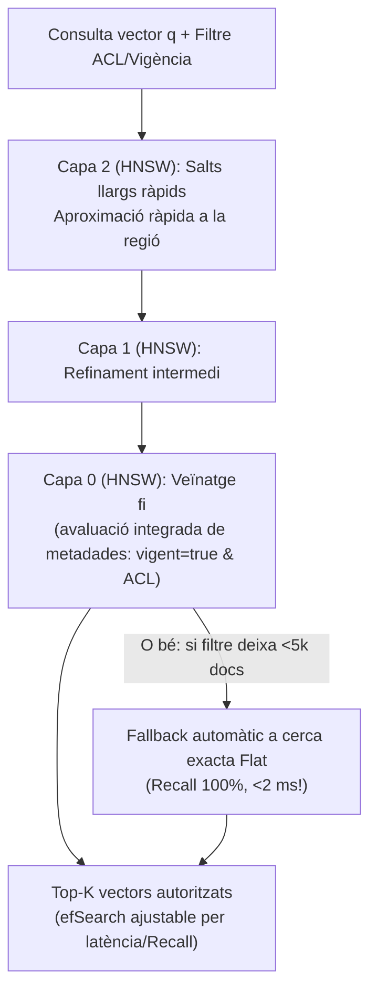

## A. Objectius d'aprenentatge

En completar aquesta lliçó, l'estudiant ha de ser capaç de:

1. **Explicar** per què la cerca exacta lineal (*k-NN / Flat*) no escala a milions de vectors i com funcionen els índexs de **veïns més propers aproximats (ANN, *Approximate Nearest Neighbors*)**: **HNSW**, **IVF** i **PQ (*Product Quantization*)**.
2. **Interpretar** els hiperparàmetres clau d'**HNSW** (`M`, `efConstruction`, `efSearch`) i el compromís **Recall vs. Latència vs. Memòria RAM**.
3. **Distingir** entre **pre-filtratge (*pre-filtering*)**, **post-filtratge (*post-filtering*)** i **filtratge integrat en graf (*single-stage filtered HNSW*)** per aplicar permisos ACL i vigència normativa sense perdre resultats.
4. **Comparar** les principals solucions del mercat (*on-premise* i integrades): **`pgvector`** (PostgreSQL), **Qdrant**, **Milvus**, **Elasticsearch/OpenSearch** i **FAISS/Chroma**, escollint la més adient per a la Diputació de Barcelona.
5. **Implementar** en Python + NumPy un índex **IVF (*Inverted File Index*)** funcional i mesurar quantitativament el compromís entre `nprobe` (clústers explorats), velocitat de cerca i `Recall@10` respecte de cerca exacta *Flat*.

---

## B. Explicació introductòria

Un model d'embeddings transforma cada fragment de text en un vector de, per exemple, `1.024` nombres decimals. Si tens `5.000` fragments, comparar la pregunta contra tots 5.000 vectors un per un (força bruta o *Flat*) tarda menys d'1 mil·lisegon en NumPy. Però si tens **2.000.000 de fragments** d'actes, ordenances i decrets de 311 municipis i 100 usuaris consultant alhora, la força bruta satura la CPU!

Una **base de dades vectorial (*Vector Database*)** és un sistema de gestió especialitzat a emmagatzemar, indexar, filtrar per metadades i cercar milions de vectors en mil·lisegons mitjançant estructures d'indexació aproximada (**ANN**), oferint alhora persistència, operacions CRUD, replicació, seguretat i suport de cerca híbrida (dens + dispers/BM25).

---

## C. Explicació tècnica avançada

### 1. Famílies d'índexs vectorials (Exacte vs. ANN)

| Índex | Com funciona | Complexitat cerca | Memòria RAM | Quan utilitzar-lo |
|---|---|---|---|---|
| **Flat (Exacte / k-NN)** | Compara el vector consulta contra el 100% dels vectors | \(O(N \cdot d)\) | 1× vectors | Datasets petits (< 50k vectors) o com a *ground truth* per mesurar el Recall d'un índex ANN! |
| **IVF (*Inverted File*)** | Agrupa els vectors en `nlist` clústers (K-Means); en consulta, només explora els **`nprobe`** clústers més propers | \(O(\text{nlist} + \frac{\text{nprobe}}{\text{nlist}} N)\) | ~1× vectors | Datasets grans amb RAM limitada; requereix fase d'entrenament de centroides |
| **PQ (*Product Quantization*)** | Divideix cada vector en \(m\) subvectors i els substitueix per codis de centroides (1 byte/subvector) | Molt ràpida (taules lookup) | **8×–32× menor!** | Escala gegant (desenes/centenars de milions) sovint combinat com **IVF-PQ** + *rescoring* |
| **HNSW** (*Hierarchical Navigable Small World*) | Graf multicapa navegable (capes superiors = autopistes de salts llargs; capa 0 = connexions locals precises) | **\(O(\log N)\)** (mil·lisegons!) | **Alta** (1,5×–2× vectors pel graf d'arestes) | **Estàndard d'or en producció RAG**: màxim Recall (~95–99%) amb latència de pocs ms i insercions incrementals |

#### Hiperparàmetres clau d'HNSW
- **`M`** (p. ex., `16`–`32`): nombre màxim de connexions (veïns) per node al graf. Més `M` → millor Recall i graf més connectat, però més RAM i construcció més lenta.
- **`efConstruction`** (p. ex., `100`–`200`): amplada de cerca durant la construcció de l'índex. Més alt → índex de major qualitat (es paga un sol cop!).
- **`efSearch`** (p. ex., `64`–`256`, configurable **per consulta**): amplada de cerca en temps de consulta. Més alt → major Recall a canvi d'alguns ms addicionals de latència.

### 2. Filtratge per metadades: el gran parany del *Post-Filtering*

En una administració, gairebé tota consulta porta filtres obligatoris (`vigent = true AND municipi_id = '08121' AND acl_rol IN (...)`):
- ***Post-filtering* (PERILLÓS)**: l'índex ANN recupera els `top-10` vectors globals i **després** descarta els que no compleixen el filtre. Si el filtre és selectiu (p. ex., un municipi petit que només representa el 0,5% del corpus), els 10 resultats queden descartats i l'usuari rep **0 resultats** malgrat existir ordenances rellevants!
- ***Pre-filtering* pur**: filtra primer per metadades i després executa cerca exacta *Flat* sobre els supervivents. Ideal si queden pocs documents (< 10k), però lent si en queden 500k.
- **Filtratge integrat (*Single-Stage Filtered HNSW*, Qdrant / pgvector iterative scan / Milvus)**: navega pel graf HNSW avaluant el predicat de metadades **en cada salt**, o commuta automàticament a cerca exacta quan la selectivitat és molt baixa → garanteix sempre `k` resultats vàlids amb alta velocitat i **zero fuites d'ACL**!

### 3. Selecció tecnològica per a una Administració pública

| Tecnologia | Tipus | Punts forts en entorn públic | Quan triar-la |
|---|---|---|---|
| **PostgreSQL + `pgvector` (+ `pg_search`/TSVector)** | Extensió relacional | **Mínima complexitat operativa**: transaccions ACID, mateix sistema de còpies de seguretat, permisos, SQL natiu i índexs HNSW/`halfvec` dins el PostgreSQL corporatiu existent! | **Primera opció recomanada** fins a diversos milions de fragments quan la Diputació ja opera PostgreSQL |
| **Qdrant / Milvus** | Base vectorial nativa (*open-source*, Rust/Go) | Filtratge HNSW avançat, cerca híbrida dens+dispers nativa, quantització `INT8`/binària + *rescoring* des de disc, escalat distribuït | Milions–desenes de milions de vectors, alta concurrència, requisits avançats de quantització i *multi-tenancy* |
| **Elasticsearch / OpenSearch** | Motor IR + Vectorial | Millor BM25 del mercat + HNSW natiu + filtres ACL madurs en un sol clúster | Quan la institució ja té un clúster Elasticsearch/OpenSearch corporatiu consolidat |
| **FAISS / Chroma** | Llibreria / BD lleugera | Prototipat local instantani en Python i laboratoris | Prototips, recerca i laboratoris (no recomanat FAISS cru com a BD transaccional en producció) |

---

## D. Diagrames i recursos visuals

### Navegació jeràrquica d'un índex HNSW i selecció de filtratge



---

## E. Aplicació a l'Administració pública

1. **Pragmatisme tecnològic amb `pgvector`**: abans d'introduir una nova peça d'infraestructura al catàleg corporatiu (que exigeix auditoria ENS, monitoratge, HA i formació de sistemes), **`PostgreSQL + pgvector`** resol amb solvència, transaccionalitat ACID i cerca híbrida el 90% dels projectes RAG municipals (< 5M de fragments).
2. ***Multi-tenancy* dels 311 municipis**: en una plataforma compartida de la Diputació, cal garantir aïllament estricte entre ajuntaments mitjançant `municipi_id` indexat (o col·leccions/particions dedicades per municipi) per evitar qualsevol barreja de documents interns entre consistoris.
3. **Cicle de vida i esborrat (RGPD)**: una base de dades vectorial de producció ha de suportar **esborrat i actualització puntual per `doc_id`** (quan es deroga una ordenança o un ciutadà exerceix el dret de supressió), cosa que una llibreria estàtica com FAISS en fitxer pla no gestiona transaccionalment.

---

## F. Exemple pràctic guiat

Implementem des de zero en **Python + NumPy** un índex **IVF (*Inverted File Index*)** (particionant 4.000 vectors en `nlist = 40` clústers via K-Means) i mesurem exactament el compromís entre **`nprobe`** (nombre de clústers visitats), **fracció de vectors escanejats (speedup)** i **`Recall@10`** respecte de la cerca exacta *Flat*.

```python
"""Exemple 3.7: Índex ANN IVF (Inverted File) des de zero en NumPy i compromís nprobe vs Recall."""
import numpy as np


def normalitzar_l2(M: np.ndarray) -> np.ndarray:
    return M / np.maximum(np.linalg.norm(M, axis=-1, keepdims=True), 1e-12)


class IndexIVF:
    def __init__(self, nlist: int = 40, seed: int = 37) -> None:
        self.nlist = nlist
        self.seed = seed
        self.centroides: np.ndarray = np.array([])
        self.llistes: dict[int, np.ndarray] = {}
        self.vectors: np.ndarray = np.array([])

    def fit(self, X: np.ndarray, iters: int = 15) -> "IndexIVF":
        rng = np.random.default_rng(self.seed)
        self.vectors = X
        c = X[rng.choice(len(X), size=self.nlist, replace=False)].copy()
        assign = np.zeros(len(X), dtype=int)
        for _ in range(iters):
            assign = np.argmax(X @ c.T, axis=1)
            for j in range(self.nlist):
                pts = X[assign == j]
                if len(pts) > 0:
                    c[j] = normalitzar_l2(pts.mean(axis=0, keepdims=True))[0]
        self.centroides = c
        self.llistes = {j: np.where(assign == j)[0] for j in range(self.nlist)}
        return self

    def cercar(self, q: np.ndarray, k: int = 10, nprobe: int = 4) -> tuple[list[int], int]:
        # 1. Trobar els `nprobe` clústers més propers a la consulta
        top_clusters = np.argsort(-(self.centroides @ q))[:nprobe]
        candidats = np.concatenate([self.llistes[int(c)] for c in top_clusters if len(self.llistes[int(c)]) > 0])
        # 2. Avaluar similitud només sobre els candidats d'aquests clústers
        sims = self.vectors[candidats] @ q
        millors_locals = np.argsort(-sims)[:k]
        return candidats[millors_locals].tolist(), int(len(candidats))


if __name__ == "__main__":
    rng = np.random.default_rng(37)
    n_docs, dim = 4000, 64
    # Generem dades amb estructura temàtica realista (20 temes + soroll)
    centres_reals = normalitzar_l2(rng.normal(0.0, 1.0, size=(20, dim)))
    temes = rng.integers(0, 20, size=n_docs)
    X = normalitzar_l2(centres_reals[temes] + rng.normal(0.0, 0.35, size=(n_docs, dim)))

    ivf = IndexIVF(nlist=40, seed=37).fit(X)
    consultes = normalitzar_l2(centres_reals[:10] + rng.normal(0.0, 0.35, size=(10, dim)))

    print("nprobe | % corpus escanejat | Recall@10 vs Flat")
    print("-" * 50)
    for nprobe in (1, 2, 4, 8):
        recalls, escanejats = [], []
        for q in consultes:
            exact = set(np.argsort(-(X @ q))[:10].tolist())
            approx, n_cand = ivf.cercar(q, k=10, nprobe=nprobe)
            recalls.append(len(exact & set(approx)) / 10.0)
            escanejats.append(n_cand / n_docs)
        print(f"  {nprobe:4d} | {np.mean(escanejats):17.1%} | {np.mean(recalls):.3f}")
```

### Interpretació dels resultats (execució verificada)

- Amb `nprobe = 1` s'escaneja només `3,2%` del corpus (més de 30× menys càlculs!), però com que els vectors en 64 dimensions amb soroll sovint cauen a prop de fronteres entre cel·les de Voronoi, `Recall@10` és baix (`0,260`).
- En pujar **`nprobe` a `4` (`10,1%` escanejat)** i **`8` (`19,6%` escanejat)**, el `Recall@10` creix monotònicament fins a **`0,490`** i **`0,720`** (i fins a `1,000` quan `nprobe = nlist`). Exactament el mateix compromís entre velocitat i precisió regula `efSearch` en HNSW!

---

## G. Exercici pràctic per resoldre

### Enunciat
Una plataforma compartida de la Diputació indexa **1,2 milions de fragments** de documents interns dels **311 municipis** en una única col·lecció HNSW (`M=16, efConstruction=128, efSearch=64`). Un municipi petit (que només aporta `1.200` fragments = `0,1%` del total) es queixa que, quan els seus tècnics fan consultes amb el filtre `municipi_id = '08250'`, el cercador retorna gairebé sempre **0 o 1 resultat** encara que els documents existeixen!

Respon:
1. Quin error d'implementació del filtratge explica exactament aquest símptoma (`0 o 1 resultat` per a un municipi del `0,1%`)?
2. Com el resoldries tècnicament en una base vectorial moderna (com **Qdrant** o **`pgvector`**)?
3. Quin avantatge i quin inconvenient té crear **311 índexs separats** (un per municipi) enfront d'un **índex únic amb filtratge integrat / particionament de payload**?

### Objectius i restriccions
- Diagnosticar *post-filtering* sobre filtres d'alta selectivitat i dissenyar *multi-tenancy* segur i eficient per a 311 ens locals.

:::hint Pista 1 — Quants dels top-10 globals pertanyen a un municipi que representa el 0,1% del corpus?
En mitjana `0,01` documents! Si s'aplica ***post-filtering*** després de treure els top-10 globals d'HNSW, pràcticament tots 10 queden eliminats!
:::

:::hint Pista 2 — Solució moderna de *multi-tenancy*
**Filtratge integrat (*single-stage filtered HNSW* + *tenant payload index* en Qdrant / `iterative_scan` o particions en PostgreSQL/`pgvector`)**, amb *fallback* automàtic a cerca exacta *Flat* sobre els 1.200 vectors del municipi (1.200 vectors es busquen en `< 0,5 ms` amb `Recall = 100%`!).
:::

### Criteris d'avaluació
- **35%**: Diagnòstic exacte de ***post-filtering*** amb alta selectivitat (`0,1%`).
- **35%**: Solució tècnica concreta (filtratge integrat HNSW / *tenant index* + *fallback* automàtic a cerca *Flat* quan el subconjunt filtrat és petit).
- **30%**: Comparativa equilibrada *multi-tenancy* (311 índexs separats: màxim aïllament però major overhead de gestió/RAM vs. índex únic amb *tenant payload index* / particions SQL).

### Errors habituals
- Proposar simplement apujar `efSearch` de `64` a `128` mantenint el *post-filtering* (un 0,1% continuaria donant 0 resultats!).

:::solution Solució completa comentada i alternatives
### 1. Diagnòstic exacte
El sistema està aplicant ***post-filtering***: primer recupera el `top-k` global sobre tots 1,2M de vectors sense mirar `municipi_id`, i després filtra els resultats retornats per `municipi_id = '08250'`. Com que aquest municipi només representa el `0,1%` del corpus, gairebé cap dels `top-10` globals li pertany, deixant el tècnic amb 0 o 1 resultat.

### 2. Solució tècnica
- **Opció A (Qdrant — *Tenant Payload Index*)**: crear un índex de payload `is_tenant = true` sobre `municipi_id`. Qdrant construeix subgrafs HNSW per *tenant* i, quan un municipi té pocs vectors (1.200), executa automàticament una **cerca exacta *Flat* sobre els seus 1.200 vectors** en `< 1 ms` garantint **`Recall = 100%`** i sempre `k` resultats!
- **Opció B (PostgreSQL + `pgvector`)**: habilitar **cerca iterativa filtrada** (`hnsw.iterative_scan = relaxed_order`) o bé **particionament declaratiu per `municipi_id` / índex parcial**, de manera que les consultes amb filtre estricte no s'aturin fins completar els `k` resultats vàlids (o executin escaneig seqüencial ràpid sobre les 1.200 files del municipi).

### 3. 311 índexs separats vs. Índex únic amb *tenant payload index*
- **311 col·leccions independents**: màxim aïllament lògic i facilitat per esborrar un municipi sencer, però **alt *overhead* de memòria, descriptors de fitxers i gestió operativa** (i impossibilita cerques globals creuades de la Diputació sobre els 311 municipis).
- **Col·lecció única amb *tenant payload index* (o particions PostgreSQL)**: gestió unificada, mínim *overhead*, suport simultani de cerques aïllades per municipi i cerques globals autoritzades de la Diputació, i seguretat determinista garantida per pre-filtre obligatori a la capa API.
:::

---

## H. Test individual

Resol les 10 preguntes sobre cerca exacta *Flat* vs. ANN (HNSW, IVF, PQ), hiperparàmetres `M`/`efConstruction`/`efSearch`, *pre-filtering* vs. *post-filtering* i selecció de tecnologies (`pgvector`, Qdrant, Milvus, FAISS).

---

## I. Preguntes de desenvolupament

### Pregunta 1
Compara els índexs **Flat**, **IVF-PQ** i **HNSW** en termes de precisió (*Recall*), latència, consum de memòria RAM i facilitat d'inserció/esborrat incremental, explicant el paper dels paràmetres `M`, `efConstruction` i `efSearch` en HNSW.

:::model-answer Resposta model i criteris de correcció (Pregunta 1)
**Resposta model**:
- **Flat**: cerca exacta (`Recall = 100%`), memòria mínima (només els vectors), però latència lineal \(O(N\cdot d)\) inviable a gran escala; ideal per <50k vectors i per avaluar el Recall dels índexs ANN.
- **IVF-PQ**: agrupa en clústers (`nlist`, explora `nprobe`) i comprimeix subvectors amb PQ (`8×–32×` menys RAM); molt econòmic en memòria per a desenes de milions de vectors però requereix entrenament dels centroides i perd més Recall sense *rescoring*.
- **HNSW**: graf multicapa navegable en \(O(\log N)\), altíssim Recall (`95–99%`), latència de pocs ms i insercions incrementals natives, a canvi d'un consum elevat de RAM (`1,5–2×` per les arestes del graf).
- **Paràmetres HNSW**: `M` = connexions màximes per node (RAM vs. connectivitat); `efConstruction` = qualitat del graf en construcció; `efSearch` = amplitud d'exploració en consulta (ajusta en temps real Recall vs. latència).

**Criteris de correcció (10 punts)**:
- Comparativa rigorosa Flat vs. IVF-PQ vs. HNSW: 6 punts.
- Definició precisa de `M`, `efConstruction` i `efSearch`: 4 punts.
:::

### Pregunta 2
Explica per què el ***post-filtering*** és perillós en bases de dades vectorials amb filtres selectius (com permisos ACL o un municipi petit d'entre 311), i descriu com ho resolen el filtratge integrat (*single-stage*) i el *fallback* a cerca exacta.

:::model-answer Resposta model i criteris de correcció (Pregunta 2)
**Resposta model**:
- En ***post-filtering***, l'índex ANN recupera primer els `top-k` globals i després aplica el filtre de metadades. Si el filtre només selecciona el 0,1%–2% del corpus (un municipi petit o un departament restringit), gairebé tots o tots els `k` candidats queden descartats, retornant 0 resultats o un Recall desastrós.
- El **filtratge integrat (*single-stage filtered HNSW* / `iterative_scan`)** comprova el filtre de metadades **durant** la navegació pel graf i continua explorant fins reunir `k` documents autoritzats. Quan el filtre és extremadament selectiu (p. ex., <5.000 documents), el motor commuta automàticament a una **cerca exacta *Flat*** sobre aquest petit subconjunt (`< 2 ms`, `Recall = 100%`), garantint resultats complets i zero fuites ACL.

**Criteris de correcció (10 punts)**:
- Explicació exacta de la fallada del *post-filtering*: 5 punts.
- Solució amb filtratge integrat + *fallback* a cerca exacta *Flat*: 5 punts.
:::

### Pregunta 3
Justifica per què **`PostgreSQL + pgvector`** sol ser la primera opció pragmàtica per a molts projectes RAG de la Diputació de Barcelona, i indica en quines condicions recomanaries migrar a una base vectorial dedicada com **Qdrant** o **Milvus**.

:::model-answer Resposta model i criteris de correcció (Pregunta 3)
**Resposta model**:
- **`PostgreSQL + pgvector`**: aprofita la infraestructura relacional ja consolidada, auditada ENS i coneguda per l'equip de sistemes; garanteix consistència transaccional **ACID** entre metadades, permisos ACL i vectors (evitant desincronitzacions en esborrar/actualitzar expedients segons RGPD), suporta HNSW, quantització `halfvec`/binària i cerca híbrida amb Full-Text Search/BM25 dins d'una única base de dades fins a diversos milions de fragments.
- **Quan passar a Qdrant / Milvus**: quan el volum creix a desenes de milions de vectors amb alta concurrència, cal escalat horitzontal distribuït (*sharding*), quantització avançada en RAM amb *rescoring* automàtic des de disc (*mmap*) o gestió avançada de *multi-tenancy* vectorial natiu amb latències estrictes.

**Criteris de correcció (10 punts)**:
- Avantatges operatius, ACID, RGPD i ENS de `pgvector`: 6 punts.
- Criteris objectius d'escala/funcionalitat per adoptar Qdrant o Milvus: 4 punts.
:::

---

## J. Resum per memoritzar

### Conceptes clau
- **Exacte (*Flat*)**: `Recall = 100%`, \(O(N)\) (fins a ~50k vectors o com a *ground truth*).
- **HNSW**: graf multicapa \(O(\log N)\), màxim Recall i latència en ms, més RAM (`M`, `efConstruction`, `efSearch`).
- **IVF / PQ**: clústers (`nlist`/`nprobe`) + compressió de subvectors (mínima RAM a gran escala).
- **Mai *post-filtering*** en filtres selectius (ACL / 311 municipis) → usar **filtratge integrat (*single-stage* / `iterative_scan` / *tenant index*)** + *fallback* a *Flat*.
- **Elecció pràctica**: **`PostgreSQL + pgvector`** com a 1a opció pragmàtica ACID; **Qdrant / Milvus** a gran escala/concurrència; **Elasticsearch/OpenSearch** si ja és estàndard corporatiu; **FAISS** només prototipat/llibreria.

### Definicions essencials
- **ANN (*Approximate Nearest Neighbors*)**: família d'algorismes d'indexació que sacrifiquen una fracció mínima de Recall (p. ex. 98% vs. 100%) per accelerar la cerca en ordres de magnitud.
- ***Post-filtering***: aplicar filtres de metadades **després** d'obtenir els top-k d'un índex ANN (antipatró perillós en filtres selectius).

### Errors conceptuals freqüents
1. Implementar *post-filtering* sobre permisos ACL o per municipi, deixant usuaris amb 0 resultats.
2. Desplegar una base de dades vectorial nova quan el projecte té 30.000 fragments i PostgreSQL corporatiu amb `pgvector` ja ho resol amb transaccions ACID.
3. No mesurar mai el Recall de l'índex ANN comparant-lo contra una cerca exacta *Flat* sobre una mostra de consultes.

### Possibles preguntes d'examen
- Explica què fan `M`, `efConstruction` i `efSearch` en HNSW i `nlist`/`nprobe` en IVF.
- Diagnostica per què un municipi petit obté 0 resultats en una base vectorial compartida (*post-filtering*) i com arreglar-ho.
- Compara `pgvector`, Qdrant/Milvus i FAISS per a un projecte públic real.
