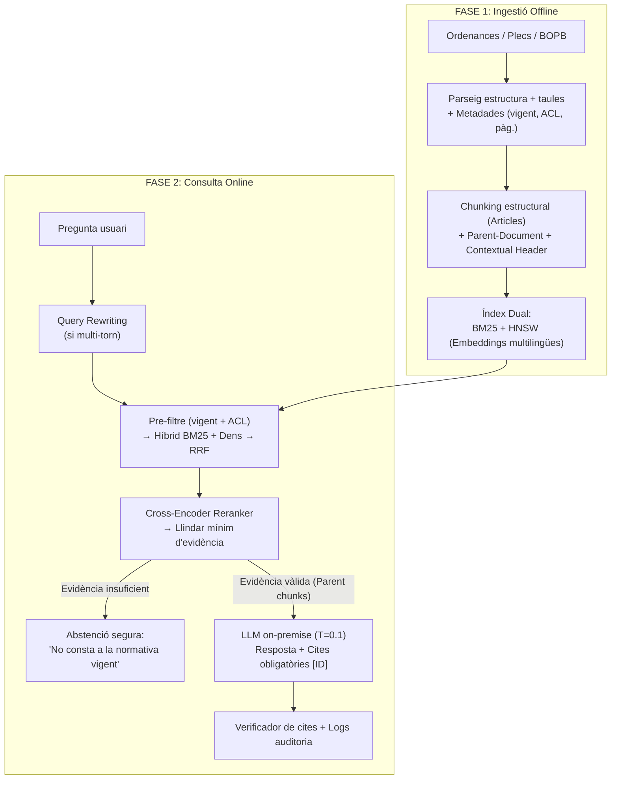

## A. Objectius d'aprenentatge

En completar aquesta lliçó troncal del temari, l'estudiant ha de ser capaç de:

1. **Explicar** l'arquitectura completa d'un sistema **RAG (*Retrieval-Augmented Generation*)** en les seves dues grans fases: **pipeline d'ingestió/indexació (*offline*)** i **pipeline de recuperació i generació (*online*)**.
2. **Comparar** estratègies de ***chunking*** (mida fixa amb solapament, recursiu/estructural per articles i seccions, semàntic, ***Parent-Document / Small-to-Big*** i ***Contextual Chunking***) per a normativa i expedients administratius.
3. **Aplicar** patrons de **RAG avançat** (*query rewriting*, cerca híbrida + RRF, *Cross-Encoder reranking*, **cites obligatòries verificables** i **detecció de manca d'evidència / abstenció**).
4. **Avaluar** rigorosament un sistema RAG descomponent-lo en la **tríada / marc RAGAS**: **Context Recall**, **Context Precision**, **Faithfulness (fidelitat)** i **Answer Relevance**, per diagnosticar amb exactitud si falla el *retriever* o el *generator*.
5. **Implementar** en Python pur un **mini-pipeline RAG verificable de punta a punta** (chunking estructural per articles, recuperació híbrida amb filtre de vigència, control de llindar d'evidència i verificador automàtic de cites).

---

## B. Explicació introductòria

Imagina una tècnica jurídica que respon un examen **a llibre obert**: en lloc de fiar-se únicament de la seva memòria (que pot fallar en un percentatge o una data d'una ordenança nova), primer **busca l'article vigent exacte al text oficial**, el llegeix atentament i redacta la resposta **citant l'article i la pàgina concreta** — i si la qüestió no apareix enlloc de la normativa, respon honestament que no consta evidència.

Això és exactament **RAG (*Retrieval-Augmented Generation*)**: connectar un LLM a una base documental externa, controlada i actualitzable. Per a l'Administració pública, el RAG és l'arquitectura fundacional perquè resol de cop els tres grans obstacles de la IA generativa: **actualització normativa immediata**, **reducció dràstica d'al·lucinacions amb cites auditables** i **control determinista d'accés (ACL)**.

---

## C. Explicació tècnica avançada

### 1. Les dues fases d'un pipeline RAG de producció

#### Fase 1 — Ingestió i indexació (*Offline / Incremental*)
1. **Extracció neta de text i estructura**: PDF natiu / OCR / taules en Markdown (un mal parseig de taules trenca qualsevol RAG!).
2. **Normalització i metadades**: `doc_id`, `titol`, `municipi_id`, `estat_vigencia` (`VIGENT`/`DEROGAT`), `data_publicacio`, `pagina`, `seccio`, `permisos_acl`.
3. ***Chunking* intel·ligent** (mesurat en **tokens** del model d'embeddings!).
4. **Enriquiment contextual** (anteposar ruta jeràrquica del document) + **indexació dual** (índex invertit **BM25** + índex vectorial **HNSW**).

#### Fase 2 — Recuperació i generació (*Online*)
1. **Reescriptura de consulta (*Query Rewriting*)**: en converses multi-torn, resol pronoms (*"I quin termini té?"* → *"Quin termini té la bonificació de l'IBI per família nombrosa?"*).
2. **Pre-filtratge determinista**: vigència normativa + permisos ACL de l'usuari.
3. **Cerca híbrida (BM25 + Bi-Encoder) → RRF → Cross-Encoder Reranker** → `top-5` fragments (o *Parent chunks*).
4. **Llindar d'evidència / Abstenció primerenca**: si el millor candidat del *reranker* queda per sota d'un llindar calibrat, el sistema s'absté directament (*"No s'ha trobat cap norma vigent..."*) sense forçar l'LLM!
5. **Generació fonamentada (*Grounded Generation*, `T = 0.0–0.1`)**: prompt estricte amb delimitadors XML, instrucció de respondre **exclusivament** amb el context recuperat i **citar obligatòriament `[font_id, art., pàg.]`** a cada afirmació.
6. **Verificació posterior**: comprovar que totes les cites `[font_id]` existeixen al context recuperat i auditar fidelitat (*faithfulness*).

### 2. Estratègies de *Chunking* per a documents administratius

| Estratègia | Com funciona | Pros i contres en normativa / expedients |
|---|---|---|
| **Mida fixa + solapament (*overlap*)** | Blocs de `400–512 tokens` amb `50–80 tokens` d'overlap | Simple, però **talla articles, llistes i taules per la meitat** |
| **Recursiu / Estructural** (*Markdown / Articles*) | Respecta fronteres naturals (`Títol → Capítol → Article → Apartat → Paràgraf`) i aplica límit màxim de tokens | **Estàndard recomanat per a ordenances, lleis i plecs** |
| ***Parent-Document* (*Small-to-Big*)** | Indexa fragments petits (`150–250 tokens`) per a **màxima precisió de cerca**, però passa a l'LLM el **bloc pare complet** (`article sencer` o `800 tokens`) | **Excel·lent en dret administratiu**: troba el detall precís però entrega a l'LLM totes les excepcions del mateix article! |
| ***Contextual Chunking*** | Anteposa a cada fragment el títol del document, any i secció (o un micro-resum contextual) | Elimina fragments orfes i puja fortament el Recall |

### 3. Avaluació rigorosa d'un RAG (Marc RAGAS / Tríada RAG)

Quan un RAG dóna una mala resposta, **mai no s'ha de culpar l'LLM a cegues!** Cal separar el diagnòstic en **4 mètriques independents**:

| Mètrica | Què avalua? | Component responsable | Si és baixa, com s'arregla? |
|---|---|---|---|
| **Context Recall** | Contenen els fragments recuperats **tota** la informació necessària per respondre? | **Retriever** | Millorar *chunking* (*Parent-Document*), cerca híbrida, embeddings o augmentar `top-k` inicial |
| **Context Precision** | Són rellevants i ben posicionats (a dalt) els fragments passats a l'LLM, sense soroll? | **Retriever + Reranker** | Afegir o millorar ***Cross-Encoder Reranker*** i filtres de metadades |
| **Faithfulness (Fidelitat)** | Es dedueix el 100% de les afirmacions de la resposta del context recuperat (**sense al·lucinacions**)? | **Generator (LLM + Prompt)** | Baixar `temperature`, reforçar prompt d'abstenció/cites, usar LLM més fidel o verificador NLI |
| **Answer Relevance** | Respon realment i completament a la pregunta formulada per l'usuari? | **Generator + Query Rewriting** | Millorar *query rewriting*, estructura del prompt i completitud del context |

---

## D. Diagrames i recursos visuals

### Arquitectura de referència RAG de producció + diagnòstic de fallades



---

## E. Aplicació a l'Administració pública

1. **Respostes amb cites clicables (*Click-to-Verify*)**: cada afirmació de l'assistent de la Diputació ha d'incorporar una referència verificable (`[OF-01-2026, art. 8, pàg. 4]`) enllaçada directament al PDF oficial perquè el tècnic o ciutadà pugui contrastar la font primària en 1 clic.
2. **Prevenció de normativa derogada**: el cicle d'ingestió ha d'estar connectat al gestor documental corporatiu perquè, el mateix dia que entra en vigor una modificació d'ordenança, la versió anterior passi automàticament a `estat_vigencia = 'DEROGAT'` i quedi exclosa del pre-filtre!
3. **Prohibit el «RAG sense dades autoritzades» (ACL)**: un assistent corporatiu que indexa expedients interns ha de propagar la identitat del funcionari (LDAP/OIDC) fins al pre-filtre de la base vectorial perquè un tècnic d'Esports **mai** no pugui recuperar ni citar un expedient confidencial de Serveis Socials.

---

## F. Exemple pràctic guiat

Implementem en **Python pur** un **mini-pipeline RAG complet i verificable** sobre ordenances sintètiques que inclou:
1. **Chunking estructural per articles** amb enriquiment contextual de capçalera i metadada `vigent`.
2. **Pre-filtratge de vigència** (exclou ordenances derogades del 2019).
3. **Recuperació amb llindar mínim d'evidència** (detecció d'abstenció quan la consulta surt del domini).
4. **Verificador automàtic de cites** que detecta si una resposta cita un identificador inexistent al context recuperat!

```python
"""Exemple 3.8: Mini-pipeline RAG amb chunking per articles, pre-filtre de vigència i verificador de cites."""
import re


def chunking_per_articles(doc_id: str, titol: str, vigent: bool, text: str) -> list[dict[str, object]]:
    parts = [p.strip() for p in re.split(r"(?=Article \d+\.)", text) if p.strip()]
    chunks = []
    for idx, art in enumerate(parts, start=1):
        chunks.append({
            "chunk_id": f"{doc_id}#c{idx}",
            "vigent": vigent,
            "text_indexat": f"[{titol}] {art}",
            "text_original": art,
        })
    return chunks


def recuperar(consulta: str, chunks: list[dict[str, object]], llindar: float = 0.20) -> list[tuple[dict[str, object], float]]:
    q_toks = set(re.findall(r"[a-zàèéíïòóúüç0-9]+", consulta.lower()))
    # 1. Pre-filtre determinista de vigència normativa
    vigents = [c for c in chunks if c["vigent"]]
    puntuats = []
    for c in vigents:
        c_toks = set(re.findall(r"[a-zàèéíïòóúüç0-9]+", str(c["text_indexat"]).lower()))
        # Similitud simple de cobertura de consulta (en producció: BM25 + Bi-Encoder + Reranker)
        score = len(q_toks & c_toks) / max(len(q_toks), 1)
        if score >= llindar:
            puntuats.append((c, score))
    return sorted(puntuats, key=lambda x: -x[1])


def verificar_cites(resposta: str, chunks_recuperats: list[dict[str, object]]) -> tuple[bool, list[str]]:
    valids = {str(c["chunk_id"]) for c in chunks_recuperats}
    citats = re.findall(r"\[([A-Z0-9_-]+#c\d+)\]", resposta)
    if not citats:
        return False, ["Manca de cites obligatòries a la resposta"]
    invalids = [cid for cid in citats if cid not in valids]
    if invalids:
        return False, [f"Cites al·lucinades o fora de context: {invalids}"]
    return True, []


if __name__ == "__main__":
    chunks = []
    chunks += chunking_per_articles(
        "OF01-2019", "Ordenança IBI 2019 (DEROGADA)", False,
        "Article 8. La bonificació de l'IBI per família nombrosa serà del 30%."
    )
    chunks += chunking_per_articles(
        "OF01-2026", "Ordenança IBI 2026 (VIGENT)", True,
        "Article 8. La bonificació de l'IBI per família nombrosa serà del 50% de la quota íntegra. "
        "Article 9. El termini de sol·licitud finalitza el 31 de març de cada exercici."
    )

    for q in ["Quina bonificació IBI família nombrosa aplica?", "Quin és el preu del bitllet d'avió a París?"]:
        rec = recuperar(q, chunks, llindar=0.25)
        if not rec:
            print(f"Consulta: '{q}' -> ABSTENCIÓ SEGURA (cap evidència vigent suficient)")
        else:
            top_chunk, sc = rec[0]
            resp_ok = f"Segons la normativa vigent, la bonificació és del 50% [{top_chunk['chunk_id']}]."
            resp_bad = "La bonificació és del 50% [OF99-2026#c9]."
            print(f"Consulta: '{q}' -> Recuperat: {top_chunk['chunk_id']} (score={sc:.2f})")
            print("  Verificació resposta fidel   :", verificar_cites(resp_ok, [c for c, _ in rec]))
            print("  Verificació cita al·lucinada :", verificar_cites(resp_bad, [c for c, _ in rec]))
```

### Interpretació dels resultats (execució verificada)

- Davant la consulta sobre IBI, el pre-filtre determinista exclou automàticament l'ordenança derogada del 2019 (`30%`) i recupera exactament **`OF01-2026#c1` (`50%`)**.
- Davant la consulta fora de domini (*"preu del bitllet d'avió a París"*), cap fragment supera el llindar i el sistema dispara **abstenció segura** sense invocar l'LLM.
- El verificador de cites valida la resposta fidel (`True`) i intercepta immediatament una cita inventada (`[OF99-2026#c9] → False`).

---

## G. Exercici pràctic per resoldre

### Enunciat
Un equip avalua el seu nou assistent normatiu RAG sobre un *golden set* de 150 preguntes amb el marc **RAGAS** i obté els resultats següents:
- **`Context Recall`**: **`0,58`** (molt baix!)
- **`Context Precision`**: **`0,62`** (baix)
- **`Faithfulness`**: **`0,94`** (molt alt!)
- **`Answer Relevance`**: **`0,61`** (baix)

En inspeccionar 15 fallades reals, observen que: (1) els plecs de contractació tenen taules de criteris de puntuació convertides a text pla desordenat; (2) el *chunking* actual és de `250 caràcters` fixos sense solapament; (3) utilitzen només cerca vectorial densa sense BM25 ni *reranker*.

Un directiu suggereix *"canviar l'LLM actual de 8B per un LLM comercial gegant molt més car perquè així pujarà tot"*.
1. Diagnostica **on és realment el coll d'ampolla** (Retriever vs. Generator) a partir de les 4 mètriques RAGAS.
2. Justifica per què canviar a un LLM gegant **NO resoldrà el problema principal** (i seria un malbaratament de recursos).
3. Proposa **4 millores concretes prioritzades** sobre el pipeline RAG que atacaran directament les causes arrel.

### Objectius i restriccions
- Demostrar diagnòstic analític amb RAGAS i enginyeria RAG de producció (parseig de taules, *Parent-Document chunking*, cerca híbrida + *reranker*).

:::hint Pista 1 — Mira `Faithfulness = 0,94` vs. `Context Recall = 0,58`!
L'LLM 8B és altament fidel (`0,94`) al que se li passa! El problema és que **el 42% de les vegades el *retriever* NO li lliura el fragment correcte** (`Context Recall = 0,58`), i per això `Answer Relevance` també cau a `0,61`!
:::

:::hint Pista 2 — Les 4 millores ataquen totes la Fase d'Ingestió i Recuperació!
1) Parseig preservant taules en Markdown; 2) *Chunking* estructural/Parent-Document mesurat en tokens (250 caràcters és ridículament petit i talla frases per la meitat!); 3) Cerca híbrida (BM25 + embeddings + RRF); 4) *Cross-Encoder Reranker* (dispararà *Context Precision*).
:::

### Criteris d'avaluació
- **30%**: Diagnòstic exacte basat en les 4 mètriques RAGAS (coll d'ampolla al **Retriever**, no al Generator).
- **20%**: Argumentació clara de per què canviar a un LLM gegant no pot recuperar informació absent del context.
- **50%**: Les 4 millores tècniques prioritzades (parseig de taules, *chunking* estructural/*Parent-Document* en tokens + capçaleres, cerca híbrida RRF, *Cross-Encoder Reranker*) i re-avaluació amb el mateix *golden set*.

### Errors habituals
- Proposar fer *fine-tuning* de l'LLM o canviar el prompt quan `Faithfulness` ja és `0,94` i el problema és `Context Recall = 0,58`.

:::solution Solució completa comentada i alternatives
### 1. Diagnòstic amb RAGAS
- **`Faithfulness = 0,94`** demostra que el **Generator (LLM 8B)** funciona molt bé: és fidel al context rebut i gairebé no al·lucina.
- **`Context Recall = 0,58`** i **`Context Precision = 0,62`** demostren inequívocament que el coll d'ampolla és al **pipeline d'ingestió i al *Retriever***: gairebé la meitat de les vegades la resposta correcta no entra al context (o entra envoltada de soroll), arrossegant avall l'`Answer Relevance` (`0,61`).

### 2. Per què un LLM gegant NO resol el problema
Cap LLM —per gran o car que sigui— pot respondre correctament ni citar una clàusula que el *retriever* no li ha entregat (de fet, un LLM més gran sense evidència tendeix fins i tot a confiar massa en memòria paramètrica desactualitzada!). Primer cal arreglar la recuperació.

### 3. Les 4 millores prioritzades (ordenades per impacte)
1. **Parseig de documents amb preservació de taules** (p. ex., `Docling`, `PyMuPDF4LLM` o OCR de taules a format Markdown/HTML estructurat) perquè les taules de criteris de puntuació dels plecs mantinguin files i columnes intactes.
2. **Redisseny del *Chunking***: abandonar els `250 caràcters` (uns 40–50 mots que esmicolen qualsevol article!) i passar a ***chunking* estructural per articles/seccions + *Parent-Document* (*Small-to-Big*)** mesurat en **tokens** (`200–300` tokens fills indexats amb **capçalera contextual** → lliurant a l'LLM l'article/taula pare complet de ~600–800 tokens).
3. **Cerca híbrida (BM25 + Bi-Encoder multilingüe fusionats amb RRF)**: pujarà dràsticament `Context Recall` tant en consultes amb codis/articles/criteris exactes com en consultes col·loquials.
4. ***Cross-Encoder Reranker* (`bge-reranker-v2-m3`)** sobre els top-30 candidats híbrids fins als top-5 finals: pujarà directament `Context Precision` eliminant el soroll abans de l'LLM.
5. Re-executar les 4 mètriques RAGAS sobre el mateix *golden set* per mesurar el guany real de cada canvi (esperable pujar `Context Recall` >0,88 i `Answer Relevance` >0,85 mantenint l'LLM 8B local!).
:::

---

## H. Test individual

Resol les 10 preguntes sobre arquitectura RAG, estratègies de *chunking* (*Parent-Document*, estructural, contextual), detecció de manca d'evidència, verificació de cites i diagnòstic amb les 4 mètriques RAGAS.

---

## I. Preguntes de desenvolupament

### Pregunta 1
Explica com l'estratègia de *chunking* ***Parent-Document* (*Small-to-Big*)** combinada amb ***Contextual Chunking*** resol la tensió clàssica entre chunks massa petits i chunks massa grans en normativa administrativa.

:::model-answer Resposta model i criteris de correcció (Pregunta 1)
**Resposta model**:
- **Tensió clàssica**: els chunks molt petits (100–200 tokens) produeixen embeddings molt focalitzats (alta precisió de cerca) però sovint tallen excepcions o requisits d'apartats contigus deixant l'LLM sense context complet; els chunks molt grans (1.000+ tokens) donen bon context a l'LLM però dilueixen el significat dins un sol vector d'embedding i baixen la precisió del *retriever*.
- ***Parent-Document* (*Small-to-Big*)**: indexa i cerca sobre fragments petits (fills, ~200 tokens) enriquits amb la capçalera jeràrquica (*Contextual Chunking*: nom d'ordenança, any, capítol), però un cop recuperats els millors fills, retorna a l'LLM el **document/article pare complet** (p. ex., l'article sencer amb totes les seves excepcions i taules), combinant màxima precisió de cerca amb context jurídic íntegre.

**Criteris de correcció (10 punts)**:
- Explicació clara de la tensió chunks petits vs. grans: 4 punts.
- Funcionament de *Parent-Document* + *Contextual Chunking* aplicat a normativa: 6 punts.
:::

### Pregunta 2
Defineix les **4 mètriques del marc d'avaluació RAGAS** (`Context Recall`, `Context Precision`, `Faithfulness` i `Answer Relevance`) i explica com les utilitzaries per diagnosticar si cal millorar el *Retriever* o el *Generator*.

:::model-answer Resposta model i criteris de correcció (Pregunta 2)
**Resposta model**:
- **Context Recall** (*Retriever*): proporció de la informació necessària per respondre que apareix dins els fragments recuperats. Si és baix → arreglar parseig, *chunking*, embeddings, cerca híbrida o `top-k`.
- **Context Precision** (*Retriever + Reranker*): grau en què els fragments rellevants estan a les primeres posicions sense soroll irrellevant. Si és baix → afegir/afinar *Cross-Encoder Reranker* i filtres de metadades.
- **Faithfulness** (*Generator*): proporció d'afirmacions de la resposta generada que estan realment sustentades pel context recuperat (mesura al·lucinacions). Si és baix → baixar `temperature`, reforçar prompt d'abstenció i cites, canviar/ajustar LLM o afegir verificador NLI.
- **Answer Relevance** (*End-to-end / Generator*): mesura si la resposta contesta de forma directa i completa la pregunta original.

**Criteris de correcció (10 punts)**:
- Definició exacta de les 4 mètriques: 6 punts.
- Diagnòstic diferencial clar (*Retriever* vs. *Generator*) i accions correctores: 4 punts.
:::

### Pregunta 3
Quins **quatre mecanismes tècnics i de governança** són obligatoris en un sistema RAG corporatiu de la Diputació de Barcelona per garantir seguretat jurídica, privacitat (RGPD/ENS) i control d'al·lucinacions?

:::model-answer Resposta model i criteris de correcció (Pregunta 3)
**Resposta model**:
1. **Gestió de vigència normativa i pre-filtres deterministes ACL**: marcar automàticament documents derogats i propagar els permisos d'usuari (LDAP/OIDC) al pre-filtre tant de BM25 com de la base vectorial, garantint que cap usuari vegi expedients sense permís ni normativa obsoleta.
2. **Detecció de manca d'evidència i abstenció controlada**: llindar calibrat del *reranker* + instrucció estricta al prompt de respondre *"No consta evidència suficient a la documentació vigent"* abans que especular.
3. **Cites obligatòries i verificació automatitzada (*grounding*)**: cada afirmació ha de citar `[doc_id, article, pàgina]` amb enllaç directe al PDF oficial i verificació programàtica que la cita existeix al context recuperat.
4. **Traçabilitat completa i supervisió humana**: registrar `consulta`, `chunks_id`, `prompt_version`, `model_id` i `resposta` (amb retenció RGPD adequada) i recordar que l'assistent és suport informatiu, mai resolució administrativa vinculant sense validació humana.

**Criteris de correcció (10 punts)**:
- Cobertura rigorosa dels 4 mecanismes (2,5 punts cadascun).
:::

---

## J. Resum per memoritzar

### Conceptes clau
- **RAG = Ingestió (Parseig taules + Metadades + Chunking estructural + Índex dual) + Consulta (Query Rewriting + Pre-filtre ACL/Vigència + Cerca híbrida RRF + Reranker + Abstenció + Generació amb cites + Verificador)**.
- ***Parent-Document* (*Small-to-Big*)**: cerca sobre chunks petits (precisió), genera sobre articles pare complets (context jurídic íntegre).
- **Diagnòstic RAGAS**:
  - `Context Recall` / `Context Precision` baixos → arreglar **Ingestió / Retriever / Reranker** (NO canviar l'LLM!).
  - `Faithfulness` baix → arreglar **Prompt / Temperatura / Generator / Abstenció**.
- **Regla d'or en l'Administració**: pre-filtre de **vigència + ACL**, **cites verificables** amb enllaç al PDF i **abstenció segura** quan falta evidència.

### Definicions essencials
- ***Faithfulness* (Fidelitat)**: grau en què totes les afirmacions generades per l'LLM estan lògicament sustentades pels fragments recuperats (invers de la taxa d'al·lucinació en RAG).
- ***Query Rewriting***: transformació d'una pregunta conversacional dependent del torn anterior en una consulta autònoma i completa abans d'invocar el *retriever*.

### Errors conceptuals freqüents
1. Canviar a un LLM més gran/car quan el veritable coll d'ampolla és `Context Recall` (mal parseig de taules o *chunking* deficient).
2. No marcar ni filtrar documents derogats en actualitzar ordenances.
3. Ometre la verificació automàtica que les cites generades pertanyen realment als chunks recuperats.

### Possibles preguntes d'examen
- Diagnostica un cas RAG donades les 4 puntuacions RAGAS i proposa les correccions prioritàries.
- Explica el patró *Parent-Document* (*Small-to-Big*) i per què és ideal per a articles de llei o ordenances.
- Dissenya el flux RAG complet amb seguretat ACL, vigència, abstenció i cites verificables.
