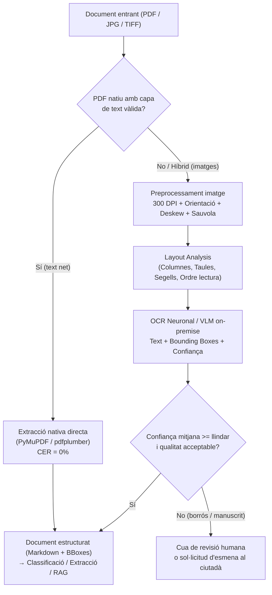

## A. Objectius d'aprenentatge

En completar aquesta lliçó, l'estudiant ha de ser capaç de:

1. **Distingir** entre **PDF natiu (text vectorial incrustat)**, **PDF escanejat (imatge pura)** i **PDF híbrid**, aplicant sempre l'extracció nativa abans de recórrer a OCR.
2. **Explicar** les etapes de **preprocessament d'imatges** (*deskewing*, binarització adaptativa d'Otsu/Sauvola, eliminació de soroll, normalització de resolució a 300 DPI) i la detecció de *layout* (*Layout Analysis*).
3. **Comparar** les tres generacions d'OCR: **OCR tradicional** (Tesseract), **OCR neuronal modern** (PaddleOCR, EasyOCR, TrOCR) i **models multimodals / OCR-free** (*Vision-Language Models* com Qwen2.5-VL, Docling, Donut) pel que fa a precisió en taules, manuscrits, segells, cost i privacitat.
4. **Calcular i interpretar** les dues mètriques estàndard de qualitat d'OCR: **CER (*Character Error Rate*)** i **WER (*Word Error Rate*)** basades en la distància d'edició de Levenshtein.
5. **Implementar** en Python pur el càlcul exacte de **CER i WER** i un **detector de tipus de PDF / puntuador de confiança OCR** per decidir automàticament quan reprocessar o derivar a revisió humana.

---

## B. Explicació introductòria

Gran part de la documentació que entra pel registre electrònic d'un ajuntament o de la Diputació de Barcelona arriba en **PDFs escanejats o fotografies fetes amb mòbil**: factures amb segells damunt les xifres, contractes signats a mà, escriptures notarials antigues o padrons històrics. Per a un ordinador, una pàgina escanejada no és text, sinó una **matriu de píxels**.

L'**OCR (*Optical Character Recognition*)** transforma aquestes imatges en text digital cercable i coordenades espacials (*bounding boxes*). En el **Processament Intel·ligent de Documents (IDP, *Intelligent Document Processing*)**, la qualitat de l'OCR és el fonament de tota la cadena: si l'OCR confon un `8` amb un `B` en un DNI o un `1.200,00` amb `12.000,00` en una factura, tots els passos posteriors (classificació, extracció i validació) heretaran l'error.

---

## C. Explicació tècnica avançada

### 1. PDF natiu vs. PDF escanejat vs. PDF híbrid

Una regla d'or d'enginyeria documental: **mai executis OCR a cegues sobre un PDF natiu!**
- **PDF natiu**: conté el flux de caràcters i coordenades vectorials (generat des de Word, ERP, e-FACT o seu electrònica). Extreure'l directament (`PyMuPDF / pdfplumber`) té **0% d'error de reconeixement de caràcters** i és 100× més ràpid que l'OCR!
- **PDF escanejat**: conté només una imatge incrustada per pàgina (sense capa de text o amb una capa OCR antiga molt dolenta). Requereix **preprocessament + OCR / VLM**.
- **PDF híbrid**: combina text natiu (p. ex., formulari) amb blocs escanejats o annexos incrustats com a imatge (p. ex., DNI o rebut bancari enganxat). Cal inspeccionar **pàgina a pàgina** (densitat de caràcters útils + àrea coberta per imatges) i aplicar OCR selectivament.

### 2. Pipeline de preprocessament d'imatges

La precisió d'un OCR tradicional o neuronal pot millorar radicalment amb preprocessament determinista:
1. **Resolució adequada**: escanejar o rasteritzar a **`300 DPI`** (per sota de 150 DPI les lletres petites i accents catalans `à, è, é, í, ï, ò, ó, ú, ü, ç, l·l` es degraden).
2. **Correcció d'inclinació (*Deskewing*) i orientació (`0°/90°/180°/270°`)**: redreçar pàgines tortes o girades de costat.
3. **Eliminació de soroll i ombres**: filtres morfològics i **binarització adaptativa** (Otsu global o **Sauvola local** per a fotos de mòbil amb ombres desiguals).
4. **Anàlisi de maquetació (*Layout Analysis*)**: segmentar prèviament columnes, capçaleres, peus de pàgina, taules i segells per reconstruir l'**ordre de lectura humà** (evitant llegir dues columnes travessades horitzontalment!).

### 3. Tres generacions d'OCR

| Generació | Eines / Models típics | Punts forts | Limitacions |
|---|---|---|---|
| **1. OCR clàssic** | **Tesseract** (LSTM + entrenament `cat`/`spa`) | Lleuger en CPU, 100% local, ideal per documents impresos nets | Feble en taules complexes, fotos amb ombres, segells damunt del text i escriptura manuscrita |
| **2. OCR neuronal + Layout** | **PaddleOCR**, EasyOCR, **Docling**, Surya, TrOCR | Excel·lent detecció de caixes rotades, taules, multicolumna i manuscrits (TrOCR) amb coordenades `[x1, y1, x2, y2]` i confiança per paraula | Requereix GPU per alt cabal; pot patir en documents extremadament degradats |
| **3. VLM / Multimodal (*OCR-free*)** | **Qwen2.5-VL**, Pixtral, Donut (*on-premise*) | Comprèn simultàniament **visual + estructura + semàntica** (taules imbricades, caselles marcades, segells, factures complexes) i pot retornar directament Markdown o JSON | Més lent i car en GPU; **risc d'al·lucinació visual** (pot «corregir» o inventar una xifra borrosa en lloc de marcar baixa confiança!) |

:::callout-warning Risc d'al·lucinació visual en VLMs
Un VLM pot *inventar* o completar un número de compte o DNI parcialmente esborrat perquè «sembla plausible». En camps crítics (NIF, IBAN, imports), combina sempre **coordenades + confiança per caràcter/paraula** amb **validació determinista** (dígit de control, suma aritmètica) i deriva a revisió humana quan falli!
:::

### 4. Mètriques d'avaluació d'OCR: **CER** i **WER**

Ambdues es basen en la **distància d'edició de Levenshtein** (mínim nombre de substitucions \(S\), esborrats \(D\) i insercions \(I\) per transformar la sortida OCR en el text real *ground truth*):
\[
\text{CER} = \frac{S_c + D_c + I_c}{N_{\text{caràcters reals}}}, \qquad \text{WER} = \frac{S_w + D_w + I_w}{N_{\text{paraules reals}}}
\]
- **Nota important**: en camps estructurats (NIFs, IBANs, imports, referències cadastrals), un **CER de només 1%** pot provocar un **WER del 10–15%** en codis de 10–20 dígits! Per això, a més del CER global, cal avaluar **Exact Match per camp crític**.

---

## D. Diagrames i recursos visuals

### Pipeline intel·ligent d'ingestió documental (PDF natiu vs. OCR neuronal / VLM)



---

## E. Aplicació a l'Administració pública

1. **Multilingüisme català/castellà i grafies pròpies**: qualsevol motor OCR desplegat a la Diputació ha d'estar configurat i avaluat explícitament amb caràcters catalans (`ç`, `l·l`, `à`, `è`, `é`, `í`, `ï`, `ò`, `ó`, `ú`, `ü`) — un OCR configurat només en anglès corromp toponímia i cognoms catalans!
2. **Digitalització segura (*ENI* — Esquema Nacional d'Interoperabilitat)**: en digitalització certificada de documents en paper de l'Administració, les normes tècniques d'interoperabilitat exigeixen resolució mínima adequada, formats estandarditzats (PDF/A) i preservació de la fidelitat visual de l'original.
3. **Traçabilitat visual (*Click-to-Highlight*)**: conservar les coordenades (*bounding boxes*) de cada paraula extreta per l'OCR permet que la pantalla de validació del funcionari **ressalti en groc sobre la imatge original del PDF** exactament d'on prové cada import o NIF, multiplicant la velocitat i fiabilitat de la supervisió humana!

---

## F. Exemple pràctic guiat

Implementem en **Python pur** el càlcul exacte de **distància de Levenshtein**, **CER (*Character Error Rate*)** i **WER (*Word Error Rate*)**, i un **enrutador de qualitat OCR** que compara un escaneig net contra un escaneig amb errors crítics en un NIF/import.

```python
"""Exemple 4.1: Càlcul exacte de CER i WER (Levenshtein) i enrutament de qualitat OCR."""


def levenshtein(seq_a: list[str], seq_b: list[str]) -> int:
    m, n = len(seq_a), len(seq_b)
    dp = list(range(n + 1))
    for i in range(1, m + 1):
        prev, dp[0] = dp[0], i
        for j in range(1, n + 1):
            temp = dp[j]
            cost = 0 if seq_a[i - 1] == seq_b[j - 1] else 1
            dp[j] = min(dp[j] + 1, dp[j - 1] + 1, prev + cost)
            prev = temp
    return dp[n]


def calcular_cer_wer(referencia: str, hipotesi_ocr: str) -> tuple[float, float]:
    ref_chars = list(referencia)
    hyp_chars = list(hipotesi_ocr)
    cer = levenshtein(ref_chars, hyp_chars) / max(len(ref_chars), 1)

    ref_words = referencia.split()
    hyp_words = hipotesi_ocr.split()
    wer = levenshtein(ref_words, hyp_words) / max(len(ref_words), 1)
    return cer, wer


def decidir_ruta_ocr(confianca_mitjana: float, te_capa_nativa: bool, llindar: float = 0.88) -> str:
    if te_capa_nativa:
        return "EXTRACCIÓ_NATIVA_DIRECTA (sense OCR)"
    if confianca_mitjana >= llindar:
        return "OCR_AUTOMÀTIC_ACCEPTAT"
    return "DERIVAR_A_REVISIÓ_HUMANA_O_VLM"


if __name__ == "__main__":
    ref = "Sol·licitud SUB-2026-0148 NIF 12345678Z Import 1.250,00 EUR"
    ocr_bo = "Sol·licitud SUB-2026-0148 NIF 12345678Z Import 1.250,00 EUR"
    ocr_1_error = "Sol.licitud SUB-2026-0148 NIF 123456782 Import 1.250,00 EUR"
    ocr_dolent = "Sollicitud SUB-2O26-O148 N1F 123456782 Imp0rt 12.500,00 EUR"

    for nom, hyp, conf in [
        ("OCR perfecte", ocr_bo, 0.99),
        ("OCR 2 errors subtils (·->., Z->2)", ocr_1_error, 0.91),
        ("OCR degradat (foto borrosa)", ocr_dolent, 0.72),
    ]:
        cer, wer = calcular_cer_wer(ref, hyp)
        ruta = decidir_ruta_ocr(conf, te_capa_nativa=False)
        print(f"{nom:35s} | CER={cer:.3f} | WER={wer:.3f} | {ruta}")
```

### Interpretació dels resultats (execució verificada)

- En el cas **"2 errors subtils"** (`·` confós amb `.` i la lletra `Z` del NIF confosa amb un `2`), el **CER sembla baixíssim (`0,034`)**, però el **WER ja puja al `0,286`** (2 de 7 paraules alterades, inclòs un **NIF invàlid!**).
- Això demostra una lliçó vital per a l'examen: un **CER baix i una confiança alta (`0,91`) NO garanteixen que un camp crític (NIF/import) sigui correcte** → cal sempre combinar OCR amb **validació determinista** (dígit de control del NIF, suma d'imports)!

---

## G. Exercici pràctic per resoldre

### Enunciat
L'equip de digitalització de la Diputació processa 40.000 factures i expedients mensuals. Actualment, el seu pipeline rasteritza **tots** els PDFs entrants a 150 DPI i els passa per **Tesseract configurat en anglès (`eng`)**. Observen tres problemes:
1. Un 65% dels PDFs ja eren PDFs natius digitals (generats per programes de facturació), però igualment pateixen errors de caràcters (`0`↔`O`, `1`↔`l`) i triguen molt a processar-se.
2. En els PDFs escanejats a dues columnes, el text extret mescla línies de la columna esquerra i dreta, i els noms catalans (`Vilassar`, `L'Hospitalet`, `sol·licitud`, `Sabadell`) apareixen amb caràcters corromputs.
3. Un proveïdor proposa enviar directament totes les imatges a una API VLM comercial als EUA per resoldre-ho tot.

Dissenya el **redisseny tècnic i normatiu complet** del pipeline d'OCR resolent tots tres problemes.

### Objectius i restriccions
- Evitar OCR innecessari en PDFs natius, corregir DPI/idioma/*layout analysis* i preservar sobirania de dades (RGPD/ENS) amb execució *on-premise*.

:::hint Pista 1 — Regla del 65% de PDFs natius
Afegir un **detector de capa de text nativa pàgina a pàgina** (`PyMuPDF`/`pdfplumber`): per al 65% de PDFs natius, extracció directa amb **0% CER** i 100× més rapidesa!
:::

:::hint Pista 2 — Escanejats (DPI + Layout + Idiomes + On-premise)
Pujar la rasterització a **300 DPI**, afegir **preprocessament + *Layout Analysis*** (Docling / PaddleOCR amb `cat+spa` per preservar columnes, taules i caràcters catalans) i reservar un **VLM *on-premise*** (mai API externa als EUA sense garanties RGPD per a factures amb dades personals!) únicament com a *fallback* en pàgines de baixa confiança, conservant *bounding boxes* per a revisió humana.
:::

### Criteris d'avaluació
- **30%**: Detecció prèvia de PDF natiu vs. escanejat/híbrid (estalvi immediat del 65% de còmput i 0% CER).
- **35%**: Correccions de qualitat OCR (300 DPI, *deskew*/Sauvola, *Layout Analysis* per columnes/taules, suport `cat+spa` amb `l·l`/accents, motor neuronal modern com PaddleOCR/Docling + preservació de *bounding boxes*).
- **35%**: Rebuig fonamentat de l'API VLM als EUA (RGPD/ENS/transferències internacionals de dades personals en factures/expedients) i alternativa *on-premise* en cascada + validació determinista de camps crítics.

### Errors habituals
- Acceptar l'API VLM als EUA sense avaluar RGPD/ENS ni el cost de processar 40.000 documents al mes.
- Continuar passant els PDFs natius per OCR.

:::solution Solució completa comentada i alternatives
### 1. Enrutador previ PDF natiu vs. escanejat/híbrid
- Inspeccionar cada pàgina amb `PyMuPDF`/`pdfplumber`: si té capa de text vectorial vàlida (densitat normal de caràcters i sense cobertura d'imatge de pàgina sencera), **extreure directament sense OCR** → elimina instantàniament errors i ~65% del cost computacional!

### 2. Redisseny de la branca d'escanejats (35% restant)
- **Resolució i preprocessament**: augmentar de 150 DPI a **300 DPI**, aplicar detecció d'orientació (`0/90/180/270°`), *deskewing* i binarització adaptativa (Sauvola) en fotos amb ombres.
- **Anàlisi de maquetació (*Layout Analysis*)**: utilitzar **Docling** o **PaddleOCR + PP-Structure** per detectar columnes, taules i ordre de lectura abans del reconeixement, eliminant la barreja entre columnes.
- **Suport lingüístic català/castellà**: configurar explícitament diccionaris/models amb suport complet per a `cat` + `spa` (`àèéíïòóúüç`, `l·l`, apòstrofs) i validar amb un conjunt de prova real mesurant CER/WER i Exact Match en NIF/imports.
- **Preservació de *bounding boxes*** i confiança per paraula per ressaltar els camps sobre el PDF original en la pantalla de validació humana.

### 3. Rebuig de l'API externa als EUA i arquitectura *on-premise* en cascada
- Les factures i expedients contenen dades personals (autònoms, NIF, adreces, IBANs): enviar-les a una API externa fora de l'EEE comporta riscos RGPD (transferències internacionals cap. V, encarregat del tractament) i ENS, a més d'un cost elevat en 40.000 docs/mes.
- **Alternativa òptima (Cascada *on-premise*)**: (Nivell 1) Extracció nativa → (Nivell 2) PaddleOCR/Docling local → (Nivell 3) VLM *open-weights* local (p. ex. Qwen2.5-VL en GPU pròpia) **només** per al 5–10% de pàgines amb baixa confiança o taules molt complexes → (Nivell 4) Validació determinista (NIF/IBAN/sumes) + revisió humana amb *bounding boxes*.
:::

---

## H. Test individual

Resol les 10 preguntes sobre PDFs natius vs. escanejats, preprocessament (300 DPI, *deskewing*, Sauvola, *layout analysis*), OCR clàssic vs. neuronal vs. VLM, risc d'al·lucinació visual i càlcul de CER/WER.

---

## I. Preguntes de desenvolupament

### Pregunta 1
Explica les diferències entre un **PDF natiu**, un **PDF escanejat** i un **PDF híbrid**, i justifica per què un pipeline IDP de producció ha d'inspeccionar cada pàgina abans d'invocar el motor OCR.

:::model-answer Resposta model i criteris de correcció (Pregunta 1)
**Resposta model**:
- **PDF natiu**: guarda el text com a caràcters digitals i coordenades vectorials; l'extracció directa (`PyMuPDF`/`pdfplumber`) ofereix **0% CER** i latència en mil·lisegons.
- **PDF escanejat**: conté únicament una imatge ràster per pàgina; exigeix preprocessament (300 DPI, *deskew*, binarització adaptativa) i OCR/*Layout Analysis*.
- **PDF híbrid**: combina pàgines o zones amb text natiu (p. ex., instància generada electrònicament) i annexos escanejats incrustats com a imatge (p. ex., DNI o factura en paper).
- Inspeccionar **pàgina a pàgina** evita degradar innecessàriament el text perfecte dels PDFs natius (introduint confusions `0`/`O` o `1`/`l`), estalvia ordres de magnitud en GPU/CPU i garanteix que els annexos escanejats dins d'un PDF híbrid no quedin invisibles.

**Criteris de correcció (10 punts)**:
- Definició precisa dels 3 tipus de PDF: 5 punts.
- Justificació tècnica d'inspecció pàgina a pàgina (qualitat + cost + annexos): 5 punts.
:::

### Pregunta 2
Compara **OCR tradicional (Tesseract)**, **OCR neuronal amb anàlisi de *layout* (PaddleOCR/Docling)** i **VLM multimodal (*OCR-free*)**, assenyalant el risc específic d'**al·lucinació visual** dels VLMs i com mitigar-lo en camps crítics.

:::model-answer Resposta model i criteris de correcció (Pregunta 2)
**Resposta model**:
- **Tesseract**: ràpid en CPU per a documents nets i d'una sola columna, però fràgil davant taules complexes, multicolumna, segells o fotos amb ombres.
- **OCR neuronal + Layout (PaddleOCR/Docling)**: detecta columnes, taules, rotacions i ordre de lectura amb *bounding boxes* i puntuacions de confiança per paraula, escalant bé *on-premise*.
- **VLM multimodal**: entén simultàniament estructura visual complexa, caselles marcades i semàntica (ideal per a taules imbricades o documents molt complexos), però consumeix molta més GPU i presenta **risc d'al·lucinació visual** (pot completar o inventar un dígit borrosament llegit en un NIF, IBAN o import fent-lo semblar plausible).
- **Mitigació**: arquitectura en cascada (natiu → OCR neuronal → VLM només en casos complexos), validació determinista de dígits de control i sumes comptables, preservació de *bounding boxes* i revisió humana obligatòria si falla la validació.

**Criteris de correcció (10 punts)**:
- Comparativa rigorosa de les 3 generacions: 6 punts.
- Explicació de l'al·lucinació visual en VLMs i mitigacions deterministes/HITL: 4 punts.
:::

### Pregunta 3
Defineix matemàticament **CER (*Character Error Rate*)** i **WER (*Word Error Rate*)** i explica per què un CER global molt baix (p. ex., 1–2%) pot resultar igualment inacceptable en documents administratius amb codis i imports.

:::model-answer Resposta model i criteris de correcció (Pregunta 3)
**Resposta model**:
- \(\text{CER} = (S_c + D_c + I_c) / N_{\text{caràcters}}\) i \(\text{WER} = (S_w + D_w + I_w) / N_{\text{paraules}}\), calculats amb la distància d'edició de Levenshtein (substitucions, esborrats, insercions).
- **Per què un CER de 1–2% pot ser crític**: mentre que un error d'un caràcter en prosa normal («ajuntamemt») és fàcilment comprensible, un sol dígit erroni en un **NIF (9 caràcters)**, un **IBAN (24 caràcters)**, una **referència cadastral (20 caràcters)** o un **import (`1.250,00` → `12.500,00`)** invalida completament el camp i dispara el WER i l'error de negoci! Per això cal complementar CER/WER amb **Exact Match per camp crític** i validadors deterministes.

**Criteris de correcció (10 punts)**:
- Fórmules exactes de CER i WER (Levenshtein): 5 punts.
- Anàlisi de l'impacte en codis estructurats i necessitat d'Exact Match + validació: 5 punts.
:::

---

## J. Resum per memoritzar

### Conceptes clau
- **Regla d'or**: detectar sempre **PDF natiu** (extracció directa, `CER = 0%`) pàgina a pàgina abans d'aplicar OCR!
- **Preprocessament clau**: `300 DPI`, orientació, *deskewing*, binarització adaptativa (**Sauvola**) i ***Layout Analysis*** (columnes, taules, ordre de lectura).
- **3 generacions**: Clàssic (Tesseract) → Neuronal + Layout (PaddleOCR / Docling) → VLM multimodal *on-premise* (potent en taules/caselles, però risc d'**al·lucinació visual**).
- **CER / WER**: distància de Levenshtein normalitzada; un CER baix no basta per a NIFs/IBANs/imports (cal **Exact Match + validació determinista**).
- **Bounding boxes**: imprescindibles per ressaltar sobre el PDF original durant la revisió humana (*Click-to-Highlight*).

### Definicions essencials
- **CER (*Character Error Rate*)**: \((S + D + I) / N_{\text{caràcters}}\) entre la sortida OCR i la transcripció de referència.
- ***Layout Analysis***: segmentació visual d'una pàgina en blocs semàntics (columnes, taules, capçaleres, peus, imatges) per preservar l'ordre de lectura i l'estructura tabular.

### Errors conceptuals freqüents
1. Executar OCR sobre PDFs natius (empitjora la qualitat i malgasta còmput).
2. Deixar l'OCR configurat només en anglès (`eng`) en una administració catalana (corromp `l·l`, `ç` i accents).
3. Confiar cegament en la sortida d'un VLM sense validació determinista ni *bounding boxes*.

### Possibles preguntes d'examen
- Com dissenyes un enrutador pàgina a pàgina per a PDFs natius, escanejats i híbrids?
- Calcula CER i WER donada una referència i una sortida OCR i interpreta la diferència en camps crítics.
- Compara OCR neuronal + Layout vs. VLM multimodal i explica com mitigar l'al·lucinació visual.
