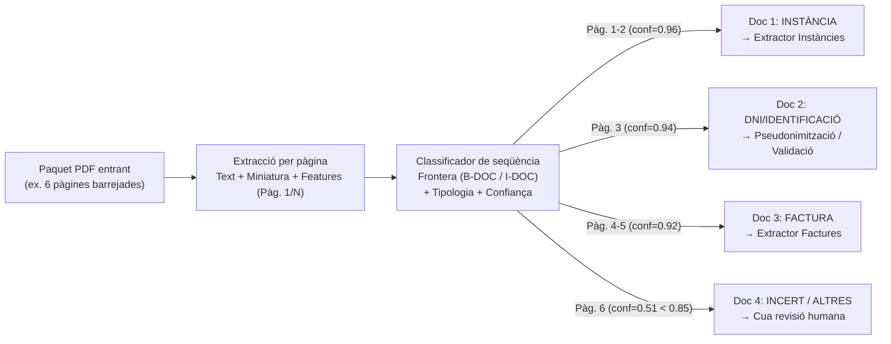

## A. Objectius d'aprenentatge

En completar aquesta lliçó, l'estudiant ha de ser capaç de:

1. **Distingir** la **classificació de textos pura (NLP)** de la **classificació documental (IDP)**, on el format visual (*layout*), les capçaleres, logotips, segells i multipàgina aporten senyal determinant.
2. **Explicar** el problema del ***Document Splitting* (segmentació de paquets PDF multipàgina)** i la seva resolució mitjançant classificació pàgina a pàgina (`INICI_DOC` vs. `CONTINUACIO` + tipologia).
3. **Comparar** enfocaments tècnics de classificació documental: **regles + paraules clau**, **text sol (TF-IDF / Transformer)**, **visió pura (CNN/ViT sobre miniatures)** i **models multimodals text + layout + visió (LayoutLMv3 / LiLT / VLM)**.
4. **Dissenyar** una taxonomia documental alineada amb el quadre de classificació de l'**ENI** (Esquema Nacional d'Interoperabilitat), gestionant la classe **`ALTRES / DESCONEGUT`** i el **llindar d'abstenció** cap a revisió humana.
5. **Implementar** en Python pur un **segmentador i classificador multipàgina (*Split & Classify*)** capaç de trobar fronteres de documents dins d'un PDF únic escanejat en bloc i assignar cada subdocument a la seva tipologia amb control de confiança.

---

## B. Explicació introductòria

Quan un ciutadà o un proveïdor presenta documentació per registre, rarament puja cada paper en un fitxer ben anomenat. Sovint envia un **únic PDF de 14 pàgines anomenat `escaner_2026.pdf`** que conté, tot seguit: la instància de sol·licitud (pàg. 1–2), una fotocòpia del DNI (pàg. 3), un certificat d'empadronament (pàg. 4), dues factures (pàg. 5–7) i un conveni signat (pàg. 8–14).

La **classificació documental** en IDP té dues missions: (1) **separar (*split*)** un paquet PDF en els seus documents individuals i (2) **etiquetar la tipologia documental exacta** de cada peça (`INSTANCIA`, `FACTURA`, `CERTIFICAT_EMPADRONAMENT`, `DECRET`, `DNI_IDENTIFICACIO`, `ALTRES`) perquè el sistema pugui invocar l'extractor de camps específic de cada tipus i arxivar-lo al quadre documental corporatiu!

---

## C. Explicació tècnica avançada

### 1. Per què el text sol no sempre basta? (Senyal visual i de *layout*)

En molts documents públics, la **disposició visual** és tan informativa com el text (i sovint més ràpida i immune a errors d'OCR!):
- Una **fotocòpia de DNI/NIE** té molt poc text (i sovint mal OCR), però una estructura visual inconfusible.
- Una **factura** té una taula central d'imports, logotip superior i bloc de total inferior dret.
- Un **certificat oficial** té escut institucional a la capçalera, fórmula de certificació i codi segur de verificació (**CSV**) al marge esquerre!

### 2. Comparativa d'arquitectures de classificació documental

| Enfocament | Dades d'entrada | Avantatges | Limitacions |
|---|---|---|---|
| **Regles + TF-IDF / SVM** | Text OCR/natiu + metadades | Ultra ràpid (<5 ms), interpretable, excel·lent *baseline* | Fràgil en documents molt visuals (DNI, plànols) o OCR degradat |
| **Transformer de text** (RoBERTa-ca / mDeBERTa) | Text de la pàgina | Alta precisió semàntica en documents rics en text (decrets, plecs, instàncies) | Ignora geometria, segells, escuts i estructura visual |
| **Classificador visual** (ViT / ResNet sobre miniatura) | Imatge de la pàgina (p. ex. 224×224) | Ultra ràpid, funciona **fins i tot sense OCR!** (ideal per DNI, plànols, rebuts bancaris) | Confon documents de maquetació idèntica però contingut diferent (p. ex. resolució favorable vs. desfavorable) |
| **Multimodal Text + Layout + Visió** (**LayoutLMv3**, LiLT, VLM) | Text + *bounding boxes* 2D + imatge | **Màxima precisió global** en combinar estructura visual i contingut textual | Major cost d'entrenament i inferència en GPU |

### 3. *Document Splitting* (Separació de paquets multipàgina)

Donat un PDF de \(P\) pàgines, el problema es modela com un **etiquetatge de seqüència sobre pàgines**:
- Per a cada pàgina \(p_t\), un classificador (que mira \(p_{t-1}\) i \(p_t\)) prediu:
  1. **Frontera**: `B-DOC` (inici de nou document) vs. `I-DOC` (continuació del document anterior).
  2. **Tipologia**: classe documental (`FACTURA`, `INSTANCIA`, `CERTIFICAT`, `DNI`, `ALTRES`).
- **Senyals forts de frontera**: aparició de `"Pàgina 1 de N"`, nova capçalera/logotip/escut, canvi brusc de tipologia visual o nou número de registre/factura.

### 4. Classe `ALTRES / DESCONEGUT` i gestió d'incertesa

En el món real sempre arriben documents inesperats (una foto de vacances enviada per error, un croquis fet a mà, un rebut no previst):
- Un classificador *softmax* tancat sobre 10 classes **sempre forçarà una de les 10 etiquetes**!
- Cal definir explícitament una classe **`ALTRES / FORA_DE_CATALEG`** i un **llindar de confiança calibrat** (p. ex., `max_prob < 0,85` o entropia alta → cua de revisió humana) perquè cap document desconegut entri a un extractor erroni (p. ex., passar un conveni a l'extractor de factures!).

---

## D. Diagrames i recursos visuals

### Flux *Split & Classify* per a paquets PDF multipàgina



---

## E. Aplicació a l'Administració pública

1. **Alineació amb el quadre de classificació documental i l'ENI**: les tipologies han d'estar mapejades directament als tipus documentals normalitzats de l'Esquema Nacional d'Interoperabilitat (`TD01 Resolució`, `TD07 Certificat`, `TD14 Sol·licitud`, `TD19 Factura`, etc.) per facilitar l'arxiu electrònic únic i les transferències entre administracions!
2. **Detecció i protecció primerenca de documents sensibles**: classificar automàticament una pàgina com a `DNI_PASSAPORT` o `INFORME_MEDIC` permet aplicar-hi immediatament polítiques reforçades de seguretat (accés restringit, evitar indexació al RAG general, anonimització).
3. **Reducció d'errors en cascada**: la classificació documental actua com a **enrutador mestre** cap als extractors de camps; un fals positiu aquí envia un document al flux equivocat, per la qual cosa la **calibració de confiança** i l'abstenció en casos dubtosos són essencials.

---

## F. Exemple pràctic guiat

Implementem en **Python pur** un **motor *Split & Classify*** que processa un paquet PDF de 5 pàgines barrejades (una instància de 2 pàgines, una factura d'1 pàgina, un certificat i una pàgina ambigua), detectant automàticament fronteres (`B-DOC` / `I-DOC`), assignant tipologies ENI i derivant a revisió humana la pàgina amb baixa confiança.

```python
"""Exemple 4.2: Motor Split & Classify multipàgina amb detecció de fronteres i control de confiança."""
import re

REGLES_CLASSE: dict[str, list[str]] = {
    "TD14_SOL·LICITUD": ["sol·licitud", "exposo", "sol·licito", "instància", "registre"],
    "TD19_FACTURA": ["factura", "base imposable", "iva", "total a pagar", "nif emissor"],
    "TD07_CERTIFICAT": ["certifico", "secretari", "padró", "csv", "efectes oportuns"],
}


def classificar_pagina(text: str) -> tuple[str, float, bool]:
    t = text.lower()
    es_inici_explicit = bool(re.search(r"pàgina\s+1\s+de\s+\d+|factura\s+n[úu]m|certifico\s+que|instància\s+general", t))
    puntuacions = {cls: sum(1 for kw in kws if kw in t) for cls, kws in REGLES_CLASSE.items()}
    millor_cls, hits = max(puntuacions.items(), key=lambda x: x[1])
    total_hits = sum(puntuacions.values())
    if hits == 0:
        return "ALTRES_DESCONEGUT", 0.30, True
    conf = min(0.98, 0.55 + 0.15 * hits) * (hits / max(total_hits, 1))
    return millor_cls, round(conf, 3), es_inici_explicit


def split_and_classify(pagines: list[str], llindar_conf: float = 0.75) -> list[dict[str, object]]:
    documents: list[dict[str, object]] = []
    for num_pag, text in enumerate(pagines, start=1):
        cls, conf, inici_explicit = classificar_pagina(text)
        estat = "AUTO" if (cls != "ALTRES_DESCONEGUT" and conf >= llindar_conf) else "REVISIO_HUMANA"
        # Obrim nou document si és la 1a pàgina, marca inici explícit o canvia la tipologia
        if not documents or inici_explicit or documents[-1]["tipologia"] != cls or estat == "REVISIO_HUMANA":
            documents.append({"tipologia": cls, "pagines": [num_pag], "confianca_min": conf, "estat": estat})
        else:
            documents[-1]["pagines"].append(num_pag)  # type: ignore[union-attr]
            documents[-1]["confianca_min"] = min(float(documents[-1]["confianca_min"]), conf)
    return documents


if __name__ == "__main__":
    paquet = [
        "Instància general Pàgina 1 de 2. Sol·licitud de subvenció. Exposo els fets i registre.",
        "Pàgina 2 de 2. Per tot això, sol·licito la concessió de l'ajut i signo la sol·licitud.",
        "Factura núm. F-2026-88. NIF emissor B12345678. Base imposable 1000 EUR, IVA 21%, Total a pagar 1210 EUR.",
        "Certifico que la persona consta al padró municipal. Secretari general. CSV-998877.",
        "Annex fotogràfic sense capçalera clara de l'obra executada.",
    ]
    for idx, doc in enumerate(split_and_classify(paquet), start=1):
        print(f"Subdocument {idx}: {doc}")
```

### Interpretació dels resultats (execució verificada)

- Les pàgines **1 i 2** s'agrupen automàticament en un únic subdocument `TD14_SOL·LICITUD` (`AUTO`), ja que la pàgina 2 continua la mateixa tipologia sense marca d'inici nou.
- La pàgina **3** obre nou document `TD19_FACTURA` (`AUTO`), la pàgina **4** obre `TD07_CERTIFICAT` (`AUTO`), i la pàgina **5** (annex fotogràfic ambigu) queda marcada com `ALTRES_DESCONEGUT` → **`REVISIO_HUMANA`**!

---

## G. Exercici pràctic per resoldre

### Enunciat
Un ajuntament ha entrenat un classificador de textos purs (TF-IDF + Regressió Logística) sobre 8 classes documentals (`INSTANCIA`, `FACTURA`, `NOMINA`, `DNI`, `CERTIFICAT`, `CONVENI`, `DECRET`, `PLÀNOL_TECNIC`) per classificar els PDFs del registre. En producció apareixen tres problemes greus:
1. Les classes `DNI` i `PLÀNOL_TECNIC` tenen un `F1` inferior al `0,45` perquè l'OCR gairebé no hi extreu text útil.
2. Quan un ciutadà envia un únic PDF de 8 pàgines amb `INSTANCIA + DNI + FACTURA`, tot el fitxer s'etiqueta com una única `INSTANCIA` i la factura no arriba mai a comptabilitat!
3. Quan un ciutadà adjunta per error una captura de pantalla d'una app bancària (classe no prevista), el model la classifica com `FACTURA` amb probabilitat `0,54` i trenca l'extractor de factures.

Proposa la **solució d'arquitectura completa** per resoldre cadascun dels 3 problemes.

### Objectius i restriccions
- Combinar modalitats (visual + text/layout), dissenyar *Split & Classify* multipàgina i calibrar abstenció + classe `ALTRES`.

:::hint Pista 1 — Per a `DNI` i `PLÀNOL_TECNIC`
Afegeix senyal **visual / multimodal** (miniatures via ViT/CNN lleugera o LayoutLMv3): un DNI i un plànol tècnic es reconeixen visualment amb `>95%` de precisió fins i tot amb 0 paraules d'OCR!
:::

:::hint Pista 2 — Paquets multipàgina + classe no prevista
(2) Passar de classificació a nivell de fitxer a ***Split & Classify* pàgina a pàgina** (`B-DOC`/`I-DOC` + tipologia); (3) Calibrar probabilitats (Temperature Scaling), fixar **llindar d'abstenció** (p. ex. `0,85`) i afegir la classe explícita **`ALTRES_DESCONEGUT`** cap a revisió humana!
:::

### Criteris d'avaluació
- **35%**: Incorporació de modalitat **visual / multimodal** (ViT/CNN o LayoutLMv3) per resoldre documents amb poc text (`DNI`, `PLÀNOL_TECNIC`).
- **35%**: Canvi de classificació per fitxer a ***Split & Classify* pàgina a pàgina** (detecció de fronteres `B-DOC`/`I-DOC`).
- **30%**: Classe `ALTRES_DESCONEGUT` + calibració de probabilitats + llindar d'abstenció (`< 0,85` → revisió humana) per protegir els extractors posteriors.

### Errors habituals
- Intentar arreglar `DNI` i `PLÀNOL_TECNIC` només afegint més n-grams de text a TF-IDF.

:::solution Solució completa comentada i alternatives
### 1. Resolució de `DNI` i `PLÀNOL_TECNIC` (F1 < 0,45)
- Incorporar un **classificador multimodal (text + layout + imatge)** com **LayoutLMv3** o un **acoblament (*late fusion*)** d'un encoder de text (RoBERTa-ca) amb un encoder visual lleuger (ResNet/ViT sobre miniatures de pàgina). Les característiques visuals identifiquen immediatament un DNI o un plànol arquitectònic sense dependre de l'OCR (i permeten marcar automàticament el `DNI` amb restriccions de privacitat RGPD!).

### 2. Resolució de paquets multipàgina barrejats
- Substituir la classificació a nivell de fitxer per un pipeline ***Split & Classify* a nivell de pàgina**: un model de seqüència avalua parells de pàgines consecutives `(p_{t-1}, p_t)` i prediu tant la frontera (`B-DOC` inici / `I-DOC` continuació) com la tipologia, partint el PDF de 8 pàgines en 3 subdocuments independents (`INSTANCIA`, `DNI`, `FACTURA`) i enrutant la factura cap a comptabilitat.

### 3. Protecció davant documents imprevistos (captura d'app amb prob. `0,54`)
- Calibrar les probabilitats del classificador (Temperature Scaling), afegir exemples negatius per a una classe explícita **`ALTRES_DESCONEGUT`** i establir una **política de llindar d'abstenció** (p. ex. `conf < 0,85` → `REVISIO_HUMANA`). Així, cap document amb probabilitat `0,54` no entra mai a l'extractor de factures.
:::

---

## H. Test individual

Resol les 10 preguntes sobre classificació documental multimodal, *Split & Classify* multipàgina, alineació ENI, classe `ALTRES`, calibració i detecció primerenca de documents sensibles.

---

## I. Preguntes de desenvolupament

### Pregunta 1
Explica per què la **classificació documental (IDP)** requereix sovint models **multimodals (text + *layout* + visió)** en lloc de classificadors de text pur, il·lustrant-ho amb tres tipus documentals reals d'un ajuntament.

:::model-answer Resposta model i criteris de correcció (Pregunta 1)
**Resposta model**:
- Un classificador de text pur ignora la geometria de la pàgina, els escuts, les taules i les imatges, i falla completament quan el document té poc text o OCR dolent.
- **3 exemples municipals**: (1) **Fotocòpia de DNI/NIE**: poc text i sovint borrós, però visualment inequívoc; (2) **Plànol d'obra / urbanisme**: quasi nul text, reconegut per trets visuals; (3) **Factura vs. pressupost / certificat oficial**: estructura tabular, escut institucional i codi CSV al marge que diferencien ràpidament la tipologia. Models com **LayoutLMv3** o fusions text+visió combinen tots dos senyals amb màxima precisió.

**Criteris de correcció (10 punts)**:
- Fonamentació tècnica de la multimodalitat (text + layout + imatge): 5 punts.
- Tres exemples municipals pertinents i ben raonats: 5 punts.
:::

### Pregunta 2
Descriu com es formula i s'implementa el problema de ***Document Splitting* (*Split & Classify*)** en paquets PDF escanejats en bloc, indicant quins senyals ajuden a detectar una frontera entre documents.

:::model-answer Resposta model i criteris de correcció (Pregunta 2)
**Resposta model**:
- Es modela com un etiquetatge de seqüència pàgina a pàgina dins del PDF: per a cada pàgina \(p_t\) (considerant també la pàgina anterior \(p_{t-1}\)), el model prediu una etiqueta de frontera (`B-DOC` = inici de nou document, `I-DOC` = continuació) i la tipologia documental.
- **Senyals clau de frontera**: reinici de paginació (`Pàgina 1 de N`), aparició d'una nova capçalera/escut/logotip, canvi de tipologia visual o textual, nou número de factura/registre, o pàgina en blanc separadora. En cas de baixa confiança en una frontera, es marca el paquet per a revisió humana abans de trencar o unir documents erròniament.

**Criteris de correcció (10 punts)**:
- Formulació com a classificació seqüencial `B-DOC`/`I-DOC` + tipologia: 5 punts.
- Senyals pràctics de frontera i gestió de baixa confiança: 5 punts.
:::

### Pregunta 3
Quina relació té la classificació documental automàtica amb l'**Esquema Nacional d'Interoperabilitat (ENI)** i amb la **protecció de dades (RGPD)** en un registre electrònic públic?

:::model-answer Resposta model i criteris de correcció (Pregunta 3)
**Resposta model**:
- **Alineació ENI**: utilitzar les tipologies documentals normalitzades de l'ENI (`TD01 Resolució`, `TD07 Certificat`, `TD14 Sol·licitud`, `TD19 Factura`, etc.) permet integrar directament la classificació IA amb l'arxiu electrònic únic, els metadades mínims obligatoris d'expedient i l'intercanvi interoperable entre administracions.
- **Protecció de dades (RGPD)**: detectar automàticament en l'entrada tipologies especialment sensibles (`DNI/NIE`, `INFORME_MEDIC`, `INFORME_SERVEIS_SOCIALS`) permet aplicar immediatament control d'accés restringit, excloure-les d'índexs RAG generals i activar fluxos de minimització/pseudonimització des del primer segon.

**Criteris de correcció (10 punts)**:
- Connexió rigorosa amb tipologies i metadades ENI: 5 punts.
- Aplicació de classificació primerenca a controls RGPD: 5 punts.
:::

---

## J. Resum per memoritzar

### Conceptes clau
- **Classificació documental ≠ classificació de text**: el senyal visual i de *layout* (**LayoutLMv3** / ViT+Text) és clau per a DNI, plànols, factures i certificats.
- ***Split & Classify***: separa paquets PDF multipàgina predient frontera (`B-DOC`/`I-DOC`) + tipologia pàgina a pàgina.
- **Taxonomia ENI**: alinear classes amb tipologies oficials (`TD01`, `TD07`, `TD14`, `TD19`...) per interoperabilitat i arxiu electrònic.
- **Classe `ALTRES` + llindar calibrat**: essencial perquè documents inesperats no es forcin dins classes existents i trenquin els extractors.

### Definicions essencials
- ***Document Splitting***: segmentació automàtica d'un fitxer PDF multipàgina escanejat en bloc en els seus documents lògics individuals.
- **LayoutLMv3**: família de models Transformer multimodals que codifiquen conjuntament text, coordenades espacials 2D (*bounding boxes*) i pedaços d'imatge.

### Errors conceptuals freqüents
1. Classificar a nivell de fitxer PDF sencer sense fer *splitting*, perdent annexos crítics dins paquets multipàgina.
2. Usar només text per classificar DNI o plànols tècnics.
3. Ometre la classe `ALTRES` i un llindar d'abstenció, provocant errors en cascada sobre els extractors posteriors.

### Possibles preguntes d'examen
- Com resols un paquet PDF de 10 pàgines amb 3 documents barrejats (*Split & Classify*)?
- Compara classificació per text pur, visual pura i multimodal (LayoutLMv3) en documents públics.
- Com protegir els extractors posteriors davant tipologies no previstes en l'entrenament?
