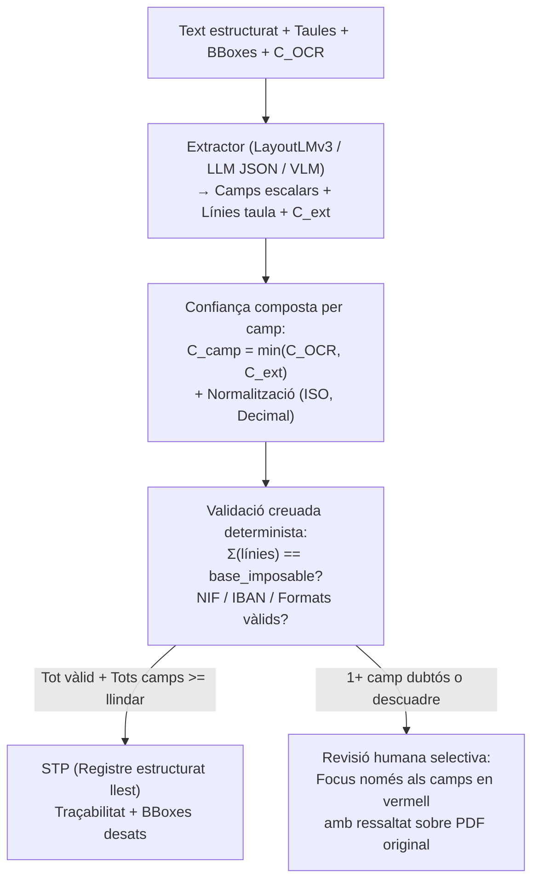

## A. Objectius d'aprenentatge

En completar aquesta lliçó, l'estudiant ha de ser capaç de:

1. **Distingir** entre extracció de **camps escalars (clau-valor, KIE)** (número d'expedient, NIF, data, total) i **extracció de taules / línies de detall** (files repetitives amb quantitat, descripció, preu unitari, IVA i subtotal, fins i tot repartides entre múltiples pàgines!).
2. **Comparar** les quatre aproximacions tècniques d'extracció de camps en documents: **plantilles/coordenades fixes**, **models de *layout* entrenats (LayoutLMv3)**, **LLMs amb sortida estructurada sobre text+taules** i **VLMs multimodals directes**.
3. **Combinar** la **confiança de l'OCR** i la **confiança de l'extractor** per calcular una **confiança composta per camp** i decidir entre **STP (*Straight-Through Processing*)** i **revisió humana selectiva** (només dels camps dubtosos!).
4. **Aplicar** les mètriques d'avaluació d'extracció documental: **Exact Match per camp**, **F1 per camp**, **Exact Match a nivell de document complet** i **TEDS** (*Tree-Edit-Distance-based Similarity*) per a estructura de taules.
5. **Implementar** en Python pur un **extractor estructurat de capçalera + taula de línies** amb càlcul de confiança composta per camp, *bounding box* associat i verificació aritmètica creuada de les línies contra el total.

---

## B. Explicació introductòria

Un cop sabem que un document és una factura, una subvenció o un pressupost, el nostre objectiu és transformar-lo en **dades estructurades llestes per entrar al gestor corporatiu o ERP** (en format JSON validat): emissor, NIF, data, import base, IVA, total i **totes les files de la taula de conceptes**.

En documents de proveïdors externs, **cada empresa fa servir una plantilla diferent**: una posa el número de factura dalt a la dreta, una altra al mig, una altra divideix la taula en 3 pàgines. L'**extracció intel·ligent de camps (KIE, *Key Information Extraction*)** supera les plantilles fràgils, associant a cada dada extreta el seu **valor normalitzat**, el seu **nivell de confiança** i les seves **coordenades exactes al PDF**.

---

## C. Explicació tècnica avançada

### 1. Camps escalars (KIE) vs. Taules i línies de detall

- **Camps escalars (1 valor per document)**: `num_factura`, `data_emissio`, `nif_emissor`, `iban`, `import_total`. Relativament directes d'extreure i normalitzar.
- **Taules i línies de detall (`list[Linea]`)**: el repte més difícil de l'IDP real! Complicacions habituals:
  - Cel·les multilínia (descripcions llargues que ocupen 3 línies però corresponen a 1 sol ítem).
  - **Taules multipàgina** (la taula comença a la pàgina 1 i continua a la pàgina 2 sense repetir capçaleres!).
  - Cel·les combinades (*merged cells*) o columnes sense línies verticals visibles (*borderless tables*).
  - **Control d'or en taules econòmiques**: verificar sempre \(\sum \text{subtotal\_línia}_i = \text{base\_imposable}\)! Si no quadra al cèntim, hi ha hagut una fila perduda o una xifra mal llegida → bloqueig automàtic cap a revisió humana!

### 2. Comparativa d'enfocaments d'extracció de camps

| Enfocament | Millor cas d'ús | Punts forts | Limitacions |
|---|---|---|---|
| **Plantilles per coordenades fixes** | Formularis oficials 100% rígids emesos per la pròpia administració | Determinista, velocitat instantània | Es trenca al mínim desplaçament d'escaneig o canvi de versió del formulari |
| **KIE basat en Layout (LayoutLMv3 / LiLT)** | Alt volum (>50k docs/mes) de tipologies fixes (factures, nòmines) | Ultra ràpid en inferència, zero al·lucinacions (només etiqueta tokens existents a l'OCR!), *bounding boxes* nadius | Requereix dataset etiquetat (300–1.000 docs) per tipologia; feble en raonament complex |
| **LLM estructurat (*JSON Schema* sobre OCR/Markdown)** | Varietat alta de plantilles (*zero/few-shot*), canvis freqüents d'esquema | Flexibilitat màxima sense reentrenament, bona comprensió semàntica | Depèn de la qualitat de l'OCR i del parseig de taules; requereix validar que el valor existeix al text font |
| **VLM multimodal estructurat** (*on-premise*) | Documents visualment complexos (caselles marcades, taules sense vores, manuscrits) | Veu directament el disseny i el text alhora | Major cost GPU; risc d'al·lucinació visual si no s'acompanya de validació determinista |

### 3. Nivells de confiança compostos i **STP (*Straight-Through Processing*)**

La confiança d'un camp extret **mai** no depèn només d'una etapa:
\[
C_{\text{composta}}(\text{camp}) = C_{\text{OCR}}(\text{tokens del camp}) \times C_{\text{extractor}}(\text{camp})
\]
*(o el mínim `min(C_OCR, C_extractor)` quan volem una política conservadora en camps crítics!)*.

Això habilita la **revisió humana selectiva (per camp, no per document sencer!)**:
- **STP (*Straight-Through Processing*)**: si **tots** els camps obligatoris superen el seu llindar específic (p. ex., `0,95` per a imports/NIF, `0,85` per a descripció) **i** passen el 100% de les regles de validació determinista (dígits de control + cuadre aritmètic), el document s'accepta automàticament sense intervenció humana (per a processos d'entrada de dades sense resolució jurídica).
- **Revisió humana focalitzada**: si només falla la confiança del camp `data_venciment` (`0,71`), la interfície porta el cursor del funcionari **directament a aquell camp** amb el requadre groc ressaltat al PDF, reduint la revisió de 3 minuts a **8 segons**!

### 4. Mètriques d'avaluació d'extracció de camps

- **Exact Match per camp**: percentatge de documents on el valor normalitzat coincideix exactament amb el *ground truth* (clau en NIF, dates, imports).
- **Document-Level Exact Match (Strict STP Accuracy)**: percentatge de documents on **tots** els camps requerits són simultàniament exactes (si tens 10 camps amb 95% de precisió independent cadascun, \(0,95^{10} \approx 59,9\%\) de documents perfectes!).
- **TEDS (*Tree-Edit-Distance-based Similarity*)**: mètrica estàndard per mesurar la fidelitat estructural i de contingut en l'extracció de taules HTML/Markdown.

---

## D. Diagrames i recursos visuals

### Pipeline d'extracció de camps + confiança composta + revisió selectiva



---

## E. Aplicació a l'Administració pública

1. **Priorització de factura electrònica estructurada (`Facturae / e-FACT`)**: abans de fer extracció IA sobre factures PDF, cal fomentar l'entrada per **e-FACT** (XML estructurat amb 0% d'error!). L'extracció IDP de factures PDF es reserva per a justificants de subvencions d'entitats/ciutadans, factures estrangeres o despeses menors en paper.
2. **Llindars diferenciats per criticitat del camp**: en un expedient econòmic, `iban`, `nif` i `import_total` exigeixen llindars estrictes (`≥ 0,95`) + validació matemàtica obligatòria, mentre que `descripcio_concepte` admet un llindar més flexible (`≥ 0,80`).
3. **Bucle de millora contínua (Aprenentatge actiu)**: cada correcció que fa un funcionari a la pantalla de validació es desa (anotant `valor_predit → valor_corregit`) com a dades d'or per reavaluar i millorar l'extractor!

---

## F. Exemple pràctic guiat

Implementem en **Python pur** un **avaluador d'extracció de capçalera i taula de línies** amb càlcul de **confiança composta conservadora (`min(C_OCR, C_ext)`)**, llindars diferenciats per camp, **verificació aritmètica exacta en `Decimal`** (`Σ quantitat × preu_unitari == base_imposable`) i decisió `STP` vs. `REVISIO_SELECTIVA`.

```python
"""Exemple 4.3: Extracció de camps + taula amb confiança composta, control aritmètic Decimal i STP."""
from dataclasses import dataclass
from decimal import Decimal


@dataclass
class CampExtret:
    nom: str
    valor: str
    c_ocr: float
    c_ext: float
    bbox: tuple[int, int, int, int]

    @property
    def confianca_composta(self) -> float:
        return round(min(self.c_ocr, self.c_ext), 3)


def avaluar_extraccio(
    camps: list[CampExtret],
    linies: list[dict[str, str]],
    llindars: dict[str, float],
) -> dict[str, object]:
    camps_a_revisar: list[str] = []
    valors: dict[str, str] = {}

    for c in camps:
        valors[c.nom] = c.valor
        llindar = llindars.get(c.nom, 0.85)
        if c.confianca_composta < llindar:
            camps_a_revisar.append(f"{c.nom} (conf={c.confianca_composta} < {llindar})")

    # Validació aritmètica creuada de la taula de línies contra la base imposable
    suma_linies = sum(
        (Decimal(l["quantitat"]) * Decimal(l["preu_unitari"]) for l in linies),
        Decimal("0.00"),
    )
    base_extreta = Decimal(valors["base_imposable"])
    diferencia = abs(suma_linies - base_extreta)
    if diferencia > Decimal("0.01"):
        camps_a_revisar.append(f"DESCUADRE_TAULA (suma={suma_linies} != base={base_extreta})")

    estat = "STP_ACCEPTAT" if not camps_a_revisar else "REVISIO_HUMANA_SELECTIVA"
    return {
        "estat": estat,
        "suma_linies": str(suma_linies),
        "base_imposable": str(base_extreta),
        "alertes": camps_a_revisar,
    }


if __name__ == "__main__":
    llindars = {"nif_emissor": 0.95, "base_imposable": 0.95, "data_emissio": 0.90}

    camps_ok = [
        CampExtret("nif_emissor", "B12345678", 0.98, 0.97, (40, 80, 160, 100)),
        CampExtret("data_emissio", "2026-03-15", 0.96, 0.94, (400, 80, 510, 100)),
        CampExtret("base_imposable", "1250.00", 0.99, 0.97, (450, 600, 540, 620)),
    ]
    linies_ok = [
        {"concepte": "Servei manteniment", "quantitat": "10", "preu_unitari": "85.00"},
        {"concepte": "Suport tècnic", "quantitat": "4", "preu_unitari": "100.00"},
    ]
    linies_descuadre = [
        {"concepte": "Servei manteniment", "quantitat": "10", "preu_unitari": "85.00"},
        {"concepte": "Suport tècnic", "quantitat": "3", "preu_unitari": "100.00"},  # fila mal llegida!
    ]

    print("Cas 1 (quadra + alta conf) :", avaluar_extraccio(camps_ok, linies_ok, llindars))
    print("Cas 2 (descuadre de taula) :", avaluar_extraccio(camps_ok, linies_descuadre, llindars))
```

### Interpretació dels resultats (execució verificada)

- **Cas 1**: tots els camps superen els seus llindars estrictes (`≥0,95`/`0,90`) i `10×85 + 4×100 = 1250.00 == base_imposable` → **`STP_ACCEPTAT`**.
- **Cas 2**: encara que la confiança OCR i de l'extractor és altíssima (`0,97–0,99`), un error d'una unitat dins la taula (`3` en lloc de `4`) provoca `suma_linies = 1150.00 != 1250.00` i dispara automàticament **`REVISIO_HUMANA_SELECTIVA`** amb l'alerta exacta `DESCUADRE_TAULA`!

---

## G. Exercici pràctic per resoldre

### Enunciat
Un sistema d'extracció de camps sobre factures justificatives de subvencions extreu **12 camps obligatoris** i presumeix d'una **precisió mitjana per camp del `96%`** (errors aproximadament independents entre camps). El cap de servei pregunta: *"Si tenim un 96% d'encert, vol dir que el 96% de les factures surten perfectes sense tocar-les, oi?"*

1. Calcula el **Document-Level Exact Match** esperat per a 12 camps amb precisió independent de `0,96` i explica-li la diferència al cap de servei.
2. Com dissenyaries la pantalla i el flux de **revisió humana selectiva** combinant **confiança composta**, **validació aritmètica de taules** i ***bounding boxes*** perquè els tècnics no hagin de revisar els 12 camps de cada factura sinó només els realment dubtosos?

### Objectius i restriccions
- Dominar la matemàtica de composició d'errors a nivell de document (\(p^k\)) i dissenyar un flux realista de revisió humana selectiva (*human-assisted IDP*).

:::hint Pista 1 — Càlcul de \(0,96^{12}\)
\(0,96^{12} \approx 0,6127\) → només el **`61,3%`** de les factures tindran tots 12 camps perfectes simultàniament! El **`38,7%`** tindran almenys 1 camp amb error!
:::

:::hint Pista 2 — Revisió selectiva per camp
En lloc de rebutjar el 100% de la factura, la revisió selectiva marca en verd els camps validats (`C_composta ≥ llindar` + regles OK) i focalitza el tècnic **únicament en l'1 o 2 camps en vermell/groc** amb *bounding box* ressaltat sobre el PDF!
:::

### Criteris d'avaluació
- **35%**: Càlcul exacte \(0,96^{12} \approx 61,3\%\) i explicació clara de la diferència entre *Field-Level* i *Document-Level Exact Match*.
- **35%**: Flux de confiança composta (`min(C_OCR, C_ext)`) + validació aritmètica de taules (`Σ línies == base`, `base + IVA == total`) + llindars diferenciats per criticitat.
- **30%**: Disseny UX de revisió selectiva (focus només en camps marcats, *Click-to-Highlight* sobre PDF, desament de correccions per millora contínua).

### Errors habituals
- Confondre precisió per camp (96%) amb taxa de documents complets sense errors (61,3%).

:::solution Solució completa comentada i alternatives
### 1. *Field-Level* (96%) vs. *Document-Level Exact Match* (61,3%)
- Si cada un dels 12 camps té una probabilitat independent d'encert de \(0,96\), la probabilitat que **tots 12 camps siguin simultàniament exactes** en un document és:
  \[
  P(\text{document perfecte}) = 0,96^{12} \approx 0,6127 \quad (\mathbf{61,3\%})
  \]
- Per tant, gairebé **4 de cada 10 factures (38,7%)** contindran almenys 1 error! Prometre «96% de factures automàtiques» seria fals i perillós.

### 2. Disseny de la revisió humana selectiva i STP segur
1. **Confiança composta per camp**: \(C_{\text{camp}} = \min(C_{\text{OCR}}, C_{\text{extractor}})\), amb llindars estrictes (`≥0,95`) en camps crítics (`NIF`, `IBAN`, `base`, `IVA`, `total`) i més flexibles (`≥0,82`) en descriptius.
2. **Validació determinista creuada**: dígit de control de NIF/IBAN, format ISO de dates i quadre comptable exacte en `Decimal` (\(\sum \text{línies} = \text{base}\) i \(\text{base} + \text{IVA} = \text{total}\)).
3. **UX de revisió selectiva (per camp, no per document!)**:
   - Els documents on passen totes les regles i tots els camps superen el llindar passen en **STP** (registre de dades preparat).
   - En el ~35–40% restant, la interfície només demana validar **l'1 o 2 camps en vermell** (no tots 12!), saltant directament amb la tecla `Tab` i ressaltant el ***bounding box*** sobre el PDF original. Això manté un estalvi de temps >75% amb precisió propera al 99,9%!
4. **Feedback loop**: desar cada correcció humana per reentrenar/afinar l'extractor i monitorar la calibració dels llindars.
:::

---

## H. Test individual

Resol les 10 preguntes sobre extracció de camps escalars i taules multipàgina, comparativa LayoutLMv3 vs. LLM vs. VLM, confiança composta, *Document-Level Exact Match*, TEDS i revisió humana selectiva.

---

## I. Preguntes de desenvolupament

### Pregunta 1
Explica les dificultats específiques de l'**extracció de taules i línies de detall** en documents administratius i econòmics respecte de l'extracció de camps escalars, i indica com es valida automàticament la integritat d'una taula econòmica.

:::model-answer Resposta model i criteris de correcció (Pregunta 1)
**Resposta model**:
- **Dificultats de les taules**: nombre variable de files repetitives, cel·les multilínia (descripcions que salten diverses línies), taules sense línies verticals (*borderless*), cel·les combinades (*merged cells*) i **taules multipàgina** que continuen a la pàgina següent sense repetir capçaleres.
- **Validació automàtica d'integritat**: utilitzar aritmètica exacta (`Decimal`, mai `float`!) per comprovar fila a fila \(\text{quantitat} \times \text{preu\_unitari} - \text{descompte} = \text{subtotal\_fila}\) i en conjunt \(\sum \text{subtotal\_fila} = \text{base\_imposable}\) i \(\text{base\_imposable} + \text{IVA} - \text{IRPF} = \text{total}\). Qualsevol descuadre superior a `0,01 €` dispara automàticament revisió humana selectiva. A més, en avaluació offline es mesura amb la mètrica **TEDS**.

**Criteris de correcció (10 punts)**:
- Identificació clara dels 4–5 reptes estructurals de taules: 5 punts.
- Validació aritmètica creuada en `Decimal` + mètrica TEDS: 5 punts.
:::

### Pregunta 2
Com es defineix la **confiança composta per camp** en un sistema IDP i com permet combinar **STP (*Straight-Through Processing*)** amb **revisió humana selectiva**?

:::model-answer Resposta model i criteris de correcció (Pregunta 2)
**Resposta model**:
- La confiança composta integra la certesa de les dues etapes dependents: \(C_{\text{composta}} = \min(C_{\text{OCR}}, C_{\text{extractor}})\) (política conservadora) o \(C_{\text{OCR}} \times C_{\text{extractor}}\).
- **STP vs. Revisió selectiva**: es defineixen llindars diferenciats segons la criticitat del camp (`≥0,95` per NIF/IBAN/imports; `≥0,80–0,85` per descripcions). Si tots els camps superen el seu llindar i passen les validacions deterministes (dígits de control i sumes), el document avança en **STP**; si fallen 1 o 2 camps, la pantalla de **revisió selectiva** focalitza el funcionari únicament en aquells camps amb el seu *bounding box* ressaltat sobre el PDF, maximitzant eficiència sense sacrificar rigor.

**Criteris de correcció (10 punts)**:
- Formulació de confiança composta i llindars diferenciats per criticitat: 5 punts.
- Funcionament de STP + revisió selectiva focalitzada amb *bounding boxes*: 5 punts.
:::

### Pregunta 3
Demostra per què una precisió per camp del **95%** sobre un formulari de **15 camps obligatoris** NO equival a un 95% de documents correctes, i compara els avantatges de **LayoutLMv3** enfront d'un **LLM/VLM** per a l'extracció de camps en gran volum.

:::model-answer Resposta model i criteris de correcció (Pregunta 3)
**Resposta model**:
- **Efecte multiplicatiu (*Document-Level Exact Match*)**: amb errors independents de 5% per camp, \(P(\text{15 camps exactes}) = 0,95^{15} \approx 46,3\%\): més de la meitat dels documents tindran algun error! Per això cal avaluar tant Exact Match per camp com a nivell de document i dissenyar validació determinista + revisió selectiva.
- **LayoutLMv3 vs. LLM/VLM**: **LayoutLMv3** (entrenat amb centenars d'exemples) és molt més ràpid, econòmic en GPU, proporciona *bounding boxes* nadius i no inventa text fora dels tokens OCR (ideal per alt volum estable); un **LLM/VLM** aporta màxima flexibilitat *zero/few-shot* quan hi ha moltíssimes plantilles diferents o canvis ràpids d'esquema, però és més lent/costós i exigeix verificació contra el text font per prevenir al·lucinacions.

**Criteris de correcció (10 punts)**:
- Càlcul i interpretació de \(0,95^{15} \approx 46,3\%\): 4 punts.
- Comparativa rigorosa LayoutLMv3 vs. LLM/VLM en volum, cost, flexibilitat i al·lucinacions: 6 punts.
:::

---

## J. Resum per memoritzar

### Conceptes clau
- **KIE (camps escalars)** vs. **Taules de detall** (cel·les multilínia, sense vores, multipàgina → control d'or: \(\sum \text{línies} = \text{base}\) en `Decimal`!).
- **Confiança composta**: `min(C_OCR, C_extractor)` amb llindars diferenciats segons criticitat del camp.
- **Efecte \(p^k\)**: 12 camps al 96% → només **`61,3%`** de documents perfectes (*Document-Level Exact Match*)!
- **Revisió humana selectiva**: enfocar el funcionari **només als camps dubtosos/descuadrats** amb *bounding box* ressaltat al PDF.
- **Mètrica de taules**: **TEDS** (*Tree-Edit-Distance-based Similarity*).
- **Factures**: prioritzar sempre entrada estructurada **e-FACT / Facturae XML** (0% error) abans que PDF + IA!

### Definicions essencials
- **STP (*Straight-Through Processing*)**: processament completament automatitzat d'un document (en tasques de captura/registre sense resolució jurídica) quan tots els camps superen el llindar de confiança i passen el 100% de les regles de validació.
- **TEDS**: mètrica d'avaluació d'extracció de taules basada en la distància d'edició entre l'arbre HTML de la taula predita i la de referència.

### Errors conceptuals freqüents
1. Confondre precisió per camp (96%) amb Exact Match a nivell de document complet (61%).
2. Usar `float` binari en lloc de `Decimal` per validar sumes de factures/subvencions.
3. Obligar el funcionari a revisar tots 15 camps quan només 1 té baixa confiança.

### Possibles preguntes d'examen
- Calcula el *Document-Level Exact Match* donat `p` i `k` camps i dissenya la política STP + revisió selectiva.
- Compara plantilles fixes, LayoutLMv3, LLM JSON i VLM per a un cas real d'extracció de factures/subvencions.
- Explica com detectar i validar taules multipàgina amb aritmètica exacta.
