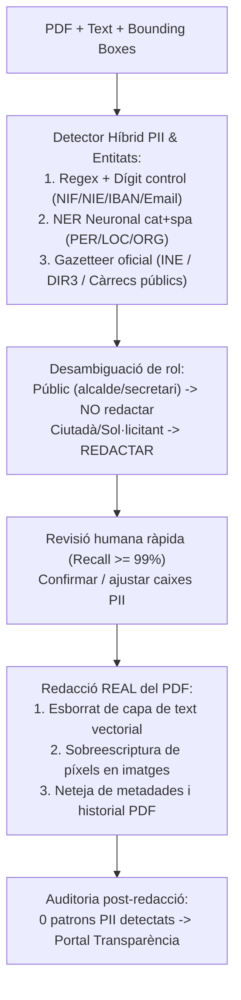

## A. Objectius d'aprenentatge

En completar aquesta lliçó, l'estudiant ha de ser capaç de:

1. **Distingir** el NER sobre text pla (Mòdul 2) del **reconeixement d'entitats en documents (IDP)**: ús del context espacial 2D, desambiguació de **rols d'entitat** (emissor vs. receptor, sol·licitant vs. representant) i enllaçat a catàlegs oficials (*Entity Linking*: codis INE de municipis, DIR3).
2. **Dissenyar** un pipeline d'**anonimització i pseudonimització documental** (tant en text com **redacció visual sobre píxels i capa de text del PDF**) per publicar acords, decrets i resolucions al portal de transparència o entrenar models sense filtrar dades personals (RGPD).
3. **Evitar** l'error clàssic de seguretat del **«rectangle negre superficial»** en PDFs (que deixa el text subjacent copiable!).
4. **Combinar** regles deterministes (NIF/NIE/IBAN/telèfons), NER neuronal català/castellà i diccionaris corporatius (*gazetteers*) per maximitzar el **Recall en detecció de PII** (*Personally Identifiable Information*).
5. **Implementar** en Python pur un **detector i pseudonimitzador consistent d'entitats PII en documents administratius** amb registre de coordenades per a redacció segura i desambiguació de rols.

---

## B. Explicació introductòria

Quan la Diputació o un ajuntament ha de publicar una acta de ple, una resolució de subvencions o una sentència al **portal de transparència**, o bé indexar expedients històrics per a anàlisi interna, cal localitzar automàticament totes les **entitats rellevants** dins dels documents: persones físiques, representants legals, NIFs, adreces postals, comptes bancaris, referències cadastrals i òrgans administratius.

A diferència del NER clàssic sobre una frase aïllada, en documents reals hi apareixen **dues persones o dues empreses a la mateixa pàgina** (qui emet i qui rep, qui sol·licita i qui signa el decret) i sovint cal **esborrar visualment i digitalment** les dades personals (redacció real de PDF) abans de difondre el document!

---

## C. Explicació tècnica avançada

### 1. Quatre reptes propis del NER documental (més enllà del NER de text)

1. **Desambiguació de rols per posició (*Layout-Aware Role Assignment*)**: una factura té *dos* NIFs i *dues* adreces (emissor dalt a l'esquerra, client/ajuntament a la dreta); una instància té *sol·licitant* i *representant*. Sense coordenades 2D o context de secció (`"Dades del sol·licitant"` vs. `"Dades del representant"`), el NER pla només et diu `PERSONA` però no **quin rol ocupa**!
2. ***Entity Linking* i resolució de correferències**: normalitzar `"Aj. de Mataró"`, `"Excm. Ajuntament de Mataró"` i `"Consistori mataroní"` al codi oficial **INE `08121` / DIR3 `L01081213`**, i vincular que *"el Sr. Joan Puig"* (pàg. 1) i *"l'interessat"* (pàg. 3) són la mateixa entitat.
3. **Soroll d'OCR**: el NER documental ha de tolerar petits errors d'OCR (p. ex., `0`↔`O` en NIFs, accents perduts) combinant coincidència aproximada (*fuzzy matching*), validadors i models entrenats amb augmentació de soroll OCR.
4. **Priorització del *Recall* en detecció de PII (RGPD)**:
   - Si anonimitzem un document per publicar-lo al portal de transparència, un **Fals Negatiu** (deixar un NIF o domicili real sense tapar!) és una **bretxa de dades personals (RGPD)** molt més greu que un **Fals Positiu** (tapar una paraula de més que un revisor desmarca en 2 segons). Per tant, optimitzem **\(F_2\)-score / Recall ≥ 0,99** i mantenim revisió humana abans de publicar!

### 2. Redacció real de PDFs: l'error mortal del rectangle negre superficial!

:::callout-warning Error greu de seguretat en anonimització de PDFs!
Dibuixar un **rectangle negre visual** per sobre d'un NIF en un PDF **NO elimina les dades personals**: qualsevol usuari pot seleccionar amb el ratolí sota el rectangle negre, fer `Ctrl+C / Ctrl+V` o obrir el PDF amb `pdftotext` i llegir el NIF íntegre!
:::

Una **redacció segura de PDF** (*True Redaction*) requereix:
1. **Eliminar físicament** els caràcters afectats del flux vectorial del PDF (p. ex., `page.add_redact_annot(bbox)` + `page.apply_redactions()` a PyMuPDF).
2. **Sobreescriure els píxels** corresponents a les imatges incrustades (en PDFs escanejats o híbrids) i eliminar metadades ocultes (`Author`, historial incremental del PDF, miniatures).
3. **Verificació automatitzada post-redacció**: re-executar una cerca de patrons PII sobre el PDF final redactat per confirmar **0 coincidències supervivents**!

### 3. Pseudonimització consistent vs. Anonimització irreversible

- **Anonimització irreversible** (per a publicació oberta / portal de transparència): substitució irreversible (`[PERSONA_OMESA]`, `[NIF_OMÈS]`) sense cap taula de correspondència recuperable; segons el Considerant 26 del RGPD, les dades veritablement anonimitzades deixen de ser dades personals (però compte amb la reidentificació indirecta per combinació de quasi-identificadors com adreça exacta + data de naixement!).
- **Pseudonimització consistent** (per a anàlisi interna o fluxos amb LLMs): `"Maria Vidal"` → `"[PER_01]"` a totes les pàgines del mateix expedient, mantenint la taula de correspondència xifrada en un magatzem separat d'accés restringit. Continua sent **dada personal sota el RGPD** (art. 4.5), però redueix dràsticament el risc d'exposició!

---

## D. Diagrames i recursos visuals

### Pipeline de detecció PII, desambiguació de rols i redacció real de PDFs



---

## E. Aplicació a l'Administració pública

1. **Distinció jurídica càrrec públic vs. ciutadà privat**: en publicar un decret o acta al portal de transparència, **NO s'ha de tapar** el nom de l'alcalde, secretari o càrrec electe que signa en exercici de funcions públiques (transparència institucional), però **SÍ s'han de protegir** el NIF complet (o aplicar la Disposició Addicional 7a de la **LOPDGDD** — xifres 4a a 7a del DNI en publicacions oficials quan la llei exigeix identificació!), el domicili particular, el telèfon personal i els comptes bancaris dels ciutadans.
2. ***Entity Linking* amb catàlegs oficials**: enllaçar cada ajuntament o organisme detectat al codi **INE / DIR3** permet creuar automàticament expedients entre sistemes de la Diputació (subvencions, convenis, assistència tècnica) sense duplicats ortogràfics.
3. **Protecció abans d'enviar a models o analítica**: aplicar el detector híbrid PII com a **filtre obligatori de sortida/entrada** abans d'indexar actes en cercadors oberts o crear datasets d'entrenament!

---

## F. Exemple pràctic guiat

Implementem en **Python pur** un **detector i pseudonimitzador consistent de PII documental** que:
1. Combina patrons deterministes (`NIF/NIE`, `IBAN`, `EMAIL`) i rols de persona.
2. **Preserva els càrrecs públics** que consten a la llista oficial (p. ex., secretari municipal signant) mentre **pseudonimitza consistentment** els ciutadans privats (`[CIUTADA_01]`, `[NIF_01]`, `[IBAN_01]`).
3. Executa una **verificació post-redacció** garantint **0 fuites residuals** de NIF/IBAN/email!

```python
"""Exemple 4.4: Detector híbrid PII, pseudonimització consistent i verificació post-redacció."""
import re

PATRONS_PII = [
    ("IBAN", re.compile(r"\bES\d{2}(?:\s?\d{4}){5}\b")),
    ("NIF", re.compile(r"\b[0-9XYZ]\d{7}[A-Z]\b")),
    ("EMAIL", re.compile(r"\b[\w.+-]+@[\w-]+\.[a-z]{2,}\b", re.IGNORECASE)),
]

CARRECS_PUBLICS = {"Pere Soler (Secretari General)"}


def pseudonimitzar_document(
    text: str,
    persones_detectades: list[str],
) -> tuple[str, dict[str, str], list[str]]:
    mapa: dict[str, str] = {}
    comptadors = {"CIUTADA": 0, "NIF": 0, "IBAN": 0, "EMAIL": 0}
    resultat = text

    # 1. Protegir ciutadans privats preservant càrrecs públics oficials
    for persona in persones_detectades:
        if persona in CARRECS_PUBLICS:
            continue
        if persona not in mapa:
            comptadors["CIUTADA"] += 1
            mapa[persona] = f"[CIUTADA_{comptadors['CIUTADA']:02d}]"
        resultat = resultat.replace(persona, mapa[persona])

    # 2. Protegir identificadors estructurats amb pseudònims consistents
    for tipus, regex in PATRONS_PII:
        for match in regex.findall(resultat):
            if match not in mapa:
                comptadors[tipus] += 1
                mapa[match] = f"[{tipus}_{comptadors[tipus]:02d}]"
            resultat = resultat.replace(match, mapa[match])

    # 3. Verificació automàtica post-redacció (0 patrons estructurats supervivents)
    fuites = [tipus for tipus, regex in PATRONS_PII if regex.search(resultat)]
    return resultat, mapa, fuites


if __name__ == "__main__":
    decret = (
        "Decret d'atorgament. Sol·licitant: Marta Roca amb NIF 12345678Z, "
        "correu marta.roca@exemple.cat i compte ES91 2100 0418 4502 0005 1332. "
        "Es notifica a Marta Roca la resolució signada per Pere Soler (Secretari General)."
    )
    text_net, taula, fuites = pseudonimitzar_document(
        decret,
        persones_detectades=["Marta Roca", "Pere Soler (Secretari General)"],
    )
    print("Document pseudonimitzat:\n ", text_net)
    print("Taula segura (magatzem separat):", taula)
    print("Fuites detectades post-redacció:", fuites)
```

### Interpretació dels resultats (execució verificada)

- Les dues aparicions de **`Marta Roca`** reben el **mateix pseudònim consistent `[CIUTADA_01]`** (mantenint la coherència narrativa del decret), mentre el seu NIF, correu i IBAN passen a `[NIF_01]`, `[EMAIL_01]` i `[IBAN_01]`.
- **`Pere Soler (Secretari General)`** es manté intacte perquè actua en qualitat de càrrec públic signant.
- L'auditoria automàtica post-redacció confirma **`fuites = []`**.

---

## G. Exercici pràctic per resoldre

### Enunciat
Un ajuntament ha publicat al portal de transparència 500 decrets d'ajuts socials «anonimitzats» mitjançant un script que dibuixava **rectangles negres** sobre les coordenades dels NIFs i noms trobats per un NER en anglès (`spaCy en_core_web_sm`). Una auditoria de seguretat detecta tres fallades crítiques:
1. En seleccionar text amb el ratolí sota les barres negres i fer copiar/enganxar, apareixen tots els noms i NIFs íntegres!
2. Els noms catalans i adreces (`C/ de la Riera`, `Àngels Puigdomènech`, `L'Hospitalet`) i els IBANs sovint ni tan sols quedaven marcats.
3. En canvi, el script havia tapat també els noms del secretari i l'alcaldessa que signen el decret.

Dissenya el **pla de correcció immediat i el pipeline d'anonimització documental segur** per a aquests 500 decrets.

### Objectius i restriccions
- Eliminar la bretxa RGPD (retirada immediata + avaluació de notificació), aplicar **redacció real (text + píxels + metadades)**, detector híbrid català/castellà orientat a Recall i distinció càrrec públic vs. ciutadà.

:::hint Pista 1 — Primera acció davant la bretxa + redacció real
Retirada immediata dels 500 PDFs del portal + comunicació al **DPD (Delegat de Protecció de Dades)** per avaluar bretxa RGPD (art. 33/34, especialment greu tractant-se d'ajuts socials!). Tècnicament: substituir els rectangles superficials per **redacció real** (esborrat de capa vectorial + sobreescriptura de píxels + eliminació de metadades/historial PDF) + auditoria post-redacció!
:::

:::hint Pista 2 — Detector híbrid català/castellà + rols + revisió humana
Substituir `en_core_web_sm` per **detector híbrid** (Regex + dígits de control per NIF/NIE/IBAN/telèfons + NER català/castellà ajustat a **màxim Recall / \(F_2\)** + *gazetteer* de càrrecs públics per NO tapar alcalde/secretari) + **revisió humana obligatòria** abans de republicar!
:::

### Criteris d'avaluació
- **30%**: Gestió d'incident RGPD (retirada immediata + DPD + avaluació art. 33/34 RGPD) i diagnòstic exacte de la fallada del rectangle negre superficial.
- **40%**: Pipeline tècnic segur: **redacció real** (esborrat del flux de text + píxels + metadades PDF), detector híbrid (`Regex/validadors + NER cat/spa` orientat a Recall ≥99%), llista d'excepció de càrrecs públics i verificador automàtic post-redacció.
- **30%**: Avaluació de quasi-identificadors (reidentificació indirecta en ajuts socials!) i supervisió humana obligatòria abans de la publicació.

### Errors habituals
- Limitant-se a rasteritzar el PDF en imatge sense revisar si l'OCR o els noms catalans s'havien escapat del detector en anglès.

:::solution Solució completa comentada i alternatives
### 1. Contenció immediata i gestió RGPD
- **Retirar immediatament** els 500 PDFs del portal de transparència i netejar memòries cau/cercadors.
- **Notificar internament al DPD** per documentar l'incident i avaluar l'obligació de notificació a l'**APDCAT** (art. 33 RGPD, termini 72 h) i a les persones afectades (art. 34 RGPD), atesa la vulnerabilitat de dades d'ajuts socials.

### 2. Redisseny del pipeline d'anonimització documental
1. **Detector híbrid català/castellà orientat a màxim Recall (\(F_2\))**:
   - Substituir `en_core_web_sm` (inadequat per a català/castellà!) per un **NER multilingüe/català** combinat amb **regles deterministes** per a NIF/NIE, IBAN, telèfons, correus, adreces (`C/`, `Av.`, `Pl.`) i codis d'expedient personal.
   - **Desambiguació de rols**: *gazetteer* oficial de càrrecs electes, secretari i interventor (i posició de bloc de signatura) per **no redactar** qui signa institucionalment, mentre es protegeixen tots els beneficiaris i familiars.
   - **Control de quasi-identificadors**: en ajuts socials, eliminar també adreça exacta, data de naixement o referències familiars que permetin reidentificació indirecta!
2. **Redacció REAL del PDF (*True Redaction*)**:
   - Aplicar `apply_redactions()` per **esborrar físicament** els caràcters del flux de text vectorial del PDF (no dibuixar-hi a sobre!), pintar sobre els píxels de qualsevol imatge incrustada i purgar metadades (`Author`, historial de revisions, adjunts).
3. **Verificació automatitzada + Revisió humana prèvia a publicació**:
   - Re-executar extractor de text + cerca PII sobre el PDF redactat per confirmar **0 coincidències** i sotmetre els decrets a verificació humana abans de tornar-los a publicar (recordant la DA 7a LOPDGDD quan la normativa sectorial exigeixi publicació amb identificació parcial de NIF).
:::

---

## H. Test individual

Resol les 10 preguntes sobre NER documental vs. text pla, desambiguació de rols, *Entity Linking* (INE/DIR3), redacció real de PDFs vs. rectangles superficials, Recall en PII i anonimització vs. pseudonimització (RGPD).

---

## I. Preguntes de desenvolupament

### Pregunta 1
Explica per què **dibuixar un rectangle negre sobre un PDF** és una fallada greu de seguretat en anonimització documental i detalla els **4 passos tècnics** d'una **redacció real (*True Redaction*)** verificada.

:::model-answer Resposta model i criteris de correcció (Pregunta 1)
**Resposta model**:
- Un rectangle negre dibuixat com a capa gràfica superior **només oculta visualment el text**, però deixa el flux de caràcters vectorials intacte a sota: qualsevol persona pot copiar/enganxar el text ocult o extreure'l amb `pdftotext`/Python, provocant una bretxa RGPD.
- **4 passos d'una redacció real**: (1) **esborrat físic dels caràcters** afectats del flux de text del PDF (`apply_redactions()`); (2) **sobreescriptura irreversible dels píxels** dins de qualsevol imatge incrustada o pàgina escanejada; (3) **neteja de metadades ocultes**, comentaris, miniatures i historial incremental del PDF; (4) **auditoria automàtica post-redacció** (re-extreure tot el text del fitxer resultant i confirmar 0 patrons PII supervivents) + verificació humana.

**Criteris de correcció (10 punts)**:
- Explicació exacta de la vulnerabilitat del rectangle superficial: 3 punts.
- Els 4 passos tècnics complets de redacció real i auditoria: 7 punts.
:::

### Pregunta 2
Quina diferència jurídica i tècnica hi ha entre **pseudonimització consistent** i **anonimització irreversible** (RGPD) aplicades a documents administratius, i en quin cas d'ús de la Diputació triaries cadascuna?

:::model-answer Resposta model i criteris de correcció (Pregunta 2)
**Resposta model**:
- **Pseudonimització consistent** (art. 4.5 RGPD): substitueix cada persona o identificador pel mateix codi dins el document/expedient (`[CIUTADA_01]`, `[NIF_01]`) conservant una taula de correspondència xifrada en un magatzem separat. **Continua sent dada personal sota el RGPD**, però minimitza l'exposició. Cas d'ús: analítica interna, suport tècnic o tractament auxiliar on cal mantenir la coherència entre mencions i poder reconstruir l'expedient amb permís.
- **Anonimització irreversible** (Considerant 26 RGPD): elimina sense cap clau de reversió tant els identificadors directes com els **quasi-identificadors** que permetrien reidentificació indirecta; si és realment irreversible, deixa d'estar subjecta al RGPD. Cas d'ús: publicació oberta al **portal de transparència**, dades obertes o datasets d'entrenament compartits.

**Criteris de correcció (10 punts)**:
- Diferència jurídica RGPD (art. 4.5 vs. Cons. 26) i tècnica: 6 punts.
- Casos d'ús ben justificats i advertència sobre quasi-identificadors: 4 punts.
:::

### Pregunta 3
En un sistema d'anonimització d'actes i decrets per al portal de transparència, per què cal prioritzar el ***Recall* (\(F_2\)-score)** enfront de la *Precision*, i per què és indispensable la **desambiguació de rols** (*càrrec públic vs. ciutadà*)?

:::model-answer Resposta model i criteris de correcció (Pregunta 3)
**Resposta model**:
- **Priorització del Recall (\(F_2\))**: un **Fals Negatiu** (deixar un NIF, domicili o nom d'un menor/beneficiari sense redactar en un portal públic) provoca una bretxa irreversible de dades personals (RGPD), mentre que un **Fals Positiu** (marcar un terme de més) es corregeix en segons durant la revisió humana prèvia a publicar. Per tant, cal maximitzar Recall (≥99%) combinant regles deterministes + NER català/castellà.
- **Desambiguació de rols**: un decret inclou tant persones privades (sol·licitants, sancionats, beneficiaris — que s'han de protegir) com autoritats i funcionaris signants (alcalde, secretari — que han de constar públicament per transparència i validesa administrativa). Sense desambiguació per secció/posició i *gazetteer* de càrrecs públics, el sistema o bé oculta els signants públics o exposa dades ciutadanes.

**Criteris de correcció (10 punts)**:
- Anàlisi asimètrica FN vs. FP i elecció de Recall/\(F_2\): 5 punts.
- Desambiguació de rols càrrec públic vs. ciutadà: 5 punts.
:::

---

## J. Resum per memoritzar

### Conceptes clau
- **NER documental > NER de text**: afegeix coordenades 2D, **desambiguació de rols** (emissor/receptor, càrrec públic/ciutadà) i ***Entity Linking*** (codis **INE / DIR3**).
- **Redacció REAL de PDF (*True Redaction*)**: esborrar capa de text vectorial + sobreescriure píxels d'imatges + purgar metadades/historial + auditoria post-redacció. **MAI rectangles negres superficials!**
- **Mètrica en PII**: prioritzar **Recall / \(F_2\)-score** (FN = bretxa RGPD!) + revisió humana abans de publicar.
- **Pseudonimització** (art. 4.5 RGPD, reversible amb clau separada → **continua sent dada personal**) vs. **Anonimització irreversible** (Cons. 26 RGPD, eliminant també quasi-identificadors).

### Definicions essencials
- ***Entity Linking***: vincular mencions textuals variables (*"Aj. de Mataró"*) a un identificador canònic d'un catàleg oficial (codi **INE** o **DIR3**).
- **Redacció real (*True Redaction*)**: eliminació física i irreversible tant del text subjacent com dels píxels i metadades d'un PDF.

### Errors conceptuals freqüents
1. Posar caixes negres damunt del text d'un PDF creient que el text queda eliminat.
2. Creure que les dades pseudonimitzades queden fora del RGPD (fals: continuen sent dades personals!).
3. Usar un model NER en anglès sobre documents catalans/castellans o tapar càrrecs públics signants.

### Possibles preguntes d'examen
- Explica el risc del «rectangle negre» en PDFs i dissenya un pipeline complet de redacció real verificada.
- Diferencia pseudonimització consistent i anonimització irreversible sota el RGPD.
- Per què en detecció de PII optimitzem Recall (\(F_2\)) i com distingim càrrecs públics de ciutadans privats?
