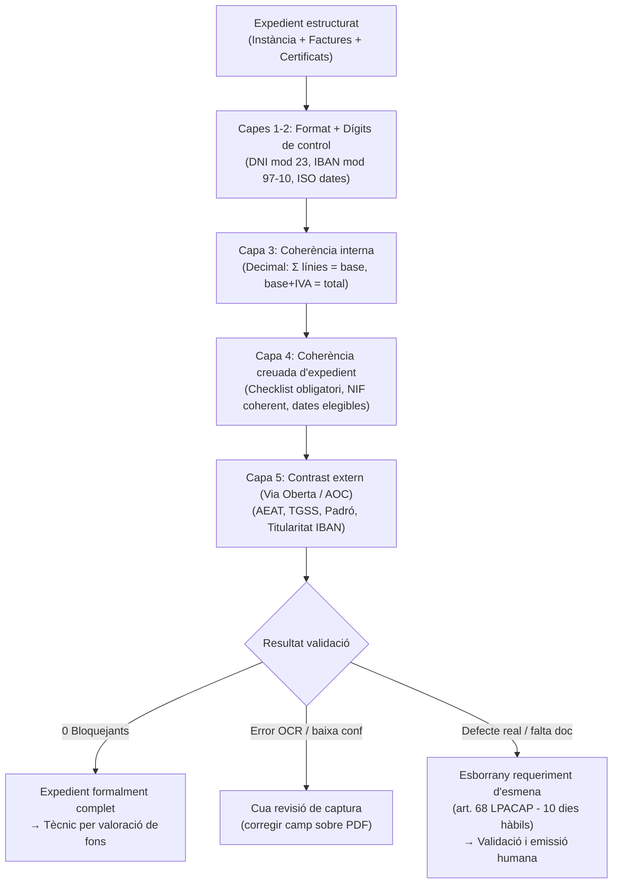

## A. Objectius d'aprenentatge

En completar aquesta lliçó, l'estudiant ha de ser capaç de:

1. **Estructurar** la **piràmide de validació documental en 5 capes**: (1) sintàctica/format, (2) algorítmica (dígits de control NIF/NIE/CIF/IBAN/CSV), (3) aritmètica/interna (`Decimal`), (4) coherència creuada entre documents del mateix expedient i (5) contrast amb registres externs oficials (Via Oberta / AOC / AEAT / BDNS).
2. **Classificar** cada incidència segons la seva **severitat operativa**: **`BLOQUEJANT`** (impedeix avançar; requereix revisió o esmena), **`AVÍS`** (permet avançar però alerta el tècnic) i **`INFO`**.
3. **Connectar** la validació documental amb el **tràmit d'esmena de l'article 68 de la Llei 39/2015 (LPACAP)** (10 dies hàbils per aportar documentació o corregir defectes) sense denegar mai automàticament una sol·licitud!
4. **Distingir** entre validació de **completitud formal** (falten documents obligatoris?) i **validació de fons/jurídica** (reservada al personal tècnic i jurídic).
5. **Implementar** en Python pur un **motor de validació documental multicapa** amb verificació real de **DNI/NIE (mòdul 23)**, **IBAN espanyol (ISO 7064 MOD 97-10)**, coherència temporal de dates, quadre d'imports i generació estructurada de motius per a revisió humana o proposta d'esmena.

---

## B. Explicació introductòria

Extreure dades d'un PDF amb IA només és la meitat de la feina; **validar-les rigorosament** és allò que separa un prototip fràgil d'un sistema apte per a l'Administració pública! Un model d'extracció pot llegir `NIF: 12345678A` o `IBAN: ES91...` amb `98%` de confiança, però si el dígit de control no quadra, si la data de la factura és anterior a l'inici del projecte subvencionat, o si falta la memòria tècnica obligatòria de les bases, la dada és invàlida.

La **validació automàtica documental** aplica una bateria de comprovacions deterministes i creuades sobre tots els documents d'un expedient per detectar errors d'OCR, incongruències del sol·licitant o manca de documentació **en segons**, preparant per al funcionari un **informe de verificació clar** i, si escau, un **esborrany de requeriment d'esmena**!

---

## C. Explicació tècnica avançada

### 1. Les 5 capes de la piràmide de validació documental

| Capa | Què verifica? | Exemples concrets | Cost / Latència |
|---|---|---|---|
| **1. Sintàctica i format** | Tipus de dada, rang, obligatori/opcional, codificació | Data ISO vàlida, import `> 0`, camp obligatori no buit, extensió/format PDF/A | `< 1 ms` |
| **2. Algorítmica (Dígits de control)** | Integritat matemàtica de codis oficials | **DNI/NIE** (`num % 23` → taula `TRWAGMYFPDXBNJZSQVHLCKE`), **CIF** (dígit/lletra de control), **IBAN** (**MOD 97-10** = `1`), codi de barres / referència cadastral | `< 1 ms` |
| **3. Coherència interna del document** | Relacions lògiques i aritmètiques dins el mateix PDF | \(\sum \text{línies} = \text{base}\), \(\text{base} + \text{IVA} - \text{IRPF} = \text{total}\) en `Decimal`; `data_venciment >= data_emissio`; signatura electrònica criptogràficament vàlida | `< 5 ms` |
| **4. Coherència creuada d'expedient** | Contrast entre **múltiples documents** del mateix expedient | El NIF de la sol·licitud coincideix amb el de la factura i el certificat bancari? Les factures estan dins el **període elegible** de la subvenció? S'han aportat tots els documents obligatoris (checklist)? | `10–50 ms` |
| **5. Contrast extern interoperable** | Verificació contra registres oficials d'altres administracions | **Via Oberta (Consorci AOC)** / **PID**: identitat, padró, estar al corrent d'obligacions tributàries (AEAT) i Seguretat Social, certificat de titularitat bancària, BDNS (no doble finançament!) | `200 ms – 2 s` (API externa) |

### 2. Taxonomia de severitat i regles de derivació HITL

Cada regla del motor retorna una severitat explícita:
- **`BLOQUEJANT` (Error crític)**: dígit de control de NIF/IBAN invàlid, descuadre comptable `> 0,01 €`, document obligatori absent, factura fora de termini elegible → **atura l'avanç automàtic** i envia l'expedient a **revisió humana** (amb distinció clara entre *possible error d'OCR* vs. *defecte real del document per a proposta d'esmena*).
- **`AVÍS` (*Warning*)**: import inusualment elevat respecte de la mitjana, data molt antiga però dins de termini, NIF d'entitat nou no vist abans → permet continuar però ressalta una bandera taronja al tècnic.
- **`INFO`**: comprovacions superades o normalitzacions menors aplicades (p. ex., eliminació d'espais a l'IBAN).

### 3. Validació automàtica i l'article 68 de la Llei 39/2015 (LPACAP)

:::callout-legal Principi fonamental del procediment administratiu (LPACAP)
Una validació automàtica **mai** no pot inadmetre o denegar directament una sol·licitud ciutadana per manca d'un document o un error formal! L'**article 68 de la Llei 39/2015 (LPACAP)** reconeix el dret de la persona interessada a ser requerida perquè **esmeni la falta o acompanyi els documents preceptius en un termini de 10 dies hàbils** (ampliable fins a 5 dies en certs supòsits). El sistema IA només genera la **proposta d'esborrany de requeriment d'esmena**, que el personal tècnic revisa i emet formalment!
:::

---

## D. Diagrames i recursos visuals

### Motor de validació documental en 5 capes i gestió d'incidències



---

## E. Aplicació a l'Administració pública

1. **Principi «Només una vegada» (*Once-Only*, art. 28.2 LPACAP)**: la Capa 5 (**Via Oberta / Consorci AOC**) evita demanar en PDF al ciutadà documents que ja obren en poder de les administracions (DNI, padró, estar al corrent amb AEAT/TGSS), eliminant el 100% dels errors d'OCR en aquests documents!
2. **Separar error de captura (OCR) de defecte del sol·licitant**: abans de proposar un requeriment d'esmena al ciutadà (art. 68 LPACAP), el sistema ha de comprovar la confiança OCR del camp fallit: si `C_OCR = 0,68`, probablement el ciutadà ho va escriure bé i va fallar el nostre OCR → no molestar el ciutadà, enviar primer a revisió interna!
3. **Validació criptogràfica de signatures i CSV**: abans d'acceptar un certificat o resolució aportada en PDF, verificar la **signatura electrònica (PAdES / @firma / Validador AOC)** i el Codi Segur de Verificació (**CSV**) per prevenir manipulacions documentals.

---

## F. Exemple pràctic guiat

Implementem en **Python pur** un **validador documental multicapa real** amb:
- **Validació real de DNI/NIE espanyol (mòdul 23)**,
- **Validació real d'IBAN (ISO 7064 MOD 97-10)**,
- **Validació creuada d'expedient** (coherència de NIF entre instància i factura, rang de dates elegibles i checklist obligatori), classificant cada incidència en `BLOQUEJANT` o `AVÍS`.

```python
"""Exemple 4.5: Motor de validació documental multicapa (DNI mod 23, IBAN mod 97-10 i coherència creuada)."""
from dataclasses import dataclass
from datetime import date
import re

LLETRES_DNI = "TRWAGMYFPDXBNJZSQVHLCKE"


def validar_dni_nie(codi: str) -> bool:
    c = codi.upper().replace("-", "").replace(" ", "")
    if not re.fullmatch(r"[0-9XYZ]\d{7}[A-Z]", c):
        return False
    prefix = {"X": "0", "Y": "1", "Z": "2"}.get(c[0], c[0])
    num = int(prefix + c[1:8])
    return LLETRES_DNI[num % 23] == c[8]


def validar_iban(iban: str) -> bool:
    clean = re.sub(r"\s+", "", iban.upper())
    if not re.fullmatch(r"ES\d{22}", clean):
        return False
    reordenat = clean[4:] + clean[:4]
    numeric = "".join(str(ord(ch) - 55) if ch.isalpha() else ch for ch in reordenat)
    return int(numeric) % 97 == 1


@dataclass
class Incidencia:
    severitat: str  # "BLOQUEJANT" | "AVIS"
    codi: str
    missatge: str


def validar_expedient(exp: dict[str, object]) -> list[Incidencia]:
    incidencies: list[Incidencia] = []
    # Capa 2: Dígits de control
    if not validar_dni_nie(str(exp["nif_sollicitant"])):
        incidencies.append(Incidencia("BLOQUEJANT", "NIF_INVALID", f"DNI/NIE invàlid: {exp['nif_sollicitant']}"))
    if not validar_iban(str(exp["iban"])):
        incidencies.append(Incidencia("BLOQUEJANT", "IBAN_INVALID", f"IBAN no supera MOD 97-10: {exp['iban']}"))

    # Capa 4: Coherència creuada d'expedient
    obligatoris = {"INSTANCIA", "MEMORIA_TECNICA", "FACTURA"}
    aportats = set(exp["documents_aportats"])  # type: ignore[arg-type]
    faltants = sorted(obligatoris - aportats)
    if faltants:
        incidencies.append(Incidencia("BLOQUEJANT", "DOCS_FALTANTS", f"Falten documents obligatoris: {faltants}"))

    inici_elegible = date.fromisoformat(str(exp["periode_inici"]))
    fi_elegible = date.fromisoformat(str(exp["periode_fi"]))
    data_factura = date.fromisoformat(str(exp["data_factura"]))
    if not (inici_elegible <= data_factura <= fi_elegible):
        incidencies.append(Incidencia("BLOQUEJANT", "DATA_FORA_PERIODE", f"Factura {data_factura} fora de [{inici_elegible}, {fi_elegible}]"))

    if str(exp["nif_sollicitant"]).upper() != str(exp["nif_client_factura"]).upper():
        incidencies.append(Incidencia("AVIS", "NIF_DIVERGENT", "El NIF de la factura no coincideix amb el del sol·licitant"))
    return incidencies


if __name__ == "__main__":
    exp_bo = {
        "nif_sollicitant": "12345678Z",
        "nif_client_factura": "12345678Z",
        "iban": "ES91 2100 0418 4502 0005 1332",
        "documents_aportats": ["INSTANCIA", "MEMORIA_TECNICA", "FACTURA"],
        "periode_inici": "2026-01-01",
        "periode_fi": "2026-12-31",
        "data_factura": "2026-04-12",
    }
    exp_erroni = {
        **exp_bo,
        "nif_sollicitant": "12345678A",       # lletra incorrecta (hauria de ser Z)
        "iban": "ES91 2100 0418 4502 0005 1339",  # últim dígit mal llegit
        "documents_aportats": ["INSTANCIA", "FACTURA"],  # falta MEMORIA_TECNICA
        "data_factura": "2025-11-20",         # fora del període 2026
    }
    print("Expedient 1 (vàlid) :", validar_expedient(exp_bo))
    print("Expedient 2 (errors):")
    for inc in validar_expedient(exp_erroni):
        print(f"  [{inc.severitat}] {inc.codi}: {inc.missatge}")
```

### Interpretació dels resultats (execució verificada)

- **Expedient 1**: supera DNI mòdul 23 (`12345678Z`), IBAN MOD 97-10 (`ES91 2100...` → residu `1`), checklist complet, dates dins 2026 i coherència de NIF → **`[]` (0 incidències)**.
- **Expedient 2**: detecta deterministament en `< 1 ms` **5 incidències exactes** (4 `BLOQUEJANT`: `NIF_INVALID`, `IBAN_INVALID`, `DOCS_FALTANTS`, `DATA_FORA_PERIODE` i 1 `AVIS`: `NIF_DIVERGENT`), separant nítidament què ha de revisar el tècnic o incloure en una proposta d'esmena!

---

## G. Exercici pràctic per resoldre

### Enunciat
Un ens local ha desplegat un validador automàtic de justificacions de subvencions que, quan detecta que falta un document o que un IBAN no supera MOD 97-10, **envia automàticament una resolució de denegació de la subvenció** al ciutadà! En el primer mes descobreixen dos desastres:
1. Un 30% dels IBANs «invàlids» en realitat eren correctes al PDF original (havia fallat l'OCR en un dígit amb confiança `0,64`!), i s'havien denegat injustament!
2. Els ciutadans als quals realment els faltava un annex presenten recursos perquè no se'ls va donar el termini legal d'esmena.

Redissenya el **flux de validació automàtica i derivació humana** corregint totes dues fallades (tècnica i jurídica).

### Objectius i restriccions
- Distingir error de captura (OCR) de defecte real del document, prohibir denegacions automàtiques i integrar el tràmit d'esmena de l'art. 68 LPACAP amb validació humana.

:::hint Pista 1 — Error OCR vs. defecte real del ciutadà
Comprova sempre la **confiança OCR (`C_OCR`)** del camp que ha fallat la validació: si `C_OCR < 0,90` (com `0,64`), l'origen probable és el nostre OCR → deriva primer a **cua de revisió interna de captura** (mai molestar ni sancionar el ciutadà per un error nostre!).
:::

:::hint Pista 2 — Mai denegar automàticament (art. 68 LPACAP!)
Fins i tot quan falta realment un annex, el sistema **mai** pot emetre una resolució de denegació: ha de generar un **esborrany de requeriment d'esmena** (art. 68 Llei 39/2015, 10 dies hàbils) perquè un tècnic el validi i l'emeti!
:::

### Criteris d'avaluació
- **35%**: Prohibició absoluta de resolucions de denegació automàtiques i aplicació rigorosa de l'**art. 68 LPACAP** (requeriment d'esmena de 10 dies hàbils, supervisat per funcionari).
- **35%**: Separació en dues cues segons `C_OCR`: baixa confiança → **revisió interna de captura** amb *bounding box* sobre PDF; alta confiança / document absent → **proposta d'esmena** per al tècnic.
- **30%**: Aprofitament de **Via Oberta (art. 28.2 LPACAP)** per no demanar documents que ja té l'Administració + auditoria i mètriques de falses alertes.

### Errors habituals
- Proposar enviar automàticament el requeriment d'esmena al ciutadà sense filtrar abans els errors de baixa confiança del nostre propi OCR.

:::solution Solució completa comentada i alternatives
### 1. Correcció jurídica immediata (art. 68 LPACAP i art. 22 RGPD)
- **Aturar qualsevol emissió automàtica de denegacions**: una fallada formal o documental mai no comporta denegació directa; l'**art. 68 de la Llei 39/2015 (LPACAP)** obliga a requerir l'esmena amb un termini de **10 dies hàbils** abans de poder tenir per desistida la sol·licitud, i la resolució sempre correspon a l'òrgan competent amb supervisió humana.

### 2. Arquitectura de doble cua (Error intern d'OCR vs. Defecte real)
1. **Validació fallida amb baixa confiança OCR (`C_OCR < 0,90`)** (com el 30% dels IBANs amb `0,64`):
   - El sistema assumeix que el risc és un **error de captura nostre** i l'envia a la **cua interna de validació de captura** (amb el *bounding box* de l'IBAN ressaltat al PDF original). El tècnic corregeix el dígit en 5 segons sense generar cap molèstia ni retard al ciutadà!
2. **Document obligatori absent o defecte confirmat amb alta confiança (`C_OCR ≥ 0,90`)**:
   - Primer verificar si el document es pot obtenir d'ofici via **Via Oberta / AOC** (dret a no aportar documents en poder de l'Administració, **art. 28.2 LPACAP**).
   - Si realment falta un document que només pot aportar el ciutadà (p. ex. memòria tècnica o factura), el sistema genera un **esborrany de requeriment d'esmena (art. 68 LPACAP)** indicant exactament quin document falta i l'envia a la **safata del funcionari** per a revisió i signatura/notificació oficial.
:::

---

## H. Test individual

Resol les 10 preguntes sobre la piràmide de validació en 5 capes, dígits de control (DNI mòdul 23, IBAN MOD 97-10), coherència creuada, severitats (`BLOQUEJANT`/`AVÍS`), art. 68 i 28.2 LPACAP i separació d'errors d'OCR vs. esmenes.

---

## I. Preguntes de desenvolupament

### Pregunta 1
Descriu les **5 capes de la piràmide de validació documental** aplicades a un expedient de subvencions, posant almenys un exemple concret de comprovació a cada capa.

:::model-answer Resposta model i criteris de correcció (Pregunta 1)
**Resposta model**:
1. **Capa 1 (Sintàctica/Format)**: tipus de dades, camps obligatoris no buits, dates ISO vàlides, imports positius, format PDF/A.
2. **Capa 2 (Algorítmica / Dígits de control)**: DNI/NIE (mòdul 23), CIF, IBAN (ISO 7064 MOD 97-10), referència cadastral.
3. **Capa 3 (Coherència interna del document)**: aritmètica exacta en `Decimal` (\(\sum \text{línies} = \text{base}\), \(\text{base} + \text{IVA} = \text{total}\)), `data_venciment >= data_emissio`, validesa criptogràfica de signatura PAdES/CSV.
4. **Capa 4 (Coherència creuada d'expedient)**: mateix NIF entre instància, factures i certificat bancari; factures dins el període elegible de les bases; checklist complet de documents obligatoris.
5. **Capa 5 (Contrast extern interoperable)**: consulta a **Via Oberta / AOC** (AEAT, Seguretat Social, padró, identitat, titularitat bancària, BDNS per evitar doble finançament).

**Criteris de correcció (10 punts)**:
- Les 5 capes clarament definides amb exemple pertinent en subvencions (2 punts per capa).
:::

### Pregunta 2
Per què és essencial diferenciar dins un validador documental si un error bloquejant (p. ex., un IBAN que falla MOD 97-10) té **baixa confiança OCR** vs. **alta confiança**, i com s'articula amb l'**art. 68 de la Llei 39/2015 (LPACAP)**?

:::model-answer Resposta model i criteris de correcció (Pregunta 2)
**Resposta model**:
- Si un IBAN falla MOD 97-10 però la confiança OCR és baixa (`0,64`), l'error probablement és de la nostra digitalització i no del ciutadà: derivar-lo directament a un requeriment d'esmena faria perdre temps al ciutadà i danyaria la qualitat del servei. Cal enviar-lo primer a una **cua interna de revisió de captura** (amb ressaltat visual del *bounding box* sobre el PDF).
- Si l'error persisteix amb alta confiança o falta realment un document obligatori no consultable via Via Oberta (art. 28.2 LPACAP), el sistema **mai** no pot denegar la sol·licitud automàticament: l'**art. 68 LPACAP** obliga a concedir un termini d'esmena de **10 dies hàbils**; la IA prepara l'**esborrany de requeriment d'esmena** perquè el tècnic el validi i notifiqui oficialment.

**Criteris de correcció (10 punts)**:
- Distinció operativa error OCR vs. defecte real del ciutadà: 5 punts.
- Integració jurídica correcta amb art. 68 i art. 28.2 LPACAP + supervisió humana: 5 punts.
:::

### Pregunta 3
Explica els beneficis tècnics i legals de connectar la **Capa 5 de validació** amb **Via Oberta (Consorci AOC)** en el processament d'expedients de la Diputació de Barcelona.

:::model-answer Resposta model i criteris de correcció (Pregunta 3)
**Resposta model**:
- **Compliment legal (art. 28.2 LPACAP — principi *Once-Only*)**: els ciutadans tenen dret a no aportar documents ja elaborats o en poder de les administracions (DNI, empadronament, certificats AEAT/TGSS).
- **Qualitat de dades (0% error OCR)**: les dades arriben estructurades directament per API des de la font autèntica en lloc de PDFs escanejats susceptibles d'errors d'OCR o manipulació.
- **Prevenció de frau i rapidesa**: valida en segons la titularitat bancària, la vigència fiscal i evita duplicitats (p. ex. BDNS), reduint càrrega documental tant per al ciutadà com per al funcionari.

**Criteris de correcció (10 punts)**:
- Base legal (art. 28.2 LPACAP): 3 punts.
- Beneficis tècnics (0% error OCR, dades estructurades autèntiques, antifrau i eficiència): 7 punts.
:::

---

## J. Resum per memoritzar

### Conceptes clau
- **5 capes de validació**: 1) Format/Sintàctica → 2) Dígits de control (**DNI mod 23**, **IBAN MOD 97-10**) → 3) Coherència interna (`Decimal`, signatura PAdES/CSV) → 4) Coherència creuada d'expedient → 5) Contrast extern (**Via Oberta / AOC**, AEAT, TGSS, BDNS).
- **Severitats**: `BLOQUEJANT` (atura automatització → revisió o esmena), `AVÍS` (bandera per al tècnic), `INFO`.
- **Error OCR vs. Defecte real**: revisar sempre `C_OCR` abans de requerir res al ciutadà!
- **Art. 68 LPACAP (Llei 39/2015)**: MAI denegar automàticament per defecte formal → esborrany de **requeriment d'esmena (10 dies hàbils)** validat per funcionari.
- **Art. 28.2 LPACAP (*Once-Only*)**: obtenir d'ofici via Via Oberta abans de demanar PDFs al ciutadà.

### Definicions essencials
- **MOD 97-10 (ISO 7064)**: algorisme de dígit de control de l'IBAN (moure els 4 primers caràcters al final, convertir lletres `A=10..Z=35` i verificar `num % 97 == 1`).
- **Validació creuada d'expedient**: comprovació de coherència lògica, temporal i d'identitat entre els diferents documents que componen un mateix expedient.

### Errors conceptuals freqüents
1. Emetre denegacions automàtiques sense requeriment d'esmena (vulnera art. 68 LPACAP).
2. Enviar requeriments d'esmena al ciutadà per errors causats per baixa confiança del nostre propi OCR.
3. Validar documents de manera aïllada sense comprovar coherència creuada entre instància, factures i certificat bancari.

### Possibles preguntes d'examen
- Enumera les 5 capes de validació documental amb exemples concrets d'un expedient de subvenció.
- Com gestiones un IBAN que falla MOD 97-10 amb `C_OCR = 0,64` respecte d'una memòria tècnica absent?
- Quins articles de la Llei 39/2015 (LPACAP) condicionen directament la validació automàtica documental?
