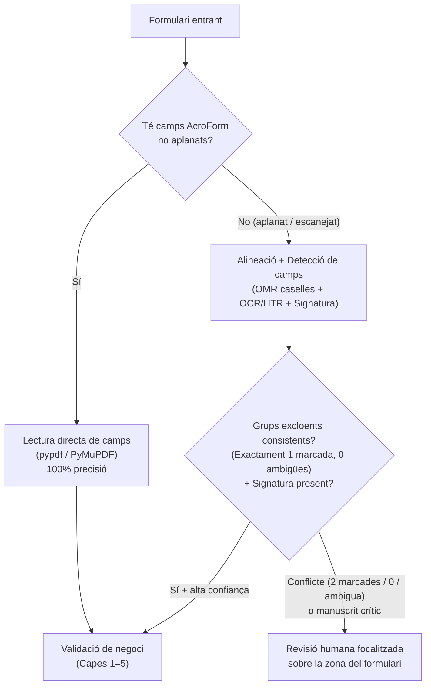

## A. Objectius d'aprenentatge

En completar aquesta lliçó, l'estudiant ha de ser capaç de:

1. **Distingir** entre **formularis digitals estructurats** (formularis web de seu electrònica, PDF **AcroForm / XFA**) i **formularis escanejats o emplenats a mà** (*flat PDFs* / paper), aplicant sempre l'extracció nativa de camps abans que visió o OCR!
2. **Explicar** les tecnologies específiques per a formularis en paper/imatge: **OMR (*Optical Mark Recognition*)** per a caselles de selecció (*checkboxes* i *radio buttons*), **HTR (*Handwritten Text Recognition*)** per a text manuscrit i **detecció de presència de signatura**.
3. **Analitzar** els riscos crítics dels **grups d'opcions mútuament excloents** (p. ex., autorització/oposició a consulta Via Oberta, declaracions responsables): una casella dubtosa o dues caselles marcades alhora **mai** no s'han d'endevinar, sinó derivar a revisió humana!
4. **Proposar** estratègies de **transformació digital des de l'origen** (substituir PDFs imprimibles per formularis web amb validació en temps real) per reduir el volum de formularis escanejats.
5. **Implementar** en Python pur un **detector OMR de caselles de selecció (*checkboxes / radio buttons*)** sobre matrius de píxels NumPy que classifica cada casella en `MARCADA`, `BUIDA` o `AMBÍGUA` i detecta conflictes en grups mútuament excloents!

---

## B. Explicació introductòria

Les administracions locals treballen amb centenars de formularis: sol·licituds de subvencions, declaracions responsables, autoritzacions de consulta de dades (Via Oberta), inscripcions d'activitats o baixes de serveis. Un formulari no és un text lineal: conté **caselles per marcar (`[X]` / `[ ]`)**, camps de text manuscrit dins de caixetes, seleccions mútuament excloents (*Sí / No*) i requadres de signatura.

Un OCR tradicional que només llegeix paraules **ignora completament les caselles de verificació** o les confon amb lletres soltes! En un formulari administratiu, confondre si un ciutadà ha marcat *"M'OPOSO a la consulta de dades tributàries"* o *"AUTORITZO la consulta"* té conseqüències jurídiques directes (RGPD i art. 28.2 LPACAP).

---

## C. Explicació tècnica avançada

### 1. Jerarquia d'extracció de formularis (del millor al més complex)

| Nivell | Format del formulari | Tècnica d'extracció | Precisió / Cost |
|---|---|---|---|
| **1. Formulari web (Seu electrònica)** | JSON / XML nadiu | Ingesta directa per API + validació en temps real al navegador | **100% precisió**, 0% OCR (estàndard objectiu!) |
| **2. PDF emplenable (AcroForm / XFA)** | Camps PDF estructurats | Lectura directa del diccionari de camps (`PyMuPDF` / `pypdf` `get_fields()`) | **~100% precisió**, `< 5 ms` (compte amb PDFs «aplanats»/*flattened* en imprimir a PDF!) |
| **3. Formulari imprès i escanejat** (plantilla fixa) | Imatge ràster | Alineació per punts d'ancoratge (*registration*) + **OMR** (caselles) + OCR/HTR per zona | Alta en camps mecanografiats; mitjana en manuscrits |
| **4. Formulari heterogeni / foto mòbil / manuscrit** | Imatge variable | **VLM multimodal *on-premise*** + **HTR** (TrOCR) + regles de consistència + HITL | Flexible però lent; obligatori validar grups excloents! |

### 2. Reptes tècnics específics dels formularis escanejats

1. **OMR (*Optical Mark Recognition*) per a caselles (*checkboxes / radio buttons*)**:
   - Mesura la densitat de píxels foscos dins l'interior de la casella (descomptant les vores del requadre!) o usa un petit classificador visual CNN/VLM (`MARCADA`, `BUIDA`, `AMBÍGUA`).
   - **Casos reals problemàtics**: marques molt suaus, tatxades (un ciutadà marca `SÍ`, es penedeix, ho ratlla i marca `NO`!), marques que surten fora de la caixa o taques d'escàner.
   - **Regla d'or de consistència en grups excloents**: en un parell `SÍ / NO` (o opció A/B/C), només és vàlid si exactament **1 casella és `MARCADA` i la resta són `BUIDES`**. Si n'hi ha **0 marcades**, **2 marcades** o alguna és **`AMBÍGUA`** → **derivació obligatòria a revisió humana!**
2. **HTR (*Handwritten Text Recognition*)**:
   - L'escriptura manuscrita (especialment cursiva) és molt més difícil que la tipografia impresa. Models moderns basats en Transformer visual-textual (**TrOCR**) o VLMs *on-premise* milloren molt Tesseract, però en noms propis, correus electrònics i IBANs manuscrits la taxa d'error continua sent alta → **validació determinista + revisió humana obligatòria**.
3. **Detecció de presència de signatura**:
   - Important distingir entre **detectar presència de traç manuscrit** al requadre de signatura (tasca fàcil i útil per avisar si el ciutadà s'ha oblidat de signar un formulari en paper!) i **verificació biomètrica d'autenticitat de signatura** (que NO es fa amb IA estàndard i comporta risc biomètric/jurídic elevat — en administració electrònica la validesa prové de la **signatura electrònica qualificada/avançada** o assistència presencial en oficina OAC!).

---

## D. Diagrames i recursos visuals

### Pipeline de tractament de formularis (AcroForm vs. OMR/HTR/VLM)



---

## E. Aplicació a l'Administració pública

1. **Atacar el problema a l'arrel (Seu electrònica > PDF imprimible)**: la mesura més rendible per a un ajuntament no és construir un VLM caríssim per llegir formularis escrits a mà, sinó **migrar els tràmits principals a formularis web estructurats** (amb desplegables, validació de NIF/IBAN en temps real i signatura electrònica integrada), deixant l'IDP/OMR per a l'atenció presencial (OAC) i la bretxa digital (dret de les persones físiques a relacionar-se en paper, art. 14.1 LPACAP!).
2. **Clàusules de protecció de dades i oposició (art. 28.2 LPACAP / RGPD)**: si una casella d'oposició a consulta Via Oberta o de consentiment surt ambigua, el principi de precaució exigeix **revisió humana** abans de consultar dades a tercers!
3. **Cura amb els PDFs «aplanats» (*flattened*)**: molts ciutadans emplenen un PDF AcroForm al navegador i després fan *"Imprimir a PDF"* per signar-lo; això destrueix els camps digitals i els converteix en text/imatge plana. El sistema ha de detectar automàticament l'absència de camps AcroForm i fer *fallback* transparent al pipeline visual/OMR.

---

## F. Exemple pràctic guiat

Implementem en **Python + NumPy** un **detector OMR de caselles de selecció** que analitza la densitat interior de píxels foscos (descartant la vora del requadre) per classificar cada casella en `BUIDA`, `MARCADA` o `AMBÍGUA` (zona gris) i avaluar la **consistència d'un grup mútuament excloent** (`AUTORITZO` vs. `M'OPOSO`) en tres escenaris reals: clar, doble marca (tatxada) i marca dubtosa!

```python
"""Exemple 4.6: Detector OMR de caselles en NumPy amb gestió de zona ambigua i grups excloents."""
import numpy as np


def classificar_casella_omr(
    patch_gris: np.ndarray,
    marge_vora: int = 2,
    llindar_buida: float = 0.08,
    llindar_marcada: float = 0.22,
) -> tuple[str, float]:
    # Retallem les vores del requadre per mesurar només l'interior de la casella
    interior = patch_gris[marge_vora:-marge_vora, marge_vora:-marge_vora]
    # Píxels foscos (< 128 sobre 0..255)
    densitat_tinta = float(np.mean(interior < 128))
    if densitat_tinta <= llindar_buida:
        return "BUIDA", round(densitat_tinta, 3)
    if densitat_tinta >= llindar_marcada:
        return "MARCADA", round(densitat_tinta, 3)
    return "AMBIGUA", round(densitat_tinta, 3)


def avaluar_grup_excloent(caselles: dict[str, np.ndarray]) -> dict[str, object]:
    estats = {nom: classificar_casella_omr(img) for nom, img in caselles.items()}
    marcades = [nom for nom, (est, _) in estats.items() if est == "MARCADA"]
    ambigues = [nom for nom, (est, _) in estats.items() if est == "AMBIGUA"]

    if ambigues or len(marcades) != 1:
        return {"decisio": "REVISIO_HUMANA", "motiu": f"marcades={marcades}, ambigues={ambigues}", "detall": estats}
    return {"decisio": "ACCEPTADA", "opcio_seleccionada": marcades[0], "detall": estats}


def crear_casella_sintetica(tipus: str) -> np.ndarray:
    img = np.full((16, 16), 255, dtype=np.uint8)
    img[0, :] = img[-1, :] = img[:, 0] = img[:, -1] = 0  # vora negra del requadre
    if tipus == "creu":
        for i in range(3, 13):
            img[i, i] = 0
            img[i, 15 - i] = 0
            img[i, min(i + 1, 13)] = 0
            img[i, max(14 - i, 2)] = 0
    elif tipus == "taca_ambigua":
        img[6:10, 6:10] = 40  # petita taca o marca molt dubtosa (16/144 ≈ 0.111)
    return img


if __name__ == "__main__":
    print("Cas 1 (AUTORITZO clar)     :", avaluar_grup_excloent({"AUTORITZO": crear_casella_sintetica("creu"), "OPOSO": crear_casella_sintetica("buida")}))
    print("Cas 2 (Doble marca/tatxat) :", avaluar_grup_excloent({"AUTORITZO": crear_casella_sintetica("creu"), "OPOSO": crear_casella_sintetica("creu")}))
    print("Cas 3 (Marca ambigua)      :", avaluar_grup_excloent({"AUTORITZO": crear_casella_sintetica("taca_ambigua"), "OPOSO": crear_casella_sintetica("buida")}))
```

### Interpretació dels resultats (execució verificada)

- **Cas 1**: `AUTORITZO` té una densitat interior clara (`MARCADA`) i `OPOSO` és `0.000` (`BUIDA`) → exactament 1 opció marcada i 0 ambigües → **`ACCEPTADA` (`AUTORITZO`)**.
- **Cas 2 (Doble marca / correcció tatxada)**: totes dues surten `MARCADA` → violació de la regla d'exclusió mútua → **`REVISIO_HUMANA`**.
- **Cas 3 (Taca o traç molt suau)**: `densitat = 0,111` cau a la **zona gris (`0,08 < d < 0,22`)** → `AMBIGUA` → **`REVISIO_HUMANA`**!

---

## G. Exercici pràctic per resoldre

### Enunciat
L'Oficina d'Atenció Ciutadana (OAC) escaneja 2.000 formularis mensuals en paper d'ajuts escolars. Els formularis inclouen: (1) un PDF AcroForm que algunes famílies envien per correu electrònic i altres imprimeixen i omplen a bolígraf; (2) una casella crítica d'**oposició a la consulta de renda a l'AEAT**; (3) un camp manuscrit d'**IBAN bancari**; i (4) un requadre de **signatura manuscrita**.

Dissenya el **flux òptim de tractament d'aquests formularis** responent a:
1. Com aprofites els formularis AcroForm sense passar-los per OCR/OMR i com gestiones els que arriben aplanats o en paper?
2. Com tractes la casella d'oposició AEAT, l'IBAN manuscrit i la presència de signatura?
3. Quina mesura estructural de transformació digital proposaries per reduir aquest volum en paper respectant el dret de les persones físiques (art. 14.1 LPACAP)?

### Objectius i restriccions
- Combinar lectura AcroForm + OMR amb zona ambigua + HTR/validació MOD 97-10 + detecció de presència de signatura + estratègia multicanal de seu electrònica respectant l'art. 14.1 LPACAP.

:::hint Pista 1 — Ruta dual AcroForm vs. paper/aplanat
Detectar primer si el PDF conté camps AcroForm emplenats (`get_fields()`) → lectura exacta 100% sense OCR! Si arriba aplanat o escanejat → alineació de plantilla + OMR (amb zona ambigua!) + HTR/VLM *on-premise*.
:::

:::hint Pista 2 — Els 3 camps crítics + art. 14.1 LPACAP
(a) Casella oposició AEAT: si és ambigua o doble marca → **revisió humana obligatòria** abans de consultar AEAT! (b) IBAN manuscrit: HTR + **validació MOD 97-10** + HITL si baixa confiança o falla; (c) Signatura: detectar **presència de traç** (no biometria!) per alertar si falta signar; (d) Oferir formulari web intuïtiu + assistència presencial OAC (mantenint sempre el dret al canal presencial/paper per a persones físiques, art. 14.1 LPACAP).
:::

### Criteris d'avaluació
- **30%**: Detecció prèvia de PDF AcroForm no aplanat + *fallback* automàtic a pipeline visual/OMR/HTR.
- **40%**: Tractament rigorós dels 3 camps crítics: casella AEAT (OMR + zona ambigua + precaució RGPD), IBAN manuscrit (HTR + MOD 97-10 + revisió), signatura (presència de traç, mai verificació biomètrica improvisada).
- **30%**: Estratègia de formulari web estructurat amb validació en temps real + respecte explícit al dret de relació no electrònica de persones físiques (art. 14.1 LPACAP) i assistència OAC.

### Errors habituals
- Proposar prohibir el paper a les famílies (il·legal per a persones físiques segons art. 14.1 LPACAP!) o implementar verificació biomètrica de signatures amb IA sense base legal ni requisits AI Act/RGPD.

:::solution Solució completa comentada i alternatives
### 1. Ingesta dual: AcroForm natiu vs. paper/aplanat
- Inspeccionar el PDF entrant: si conserva camps **AcroForm** actius i poblats, extreure directament tots els valors i caselles per codi (`100%` de precisió, `< 5 ms`).
- Si és un escaneig en paper o un PDF «aplanat», activar automàticament la branca visual: alineació per marques d'ancoratge + **OMR** sobre caselles + **HTR/VLM *on-premise*** sobre camps manuscrits.

### 2. Controls específics dels 3 camps crítics
- **Casella d'oposició a consulta AEAT**: aplicar OMR amb **zona ambigua** i regla de grup excloent. Si la casella és ambigua o hi ha tatxadura, **bloquejar la consulta Via Oberta/AEAT** fins que un funcionari ho verifiqui visualment sobre el PDF (principi de precaució RGPD/art. 28.2 LPACAP).
- **IBAN manuscrit**: reconèixer amb HTR/VLM *on-premise* i passar obligatòriament pel validador **ISO 7064 MOD 97-10**. Qualsevol baixa confiança o error de mòdul salta a revisió humana amb el *bounding box* de l'IBAN ampliat en pantalla (i idealment contrastat amb certificat bancari).
- **Requadre de signatura**: aplicar un detector simple de **presència de traç** per avisar de formularis entregats sense signar (sense realitzar mai reconeixement biomètric d'identitat de signatura!).

### 3. Transformació des de l'origen respectant l'art. 14.1 LPACAP
- Desplegar un **formulari web accessible** a la seu electrònica amb validació instantània de NIF/IBAN i signatura electrònica (idCAT Mòbil) per reduir dràsticament el volum de paper, **mantenint sempre l'atenció presencial en OAC i el canal en paper per a persones físiques** (dret garantit per l'art. 14.1 de la Llei 39/2015), on fins i tot el funcionari de taulell pot emplenar directament el formulari web assistit amb la família!
:::

---

## H. Test individual

Resol les 10 preguntes sobre AcroForm vs. formularis escanejats/aplanats, OMR (*Optical Mark Recognition*), grups excloents i zona ambigua, HTR, presència de signatura vs. biometria i art. 14.1 LPACAP.

---

## I. Preguntes de desenvolupament

### Pregunta 1
Explica la **jerarquia de 4 nivells** per al tractament de formularis en una administració pública (des del formulari web fins al formulari manuscrit escanejat) i justifica per què cal detectar els **PDFs AcroForm no aplanats** abans d'invocar OMR o OCR.

:::model-answer Resposta model i criteris de correcció (Pregunta 1)
**Resposta model**:
- **4 nivells**: (1) Formulari web de seu electrònica (JSON/XML natiu, 100% precisió, validació en temps real); (2) PDF emplenable **AcroForm** (lectura directa del diccionari de camps, ~100% precisió en `< 5 ms`); (3) Formulari imprès i escanejat de plantilla fixa (alineació + OMR + OCR/HTR); (4) Formulari heterogeni o manuscrit en foto mòbil (VLM *on-premise* + HTR + HITL).
- **Detecció prèvia d'AcroForm**: si el PDF conserva els camps digitals emplenables, llegir-los directament elimina al 100% errors d'OCR i d'OMR en caselles i estalvia tot el còmput visual; en canvi, si l'usuari l'ha «aplanat» (*Imprimir a PDF*), cal fer *fallback* automàtic a OMR/OCR.

**Criteris de correcció (10 punts)**:
- Descripció precisa dels 4 nivells: 6 punts.
- Justificació d'AcroForm i gestió de PDFs aplanats: 4 punts.
:::

### Pregunta 2
Descriu com funciona un **detector OMR (*Optical Mark Recognition*)** de caselles de selecció i explica quina regla de seguretat s'ha d'aplicar davant **grups d'opcions mútuament excloents** (com autorització/oposició a consulta de dades).

:::model-answer Resposta model i criteris de correcció (Pregunta 2)
**Resposta model**:
- L'**OMR** retalla l'interior de cada casella (excloent les vores del requadre per no comptar la tinta del marc) i mesura la densitat de píxels foscos (o utilitza un classificador visual), classificant-la en **3 estats**: `BUIDA` (sota el llindar inferior), `MARCADA` (sobre el llindar superior) o **`AMBÍGUA`** (zona gris intermèdia per taques o traços suaus).
- **Regla en grups excloents**: una selecció només s'accepta automàticament si exactament **una opció és `MARCADA` i la resta són `BUIDES`**. Si n'hi ha 0 marcades, 2 marcades (p. ex., tatxadura) o alguna `AMBÍGUA`, el sistema bloqueja qualsevol acció jurídica (com consultar Via Oberta) i deriva el camp a **revisió humana**.

**Criteris de correcció (10 punts)**:
- Funcionament d'OMR amb retall de vores i 3 estats (inclosa zona ambigua): 5 punts.
- Regla de consistència de grups excloents i derivació HITL: 5 punts.
:::

### Pregunta 3
En el tractament de formularis escanejats, quina diferència tècnica i jurídica hi ha entre **detectar presència de signatura** i **fer verificació biomètrica d'autenticitat de signatura**?

:::model-answer Resposta model i criteris de correcció (Pregunta 3)
**Resposta model**:
- **Detecció de presència de signatura**: comprova únicament si el requadre de signatura conté un traç manuscrit o està en blanc, útil com a control de completitud formal per alertar el tècnic si un formulari en paper s'ha lliurat sense signar (risc molt baix).
- **Verificació biomètrica d'autenticitat de signatura**: intenta identificar o autenticar la persona a partir de trets biomètrics del traç; comporta tractament de dades biomètriques de categoria especial (art. 9 RGPD), altes taxes d'error i exigències reguladores estrictes (AI Act), i a més és innecessària perquè la validesa jurídica en administració electrònica prové de la **signatura electrònica** (certificat/idCAT Mòbil) o de la **identificació presencial assistida en oficina OAC**.

**Criteris de correcció (10 punts)**:
- Diferència tècnica clara entre presència i autenticació biomètrica: 5 punts.
- Implicacions jurídiques (art. 9 RGPD, AI Act, alternatives electròniques/OAC): 5 punts.
:::

---

## J. Resum per memoritzar

### Conceptes clau
- **Jerarquia de formularis**: Web estructurat (`JSON`) > PDF **AcroForm** (lectura directa) > Escanejat plantilla fixa (Alineació + **OMR** + OCR/HTR) > Foto/manuscrit heterogeni (VLM *on-premise* + HITL).
- **OMR**: retallar sempre la vora de la casella i classificar en **`BUIDA` / `MARCADA` / `AMBÍGUA`**.
- **Grups excloents**: només vàlid si exactament **1 `MARCADA` i 0 `AMBÍGUES`**; qualsevol tatxadura, doble marca o dubte → **revisió humana**!
- **Signatura**: detectar **presència de traç** sí; **verificació biomètrica** no!
- **Art. 14.1 LPACAP**: promoure formulari web però mantenir sempre el canal presencial/paper per a persones físiques.

### Definicions essencials
- **OMR (*Optical Mark Recognition*)**: detecció automàtica de marques en caselles de selecció (*checkboxes*, *radio buttons*) en documents escanejats.
- **HTR (*Handwritten Text Recognition*)**: reconeixement de text manuscrit mitjançant models neuronals especialitzats (p. ex., TrOCR o VLMs).

### Errors conceptuals freqüents
1. Passar PDFs AcroForm emplenables per OCR/OMR en lloc de llegir-ne els camps natius.
2. Classificar caselles en binari (`MARCADA`/`BUIDA`) sense zona ambigua ni validació de grups mútuament excloents.
3. Obligar persones físiques a usar només formulari web sense opció presencial/paper (vulnera art. 14.1 LPACAP).

### Possibles preguntes d'examen
- Com gestionaries una casella d'oposició a consulta AEAT amb doble marca o taca dubtosa?
- Què passa quan un ciutadà fa «Imprimir a PDF» sobre un formulari AcroForm i com ho detecta el sistema?
- Diferencia detecció de presència de signatura vs. verificació biomètrica en el sector públic.
