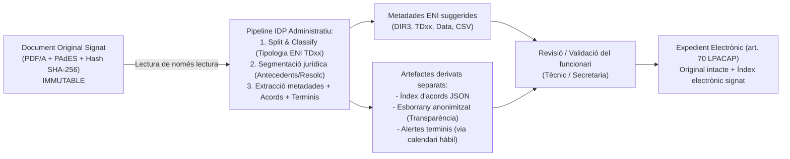

## A. Objectius d'aprenentatge

En completar aquesta lliçó, l'estudiant ha de ser capaç de:

1. **Caracteritzar** les grans famílies de **documents administratius locals** (instàncies, decrets/resolucions, actes de ple i junta de govern, convenis, plecs de contractació PCAP/PPT, subvencions i edictes del BOPB) i els seus esquemes estructurals típics.
2. **Integrar** el processament IA amb les exigències de l'**expedient electrònic** (art. 70 Llei 39/2015 LPACAP) i l'**Esquema Nacional d'Interoperabilitat (ENI)**: índex electrònic signat, metadades mínimes obligatòries (`NTI de Document i Expedient Electrònic`) i format de preservació **PDF/A**.
3. **Dissenyar** pipelines específics per a casos d'alt valor a la Diputació de Barcelona: **anàlisi comparativa de plecs de contractació**, **extracció d'acords d'actes de ple** i **verificació de requisits de subvencions** sense substituir mai el judici jurídic ni la fe pública del secretari!
4. **Controlar** el **còmput de terminis administratius** (dies hàbils vs. naturals, art. 30 LPACAP) i les referències normatives creuades (lleis modificades o derogades).
5. **Implementar** en Python pur un **estructurador d'actes i decrets administratius** que segmenta seccions jurídiques (`Antecedents`, `Fonaments de dret`, `Part dispositiva / Acords`), extreu metadades ENI (`òrgan`, `data`, `tipologia`, `acords`, `CSV`) i genera un índex estructurat auditable.

---

## B. Explicació introductòria

Els documents administratius no són escrits arbitraris: responen a una **estructura jurídica altament formalitzada** dictada pel dret administratiu (Llei 39/2015 LPACAP, Llei 9/2017 de Contractes del Sector Públic, Llei 38/2003 General de Subvencions). Un decret d'alcaldia té *Antecedents de fet*, *Fonaments de dret*, *Part dispositiva (Resolc)* i *Peu de recurs*; un plec de contractació (PCAP/PPT) té *Objecte*, *Pressupost base de licitació (PBL)*, *Valor estimat del contracte (VEC)*, *Criteris d'adjudicació* i *Condicions especials d'execució*.

Processar intel·ligentment aquests documents permet **accelerar dràsticament la tramitació i la transparència** —extraient metadades ENI, generant índexs d'acords, comprovant clàusules en plecs o resumint expedients llargs per a tècnics i interventors— sempre preservant la **integritat de l'expedient electrònic** i la **responsabilitat exclusiva del personal funcionari en les resolucions**.

---

## C. Explicació tècnica avançada

### 1. Famílies de documents administratius i pipelines IA específics

| Tipus documental | Estructura jurídica característica | Tasques IA d'alt valor | Riscos i controls obligatoris |
|---|---|---|---|
| **Decrets i resolucions (`TD01`)** | Antecedents → Fonaments → *Resolc* → Peu de recurs → Signatura/CSV | Extracció d'acords, òrgan, imports, beneficiaris, metadades ENI; anonimització per a transparència | Mai alterar la part dispositiva; distingir càrrec signant vs. interessat privat (RGPD/DA 7a LOPDGDD) |
| **Actes de Ple / JGL (`TD03`)** | Assistents → Ordre del dia → Debats → Votacions → Acords adoptats | Segmentació per punt de l'ordre del dia, extracció d'acords i sentit de votació, cerca RAG històrica | La fe pública correspon exclusivament a la **Secretaria**; un resum IA mai no substitueix l'acta oficial |
| **Plecs de contractació (PCAP / PPT)** | Objecte, CPV, PBL, VEC, lots, solvència, criteris automàtics/judici de valor | Revisió assistida de coherència (PBL vs. VEC vs. IVA), detecció de clàusules absents, comparativa de plecs | Taules complexes de barems i fórmules matemàtiques (exigeix parseig tabular perfecte + revisió jurídica) |
| **Convenis i bases de subvencions** | Parts, objecte, vigència, aportacions econòmiques, justificació, comissió seguiment | Extracció d'obligacions, terminis de justificació, calendari d'alertes i checklist documental | Vigència de convenis (màxim 4 anys + pròrroga art. 49 LRJSP); control de doble finançament (BDNS) |

### 2. Requisits de l'**Expedient Electrònic (art. 70 LPACAP)** i l'**ENI**

Qualsevol sistema d'IDP que s'integri amb el gestor d'expedients corporatiu ha de respectar:
1. **Metadades mínimes obligatòries ENI** (NTI de Document Electrònic): `identificador`, `òrgan` (codi **DIR3**), `data_captura`, `origen` (`ciutadà`/`administració`), `estat_elaboració` (`original`/`còpia autèntica`), `format` (**PDF/A**), `tipus_documental` (`TD01`..`TD99`).
2. **Índex electrònic signat (art. 70.2 LPACAP)**: l'expedient electrònic ha de mantenir un índex numerat amb la petjada criptogràfica (*hash*) de cada document per garantir integritat i evitar qualsevol alteració posterior.
3. **Immutabilitat dels originals**: el pipeline IA **mai modifica el document original signat**! Totes les sortides de la IA (JSON extret, resums, classificacions, versions anonimitzades) s'emmagatzemen com a **artefactes derivats o metadades vinculades**, preservant intacte l'original amb la seva signatura PAdES/XAdES!

### 3. Gestió rigorosa de terminis i dret administratiu

- **Dies hàbils vs. dies naturals (art. 30 LPACAP)**: per defecte, els terminis per dies en el procediment administratiu són **dies hàbils** (excloent dissabtes, diumenges i festius nacionals, autonòmics i **festius locals de cadascun dels 311 municipis**!). Un LLM **mai** no ha de calcular dates de venciment «de cap»: ha d'invocar una **eina determinista de calendari laboral oficial**!
- **Peu de recurs i notificació**: un error en el termini o tipus de recurs (*reposició 1 mes* vs. *contenciós-administratiu 2 mesos*) té efectes jurídics greus; per això les plantilles de peu de recurs han de ser **regles deterministes revisades per Serveis Jurídics**, no generació lliure d'un LLM!

---

## D. Diagrames i recursos visuals

### Integració d'IDP amb l'Expedient Electrònic ENI (Preservació d'originals + Artefactes IA)



---

## E. Aplicació a l'Administració pública

1. **BOPB (Butlletí Oficial de la Província de Barcelona)**: la Diputació publica diàriament centenars d'anuncis, ordenances, convocatòries i acords dels 311 municipis. Un pipeline d'IDP administratiu pot segmentar automàticament cada edicte, enllaçar el municipi al seu codi INE/DIR3, extreure terminis d'al·legacions/exposició pública i alimentar el cercador RAG amb metadades de vigència!
2. **Assistència en contractació pública (LCSP)**: revisar plecs (PCAP/PPT) de 80 pàgines per comprovar coherència entre pressupost (PBL), valor estimat (VEC), lots, solvència i taules de criteris estalvia hores de lectura repetitiva als tècnics de contractació i intervenció.
3. **Preservació estricta de la fe pública i la motivació**: l'art. 35 LPACAP exigeix motivació suficient dels actes administratius; els esborranys generats per IA han de ser sempre revisats, contrastats amb l'expedient i assumits pel funcionari competent.

---

## F. Exemple pràctic guiat

Implementem en **Python pur** un **estructurador de decrets administratius** que:
1. Segmenta un decret en les seves seccions jurídiques canòniques (`ANTECEDENTS`, `FONAMENTS`, `RESOLC`, `PEU_DE_RECURS`).
2. Extreu metadades compatibles amb l'**ENI** (`num_decret`, `data`, `csv`, `tipologia_eni = TD01`, llista numerada d'acords de la part dispositiva) i calcula el **`hash_sha256` immutable** del document original per a l'índex electrònic!

```python
"""Exemple 4.7: Estructurador de decrets administratius amb metadades ENI i hash d'integritat."""
import hashlib
import re

SECCIONS = [
    ("ANTECEDENTS", r"ANTECEDENTS DE FET"),
    ("FONAMENTS", r"FONAMENTS DE DRET"),
    ("RESOLC", r"RESOLC"),
    ("PEU_DE_RECURS", r"RÈGIM DE RECURSOS"),
]


def analitzar_decret(text_original: str) -> dict[str, object]:
    hash_orig = hashlib.sha256(text_original.encode("utf-8")).hexdigest()
    num_match = re.search(r"Decret\s+núm\.\s*([A-Z0-9/-]+)", text_original, re.IGNORECASE)
    data_match = re.search(r"Data:\s*(\d{4}-\d{2}-\d{2})", text_original)
    csv_match = re.search(r"CSV:\s*([A-Z0-9-]{8,})", text_original)

    # Localitzem posicions de les seccions jurídiques canòniques
    posicions: list[tuple[int, int, str]] = []
    for nom, patro in SECCIONS:
        m = re.search(patro, text_original, re.IGNORECASE)
        if m:
            posicions.append((m.start(), m.end(), nom))
    posicions.sort()

    seccions_text: dict[str, str] = {}
    for i, (_, fi_titol, nom) in enumerate(posicions):
        fi_bloc = posicions[i + 1][0] if i + 1 < len(posicions) else len(text_original)
        seccions_text[nom] = text_original[fi_titol:fi_bloc].strip()

    # Extracció dels punts numerats de la part dispositiva (RESOLC)
    acords = re.findall(r"(?:Primer|Segon|Tercer|Quart|\d+\.)\s*[.-]?\s*(.+)", seccions_text.get("RESOLC", ""))

    return {
        "tipologia_eni": "TD01_RESOLUCIO",
        "num_decret": num_match.group(1) if num_match else None,
        "data": data_match.group(1) if data_match else None,
        "csv": csv_match.group(1) if csv_match else None,
        "hash_sha256_original": hash_orig[:16] + "...",
        "seccions_detectades": list(seccions_text.keys()),
        "acords_dispositius": acords,
    }


if __name__ == "__main__":
    decret_sintetic = """
    AJUNTAMENT DE VILAFRANCA SINTÈTICA — Decret núm. DEC-2026/0412
    Data: 2026-05-10 | CSV: CSV-9988-7766-ABCD
    ANTECEDENTS DE FET
    En data 2026-04-02 l'entitat Associació Cultural Sintètica va presentar sol·licitud de subvenció.
    FONAMENTS DE DRET
    Vist l'article 17 de la Llei 38/2003, General de Subvencions, i les bases reguladores vigents.
    RESOLC
    Primer.- Atorgar una subvenció de 3.500,00 EUR a l'entitat sol·licitant.
    Segon.- Disposar la publicació de la resolució a la BDNS i notificar-la als interessats.
    RÈGIM DE RECURSOS
    Contra aquesta resolució es pot interposar recurs potestatiu de reposició en el termini d'un mes.
    """
    resultat = analitzar_decret(decret_sintetic)
    for k, v in resultat.items():
        print(f"{k}: {v}")
```

### Interpretació dels resultats (execució verificada)

- El parser identifica deterministament les 4 seccions jurídiques (`ANTECEDENTS`, `FONAMENTS`, `RESOLC`, `PEU_DE_RECURS`), etiqueta la tipologia ENI `TD01_RESOLUCIO`, captura número (`DEC-2026/0412`), data (`2026-05-10`), `CSV` i els **2 acords dispositius** exactes (`Primer` i `Segon`), conservant la petjada criptogràfica **SHA-256** del text original sense modificar-lo!

---

## G. Exercici pràctic per resoldre

### Enunciat
La Secretaria General d'un ajuntament de 80.000 habitants vol implantar un sistema d'IA sobre els **plecs de contractació (PCAP/PPT)** i les **actes de Ple** dels darrers 5 anys. El proveïdor proposa:
1. Modificar directament els PDFs originals signats de les actes per inserir-hi a la pàgina 1 un resum generat per l'LLM i desar-los sobreescrivint el fitxer de l'arxiu electrònic.
2. Utilitzar l'LLM perquè calculi directament la data exacta de venciment de 15 dies hàbils per presentar ofertes o recursos.
3. Publicar automàticament els acords extrets al portal de transparència sense intervenció de Secretaria.

Identifica els **3 errors greus (tècnics i jurídics)** de la proposta i dissenya l'arquitectura correcta conforme a la **Llei 39/2015 (LPACAP)** i l'**ENI**.

### Objectius i restriccions
- Protegir la immutabilitat de l'expedient electrònic i signatures (art. 70 LPACAP / ENI), delegar càlculs de terminis hàbils a codi determinista (art. 30 LPACAP) i preservar fe pública + anonimització/supervisió humana.

:::hint Pista 1 — Sobreescriure un PDF signat electrònicament!
Modificar un sol byte d'un PDF signat **trenca criptogràficament la signatura PAdES i el hash de l'índex electrònic (art. 70 LPACAP / ENI)**, invalidant l'acta oficial! Tots els resums/metadades IA han d'anar com a **artefactes derivats separats**!
:::

:::hint Pista 2 — Terminis hàbils + fe pública
(2) Un LLM al·lucina festius locals i regles de dies hàbils (art. 30 LPACAP): cal una **funció determinista amb calendari oficial** (estatal + Generalitat + 2 festius locals del municipi)! (3) La fe pública i l'aprovació de publicació corresponen a **Secretaria** (més anonimització verificada RGPD abans de publicar!).
:::

### Criteris d'avaluació
- **35%**: Diagnòstic exacte de la ruptura de signatura criptogràfica PAdES / índex electrònic ENI (art. 70 LPACAP) + solució d'immutabilitat dels originals i artefactes derivats separats.
- **35%**: Substitució del càlcul de terminis per LLM mitjançant una **eina/servei determinista de calendari de dies hàbils** (art. 30 LPACAP, incloent festius locals!).
- **30%**: Preservació de la fe pública de Secretaria + flux de revisió humana i anonimització real abans de publicar acords al portal de transparència.

### Errors habituals
- Acceptar modificar el PDF original "només afegint una portada" (qualsevol modificació invalida la signatura electrònica del PDF!).

:::solution Solució completa comentada i alternatives
### 1. Error crític 1: Sobreescriure els PDFs originals signats
- **Problema**: qualsevol alteració d'un PDF signat electrònicament (encara que sigui afegir una portada de resum) **invalida criptogràficament la signatura PAdES** i altera el *hash* registrat a l'**índex electrònic (art. 70 LPACAP / ENI)**, destruint el valor probatori de l'acta oficial!
- **Solució**: els documents originals en PDF/A són estrictament **immutables (només lectura)**. Els resums, índexs d'acords i metadades ENI suggerides es guarden en una capa/taula separada vinculada per `doc_id` i `hash_sha256`, etiquetats explícitament com a *«Contingut auxiliar generat per IA — no substitueix l'acta oficial»*.

### 2. Error crític 2: Càlcul de dies hàbils per LLM
- **Problema**: el còmput de terminis administratius (art. 30 LPACAP) exclou dissabtes, diumenges i festius estatals, autonòmics i **locals del municipi**; un LLM comet errors greus comptant dies hàbils i no coneix el calendari oficial vigent de cada any.
- **Solució**: extreure la data d'inici i el nombre de dies hàbils, i delegar el càlcul exacte a un **microservei determinista de calendari oficial** (actualitzat anualment amb els festius oficials de cada municipi), invocable com a eina verificable!

### 3. Error crític 3: Publicació automàtica sense Secretaria ni anonimització
- **Problema**: la fe pública dels acords de Ple correspon exclusivament a la Secretaria General; publicar extractes no revisats pot difondre errors jurídics o **dades personals protegides (RGPD/LOPDGDD)** presents dins les actes.
- **Solució**: la IA genera l'**esborrany d'extracte d'acords** + proposta de **redacció real PII**, i el sotmet obligatòriament a **validació i aprovació humana de Secretaria** abans de publicar-lo al portal de transparència.
:::

---

## H. Test individual

Resol les 10 preguntes sobre estructura jurídica de documents administratius, immutabilitat de PDFs signats (art. 70 LPACAP / ENI), metadades ENI (`DIR3`, `TDxx`), còmput determinista de dies hàbils (art. 30 LPACAP), plecs de contractació i fe pública.

---

## I. Preguntes de desenvolupament

### Pregunta 1
Explica per què un pipeline d'IDP sobre documents administratius **mai no ha de modificar els PDFs originals signats**, i descriu com s'han d'integrar els resultats de la IA amb l'**expedient electrònic (art. 70 LPACAP)** i l'**ENI**.

:::model-answer Resposta model i criteris de correcció (Pregunta 1)
**Resposta model**:
- Modificar un sol byte d'un PDF/A signat electrònicament **trenca criptogràficament la signatura PAdES** i fa fallar la coincidència del *hash* dins l'**índex electrònic signat** de l'expedient (art. 70.2 LPACAP i NTI d'Expedient Electrònic de l'ENI), destruint-ne la validesa probatòria i d'arxiu.
- **Integració correcta**: els documents originals es llegeixen en mode estrictament *read-only* preservant el seu format PDF/A i petjada SHA-256. Les metadades ENI suggerides (`TDxx`, codi `DIR3`, data, origen), els resums, els acords extrets i les versions anonimitzades s'emmagatzemen com a **artefactes derivats separats** vinculats a l'identificador de l'original i sotmesos a validació humana abans d'incorporar-se oficialment a l'expedient o al portal de transparència.

**Criteris de correcció (10 punts)**:
- Explicació criptogràfica i jurídica (PAdES, hash, art. 70 LPACAP, ENI): 5 punts.
- Disseny d'immutabilitat + artefactes derivats separats + metadades ENI + HITL: 5 punts.
:::

### Pregunta 2
Per què el **còmput de terminis administratius (art. 30 LPACAP)** i els **peus de recurs** NO s'han de delegar a la generació lliure d'un LLM, i com dissenyaries un sistema híbrid fiable per assistir en la gestió de terminis?

:::model-answer Resposta model i criteris de correcció (Pregunta 2)
**Resposta model**:
- **Terminis (art. 30 LPACAP)**: per defecte es compten en **dies hàbils** excloent dissabtes, diumenges i festius estatals, autonòmics i **festius locals de cadascun dels 311 municipis**; un LLM no és un motor de calendari determinista i al·lucina dates i festius, amb risc de caducitat o indefensió.
- **Peus de recurs**: un error en el termini o l'òrgan davant el qual recórrer genera vicis en la notificació; ha de provenir de **plantilles deterministes aprovades per Serveis Jurídics** segons el tipus d'acte (`esgota via administrativa` sí/no).
- **Disseny híbrid**: l'IDP/LLM extreu del document la data de notificació/publicació, el municipi (INE) i el tipus de termini; una **funció Python determinista** carregada amb el calendari oficial de dies inhàbils calcula la data exacta de venciment i l'entrega auditada al tècnic.

**Criteris de correcció (10 punts)**:
- Riscos del còmput de terminis (art. 30 LPACAP + festius locals) i peus de recurs amb LLMs: 5 punts.
- Arquitectura híbrida (extracció IA + motor determinista de calendari oficial i plantilles jurídiques): 5 punts.
:::

### Pregunta 3
Dissenya un cas d'ús realista i segur de processament intel·ligent de **plecs de contractació pública (PCAP/PPT)** o d'**edictes del BOPB** a la Diputació de Barcelona, detallant entrades, extraccions, validacions i límits de supervisió humana.

:::model-answer Resposta model i criteris de correcció (Pregunta 3)
**Resposta model**:
- **Exemple (Plecs PCAP/PPT)**:
  - *Entrada*: PDFs natius/escanejats dels plecs administratius i tècnics.
  - *Processament*: parseig preservant taules de barems i pressupost en Markdown; extracció estructurada (codis CPV, PBL amb/sense IVA, VEC, nombre de lots, solvència econòmica/tècnica, ponderació de criteris automàtics vs. judici de valor).
  - *Validacions deterministes*: `PBL_amb_IVA == PBL_sense_IVA × (1 + IVA)`, `VEC >= PBL_sense_IVA`, `suma_punts_criteris == 100`, detecció d'absència de clàusules obligatòries (p. ex., condicions especials d'execució o clàusula RGPD si hi ha tractament de dades).
  - *Límits i HITL*: genera una **llista de comprovació i informe d'incidències** amb cites a pàgina i clàusula per als tècnics de contractació i Intervenció, sense emetre mai informes jurídics o fiscalització vinculants de manera autònoma.

**Criteris de correcció (10 punts)**:
- Cas d'ús realista amb entrades i extraccions específiques del sector públic: 4 punts.
- Validacions deterministes creuades rellevants: 3 punts.
- Límits clars de supervisió humana i cita verificable: 3 punts.
:::

---

## J. Resum per memoritzar

### Conceptes clau
- **Immutabilitat absoluta**: MAI modificar un PDF/A original signat (trenca PAdES i el hash de l'índex electrònic **art. 70 LPACAP / ENI**); guardar sempre sortides IA com a **artefactes derivats separats**.
- **Metadades ENI**: `TDxx`, codi `DIR3`, data, origen, format `PDF/A`, hash `SHA-256`.
- **Terminis (art. 30 LPACAP)**: MAI calcular dies hàbils amb un LLM → **servei determinista de calendari** (incloent festius estatals, autonòmics i **locals del municipi**!).
- **Peus de recurs**: plantilles deterministes validades jurídicament, no generació lliure.
- **Fe pública i motivació (art. 35 LPACAP)**: els extractes d'actes i informes de plecs són suport tècnic; la fe pública és exclusiva de Secretaria i la decisió del funcionari competent.

### Definicions essencials
- **Índex electrònic (art. 70.2 LPACAP)**: relació numerada i signada electrònicament de tots els documents d'un expedient electrònic juntament amb la seva petjada digital (*hash*) per garantir integritat.
- **CSV (*Codi Segur de Verificació*)**: codi únic imprès en un document administratiu que permet contrastar-ne l'autenticitat i integritat a la seu electrònica emissora.

### Errors conceptuals freqüents
1. Inserir marques, resums o canvis dins d'un PDF signat electrònicament.
2. Demanar a un LLM que sumi «15 dies hàbils» a una data (ignora festius locals i comet errors de calendari).
3. Tractar un resum IA d'una acta de Ple com a substitut legal de l'acta certificada per Secretaria.

### Possibles preguntes d'examen
- Què passa si modifiques un PDF signat electrònicament per afegir-hi metadades o un resum IA, i com s'ha d'arquitectar correctament?
- Com combinar IA i codi determinista per gestionar terminis administratius (art. 30 LPACAP) en 311 municipis?
- Quines validacions automàtiques aplicaries sobre un plec de contractació (PCAP/PPT)?
