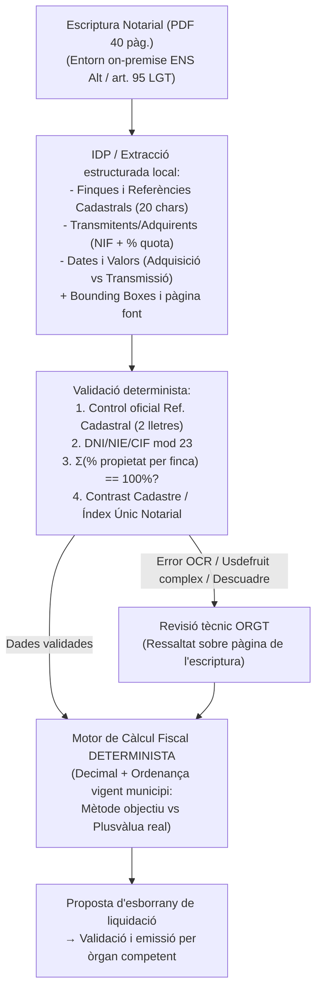

## A. Objectius d'aprenentatge

En completar aquesta lliçó final del Mòdul 4 (especialment rellevant per a l'**ORGT — Organisme de Gestió Tributària de la Diputació de Barcelona**), l'estudiant ha de ser capaç de:

1. **Identificar** les principals tipologies de **documents tributaris locals** (escriptures notarials de compravenda/herència per a **IIVTNU / plusvàlua**, declaracions i bonificacions d'**IBI**, **IAE**, **IVTM**, autoliquidacions, recursos de reposició i sol·licituds de fraccionament/ajornament).
2. **Explicar** l'estructura i la validació determinista de codis tributaris crítics: **referència cadastral** (20 caràcters alfanumèrics amb **2 dígits de control oficials**!), **NIF/NIE/CIF**, **IBAN**, dates de meritació (*devengo*) i quotes tributàries en **`Decimal`**.
3. **Analitzar** els reptes d'extracció en **escriptures notarials llargues** (20–60 pàgines de prosa jurídica densa amb múltiples immobles, quotes de participació, valors d'adquisició/transmissió i annexos cadastrals).
4. **Aplicar** les exigències reforçades de **confidencialitat fiscal (art. 95 LGT — caràcter reservat de les dades tributàries)**, **RGPD**, **ENS** i **prohibició de liquidacions o sancions tributàries autònomes** sense motor normatiu auditat ni supervisió humana (art. 41 LRJSP + AI Act / garanties del contribuent).
5. **Implementar** en Python pur un **validador real de referència cadastral (20 caràcters + algorisme oficial de 2 caràcters de control)** i un **comprovador tributari en `Decimal`** per a una autoliquidació de plusvàlua / bonificació IBI amb detecció d'inconsistències abans de liquidar!

---

## B. Explicació introductòria

La Diputació de Barcelona, a través de l'**Organisme de Gestió Tributària (ORGT)**, gestiona i recapta tributs locals (IBI, IAE, IVTM, plusvàlua/IIVTNU, taxes) per a més de **300 municipis de la província**, processant **centenars de milers de documents tributaris cada any**: escriptures notarials de compravenda i herències, sol·licituds de bonificacions (família nombrosa, plaques fotovoltaiques, vehicles zero emissions), recursos tributaris i domicialiacions bancàries.

En l'àmbit tributari, **la tolerància a l'error numèric és literalment ZERO**: un cèntim mal arrodonit, un percentatge de propietat (`50%` vs `100%`) mal llegit en una escriptura de 40 pàgines o una referència cadastral equivocada genera una liquidació errònia, recursos, interessos de demora i pèrdua de confiança ciutadana! Per això, el processament tributari combina **IDP d'alta precisió** amb **motors de càlcul fiscal 100% deterministes**, **confidencialitat estricta (art. 95 LGT)** i **supervisió humana**.

---

## C. Explicació tècnica avançada

### 1. Documents tributaris locals clau i què n'extreu la IA

| Document tributari | Tribut associat | Camps crítics a extreure | Complexitat principal |
|---|---|---|---|
| **Escriptura notarial** (compravenda, herència, donació) | **IIVTNU (Plusvàlua)** i canvi titularitat **IBI** | Data meritació (*devengo*), transmitents/adquirents (NIF + % quota!), **referència cadastral** (20 chars), valor d'adquisició vs. transmissió, municipi | 20–60 pàgines de prosa notarial, **múltiples finques** dins la mateixa escriptura, diferents percentatges de propietat (plena propietat vs. usdefruit/nua propietat!) |
| **Sol·licitud bonificació IBI** (família nombrosa / solar) | **IBI** | NIF titular, referència cadastral, núm. títol família nombrosa i vigència, certificat instal·lació fotovoltaica / potència kW | Coherència creuada entre títol de família nombrosa vigent, padró (domicili habitual) i referència cadastral! |
| **Permís de circulació / Fitxa tècnica** | **IVTM** (Vehicles) | Matrícula, bastidor (VIN 17 chars), potència fiscal (CVF), emissions/etiqueta DGT (0/ECO), titular | Bonificacions ambientals i exempcions (discapacitat/agrícola) amb verificació DGT |
| **Recursos de reposició i al·legacions** | Tots els tributs | Núm. liquidació/rebut impugnat, motiu jurídic, prescripció, proves adjuntes | Classificació del motiu de recurs i enrutament al tècnic jurídic + control de terminis (art. 14 TRLRHL: 1 mes!) |

### 2. Arquitectura híbrida obligatòria: **IDP per llegir + Motor Fiscal Determinista per calcular!**

Una regla absoluta en IA tributària: **un LLM MAI no ha de calcular la quota d'un impost!**
1. **Capa IA (IDP — Extracció assistida)**: localitza i extreu les dades brutes del PDF/escriptura (dates, percentatges, referències cadastrals, valors d'escriptura) amb **cites exactes a pàgina i *bounding box***.
2. **Capa de Validació Determinista**:
   - **Referència cadastral (20 caràcters)**: comprovar els **2 caràcters de control oficials** (posicions 19 i 20) segons l'algorisme oficial de la Direcció General del Cadastre!
   - **Coherència de quotes de participació**: \(\sum \%_{\text{adquirents}} = 100\%\) per a cada finca!
   - **Aritmètica exacta en `Decimal`**: mai `float` binari en imports, bases imposables, tipus impositius ni arrodoniments a 2 decimals (`ROUND_HALF_UP`).
3. **Motor de Càlcul Tributari 100% Determinista**: aplica exactament l'ordenança fiscal vigent del municipi (p. ex., en plusvàlua / IIVTNU després de la reforma RDL 26/2021, calcular tant el **mètode objectiu** per coeficients com la **plusvàlua real** per diferència de valors, i aplicar el **més favorable per al contribuent**, o detectar **no subjecció** si hi ha pèrdua patrimonial!).
4. **Supervisió humana (HITL)**: el tècnic tributari valida les dades ressaltades sobre l'escriptura abans d'emetre la liquidació o aprovar la bonificació.

### 3. Seguretat i confidencialitat fiscal reforçada (**art. 95 LGT** + RGPD + ENS)

:::callout-legal Caràcter reservat de les dades tributàries (art. 95 Llei 58/2003, LGT)
Les dades, informes o antecedents obtinguts per l'Administració tributària tenen **caràcter estrictament reservat** (art. 95 LGT): només es poden utilitzar per a l'aplicació efectiva dels tributs i no es poden cedir a tercers fora dels supòsits taxats per la llei. En conseqüència:
- **Execució 100% *on-premise* o núvol sobirà certificat ENS Alt**, amb prohibició absoluta d'enviar escriptures o dades fiscals a APIs externes de tercers sense garanties o que entrenin amb les dades!
- **Aïllament estricte de permisos** (només personal tributari autoritzat) i **auditoria completa d'accessos** a cada consulta (ENS).
:::

---

## D. Diagrames i recursos visuals

### Pipeline segur de processament d'escriptures notarials per a IIVTNU (Plusvàlua)



---

## E. Aplicació a l'Administració pública

1. **Integració amb l'Índex Únic Notarial (dades estructurades) + IDP**: sempre que sigui possible, aprofitar els fitxers estructurats que els notaris remeten per via telemàtica, reservant l'IDP per a les escriptures aportades en PDF pel contribuent, escriptures antigues d'adquisició (per acreditar pèrdua patrimonial en plusvàlua!) i documentació complementària.
2. **Detecció proactiva de casos complexos (usdefruit, herències múltiples, no subjecció)**: quan l'extractor detecta paraules clau com *"usdefruit vitalici"*, *"nua propietat"*, *"extinció de condomini"* o *"pèrdua patrimonial"* (`valor_transmissio <= valor_adquisicio`), ha de marcar automàticament una bandera per a **revisió jurídica tributària especialitzada**!
3. **Zero entrenament sobre dades fiscals sense governança**: no reutilitzar mai escriptures ni recursos reals dels contribuents per entrenar models sense base jurídica i anonimització rigorosa verificada (art. 95 LGT + RGPD).

---

## F. Exemple pràctic guiat

Implementem en **Python pur** dues peces reals d'enginyeria tributària:
1. L'**algorisme oficial de verificació dels 2 caràcters de control d'una Referència Cadastral espanyola de 20 caràcters** (posicions 19 i 20 amb pesos oficials de la Direcció General del Cadastre!).
2. Un **validador i calculador fiscal determinista en `Decimal`** per a una operació d'IIVTNU (plusvàlua) que comprova que la suma de quotes d'adquirents és `100%`, detecta **no subjecció per pèrdua patrimonial** i aplica el **mínim entre base objectiva i plusvàlua real**!

```python
"""Exemple 4.8: Validador oficial de Referència Cadastral (20 chars) i motor fiscal determinista en Decimal."""
from decimal import Decimal, ROUND_HALF_UP
import re

PESOS_CADASTRE = [13, 15, 12, 5, 4, 17, 9, 21, 3, 7, 1]
LLETRES_CADASTRE = "MQWERTYUIOPASDFGHJKLBZX"


def _valor_char_cadastre(ch: str) -> int:
    if ch.isdigit():
        return int(ch)
    if ch == "Ñ":
        return 15
    codi = ord(ch) - ord("A") + 1
    return codi + 1 if ch > "N" else codi


def calcular_controls_ref_cadastral(base18: str) -> str:
    """Calcula els 2 caràcters de control oficials (posicions 19 i 20) d'una referència cadastral."""
    b = base18.upper()
    bloc1 = b[0:7] + b[14:18]   # 7 primers (finca) + 4 càrrec = 11 caràcters
    bloc2 = b[7:14] + b[14:18]  # 7 segons (full/parcel·la) + 4 càrrec = 11 caràcters
    c1 = LLETRES_CADASTRE[sum(_valor_char_cadastre(ch) * w for ch, w in zip(bloc1, PESOS_CADASTRE)) % 23]
    c2 = LLETRES_CADASTRE[sum(_valor_char_cadastre(ch) * w for ch, w in zip(bloc2, PESOS_CADASTRE)) % 23]
    return c1 + c2


def validar_ref_cadastral(ref: str) -> bool:
    r = re.sub(r"\s+", "", ref.upper())
    if not re.fullmatch(r"[0-9A-ZÑ]{20}", r):
        return False
    return calcular_controls_ref_cadastral(r[:18]) == r[18:20]


def calcular_base_iivtnu_determinista(
    ref_cadastral: str,
    quotes_adquirents: list[Decimal],
    valor_adquisicio: Decimal,
    valor_transmissio: Decimal,
    percentatge_sol: Decimal,
    valor_cadastral_sol: Decimal,
    coeficient_anys: Decimal,
    tipus_impositiu: Decimal,
) -> dict[str, object]:
    if not validar_ref_cadastral(ref_cadastral):
        return {"estat": "BLOQUEJAT", "motiu": "Referència cadastral no supera dígits de control"}
    if sum(quotes_adquirents, Decimal("0")) != Decimal("100"):
        return {"estat": "BLOQUEJAT", "motiu": f"Suma de quotes != 100% ({sum(quotes_adquirents)})"}

    guany_total = valor_transmissio - valor_adquisicio
    if guany_total <= Decimal("0"):
        return {"estat": "NO_SUBJECTE", "motiu": "Sense increment de valor (pèrdua o guany zero)", "quota_eur": "0.00"}

    base_real = (guany_total * percentatge_sol).quantize(Decimal("0.01"), rounding=ROUND_HALF_UP)
    base_objectiva = (valor_cadastral_sol * coeficient_anys).quantize(Decimal("0.01"), rounding=ROUND_HALF_UP)
    base_aplicada = min(base_real, base_objectiva)  # Regla favorable al contribuent (RDL 26/2021)
    quota = (base_aplicada * tipus_impositiu).quantize(Decimal("0.01"), rounding=ROUND_HALF_UP)
    return {
        "estat": "PROPOSTA_CALCULADA",
        "base_real": str(base_real),
        "base_objectiva": str(base_objectiva),
        "metode_aplicat": "REAL" if base_real < base_objectiva else "OBJECTIU",
        "quota_eur": str(quota),
    }


if __name__ == "__main__":
    # Construïm una referència cadastral sintètica amb els 2 caràcters de control oficials vàlids
    base_sint = "1234567DF3813S0001"
    ref_valida = base_sint + calcular_controls_ref_cadastral(base_sint)
    ref_corrupta = base_sint + "AA"  # error OCR als caràcters de control

    print(f"Ref vàlida ({ref_valida}):", validar_ref_cadastral(ref_valida))
    print(f"Ref errònia ({ref_corrupta}):", validar_ref_cadastral(ref_corrupta))
    print("Cas 1 (guany moderat, aplica mètode real):", calcular_base_iivtnu_determinista(
        ref_valida, [Decimal("50"), Decimal("50")],
        Decimal("180000"), Decimal("195000"), Decimal("0.40"),
        Decimal("60000"), Decimal("0.17"), Decimal("0.30"),
    ))
    print("Cas 2 (pèrdua patrimonial -> no subjecte):", calcular_base_iivtnu_determinista(
        ref_valida, [Decimal("100")],
        Decimal("210000"), Decimal("190000"), Decimal("0.40"),
        Decimal("60000"), Decimal("0.17"), Decimal("0.30"),
    ))
```

### Interpretació dels resultats (execució verificada)

- L'algorisme oficial valida la referència cadastral sintètica de 20 caràcters (`True`) i rebutja immediatament la versió amb error OCR als dígits de control (`False`).
- **Cas 1**: amb un guany de `15.000 €` i 40% de sòl, la **base real (`6.000,00 €`)** és inferior a la **base objectiva (`10.200,00 €`)** → el motor determinista aplica automàticament la més favorable (`REAL`) i calcula una quota exacta en `Decimal` de **`1.800,00 €`** (`6000 × 0,30`).
- **Cas 2**: venda per sota del preu de compra (`190.000 < 210.000`) → **`NO_SUBJECTE` (`quota_eur = 0.00`)**, sense intervenció aritmètica de cap LLM!

---

## G. Exercici pràctic per resoldre

### Enunciat
Un ens de gestió tributària provincial vol automatitzar el processament d'escriptures notarials de compravenda i herències per preparar propostes de liquidació de l'**IIVTNU (plusvàlua)**. Un equip proposa enviar els PDFs de 45 pàgines directament a un **LLM comercial al núvol extern** amb el prompt: *"Llegeix aquesta escriptura, troba les finques i calcula directament l'impost de plusvàlua a pagar per cada comprador"*.

Enumera **4 fallades crítiques (jurídiques, de seguretat i d'enginyeria)** d'aquesta proposta i dissenya l'**arquitectura correcta de producció** per a un organisme tributari públic (com l'ORGT de la Diputació de Barcelona).

### Objectius i restriccions
- Aplicar art. 95 LGT (caràcter reservat de dades tributàries) + RGPD + ENS Alt, separar estrictament extracció IA de motor de càlcul fiscal determinista en `Decimal`, validar referències cadastrals/quotes i mantenir revisió humana.

:::hint Pista 1 — Seguretat i normativa fiscal (art. 95 LGT + RGPD + ENS)
Enviar escriptures notarials (dades patrimonials, NIFs, comptes, herències) a un LLM comercial extern vulnera el **caràcter reservat de dades tributàries (art. 95 LGT)**, el RGPD i l'ENS! Cal processament **100% *on-premise*** (o núvol sobirà ENS Alt)!
:::

:::hint Pista 2 — Mai calcular impostos amb un LLM + múltiples finques/usdefruit
(2) Un LLM **mai** no pot calcular quotes tributàries (al·lucinacions aritmètiques, ordenances municipals variables per 311 municipis, doble mètode real/objectiu); (3) Les escriptures de 45 pàgines tenen múltiples finques, quotes i figures com usdefruit/extinció de condomini que requereixen validació determinista (control referència cadastral 20 chars, `Σ quotes == 100%`) i bandera de revisió jurídica; (4) Cap liquidació sense supervisió humana ni aprofitar abans l'**Índex Únic Notarial** estructurat!
:::

### Criteris d'avaluació
- **30%**: Vulneració de l'**art. 95 LGT** (dades tributàries reservades), RGPD i ENS en enviar escriptures a un LLM extern → exigència d'entorn *on-premise* / ENS Alt.
- **30%**: Separació absoluta entre **extracció IA** (amb cites a pàgina/*bbox*) i **motor de càlcul fiscal 100% determinista en `Decimal`** (amb taules d'ordenances dels 311 municipis i doble mètode objectiu/real).
- **20%**: Validacions deterministes (algorisme oficial de 20 caràcters de referència cadastral, DNI/NIE, `Σ quotes = 100%`) + detecció de casos jurídics complexos (usdefruit, herència, no subjecció).
- **20%**: Priorització de dades estructurades (**Índex Únic Notarial**) + revisió i emissió humana obligatòria (HITL).

### Errors habituals
- Acceptar que l'LLM calculi la quota de plusvàlua «si se li passa una taula de coeficients al prompt».

:::solution Solució completa comentada i alternatives
### Les 4 fallades crítiques
1. **Vulneració d'art. 95 LGT, RGPD i ENS**: enviar escriptures notarials amb dades patrimonials, herències i NIFs a una API LLM comercial externa incompleix el caràcter estrictament reservat de les dades tributàries i els requisits de sobirania i seguretat ENS.
2. **Delegació del càlcul tributari a un LLM**: els LLMs cometen errors aritmètics, no garanteixen arrodoniments fiscals exactes en `Decimal` i no coneixen amb certesa les ordenances fiscals vigents de 311 municipis ni el càlcul comparat objectiu vs. real.
3. **Absència de validació determinista i gestió de complexitat notarial**: una escriptura de 45 pàgines pot contenir 4 finques, usdefruits, nua propietat o quotes parcials; sense validar la **referència cadastral (20 caràcters)**, DNI i `Σ quotes == 100%`, qualsevol error d'OCR passa directament a liquidació.
4. **Omissió de fonts estructurades (Índex Únic Notarial) i supervisió humana**: no aprofitar les remissions telemàtiques notarials ni preveure revisió humana abans d'emetre actes tributaris amb efectes jurídics.

### Arquitectura de producció correcta (ORGT)
1. **Ingesta prioritària estructurada**: consumir primer les dades de l'**Índex Únic Notarial** i Cadastre; aplicar IDP *on-premise* (ENS Alt) sobre PDFs d'escriptures aportades pel contribuent o escriptures antigues d'adquisició.
2. **Extracció estructurada local amb cites visuals**: model *on-premise* extreu per a cada finca: referència cadastral, transmitents, adquirents, quotes %, dates i valors, conservant pàgina i *bounding box* (mai càlculs!).
3. **Validació determinista i detecció de complexitat**: control oficial de 20 caràcters de referència cadastral, DNI/NIE/CIF, `Σ(% quotes) == 100%`, contrast amb Cadastre i bandera automàtica de derivació a tècnic jurídic si detecta *usdefruit*, *extinció de condomini* o *herència complexa*.
4. **Motor fiscal 100% determinista en `Decimal`**: aplica l'ordenança vigent del municipi concret, compara mètode objectiu vs. real (i no subjecció per pèrdua) i genera un **esborrany de liquidació** que el personal tributari revisa (amb *Click-to-Highlight* sobre l'escriptura) i aprova formalment.
:::

---

## H. Test individual

Resol les 10 preguntes sobre documents tributaris locals (ORGT, IBI, IIVTNU, IVTM), validació de referència cadastral (20 caràcters), càlcul determinista en `Decimal`, art. 95 LGT, Índex Únic Notarial i gestió de casos complexos.

---

## I. Preguntes de desenvolupament

### Pregunta 1
Justifica el principi d'arquitectura **«IDP per extreure, motor determinista en `Decimal` per liquidar»** en un organisme de gestió tributària (com l'ORGT), explicant quins riscos apareixerien si es deixés el càlcul d'impostos en mans d'un LLM.

:::model-answer Resposta model i criteris de correcció (Pregunta 1)
**Resposta model**:
- **Separació de responsabilitats**: la IA/IDP destaca en comprendre prosa jurídica llarga i heterogènia (escriptures notarials de 40 pàgines) per localitzar dates, NIFs, quotes de participació, valors i referències cadastrals amb cites a pàgina i *bounding box*.
- **Motor fiscal determinista**: un cop extretes i validades les dades (algorisme oficial de referència cadastral, `Σ quotes = 100%`, DNI/NIE), el càlcul de bases, exempcions, bonificacions i quotes (p. ex., comparant mètode objectiu i plusvàlua real en IIVTNU segons l'ordenança vigent de cada municipi) s'ha d'executar **exclusivament amb codi determinista en aritmètica exacta `Decimal`** (`ROUND_HALF_UP`), 100% versionat, provat amb tests unitaris i auditable.
- **Riscos d'un LLM calculant impostos**: errors aritmètics i d'arrodoniment, confusió de tipus impositius entre 311 ordenances municipals, manca de reproductibilitat i impossibilitat de garantir seguretat jurídica tributària ni motivació exacta davant recursos.

**Criteris de correcció (10 punts)**:
- Separació clara extracció IA vs. càlcul determinista en `Decimal`: 6 punts.
- Riscos tècnics i jurídics d'usar LLMs per liquidar impostos: 4 punts.
:::

### Pregunta 2
Com condiciona l'**article 95 de la Llei 58/2003 (Llei General Tributària — LGT)** juntament amb el RGPD i l'ENS el desplegament de sistemes d'IA sobre documents tributaris (escriptures, declaracions, recursos)?

:::model-answer Resposta model i criteris de correcció (Pregunta 2)
**Resposta model**:
- L'**art. 95 LGT** estableix el **caràcter estrictament reservat** de totes les dades, informes i antecedents tributaris: només es poden utilitzar per a l'aplicació efectiva dels tributs i està prohibida la seva cessió fora dels supòsits legalment taxats.
- **Implicacions tècniques obligatòries**: (1) desplegament **100% *on-premise*** o en núvol sobirà certificat **ENS Alt** amb contracte d'encarregat conforme (mai APIs externes sense garanties ni ús de dades per entrenar models de tercers); (2) **control d'accés estricte (mínim privilegi / ACL)** només per a personal tributari autoritzat; (3) **xifratge en trànsit i repòs** i **registre immutable d'auditoria** de tots els accessos; (4) no reutilitzar documents fiscals reals per entrenar o provar models sense anonimització rigorosa verificada.

**Criteris de correcció (10 punts)**:
- Referència correcta al caràcter reservat de l'art. 95 LGT i encaix RGPD/ENS: 4 punts.
- Mesures tècniques concretes (*on-premise*/ENS Alt, ACL, auditoria, prohibició d'entrenament amb dades reals): 6 punts.
:::

### Pregunta 3
Descriu quins controls deterministes i quines banderes de complexitat jurídica implementaries en un pipeline d'extracció d'**escriptures notarials de compravenda/herència** abans de generar una proposta de liquidació de plusvàlua (IIVTNU).

:::model-answer Resposta model i criteris de correcció (Pregunta 3)
**Resposta model**:
- **Controls deterministes**: (1) verificació dels **2 caràcters de control oficials** de cada **referència cadastral (20 caràcters)**; (2) validació de DNI/NIE/CIF de transmitents i adquirents; (3) comprovació per cada finca que **\(\sum \%_{\text{propietat}} = 100\%\)**; (4) validació temporal (`data_transmissio >= data_adquisicio`) i contrast amb Cadastre i Índex Únic Notarial; (5) càlcul en `Decimal` de no subjecció (pèrdua patrimonial) i mínim entre mètode objectiu i real.
- **Banderes de complexitat jurídica (derivació obligatòria a tècnic especialista)**: detecció de termes o estructures complexes com **usdefruit vitalici / nua propietat**, **extinció de condomini**, **herències amb múltiples causahavents**, **múltiples finques amb valor global sense desglossament**, o discrepància entre valor escripturat i valor de referència cadastral.

**Criteris de correcció (10 punts)**:
- Controls deterministes (ref. cadastral 20 chars, quotes 100%, dates, Decimal, Cadastre): 6 punts.
- Banderes de complexitat jurídica notarial + derivació HITL: 4 punts.
:::

---

## J. Resum per memoritzar

### Conceptes clau
- **Principi d'or tributari**: **IDP *on-premise* per extreure (amb pàgina/*bbox*) + Motor Fiscal 100% Determinista en `Decimal` per calcular** — un LLM **MAI** no calcula impostos!
- **Referència cadastral**: **20 caràcters** amb **2 caràcters de control oficials** (posicions 19 i 20) validables deterministament!
- **IIVTNU (Plusvàlua)**: comprovar `Σ(% quotes) == 100%`, detectar **no subjecció** si hi ha pèrdua patrimonial (`valor_transmissio <= valor_adquisicio`) i aplicar el **mínim** entre mètode objectiu i plusvàlua real.
- **Art. 95 LGT**: caràcter **estrictament reservat** de les dades tributàries → execució *on-premise* / **ENS Alt**, zero APIs externes no autoritzades, ACL estricte i auditoria d'accessos.
- **Prioritzar fonts estructurades**: Índex Únic Notarial i Cadastre abans d'OCR/IDP, i derivar casos complexos (*usdefruit*, *extinció de condomini*, *herències múltiples*) a revisió tributària experta.

### Definicions essencials
- **Art. 95 LGT (Llei 58/2003)**: norma que atorga caràcter reservat a les dades obtingudes per l'Administració tributària, restringint-ne l'ús i la cessió exclusivament als fins tributaris i supòsits legals taxats.
- **Referència cadastral**: identificador oficial únic de 20 caràcters alfanumèrics de cada bé immoble a Espanya, dotat de 2 caràcters de control que permeten verificar-ne la integritat matemàtica.

### Errors conceptuals freqüents
1. Demanar a un LLM que calculi quotes d'IBI o plusvàlua.
2. Enviar escriptures notarials o expedients fiscals a APIs comercials externes vulnerant l'art. 95 LGT i el RGPD.
3. No detectar casos notarials complexos (usdefruit/nua propietat, múltiples finques) ni verificar que les quotes de propietat sumin 100%.

### Possibles preguntes d'examen
- Per què un organisme tributari (com l'ORGT) ha de separar l'extracció IDP del motor de càlcul fiscal determinista en `Decimal`?
- Quines implicacions tècniques té l'art. 95 LGT sobre l'arquitectura d'IA en documents tributaris?
- Quines validacions deterministes i quines banderes de revisió humana aplicaries sobre una escriptura notarial de 40 pàgines?
