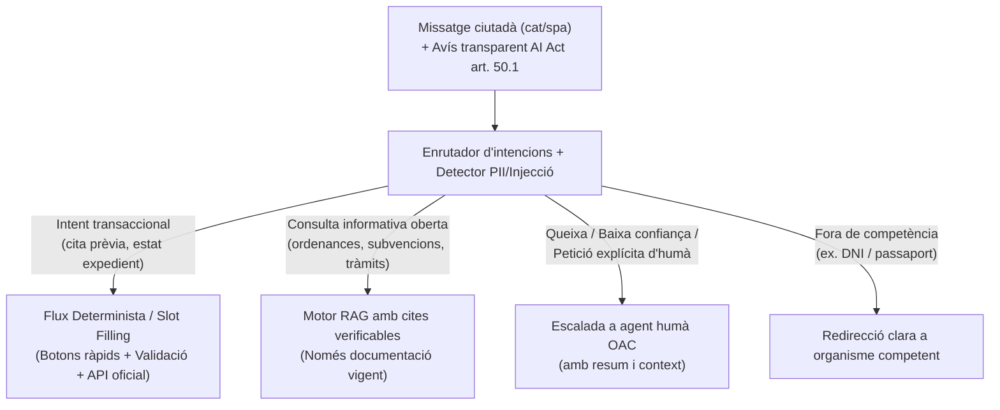

## A. Objectius d'aprenentatge

En completar aquesta lliçó, l'estudiant ha de ser capaç de:

1. **Comparar** les tres arquitectures de chatbots: **basats en regles / arbres de decisió**, **NLU clàssic (*Intents + Entities + Slots*, tipus Rasa/Dialogflow)** i **conversacionals basats en LLM + RAG**, identificant l'**arquitectura híbrida** com a òptima per a l'Administració pública.
2. **Explicar** els components clau d'un motor NLU: **detecció d'intencions (*Intent Classification*)**, **extracció de paràmetres (*Slot Filling / Entity Extraction*)** i **gestió del llindar de confiança i *out-of-scope***.
3. **Aplicar** l'obligació legal de **transparència de l'article 50.1 de l'AI Act (Reglament UE 2024/1689)**: informar de manera clara i inequívoca la persona ciutadana que està interactuant amb un sistema d'IA!
4. **Distingir** quan un tràmit ciutadà ha de ser resolt per un **flux determinista/botons** (cita prèvia, consulta d'estat d'expedient, pagament de rebut) i quan per **LLM + RAG** (preguntes obertes sobre ordenances o requisits).
5. **Implementar** en Python pur un **enrutador híbrid de chatbot municipal** (classificador d'intencions + extractor de *slots* + detector d'*out-of-scope*) que deriva intencions transaccionals a fluxos deterministes i preguntes obertes al RAG.

---

## B. Explicació introductòria

Un **chatbot** (o assistent conversacional) és una interfície que permet als ciutadans o empleats públics interactuar en llenguatge natural (text o veu) per obtenir informació o iniciar gestions 24/7 sense navegar per menús complexos de la seu electrònica.

Però no tots els chatbots són iguals! Si un ciutadà pregunta *"Quins documents necessito per demanar la bonificació d'IBI?"*, un **chatbot basat en RAG** ofereix una resposta natural, precisa i citada. En canvi, si el ciutadà vol **demanar cita prèvia a l'OAC o consultar el saldo del seu rebut**, deixar el control a un LLM lliure és un error: un **flux estructurat amb regles, *slots* i botons ràpids** és més ràpid, econòmic, predictible i segur!

---

## C. Explicació tècnica avançada

### 1. Evolució i comparativa d'arquitectures de chatbots

| Arquitectura | Com funciona | Punts forts | Limitacions |
|---|---|---|---|
| **1. Basat en regles / Arbres de botons** | Menús guiats, paraules clau i transicions deterministes | **0% al·lucinacions**, cost gairebé nul, 100% previsible i auditable | Rígid: frustra l'usuari si escriu amb frases naturals fora del guió |
| **2. NLU clàssic (*Intent + Slots*, ex. Rasa)** | Classificador d'intencions + extractor d'entitats (*slot filling*) + gestor de diàleg | Previsible en tràmits estructurats (*cita prèvia, horaris, consultes BD*), control total de *slots* obligatoris | Cost elevat mantenir centenars d'intencions i respostes estàtiques; feble en preguntes obertes sobre normativa |
| **3. LLM + RAG pur** | Recuperació documental + generació lliure en llenguatge natural | Excel·lent comprensió multilingüe (català/castellà/anglès/àrab) i preguntes obertes complexes | Major latència/cost, risc d'al·lucinació o *prompt injection*, menys adequat per a formularis estrictes pas a pas |
| **4. Arquitectura HÍBRIDA (Recomanada)** | Enrutador d'intencions: **tràmits estructurats → flux determinista**; **dubtes normatius → RAG amb cites**; **fora d'abast / queixa greu → escalada humana** | Combina la **seguretat determinista** en gestions amb la **flexibilitat lingüística** del RAG en informació | Requereix bon disseny d'enrutament i manteniment coordinat |

### 2. Components del NLU: Intencions, *Slots* i *Out-of-Scope*

- **Intenció (*Intent*)**: objectiu principal del missatge (`demanar_cita`, `consultar_expedient`, `info_tributs`, `queixa_incidencia`, `salutacio`, `parlar_amb_persona`).
- ***Slot Filling* (Extracció de paràmetres)**: omplir els camps obligatoris per executar una acció (`oficina = "OAC Mataró"`, `data = "2026-06-15"`, `codi_expedient = "SUB-2026-0148"`). Si falta un *slot*, el chatbot el demana explícitament abans d'invocar cap API!
- **Detecció d'*Out-of-Scope* (Fora de domini)**: quan la confiança de la millor intenció queda per sota del llindar (p. ex., `conf < 0,70`) o el tema no és competència de l'ajuntament (p. ex., renovació del passaport — competència estatal!), el chatbot ho reconeix clarament i redirigeix a l'organisme competent en lloc d'improvisar.

### 3. Obligació legal de transparència (**AI Act, art. 50.1**)

:::callout-legal Obligació de transparència en sistemes interactius (AI Act — Reglament UE 2024/1689, art. 50.1)
Els sistemes d'IA destinats a interactuar directament amb persones físiques (com els chatbots ciutadans!) s'han de dissenyar de manera que s'informi la persona física **de manera clara, visible i des del primer moment** que està interactuant amb un sistema d'IA (tret que resulti obvi des del punt de vista d'una persona raonablement ben informada). A l'Administració pública, és bona pràctica obligatòria mostrar un **avís inicial inequívoc** (*«Soc un assistent virtual basat en IA...»*), indicar les seves **limitacions** (caràcter informatiu, no vinculant) i oferir en tot moment l'opció de **contactar amb una persona**.
:::

---

## D. Diagrames i recursos visuals

### Arquitectura híbrida d'un chatbot municipal (Enrutador NLU + Flux determinista + RAG)



---

## E. Aplicació a l'Administració pública

1. **Multilingüisme i llenguatge clar**: un chatbot municipal a la província de Barcelona ha d'atendre amb fluïdesa en **català** (idioma d'ús normal i preferent de les administracions locals catalanes) i **castellà**, i opcionalment altres idiomes per a atenció a nouvinguts, traduint l'argot administratiu a **llenguatge planer (*Plain Language*)** comprensible per a tothom.
2. **Accessibilitat universal (WCAG 2.1 AA / RD 1112/2018)**: el widget de chatbot web ha de ser 100% navegable per teclat, compatible amb lectors de pantalla (`ARIA live regions`), amb contrast adequat i mai ser l'única via d'accés a un tràmit.
3. **Caràcter informatiu, no vinculant**: les respostes d'un chatbot informatiu no constitueixen actes administratius ni resolucions vinculants; en consultes tributàries o jurídiques complexes ha de citar sempre l'ordenança oficial i indicar el canal de consulta vinculant.

---

## F. Exemple pràctic guiat

Implementem en **Python pur** un **enrutador híbrid de chatbot municipal** que:
1. Classifica la intenció del missatge (`DEMANAR_CITA`, `CONSULTAR_EXPEDIENT`, `INFO_NORMATIVA`, `ESCALAR_HUMA`, `FORA_COMPETENCIA`).
2. Extreu *slots* estructurats (`codi_expedient`) quan la intenció és transaccional.
3. Decideix la ruta òptima (`FLUX_DETERMINISTA`, `MOTOR_RAG`, `ESCALADA_OAC` o `REDIRECCIO_OOS`) mantenint sempre un missatge transparent conforme a l'art. 50.1 AI Act.

```python
"""Exemple 5.1: Enrutador híbrid de chatbot municipal (Intents + Slot Filling + Rutes)."""
import re

PATRONS_INTENT: list[tuple[str, list[str], str]] = [
    ("ESCALAR_HUMA", ["parlar amb una persona", "agent humà", "operador", "queixa greu"], "ESCALADA_OAC"),
    ("DEMANAR_CITA", ["cita prèvia", "demanar hora", "reservar cita"], "FLUX_DETERMINISTA"),
    ("CONSULTAR_EXPEDIENT", ["estat del meu expedient", "estat expedient", "com va la meva sol·licitud"], "FLUX_DETERMINISTA"),
    ("FORA_COMPETENCIA", ["renovar dni", "passaport", "carnet de conduir", "seguretat social"], "REDIRECCIO_OOS"),
    ("INFO_NORMATIVA", ["bonificació", "ibi", "ordenança", "requisits", "subvenció", "termini"], "MOTOR_RAG"),
]


def enrutar_missatge(missatge: str) -> dict[str, object]:
    m = missatge.lower()
    slots: dict[str, str] = {}
    exp = re.search(r"\b[A-Z]{2,4}-\d{4}-\d{3,6}\b", missatge.upper())
    if exp:
        slots["codi_expedient"] = exp.group(0)

    for intent, keywords, ruta in PATRONS_INTENT:
        if any(kw in m for kw in keywords):
            falta_slot = intent == "CONSULTAR_EXPEDIENT" and "codi_expedient" not in slots
            return {
                "intent": intent,
                "ruta": ruta,
                "slots": slots,
                "seguent_pas": "DEMANAR_SLOT_EXPEDIENT" if falta_slot else f"EXECUTAR_{ruta}",
            }

    return {"intent": "INCERT", "ruta": "MOTOR_RAG_AMB_FALLBACK", "slots": slots, "seguent_pas": "CERCAR_O_ACLARIR"}


if __name__ == "__main__":
    proves = [
        "Hola, vull saber l'estat del meu expedient SUB-2026-0148",
        "Com va la meva sol·licitud de beca?",
        "Quins requisits té la bonificació de l'IBI per plaques solars?",
        "On puc renovar el passaport?",
        "Vull parlar amb una persona de l'OAC si us plau",
    ]
    for p in proves:
        print(f"Usuari: {p}\n  -> {enrutar_missatge(p)}")
```

### Interpretació dels resultats (execució verificada)

- Missatge 1: detecta `CONSULTAR_EXPEDIENT` **i** extreu el *slot* `codi_expedient = 'SUB-2026-0148'` → executa directament el **flux determinista** (amb autenticació prèvia!).
- Missatge 2: detecta `CONSULTAR_EXPEDIENT` però falta el *slot* → retorna `DEMANAR_SLOT_EXPEDIENT` abans de cridar cap API.
- Missatge 3 → **Motor RAG**; Missatge 4 (*passaport*) → **Redirecció fora de competència**; Missatge 5 → **Escalada immediata a agent humà OAC**!

---

## G. Exercici pràctic per resoldre

### Enunciat
Un ajuntament vol desplegar un chatbot ciutadà al seu web municipal que resolgui:
1. Consultes obertes sobre 40 ordenances i 120 tràmits municipals.
2. Reserva de cita prèvia a les 3 oficines OAC (requereix triar oficina, tràmit, dia i franja horària disponible en temps real).
3. Consultes que sovint no són competència municipal (renovació de DNI, targeta sanitària, prestació d'atur).

L'equip dubta entre: (Opció 1) un chatbot 100% d'arbres de regles/botons, (Opció 2) un LLM pur sense regles ni fluxos, o (Opció 3) una arquitectura híbrida.
- Justifica tècnicament i econòmicament quina opció recomanes, detalla el paper de cada component i inclou els requisits mínims d'**AI Act (art. 50.1)** i d'**accessibilitat**.

### Objectius i restriccions
- Justificar l'arquitectura híbrida (flux determinista per a cita prèvia + RAG per a 40 ordenances + redirecció OOS + transparència AI Act + WCAG).

:::hint Pista 1 — Per què ni Opció 1 pura ni Opció 2 pura?
- Opció 1 (només regles) no pot mantenir manualment arbres per a 40 ordenances canviants i 120 tràmits!
- Opció 2 (només LLM lliure) és lenta, cara i propensa a errors en un procés transaccional estricte com reservar una cita real (`oficina + tràmit + dia + hora`)!
:::

:::hint Pista 2 — Opció 3 (Arquitectura Híbrida) + Compliment legal
Enrutador d'intencions → (a) Cita prèvia = **flux determinista amb *slot filling* + botons + API de cites**; (b) Ordenances/tràmits = **RAG amb cites i pre-filtre de vigència**; (c) DNI/Atur/Salut = **detector *out-of-scope*** amb enllaços oficials; tot amb **avís clar AI Act art. 50.1**, opció visible d'atenció humana i accessibilitat **WCAG 2.1 AA**.
:::

### Criteris d'avaluació
- **35%**: Descart fonamentat de l'Opció 1 pura i l'Opció 2 pura.
- **40%**: Disseny detallat de l'**Opció 3 (Arquitectura Híbrida)** assignant cada cas d'ús al seu motor òptim (determinista per a cites, RAG per a normativa, OOS per a competències alienes).
- **25%**: Compliment explícit de **transparència AI Act art. 50.1**, caràcter informatiu no vinculant, accessibilitat **WCAG 2.1 AA (RD 1112/2018)** i canal català/castellà.

### Errors habituals
- Proposar que un LLM gestioni tota la reserva de cites amb text lliure sense validació d'horaris reals ni *slot filling*.

:::solution Solució completa comentada i alternatives
### Recomanació: Opció 3 — Arquitectura Híbrida
1. **Per què descartar Opció 1 (només regles)**: codificar i mantenir manualment centenars d'arbres de decisió per a 40 ordenances que canvien cada any i 120 tràmits té un cost de manteniment insostenible i frustra l'usuari que pregunta en llenguatge natural.
2. **Per què descartar Opció 2 (només LLM)**: reservar cita prèvia és una transacció estricta de 4 paràmetres (`oficina`, `tràmit`, `dia`, `hora disponible en temps real`); usar un LLM lliure afegeix latència, cost i risc d'inventar franges horàries inexistents.
3. **Disseny de l'Opció 3 (Híbrida)**:
   - **Enrutador d'intencions**: separa consultes informatives, cita prèvia, peticions d'humà i *out-of-scope*.
   - **Cita prèvia → Flux determinista + *Slot Filling* + Botons ràpids** connectats a l'API oficial de cites (0% al·lucinació, confirmació explícita abans de gravar).
   - **40 ordenances i 120 tràmits → Motor RAG amb cites** i pre-filtre de vigència normativa (fàcil d'actualitzar en canviar una ordenança sense reescriure arbres!).
   - **DNI / Targeta sanitària / Atur → Detector *Out-of-Scope*** que respon immediatament indicant l'administració competent (Policia Nacional / CatSalut / SOC-SEPE) amb enllaç oficial.
4. **Requisits normatius i d'accessibilitat**:
   - **AI Act art. 50.1**: missatge inicial clar indicant que l'usuari interactua amb un sistema d'IA i que la informació té caràcter orientatiu, no vinculant.
   - **Escalada humana** sempre visible (telèfon 010 / xat OAC).
   - **Accessibilitat WCAG 2.1 AA (RD 1112/2018)** i atenció impecable en català i castellà en llenguatge planer.
:::

---

## H. Test individual

Resol les 10 preguntes sobre chatbots de regles, NLU (*intents* i *slots*), LLM + RAG, arquitectura híbrida, detecció d'*out-of-scope*, art. 50.1 AI Act i accessibilitat WCAG.

---

## I. Preguntes de desenvolupament

### Pregunta 1
Compara les arquitectures de chatbots **basats en regles**, **NLU clàssic (*intents + slots*)** i **LLM + RAG**, i argumenta per què el model **híbrid** sol ser el més adequat per a una seu electrònica municipal.

:::model-answer Resposta model i criteris de correcció (Pregunta 1)
**Resposta model**:
- **Regles/botons**: 0% al·lucinacions, ràpid i barat, però rígid i incapaç de cobrir consultes obertes sobre normativa canviant.
- **NLU clàssic (Intents + Slots)**: previsible per a gestions estructurades i captura de paràmetres obligatoris (*slot filling*), però car d'escalar a centenars de preguntes informatives.
- **LLM + RAG**: compren llenguatge natural multilingüe i respon preguntes complexes sobre ordenances actualitzables citant fonts, però és més car/lent i menys fiable per a transaccions pas a pas.
- **Model híbrid**: utilitza un enrutador per enviar **tràmits transaccionals** (cita prèvia, consulta d'expedient) a **fluxos deterministes amb *slot filling*** i **consultes normatives obertes** al **motor RAG amb cites**, combinant seguretat jurídica, cost òptim i bona experiència ciutadana.

**Criteris de correcció (10 punts)**:
- Comparativa precisa de les 3 arquitectures base: 6 punts.
- Justificació operativa del model híbrid en seu electrònica: 4 punts.
:::

### Pregunta 2
Explica què són la **detecció d'intencions (*Intent Classification*)**, el ***Slot Filling*** i la gestió d'***Out-of-Scope***, posant un exemple municipal de cadascun.

:::model-answer Resposta model i criteris de correcció (Pregunta 2)
**Resposta model**:
- **Detecció d'intencions**: identifica l'objectiu principal del missatge de l'usuari (p. ex. *"Vull demanar hora per empadronar-me"* → `DEMANAR_CITA`).
- ***Slot Filling***: extreu i valida els paràmetres necessaris per completar la intenció (`oficina`, `tràmit = "padró"`, `data`, `hora`); si falta algun *slot* obligatori, el gestor de diàleg el sol·licita explícitament abans de cridar l'API.
- **Gestió d'*Out-of-Scope***: detecta quan el missatge cau fora de les competències municipals o té confiança per sota del llindar (p. ex. *"Com renovo el passaport?"*) per no al·lucinar ni forçar una intenció errònia, redirigint el ciutadà a l'organisme competent o a un agent humà.

**Criteris de correcció (10 punts)**:
- Definició i exemple municipal exacte de cadascun dels 3 conceptes (~3,3 punts per concepte).
:::

### Pregunta 3
Quines obligacions de **transparència (AI Act, art. 50.1)**, **accessibilitat** i **abast jurídic** ha de complir un chatbot ciutadà desplegat per la Diputació o un ajuntament?

:::model-answer Resposta model i criteris de correcció (Pregunta 3)
**Resposta model**:
- **Transparència AI Act (Reglament UE 2024/1689, art. 50.1)**: informar la persona ciutadana de manera clara i des del primer instant que interactua amb un sistema d'IA (no amb un funcionari humà).
- **Abast jurídic no vinculant**: advertir explícitament que les respostes tenen caràcter purament informatiu/orientatiu, citar les fonts oficials vigents i oferir sempre derivació a atenció humana (OAC/010).
- **Accessibilitat i llengua**: complir **WCAG 2.1 AA (RD 1112/2018)** (navegació per teclat, lectors de pantalla ARIA, contrast), no ser mai l'única via d'accés al servei públic, i atendre en **català i castellà** amb llenguatge planer.

**Criteris de correcció (10 punts)**:
- Art. 50.1 AI Act correctament citat i aplicat: 4 punts.
- Caràcter no vinculant + escalada humana + WCAG 2.1 AA + llengua: 6 punts.
:::

---

## J. Resum per memoritzar

### Conceptes clau
- **Arquitectura híbrida = estàndard públic**: Enrutador → **Flux determinista + *Slot Filling*** (cita prèvia, estat expedient) + **RAG amb cites** (ordenances, tràmits) + **OOS** (competències alienes) + **Escalada humana**.
- **NLU**: **Intent** (objectiu) + **Slots** (paràmetres obligatoris) + **Out-of-Scope** (fora de competència/llindar).
- **AI Act art. 50.1**: obligació legal d'informar clarament el ciutadà que interactua amb un sistema d'IA!
- **Accessibilitat**: WCAG 2.1 AA (RD 1112/2018), català/castellà en llenguatge planer i caràcter informatiu no vinculant.

### Definicions essencials
- ***Slot Filling***: procés d'extreure i completar tots els paràmetres obligatoris d'una intenció conversacional abans d'invocar una acció o API.
- ***Out-of-Scope* (OOS)**: petició fora del domini o competències de l'assistent que requereix abstenció i redirecció clara en lloc d'improvisar una resposta.

### Errors conceptuals freqüents
1. Fer passar una reserva de cita prèvia o un tràmit transaccional per un LLM lliure sense flux determinista.
2. Ocultar al ciutadà que està parlant amb una IA (vulnera l'art. 50.1 AI Act).
3. No tenir resposta específica per a competències no municipals (DNI, passaport, atur, salut).

### Possibles preguntes d'examen
- Justifica una arquitectura híbrida de chatbot municipal davant d'una de regles pures o LLM pur.
- Quina obligació específica imposa l'art. 50.1 de l'AI Act als chatbots d'atenció ciutadana?
- Explica la diferència entre *Intent*, *Slot* i *Out-of-Scope* amb un exemple real.
