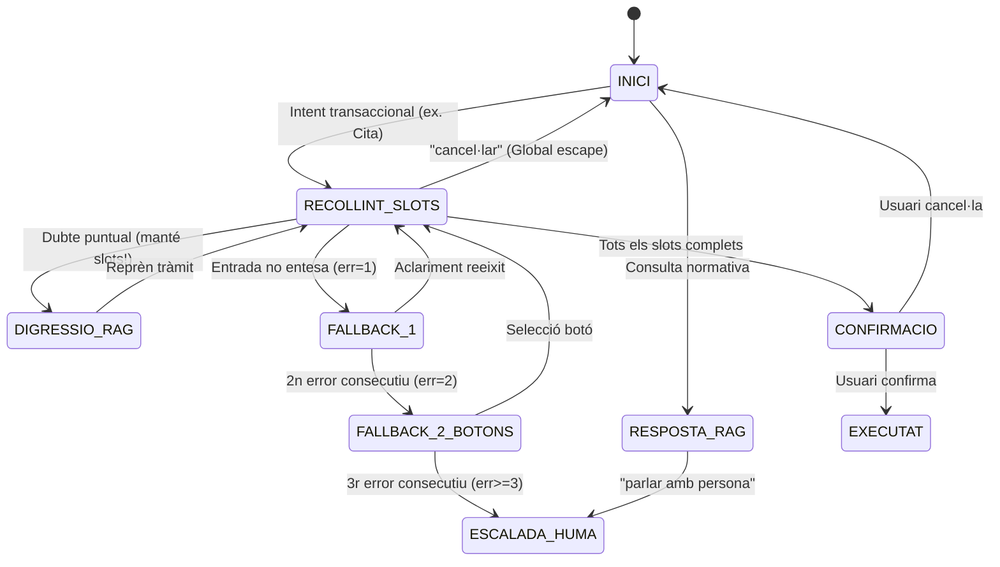

## A. Objectius d'aprenentatge

En completar aquesta lliçó, l'estudiant ha de ser capaç de:

1. **Modelar** fluxos conversacionals robustos mitjançant **màquines d'estats finits / grafs d'estats** (estats, transicions, *slots* pendents, confirmacions explícites i cancel·lació).
2. **Gestionar** la **memòria i el context multi-torn** (*sliding window*, resum progressiu d'historial, estat estructurat de sessió i *query rewriting* per a referències anafòriques) dins els límits de la finestra de context i amb TTL de sessió.
3. **Dissenyar** estratègies de **gestió d'errors, desambiguació i *fallback* progressiu** (reparació conversacional en 3 nivells: aclariment → menú guiat → escalada automàtica a humà) evitant els temuts **bucles infinits de *"No t'he entès"***!
4. **Gestionar** **canvis bruscos de tema (*digressions*)** i interrupcions de l'usuari sense perdre els *slots* ja recollits ni corrompre l'estat del tràmit.
5. **Implementar** en Python pur un **gestor d'estats conversacional amb *fallback* progressiu (regla dels 2–3 intents)**, cancel·lació immediata, confirmació explícita i memòria de sessió acotada.

---

## B. Explicació introductòria

Una conversa real amb un ciutadà gairebé mai segueix una línia recta perfecta! Un usuari comença demanant cita prèvia, al segon torn dubta i pregunta *"Espera, quins papers haig de portar?"* (*digressió*), s'equivoca en escriure la data, o escriu un missatge vague (*"Ho vull arreglar ja!"*).

El disseny de **fluxos conversacionals** (*Dialogue Management*) és l'enginyeria que manté la conversa coherent, breu i resolutiva al llarg de múltiples torns: recorda què ja s'ha dit sense saturar el context, demana aclariments concrets quan hi ha ambigüitat, permet corregir o cancel·lar en qualsevol moment i **escala ordenadament a un humà** abans de frustrar el ciutadà!

---

## C. Explicació tècnica avançada

### 1. Gestió de memòria i context multi-torn

En converses de 10–30 torns, enviar tot l'historial brut a l'LLM a cada missatge dispara el cost, la latència i la degradació (*Lost in the Middle*). S'utilitzen **3 capes complementàries de memòria de sessió**:
1. **Estat estructurat (*Session State / Slots*)**: un diccionari JSON determinista (`{"intent_actiu": "CITA", "oficina": "OAC Mataró", "tramit": "Padró", "intents_fallits": 1}`). Ocupa pocs bytes i **mai no s'oblida ni s'al·lucina**!
2. **Finestra lliscant (*Sliding Window*)**: manté íntegres els darrers `k` torns (p. ex., `k = 4–6` missatges recents) per a fluïdesa immediata i *Query Rewriting* d'anàfores (*"I quant costa?"* → *"Quant costa el certificat d'empadronament?"*).
3. **Resum progressiu (*Running Summary*)** (opcional en converses molt llargues): comprimeix els torns antics en 3–4 línies clau per acotar el consum de tokens.
4. **TTL (*Time-To-Live*) de sessió**: expirar i purgar el context després de `15–30 minuts` d'inactivitat (seguretat RGPD en ordinadors compartits o biblioteques públiques!).

### 2. Estratègia de ***Fallback* progressiu (Escala de reparació en 3 nivells)**

El pitjor error de disseny conversacional és repetir indefinidament *"Ho sento, no t'he entès. Torna-ho a provar."* La regla d'or d'enginyeria de diàleg és el ***fallback* progressiu comptabilitzat**:

| Intent fallit consecutiu | Comportament del gestor de diàleg |
|---|---|
| **Fallback 1 (Aclariment concret)** | Explica breument què necessita o demana reformular amb **1 exemple concret** (*"No he pogut identificar el tràmit. Em pots indicar si és padró, IBI o registre?"*). |
| **Fallback 2 (Guiat estructurat / Botons)** | Ofereix **opcions clicables tancades** (botons ràpids dels 4–5 temes principals + botó *"Altres / Parlar amb una persona"*). |
| **Fallback 3 (Escalada automàtica obligatòria)** | **Atura els reintents automàtics** i ofereix/executa derivació directa a **atenció humana (OAC / 010)** adjuntant el resum de la conversa perquè el ciutadà **no hagi de repetir-ho tot**! |

### 3. *Digressions*, confirmacions explícites i sortides d'emergència

- ***Digressions* (canvi temporal de tema)**: si l'usuari està al pas 2 de `DEMANAR_CITA` i pregunta *"Quina documentació he de portar per empadronar-me?"*, el sistema pot invocar el **RAG** per respondre el dubte puntual i després preguntar *"Vols que continuem amb la reserva de cita a l'OAC de Mataró?"* mantenint intactes els *slots* ja desats!
- **Confirmació explícita abans d'efectes secundaris**: abans d'executar qualsevol alta, reserva o enregistrament, mostrar un resum estructurat (*"Confirma la cita: OAC Mataró, Padró, dimarts 16/06 a les 10:30?"* → `[Confirmar]` / `[Modificar]` / `[Cancel·lar]`).
- **Paraules d'escapament globals (*Global Escape Hatches*)**: `cancel·lar`, `tornar a començar`, `menú principal` i `parlar amb una persona` han de funcionar des de **qualsevol estat** del flux!

---

## D. Diagrames i recursos visuals

### Màquina d'estats conversacional amb *digressions*, confirmació i *fallback* progressiu



---

## E. Aplicació a l'Administració pública

1. **Zero frustració ciutadana (regla del màxim 2–3 fallbacks)**: en un servei públic universal, atrapar una persona gran o amb dificultats digitals en un bucle de *"No t'he entès"* genera exclusió; l'escalada automàtica al 3r intent fallit (o al 1r clic de *"Parlar amb una persona"*) és un estàndard de qualitat obligatori.
2. **TTL de sessió curt en punts d'accés públic**: molts ciutadans fan tràmits des de biblioteques municipals o quioscos de l'OAC; expirar la sessió i netejar la pantalla després de 15 minuts d'inactivitat prevé que el següent usuari vegi dades personals del ciutadà anterior!
3. **Separar estat estructurat (determinista) de conversa (LLM)**: guardar els *slots* confirmats en un objecte tipat del backend evita que l'LLM «oblidi» o alteri una data, un NIF o una oficina durant una conversa llarga.

---

## F. Exemple pràctic guiat

Implementem en **Python pur** una **màquina d'estats conversacional** per a reserva de cita prèvia que gestiona:
- Recollida progressiva de *slots* (`oficina`, `tramit`),
- **Confirmació explícita** abans de gravar,
- **Escapament global (`cancel·lar`)**,
- ***Fallback* progressiu en 3 nivells** (1r error = aclariment concret, 2n error = botons guiats, 3r error = escalada automàtica a agent humà OAC)!

```python
"""Exemple 5.3: Màquina d'estats conversacional amb slots, confirmació i fallback progressiu (3 nivells)."""
from dataclasses import dataclass, field

OFICINES_VALIDES = {"mataró", "sabadell", "granollers"}
TRAMITS_VALIDS = {"padró", "ibi", "registre"}


@dataclass
class SessioDialeg:
    estat: str = "RECOLLINT_OFICINA"
    slots: dict[str, str] = field(default_factory=dict)
    errors_consecutius: int = 0

    def processar_torn(self, text: str) -> str:
        t = text.strip().lower()
        # Sortides d'escapament globals des de qualsevol estat
        if t in {"cancel·lar", "sortir"}:
            self.estat, self.slots, self.errors_consecutius = "CANCEL·LAT", {}, 0
            return "Hem cancel·lat la gestió. En què més et puc ajudar?"
        if "persona" in t or "humà" in t:
            self.estat = "ESCALADA_HUMA"
            return f"Et passo amb un agent humà OAC amb el context actual: {self.slots}"

        if self.estat == "RECOLLINT_OFICINA":
            trobat = next((o for o in OFICINES_VALIDES if o in t), None)
            if trobat:
                self.slots["oficina"] = trobat.capitalize()
                self.errors_consecutius = 0
                self.estat = "RECOLLINT_TRAMIT"
                return f"Perfecte ({self.slots['oficina']}). Quin tràmit vols fer (padró, IBI o registre)?"
            return self._gestionar_fallback("l'oficina (Mataró, Sabadell o Granollers)")

        if self.estat == "RECOLLINT_TRAMIT":
            trobat = next((tr for tr in TRAMITS_VALIDS if tr in t), None)
            if trobat:
                self.slots["tramit"] = trobat.upper()
                self.errors_consecutius = 0
                self.estat = "CONFIRMACIO"
                return f"Confirma la reserva: Oficina {self.slots['oficina']}, tràmit {self.slots['tramit']}? [Sí / Cancel·lar]"
            return self._gestionar_fallback("el tràmit (padró, IBI o registre)")

        if self.estat == "CONFIRMACIO":
            if t in {"sí", "si", "confirmar"}:
                self.estat = "COMPLETAT"
                return f"Cita reservada correctament: {self.slots}"
            return self._gestionar_fallback("la confirmació (respon Sí o Cancel·lar)")

        return f"Sessió en estat final: {self.estat}"

    def _gestionar_fallback(self, que_falta: str) -> str:
        self.errors_consecutius += 1
        if self.errors_consecutius == 1:
            return f"[Fallback 1] Disculpa, no he reconegut {que_falta}. Em pots indicar-ho concretament?"
        if self.errors_consecutius == 2:
            return f"[Fallback 2 - Botons] Tria una opció per a {que_falta} o prem [Parlar amb una persona]."
        self.estat = "ESCALADA_HUMA"
        return f"[Fallback 3 - Escalada automàtica] Et derivo a un agent humà OAC (slots recollits: {self.slots})."


if __name__ == "__main__":
    print("--- Simulació A (Flux reeixit amb 1 error recuperat) ---")
    s1 = SessioDialeg()
    for msg in ["no sé ben bé", "a Mataró", "padró", "sí"]:
        print(f"U: {msg:15s} -> B: {s1.processar_torn(msg)}")

    print("\n--- Simulació B (3 errors consecutius -> Escalada automàtica) ---")
    s2 = SessioDialeg()
    for msg in ["hola???", "vull arreglar coses", "no entenc res"]:
        print(f"U: {msg:20s} -> B: {s2.processar_torn(msg)}")
```

### Interpretació dels resultats (execució verificada)

- **Simulació A**: el 1r missatge ambigu dispara `[Fallback 1]` amb exemple concret; al següent torn l'usuari diu `"a Mataró"`, **es reinicia `errors_consecutius = 0`**, continua cap a `padró`, demana confirmació explícita i completa la reserva (`COMPLETAT`)!
- **Simulació B**: després de 3 entrades no compreses consecutives, el gestor passa seqüencialment per `Fallback 1` → `Fallback 2 (Botons)` → **`Fallback 3 (Escalada automàtica a OAC)`**, sense caure mai en un bucle infinit!

---

## G. Exercici pràctic per resoldre

### Enunciat
L'anàlisi dels logs del chatbot municipal d'un ajuntament mostra tres problemes crítics d'experiència d'usuari:
1. En un 18% de les converses, el ciutadà rep **4 o 5 vegades seguides** el mateix missatge *"Ho sento, no t'he entès"* abans d'abandonar indignat.
2. Quan un ciutadà pregunta al torn 1 *"Quina bonificació d'IBI tinc per plaques solars?"* i al torn 2 escriu *"I quant dura?"*, el chatbot respon *"Disculpa, no sé de què em parles"* perquè no gestiona el context multi-torn.
3. En una biblioteca municipal amb ordinadors compartits, un usuari obre el web i veu encara a la pantalla la conversa anterior d'un altre ciutadà amb el seu número d'expedient!

Dissenya les **3 solucions tècniques concretes** per corregir tots tres problemes.

### Objectius i restriccions
- Implementar *fallback* progressiu amb màxim 2–3 intents + escalada, *Query Rewriting* amb finestra lliscant i TTL curt de sessió + neteja automàtica (RGPD).

:::hint Pista 1 — Problemes 1 i 2
(1) **Fallback progressiu en 3 nivells** (`err=1` aclariment concret → `err=2` botons ràpids → `err=3` escalada automàtica a humà amb resum, + escapament global `"parlar amb persona"`); (2) **Finestra lliscant (`4–6` torns) + *Query Rewriting*** que transforma *"I quant dura?"* en *"Quina durada té la bonificació de l'IBI per plaques solars?"* abans d'invocar el RAG!
:::

:::hint Pista 2 — Problema 3 (Privacitat en equips compartits!)
**TTL curt de sessió** (p. ex. 10–15 minuts d'inactivitat) que expira el token i **esborra automàticament l'historial de la pantalla i de `sessionStorage`** (mai desar converses sensibles a `localStorage` permanent!), + botó visible *«Finalitzar i esborrar xat»*!
:::

### Criteris d'avaluació
- **35%**: Disseny exacte del **fallback progressiu en 3 nivells** i reinici del comptador en recuperar-se + botó permanent d'escalada.
- **35%**: Resolució del context multi-torn amb **finestra lliscant + *Query Rewriting*** (reescriptura d'anàfores abans del retriever RAG) + estat estructurat de *slots*.
- **30%**: Protecció en equips compartits (**TTL curt d'inactivitat**, no persistència en `localStorage`, neteja automàtica de UI i botó de tancament segur de sessió conforme RGPD/ENS).

### Errors habituals
- Guardar tot l'historial de 50 torns en `localStorage` sense caducitat i passar-lo sencer a cada consulta RAG.

:::solution Solució completa comentada i alternatives
### 1. Eliminació del bucle *"No t'he entès"* (Problema 1)
- Implementar **comptador d'errors consecutius (`errors_consecutius`)** amb **fallback progressiu en 3 nivells**:
  - `err == 1`: petició d'aclariment concreta amb exemples del camp o tema esperat.
  - `err == 2`: presentació de **botons ràpids guiats** dels temes principals + opció de derivació humana.
  - `err >= 3`: **escalada automàtica immediata** a atenció humana (OAC / 010) adjuntant el resum de la conversa (i reiniciant `errors_consecutius = 0` si el ciutadà recupera el fil en el pas 1 o 2).

### 2. Resolució del context multi-torn (Problema 2)
- Mantenir una **finestra lliscant** dels darrers 4–6 torns al backend de sessió (més l'estat estructurat de *slots*) i afegir una etapa de ***Query Rewriting*** abans del *retriever* RAG: transforma la pregunta anafòrica *"I quant dura?"* en una consulta autònoma (*"Quina és la durada en anys de la bonificació de l'IBI per instal·lació de plaques solars?"*), permetent que BM25 i els embeddings recuperin exactament l'article vigent.

### 3. Protecció en ordinadors compartits (Problema 3 — RGPD/ENS)
- **No persistir mai** el xat en `localStorage` del navegador; emmagatzemar l'estat al backend vinculat a una sessió amb **TTL curt d'inactivitat (10–15 minuts)** i `sessionStorage` efímer.
- En expirar el TTL (o en tancar pestanya / prémer el botó visible *«Finalitzar i esborrar conversa»*), **netejar immediatament el DOM de la pantalla** i invalidar la sessió perquè cap tercer en una biblioteca o quiosc públic pugui veure dades d'un ciutadà anterior.
:::

---

## H. Test individual

Resol les 10 preguntes sobre màquines d'estats conversacionals, capes de memòria (estat estructurat, finestra lliscant, resum progressiu), TTL de sessió, *fallback* progressiu, *digressions*, confirmació explícita i sortides d'escapament globals.

---

## I. Preguntes de desenvolupament

### Pregunta 1
Explica les **3 capes de gestió de memòria i context** en un assistent conversacional multi-torn (estat estructurat, finestra lliscant i resum progressiu) i indica per què cal un **TTL curt de sessió** en entorns públics.

:::model-answer Resposta model i criteris de correcció (Pregunta 1)
**Resposta model**:
1. **Estat estructurat (*Session State / Slots*)**: diccionari JSON determinista que conserva valors confirmats (`oficina`, `tràmit`, `errors_consecutius`) ocupant pocs bytes i sense risc que l'LLM els oblidi o alteri.
2. **Finestra lliscant (*Sliding Window*)**: conserva íntegres els darrers 4–6 torns recents per mantenir naturalitat i alimentar el *Query Rewriting* d'anàfores (*"I quin termini té?"*) sense disparar costos ni patir *Lost in the Middle*.
3. **Resum progressiu (*Running Summary*)**: en converses llargues, condensa els torns antics en poques línies per acotar el nombre total de tokens.
- **TTL curt de sessió (10–15 minuts)**: essencial en administracions públiques per compliment RGPD/ENS, ja que molts ciutadans es connecten des de biblioteques, quioscos OAC o ordinadors familiars compartits; en expirar la inactivitat, s'invalida la sessió i s'esborra la pantalla.

**Criteris de correcció (10 punts)**:
- Explicació clara de les 3 capes de memòria i el seu propòsit: 7 punts.
- Justificació de seguretat/RGPD del TTL curt en equips compartits: 3 punts.
:::

### Pregunta 2
Descriu l'**escala de *fallback* progressiu en 3 nivells** i les **sortides d'escapament globals (*Global Escape Hatches*)**, justificant per què són indispensables per evitar l'exclusió digital.

:::model-answer Resposta model i criteris de correcció (Pregunta 2)
**Resposta model**:
- **Fallback progressiu**: en lloc de repetir *"No t'he entès"* en bucle infinit, el gestor porta un comptador d'errors consecutius: (1) **1r error**: demana aclariment concret amb un exemple; (2) **2n error**: presenta opcions tancades amb botons ràpids + botó d'humà; (3) **3r error**: atura els reintents i dispara **escalada automàtica a atenció humana (OAC/010)** adjuntant el resum del diàleg perquè l'usuari no hagi de repetir-ho tot. En recuperar-se, el comptador torna a `0`.
- **Sortides d'escapament globals**: ordres com `cancel·lar`, `menú principal` i `parlar amb una persona` s'intercepten **abans** de la lògica de cada estat, garantint que cap persona (especialment gent gran o usuaris amb dificultats digitals) quedi atrapada dins d'un formulari conversacional.

**Criteris de correcció (10 punts)**:
- Descripció precisa dels 3 nivells de fallback i reinici del comptador: 6 punts.
- Funció de les sortides d'escapament globals i prevenció d'exclusió digital: 4 punts.
:::

### Pregunta 3
Com ha de gestionar un flux conversacional una **digressió** (un usuari que interromp un tràmit de cita prèvia per fer una pregunta normativa) i una **confirmació prèvia a accions amb efectes secundaris**?

:::model-answer Resposta model i criteris de correcció (Pregunta 3)
**Resposta model**:
- **Digressió**: quan l'usuari es troba en estat `RECOLLINT_SLOTS` (ja ha indicat `oficina = Mataró`) i pregunta *"Quina documentació necessito per empadronar-me?"*, el gestor no destrueix l'estat ni llança un error de *slot* invàlid: detecta la pregunta informativa, la delega temporalment al **motor RAG**, mostra la resposta amb cita oficial i a continuació **reprèn explícitament el tràmit** (*"Vols que continuem amb la reserva a l'OAC de Mataró?"*) preservant intactes els *slots* ja desats.
- **Confirmació explícita**: abans d'executar qualsevol acció d'escriptura (gravar una cita, registrar una incidència), la màquina d'estats passa per un estat `CONFIRMACIO` mostrant un resum llegible de tots els paràmetres amb opcions `[Confirmar]`, `[Modificar]` i `[Cancel·lar]`, prevenint errors irreversibles o males interpretacions del NLU.

**Criteris de correcció (10 punts)**:
- Gestió tècnica completa de la digressió (preservació d'estat + delegació RAG + represa): 5 punts.
- Patró de confirmació explícita abans d'efectes secundaris: 5 punts.
:::

---

## J. Resum per memoritzar

### Conceptes clau
- **3 capes de memòria**: Estat estructurat (`slots` JSON deterministes) + Finestra lliscant (`4–6` torns + *Query Rewriting*) + Resum progressiu.
- **TTL curt de sessió** (10–15 minuts, mai `localStorage` persistent!) per privacitat en equips compartits (biblioteques/OAC).
- **Fallback progressiu (3 nivells)**: `err=1` aclariment concret → `err=2` botons guiats → `err=3` **escalada automàtica a humà amb resum** (MAI bucles infinits de *"No t'he entès"*!).
- **Digressions**: respondre dubtes puntuals via RAG preservant els *slots* i reprendre el tràmit.
- **Sortides d'escapament globals** (`cancel·lar`, `parlar amb una persona`) i **confirmació explícita** abans de qualsevol acció d'escriptura.

### Definicions essencials
- ***Digressió* conversacional**: interrupció temporal d'un flux transaccional per formular una pregunta lateral, que el gestor resol sense perdre els *slots* acumulats abans de reprendre el flux principal.
- ***Fallback* progressiu**: estratègia escalonada de reparació conversacional que canvia d'ajuda en cada intent fallit consecutiu fins derivar ordenadament a un humà.

### Errors conceptuals freqüents
1. Repetir indefinidament *"Ho sento, no t'he entès"* sense comptador ni escalada.
2. Emmagatzemar converses ciutadanes en `localStorage` sense TTL (bretxa de privacitat en ordinadors compartits).
3. Esborrar tots els *slots* del ciutadà quan fa una pregunta lateral o executar reserves sense pantalla de confirmació explícita.

### Possibles preguntes d'examen
- Dissenya una màquina d'estats conversacional amb *fallback* progressiu de 3 nivells, digressions i sortides d'escapament globals.
- Com gestiones el context multi-torn sense saturar la finestra de context ni perdre precisió en consultes anafòriques?
- Quines mesures de sessió protegeixen la privacitat dels ciutadans en quioscos i biblioteques municipals?
