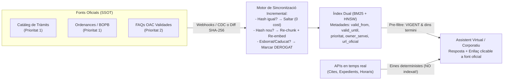

## A. Objectius d'aprenentatge

En completar aquesta lliçó, l'estudiant ha de ser capaç de:

1. **Dissenyar** el cicle de vida d'una **base de coneixement viva** per a un assistent públic: **font única de veritat (*Single Source of Truth*)**, responsabilitat editorial (*content owners*), metadades de vigència (`data_inici`, `data_fi`, `estat`) i sincronització incremental.
2. **Comparar** estratègies de sincronització amb sistemes font (CMS municipal, seu electrònica, catàleg de tràmits, SharePoint, BOPB): ***polling* programat (diff per hash)** vs. **orientada a esdeveniments (*webhooks / CDC*)** per evitar respostes basades en normativa caducada!
3. **Resoldre** els **conflictes entre múltiples fonts** (p. ex., un PDF antic d'un web de barri que contradiu l'ordenança fiscal vigent del 2026) mitjançant **jerarquia de prioritat documental** i control estricte de versions.
4. **Distingir** entre **coneixement semiestructurat/documental (RAG)** i **dades transaccionals/estructurades en temps real (APIs/SQL)** (horaris avui, disponibilitat de cites, estat d'expedient — mai indexar dades volàtils al RAG!).
5. **Implementar** en Python pur un **sincronitzador incremental per hash SHA-256 amb gestió de vigència i jerarquia de fonts** que només reindexa documents modificats, marca derogats els suprimits i prioritza sempre la font normativa oficial.

---

## B. Explicació introductòria

Un assistent virtual només és tan bo com el coneixement que el sustenta. El primer dia que s'estrena un chatbot municipal, totes les respostes són impecables. Però passen 6 mesos: canvia l'ordenança de terrasses, es tanca una convocatòria d'ajuts escolars, canvia l'horari d'estiu de l'OAC i s'obre un nou tràmit de subvenció. Si la base de coneixement no té un **procés automatitzat de sincronització i governança editorial**, el chatbot comença a donar **informació obsoleta amb total seguretat** (*stale knowledge*)!

Integrar una base de coneixement en producció consisteix a connectar de manera ordenada, incremental i auditable les **fonts oficials de l'Administració** (catàleg de tràmits, CMS, ordenances, FAQs validades) amb el motor RAG i les APIs de dades vives, definint responsables, vigències i resolució de conflictes.

---

## C. Explicació tècnica avançada

### 1. Fonts documentals (RAG) vs. Dades vives transaccionals (APIs)

Un error molt habitual és intentar «posar-ho tot dins la base vectorial»:
- **Coneixement documental estable/semi-estable → RAG (BM25 + HNSW)**: ordenances, bases de subvencions, guies de tràmits, circulars internes, FAQs validades. Canvia en dies, setmanes o mesos.
- **Dades volàtils o transaccionals en temps real → APIs / Eines deterministes**: disponibilitat de cita prèvia ara mateix, estat actual d'un expedient, llistat d'incidències obertes o saldo d'un rebut. **Mai indexis dades en temps real en un índex vectorial** (queden obsoletes als 5 segons!).

### 2. Sincronització incremental i gestió del cicle de vida (*Content Lifecycle*)

Reindexar des de zero 50.000 pàgines cada nit és lent i car, però no sincronitzar provoca dades caducades. L'estàndard de producció és la **sincronització incremental per `doc_id` + `content_hash` (SHA-256)**:
1. **Orientada a esdeveniments (*Webhooks / CDC — Change Data Capture*)**: quan el CMS o el gestor documental publica una nova versió d'una ordenança o tanca una convocatòria, dispara immediatament un esdeveniment (`DOC_UPDATED` / `DOC_ARCHIVED`) → latència d'actualització de segons!
2. ***Polling* programat amb *diff* per *hash*** (per a fonts que no tenen webhooks): un procés periòdic calcula el `SHA-256` de cada document; només re-parseja, re-trosseja i re-calcula embeddings si el *hash* ha canviat, i marca automàticament `estat = 'DEROGAT'` (esborrat lògic o físic) els documents eliminats a la font!
3. **Metadades de vigència obligatòries**: `valid_from`, `valid_until`, `estat` (`VIGENT`/`DEROGAT`/`ESBORRANY`), `versio`, `font_prioritat` (`1=Ordenança/BOPB`, `2=Catàleg tràmits`, `3=FAQ web`), `owner_servei` (responsable editorial!).

### 3. Resolució de conflictes i *Single Source of Truth* (SSOT)

A les webs municipals sovint conviuen 3 pàgines que parlen del mateix tràmit (una notícia antiga del 2022, un PDF desactualitzat d'una regidoria i la fitxa oficial vigent del catàleg de tràmits):
- **Principi SSOT (*Single Source of Truth*)**: designar una **única font autoritària** per a cada àmbit (p. ex., el Catàleg de Tràmits corporatiu i el repositori oficial d'Ordenances Vigents) i **excloure notícies antigues o PDFs sense metadada de vigència** de l'índex del chatbot!
- **Jerarquia de prioritat (*Authority Boosting*)**: si coincideixen una FAQ divulgativa i una ordenança vigent, el sistema prioritza l'ordenança oficial i alerta automàticament el *content owner* de la discrepància.
- **Control temporal estricte (`now()`)**: en convocatòries de subvencions, un pre-filtre temporal (`valid_from <= avui <= valid_until`) impedeix que el chatbot recomani una beca el termini de la qual va tancar fa dos mesos!

---

## D. Diagrames i recursos visuals

### Pipeline de sincronització incremental i governança d'una Base de Coneixement viva



---

## E. Aplicació a l'Administració pública

1. **Governança editorial (*Content Owners*)**: el fracàs núm. 1 dels assistents públics al cap d'1 any **no és tecnològic, sinó organitzatiu**! Cada família de continguts (tributs, padró, subvencions, urbanisme) ha de tenir un **servei responsable** que mantingui actualitzada la font oficial i rebi alertes automàtiques quan una fitxa s'acosta a la data de revisió o rep valoracions negatives dels usuaris!
2. **Enllaços profunds verificats (*Deep Links*)**: la base de coneixement ha d'emmagatzemar la URL oficial vigent del tràmit a la seu electrònica (i comprovar periòdicament que no retorna `HTTP 404`!) perquè el chatbot pugui portar el ciutadà directament a iniciar la gestió en 1 clic.
3. **Anàlisi de llacunes de coneixement (*Knowledge Gaps*)**: registrar totes les consultes on el RAG s'ha abstingut per manca d'evidència revela exactament quines preguntes freqüents ciutadanes falten a les guies oficials de l'ajuntament!

---

## F. Exemple pràctic guiat

Implementem en **Python pur** un **motor de sincronització incremental per *hash* SHA-256** que compara l'estat actual de la font oficial amb l'índex existent i classifica cada document en **`SENSE_CANVIS`** (estalvia re-embedding!), **`NOU`**, **`ACTUALITZAT`** o **`DEROGAT_O_CADUCAT`**, filtrant també convocatòries fora de data!

```python
"""Exemple 5.4: Sincronitzador incremental per SHA-256 amb control de vigència temporal."""
from datetime import date
import hashlib


def hash_text(text: str) -> str:
    return hashlib.sha256(text.encode("utf-8")).hexdigest()[:16]


def sincronitzar_base_coneixement(
    index_actual: dict[str, dict[str, object]],
    documents_font: list[dict[str, object]],
    avui: date,
) -> dict[str, list[str]]:
    accions: dict[str, list[str]] = {"NOU": [], "ACTUALITZAT": [], "SENSE_CANVIS": [], "DEROGAT_O_CADUCAT": []}
    ids_font_vigents: set[str] = set()

    for doc in documents_font:
        doc_id = str(doc["doc_id"])
        valid_until = date.fromisoformat(str(doc["valid_until"]))
        # Comprovació de caducitat temporal (ex. convocatòria tancada)
        if valid_until < avui:
            if doc_id in index_actual:
                index_actual[doc_id]["estat"] = "CADUCAT"
            accions["DEROGAT_O_CADUCAT"].append(doc_id)
            continue

        ids_font_vigents.add(doc_id)
        nou_hash = hash_text(str(doc["contingut"]))
        if doc_id not in index_actual:
            index_actual[doc_id] = {"hash": nou_hash, "estat": "VIGENT", "prioritat": doc["prioritat"]}
            accions["NOU"].append(doc_id)
        elif index_actual[doc_id]["hash"] != nou_hash or index_actual[doc_id]["estat"] != "VIGENT":
            index_actual[doc_id].update({"hash": nou_hash, "estat": "VIGENT", "prioritat": doc["prioritat"]})
            accions["ACTUALITZAT"].append(doc_id)
        else:
            accions["SENSE_CANVIS"].append(doc_id)

    # Documents eliminats de la font oficial -> marcar com a DEROGAT
    for doc_id, meta in list(index_actual.items()):
        if doc_id not in ids_font_vigents and meta["estat"] == "VIGENT":
            meta["estat"] = "DEROGAT"
            accions["DEROGAT_O_CADUCAT"].append(doc_id)
    return accions


if __name__ == "__main__":
    index_existent = {
        "OF-IBI-2026": {"hash": hash_text("Bonificació IBI 50% família nombrosa."), "estat": "VIGENT", "prioritat": 1},
        "TR-PADRO": {"hash": hash_text("Horari OAC antic 9-14h."), "estat": "VIGENT", "prioritat": 1},
        "OF-TERRASSES-2020": {"hash": hash_text("Ordenança antiga derogada."), "estat": "VIGENT", "prioritat": 1},
    }
    font_oficial = [
        {"doc_id": "OF-IBI-2026", "contingut": "Bonificació IBI 50% família nombrosa.", "valid_until": "2026-12-31", "prioritat": 1},
        {"doc_id": "TR-PADRO", "contingut": "Horari OAC nou 8:30-15h.", "valid_until": "2026-12-31", "prioritat": 1},
        {"doc_id": "SUB-ESCOLAR-2026", "contingut": "Ajuts escolars 2026.", "valid_until": "2026-03-31", "prioritat": 1},  # caducada!
        {"doc_id": "SUB-CULTURA-2026", "contingut": "Subvencions culturals obertes.", "valid_until": "2026-09-30", "prioritat": 1},
    ]
    res = sincronitzar_base_coneixement(index_existent, font_oficial, avui=date(2026, 6, 15))
    print("Resultat sincronització incremental:", res)
```

### Interpretació dels resultats (execució verificada)

- `OF-IBI-2026`: mateix *hash* → **`SENSE_CANVIS`** (estalvia re-embedding!).
- `TR-PADRO`: *hash* modificat (nou horari OAC) → **`ACTUALITZAT`** (es reindexa només aquest!).
- `SUB-CULTURA-2026`: document nou vigent → **`NOU`**.
- `SUB-ESCOLAR-2026` (termini vençut el 31/03) i `OF-TERRASSES-2020` (suprimida a la font) → marcades com **`DEROGAT_O_CADUCAT`** i excloses automàticament del chatbot!

---

## G. Exercici pràctic per resoldre

### Enunciat
Un ajuntament ha connectat el seu chatbot RAG fent un *web scraping* massiu de tot el seu portal web (5.000 URLs, incloent notes de premsa des del 2018, PDFs antics de regidories i fitxes del catàleg de tràmits) reindexant-ho tot un cop al mes. Al cap de 3 mesos, els ciutadans es queixen de:
1. El chatbot respon amb **tarifes del 2021** perquè una nota de premsa del 2021 apareix amb molta similitud semàntica a les consultes.
2. Recomana demanar una **beca el termini de la qual va tancar fa 3 setmanes**.
3. Dóna un **nombre de cites disponibles erroni** perquè s'havia indexat una captura d'horaris del mes passat.

Redissenya la **integració amb bases de coneixement** per resoldre els 3 problemes de forma estructural.

### Objectius i restriccions
- Establir SSOT + jerarquia de fonts, sincronització incremental per webhooks/hash amb vigència temporal (`valid_until`) i separar RAG de dades vives en temps real via API.

:::hint Pista 1 — *Scraping* indiscriminat vs. SSOT + Vigència
Abandonar el *scraping* indiscriminat de notes de premsa antigues! Indexar únicament **fonts autoritàries (SSOT)**: Catàleg de Tràmits, Ordenances vigents i FAQs OAC amb metadades obligatòries (`estat = VIGENT`, `valid_from`, `valid_until`, `prioritat`, `owner_servei`)!
:::

:::hint Pista 2 — Convocatòries tancades + dades volàtils
(2) Sincronització **orientada a esdeveniments (webhooks) / diària per *hash*** + pre-filtre temporal determinista `valid_from <= avui <= valid_until` per excloure convocatòries tancades el mateix dia que vencen; (3) **Mai indexar disponibilitat de cites al RAG**: connectar la consulta de cites directament a l'**API en temps real** via eina determinista!
:::

### Criteris d'avaluació
- **35%**: Eliminació del *scraping* indiscriminat i adopció de **SSOT** (exclusió de notes de premsa històriques + jerarquia de fonts + *content owners*).
- **35%**: Sincronització **incremental (webhooks / diff SHA-256)** + pre-filtre temporal `valid_from/valid_until` per evitar convocatòries vençudes.
- **30%**: Separació estricta entre **coneixement documental (RAG)** i **dades volàtils en temps real (APIs/eines deterministes)** + anàlisi de *Knowledge Gaps*.

### Errors habituals
- Proposar fer *scraping* de les 5.000 URLs cada hora en lloc d'eliminar les fonts obsoletes i connectar-se a les fonts SSOT i APIs.

:::solution Solució completa comentada i alternatives
### 1. Resolució de tarifes del 2021 (SSOT + exclusió de notícies antigues)
- Aturar el *web scraping* indiscriminat del portal: les notes de premsa del 2018–2024 **no són fonts normatives** i contaminen el RAG amb informació derogada!
- Connectar la base de coneixement exclusivament a les **fonts autoritàries (SSOT)**: repositori d'Ordenances Fiscals Vigents (Prioritat 1), Catàleg de Tràmits (Prioritat 1) i FAQs validades per l'OAC (Prioritat 2), assignant a cada bloc un **servei responsable (*content owner*)**.

### 2. Resolució de beques tancades (Sincronització incremental + pre-filtre temporal)
- Substituir la reindexació mensual per **sincronització orientada a esdeveniments (*webhooks* del CMS/seu)** o *diff* diari per **SHA-256**.
- Afegir metadades temporals obligatòries (`valid_from`, `valid_until`, `estat`) i aplicar un **pre-filtre determinista temporal (`avui <= valid_until`)** en cada consulta: el dia següent al tancament de la convocatòria, deixa d'oferir-se com a oberta (i pot informar clarament *"Convocatòria tancada el DD/MM/AAAA"*!).

### 3. Resolució de cites disponibles errònies (RAG vs. API en temps real)
- Retirar completament les dades volàtils (franges lliures de cita, estat d'expedients) de l'índex vectorial. Consultar-les sempre en temps real mitjançant **eines deterministes sobre l'API corporativa de cites**.
- Complementar amb control automàtic d'enllaços trencats (`404`) i quadre mensual de ***Knowledge Gaps*** (consultes abstingudes) per als *content owners*.
:::

---

## H. Test individual

Resol les 10 preguntes sobre SSOT (*Single Source of Truth*), sincronització incremental per SHA-256 i webhooks/CDC, metadades de vigència temporal, separació RAG vs. APIs en temps real, *content owners* i *Knowledge Gaps*.

---

## I. Preguntes de desenvolupament

### Pregunta 1
Explica la diferència entre dades que s'han d'integrar en un **índex RAG** i dades que s'han de consultar mitjançant **APIs/eines en temps real** en un assistent virtual municipal, posant tres exemples de cada categoria.

:::model-answer Resposta model i criteris de correcció (Pregunta 1)
**Resposta model**:
- **Índex RAG (coneixement documental estable o semi-estable)**: informació textual i normativa que canvia amb freqüència baixa/mitjana i requereix cerca semàntica/lèxica i citació. Exemples: (1) ordenances fiscals i municipals vigents, (2) bases de convocatòries de subvencions, (3) fitxes descriptives del catàleg de tràmits i FAQs OAC.
- **APIs/Eines deterministes en temps real (dades volàtils o transaccionals)**: informació que canvia minut a minut o depèn d'un registre personal concret; indexar-la en un vector store la deixa obsoleta de seguida i pot trencar ACL. Exemples: (1) franges horàries disponibles ara mateix per a cita prèvia, (2) estat actual d'un expedient concret (amb autenticació prèvia), (3) saldo o situació d'un rebut tributari.

**Criteris de correcció (10 punts)**:
- Criteri tècnic clar de separació (estabilitat, volatilitat, personalització): 4 punts.
- Tres exemples municipals pertinents per a cada categoria: 6 punts.
:::

### Pregunta 2
Com funciona una **sincronització incremental per *hash* SHA-256 i webhooks (CDC)** d'una base de coneixement, i per què és molt superior a fer *web scraping* mensual indiscriminat d'un portal municipal?

:::model-answer Resposta model i criteris de correcció (Pregunta 2)
**Resposta model**:
- **Webhooks / CDC + *diff* per SHA-256**: connecta directament amb les fonts autoritàries (**SSOT**: CMS, Catàleg de Tràmits, repositori d'Ordenances). En publicar, editar o derogar un document, o en detectar un canvi de `SHA-256`, el pipeline **només re-trosseja i re-calcula embeddings dels documents canviats** (`NOU`/`ACTUALITZAT`), salta els inalterats (`SENSE_CANVIS`, estalviant còmput) i marca immediatament `DEROGAT`/`CADUCAT` els eliminats o fora de termini (`valid_until < avui`).
- **Per què supera el *web scraping* mensual**: el *scraping* indiscriminat ingereix notes de premsa i PDFs antics que contaminen les respostes amb tarifes derogades, deixa una finestra de fins a 30 dies d'informació caducada (p. ex., beques tancades) i malgasta recursos reindexant tot el portal cada cop.

**Criteris de correcció (10 punts)**:
- Mecànica de sincronització incremental (webhooks/CDC + hash SHA-256 + estats/vigència): 6 punts.
- Crítica fonamentada del *scraping* mensual indiscriminat: 4 punts.
:::

### Pregunta 3
Defineix els conceptes de **governança editorial (*Content Owners*)** i **anàlisi de llacunes de coneixement (*Knowledge Gaps*)** i explica per què són decisius per mantenir viu un assistent públic al cap d'un any de producció.

:::model-answer Resposta model i criteris de correcció (Pregunta 3)
**Resposta model**:
- **Governança editorial (*Content Owners*)**: assignació explícita d'un servei o tècnic responsable per a cada bloc temàtic (Tributs, Padró, Subvencions, Urbanisme) encarregat de mantenir actualitzada la font única de veritat (SSOT), revisar dates de caducitat i atendre alertes de conflictes o enllaços trencats (`404`). Sense *content owners*, la base de coneixement s'envelleix silenciosament.
- **Anàlisi de *Knowledge Gaps***: registre sistemàtic de les consultes ciutadanes on el motor RAG s'ha abstingut per baixa evidència o ha derivat a humà (més valoracions negatives); agrupa periòdicament els temes més demandats que manquen a la documentació oficial, guiant els *content owners* sobre quines noves FAQs o aclariments cal publicar per elevar la taxa de resolució real!

**Criteris de correcció (10 punts)**:
- Rol i operativa dels *Content Owners*: 5 punts.
- Mecànica i valor de l'anàlisi de *Knowledge Gaps*: 5 punts.
:::

---

## J. Resum per memoritzar

### Conceptes clau
- **RAG (coneixement documental estable)** vs. **APIs en temps real (dades volàtils/transaccionals: cites, expedients, rebuts)** — MAI indexar dades volàtils al vector store!
- **SSOT (*Single Source of Truth*)**: connectar només a fonts oficials (Catàleg tràmits, Ordenances vigents, FAQs OAC) i excloure notes de premsa històriques!
- **Sincronització incremental**: **Webhooks / CDC** o ***diff* per SHA-256** (`NOU`, `ACTUALITZAT`, `SENSE_CANVIS`, `DEROGAT_O_CADUCAT`) + pre-filtre temporal `valid_from <= avui <= valid_until`.
- **Governança viva**: ***Content Owners*** per àmbit + verificació d'enllaços `404` + anàlisi periòdica de ***Knowledge Gaps*** (consultes abstingudes).

### Definicions essencials
- ***Single Source of Truth* (SSOT)**: principi de governança segons el qual cada informació té una única font autoritària mantinguda per un responsable, eliminant contradiccions entre còpies obsoletes.
- ***Knowledge Gap* (Llacuna de coneixement)**: consulta freqüent dins l'abast municipal per a la qual la base documental no disposa d'evidència vigent suficient (detectada via abstencions del RAG).

### Errors conceptuals freqüents
1. Fer *web scraping* massiu de tot el portal incloent notícies del 2018 (contamina el RAG amb tarifes derogades).
2. Indexar disponibilitat de cites o estat d'expedients dins la base vectorial.
3. Posar en producció una base de coneixement sense *content owners* ni metadades `valid_until`.

### Possibles preguntes d'examen
- Com dissenyes una sincronització incremental amb gestió de vigència per evitar que un chatbot recomani subvencions tancades?
- Quines dades van al RAG i quines van a APIs en temps real en un assistent municipal?
- Com aprofites les abstencions del RAG (*Knowledge Gaps*) per millorar el servei d'atenció ciutadana?
