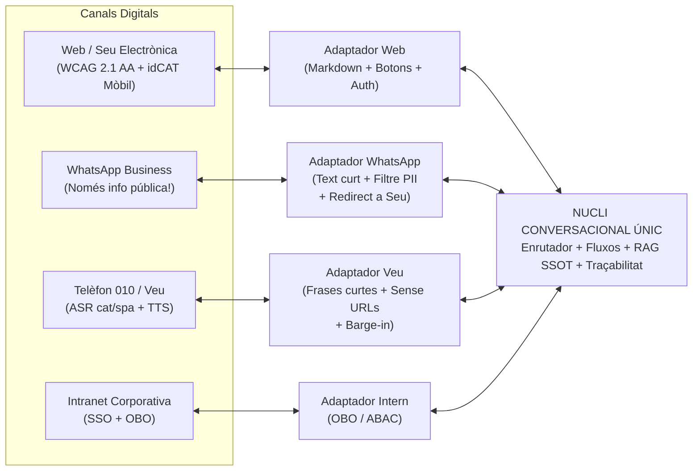

## A. Objectius d'aprenentatge

En completar aquesta lliçó, l'estudiant ha de ser capaç de:

1. **Distingir** entre **multicanalitat** (canals aïllats sense memòria compartida) i **omnicanalitat** (un únic nucli conversacional que comparteix base de coneixement, regles i context d'escalada a través d'adaptadors de canal).
2. **Comparar** les característiques tècniques, d'UX i de privacitat (RGPD/ENS) dels principals **canals digitals públics**: **widget web / seu electrònica**, **apps mòbils**, **missatgeria (WhatsApp Business / Telegram)**, **intranet / Teams (corporatiu)** i **canals de veu (ASR + LLM/Flux + TTS / 010)**.
3. **Analitzar** els riscos legals i de privacitat específics de **WhatsApp Business** en l'Administració pública (metadades, transferències internacionals fora de l'EEE, prohibició d'enviar dades personals sensibles o expedients complets!).
4. **Adaptar** el format de resposta (*Channel Adapter Pattern*) a les restriccions de cada canal (Markdown/taules/botons al web vs. missatges curts sense taules a WhatsApp vs. frases breus i pausades en veu/telèfon!).
5. **Implementar** en Python pur un **patró Adaptador de Canal (*Channel Adapter*)** que transforma una única resposta canònica estructurada del nucli conversacional en formats òptims i segurs per a **Web**, **WhatsApp (amb filtre PII!)** i **Veu (TTS)**.

---

## B. Explicació introductòria

La ciutadania d'un municipi no utilitza tota el mateix canal: una persona jove consulta des del web mòbil, una altra pregunta per WhatsApp, una persona gran truca al telèfon **010**, i els tècnics municipals treballen des de la intranet corporativa.

L'error típic d'una administració és contractar **un chatbot independent per a cada canal** (amb bases de coneixement diferents i respostes contradictòries!). L'arquitectura moderna construeix **un únic nucli conversacional** (enrutador + RAG + màquina d'estats + governança) desacoblat dels canals mitjançant **adaptadors lleugers (*Channel Adapters*)** que adapten el format, l'autenticació i el nivell de dades permès a les regles de seguretat de cada canal!

---

## C. Explicació tècnica avançada

### 1. Multicanalitat vs. Omnicanalitat (*Core + Channel Adapters*)

- **Multicanalitat (silos)**: web, WhatsApp i 010 operen per separat; si canvies una ordenança l'has d'actualitzar a tres llocs i si el ciutadà passa del web al telèfon 010 ha de tornar a explicar-ho tot!
- **Omnicanalitat (*Core + Adapters*)**: **una sola base de coneixement SSOT, un sol motor de diàleg/RAG i un sol sistema de traçabilitat**, connectats a cada canal mitjançant un **adaptador** que tradueix l'entrada a un format canònic intern (`IncomingMessage`) i renderitza la sortida canònica (`CanonicalResponse`) segons les capacitats i límits del canal!

### 2. Comparativa de canals digitals en el sector públic

| Canal | Format òptim de resposta | Autenticació / Nivell de dades permès | Riscos i consideracions RGPD / ENS / Accessibilitat |
|---|---|---|---|
| **Web / Seu electrònica** | Text enriquit, enllaços clicables, botons, targetes, selector de cites | **Màxim** (integrable amb **idCAT Mòbil / Cl@ve / Certificat** per a tràmits personalitzats) | Obligatori **WCAG 2.1 AA (RD 1112/2018)**; control total 100% *on-premise*/ENS |
| **Intranet / Teams (Intern)** | Text enriquit, cites internes, accions OBO | **SSO Corporatiu (OIDC/SAML + MFA)** | Aïllament per departament/municipi; control DLP |
| **WhatsApp Business / Telegram** | Text molt breu (<600 chars), llistes simples, **sense taules Markdown** | **Només informació general pública!** (NO dades sensibles, NIFs, expedients ni salut!) | **Alt risc RGPD/ENS**: plataforma de tercers fora de control directe (metadades/transferències); usar només per informació pública i redirigir amb enllaç a la **seu electrònica** per a tràmits personals! |
| **Veu / Telèfon (010 / IVR intel·ligent)** | Frases **molt curtes** (<2–3 oracions), sense URLs llargues, to clar, opció `"0"` per humà | Baixa/mitjana (requereix verificació específica; compte amb soroll ambiental) | Pipeline **ASR (Whisper local) → Nucli → TTS**; **latència crítica (<1–1,5 s)**; suport **català/castellà** en reconeixement de veu (ASR) imprescindible! |

### 3. Restriccions d'enginyeria en **canals de veu (Voicebots / 010)**

Un error clàssic és enganxar un motor TTS (*Text-to-Speech*) directament sobre la resposta llarga d'un chatbot web:
- Una resposta web amb una taula Markdown, 4 punts llargs i una URL `https://seu.exemple.cat/tramits/12345` és **incomprensible llegida en veu alta**!
- En veu cal: (1) **latència total < 1,5 s** (streaming frase a frase); (2) **suport ASR d'alta qualitat en català** (incloent accents dialectals i soroll telefònic 8 kHz); (3) **respostes concises** i enviament d'enllaços/codis per **SMS** en lloc de dictar URLs; (4) **barge-in** (permetre interrompre el bot mentre parla) i sortida ràpida a operador humà 010!

---

## D. Diagrames i recursos visuals

### Arquitectura omnicanal: Nucli únic + Adaptadors de canal amb polítiques de seguretat diferenciades



---

## E. Aplicació a l'Administració pública

1. **Redirecció segura des de WhatsApp cap a la Seu Electrònica**: WhatsApp és un canal molt accessible per apropar informació general (horaris, incidències de recollida, calendari fiscal, requisits generals d'un tràmit), però **mai** no s'hi ha de demanar al ciutadà que enviï fotografies del DNI, informes mèdics ni dades d'expedients personals! En detectar una petició personal, l'adaptador de WhatsApp respon: *"Per protegir les teves dades personals, pots consultar el teu expedient de forma segura a la Seu Electrònica: [enllaç]"*.
2. **Inclusió i dret multicanal**: oferir canals digitals moderns (web, veu 010, WhatsApp informatiu) redueix cues a les OAC, però **mai** no pot suprimir el canal telefònic humà ni l'atenció presencial (especialment per a gent gran i bretxa digital, art. 14.1 LPACAP).
3. **Qualitat de català en ASR/TTS**: abans de licitar o desplegar un canal de veu al 010, avaluar explícitament el **WER en català** (i canvi de codi català/castellà dins la mateixa frase!) sobre àudio telefònic real.

---

## F. Exemple pràctic guiat

Implementem en **Python pur** el **patró *Channel Adapter*** sobre una resposta canònica única del nucli conversacional, renderitzant-la automàticament per a:
1. **`web`**: conserva títol, passos estructurats, cita normativa i enllaç clicable a la seu.
2. **`whatsapp`**: aplana el format a text breu (<450 chars), bloqueja qualsevol dada personal (PII) que intenti sortir pel canal i redirigeix a la seu si requereix tràmit personal.
3. **`veu`**: elimina URLs, símbols Markdown i abreviatures, limitant la resposta a una frase curta apta per a TTS!

```python
"""Exemple 5.5: Patró Channel Adapter (Nucli únic -> Web, WhatsApp amb filtre PII i Veu TTS)."""
from dataclasses import dataclass
import re


@dataclass(frozen=True)
class RespostaCanonica:
    resum_curt: str
    detall_passos: list[str]
    cita_oficial: str
    url_seu: str
    conte_dades_personals: bool = False


def adaptar_resposta(resp: RespostaCanonica, canal: str) -> str:
    if canal == "web":
        passos = "\n".join(f"{i}. {p}" for i, p in enumerate(resp.detall_passos, start=1))
        return f"{resp.resum_curt}\n{passos}\nFont: [{resp.cita_oficial}]({resp.url_seu})"

    if canal == "whatsapp":
        # Política de seguretat: MAI exposar dades personals o expedients privats per WhatsApp!
        if resp.conte_dades_personals:
            return (
                "Per protegir les teves dades personals (RGPD), aquesta gestió només es pot "
                f"consultar amb identificació segura a la Seu Electrònica: {resp.url_seu}"
            )
        passos_curts = " ".join(f"- {p}" for p in resp.detall_passos[:2])
        msg = f"{resp.resum_curt} {passos_curts} Més info ({resp.cita_oficial}): {resp.url_seu}"
        return msg[:450]

    if canal == "veu":
        # Sense URLs ni Markdown; frases curtes i pausades aptes per a lectura TTS
        text_net = re.sub(r"[*_`#\[\]()]", "", resp.resum_curt)
        return f"{text_net} Si vols rebre l'enllaç del tràmit per SMS, digues 'enviar SMS', o prem zero per parlar amb una persona."

    raise ValueError(f"Canal no suportat: {canal}")


if __name__ == "__main__":
    resp_publica = RespostaCanonica(
        resum_curt="La bonificació de l'IBI per família nombrosa és del 50% de la quota íntegra.",
        detall_passos=["Presenta la sol·licitud abans del 31 de març.", "Cal tenir el títol vigent i estar empadronat a l'habitatge."],
        cita_oficial="OF-01-2026 art. 8",
        url_seu="https://seu.exemple.cat/ibi-bonificacio",
        conte_dades_personals=False,
    )
    resp_privada = RespostaCanonica(
        resum_curt="L'expedient SUB-2026-0148 de Marta Roca (NIF 12345678Z) està en revisió.",
        detall_passos=[],
        cita_oficial="Gestor Expedients",
        url_seu="https://seu.exemple.cat/carpetaciutadana",
        conte_dades_personals=True,
    )

    for canal in ("web", "whatsapp", "veu"):
        print(f"=== CANAL {canal.upper()} (info pública) ===\n{adaptar_resposta(resp_publica, canal)}\n")
    print(f"=== CANAL WHATSAPP (dada privada bloquejada!) ===\n{adaptar_resposta(resp_privada, 'whatsapp')}")
```

### Interpretació dels resultats (execució verificada)

- La **mateixa resposta canònica pública** es renderitza òptimament en cada canal: Markdown + enllaç ric a **`web`**, text compacte sense taules a **`whatsapp`** i frase breu sense URLs dictades (oferint SMS i tecla `0` per a operador) a **`veu`**.
- Quan s'intenta enviar una resposta amb **dades personals (`conte_dades_personals=True`)** pel canal **`whatsapp`**, l'adaptador bloqueja deterministament la dada i redirigeix el ciutadà a la **Carpeta Ciutadana de la Seu Electrònica**!

---

## G. Exercici pràctic per resoldre

### Enunciat
Un ajuntament vol obrir el seu assistent virtual per **WhatsApp Business** i pel **telèfon 010 (veu)**, a més de mantenir el **web municipal**. Un regidor demana dues coses:
1. *"Per WhatsApp, que els ciutadans puguin enviar-nos directament una foto del seu DNI i del certificat d'empadronament i que el bot els confirmi l'estat dels seus expedients d'ajuts socials."*
2. *"Per al telèfon 010, que el bot llegeixi exactament en veu alta el mateix text llarg amb taules i URLs que surt al web per estalviar feina."*

Argumenta tècnicament i jurídicament per què **totes dues peticions s'han de reformular** i dissenya l'arquitectura **omnicanal (*Core + Channel Adapters*)** correcta!

### Objectius i restriccions
- Aplicar protecció de dades RGPD/ENS sobre WhatsApp (prohibició de DNI/ajuts socials), dissenyar adaptació UX de veu (frases breus, ASR català/castellà, SMS, *barge-in*) i mantenir nucli únic SSOT.

:::hint Pista 1 — WhatsApp amb DNI i ajuts socials (RGPD/ENS!)
**Prohibit!** Els ajuts socials i còpies de DNI són dades personals d'alt risc (i potencialment categories especials / vulnerabilitat): passar-les per WhatsApp (plataforma privada de tercers fora del control ENS i amb metadades/transferències) genera riscos gravíssims RGPD/ENS i manca d'autenticació forta (un número de telèfon NO acredita identitat jurídica!). Solució: **WhatsApp només per informació pública + redirecció amb enllaç a la Seu Electrònica (idCAT Mòbil)**!
:::

:::hint Pista 2 — Veu 010 (TTS sobre text web!)
Llegir una taula Markdown o una URL `https://...` per telèfon fa el servei inutilitzable! L'**Adaptador de Veu** ha de generar respostes molt curtes (<2–3 frases), enviar URLs/codis per **SMS**, suportar ***barge-in***, garantir **latència < 1,5 s** i validar **WER en català/castellà** sobre àudio telefònic 8 kHz, amb tecla `0` directa a agent humà!
:::

### Criteris d'avaluació
- **35%**: Rebuig fonamentat de DNI/ajuts socials per WhatsApp (RGPD, ENS, falta d'autenticació oficial) + alternativa segura (info pública a WhatsApp + derivació a Seu Electrònica amb idCAT Mòbil).
- **35%**: Disseny de l'adaptador de veu 010 (respostes curtes sense URLs/taules, SMS per enllaços, *barge-in*, latència <1,5 s, ASR català/castellà i tecla directa a operador).
- **30%**: Arquitectura omnicanal (**Nucli únic SSOT + Adaptadors de canal**) per evitar inconsistències entre web, WhatsApp i 010.

### Errors habituals
- Acceptar rebre fotografies de DNI per WhatsApp «si es posa un avís legal al principi del xat».

:::solution Solució completa comentada i alternatives
### 1. Arquitectura omnicanal recomanada (*Core + Channel Adapters*)
- Construir un **únic nucli conversacional** (mateixa base de coneixement SSOT, mateix RAG, mateixa traçabilitat) exposat als 3 canals mitjançant **adaptadors independents** amb polítiques de format i seguretat diferenciades.

### 2. Reformulació de WhatsApp Business (RGPD + ENS)
- **Per què no rebre DNI ni consultar ajuts socials per WhatsApp**: WhatsApp és una plataforma comercial de tercers fora del perímetre ENS directe (metadades, emmagatzematge intermedi i transferències internacionals) i un número de telèfon mòbil **no és un sistema d'identificació electrònica vàlid** per a dades sensibles o vulnerabilitat social!
- **Alternativa correcta**: utilitzar WhatsApp exclusivament per a **informació pública general** (horaris, requisits generals, avisos municipals, calendari fiscal) amb un **filtre de bloqueig PII** a l'adaptador; davant qualsevol gestió personal o adjunt de documents, redirigir amb un enllaç directe a la **Seu Electrònica autenticada (idCAT Mòbil / Cl@ve)**.

### 3. Reformulació del canal de veu (Telèfon 010)
- **Per què no llegir el text web literal**: taules Markdown, llistes llargues i URLs dictades destrueixen la comprensió auditiva i frustren especialment la gent gran.
- **Disseny de l'Adaptador de Veu**:
  - Pipeline **ASR local/sobirà avaluat específicament en català i castellà telefònic (8 kHz)** → Nucli → **TTS natural en català/castellà** amb **latència < 1,5 s**.
  - Respostes adaptades a **màxim 2–3 frases curtes**, **mai dictar URLs** (enviar enllaç o comprovant per **SMS** si l'usuari ho demana).
  - Suport de ***barge-in*** (interrupció natural) i sortida directa a agent humà del 010 prement `0` o dient *"operador"*.
:::

---

## H. Test individual

Resol les 10 preguntes sobre multicanalitat vs. omnicanalitat, *Channel Adapter Pattern*, riscos RGPD/ENS a WhatsApp Business, requisits de canals de veu (ASR català, TTS, latència, *barge-in*), WCAG 2.1 AA i dret multicanal.

---

## I. Preguntes de desenvolupament

### Pregunta 1
Diferencia **multicanalitat** d'**omnicanalitat** en l'atenció ciutadana amb IA, i explica com el **patró Adaptador de Canal (*Channel Adapter*)** evita inconsistències entre web, WhatsApp i telèfon 010.

:::model-answer Resposta model i criteris de correcció (Pregunta 1)
**Resposta model**:
- **Multicanalitat**: desplegar bots independents per a cada canal (silos separats amb bases de coneixement duplicades), generant respostes contradictòries, triple cost de manteniment i pèrdua de context en canviar de canal.
- **Omnicanalitat (*Core + Channel Adapters*)**: un **únic nucli conversacional** (mateixa base de coneixement SSOT, mateix RAG, mateixes regles i traçabilitat unificada) desacoblat dels canals mitjançant adaptadors lleugers. Cada adaptador tradueix l'entrada a un missatge canònic i renderitza la resposta canònica adaptant format, longitud, interactivitat i **política de seguretat/PII** pròpia de cada canal (Markdown ric a Web, text breu sense PII a WhatsApp, frases curtes sense URLs a Veu).

**Criteris de correcció (10 punts)**:
- Distinció nítida multicanalitat vs. omnicanalitat: 4 punts.
- Funcionament i beneficis del *Channel Adapter Pattern* en els 3 canals: 6 punts.
:::

### Pregunta 2
Justifica quins tipus de consultes **sí** i quins **no** s'han de permetre a través d'un canal de **WhatsApp Business** en una administració local des del punt de vista del **RGPD**, l'**ENS** i la identificació electrònica.

:::model-answer Resposta model i criteris de correcció (Pregunta 2)
**Resposta model**:
- **Sí permès (informació pública general)**: horaris d'oficines OAC, ubicacions, calendari fiscal general, requisits públics d'un tràmit o subvenció, avisos d'incidències urbanes i enllaços cap a la seu electrònica.
- **No permès (dades personals sensibles, expedients privats o aportació de DNI/informes)**: WhatsApp és una plataforma comercial de tercers fora del control ENS directe (amb gestió de metadades i transferències internacionals), i un número de telèfon no constitueix identificació electrònica fefaent (eIDAS / LPACAP). Qualsevol intent d'enviar dades personals o consultar expedients individuals ha de ser interceptat per l'adaptador i redirigit amb enllaç directe a la **Seu Electrònica autenticada (idCAT Mòbil / Cl@ve / certificat)**.

**Criteris de correcció (10 punts)**:
- Delimitació clara del que és permès vs. prohibit: 4 punts.
- Fonamentació RGPD, ENS i identificació electrònica + redirecció segura a Seu: 6 punts.
:::

### Pregunta 3
Quins **5 requisits tècnics i d'experiència d'usuari** exigeix un **canal de veu intel·ligent (telèfon 010)** que el diferencien completament d'un chatbot web?

:::model-answer Resposta model i criteris de correcció (Pregunta 3)
**Resposta model**:
1. **Respostes breus i parlades**: màxim 2–3 frases clares sense taules Markdown, codis ni URLs dictades (els enllaços o referències s'envien opcionalment per **SMS**).
2. **Latència baixa (< 1–1,5 s)**: mitjançant *streaming* ASR → Nucli → TTS frase a frase, ja que silencis de 4–5 segons al telèfon fan pensar a l'usuari que s'ha tallat la trucada.
3. **ASR i TTS d'alta qualitat en català i castellà**: avaluant explícitament el WER sobre àudio telefònic de 8 kHz, accents dialectals i alternança català/castellà.
4. ***Barge-in* (interrupció natural)**: permetre que el ciutadà interrompi el bot mentre parla sense haver d'esperar que acabi tota la locució.
5. **Sortida ràpida a operador humà 010**: opció sempre disponible (tecla `0` o *"operador"*) amb transferència del resum i dades de trucada (*CTI/screen pop*).

**Criteris de correcció (10 punts)**:
- Els 5 requisits explicats amb rigor tècnic i orientació ciutadana (2 punts cadascun).
:::

---

## J. Resum per memoritzar

### Conceptes clau
- **Omnicanalitat = 1 Nucli SSOT + Adaptadors de canal (*Channel Adapters*)** (Web, WhatsApp, Veu 010, Intranet).
- **Web / Seu electrònica**: canal complet (WCAG 2.1 AA, idCAT Mòbil/Cl@ve, tràmits personalitzats, control ENS 100%).
- **WhatsApp Business**: **NOMÉS informació pública general** + bloqueig PII + redirecció a Seu Electrònica per a tràmits/expedients personals (mai DNI ni ajuts socials!).
- **Veu (010)**: frases molt curtes (<2–3 oracions), sense URLs (enviar per SMS), **latència < 1,5 s**, **ASR/TTS validat en català telefònic**, ***barge-in*** i tecla `0` directa a humà.

### Definicions essencials
- ***Channel Adapter Pattern***: capa lleugera que desacobla el nucli conversacional dels detalls de format, longitud, autenticació i seguretat propis de cada canal digital.
- ***Barge-in***: capacitat d'un sistema de veu de detectar que l'usuari comença a parlar mentre el bot reprodueix àudio, aturant immediatament el TTS i escoltant l'usuari.

### Errors conceptuals freqüents
1. Demanar fotografies de DNI o consultar expedients personals per WhatsApp.
2. Connectar un motor TTS directament a respostes web llargues amb taules i URLs.
3. Desplegar bots separats per canal amb bases de coneixement duplicades i contradictòries.

### Possibles preguntes d'examen
- Explica el patró *Channel Adapter* i compara els requisits de Web, WhatsApp i Veu 010.
- Per què no s'han de tramitar expedients privats ni rebre DNIs per WhatsApp Business?
- Quins reptes específics té un canal de veu 010 en català (latència, ASR 8 kHz, *barge-in*, SMS)?
