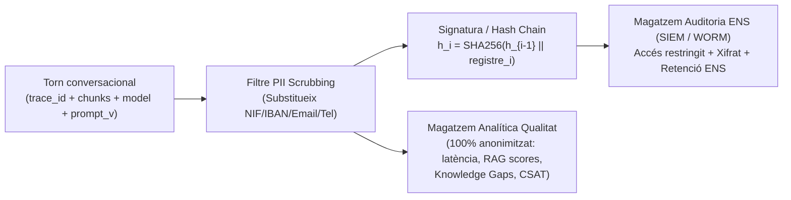

## A. Objectius d'aprenentatge

En completar aquesta lliçó, l'estudiant ha de ser capaç de:

1. **Explicar** per què la **traçabilitat extrem a extrem** de cada torn conversacional és imprescindible per a l'auditoria administrativa, la depuració de qualitat, la defensa davant reclamacions i el compliment de l'**ENS** i l'**AI Act** (art. 12 en sistemes d'alt risc i bones pràctiques generals).
2. **Definir** l'**esquema mínim d'un registre d'auditoria conversacional**: `trace_id`, `session_id` (pseudonimitzat), `timestamp_utc`, `canal`, `prompt_version`, `model_id`, `chunks_recuperats_ids` (amb *scores*), `tool_calls`, `latencies_ms`, `tokens`, `estat_validacio_cites` i `motiu_escalada`.
3. **Resoldre** la **tensió entre traçabilitat (ENS/auditoria) i minimització de dades (RGPD)** mitjançant ***PII Scrubbing* abans d'escriure els logs**, separació d'accessos i polítiques de retenció diferenciades!
4. **Garantir** la **integritat i no-repudi dels registres d'auditoria** (logs *append-only* o encadenament de *hashes* SHA-256 i enviament centralitzat al **SIEM** corporatiu).
5. **Implementar** en Python pur un **registrador d'auditoria conversacional amb *PII scrubbing* previ i encadenament criptogràfic de *hashes* (*hash chain*)** capaç de detectar qualsevol manipulació posterior d'un registre!

---

## B. Explicació introductòria

Imagina que un ciutadà presenta una queixa formal al Síndic de Greuges local: *"El dia 12 de maig a les 11:20 el vostre chatbot em va dir que no calia presentar la declaració abans del juny, i ara em cobren un recàrrec!"* Sense **traçabilitat conversacional**, l'ajuntament no sap què va preguntar el ciutadà, quina versió del prompt i del model hi havia activa, quins documents de la base de coneixement es van recuperar ni què va respondre exactament el bot!

La **traçabilitat** registra de manera estructurada, segura i manipulació-evident cada esdeveniment crític del cicle de vida d'una interacció —sense convertir els fitxers de log en una fuga massiva de dades personals (RGPD)!

---

## C. Explicació tècnica avançada

### 1. Anatomia d'una traça conversacional completa (**OpenTelemetry / JSON estructurat**)

Cada torn conversacional genera un identificador únic (`trace_id` / `span_id`) que correlaciona tots els salts del backend:

| Camp del registre | Què registra? | Utilitat operativa i d'auditoria |
|---|---|---|
| `trace_id` / `session_hash` | Identificador únic del torn i sessió pseudonimitzada | Reconstruir la conversa sencera i correlacionar microserveis |
| `timestamp_utc` / `canal` | Instant exacte (ISO 8601) i canal (`web`, `010`, `intranet`) | Contrastar amb la normativa vigent en aquella data exacta! |
| `model_id` / `prompt_version` | Model exacte (`llama-3.1-8b-q4`) + hash/versió del prompt (`v2.4`) | **Reproductibilitat**: saber exactament quina configuració va generar la resposta |
| `intent` / `route` | Intenció classificada, confiança i ruta (`RAG`, `DET`, `ESCALADA`) | Diagnòstic d'errors d'enrutament i *funnel* |
| `retrieved_chunks` | Llista de `(doc_id, versio, chunk_id, score_reranker)` | **Auditoria RAG**: saber exactament en quins articles es va basar (o si va faltar evidència) |
| `tool_calls` | Nom de l'eina, estat (`OK`/`DENEGAT`/`HITL`), latència (sense paràmetres PII!) | Auditoria de seguretat i comprovació de mínim privilegi |
| `guardrails` | Resultat de filtre injecció, verificador de cites, abstenció | Detecció d'atacs i mesura de taxa d'al·lucinació interceptada |
| `cost_latency` | `ttft_ms`, `total_ms`, `tokens_in`, `tokens_out` | Control de SLA, capacitat GPU i pressupost |

### 2. Tensió **Traçabilitat (ENS) vs. Minimització (RGPD)**: *PII Scrubbing* en logs!

:::callout-warning Mai escriguis dades personals en cru als logs d'aplicació!
Un ciutadà sovint escriu el seu nom, DNI, telèfon o situació mèdica dins una pregunta al chatbot (*"Soc en Pere Puig, DNI 12345678Z, i tinc una discapacitat del 65%..."*). Si guardes el prompt brut dins els logs d'observabilitat accessibles per desenvolupadors, **crees un nou fitxer massiu de dades personals sensibles sense base jurídica ni control d'accés (infracció RGPD!)**.
:::

Com es resol rigorosament?
1. ***PII Scrubbing* previ al registre**: substituir automàticament `NIF/NIE`, `IBAN`, telèfons, emails i adreces per tokens (`[NIF]`, `[IBAN]`, `[EMAIL]`) **abans** d'enviar la traça a la base d'observabilitat/analytics!
2. **Doble magatzem amb retenció diferenciada**:
   - **Logs d'auditoria de seguretat i evidència (SIEM / ENS)**: accés molt restringit, xifrats, immutables (*append-only* / *WORM*), retenció legalment justificada (p. ex., 2 anys segons política ENS).
   - **Logs d'analítica i millora de qualitat**: estrictament **anonimitzats/scrubbed** sense identificadors personals.
3. **Integritat contra manipulació (*Tamper-Evident Logging*)**: encadenar cada registre amb el *hash* criptogràfic del registre anterior (`hash_i = SHA256(hash_{i-1} || payload_i)`), de manera que alterar o esborrar una sola entrada antiga trenca immediatament tota la cadena posterior!

---

## D. Diagrames i recursos visuals

### Pipeline de traçabilitat segura (*PII Scrubbing* + Doble magatzem + Hash Chain SIEM)



---

## E. Aplicació a l'Administració pública

1. **Defensa davant reclamacions i transparència (Síndic / Auditoria)**: poder demostrar exactament quina versió de l'ordenança vigent, quin `prompt_version` i quina resposta (incloent l'avís de caràcter orientatiu) es van servir en un `trace_id` concret dona màxima seguretat jurídica a l'ens local.
2. **Compliment de l'ENS (mesura `op.exp.8` — Registre d'activitat)**: l'Esquema Nacional de Seguretat exigeix registrar esdeveniments d'accés, intents denegats, canvis de configuració i mantenir protegits els registres contra alteració o destrucció no autoritzada, sincronitzats amb rellotge oficial (**NTP**).
3. **Registre automàtic d'esdeveniments (AI Act, art. 12)**: per a sistemes d'alt risc (i bona pràctica recomanada per a qualsevol assistent públic), la traçabilitat automàtica de les operacions facilita el monitoratge posterior a la comercialització (*post-market monitoring*) i la investigació d'incidents greus.

---

## F. Exemple pràctic guiat

Implementem en **Python pur** un **registrador d'auditoria conversacional** amb:
1. ***PII Scrubbing* automàtic** abans d'escriure el log (elimina NIF, IBAN i email del text del ciutadà!).
2. **Encadenament criptogràfic *Hash Chain* (SHA-256)** on cada registre depèn del *hash* anterior.
3. Un **verificador d'integritat** que demostra com la cadena és `VÀLIDA` originalment i **detecta immediatament** si algú manipula una sola lletra d'un registre històric!

```python
"""Exemple 5.6: Auditoria conversacional amb PII scrubbing i integritat Hash Chain (SHA-256)."""
from datetime import datetime, timezone
import hashlib
import json
import re

REGLES_SCRUB = [
    (re.compile(r"\bES\d{2}(?:\s?\d{4}){5}\b"), "[IBAN_OMES]"),
    (re.compile(r"\b[0-9XYZ]\d{7}[A-Z]\b"), "[NIF_OMES]"),
    (re.compile(r"\b[\w.+-]+@[\w-]+\.[a-z]{2,}\b", re.IGNORECASE), "[EMAIL_OMES]"),
]


def scrub_pii(text: str) -> str:
    net = text
    for patro, token in REGLES_SCRUB:
        net = patro.sub(token, net)
    return net


class AuditLoggerConversacional:
    def __init__(self) -> None:
        self.registres: list[dict[str, object]] = []
        self._ultim_hash = "0" * 64

    def registrar_torn(
        self,
        trace_id: str,
        consulta_usuari: str,
        model_id: str,
        prompt_version: str,
        chunks_ids: list[str],
        estat_cites: str,
    ) -> dict[str, object]:
        payload = {
            "trace_id": trace_id,
            "timestamp_utc": datetime.now(timezone.utc).isoformat(timespec="seconds"),
            "consulta_scrubbed": scrub_pii(consulta_usuari),
            "model_id": model_id,
            "prompt_version": prompt_version,
            "chunks_ids": chunks_ids,
            "estat_cites": estat_cites,
            "prev_hash": self._ultim_hash,
        }
        canon = json.dumps(payload, sort_keys=True, ensure_ascii=False)
        nou_hash = hashlib.sha256(canon.encode("utf-8")).hexdigest()
        entrada = {**payload, "entry_hash": nou_hash}
        self.registres.append(entrada)
        self._ultim_hash = nou_hash
        return entrada

    def verificar_integritat(self) -> tuple[bool, str]:
        prev = "0" * 64
        for idx, reg in enumerate(self.registres):
            if reg["prev_hash"] != prev:
                return False, f"Trencament de cadena al registre {idx} (prev_hash)"
            sense_hash = {k: v for k, v in reg.items() if k != "entry_hash"}
            recalculat = hashlib.sha256(json.dumps(sense_hash, sort_keys=True, ensure_ascii=False).encode("utf-8")).hexdigest()
            if recalculat != reg["entry_hash"]:
                return False, f"Manipulació detectada al registre {idx} (entry_hash invàlid)"
            prev = str(reg["entry_hash"])
        return True, f"Cadena íntegra ({len(self.registres)} registres verificats)"


if __name__ == "__main__":
    logger = AuditLoggerConversacional()
    r1 = logger.registrar_torn(
        "tr-001", "Soc 12345678Z, correu joan@exemple.cat, vull saber bonificació IBI",
        "llama-3.1-8b-q4", "v2.3", ["OF01-2026#c1"], "OK",
    )
    logger.registrar_torn(
        "tr-002", "Quin és l'horari de l'OAC?",
        "llama-3.1-8b-q4", "v2.3", ["TR-OAC-2026#c2"], "OK",
    )
    print("Consulta netejada al log :", r1["consulta_scrubbed"])
    print("Integritat abans         :", logger.verificar_integritat())

    # Simulem una manipulació maliciosa del registre 0
    logger.registres[0]["estat_cites"] = "FORCAT_OK"
    print("Integritat després atac  :", logger.verificar_integritat())
```

### Interpretació dels resultats (execució verificada)

- El NIF `12345678Z` i el correu `joan@exemple.cat` queden substituïts per `[NIF_OMES]` i `[EMAIL_OMES]` **abans** d'entrar al log!
- La verificació confirma `Cadena íntegra (2 registres verificats)`.
- En alterar un sol camp del registre 0 (`estat_cites`), `verificar_integritat()` intercepta immediatament la manipulació (`False: Manipulació detectada al registre 0`)!

---

## G. Exercici pràctic per resoldre

### Enunciat
Un equip de desenvolupament d'un chatbot municipal guarda tots els missatges crus de les converses en una taula PostgreSQL sense xifrar (`chat_logs_raw`), amb permisos `SELECT` i `UPDATE` per a tot l'equip de desenvolupament, sense termini d'esborrat i **sense desar ni `prompt_version` ni `chunks_ids` recuperats**.

Identifica els **4 defectes greus** d'aquest disseny (RGPD, ENS i operació IA) i proposa l'arquitectura correcta de traçabilitat conversacional!

### Objectius i restriccions
- Combinar *PII scrubbing* + retenció acotada (RGPD), immutabilitat WORM/Hash Chain + SIEM + mínim privilegi (ENS) i metadades completes de reproductibilitat (`trace_id`, `prompt_version`, `model_id`, `chunks_ids`).

:::hint Pista 1 — Defectes RGPD i ENS
1) Guardar missatges crus exposa DNI, adreces i dades sensibles a desenvolupadors (**RGPD**); 2) Sense termini d'esborrat viola limitació de conservació (**art. 5.1.e RGPD**); 3) Permisos `UPDATE` sobre logs trenca la integritat d'auditoria (**ENS `op.exp.8`** — qualsevol pot alterar l'evidència!).
:::

:::hint Pista 2 — Defecte d'enginyeria IA
4) Sense `prompt_version`, `model_id` ni `chunks_ids` recuperats és **impossible reproduir ni auditar** per què el chatbot va donar una resposta equivocada fa 2 mesos!
:::

### Criteris d'avaluació
- **40%**: Identificació precisa dels 4 defectes (PII cru, conservació indefinida, logs modificables `UPDATE` sense mínim privilegi, manca de metadades de reproductibilitat IA).
- **60%**: Redisseny complet: *PII scrubbing* previ, doble magatzem (SIEM/WORM *append-only* amb *hash chain* i accés restringit ENS vs. analítica anonimitzada), retenció definida, rellotge NTP i esquema complet amb `trace_id`, `prompt_version`, `model_id`, `chunks_ids` i `guardrails`.

### Errors habituals
- Proposar «no guardar cap log per complir el RGPD» (això trencaria l'ENS `op.exp.8` i deixaria l'administració indefensa davant reclamacions i auditories!).

:::solution Solució completa comentada i alternatives
### Els 4 defectes greus
1. **Exposició de PII crua (RGPD)**: desar missatges bruts dels ciutadans accessibles a desenvolupadors crea un magatzem no autoritzat de dades personals (i potencialment categories especials!).
2. **Conservació indefinida (art. 5.1.e RGPD)**: absència de política de retenció i purgat automàtic.
3. **Logs modificables i sense protecció (ENS `op.exp.8`)**: atorgar `UPDATE` a desenvolupadors sobre els logs destrueix el seu valor probatori i permet esborrar rastres d'incidents o errors; a més falta xifratge i mínim privilegi.
4. **Manca de reproductibilitat IA**: sense `trace_id`, `model_id`, `prompt_version` ni `chunks_ids` recuperats no es pot investigar cap al·lucinació ni demostrar quina normativa es va servir en una data passada.

### Arquitectura correcta de traçabilitat conversacional
1. ***PII Scrubbing* obligatori abans del registre**: eliminar automàticament NIF, IBAN, telèfons, emails i dades identificatives abans d'escriure als logs d'observabilitat.
2. **Esquema complet OpenTelemetry/JSON**: registrar `trace_id`, `timestamp_utc` (sincronitzat **NTP**), `session_hash`, `canal`, `model_id`, `prompt_version`, `intent`, `chunks_ids` + versions + *scores*, `tool_calls`, resultat de `guardrails`/cites i `latencies_ms`.
3. **Doble magatzem segur i immutable**:
   - **Auditoria ENS (SIEM / emmagatzematge *WORM* *append-only* amb *hash chain*)**: zero permisos `UPDATE/DELETE`, xifrat, accés restringit a seguretat/auditoria i retenció legalment fixada (p. ex. 2 anys).
   - **Analítica de qualitat**: còpia estrictament anonimitzada per mesurar *Knowledge Gaps*, latència i satisfacció (CSAT) amb retenció acotada.
:::

---

## H. Test individual

Resol les 10 preguntes sobre esquema de traçabilitat (`trace_id`, `prompt_version`, `chunks_ids`), *PII scrubbing*, tensió ENS vs. RGPD, integritat *WORM / Hash Chain*, sincronització NTP i registre d'esdeveniments (ENS `op.exp.8` / AI Act art. 12).

---

## I. Preguntes de desenvolupament

### Pregunta 1
Detalla l'**esquema mínim d'un registre de traçabilitat conversacional** per a un assistent RAG públic i explica per a què serveix cada bloc de camps davant una reclamació ciutadana o auditoria.

:::model-answer Resposta model i criteris de correcció (Pregunta 1)
**Resposta model**:
Un registre complet de torn inclou:
- **Identificació i temps**: `trace_id`, `session_hash` (pseudonimitzat), `timestamp_utc` (sincronitzat amb NTP) i `canal` (`web`/`010`/`intranet`).
- **Configuració exacta del sistema**: `model_id` i `prompt_version` (hash/versió) per garantir reproductibilitat completa.
- **Evidència RAG i accions**: `intent`/`route`, llista de `chunks_ids` recuperats amb versió normativa i *scores* del *reranker*, `tool_calls` executats o bloquejats (sense PII) i resultat dels `guardrails` (filtre injecció, verificador de cites, abstenció).
- **Rendiment i qualitat**: `ttft_ms`, `total_ms`, `tokens_in`/`out` i esdeveniments d'escalada o CSAT.
Davant una reclamació, permet reconstruir exactament quina normativa vigent en aquella data i quina configuració van originar la resposta.

**Criteris de correcció (10 punts)**:
- Cobertura dels 4 blocs de camps (identificació, configuració, evidència RAG/eines, mètriques): 7 punts.
- Aplicació a auditoria i reclamacions: 3 punts.
:::

### Pregunta 2
Com es resol tècnicament i jurídicament la tensió entre l'**obligació de registre d'activitat de l'ENS (`op.exp.8`)** i el **principi de minimització i limitació de conservació del RGPD** en els logs d'un chatbot?

:::model-answer Resposta model i criteris de correcció (Pregunta 2)
**Resposta model**:
- No són incompatibles: es concilien mitjançant **disseny de privacitat en els logs**:
  1. ***PII Scrubbing* previ**: emmascarar deterministament NIFs, IBANs, telèfons, emails i dades sensibles abans de persistir els logs, evitant acumular dades personals innecessàries.
  2. **Separació de magatzems i mínim privilegi**: enviar els logs d'auditoria de seguretat al **SIEM / magatzem *WORM* xifrat** d'accés molt restringit (ENS), mentre l'equip de producte/IA només accedeix a mètriques i traces **100% anonimitzades** per analitzar qualitat i *Knowledge Gaps*.
  3. **Política de retenció i esborrat automàtic**: terminis de conservació proporcionats i documentats (p. ex., retenció d'auditoria ENS vs. purgat ràpid d'historials de sessió).

**Criteris de correcció (10 punts)**:
- Explicació clara de la tensió ENS vs. RGPD: 3 punts.
- Solució completa (*PII scrubbing*, doble magatzem + mínim privilegi, retenció diferenciada): 7 punts.
:::

### Pregunta 3
Què aporta l'**encadenament criptogràfic (*Hash Chain*)** o l'emmagatzematge ***WORM* (*Write-Once-Read-Many*)** en els registres d'auditoria d'un assistent corporatiu o ciutadà?

:::model-answer Resposta model i criteris de correcció (Pregunta 3)
**Resposta model**:
- Garanteix la **integritat i detecció de manipulacions (*tamper-evidence*)**: en una *hash chain*, cada registre \(i\) calcula el seu `entry_hash = SHA256(prev_hash || payload_i)`. Si qualsevol persona (interna o atacant) intenta modificar o suprimir una sola entrada històrica per encobrir un error del bot o un accés indegut a dades confidencials, tots els *hashes* posteriors deixen de quadrar immediatament!
- Combinat amb emmagatzematge **WORM (*append-only*)**, enviament extern al **SIEM** i sincronització horària **NTP**, compleix plenament les exigències d'integritat dels registres de l'ENS (`op.exp.8`) i proporciona evidència sòlida davant auditories o procediments legals.

**Criteris de correcció (10 punts)**:
- Funcionament criptogràfic exacte de la *hash chain* / WORM: 6 punts.
- Connexió amb ENS (`op.exp.8`), SIEM, NTP i valor probatori: 4 punts.
:::

---

## J. Resum per memoritzar

### Conceptes clau
- **Esquema mínim de traça**: `trace_id`, `session_hash`, `timestamp_utc` (NTP), `canal`, `model_id`, `prompt_version`, `intent`, `chunks_ids` (+ versió + *score*), `tool_calls`, `guardrails` i `latencies/tokens`.
- **ENS (`op.exp.8`) vs. RGPD**: **mai guardar PII en cru als logs** → aplicar ***PII Scrubbing* previ**, **doble magatzem** (SIEM/WORM restringit vs. analítica anonimitzada) i **retenció acotada**.
- **Integritat (*Tamper-Evident*)**: logs *append-only* / **WORM** + ***Hash Chain* SHA-256** (zero `UPDATE`/`DELETE`!).
- **AI Act art. 12**: registre automàtic d'esdeveniments essencial per a traçabilitat i investigació d'incidents.

### Definicions essencials
- ***PII Scrubbing***: detecció i substitució automatitzada de dades personals identificatives (NIF, IBAN, email, telèfon) abans d'escriure registres o traces d'observabilitat.
- ***Hash Chain***: encadenament criptogràfic on el *hash* de cada registre inclou el *hash* del registre anterior, fent detectable qualsevol alteració o esborrat retroactiu.

### Errors conceptuals freqüents
1. Escriure els prompts bruts dels ciutadans en logs accessibles a tot l'equip de desenvolupament.
2. Permetre `UPDATE`/`DELETE` sobre les taules de logs d'auditoria.
3. Oblidar registrar `prompt_version`, `model_id` i `chunks_ids` (sense ells, els errors no són reproduïbles!).

### Possibles preguntes d'examen
- Dissenya l'esquema de traçabilitat d'un chatbot RAG conciliant ENS (`op.exp.8`) i RGPD.
- Explica com funciona una *hash chain* SHA-256 per garantir integritat dels logs d'auditoria.
- Què ha de quedar registrat exactament per poder auditar una reclamació d'un ciutadà de fa 3 mesos?
