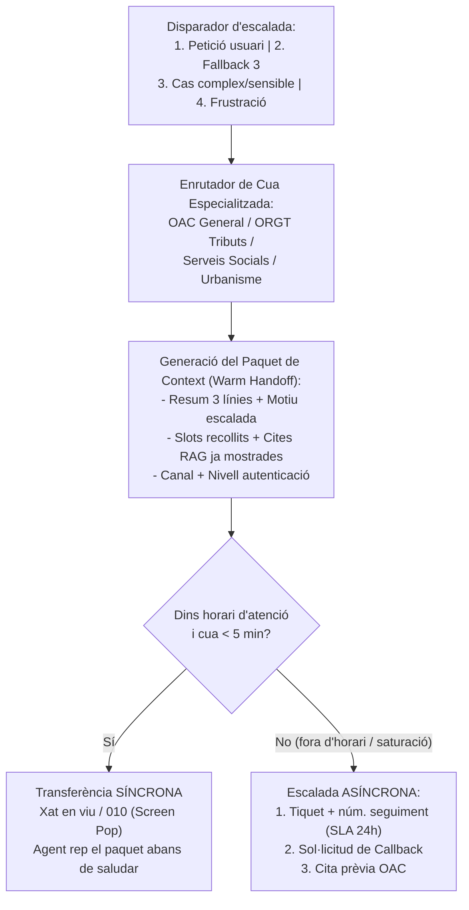

## A. Objectius d'aprenentatge

En completar aquesta lliçó final del Mòdul 5, l'estudiant ha de ser capaç de:

1. **Definir** els **6 disparadors (*triggers*) obligatoris d'escalada a intervenció humana**: petició explícita del ciutadà, baixa confiança / 3 fallbacks consecutius, cas jurídic o personal complex, detecció de frustració/malestar elevat, tema sensible/vulnerable i acció amb efectes jurídics o econòmics.
2. **Distingir** entre **traspàs fred (*cold handoff*)** (el ciutadà ha de repetir-ho tot de zero) i **traspàs càlid (*warm handoff*)** amb **paquet estructurat de context** (resum breu, intenció, *slots* verificats, documents citats, historial net i motiu exacte d'escalada).
3. **Gestionar** els **horaris d'atenció humana i la disponibilitat d'agents OAC/010**: cua de xat en viu dins horari laboral (amb temps d'espera estimat!) vs. **escalada asíncrona fora d'horari** (creació de tiquet / sol·licitud de *callback* / cita prèvia confirmada amb número de seguiment!).
4. **Dissenyar** l'**enrutament intel·ligent per cua especialitzada** (OAC general, ORGT Tributs, Serveis Socials, Urbanisme, Suport Tècnic) per evitar rebotar el ciutadà entre agents!
5. **Implementar** en Python pur un **motor d'escalada humana (*Warm Handoff Engine*)** que avalua tots els disparadors, selecciona la cua especialitzada, verifica disponibilitat horària (síncron vs. tiquet/*callback* asíncron) i empaqueta el resum estructurat per a l'agent OAC.

---

## B. Explicació introductòria

L'èxit d'un assistent virtual públic no es mesura pel fet que *no necessiti mai persones*, sinó per la **qualitat de la col·laboració entre la IA i el personal públic de l'OAC i el 010**. Hi ha consultes que sempre corresponen a un ésser humà: una situació familiar vulnerable, una reclamació tributària complexa, un ciutadà angoixat o algú que simplement prefereix parlar amb una persona!

L'**escalada a intervenció humana (*Human Handoff*)** és el pont entre l'assistent i l'agent públic. Quan està mal dissenyada (*cold handoff*: *"Truca al 010 i explica-ho tot de nou"*), genera indignació; quan està ben dissenyada (*warm handoff* amb resum en pantalla i cua especialitzada), converteix l'assistent en un aliat que estalvia temps tant al ciutadà com al funcionari!

---

## C. Explicació tècnica avançada

### 1. Els 6 disparadors (*Triggers*) obligatoris d'escalada humana

1. **Petició explícita de l'usuari (Prioritat 1 absoluta)**: *"Vull parlar amb una persona"*, *"operador"*, botó permanent `[Parlar amb una persona]`. Mai bloquejar ni amagar aquesta opció!
2. **Esgotament de *fallback* o baixa confiança persistent**: 2–3 intents fallits consecutius (`Fallback 3`) o abstenció repetida del RAG dins competència municipal.
3. **Complexitat jurídica o excepció no contemplada**: recursos administratius, casos especials d'usdefruit/herència, dubtes interpretatius d'ordenances o discrepàncies en un expedient concret.
4. **Temes sensibles o vulnerabilitat social**: pobresa energètica, risc de desnonament, protecció de menors, discapacitat o atenció social → requereixen empatia humana i derivació immediata a **Serveis Socials / OAC especialitzada** (i `112`/`900 900 120` si hi ha emergència!).
5. **Frustració o malestar elevat (anàlisi de sentiment/to)**: detecció d'insults, majúscules sostingudes o expressions de frustració repetida (*"Això no serveix per a res!"*) → derivar proactivament abans que escali la queixa.
6. **Accions amb efectes jurídics, econòmics o irreversibles**: qualsevol excepció de pagament, recurs, modificació d'expedient o valoració discrecional.

### 2. *Cold Handoff* vs. *Warm Handoff* (El Paquet de Context)

| Aspecte | *Cold Handoff* (Antipatró) | *Warm Handoff* (Estàndard de qualitat) |
|---|---|---|
| **Experiència ciutadà** | Rep un telèfon genèric i ha de tornar a explicar el problema des de zero | Transferència fluida al xat/trucada d'un agent que **ja sap què necessita** |
| **Informació rebuda per l'agent OAC** | Cap | **Paquet estructurat (Screen Pop)**: resum en 3 línies, intenció, *slots* recollits, documents RAG ja mostrats, motiu d'escalada, canal i nivell d'autenticació! |
| **Enrutament** | Cua única genèrica (rebots constants entre departaments) | **Cua especialitzada** (`CUA_TRIBUTS`, `CUA_SOCIAL`, `CUA_OAC_GENERAL`) |
| **Fora d'horari** | *"Ara estem tancats, torna demà"* (punt mort!) | **Escalada asíncrona garantida**: creació de tiquet amb número de seguiment, sol·licitud de trucada (*callback*) o reserva de cita prèvia! |

### 3. Gestió d'horaris, cues i **SLA (*Service Level Agreement*)**

- **Dins horari d'atenció (ex. dl–dv 08:30–19:00) amb agents disponibles**: transferència síncrona a xat en viu (o trucada 010) informant del **temps d'espera estimat** (i oferint *callback* si la cua supera p. ex. 5 minuts!).
- **Fora d'horari o cua saturada**: **mai deixar l'usuari en un carreró sense sortida!** Oferir automàticament **3 sortides asíncrones**: (1) deixar un **tiquet/consulta** amb el resum adjunt i número de referència per rebre resposta en `< 24–48 h hàbils`, (2) sol·licitar **trucada (*callback*)** en una franja horària del dia següent, o (3) reservar **cita prèvia presencial**.
- **Privacitat al traspàs**: el paquet de context només s'envia a la cua autoritzada amb els permisos ACL corresponents (un agent de cua genèrica no ha de rebre dades clíniques o socials reservades de la cua de Serveis Socials!).

---

## D. Diagrames i recursos visuals

### Motor de decisió d'escalada humana (*Warm Handoff* síncron vs. asíncron)



---

## E. Aplicació a l'Administració pública

1. **Empoderar el personal de l'OAC i el 010**: l'objectiu de l'assistent no és reduir la qualitat humana de l'OAC, sinó **absorbir les consultes repetitives** (horaris, requisits estàndard, estat bàsic) perquè els funcionaris disposin de **més temps i context estructurat** per atendre els casos complexos i les persones vulnerables!
2. **Retroalimentació dels agents humans (*Closed Loop*)**: afegir un botó ràpid a la pantalla de l'agent OAC en tancar una escalada (`[Falta info a la KB]`, `[Bot confós]`, `[Cas jurídic complex]`) alimenta automàticament la millora del chatbot i dels *content owners*.
3. **Principi de transparència en la transició**: informar clarament el ciutadà del moment exacte en què passa d'estar parlant amb la IA a estar parlant amb una persona real (*«Ara t'atén la Marta, agent de l'OAC, que ja disposa del resum de la teva consulta»*).

---

## F. Exemple pràctic guiat

Implementem en **Python pur** un **motor d'escalada humana (*Warm Handoff Engine*)** que:
1. Avalua prioritàriament els disparadors (`PETICIO_EXPLICITA`, `TEMA_SENSIBLE`, `FALLBACK_EXHAUST`, `FRUSTRACIO`).
2. Selecciona la **cua especialitzada** (`CUA_SERVEIS_SOCIALS`, `CUA_ORGT_TRIBUTS`, `CUA_OAC_GENERAL`).
3. Decideix automàticament entre **transferència síncrona** (dins horari i cua baixa) i **tiquet/*callback* asíncron** (fora d'horari o cua saturada), empaquetant el **resum estructurat** per a l'agent humà!

```python
"""Exemple 5.8: Motor d'escalada humana (Warm Handoff) amb cues especialitzades i gestió horària."""
from dataclasses import dataclass


@dataclass
class ContextConversa:
    session_id: str
    tema: str
    ultim_missatge: str
    errors_consecutius: int
    slots: dict[str, str]
    cites_mostrades: list[str]
    sentiment_negatiu: bool = False


def assignar_cua(tema: str, missatge: str) -> str:
    txt = f"{tema} {missatge}".lower()
    if any(k in txt for k in ("desnonament", "pobresa", "ajut social", "menor", "discapacitat")):
        return "CUA_SERVEIS_SOCIALS_PRIORITARIA"
    if any(k in txt for k in ("ibi", "plusvàlua", "recurs tributari", "orgt", "embargament")):
        return "CUA_ORGT_TRIBUTS"
    return "CUA_OAC_GENERAL"


def avaluar_escalada(
    ctx: ContextConversa,
    hora_actual: int,
    temps_espera_cua_min: int,
) -> dict[str, object]:
    m = ctx.ultim_missatge.lower()
    motiu: str | None = None
    if any(k in m for k in ("parlar amb una persona", "agent humà", "operador")):
        motiu = "PETICIO_EXPLICITA_CIUTADA"
    elif any(k in m for k in ("desnonament", "pobresa energètica", "ajut urgent")):
        motiu = "VULNERABILITAT_SOCIAL"
    elif ctx.errors_consecutius >= 3:
        motiu = "FALLBACK_3_EXHAUST"
    elif ctx.sentiment_negatiu:
        motiu = "FRUSTRACIO_DETECTADA"

    if not motiu:
        return {"escalar": False}

    cua = assignar_cua(ctx.tema, ctx.ultim_missatge)
    dins_horari = 8 <= hora_actual < 19
    modalitat = (
        f"TRANSFERENCIA_SINCRONA (espera estimada: {temps_espera_cua_min} min)"
        if (dins_horari and temps_espera_cua_min <= 5)
        else "TIQUET_ASINCRON_O_CALLBACK (SLA < 24h hàbils)"
    )

    return {
        "escalar": True,
        "motiu": motiu,
        "cua_desti": cua,
        "modalitat": modalitat,
        "paquet_warm_handoff": {
            "session_id": ctx.session_id,
            "resum_agent": f"Motiu: {motiu}. Tema: {ctx.tema}. Slots: {ctx.slots}. Últim missatge: '{ctx.ultim_missatge}'",
            "cites_ja_mostrades": ctx.cites_mostrades,
        },
    }


if __name__ == "__main__":
    cas_social = ContextConversa(
        "sess-101", "habitatge", "Tinc ordre de desnonament i necessito ajut urgent",
        0, {"municipi": "Mataró"}, [], True,
    )
    cas_tribut_nit = ContextConversa(
        "sess-102", "IBI", "No entenc el recàrrec del meu IBI, vull parlar amb una persona",
        1, {"tribut": "IBI"}, ["OF01-2026#c8"], False,
    )
    print("Cas 1 (Vulnerabilitat 11:00, cua 2m):\n ", avaluar_escalada(cas_social, hora_actual=11, temps_espera_cua_min=2))
    print("Cas 2 (Tributs 22:00, fora d'horari):\n ", avaluar_escalada(cas_tribut_nit, hora_actual=22, temps_espera_cua_min=0))
```

### Interpretació dels resultats (execució verificada)

- **Cas 1** (11:00 h, cua de 2 min): detecta `VULNERABILITAT_SOCIAL`, enruta directament a **`CUA_SERVEIS_SOCIALS_PRIORITARIA`** en mode **`TRANSFERENCIA_SINCRONA`** amb el paquet complet de *warm handoff* per a la treballadora social!
- **Cas 2** (22:00 h, fora d'horari): detecta `PETICIO_EXPLICITA_CIUTADA`, enruta a **`CUA_ORGT_TRIBUTS`** i, en estar fora d'horari, obre automàticament **`TIQUET_ASINCRON_O_CALLBACK (SLA < 24h hàbils)`** conservant les cites ja mostrades (`OF01-2026#c8`) perquè el tècnic tributari l'endemà no repeteixi explicacions!

---

## G. Exercici pràctic per resoldre

### Enunciat
L'OAC d'un municipi es queixa després de 2 mesos d'operar el nou chatbot:
1. Els ciutadans que arriben derivats del chatbot al telèfon 010 o al xat en viu arriben **molt enfadats** perquè han de tornar a explicar-ho tot des del principi.
2. Un 35% de les derivacions cauen a la cua general d'OAC tot i ser recursos tributaris complexos d'IBI/plusvàlua, obligant l'agent a tornar a transferir el ciutadà a l'ORGT.
3. A partir de les 19:00 h (quan tanca l'OAC), el botó *"Parlar amb una persona"* simplement mostra *"Oficina tancada, torna demà a les 8:30"* i tanca la conversa!

Redissenya el **model complet d'escalada humana** per resoldre totes tres queixes i afegir un **bucle de millora contínua** amb els agents OAC.

### Objectius i restriccions
- Implementar *Warm Handoff* amb paquet estructurat (*Screen Pop*), enrutament a cues especialitzades, escalada asíncrona fora d'horari (tiquet/*callback*/cita) i feedback estructurat de tancament dels agents.

:::hint Pista 1 — Queixes 1 i 2
(1) Passar de *cold handoff* a ***Warm Handoff*** (*Screen Pop* amb resum en 3 línies, *slots*, cites RAG ja vistes i motiu exacte d'escalada) + avisar el ciutadà de la transició transparent; (2) **Enrutament intel·ligent per cua especialitzada** (`CUA_ORGT_TRIBUTS`, `CUA_SERVEIS_SOCIALS`, `CUA_OAC_GENERAL`) segons tema i intenció detectats!
:::

:::hint Pista 2 — Queixa 3 + Bucle de millora
(3) Fora d'horari (>19:00 h) o amb cua >5 min: **escalada asíncrona garantida** (obrir tiquet amb número de seguiment i SLA `< 24 h`, programar *callback* o reservar cita prèvia conservant tot el paquet de context!); (4) Afegir etiquetatge ràpid de tancament a la consola OAC (`Falta KB` / `Error NLU` / `Cas complex`) per retroalimentar l'equip d'IA!
:::

### Criteris d'avaluació
- **35%**: Disseny del ***Warm Handoff*** i contingut exacte del paquet de context (resum, *slots*, cites ja mostrades, motiu, nivell d'autenticació, privacitat per cua).
- **30%**: **Enrutament per cues especialitzades** per eliminar transferències en cadena (OAC vs. ORGT vs. Serveis Socials).
- **35%**: **Escalada asíncrona fora d'horari / saturació** (tiquet amb núm. seguiment + *callback* + cita prèvia + SLA) i **bucle de feedback dels agents** en tancar el cas.

### Errors habituals
- Enviar l'historial brut de 40 missatges sense resumir a la pantalla de l'agent OAC (un agent al telèfon té 10 segons per llegir un resum de 3 línies, no una novel·la!).

:::solution Solució completa comentada i alternatives
### 1. Pas de *Cold Handoff* a *Warm Handoff* (*Screen Pop*)
- Generar automàticament un **paquet estructurat breu** (llegible en <10 segons per l'agent humà!):
  - **Resum executiu de 3 línies** del problema,
  - **Motiu d'escalada** (`PETICIO_EXPLICITA`, `FALLBACK_3`, `VULNERABILITAT`, `FRUSTRACIO`),
  - ***Slots* recollits** (`municipi`, `tribut`, `tràmit`),
  - **Cites RAG ja mostrades** (per no repetir informació que el ciutadà ja ha llegit!),
  - **Nivell d'autenticació** i accés a l'historial detallat si cal.
- Informar el ciutadà amb transparència: *"Et passo amb un agent que ja té el resum de la teva consulta perquè no hagis de repetir-ho tot."*

### 2. Enrutament per cues especialitzades (eliminació de rebots)
- Mapejar les intencions i paraules clau a cues dedicades (`CUA_ORGT_TRIBUTS`, `CUA_SERVEIS_SOCIALS_PRIORITARIA`, `CUA_URBANISME`, `CUA_OAC_GENERAL`) respectant l'aïllament ACL de dades sensibles (els casos socials només arriben a la cua de Serveis Socials!).

### 3. Escalada asíncrona fora d'horari (>19:00 h) o cua saturada (>5 min)
- Substituir el missatge de «tancat» per **3 opcions operatives amb el paquet de context adjunt**:
  1. **Registrar consulta/tiquet** amb número de seguiment immediat i compromís SLA (`resposta en < 24 h hàbils`),
  2. **Programar trucada (*callback*)** a la franja horària que triï el ciutadà l'endemà,
  3. **Reservar cita prèvia presencial** a l'OAC.

### 4. Bucle de millora contínua amb els agents
- En tancar cada cas escalat, l'agent OAC marca en 1 clic el motiu real (`Falta informació a la KB`, `Bot no ha entès`, `Cas jurídic/social inherentment humà`), nodrint automàticament el *backlog* dels *content owners* i de l'equip d'IA.
:::

---

## H. Test individual

Resol les 10 preguntes sobre els 6 disparadors d'escalada, *cold* vs. *warm handoff*, paquet de context (*Screen Pop*), enrutament per cues especialitzades, escalada asíncrona fora d'horari, SLA i feedback tancat dels agents.

---

## I. Preguntes de desenvolupament

### Pregunta 1
Enumera els **6 disparadors obligatoris d'escalada a intervenció humana** en un assistent virtual públic i justifica per què la **petició explícita del ciutadà** ha de tenir sempre prioritat absoluta.

:::model-answer Resposta model i criteris de correcció (Pregunta 1)
**Resposta model**:
- **Els 6 disparadors**: (1) **Petició explícita del ciutadà** (*«parlar amb una persona»*); (2) **Esgotament de *fallback* / baixa confiança** (3 errors consecutius o abstenció repetida); (3) **Complexitat jurídica o excepció no reglada** (recursos, herències, discrepàncies d'expedient); (4) **Vulnerabilitat o tema sensible** (desnonaments, pobresa energètica, menors → Serveis Socials); (5) **Frustració o malestar elevat** detectat; (6) **Accions amb efectes jurídics, econòmics o irreversibles**.
- **Prioritat absoluta de la petició explícita**: en l'Administració pública l'atenció humana és un dret i una garantia contra la bretxa digital; forçar un ciutadà que demana una persona a passar abans per 4 menús o preguntes del bot destrueix la confiança institucional i exclou col·lectius vulnerables.

**Criteris de correcció (10 punts)**:
- Els 6 disparadors clarament enumerats i contextualitzats: 7 punts.
- Justificació de la prioritat absoluta de la petició explícita: 3 punts.
:::

### Pregunta 2
Compara ***Cold Handoff*** i ***Warm Handoff***, detallant exactament **quins 5 camps** ha de contenir el **paquet de context** que rep l'agent OAC/010 i per què el resum ha de ser breu.

:::model-answer Resposta model i criteris de correcció (Pregunta 2)
**Resposta model**:
- En ***Cold Handoff*** el ciutadà rep un telèfon o enllaç genèric i ha de tornar a explicar el cas des de zero (alta frustració i doble temps de gestió). En ***Warm Handoff*** la transferència porta adjunt el **paquet de context (*Screen Pop*)** directament a la consola de l'agent.
- **5 camps essencials del paquet de context**: (1) **Resum executiu de 2–3 línies** del problema; (2) **Motiu exacte d'escalada** (`FALLBACK_3`, `VULNERABILITAT`, `PETICIO_EXPLICITA`); (3) ***Slots* ja recollits i validats** (`municipi`, `tribut`, `tràmit`); (4) **Cites o respostes RAG ja mostrades** (per no repetir el que l'usuari ja sap); (5) **Canal i nivell d'autenticació** (si ja ve autenticat amb idCAT Mòbil o és anònim).
- Ha de ser breu (<10 segons de lectura) perquè un agent al telèfon o xat en viu pugui saludar immediatament amb coneixement de causa sense fer esperar el ciutadà.

**Criteris de correcció (10 punts)**:
- Contrast clar Cold vs. Warm Handoff: 3 punts.
- Els 5 camps del paquet de context + justificació de brevetat: 7 punts.
:::

### Pregunta 3
Com s'ha de dissenyar l'**escalada fora d'horari d'atenció humana** (o en pics de saturació de cues) i com s'aprofita el tancament de les escalades per crear un **bucle de millora contínua** de l'assistent?

:::model-answer Resposta model i criteris de correcció (Pregunta 3)
**Resposta model**:
- **Fora d'horari / saturació (>5 min de cua)**: mai mostrar un carreró sense sortida («tancat, torna demà»). Oferir automàticament **escalada asíncrona** adjuntant el paquet de *warm handoff*: (1) creació de **tiquet** amb número de seguiment i compromís **SLA** (ex. resposta en `< 24–48 h hàbils`), (2) programació de **trucada (*callback*)** a la franja triada pel ciutadà, o (3) reserva directa de **cita prèvia presencial**.
- **Bucle de millora contínua (*Closed Loop*)**: afegir un etiquetatge d'1 clic a la consola de l'agent OAC en tancar el cas (`Falta info a la KB`, `Error NLU/enrutament`, `Cas jurídic/social inherentment humà`). Això mesura la **taxa d'escalada evitable vs. legítima** i genera automàticament tasques prioritzades per als *content owners* i l'equip d'IA!

**Criteris de correcció (10 punts)**:
- Disseny complet d'escalada asíncrona (tiquet+SLA, *callback*, cita prèvia + context adjunt): 5 punts.
- Bucle de feedback dels agents i distinció escalada evitable vs. legítima: 5 punts.
:::

---

## J. Resum per memoritzar

### Conceptes clau
- **6 disparadors d'escalada**: (1) Petició explícita (prioritat màxima!), (2) `Fallback 3` / baixa confiança, (3) Complexitat jurídica, (4) Vulnerabilitat/tema sensible, (5) Frustració elevada, (6) Efectes jurídics/econòmics.
- ***Warm Handoff* (*Screen Pop*)**: resum en 2–3 línies + motiu escalada + *slots* + cites RAG ja mostrades + canal/autenticació (**llegible en <10 s!**).
- **Enrutament per cues especialitzades**: `OAC General`, `ORGT Tributs`, `Serveis Socials` (amb aïllament ACL!).
- **Fora d'horari / saturació (>5 min)**: MAI carreró sense sortida → **Tiquet + núm. seguiment (SLA) / *Callback* / Cita prèvia** amb el paquet de context adjunt.
- ***Closed Loop* OAC**: etiquetatge d'1 clic en tancar l'escalada (`Falta KB` vs. `Error NLU` vs. `Inherentment humà`) + transició transparent (*«Ara t'atén una persona»*).

### Definicions essencials
- ***Warm Handoff* (Traspàs càlid)**: transferència d'una conversa d'un assistent virtual a un agent humà acompanyada d'un paquet estructurat de context que evita al ciutadà repetir la seva consulta.
- **Escalada asíncrona**: mecanisme alternatiu fora d'horari laboral o en saturació de cues que converteix el context de la conversa en un tiquet rastrejable amb SLA, una sol·licitud de *callback* o una cita prèvia.

### Errors conceptuals freqüents
1. Fer *cold handoff* obligant el ciutadà a repetir-ho tot de zero al 010.
2. Enviar totes les escalades a una cua única genèrica (provocant rebots entre departaments) o tancar la porta fora d'horari.
3. Volcar 40 missatges crus sense resumir a la pantalla d'un agent telefònic.

### Possibles preguntes d'examen
- Enumera els 6 disparadors d'escalada humana i dissenya el paquet de *Warm Handoff*.
- Com resols l'escalada a les 22:00 h quan l'OAC està tancada o quan la cua supera 5 minuts?
- Com distingeixes escalades evitables (millora KB/NLU) d'escalades legítimes (casos humans) mitjançant el feedback dels agents?
