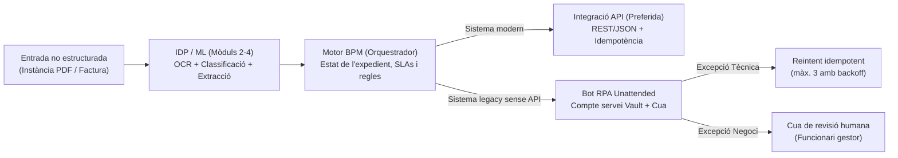

## A. Objectius d'aprenentatge

En completar aquesta lliçó, l'estudiant ha de ser capaç de:

1. **Definir** què és ***Robotic Process Automation* (RPA)** (robots de programari que imiten accions repetitives i basades en regles sobre interfícies o sistemes existents) i distingir entre **RPA atesa (*attended*)**, **no atesa (*unattended*)** i **Automatització Intel·ligent de Processos (IPA / *Hyperautomation*)**.
2. **Comparar** rigorosament **RPA**, **BPM (*Business Process Management*)**, **integració per API**, **Machine Learning / IDP** i **Agents d'IA**, seleccionant l'eina adequada per a cada problema administratiu!
3. **Identificar** la **fragilitat estructural de la RPA basada en interfície gràfica (*UI Scraping*)** (canvis de botons, resolució, *timeouts*) i aplicar el principi ***API-first*** (reservar RPA sobre UI només per a aplicacions *legacy* sense API).
4. **Aplicar** els requisits de **governança, seguretat i idempotència** en bots RPA dins l'Administració pública: comptes de servei dedicats (mai credencials personals d'un funcionari!), gestió segura en *Vault*, gestió d'excepcions tècniques vs. de negoci, reintents idempotents i enquadrament jurídic com a **Actuació Administrativa Automatitzada (art. 41 Llei 40/2015)** quan produeixi actes administratius!
5. **Implementar** en Python pur un **orquestrador de cua de tasques RPA resilient i idempotent** que separa excepcions de negoci (derivació a cua humana) d'excepcions tècniques (reintent amb *backoff*) i evita duplicar assentaments comptables davant reexecucions!

---

## B. Explicació introductòria

En molts ajuntaments i diputacions conviuen desenes d'aplicacions heretades (*legacy*): un programa antic de comptabilitat, el registre d'entrada, el padró, una plataforma de factures electròniques (e.FACT) i el gestor d'expedients. Sovint, els administratius dediquen hores cada setmana a tasques repetitives de «copiar i enganxar» dades d'una pantalla a una altra seguint regles exactes.

***Robotic Process Automation* (RPA)** són «robots de programari» (no robots físics!) que executen aquestes tasques estructurades i repetitives 24/7 amb zero errors de tecleig. Quan combinem **RPA** (els «braços» que mouen dades entre aplicacions) amb **IDP/ML/NLP** (els «ulls i cervell» que llegeixen PDFs no estructurats i classifiquen expedients) i **BPM** (el director d'orquestra del flux de punta a punta), parlem d'**Automatització Intel·ligent (IPA)**!

---

## C. Explicació tècnica avançada

### 1. Comparativa decisiva d'examen: API vs. RPA vs. BPM vs. ML/IDP vs. Agents d'IA

| Tecnologia | Què fa millor | Entrades | Determinisme | Quan usar-la a l'Administració pública |
|---|---|---|---|---|
| **Integració per API (REST/SOAP)** | Connectar sistemes moderns directament a nivell de dades | Estructurades (JSON/XML) | 100% | **SEMPRE primera opció (*API-first*)** si els sistemes disposen d'API (ràpida, estable, segura) |
| **RPA (UI / Desktop)** | Automatitzar passos repetitius sobre aplicacions *legacy* **sense API** (o entre múltiples pantalles) | Estructurades i reglades | 100% (fràgil a canvis d'UI!) | Pont pragmàtic amb ERP/aplicacions antigues o plataformes externes sense API disponible |
| **BPM (Motor de processos, BPMN 2.0)** | Orquestrar el flux complet d'un expedient de llarga durada (dies/mesos) amb tasques humanes, SLAs i paral·lelisme | Fluxos d'estat + esdeveniments | 100% | Columna vertebral de la tramitació d'expedients (registre → requeriment → informe → resolució) |
| **ML / IDP (Mòduls 1–4)** | Entendre documents escanejats, classificar textos, estimar probabilitats o detectar anomalies | No estructurades (PDF, text, imatge) | Probabilístic | Convertir entrades brutes en JSON validat abans d'entregar-ho a BPM/API/RPA |
| **Agents d'IA (Mòdul 3)** | Planificar passos adaptatius en consultes obertes cridant eines controlades | Text lliure / multi-font | Probabilístic (alt risc si s'executa sense control) | Assistència i anàlisi; **NO** per a processos transaccionals comptables/tributaris deterministes! |

### 2. Modalitats de RPA i gestió d'excepcions

- **RPA Atesa (*Attended*)**: s'executa a l'estació de treball del funcionari sota demanda (*co-pilot* d'escriptori que emplena camps o comprova dades mentre la persona decideix).
- **RPA No Atesa (*Unattended*)**: s'executa de manera autònoma en servidors virtuals a partir d'una **cua de treball (*Work Queue*)** programada o disparada per esdeveniments (ex. cada nit conciliar 2.000 factures e.FACT).
- **Dos tipus d'excepcions obligatòriament separats**:
  1. **Excepció tècnica / de sistema (*System Exception*)**: caiguda momentània de la xarxa, *timeout* de l'ERP, finestra bloquejada → **reintent automàtic controlat** (màx. 3 intents amb *backoff* + alerta a IT si persisteix).
  2. **Excepció de negoci (*Business Exception*)**: NIF incorrecte, partida pressupostària sense saldo, factura duplicada → **NO reintentar!** (reintentar donarà exactament el mateix error); marcar com a `EXCEPCIO_NEGOCI` i derivar a la cua humana de revisió!
- **Idempotència obligatòria**: si un bot falla just després d'enregistrar una factura però abans d'actualitzar la seva cua, en reintentar **mai no ha de crear una segona factura duplicada!** Cada ítem porta una **clau d'idempotència única** (ex. `idempotency_key = sha256(proveidor + num_factura + exercici)`).

### 3. Governança i seguretat RPA en el sector públic (ENS + art. 41 LRJSP)

- **Prohibit usar credencials personals d'un funcionari**: cada bot ha de tenir un **compte de servei nominal i auditable** (ex. `svc_rpa_efact_01`) amb **mínim privilegi** i credencials guardades en un ***Password Vault* xifrat** (mai en text pla ni incrustades al codi!).
- **Marc jurídic (art. 41 Llei 40/2015, LRJSP)**: si un bot RPA executa tasques merament auxiliars internes (moure fitxers, carregar dades d'esborrany), és automatització instrumental; però si emet **actes o actuacions administratives sense intervenció directa d'un empleat** (certificats, resolucions massives, assentaments definitius), requereix aprovació formal prèvia com a **Actuació Administrativa Automatitzada (AAA)**, definint òrgan competent, especificacions, auditoria i **segell electrònic d'òrgan**!

---

## D. Diagrames i recursos visuals

### Arquitectura d'Automatització Intel·ligent (IPA): BPM + IDP/ML + API/RPA



---

## E. Aplicació a l'Administració pública

1. **Conciliació de factures e.FACT amb comptabilitat *legacy***: lectura via API/XML de factures entrants, validació de regles i assentament preliminar automàtic al programa comptable heretat mitjançant RPA *unattended*, derivant automàticament les discrepàncies d'import (excepcions de negoci) a Intervenció!
2. **Alta massiva de padró o subvencions amb càrrega punta estacional**: durant les 3 setmanes de beques menjador (15.000 sol·licituds), un bot RPA *unattended* consulta interoperabilitat (Via Oberta / AOC) i prepara els dossiers validats per a la revisió dels tècnics.
3. **Evitar la «trampa de la RPA per a tot»**: automatitzar un procediment mal dissenyat i burocràtic amb 15 clics d'UI sobre un formulari antic només genera «burocràcia més ràpida i fràgil». Abans d'implantar RPA: (1) simplificar el procés, (2) comprovar si existeix API, (3) reservar RPA per a sistemes *legacy* estables i de volum alt.

---

## F. Exemple pràctic guiat

Implementem en **Python pur** un **orquestrador de cua RPA idempotent** que processa assentaments de factures:
1. Comprova la **clau d'idempotència** per impedir duplicats davant reexecucions.
2. Separa **excepcions tècniques** (reintent fins a `max_reintents=3`) d'**excepcions de negoci** (0 reintents → derivació immediata a cua humana!).
3. Deixa traça completa del resultat de cada ítem de la cua.

```python
"""Exemple 6.1: Orquestrador de cua RPA idempotent amb separació d'excepcions tècniques vs negoci."""
from dataclasses import dataclass


class ExcepcioTecnica(Exception):
    pass


class ExcepcioNegoci(Exception):
    pass


@dataclass
class TascaFactura:
    idempotency_key: str
    import_eur: float
    intents: int = 0
    estat: str = "PENDENT"
    detall: str = ""


class OrquestradorRPA:
    def __init__(self, max_reintents: int = 3) -> None:
        self.max_reintents = max_reintents
        self.ja_assentades: set[str] = set()
        self.err_transitori_simulat = True

    def executar_erp_legacy(self, tasca: TascaFactura) -> None:
        if tasca.import_eur <= 0 or tasca.import_eur > 15_000:
            raise ExcepcioNegoci("Import fora de rang de contracte menor (>15.000 € o <=0).")
        if tasca.idempotency_key == "FAC-2026-002" and self.err_transitori_simulat:
            self.err_transitori_simulat = False  # Falla el 1r intent, reïx el 2n
            raise ExcepcioTecnica("Timeout de connexió amb ERP legacy.")
        self.ja_assentades.add(tasca.idempotency_key)

    def processar_cua(self, cua: list[TascaFactura]) -> None:
        for t in cua:
            if t.idempotency_key in self.ja_assentades:
                t.estat = "OMES_JA_ASSENTAT_IDEMPOTENT"
                t.detall = "Evitat duplicat per clau d'idempotència."
                continue
            while t.intents < self.max_reintents:
                t.intents += 1
                try:
                    self.executar_erp_legacy(t)
                    t.estat = "COMPLETAT"
                    t.detall = f"Assentat correctament a l'intent {t.intents}."
                    break
                except ExcepcioNegoci as e:
                    t.estat = "DERIVAT_HUMA_NEGOCI"
                    t.detall = f"Sense reintents: {e}"
                    break
                except ExcepcioTecnica as e:
                    t.detall = f"Intent {t.intents} fallit: {e}"
                    if t.intents >= self.max_reintents:
                        t.estat = "FALLIDA_TECNICA_ALERTA_IT"


if __name__ == "__main__":
    orq = OrquestradorRPA(max_reintents=3)
    cua = [
        TascaFactura("FAC-2026-001", 1250.00),
        TascaFactura("FAC-2026-001", 1250.00),  # Duplicat accidental!
        TascaFactura("FAC-2026-002", 3400.00),  # Error tècnic transitori al 1r intent
        TascaFactura("FAC-2026-003", 18500.00), # Excepció de negoci (>15.000 €)
    ]
    orq.processar_cua(cua)
    for t in cua:
        print(f"{t.idempotency_key} | intents={t.intents} | {t.estat} | {t.detall}")
```

### Interpretació dels resultats (execució verificada)

- `FAC-2026-001` (1a): `COMPLETAT` a l'intent 1; `FAC-2026-001` (2a, duplicat): **`OMES_JA_ASSENTAT_IDEMPOTENT`** (0 intents, evitat doble pagament!).
- `FAC-2026-002`: falla tècnicament al 1r intent (*timeout*) → reintenta automàticament i acaba `COMPLETAT` a l'intent 2!
- `FAC-2026-003` (`18.500 € > 15.000 €`): **`DERIVAT_HUMA_NEGOCI`** immediatament a l'intent 1 **sense reintentar inútilment**, enviant el cas a Intervenció!

---

## G. Exercici pràctic per resoldre

### Enunciat
Un ajuntament vol automatitzar 3 processos molt diferents i un proveïdor comercial li proposa comprar llicències de **RPA basada en clics d'UI** per a tots tres:
1. **Procés A**: Transferir diàriament les altes d'inscripcions esportives des de la Seu Electrònica (té API REST moderna) cap al nou CRM municipal (també té API REST moderna).
2. **Procés B**: Llegir 4.000 sol·licituds de subvenció en PDF escanejat amb factures adjuntes heterogènies i extreure'n els imports i conceptes subvencionables.
3. **Procés C**: Enregistrar els assentaments de nòmines en una aplicació comptable de fa 18 anys sense API ni accés a base de dades, on les dades ja arriben en un CSV estructurat i validat, i els passos són 100% repetitius.

Indica quina **tecnologia recomanes per a cada procés** (justificant per què rebutges RPA on no toca!), i per al procés on sí que recomanes RPA, especifica **4 requisits obligatoris de seguretat, governança i resiliència** abans de posar-lo en producció.

### Objectius i restriccions
- Aplicar estrictament el principi *API-first*, distingir IDP/ML vs. RPA, i detallar requisits de seguretat (compte de servei + Vault, idempotència, separació excepcions tècniques/negoci, auditoria/art. 41 LRJSP).

:::hint Pista 1 — Selecció per procés
- **Procés A**: els dos sistemes tenen API REST → **Integració API directa** (MAI RPA sobre UI!).
- **Procés B**: PDFs escanejats heterogenis no estructurats → **IDP (OCR + extracció ML/VLM + validació determinista)** (Mòdul 4), NO RPA clàssic!
- **Procés C**: dades estructurades CSV + sistema *legacy* sense API + passos 100% repetitius → **Cas d'ús clàssic i legítim de RPA *unattended***!
:::

:::hint Pista 2 — 4 requisits obligatoris per a RPA en producció (Procés C)
(1) Compte de servei dedicat nominal amb mínim privilegi + credencials en **Vault xifrat** (mai usuari d'un funcionari!); (2) **Idempotència** per evitar dobles assentaments comptables; (3) **Separació excepcions tècniques (reintent) vs. de negoci (cua humana)**; (4) **Traçabilitat completa ENS + valoració d'Actuació Administrativa Automatitzada (art. 41 LRJSP)** si produeix actes definitius!
:::

### Criteris d'avaluació
- **50%**: Elecció tecnològica exacta i justificada per als 3 processos (A: API, B: IDP/ML, C: RPA *unattended*).
- **50%**: Els 4 requisits d'enginyeria, seguretat i compliment per al bot RPA del Procés C.

### Errors habituals
- Acceptar RPA sobre UI per al Procés A quan tots dos sistemes ja exposen API REST (multiplica cost de llicències i fragilitat!).

:::solution Solució completa comentada i alternatives
### 1. Selecció tecnològica per procés
- **Procés A → Integració directa per API REST** (*API-first*): connectar dues APIs REST amb un microservei o integrador és més ràpid, econòmic, segur, escalable i immune a canvis visuals de pantalla. Usar RPA d'UI aquí seria un antipatró costós i fràgil.
- **Procés B → Pipeline IDP (Mòdul 4)** (OCR + classificació documental + extracció d'imports + validació aritmètica `Decimal` + HITL): la RPA tradicional només executa regles rígides sobre dades estructurades; no pot interpretar factures escanejades heterogènies.
- **Procés C → RPA *Unattended* (cas legítim!)**: entrada CSV estructurada i validada + aplicació *legacy* de 18 anys sense API + regles 100% deterministes = encaix perfecte per a RPA mentre es planifica la futura migració de l'ERP.

### 2. Requisits obligatoris abans de producció (Procés C)
1. **Identitat i secrets (ENS)**: compte de servei dedicat (ex. `svc_rpa_nomines`) amb permisos mínims i credencials al **Password Vault xifrat** (prohibit usar l'usuari d'un empleat).
2. **Idempotència comptable**: clau única per assentament (`exercici + mes + ref_nomina`) per impedir duplicacions si el bot s'interromp i reintenta.
3. **Gestió dual d'excepcions**: reintent controlat (màx. 3) davant *timeouts* tècnics, i derivació immediata sense reintents a la cua d'Intervenció davant excepcions de negoci.
4. **Traçabilitat i empara jurídica**: registre complet d'execucions amb segell temporal, conciliació final (suma total CSV = suma assentada a l'ERP!) i, si genera actes/assentaments definitius sense validació humana posterior, aprovació formal com a **AAA (art. 41 LRJSP)**.
:::

---

## H. Test individual

Resol les 10 preguntes sobre RPA atesa vs. no atesa, comparativa API/RPA/BPM/ML/Agents, fragilitat UI, idempotència, excepcions tècniques vs. de negoci, seguretat de credencials i art. 41 LRJSP.

---

## I. Preguntes de desenvolupament

### Pregunta 1
Compara **Integració API**, **RPA**, **BPM** i **IDP/Machine Learning**, explicant com es combinen en una arquitectura d'**Automatització Intel·ligent (IPA)** dins d'un ajuntament.

:::model-answer Resposta model i criteris de correcció (Pregunta 1)
**Resposta model**:
- **API**: integració directa sistema-a-sistema (ràpida, robusta, sempre primera opció *API-first*).
- **RPA**: bots de programari deterministes que operen sobre interfícies d'usuari d'aplicacions *legacy* sense API per a tasques estructurades i repetitives.
- **BPM**: motor de processos de llarga durada (BPMN 2.0) que governa l'estat de l'expedient, SLAs, bifurcació de regles i tasques humanes.
- **IDP/ML**: components probabilístics que llegeixen documents no estructurats (PDFs, textos) i els converteixen en JSON estructurat i validat.
- **Sinergia IPA**: l'**IDP/ML** extreu i valida les dades d'una instància/factura escanejada → el **BPM** dirigeix el flux d'expedient i tasques humanes → l'**API** connecta els sistemes moderns i la **RPA** actua únicament com a pont sobre les aplicacions *legacy* sense API.

**Criteris de correcció (10 punts)**:
- Definició i diferenciació exacta dels 4 components: 6 punts.
- Integració coherent en un flux IPA real administratiu: 4 punts.
:::

### Pregunta 2
Explica la diferència entre una **excepció tècnica** i una **excepció de negoci** en una cua de bots RPA, i justifica per què la **idempotència** és crítica en automatitzacions econòmiques o registrals.

:::model-answer Resposta model i criteris de correcció (Pregunta 2)
**Resposta model**:
- **Excepció tècnica (*System Exception*)**: errada d'infraestructura transitòria (*timeout* d'ERP, tall de xarxa, pantalla congelada). S'ha de gestionar amb **reintents controlats** (màx. 3 amb *backoff*) i alerta a IT si esgota intents.
- **Excepció de negoci (*Business Exception*)**: incompliment de regles del procediment (NIF invàlid, import fora de contracte menor, falta de crèdit pressupostari). **Mai s'ha de reintentar** (repetiria el mateix error); s'ha de marcar i derivar immediatament a la cua humana de gestió.
- **Idempotència**: propietat per la qual reexecutar una mateixa operació produeix exactament el mateix resultat que executar-la un sol cop. En processos comptables o registrals, si el bot cau just després de fer clic a «Confirmar pagament» i abans de marcar la tasca com a feta, una reexecució sense clau d'idempotència generaria un **doble pagament o un expedient duplicat**.

**Criteris de correcció (10 punts)**:
- Distinció i tractament operatiu d'excepció tècnica vs. negoci: 5 punts.
- Explicació tècnica i exemple concret d'idempotència: 5 punts.
:::

### Pregunta 3
Quins requisits de **seguretat (ENS)** i de **dret administratiu (art. 41 Llei 40/2015, LRJSP)** cal complir abans de posar en producció un bot RPA *unattended* en una administració pública?

:::model-answer Resposta model i criteris de correcció (Pregunta 3)
**Resposta model**:
- **Seguretat (ENS)**:
  1. **Compte de servei nominal i dedicat** (prohibit compartir usuari/contrasenya d'un empleat públic, per garantir traçabilitat i responsabilitat).
  2. **Principi de mínim privilegi** (només accés a les pantalles/mòduls estrictament necessaris).
  3. **Gestió segura de credencials en *Vault* xifrat** (mai codificades al script) amb rotació periòdica i registres d'auditoria centralitzats (SIEM).
- **Dret administratiu (art. 41 LRJSP)**: si el bot no es limita a preparar esborranys sinó que executa **Actuacions Administratives Automatitzades** (actes sense intervenció directa d'un empleat), requereix resolució prèvia d'aprovació publicada que estableixi l'òrgan competent per a definició d'especificacions, programació, manteniment, supervisió, control de qualitat, auditoria, recursos impugnatoris i ús de **segell electrònic d'òrgan** (art. 42 LRJSP).

**Criteris de correcció (10 punts)**:
- Mesures de seguretat ENS (compte servei, mínim privilegi, Vault, logs): 5 punts.
- Enquadrament rigorós de l'art. 41 i 42 LRJSP (AAA i segell d'òrgan): 5 punts.
:::

---

## J. Resum per memoritzar

### Conceptes clau
- **RPA**: robots de programari deterministes per a tasques repetitives sobre sistemes *legacy* sense API (atesa = co-pilot humà; no atesa = servidors autònoms en cua).
- **Principi *API-first***: si hi ha API, usa API (mai RPA sobre UI, que és fràgil a canvis de pantalla!).
- **IPA (Automatització Intel·ligent)**: **IDP/ML** (llegeix no estructurat) + **BPM** (orquestra l'expedient) + **API/RPA** (executa transaccions).
- **Excepcions**: **Tècnica** → reintent idempotent (màx. 3); **Negoci** → 0 reintents, derivar a cua humana!
- **Idempotència**: clau única per evitar dobles pagaments o registres duplicats en reintents.
- **Seguretat i dret**: compte de servei dedicat + **Vault** (mai usuari d'un funcionari!) + **art. 41 LRJSP** (AAA + segell electrònic d'òrgan si produeix actes definitius).

### Definicions essencials
- ***Robotic Process Automation* (RPA)**: automatització basada en regles que executa interaccions repetitives sobre aplicacions existents sense alterar-ne el codi font.
- **Idempotència**: garantia tècnica que repetir una mateixa operació (per un reintent després d'un error de xarxa) no produeix efectes duplicats.

### Errors conceptuals freqüents
1. Usar RPA sobre UI per connectar dues aplicacions modernes que ja disposen d'API REST.
2. Reintentar 3 vegades una excepció de negoci (p. ex., falta de crèdit pressupostari) o desplegar bots amb les credencials personals d'un funcionari.
3. Confondre RPA (determinista, dades estructurades) amb IDP/ML (interpretació probabilística de PDFs escanejats).

### Possibles preguntes d'examen
- Tria entre API, RPA, BPM i IDP per a tres processos municipals concrets justificant cada descart.
- Diferencia excepció tècnica vs. excepció de negoci i explica com garanteixes la idempotència.
- Quins requisits de l'ENS i de l'art. 41 LRJSP aplica a un bot RPA *unattended* en l'Administració?
