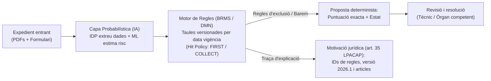

## A. Objectius d'aprenentatge

En completar aquesta lliçó, l'estudiant ha de ser capaç de:

1. **Distingir** amb precisió **motors de regles de negoci (*BRMS* / *Decision Tables* / estàndard *DMN*)** (100% deterministes, explicables i versionables) de **models estadístics / ML / LLM** (probabilístics, generalitzen patrons complexos).
2. **Desacoblar** les **regles de negoci** del codi font de l'aplicació (evitant `if/else` incrustats i escampats per tot el codi!) mitjançant taules de decisió versionades per vigència temporal (ex. bases de subvencions 2025 vs. 2026).
3. **Aplicar** el criteri de **separació determinista vs. probabilista** en l'Administració pública: tot el que està **reglat en una llei, ordenança o barem** (imports, terminis, llindars de renda, incompatibilitats) s'executa **sempre amb regles deterministes**; el ML/NLP s'usa per **extreure senyals o prioritzar risc**, mai per substituir un barem legal!
4. **Garantir** la **traçabilitat i motivació jurídica (art. 35 LPACAP)** fent que el motor de regles retorni no només el resultat (`APTE` / `NO_APTE`), sinó la **llista exacta de regles disparades, versions i articles normatius** que fonamenten la proposta!
5. **Implementar** en Python pur un **motor declaratiu de taules de decisió versionades (estil DMN) combinat amb un senyal ML** per a la preavaluació d'ajuts de menjador escolar, generant la traça completa de motivació jurídica.

---

## B. Explicació introductòria

En una administració pública, una ordenança fiscal o les bases d'una beca menjador no són «patrons difusos» que hagi d'endevinar una xarxa neuronal: són **normes jurídiques explícites** (*«Si la renda per càpita familiar ≤ 8.500 € i el domicili és al municipi → puntuació = 10 punts, art. 6.2 Bases 2026»*).

Si programes aquestes regles amb ML, un model probabilístic podria donar 9,4 punts a una família i 10,1 a una altra idèntica, vulnerant el principi d'igualtat i de seguretat jurídica! I si les incrustes amb `if/else` dins el codi Java/Python, cada any quan canvien els barems cal recompilar i desplegar tota l'aplicació. Els **motors de regles de negoci (BRMS / DMN)** separen la lògica normativa del codi, garanteixen **100% de determinisme i explicabilitat jurídica**, i es combinen harmònicament amb la IA (*Neuro-Symbolic / Híbrid*): **IA per percebre, regles per decidir el que és reglat!**

---

## C. Explicació tècnica avançada

### 1. Determinisme (BRMS / DMN) vs. Probabilisme (ML / LLM)

| Dimensió | Regles de negoci (BRMS / DMN) | Models ML / Deep Learning / LLM |
|---|---|---|
| **Naturalesa** | 100% **determinista**: mateixa entrada + mateixa versió de regles = mateix resultat sempre | **Probabilístic**: produeix puntuacions o distribucions amb marge d'incertesa |
| **Explicabilitat jurídica (art. 35 LPACAP)** | **Total i immediata**: retorna exactament quines regles i articles s'han complert o incomplert | Aproximada (SHAP, atenció, justificació generada), pot no ser fidel al 100% |
| **Quan usar-lo** | Requisits legals, barems, càlculs tributaris, terminis, incompatibilitats, límits pressupostaris | Extracció de camps en PDFs, classificació d'instàncies en text lliure, detecció d'anomalies/frau |
| **Principal limitació** | Explosió combinatòria si es volen modelar problemes no estructurats (ex. llenguatge natural o imatges) | No garanteix compliment exacte de llindars normatius ni equitat determinista |

### 2. Estàndard **DMN (*Decision Model and Notation*)** i polítiques de coincidència (*Hit Policies*)

L'estàndard obert **DMN** (de l'OMG, germà de BPMN 2.0) representa les regles de negoci en **taules de decisió** auditables tant per juristes/tècnics d'administració com per enginyers. Les *Hit Policies* clàssiques defineixen com resoldre múltiples files:
- **`UNIQUE (U)`**: exactament una regla pot coincidir (detecta solapaments erronis en temps de validació!).
- **`FIRST (F)`**: s'aplica la primera regla que coincideix per ordre de prioritat (ex. primer comprovacions d'exclusió absoluta).
- **`COLLECT (C+)`**: s'acumulen totes les regles que coincideixen (ex. **suma de punts d'un barem de subvencions**!).

### 3. Governança del cicle de vida de regles (evitar *Rule Rot*)

1. **Versionat amb vigència temporal (`effective_from`, `effective_to`)**: si una sol·licitud presentada el 2025 es resol o recorre el 2026, el motor ha d'executar exactament el **paquet de regles vigent el 2025**!
2. **Proves de completitud i no-contradicció**: validar automàticament abans de publicar que la taula no té **buits (*gaps*)** ni **regles contradictòries** (i executar un joc de casos de prova jurídics regressius en CI/CD!).
3. **Arquitectura híbrida (*Guardrail* de regles sobre ML)**: el model ML proposa una categoria o score de risc → el motor de regles determinista aplica les restriccions legals infranquejables i decideix si el cas pot passar a tramitació ràpida o requereix inspecció humana!

---

## D. Diagrames i recursos visuals

### Arquitectura híbrida: percepció IA + motor declaratiu de regles DMN + traça jurídica



---

## E. Aplicació a l'Administració pública

1. **Barem de beques menjador i subvencions culturals**: taules DMN amb `COLLECT (C+)` versionades per convocatòria anual. Els tècnics d'Educació revisen la taula en format llegible abans d'obrir la convocatòria, i el sistema genera automàticament el desglossament de punts per a la resolució provisional i les al·legacions!
2. **Contractació pública i Intervenció**: regles deterministes que verifiquen límits de contracte menor (`< 15.000 €` serveis/subministraments, `< 40.000 €` obres, sense IVA, LCSP), fraccionament sospitós per proveïdor/any i existència de crèdit pressupostari.
3. **Complementarietat amb ML en detecció de frau**: les regles capturen les infraccions legals conegudes (100% precisió), mentre que un model d'anomalies (Mòdul 1) marca patrons nous sospitosos perquè un inspector els revisi i, si confirma una nova tipologia, la converteixi en nova regla!

---

## F. Exemple pràctic guiat

Implementem en **Python pur** un **motor declaratiu de regles (estil DMN)** amb:
1. Taules versionades (`BASES_MENJADOR_2026_v1`) separades del codi d'execució.
2. Política **`FIRST`** per a requisits obligatoris d'admissió (exclusió immediata amb cita d'article).
3. Política **`COLLECT (C+)`** per a l'acumulació de punts del barem + integració d'una alerta probabilística ML (`score_anomalia_ml`) que **mai denega automàticament**, sinó que deriva a revisió tècnica!

```python
"""Exemple 6.2: Motor declaratiu de regles (DMN FIRST + COLLECT) amb motivació jurídica i senyal ML."""
from dataclasses import dataclass
from typing import Callable


@dataclass(frozen=True)
class Regla:
    id_regla: str
    article: str
    descripcio: str
    punts: int
    condicio: Callable[[dict], bool]


# Taula declarativa versionada (separada del motor d'avaluació!)
VERSIO_REGLEMENT = "BASES_MENJADOR_2026_v1"

REGLES_EXCLUSIO_FIRST = [
    Regla("EX-01", "Art. 4.1", "No empadronat al municipi", 0, lambda d: not d["empadronat"]),
    Regla("EX-02", "Art. 4.3", "Renda per càpita supera el màxim (14.000 €)", 0, lambda d: d["renda_pc"] > 14000),
]

REGLES_BAREM_COLLECT = [
    Regla("BR-01", "Art. 6.1", "Renda per càpita <= 7.000 €", 10, lambda d: d["renda_pc"] <= 7000),
    Regla("BR-02", "Art. 6.2", "Renda per càpita entre 7.001 € i 10.500 €", 5, lambda d: 7000 < d["renda_pc"] <= 10500),
    Regla("BR-03", "Art. 6.3", "Família monoparental o nombrosa acreditada", 4, lambda d: d["monoparental_o_nombrosa"]),
    Regla("BR-04", "Art. 6.4", "Situació de vulnerabilitat amb informe social", 6, lambda d: d["informe_social"]),
]


def avaluar_expedient(dades: dict) -> dict:
    traca = []
    # 1. Hit Policy FIRST: requisits d'exclusió
    for r in REGLES_EXCLUSIO_FIRST:
        if r.condicio(dades):
            return {
                "versio_regles": VERSIO_REGLEMENT,
                "estat": "PROPOSTA_EXCLOS",
                "punts": 0,
                "motivacio": [f"{r.id_regla} ({r.article}): {r.descripcio}"],
            }

    # 2. Hit Policy COLLECT (C+): suma determinista de punts del barem
    punts = 0
    for r in REGLES_BAREM_COLLECT:
        if r.condicio(dades):
            punts += r.punts
            traca.append(f"{r.id_regla} ({r.article}): +{r.punts} pts — {r.descripcio}")

    # 3. Senyal ML probabilístic: MAI denega; només activa revisió humana si supera llindar!
    estat = "PROPOSTA_ADMES"
    if dades.get("score_anomalia_ml", 0.0) >= 0.80:
        estat = "REVISIO_TECNICA_ALERTA_ML"
        traca.append(f"ML-ALERTA: score anomalia documental = {dades['score_anomalia_ml']:.2f} (>=0.80) -> revisió humana.")

    return {"versio_regles": VERSIO_REGLEMENT, "estat": estat, "punts": punts, "motivacio": traca}


if __name__ == "__main__":
    casos = [
        ("SOL-01", {"empadronat": True, "renda_pc": 6200, "monoparental_o_nombrosa": True, "informe_social": False, "score_anomalia_ml": 0.12}),
        ("SOL-02", {"empadronat": True, "renda_pc": 6200, "monoparental_o_nombrosa": True, "informe_social": False, "score_anomalia_ml": 0.88}),
        ("SOL-03", {"empadronat": False, "renda_pc": 5000, "monoparental_o_nombrosa": False, "informe_social": True, "score_anomalia_ml": 0.05}),
    ]
    for cid, d in casos:
        print(cid, "->", avaluar_expedient(d))
```

### Interpretació dels resultats (execució verificada)

- **`SOL-01`**: compleix `BR-01` (+10) i `BR-03` (+4) → `PROPOSTA_ADMES` amb **14 punts** i motivació exacta article per article (`Art. 6.1`, `Art. 6.3`).
- **`SOL-02`**: idèntics **14 punts** deterministes, però com que el detector ML marca `score_anomalia_ml = 0.88 >= 0.80`, passa a **`REVISIO_TECNICA_ALERTA_ML`** (el senyal ML mai denega per si sol; activa verificació humana!).
- **`SOL-03`**: disparada immediatament `EX-01` (`Art. 4.1`: no empadronat) sota política `FIRST` → `PROPOSTA_EXCLOS` amb motivació exacta (art. 35 LPACAP).

---

## G. Exercici pràctic per resoldre

### Enunciat
Un servei municipal ha descobert que el seu programa de càlcul de bonificacions d'IBI té més de **90 `if/else` niats dins el codi Java** escrits fa 7 anys. Quan enguany el Ple aprova canviar el llindar de família nombrosa i afegir una nova bonificació de plaques solars, passen tres problemes:
1. Calen 3 setmanes de desenvolupament i recompilació per a un canvi normatiu senzill.
2. En resoldre un recurs de reposició d'un rebut del **2024**, el programa li aplica per error els percentatges del **2026**!
3. Quan una bonificació es denega, el programa només imprimeix «No procedent» sense indicar quin requisit ha fallat.

Dissenya la **migració cap a un Motor de Regles de Negoci (BRMS / DMN)** resolent els tres problemes i integrant-hi de manera segura un model ML que detecta possibles incompatibilitats cadastrals.

### Objectius i restriccions
- Externalitzar regles en taules DMN versionades per vigència temporal (`effective_from`/`effective_to`), generar traça d'explicació (art. 35 LPACAP), validar completitud/contradiccions en CI/CD i acotar el paper del model ML a alerta de revisió humana.

:::hint Pista 1 — Resolució dels 3 problemes
(1) Separar la taula DMN del codi → els tècnics i informàtics actualitzen i testegen la taula sense recompilar el nucli; (2) **Versionat temporal efectiu** (`vigent_des_de`, `vigent_fins_a`) consultat per la **data de meritació/sol·licitud** (el recurs de 2024 executa exactament `OF_IBI_2024`!); (3) Retornar l'**explicació estructurada** (`rule_id`, `versio`, `article`, `motiu`).
:::

:::hint Pista 2 — Paper del ML i validació pre-producció
El model ML de risc cadastral **només pot elevar un flag de revisió a l'inspector**, MAI denegar automàticament una bonificació reglada; a més, cada nova versió de taula DMN ha de passar tests automàtics de **no-contradicció, no-buits i casos regressius** abans de publicar-se!
:::

### Criteris d'avaluació
- **35%**: Desacoblament en taules DMN + governança de canvis i tests automàtics de completitud/no-contradicció.
- **35%**: Versionat per **data de vigència / meritació** per garantir retroactivitat exacta en recursos d'anys anteriors.
- **30%**: Traça de motivació jurídica (art. 35 LPACAP) + delimitació estricta determinisme (regles) vs. probabilisme (alerta ML → humà).

### Errors habituals
- Sobreescriure les regles del 2024 amb les del 2026 (impossibilita resoldre recursos o auditories d'exercicis anteriors!).

:::solution Solució completa comentada i alternatives
### 1. Externalització a Motor de Regles (BRMS / DMN)
- Substituir els 90 `if/else` per **taules de decisió DMN** versionades (`OF_IBI_2024_v1`, `OF_IBI_2025_v1`, `OF_IBI_2026_v1`) emmagatzemades en repositori Git amb revisió conjunta (tècnic tributari + enginyer) i desplegament sense recompilar el nucli de l'aplicació.

### 2. Versionat per data de vigència (resolució de recursos històrics)
- Cada conjunt de regles incorpora `valid_from` i `valid_to`. En avaluar un expedient o recurs, el motor selecciona la versió corresponent a la **data de meritació o presentació** (recurs 2024 → executa `OF_IBI_2024_v1`), garantint seguretat jurídica i auditabilitat històrica!

### 3. Motivació automàtica (art. 35 LPACAP) i qualitat en CI/CD
- Cada regla retorna `(rule_id, versio, article_ordenanca, estat, motiu)`, eliminant el missatge opac «No procedent».
- Abans de publicar qualsevol nova versió de taula, una suite automatitzada verifica: (a) absència de buits i solapaments en taules `UNIQUE`, i (b) bateria de casos de prova jurídics regressius (p. ex., 50 expedients de referència).

### 4. Integració segura del senyal ML
- El model ML d'incompatibilitats cadastrals actua exclusivament com a **alerta d'inspecció humana** (`REVISIO_TECNICA`), mai com a criteri de denegació automàtica.
:::

---

## H. Test individual

Resol les 10 preguntes sobre determinisme vs. probabilisme, motors BRMS/DMN, *Hit Policies* (`UNIQUE`, `FIRST`, `COLLECT`), versionat temporal per recursos, motivació jurídica (art. 35 LPACAP) i arquitectura híbrida regles + ML.

---

## I. Preguntes de desenvolupament

### Pregunta 1
Quan has d'utilitzar un **motor de regles determinista (BRMS / DMN)** i quan un **model de Machine Learning / LLM** en un procediment administratiu? Posa un exemple concret on **tots dos treballin junts** de forma òptima.

:::model-answer Resposta model i criteris de correcció (Pregunta 1)
**Resposta model**:
- **Motor de regles determinista (BRMS / DMN)**: sempre que el criteri estigui explícitament fixat en una llei, ordenança o barem (requisits d'admissió, puntuació de beques, càlcul tributari, terminis, límits de contractació), perquè garanteix 100% d'igualtat, predictibilitat i motivació jurídica exacta (art. 35 LPACAP).
- **ML / NLP / LLM**: quan les dades d'entrada són no estructurades o els patrons són difusos i no expressables en regles simples (llegir factures PDF escanejades, classificar instàncies en text lliure, detectar patrons nous de frau o anomalia).
- **Exemple híbrid òptim**: en la gestió d'ajuts de menjador escolar, l'**IDP/ML** extreu els imports dels justificants PDF i calcula un índex de risc d'anomalia documental; després, el **motor de regles DMN** aplica deterministament les bases 2026 per calcular els punts i la motivació exacta, i si l'índex ML supera 0,80 deriva l'expedient a revisió tècnica humana (sense denegar mai pel senyal probabilístic).

**Criteris de correcció (10 punts)**:
- Criteri clar de separació determinisme vs. probabilisme: 5 punts.
- Exemple híbrid complet, realista i jurídicament segur: 5 punts.
:::

### Pregunta 2
Explica les diferències entre les tres *Hit Policies* principals de l'estàndard **DMN (`UNIQUE`, `FIRST`, `COLLECT`)** i indica per a quin tipus de regla administrativa encaixa cadascuna.

:::model-answer Resposta model i criteris de correcció (Pregunta 2)
**Resposta model**:
1. **`UNIQUE (U)`**: exigeix que per a qualsevol entrada vàlida coincideixi **exactament una fila** (cap solapament). Ideal per a **trams excloents** (ex. trams d'ingressos o tipus impositius per valor cadastral), perquè permet detectar contradiccions en temps de disseny.
2. **`FIRST (F)`**: avalua les files en ordre de prioritat i s'atura a la **primera regla que coincideix**. Ideal per a **regles d'exclusió o triatge prioritari** (ex. comprovar primer si falta un requisit essencial d'empadronament o si el cas és d'emergència).
3. **`COLLECT (C+)`**: avalua totes les files i **agrega (suma, compta o llista)** tots els resultats coincidents. Ideal per a **barems acumulatius de punts** en subvencions, borses de treball o beques (ex. punts per renda + família monoparental + discapacitat).

**Criteris de correcció (10 punts)**:
- Explicació exacta i exemple administratiu encertat per a cada *Hit Policy* (~3,3 punts cadascuna).
:::

### Pregunta 3
Per què és imprescindible el **versionat temporal per data de vigència (`effective_from` / `effective_to`)** en un motor de regles de l'Administració pública i quines verificacions automàtiques cal executar abans de publicar una nova versió?

:::model-answer Resposta model i criteris de correcció (Pregunta 3)
**Resposta model**:
- **Necessitat del versionat temporal**: en l'Administració pública els expedients, inspeccions i **recursos administratius o contenciosos** sovint es resolen 1, 2 o 4 anys després de la data de sol·licitud o meritació del tribut. Si les regles del 2026 sobreescriuen les del 2024, el sistema no pot reproduir ni motivar el càlcul aplicable a un expedient del 2024, vulnerant la seguretat jurídica i la irretroactivitat normativa.
- **Verificacions pre-publicació (CI/CD de regles)**:
  1. **Anàlisi estàtica de taules**: comprovar absència de **buits (*gaps*)** i **solapaments/contradiccions** en taules `UNIQUE`.
  2. **Suite de casos de prova jurídics regressius**: conjunt d'expedients sintètics validats per juristes (casos límit en fronteres exactes com `7.000,00 €` vs. `7.000,01 €`) que han de passar al 100% abans d'activar la nova versió.

**Criteris de correcció (10 punts)**:
- Justificació jurídica i operativa del versionat temporal (recursos, inspeccions, auditories): 5 punts.
- Verificacions automatitzades (gaps, contradiccions, casos límit regressius): 5 punts.
:::

---

## J. Resum per memoritzar

### Conceptes clau
- **Regla d'or**: **tot el que és reglat per llei/ordenança/barem → motor determinista (BRMS/DMN)**; **percepció no estructurada / risc → ML/IDP** (mai denegar automàticament només per un score probabilístic!).
- **BRMS / DMN**: desacobla la lògica normativa del codi (fora 90 `if/else` incrustats!).
- ***Hit Policies* DMN**: `UNIQUE` (trams excloents), `FIRST` (exclusions/prioritats), `COLLECT (C+)` (suma de punts de barems).
- **Versionat temporal**: conservar sempre versions històriques (`valid_from`/`valid_to`) per resoldre recursos i auditories d'anys anteriors!
- **Motivació jurídica (art. 35 LPACAP)**: el motor retorna `versio_regles`, `id_regla`, `article` i explicació exacta.

### Definicions essencials
- **BRMS (*Business Rules Management System*)**: plataforma que permet definir, versionar, provar i executar regles de negoci de manera independent del codi font de l'aplicació.
- **DMN (*Decision Model and Notation*)**: estàndard obert per modelar decisions de negoci mitjançant taules de decisió llegibles tant per experts de negoci/juristes com per motors de programari.

### Errors conceptuals freqüents
1. Entrenar un model ML per «aprendre» un barem de subvencions que ja està escrit clarament en les bases oficials.
2. Sobreescriure les regles de l'any anterior sense versionat temporal (trenca recursos d'anys passats!).
3. Retornar només `DENEGAT` sense la traça de regles i articles disparats.

### Possibles preguntes d'examen
- Diferencia determinisme (BRMS/DMN) vs. probabilisme (ML) i proposa una arquitectura híbrida per a subvencions.
- Explica les *Hit Policies* `UNIQUE`, `FIRST` i `COLLECT` amb un exemple administratiu de cadascuna.
- Com gestiones el canvi anual d'ordenances fiscals sense recompilar el codi ni trencar recursos d'anys anteriors?
