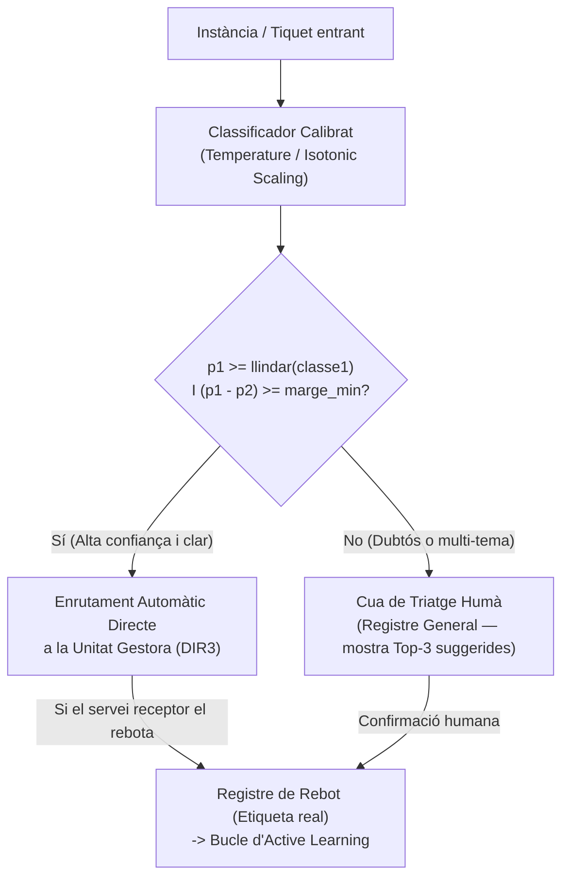

## A. Objectius d'aprenentatge

En completar aquesta lliçó, l'estudiant ha de ser capaç de:

1. **Distingir** entre construir un model de classificació en un notebook (Mòdul 1/2) i **integrar un classificador automàtic dins un procés operatiu en producció** (enrutament automàtic d'expedients, tiquets o incidències a unitats gestores amb SLAs reals!).
2. **Dissenyar** **polítiques de llindars asimètrics per classe** i **opció de rejecció (*Abstain / Reject Option*)**: una classe de baix risc (p. ex., enllumenat) pot enrutar-se automàticament amb confiança `>= 0,80`, mentre que una classe crítica (p. ex., urgència social o recurs jurídic) exigeix un llindar més alt o doble comprovació i envia els casos dubtosos a la **cua de triatge humà**!
3. **Justificar** la importància del **calibratge de probabilitats** (*Platt Scaling*, *Isotonic Regression*, *Temperature Scaling*) i mesurar-lo mitjançant **ECE (*Expected Calibration Error*)** i **Brier Score** abans d'utilitzar les probabilitats del model per automatitzar decisions d'enrutament!
4. **Implementar** un **bucle de retroalimentació i *Active Learning***: cada vegada que una unitat gestora re-assigna una instància mal enrutada (`[Rebotar a Urbanisme]`), la correcció humana es registra automàticament com a nova dada etiquetada per millorar el classificador (controlant *data drift*!).
5. **Implementar** en Python pur un **enrutador automàtic de processos amb calibratge, llindars asimètrics per classe, detecció de multi-etiqueta (marge Top-1 vs Top-2)** i mesura exacta del **percentatge d'automatització vs. precisió efectiva**!

---

## B. Explicació introductòria

Cada dia entren a un ajuntament centenars d'instàncies genèriques, correus a la bústia ciutadana, incidències de via pública i tiquets de suport IT. Tradicionalment, un equip del Registre General llegeix cada entrada i la deriva manualment a un dels 18 serveis municipals (Urbanisme, Tributs, Serveis Socials, Medi Ambient, Mobilitat, etc.).

Un **classificador automàtic operatiu** no es limita a predir una etiqueta: pren decisions d'enrutament reals amb **costos d'error asimètrics**. Si una queixa d'un fanal espatllat va per error a Parcs i Jardins, es perd un dia; si una alerta de risc per a un menor va per error a Cultura, el dany pot ser gravíssim! Per això, en producció, el secret d'un bon classificador automàtic no és només el model, sinó el **calibratge, els llindars per classe, la zona d'abstenció (*Reject Option*) i la gestió de rebots**!

---

## C. Explicació tècnica avançada

### 1. Probabilitats ben calibrades vs. «confiança falsa»

Molts classificadors moderns (xarxes neuronals, Transformers, *gradient boosting* sense calibrar) són **sobreconfiats**: diuen `0,95` quan en realitat només encerten el `72%` de les vegades! Si poses un llindar d'enrutament automàtic a `0,90` sobre un model mal calibrat, enviaràs automàticament gairebé un 30% d'errors als serveis municipals!
- **Calibratge**: ajustar les sortides del model (amb ***Temperature Scaling*** per a xarxes neuronals, ***Platt Scaling*** o ***Isotonic Regression*** sobre un conjunt de validació independent) de manera que quan el model diu `0,85`, encerti realment ~`85%` de les vegades.
- **Mètriques de calibratge**: **Brier Score** (error quadràtic mitjà de les probabilitats) i **ECE (*Expected Calibration Error*)** (diferència ponderada entre confiança predita i exactitud real per franges).

### 2. Llindars asimètrics per classe + Marge Top-1 vs Top-2

En producció, mai no s'usa un únic llindar global (`0,50`) per a totes les classes:
1. **Llindars per risc de classe**: `tau_ViaPublica = 0,80` (error barat i fàcil de rebotar), `tau_Tributs = 0,90`, `tau_ServeisSocials = 0,95` (o sempre amb revisió humana prioritària!).
2. **Marge entre la 1a i la 2a classe (`p1 - p2`)**: si una instància té `p(Urbanisme) = 0,48` i `p(MediAmbient) = 0,45` (ex. *"soroll d'obres i tala d'arbres al carrer"*), el marge és mínim (`0,03`!). Això indica o bé **ambigüitat alta** o bé una **instància multi-departament** (que requereix derivació coordinada o revisió del Registre!).
3. **Compromís Cobertura (*Automation Rate*) vs. Precisió (*Precision on Auto-Routed*)**: apujar el llindar redueix els rebots (puja precisió al 98%+) a costa d'enviar una mica més de volum a la cua humana; trobar el punt òptim es decideix mesurant la **corba Risc-Cobertura (*Risk-Coverage Curve*)**!

### 3. Mètrica reina operativa: Taxa de rebot (*Misrouting / Reassignment Rate*) i bucle de millora

- **Taxa de rebot**: percentatge d'expedients enrutats automàticament que el servei receptor ha hagut de retornar o re-assignar a un altre departament. Objectiu operatiu habitual: `< 3–5%` (per sota del qual els funcionaris confien en el sistema!).
- **Bucle d'*Active Learning* natiu**: cada botó `[Re-assignar a un altre servei]` al gestor d'expedients guarda `(document_id, classe_predita, classe_corregida_humana)` i nodreix automàticament el *dataset* de reentrenament (i detecta nous temes emergents o *drift*!).

---

## D. Diagrames i recursos visuals

### Enrutador automàtic calibrat amb llindars per classe, marge Top1-Top2 i gestió de rebots



---

## E. Aplicació a l'Administració pública

1. **Registre General i bústia d'instàncies genèriques**: enrutar automàticament el `70–80%` de les instàncies clares directament a la unitat DIR3 competent en segons, reduint de 3 dies a 5 segons l'assignació inicial, i presentant el `20–30%` restant a l'equip del Registre amb els **3 serveis més probables preseleccionats** (*Human-in-the-Loop* assistit)!
2. **Centre de Suport TIC de la Diputació (ens locals)**: classificar tiquets dels 311 ajuntaments cap a cues especialitzades (Xarxes, Seu Electrònica, Padró, Ciberseguretat), enviant qualsevol possible incident de seguretat amb llindar conservador (alta sensibilitat / *Recall*!) directament al SOC/CSIRT!
3. **Prevenció de rebots en bucle (*Ping-Pong*)**: afegir una regla determinista de seguretat sobre el classificador: si una instància ja ha estat rebotada manualment per un servei, **mai no es torna a passar pel classificador automàtic** (s'assigna definitivament per una persona del Registre).

---

## F. Exemple pràctic guiat

Implementem en **Python pur** un **motor d'enrutament automàtic amb llindars asimètrics per classe i comprovació de marge Top-1 vs Top-2**, i calculem exactament la **taxa d'automatització (*Coverage*)** i la **precisió efectiva sobre els casos auto-enrutats**!

```python
"""Exemple 6.3: Enrutador automàtic amb llindars asimètrics per classe, marge Top1-Top2 i mètriques."""

LLINDARS_PER_CLASSE = {
    "VIA_PUBLICA": 0.80,
    "TRIBUTS": 0.90,
    "URBANISME": 0.88,
    "SERVEIS_SOCIALS": 0.95,  # Molt conservador pel risc social!
}
MARGE_MINIM_TOP1_TOP2 = 0.15


def enrutar_cas(probs: dict[str, float]) -> dict[str, object]:
    ordenat = sorted(probs.items(), key=lambda kv: kv[1], reverse=True)
    (c1, p1), (c2, p2) = ordenat[0], ordenat[1]
    marge = p1 - p2
    llindar = LLINDARS_PER_CLASSE[c1]

    if p1 >= llindar and marge >= MARGE_MINIM_TOP1_TOP2:
        return {"accio": "AUTO_ENRUTAR", "desti": c1, "p1": p1, "marge": round(marge, 2)}
    motiu = "BAIXA_CONFIANCA" if p1 < llindar else "AMBIGU_O_MULTITEMA"
    return {
        "accio": "TRIATGE_HUMA",
        "suggerits": [c1, c2],
        "p1": p1,
        "marge": round(marge, 2),
        "motiu": motiu,
    }


if __name__ == "__main__":
    lot = [
        ("INS-1", {"VIA_PUBLICA": 0.86, "URBANISME": 0.08, "TRIBUTS": 0.04, "SERVEIS_SOCIALS": 0.02}, "VIA_PUBLICA"),
        ("INS-2", {"SERVEIS_SOCIALS": 0.89, "TRIBUTS": 0.06, "VIA_PUBLICA": 0.03, "URBANISME": 0.02}, "SERVEIS_SOCIALS"),
        ("INS-3", {"URBANISME": 0.52, "VIA_PUBLICA": 0.44, "TRIBUTS": 0.02, "SERVEIS_SOCIALS": 0.02}, "URBANISME"),
        ("INS-4", {"TRIBUTS": 0.94, "URBANISME": 0.03, "VIA_PUBLICA": 0.02, "SERVEIS_SOCIALS": 0.01}, "TRIBUTS"),
    ]
    auto_ok = auto_tot = 0
    for cid, probs, real in lot:
        res = enrutar_cas(probs)
        print(f"{cid} (real={real}) -> {res}")
        if res["accio"] == "AUTO_ENRUTAR":
            auto_tot += 1
            if res["desti"] == real:
                auto_ok += 1

    print(f"Cobertura auto-enrutament: {auto_tot}/{len(lot)} ({100*auto_tot/len(lot):.1f}%)")
    print(f"Precisió sobre auto-enrutats: {auto_ok}/{auto_tot} ({100*auto_ok/auto_tot:.1f}%)")
```

### Interpretació dels resultats (execució verificada)

- `INS-1` (`VIA_PUBLICA=0.86 >= 0.80`, marge `0.78`) i `INS-4` (`TRIBUTS=0.94 >= 0.90`, marge `0.91`) s'enruten automàticament amb **100% de precisió (`2/2`)**!
- `INS-2` (`SERVEIS_SOCIALS=0.89 < 0.95`) va a **`TRIATGE_HUMA`** per política conservadora de risc social (`BAIXA_CONFIANCA`) tot i tenir 89%!
- `INS-3` (`URBANISME=0.52`, `VIA_PUBLICA=0.44`, marge `0.08 < 0.15`) va a **`TRIATGE_HUMA`** mostrant els dos suggerits (`['URBANISME', 'VIA_PUBLICA']`) per possible doble competència!

---

## G. Exercici pràctic per resoldre

### Enunciat
Un ajuntament ha posat en producció un classificador automàtic d'instàncies basat en un model Transformer *fine-tuned* amb un llindar únic de `0,85` per a tots els 15 serveis municipals. Al cap d'un mes:
1. Els serveis municipals es queixen que reben un **22% de rebots** (instàncies mal assignades) malgrat que totes entraven amb probabilitat predita `>= 0,85`!
2. Dues instàncies que barrejaven «obres sense llicència + ocupació de via pública» es van assignar només a un servei i l'altre mai no se'n va assabentar.
3. Les correccions manuals que fan els administratius rebotant instàncies no s'estan aprofitant enlloc.

Diagnostica **la causa tècnica principal** de cada problema i dissenya el **pla de correcció en producció** (calibratge, polítiques d'enrutament i *Active Learning*).

### Objectius i restriccions
- Identificar sobreconfiança de Transformers sense calibrar (ECE/Brier + Temperature Scaling), aplicar llindars asimètrics + marge Top1-Top2 (o multi-etiqueta), i tancar el bucle de feedback amb Active Learning + control anti-bucle de rebots.

:::hint Pista 1 — Per què hi ha 22% d'errors amb confiança >= 0,85?!
Els models Transformer *fine-tuned* solen estar **greument sobreconfiats** (prediuen `0,90` quan la seva precisió real és `0,78`!). Cal mesurar **ECE / Brier Score** i aplicar **calibratge (*Temperature Scaling* / *Isotonic Regression*)** abans de fixar llindars per classe!
:::

:::hint Pista 2 — Multi-tema i bucle de rebots
(2) Afegir comprovació de **marge Top-1 vs Top-2** (o model **multi-etiqueta** amb `sigmoid` independent per departament!) per detectar expedients que afecten 2 serveis simultàniament; (3) Capturar automàticament cada rebot humà `(doc_id, pred, real)` com a bucle d'***Active Learning*** per reentrenar i vigilar la **taxa de rebot (<5%)** com a KPI setmanal!
:::

### Criteris d'avaluació
- **40%**: Diagnòstic exacte de **sobreconfiança / falta de calibratge** (ECE, Brier Score, *Temperature Scaling* / *Isotonic*) + llindars asimètrics per risc de classe.
- **30%**: Solució al problema multi-departament (marge Top1-Top2 + cua triatge o sortida multi-etiqueta).
- **30%**: Bucle de retroalimentació (*Active Learning* a partir dels rebots) + regla anti-ping-pong + KPI taxa de rebot `< 5%`.

### Errors habituals
- Pensar que el model és «dolent» i canviar d'arquitectura sense comprovar abans la **corba de calibratge** (sovint un simple *Temperature Scaling* + ajust de llindars per classe redueix els rebots del 22% al 3%!).

:::solution Solució completa comentada i alternatives
### 1. Diagnòstic i correcció del 22% de rebots (Calibratge + Llindars asimètrics)
- **Causa**: **sobreconfiança (*overconfidence*)** típica de xarxes Transformer sense calibrar (`softmax` molt punxegut). Una sortida `0,85` no equivalia realment a un 85% d'encert.
- **Solució**:
  1. Mesurar **ECE (*Expected Calibration Error*)** i corba de fiabilitat sobre un conjunt de validació separat.
  2. Aplicar ***Temperature Scaling*** (o *Isotonic Regression*) per calibrar les probabilitats reals.
  3. Substituir el llindar únic `0,85` per **llindars asimètrics per classe** segons el cost d'error (més exigents a Serveis Socials, Jurídic i Tributs) revisant la corba *Risc-Cobertura* per mantenir la taxa de rebot `< 3–5%`.

### 2. Gestió d'expedients multi-departament
- Afegir comprovació de **marge `p1 - p2`** (si és baix, enviar a triatge humà mostrant ambdós serveis) o evolució a **classificació multi-etiqueta** (una sigmoide independent per departament) perquè una instància d'«obres + ocupació de via pública» pugui obrir tasca coordinada a Urbanisme i Via Pública.

### 3. Bucle de millora (*Active Learning*) i anti-ping-pong
- Registrar cada re-assignació manual com a dada d'entrenament etiquetada `(id, classe_predita, classe_real_humana)` i programar reentrenaments/recalibratges periòdics.
- Afegir regla determinista **anti-bucle**: qualsevol expedient ja rebotat un cop surt de l'auto-enrutament i el tanca manualment el Registre.
:::

---

## H. Test individual

Resol les 10 preguntes sobre enrutament automàtic, calibratge de probabilitats (Temperature Scaling, ECE, Brier Score), llindars asimètrics per classe, marge Top-1 vs Top-2, taxa de rebot, multi-etiqueta i *Active Learning*.

---

## I. Preguntes de desenvolupament

### Pregunta 1
Explica què és la **sobreconfiança (*overconfidence*)** dels classificadors neuronals, com es mesura (**ECE** i **Brier Score**) i per què **calibrar** el model és indispensable abans de fixar llindars d'automatització operativa.

:::model-answer Resposta model i criteris de correcció (Pregunta 1)
**Resposta model**:
- **Sobreconfiança**: tendència de molts models moderns (especialment xarxes neuronals i Transformers amb `softmax`) a emetre probabilitats molt properes a `0,95–0,99` fins i tot quan el seu percentatge real d'encert és molt inferior (p. ex., 75%).
- **Mesura del calibratge**:
  - **ECE (*Expected Calibration Error*)**: divideix les prediccions en franges de confiança (ex. 0,8–0,9) i calcula la diferència mitjana ponderada entre confiança predita i exactitud real observada en cada franja.
  - **Brier Score**: error quadràtic mitjà entre la probabilitat predita i el resultat binari real (penalitza molt fortament errors comesos amb alta confiança).
- **Necessitat operativa**: en un enrutador automàtic, les decisions de derivar sense revisió humana depenen directament del llindar de probabilitat (`>= 0,90`). Si les probabilitats no estan calibrades (*Temperature Scaling*, *Platt Scaling* o *Isotonic Regression*), el sistema operarà amb una taxa real d'errors molt superior a la tolerada pel servei públic.

**Criteris de correcció (10 punts)**:
- Explicació clara de la sobreconfiança: 3 punts.
- Definició rigorosa d'ECE, Brier Score i mètodes de calibratge: 4 punts.
- Impacte directe en l'automatització operativa per llindars: 3 punts.
:::

### Pregunta 2
Com combines **llindars asimètrics per classe**, **marge Top-1 vs Top-2** i **opció de rejecció (*Reject Option*)** en un enrutador d'instàncies municipals, i com avalues el compromís entre automatització i qualitat?

:::model-answer Resposta model i criteris de correcció (Pregunta 2)
**Resposta model**:
- **Llindars asimètrics per classe**: assignar llindars diferents segons el cost d'un error en cada departament (ex. `0,80` per a incidències de via pública on un rebot és barat; `0,95` o revisió obligatòria per a Serveis Socials o recursos jurídics).
- **Marge Top-1 vs Top-2 (`p1 - p2`)**: encara que la classe guanyadora superi un llindar moderat, si la segona classe és molt a prop (ex. `0,52` vs `0,44`), indica ambigüitat o possible instància multi-departament que cal enviar a triatge.
- **Opció de rejecció (*Reject Option*)**: els casos que no superen el llindar o el marge no es forcen a una classe aleatòria; van a la cua de triatge humà amb les 2–3 classes suggerides per accelerar el treball del Registre.
- **Avaluació (*Risk-Coverage Curve*)**: analitzar conjuntament la **taxa d'automatització (*Coverage*)** (% auto-enrutat) i la **precisió efectiva / taxa de rebot** (% d'encert sobre l'auto-enrutat, objectiu rebots `< 3–5%`).

**Criteris de correcció (10 punts)**:
- Llindars asimètrics + marge Top1-Top2 + Reject Option: 7 punts.
- Corba Risc-Cobertura i taxa de rebot: 3 punts.
:::

### Pregunta 3
Dissenya el **bucle de retroalimentació (*Active Learning*)** a partir dels rebots dels funcionaris en producció, indicant també com evites el problema del **ping-pong** entre unitats gestores.

:::model-answer Resposta model i criteris de correcció (Pregunta 3)
**Resposta model**:
- **Captura nativa del feedback**: integrar al gestor d'expedients l'acció `[Re-assignar servei]` que registra estructuradament `(expedient_id, versio_model, classe_predita, probabilitats, classe_corregida_humana, data)`.
- ***Active Learning* i governança**: aquestes correccions (juntament amb els casos de la cua de triatge d'alta incertesa) formen els exemples més informatius per reentrenar i recalibrar periòdicament el classificador (prèvia validació contra un conjunt de prova congelat per evitar regressions o enverinament!).
- **Prevenció de ping-pong**: regla determinista que impedeix que un expedient ja rebotat manualment torni al motor d'auto-enrutament; a més, un segon rebot eleva automàticament el cas a un supervisor del Registre General per a assignació definitiva.

**Criteris de correcció (10 punts)**:
- Captura estructurada + selecció d'exemples informatius i validació abans de reentrenar: 6 punts.
- Regla determinista anti-ping-pong i escalada de conflictes: 4 punts.
:::

---

## J. Resum per memoritzar

### Conceptes clau
- **Calibratge obligatori**: els Transformers solen ser **sobreconfiats**; calibrar (*Temperature Scaling*, *Platt*, *Isotonic*) i mesurar **ECE** i **Brier Score** abans d'enrutar automàticament!
- **Llindars asimètrics per classe**: ajustar `tau_c` al cost d'error de cada departament (`Via Pública 0,80` vs. `Serveis Socials 0,95`).
- **Marge Top-1 vs Top-2 (`p1 - p2`)**: detecta ambigüitat i expedients **multi-departament** (o usar classificació **multi-etiqueta**).
- ***Reject Option* (Abstenció)**: casos dubtosos → cua de triatge humà amb el **Top-3 preseleccionat**!
- **KPI operatiu rei**: **Taxa de rebot (`< 3–5%`)** vs. **Cobertura d'automatització** (*Risk-Coverage Curve*).
- **Bucle *Active Learning***: cada rebot humà genera etiqueta real per millorar el model + regla **anti-ping-pong**!

### Definicions essencials
- **Calibratge de probabilitats**: procés d'ajustar les sortides d'un classificador perquè la probabilitat predita (ex. `0,85`) coincideixi amb la freqüència real d'encert observada (`85%`).
- **Opció de rejecció (*Reject Option*)**: mecanisme pel qual un classificador s'absté d'enrutar automàticament els casos de baixa confiança o baix marge i els deriva a triatge humà.

### Errors conceptuals freqüents
1. Usar un únic llindar global (`0,50` o `0,85`) sense calibrar les probabilitats ni diferenciar el risc entre departaments.
2. No controlar el marge `p1 - p2` (forçant a un sol servei una instància que afecta dos departaments).
3. Desaprofitar els rebots manuals dels funcionaris en lloc de tancar el bucle d'*Active Learning*.

### Possibles preguntes d'examen
- Per què un classificador amb llindar `0,85` genera un 22% de rebots en producció i com ho diagnostiques i resols?
- Explica el paper del marge Top-1 vs Top-2 i dels llindars asimètrics en l'enrutament d'instàncies.
- Com dissenyes el bucle d'*Active Learning* sobre els rebots i la protecció anti-ping-pong?
