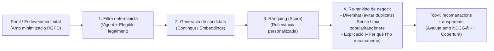

## A. Objectius d'aprenentatge

En completar aquesta lliçó, l'estudiant ha de ser capaç de:

1. **Explicar** els **4 paradigmes clàssics de recomanació**: **basat en contingut (*Content-Based*)**, **filtratge col·laboratiu (*Collaborative Filtering* — usuari/ítem, factorització matricial)**, **basat en coneixement/regles (*Knowledge-Based*)** i **híbrid** (combinació + *reranking* amb restriccions de negoci).
2. **Diagnosticar** i mitigar els problemes clàssics dels recomanadors: **arrencada en fred (*Cold Start*)** (nous ciutadans o nous ajuts/llibres sense historial), **escassetat (*Sparsity*)**, **biaix de popularitat** i **bombolla de filtre (*Filter Bubble*)**.
3. **Avaluar** un recomanador amb les **mètriques de rànquing adequades**: **`Precision@K`**, **`Recall@K`**, **`MAP@K`**, **`NDCG@K`** (que premia posar els ítems més rellevants a dalt del rànquing!), juntament amb mètriques més enllà de la precisió (**cobertura de catàleg**, **diversitat** i **equitat/no-discriminació**).
4. **Adaptar** els sistemes de recomanació a l'**Administració pública** respectant el **RGPD (minimització, consentiment/base jurídica, no elaboració de perfils invasius)** i la **igualtat d'accés**: ex. recomanador proactiu de **tràmits/ajuts per esdeveniment vital** (basat en regles + contingut), **catàleg de biblioteques municipals (Xarxa de Biblioteques DIBA)** o **oferta formativa i ocupació (SOC/SOM)**!
5. **Implementar** en Python pur un **recomanador híbrid (elegibilitat determinista + similitud cosinus de contingut + factor de diversitat)** per suggerir ajuts i tràmits públics a un ciutadà, calculant el **`NDCG@K`**!

---

## B. Explicació introductòria

Quan pensem en sistemes de recomanació ens venen al cap plataformes d'entreteniment o comerç electrònic (*«Qui va comprar X també va comprar Y»*). Però a l'Administració pública el problema del «no sé quin servei o ajut em correspon» és enorme (*non-take-up* d'ajuts socials i subvencions: milers de famílies no demanen beques o bonificacions a què tenen dret simplement perquè no saben que existeixen!).

Els **sistemes de recomanació públics** ajuden ciutadans i empleats a descobrir el **tràmit, ajut, curs de formació, llibre de la Xarxa de Biblioteques o antecedent administratiu rellevant**, però amb una diferència fonamental respecte del sector privat: **l'objectiu NO és maximitzar clics ni temps en pantalla**, sinó maximitzar la **utilitat pública, la legalitat d'elegibilitat, la diversitat i la privacitat (RGPD)**!

---

## C. Explicació tècnica avançada

### 1. Comparativa dels 4 paradigmes de recomanació

| Paradigma | Com funciona | Fortaleses | Limitacions | Ús recomanat en sector públic |
|---|---|---|---|---|
| **Basat en contingut (*Content-Based*)** | Emparella atributs/embeddings de l'ítem (text del curs, llibre, tràmit) amb el perfil/consulta actual | **Sense *cold start* d'ítems nous**; explicable (*«recomanat perquè té etiqueta X»*); baixa invasió de privacitat | Pot generar sobre-especialització (sempre recomana el mateix tipus) | Recomanar cursos formatius, recursos de biblioteca, expedients similars per a tècnics |
| **Filtratge col·laboratiu (*Collaborative Filtering*)** | Aprofita interaccions històriques d'altres usuaris similars (*User-User*, *Item-Item*, *Matrix Factorization / SVD*) | Descobreix relacions inesperades (*serendipitat*) sense necessitar metadades riques | **Greu *Cold Start*** en nous usuaris/ítems, *sparsity*, **biaix de popularitat** i risc de privacitat si perfila ciutadans | Catàleg de la **Xarxa de Biblioteques** (sempre agregat/anonimitzat i amb consentiment!) |
| **Basat en coneixement / regles (*Knowledge-Based*)** | Utilitza requisits explícits i regles d'elegibilitat (ex. *«tens un nadó + renda < X»*) | **100% explicable, zero *cold start***, respecta requisits legals exactes! | Requereix mantenir la base de regles i atributs d'elegibilitat | **Recomanador proactiu d'ajuts, bonificacions i tràmits per esdeveniment vital!** |
| **Híbrid (Candidats + Rànquing + Reranking)** | Filtra per regles/elegibilitat → puntua amb contingut/embeddings/col·laboratiu → reordena per **diversitat i equitat** | Combina legalitat, rellevància semàntica i descobribilitat | Més complexitat d'arquitectura i monitoratge | **Estàndard recomanat** en portals ciutadans i borses d'ocupació/formació |

### 2. Arquitectura en dues etapes (*Two-Stage Recommender*)

Els sistemes reals separen la recomanació en **dues etapes** (+ capa de negoci):
1. **Generació de candidats (*Candidate Generation / Retrieval*)**: redueix 50.000 ítems a ~100 candidats ràpidament (filtre determinista d'elegibilitat/vigència + cerca vectorial *Two-Tower* / embeddings).
2. **Rànquing (*Ranking / Scoring*)**: puntua finament els ~100 candidats amb un model més ric (ex. *Gradient Boosted Trees* o *Cross-Encoder*).
3. **Re-ordenació (*Re-ranking* de negoci i equitat)**: evita mostrar 5 ítems idèntics (**diversitat MMR**, *Maximal Marginal Relevance*), limita el biaix de popularitat i garanteix que els ajuts urgents o nous tinguin visibilitat!

### 3. Mètriques d'avaluació: **`NDCG@K`** i mètriques més enllà de la precisió

- **`Precision@K` / `Recall@K`**: proporció d'ítems rellevants dins del Top-K / proporció de tots els rellevants recuperats al Top-K (però no distingeixen posició 1 de posició 5!).
- **`NDCG@K` (*Normalized Discounted Cumulative Gain*)**: mesura tant la **rellevància graduada** (ex. 0, 1, 2, 3) com la **posició** (un descompte logarítmic \(\frac{1}{\log_2(i+1)}\) penalitza posar el millor resultat al lloc 5 en lloc del lloc 1!), normalitzat pel rànquing ideal (`IDCG@K`), en rang `[0, 1]`.
- **Mètriques més enllà de la precisió (*Beyond-Accuracy*)**: **Cobertura de catàleg** (% d'ítems del catàleg recomanats almenys un cop — combat el biaix de popularitat!), **Diversitat** (distància mitjana entre els ítems del Top-K) i **Equitat de grups** (evitar reproduir biaixos de gènere o territori en ofertes d'ocupació!).

---

## D. Diagrames i recursos visuals

### Arquitectures de recomanació híbrida en dues etapes amb filtre legal i diversitat



---

## E. Aplicació a l'Administració pública

1. **Recomanador proactiu d'ajuts per esdeveniment vital (lluita contra el *non-take-up*)**: el ciutadà selecciona de forma **anònima o voluntària** un esdeveniment (*«He tingut un fill»*, *«He perdut la feina»*, *«Tinc >65 anys»*) i el sistema **híbrid (regles d'elegibilitat + similitud de contingut)** mostra els tràmits, bonificacions d'IBI, beques i serveis municipals vigents amb explicació clara!
2. **Xarxa de Biblioteques Municipals (DIBA)**: recomanació de lectures combinant *Content-Based* (temàtica, autor, nivell lector, idioma català/castellà) amb *Item-Item Collaborative* sobre préstecs anonimitzats, introduint **diversitat i cobertura** per visibilitzar editorials petites i llibres nous (*Cold Start* d'ítems!).
3. **Borses d'ocupació i formació local (protecció contra biaixos!)**: si s'entrenés un recomanador col·laboratiu pur sobre l'històric laboral, podria reproduir **biaixos històrics de gènere** (recomanant feines tècniques a homes i cures a dones!). Cal **excloure variables protegides, auditar disparitats per grup i basar el rànquing en competències objectives**!

---

## F. Exemple pràctic guiat

Implementem en **Python pur** un **recomanador híbrid d'ajuts i cursos municipals** (filtre d'elegibilitat determinista + similitud cosinus de contingut + penalització de redundància per diversitat de categoria) i calculem el **`NDCG@3`** respecte d'un rànquing ideal!

```python
"""Exemple 6.4: Recomanador híbrid (elegibilitat + similitud cosinus + diversitat) i càlcul de NDCG@3."""
import math


def cosinus(a: list[float], b: list[float]) -> float:
    dot = sum(x * y for x, y in zip(a, b))
    na, nb = math.sqrt(sum(x * x for x in a)), math.sqrt(sum(y * y for y in b))
    return dot / (na * nb) if na and nb else 0.0


def ndcg_at_k(rel_predites: list[int], k: int = 3) -> float:
    def dcg(rels: list[int]) -> float:
        return sum((2**r - 1) / math.log2(i + 2) for i, r in enumerate(rels[:k]))
    ideal = dcg(sorted(rel_predites, reverse=True))
    return dcg(rel_predites) / ideal if ideal > 0 else 0.0


# Vectors de perfil [ocupacio, familia, habitatge, digital]
ITEMS = [
    {"id": "AJ-BEQUES", "cat": "FAMILIA", "vigent": True, "max_renda": 12000, "vec": [0.2, 0.9, 0.4, 0.2], "rel": 3},
    {"id": "AJ-HABITATGE", "cat": "HABITATGE", "vigent": True, "max_renda": 15000, "vec": [0.2, 0.5, 0.9, 0.1], "rel": 2},
    {"id": "AJ-LUDOTECA", "cat": "FAMILIA", "vigent": True, "max_renda": 12000, "vec": [0.1, 0.85, 0.1, 0.1], "rel": 1},
    {"id": "CURS-PYTHON", "cat": "OCUPACIO", "vigent": True, "max_renda": 99999, "vec": [0.9, 0.1, 0.1, 0.9], "rel": 2},
    {"id": "AJ-CADUCAT", "cat": "FAMILIA", "vigent": False, "max_renda": 12000, "vec": [0.2, 0.95, 0.4, 0.2], "rel": 0},
]


def recomanar(perfil_vec: list[float], renda: int, k: int = 3) -> list[dict]:
    # 1. Filtre determinista d'elegibilitat i vigència
    candidats = [it for it in ITEMS if it["vigent"] and renda <= it["max_renda"]]
    # 2. Puntuació per contingut (cosinus)
    puntuats = [{**it, "sim": cosinus(perfil_vec, it["vec"])} for it in candidats]
    # 3. Re-ranking greedy amb diversitat (penalitza 0.25 si repeteix categoria ja triada)
    seleccionats, restants = [], puntuats[:]
    cats_vistes: set[str] = set()
    while restants and len(seleccionats) < k:
        millor = max(restants, key=lambda x: x["sim"] - (0.25 if x["cat"] in cats_vistes else 0.0))
        seleccionats.append(millor)
        cats_vistes.add(millor["cat"])
        restants.remove(millor)
    return seleccionats


if __name__ == "__main__":
    perfil_ciutada = [0.6, 0.8, 0.6, 0.5]  # Família amb necessitat d'habitatge i formació digital
    top3 = recomanar(perfil_ciutada, renda=10500, k=3)
    for pos, it in enumerate(top3, start=1):
        print(f"#{pos} {it['id']} (cat={it['cat']}, sim={it['sim']:.3f}, rel_real={it['rel']})")
    rels = [it["rel"] for it in top3]
    print(f"NDCG@3 = {ndcg_at_k(rels, k=3):.4f}")
```

### Interpretació dels resultats (execució verificada)

- `AJ-CADUCAT` (`sim` molt alta!) queda **descartat deterministament** a la fase 1 per no estar vigent (`vigent=False`)!
- Sense diversitat, `AJ-BEQUES` i `AJ-LUDOTECA` (tots dos `FAMILIA`) haurien copat les dues primeres posicions; amb el re-ranking de diversitat, el Top-3 cobreix les 3 necessitats clau (`FAMILIA`, `HABITATGE`, `OCUPACIO`) amb **`NDCG@3 = 1.0000`**!

---

## G. Exercici pràctic per resoldre

### Enunciat
Un servei municipal d'ocupació i formació vol implementar un **recomanador de cursos i ofertes laborals** entrenat únicament amb **filtratge col·laboratiu sobre l'històric d'inscripcions dels últims 5 anys**. Abans d'aprovar-lo, el Comitè d'Ètica i l'equip de dades detecten 3 riscos greus:
1. Els **cursos nous** d'energies renovables i ciberseguretat (acabats de crear aquest mes, 0 inscripcions prèvies) **no apareixen mai** a les recomanacions!
2. El sistema està recomanant sistemàticament cursos d'electricitat i soldadura a homes i cursos d'auxiliar administratiu i cures a dones (reproduint el biaix històric de les inscripcions passades!).
3. Apareixen recomanats cursos que **ja tenen el termini tancat** o que requereixen un títol de batxillerat que el sol·licitant no té.

Redissenya el sistema de recomanació resolent els 3 problemes i indica amb quines **mètriques** n'avaluaràs la qualitat i l'equitat abans i després del desplegament.

### Objectius i restriccions
- Evolucionar de filtratge col·laboratiu pur a arquitectura híbrida en 2 etapes (filtre determinista d'elegibilitat/vigència + *Content-Based* per competències/embeddings + re-ranking de diversitat i equitat), eliminant *Cold Start* i biaixos de gènere.

:::hint Pista 1 — Resolució dels 3 problemes
(1) **Cold Start d'ítems nous**: afegir component ***Content-Based* (embeddings de temari i competències del curs)** + impuls temporal d'exploració per a cursos nous!
(2) **Biaix de gènere**: eliminar filtratge col·laboratiu cec sobre històric esbiaixat (i variable sexe), basar el rànquing en **competències i interessos declarats**, i auditar mètriques d'equitat de recomanació per grup!
(3) **Cursos tancats o no elegibles**: **capa 1 de filtre determinista d'elegibilitat i vigència** (data oberta + requisit acadèmic) ABANS del rànquing!
:::

:::hint Pista 2 — Mètriques completes
Combinar **`NDCG@K` / `Recall@K`** (rellevància ordenada) + **Cobertura de catàleg** (% de cursos nous recomanats) + **Diversitat** + **Auditoria d'equitat per gènere/edat** + **Explicabilitat transparent** (*«Recomanat perquè encaixa amb la teva competència X»*)!
:::

### Criteris d'avaluació
- **35%**: Solució al *Cold Start* de cursos nous (*Content-Based* amb embeddings de competències + exploració controlada).
- **35%**: Mitigació rigorosa del **biaix històric de gènere** + **filtre determinista previ** de vigència i requisits acadèmics.
- **30%**: Marc complet de mètriques (`NDCG@K`, cobertura de catàleg, diversitat, equitat entre grups) i compliment RGPD/explicabilitat.

### Errors habituals
- Pensar que «treure la columna gènere» del dataset és suficient (en filtratge col·laboratiu, l'historial d'inscripcions actua com a *proxy* directe del gènere i reprodueix exactament el mateix biaix!).

:::solution Solució completa comentada i alternatives
### 1. Arquitectura híbrida segura (3 capes)
1. **Capa 1 — Filtre determinista d'elegibilitat i vigència**: descarta abans del rànquing qualsevol curs amb termini tancat, places esgotades o requisits acadèmics que el candidat no compleix.
2. **Capa 2 — Emparellament *Content-Based* per competències (resol *Cold Start* i biaix!)**: representa tant els cursos (inclosos els acabats de crear amb 0 inscripcions!) com les competències/interessos voluntaris del candidat mitjançant vectors semàntics (embeddings + taxonomia ESCO), sense dependre de l'historial esbiaixat d'inscripcions.
3. **Capa 3 — Re-ranking de diversitat, cobertura i explicabilitat**: aplica diversitat per família professional, dona visibilitat mínima a cursos nous estratègics (renovables, ciberseguretat) i mostra una explicació transparent (*«Recomanat per la teva competència en xarxes i interès en tecnologia»*).

### 2. Mitigació activa del biaix de gènere (Mòdul 8)
- Excloure tant l'atribut gènere com el filtratge col·laboratiu no auditat sobre històrics segregats per gènere (que actua com a variable *proxy*!).
- Executar auditories d'equitat mesurant si homes i dones amb **perfil de competències idèntic** reben exactament el mateix Top-K de cursos (prova contrafactual!).

### 3. Mètriques d'avaluació i RGPD
- **Precisió de rànquing**: `NDCG@5`, `Recall@5`.
- **Més enllà de la precisió**: **Cobertura de catàleg** (específicament % d'impressions de cursos nous), **Diversitat** i **Paritat de recomanació en perfils equivalents**.
- **RGPD**: minimització de dades, control del ciutadà sobre el seu perfil de competències i possibilitat de veure tot el catàleg sense personalització (*opt-out*).
:::

---

## H. Test individual

Resol les 10 preguntes sobre paradigmes de recomanació (contingut, col·laboratiu, coneixement, híbrid), *Cold Start*, biaix de popularitat, arquitectura en dues etapes, `NDCG@K`, diversitat/cobertura, biaix històric de gènere i RGPD.

---

## I. Preguntes de desenvolupament

### Pregunta 1
Compara el **filtratge col·laboratiu (*Collaborative Filtering*)**, el **basat en contingut (*Content-Based*)** i el **basat en coneixement/regles (*Knowledge-Based*)**, explicant com resol el problema del ***Cold Start*** un sistema **híbrid** en un portal públic.

:::model-answer Resposta model i criteris de correcció (Pregunta 1)
**Resposta model**:
- **Filtratge col·laboratiu**: aprèn patrons a partir d'interaccions històriques d'altres usuaris similars (*User-User*, *Item-Item*, factorització matricial). Molt bo per descobrir relacions inesperades (*serendipitat*), però pateix greument de ***Cold Start*** (no pot recomanar un curs o ajut nou sense històric ni atendre un usuari nou) i de **biaix de popularitat**.
- **Basat en contingut (*Content-Based*)**: compara els atributs o embeddings de l'ítem amb les preferències o competències del perfil actual. Funciona immediatament amb ítems acabats de publicar (0 *cold start* d'ítem) i és fàcilment explicable.
- **Basat en coneixement/regles**: usa requisits explícits (edat, renda, esdeveniment vital) i regles normatives; 100% explicable i zero *cold start*.
- **Solució híbrida al *Cold Start***: aplica primer el filtre de regles d'elegibilitat i vigència, usa *Content-Based* (embeddings de descripció/competències) per donar puntuació immediata als ítems nous sense historial, i incorpora senyals col·laboratius (si són legítims i anonimitzats) només quan hi ha prou interaccions, combinats amb un re-ranking de diversitat.

**Criteris de correcció (10 punts)**:
- Explicació rigorosa dels 3 paradigmes amb pros/contres: 6 punts.
- Estratègia híbrida concreta contra el *Cold Start*: 4 punts.
:::

### Pregunta 2
Explica què mesura el **`NDCG@K` (*Normalized Discounted Cumulative Gain*)**, en què millora **`Precision@K`**, i per què en serveis públics cal complementar-lo amb **cobertura de catàleg**, **diversitat** i **equitat**.

:::model-answer Resposta model i criteris de correcció (Pregunta 2)
**Resposta model**:
- **`Precision@K`** només mesura quina fracció dels K primers resultats és rellevant (binari), tractant exactament igual un resultat excel·lent a la posició 1 que a la posició 5!
- **`NDCG@K`** supera ambdues limitacions: (1) admet **rellevància graduada** (ex. `0, 1, 2, 3`), i (2) aplica un **descompte logarítmic per posició** (\(1/\log_2(i+1)\)) que premia situar els ítems més útils a dalt del rànquing, normalitzant-lo entre 0 i 1 respecte del rànquing ideal (`IDCG@K`).
- **Mètriques *Beyond-Accuracy* en sector públic**: un recomanador amb alt `NDCG@K` pot estar recomanant sempre els mateixos 5 tràmits o llibres populars (baixa **cobertura**), mostrar 4 cursos gairebé idèntics (baixa **diversitat**) o reproduir estereotips de gènere en ofertes laborals (falta d'**equitat**). Cal monitorar totes quatre dimensions conjuntament!

**Criteris de correcció (10 punts)**:
- Explicació precisa de `NDCG@K` (rellevància graduada + descompte posicional + normalització) vs. `Precision@K`: 5 punts.
- Justificació de cobertura, diversitat i equitat en l'Administració pública: 5 punts.
:::

### Pregunta 3
Quins riscos de **biaix històric** i de **privacitat (RGPD)** planteja un recomanador públic d'ocupació o d'ajuts socials, i quines salvaguardes tècniques i jurídiques s'han d'implantar des del disseny?

:::model-answer Resposta model i criteris de correcció (Pregunta 3)
**Resposta model**:
- **Riscos de biaix**: entrenar filtratge col·laboratiu sobre històrics d'inscripcions laborals o socials reprodueix estereotips de gènere, edat o origen (encara que es tregui la columna «gènere», els patrons d'inscripció actuen com a *proxies*!), o crea «bombolles de filtre» que amaguen oportunitats formatives a col·lectius vulnerables.
- **Riscos RGPD**: elaboració de perfils invasius (*profiling*), ús indegut de dades sensibles (vulnerabilitat, salut) o reutilització de dades recollides per a una altra finalitat (principi de limitació de la finalitat i minimització).
- **Salvaguardes des del disseny**: (1) recomanació preferentment *stateless* / voluntària (per esdeveniment vital o competències declarades), sense perfilatge encobert; (2) filtre determinista d'elegibilitat i vigència; (3) prohibició de variables protegides i auditories contrafactuals d'equitat entre grups; (4) transparència (*«Per què t'ho recomanem»*) i dret a navegar pel catàleg complet sense recomanador (*opt-out*).

**Criteris de correcció (10 punts)**:
- Identificació clara de biaixos (incloent *proxies* històrics) i riscos RGPD: 5 punts.
- Salvaguardes concretes tècniques i jurídiques des del disseny: 5 punts.
:::

---

## J. Resum per memoritzar

### Conceptes clau
- **4 paradigmes**: *Content-Based* (atributs/embeddings, 0 *cold start* d'ítem), *Collaborative Filtering* (usuaris similars, pateix *cold start* i biaix popularitat), *Knowledge-Based* (regles d'elegibilitat, 100% explicable) i **Híbrid** (estàndard públic!).
- **Arquitectura en 2 etapes + Re-ranking**: (1) **Filtre determinista de vigència/elegibilitat**, (2) Candidats + Rànquing, (3) **Re-ranking de diversitat, cobertura i equitat** + explicació transparent!
- **Mètrica de rànquing reina**: **`NDCG@K`** (rellevància graduada + descompte logarítmic per posició, `[0, 1]`).
- **Més enllà de la precisió**: **Cobertura de catàleg** (visibilitzar ítems nous!), **Diversitat** (evitar redundància) i **Equitat** (auditar biaixos històrics de gènere/territori — compte amb *proxies*!).
- **Sector públic**: objectiu = **utilitat pública i reduir *non-take-up*** (NO clics!), amb minimització RGPD i opció d'*opt-out*.

### Definicions essencials
- ***Cold Start* (Arrencada en fred)**: incapacitat del filtratge col·laboratiu per recomanar ítems nous sense interaccions prèvies o usuaris nous sense historial.
- **`NDCG@K`**: mètrica de qualitat de rànquing normalitzada entre 0 i 1 que valora tant el grau de rellevància com el fet que els ítems més rellevants apareguin en les primeres posicions.

### Errors conceptuals freqüents
1. Usar filtratge col·laboratiu pur en ofertes d'ocupació o ajuts nous (pateix *Cold Start* i reprodueix biaixos històrics de gènere!).
2. Oblidar el filtre determinista previ de vigència i requisits legals (recomanar ajudes caducades!).
3. Avaluar només amb `Precision@K` ignorant l'ordre (`NDCG@K`), la cobertura i la diversitat.

### Possibles preguntes d'examen
- Com resols simultàniament el *Cold Start* de cursos nous, el biaix de gènere i els terminis tancats en un recomanador municipal de formació?
- Diferencia `Precision@K` de `NDCG@K` i explica per què calen mètriques de cobertura i diversitat.
- Dissenya un recomanador proactiu d'ajuts per esdeveniment vital respectuós amb el RGPD.
