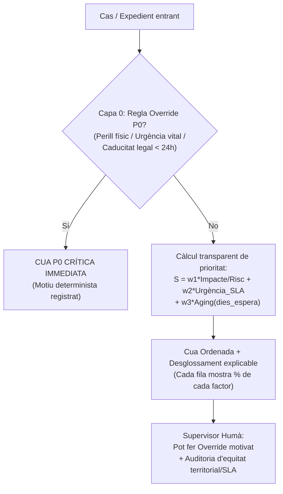

## A. Objectius d'aprenentatge

En completar aquesta lliçó, l'estudiant ha de ser capaç de:

1. **Distingir** entre **ordre estricte d'incoació / FIFO (principi general de l'art. 71.2 LPACAP per a expedients homogenis)** i **priorització justificada per risc, urgència vital/social, caducitat legal o impacte econòmic** (triatge d'incidències, inspecció tributària, urgències socials, ciberseguretat)!
2. **Dissenyar** una **funció composta de priorització (*Priority Scoring*)** transparent, auditable i acotada que combini: (a) **regles d'urgència legal/vital** (*override* immediat!), (b) **risc/impacte estimat (ML o regles)**, (c) **proximitat al venciment del termini / SLA** i (d) **factor d'envelliment (*Aging*)**!
3. **Prevenir** la **inanició de cua (*Starvation*)** (expedients de baixa prioritat que queden eternament al fons de la cua i mai no es resolen!) mitjançant mecanismes matemàtics d'***Aging*** i **quotes reservades de capacitat**!
4. **Identificar** les **implicacions ètiques i normatives de l'AI Act (Annex III)** en la priorització de serveis públics essencials o d'emergència: auditar que la priorització **no discrimini silenciosament** col·lectius vulnerables ni barris concrets i mantenir sempre **explicabilitat del motiu de prioritat** i **capacitat d'anul·lació (*override*) pel supervisor humà**!
5. **Implementar** en Python pur un **motor de priorització de cues administratives amb *override* d'urgència vital, proximitat d'SLA i factor *Aging* anti-inanició**, verificant que cap cas ordinari queda mai abandonat!

---

## B. Explicació introductòria

Els recursos humans d'una administració (inspectors tributaris, treballadors socials, brigades de via pública, tècnics de ciberseguretat) són finits, mentre que el volum d'entrades pot créixer de cop en pics estacionals. Si tots els casos entren en una cua plana per ordre d'arribada (FIFO), una fuita d'aigua al mig d'una escola o una família amb ordre de desnonament en 48 hores quedarien darrere de 200 consultes menors sobre un banc despintat!

La **priorització intel·ligent de casos (*Case Prioritization / Triage*)** ordena les cues de treball perquè el personal públic atengui primer allò que és **més urgent, més arriscat o més proper a caducar**, però amb una condició jurídica i ètica irrenunciable en l'Administració: **respectar l'art. 71.2 de la Llei 39/2015 (LPACAP), evitar que cap expedient ordinari «mori d'inanició» al fons de la cua (*Starvation*) i explicar sempre per què un cas puja de posició!**

---

## C. Explicació tècnica avançada

### 1. Marc jurídic essencial: **Article 71.2 LPACAP** (ordre rigorós d'incoació) vs. triatge motivat

:::callout-legal Atenció jurídica clau (Llei 39/2015, LPACAP — art. 71.2)
L'article 71.2 de la LPACAP estableix que en el despatx dels expedients s'ha de guardar l'**ordre rigorós d'incoació en assumptes d'homogènia naturalesa**, llevat que pel titular de la unitat administrativa es doni **ordre motivada en contrari** (de la qual quedi constància!).  
**Conseqüència tècnica directa**:
- En procediments homogenis de concurrència o ordre estricte (ex. registre de llicències d'obres ordinàries o ajuts per ordre d'arribada), **NO es pot alterar arbitràriament l'ordre FIFO amb un model ML caixa negra!**
- En canvi, en **triatge d'incidències de via pública, inspecció antifrau/tributària, emergències socials, ciberseguretat o classificació d'urgències**, la priorització basada en **criteris objectius, motivats, aprovats pel titular de la unitat i auditables** és absolutament legítima i necessària!
:::

### 2. Fórmula transparent de priorització multicriteri + *Aging* anti-inanició

Un motor de priorització segur combina **4 capes explícites**:
1. **Capa 0 — *Override* determinista de màxima prioritat (`P0`)**: risc vital, seguretat pública (ex. cable elèctric caigut, arbre a punt de caure), desnonament imminent (<72 h) o incident crític de ciberseguretat → **sempre a dalt de tot sense esperar cap score ML**!
2. **Score de risc / impacte (`0..100`)**: combinació de regles i/o model ML calibrat (ex. risc de frau en inspecció, gravetat d'incidència, nombre de persones afectades).
3. **Urgència de termini / SLA**: augmenta dràsticament a mesura que s'acosta la data límit legal de resolució o caducitat (`silenci administratiu positiu` o venciment d'SLA!).
4. **Factor d'envelliment (*Aging*) anti-inanició**: cada dia que un cas espera a la cua guanya punts d'antiguitat (`+alpha * dies_espera`), garantint matemàticament que **cap expedient de baixa gravetat quedarà mai encallat eternament** (*Zero Starvation*)! Alternativament o complementàriament: **reserva de capacitat** (ex. el 20% dels slots diaris es dediquen sempre als expedients més antics!).

### 3. Vigilància de riscos de l'AI Act (Annex III) i biaix en priorització

- L'**Annex III del Reglament (UE) 2024/1689 (AI Act)** qualifica d'**alt risc** els sistemes d'IA destinats a avaluar l'elegibilitat o **prioritzar l'accés a prestacions i serveis públics essencials** o a **prioritzar enviaments de serveis d'emergència**!
- **Risc de biaix territorial o socioeconòmic**: si prioritzem incidències de via pública només pel «nombre de queixes rebudes a l'app mòbil», els barris amb més ús digital rebran atenció ràpida i els barris envellits o vulnerables quedaran sistemàticament al final! Cal normalitzar i auditar **temps mitjà de resolució per barri/col·lectiu**!

---

## D. Diagrames i recursos visuals

### Motor de priorització auditable: *Override P0* + Multicriteri + *Aging* anti-inanició



---

## E. Aplicació a l'Administració pública

1. **Triatge d'incidències de via pública (brigades municipals)**: un fanal fos a un carrer solitari no pot competir igual que un semàfor avariat en una cruïlla escolar o una claveguera enfonsada (`Override P0`), mentre que l'*Aging* assegura que el banc despintat acabi resolent-se dins del mes!
2. **Selecció i priorització d'expedients per a inspecció tributària o de subvencions**: combinar probabilitat calibrada de risc/anomalia amb l'import econòmic en joc (`Risc esperat = Probabilitat × Import`) i proximitat a la prescripció (4 anys, LGT), presentant sempre als inspectors els **motius concrets** de per què un expedient és al Top-20.
3. **Gestió de terminis de silenci administratiu (LPACAP)**: pujar automàticament la prioritat d'expedients als quals queden menys de `5 dies hàbils` abans que operi el silenci administratiu o caduqui el termini legal, evitant responsabilitat patrimonial!

---

## F. Exemple pràctic guiat

Implementem en **Python pur** un **motor de priorització transparent amb *Override P0*, urgència d'SLA i factor d'*Aging* anti-inanició**, mostrant el desglossament exacte de punts de cada expedient perquè el supervisor pugui auditar la cua!

```python
"""Exemple 6.5: Motor de priorització amb Override P0, urgència SLA i factor Aging anti-inanició."""
from dataclasses import dataclass


@dataclass
class Cas:
    id: str
    titol: str
    impacte: float          # 0..100
    dies_espera: int        # Dies a la cua (Aging!)
    dies_fins_sla: int      # Dies restants fins a venciment legal/SLA
    perill_immediat: bool = False


def calcular_prioritat(c: Cas) -> dict[str, object]:
    if c.perill_immediat:
        return {
            "id": c.id,
            "nivell": "P0_CRITIC",
            "score": 1000.0,
            "explicacio": "OVERRIDE determinista: perill físic o emergència immediata.",
        }

    # Urgència SLA: puja fort quan queden <= 5 dies
    urgencia_sla = max(0.0, (10 - c.dies_fins_sla) * 10.0) if c.dies_fins_sla <= 10 else 0.0
    # Factor Aging anti-inanició: +4 punts per cada dia d'espera (màx +120)
    aging = min(120.0, c.dies_espera * 4.0)
    score = round(0.50 * c.impacte + 0.35 * urgencia_sla + aging, 1)

    return {
        "id": c.id,
        "nivell": "P1_ALT" if score >= 80 else "P2_NORMAL",
        "score": score,
        "explicacio": f"impacte={0.5*c.impacte:.1f} + sla={0.35*urgencia_sla:.1f} + aging={aging:.1f} ({c.dies_espera}d espera)",
    }


if __name__ == "__main__":
    cua = [
        Cas("INC-01", "Banc despintat al parc (esperant 25 dies!)", impacte=15, dies_espera=25, dies_fins_sla=20),
        Cas("INC-02", "Sot profund en calçada principal", impacte=75, dies_espera=2, dies_fins_sla=6),
        Cas("INC-03", "Expedient prop de silenci administratiu (2 dies)", impacte=50, dies_espera=8, dies_fins_sla=2),
        Cas("INC-04", "Branca gran a punt de caure sobre escola", impacte=95, dies_espera=0, dies_fins_sla=1, perill_immediat=True),
    ]
    ordenats = sorted((calcular_prioritat(c) for c in cua), key=lambda x: x["score"], reverse=True)
    for pos, r in enumerate(ordenats, start=1):
        print(f"#{pos} {r['id']} [{r['nivell']}] score={r['score']} -> {r['explicacio']}")
```

### Interpretació dels resultats (execució verificada)

- `#1 INC-04` (`P0_CRITIC`, `1000.0`): puja automàticament per **regla determinista d'*Override P0*** (perill escolar immediat).
- `#2 INC-01` (`P1_ALT`, `107.5` = `7.5 impacte + 0 sla + 100.0 aging`): el banc despintat de baix impacte (`15`) que portava **25 dies esperant** puja automàticament gràcies al **factor *Aging***, impedint la **inanició (*Starvation*)**!
- `#3 INC-03` (`P1_ALT`, `85.0`): escala per proximitat al venciment del termini legal (`2 dies fins SLA` + `8 dies d'espera`).
- `#4 INC-02` (`P2_NORMAL`, `59.5`): s'atén a continuació amb explicació transparent de cada component!

---

## G. Exercici pràctic per resoldre

### Enunciat
Un ajuntament ha implantat un sistema de priorització d'incidències de via pública que ordena la cua únicament per `score = num_queixes_app * 10 + urgencia_ML`. Sis mesos després, una auditoria interna descobreix 3 problemes greus:
1. 180 incidències petites (bústies malmeses, voreres aixecades en carrers secundaris) porten **més de 6 mesos al fons de la cua sense atendre's mai** (*Starvation*)!
2. Els dos barris amb població més jove (que usen molt l'app mòbil) tenen un temps mitjà de resolució de **3 dies**, mentre que el barri més envellit (que truca al 010 en lloc d'usar l'app) té un temps mitjà de **27 dies**!
3. Una incidència de «cable elèctric pelat a la vorera» amb només 1 avís va quedar a la posició 42 perquè no tenia múltiples queixes a l'app!

Redissenya el **sistema de priorització** resolent els tres problemes amb criteris tècnics, ètics i jurídics (art. 71.2 LPACAP + AI Act).

### Objectius i restriccions
- Afegir Capa 0 determinista d'*Override P0* (perill físic), factor *Aging* + reserva de capacitat contra *Starvation*, normalització omnicanal + auditoria d'equitat territorial, i explicabilitat + *override* humà motivat.

:::hint Pista 1 — Resol els 3 errors d'arrel
(3) **Perill físic (cable pelat)**: **Capa 0 determinista `Override P0`** (paraules/tipologies de seguretat física pugen immediatament a posició #1 independentment del nombre d'avisos!).
(1) ***Starvation* de 180 casos**: introduir **factor *Aging*** (`+punts/dia`) + **quota reservada** (ex. 20% de les ordres setmanals dedicades als expedients més antics!).
:::

:::hint Pista 2 — Biaix territorial i governança
(2) **Biaix de canal (app vs. 010)**: eliminar `num_queixes_app` com a factor dominant (biaix de bretxa digital!), unificar tots els canals (010 + presencial + app) amb igual pes, prioritzar per **gravetat objectiva i seguretat** i implantar un **KPI mensual d'equitat territorial** (temps mitjà de resolució per districte/barri)!
:::

### Criteris d'avaluació
- **35%**: Resolució del risc físic (`Override P0` determinista) i eliminació de la *Starvation* (*Aging* + reserva de capacitat).
- **35%**: Diagnòstic exacte del **biaix de canal/bretxa digital** (app vs. 010) i mesures correctores (normalització omnicanal + auditoria de temps de resolució per barri).
- **30%**: Governança i compliment: motivació formal del criteri de triatge (art. 71.2 LPACAP), explicabilitat per cas, capacitat d'*override* humà i valoració de risc AI Act.

### Errors habituals
- Mantenir `num_queixes_app` i simplement multiplicar per un factor més petit (segueix discriminant els barris envellits que no usen l'app!).

:::solution Solució completa comentada i alternatives
### 1. Capa 0: *Override P0* determinista de seguretat pública
- Tota incidència classificada de perill físic immediat (cable elèctric, fuita de gas/aigua, arbre caigut, semàfor apagat) entra directament a **`CUA_P0_CRITICA`** amb **1 sol avís**, independentment del canal o del nombre de queixes.

### 2. Eliminació de la inanició (*Starvation*)
- Incorporar un **factor *Aging*** creixent diàriament en la fórmula de priorització + **reserva de capacitat del 20%** de les brigades dedicada als expedients més antics de la cua, garantint un sostre màxim d'espera (SLA) per a qualsevol incidència!

### 3. Correcció del biaix territorial i de bretxa digital
- **Diagnòstic**: usar `num_queixes_app` premiava els barris joves digitalitzats i castigava els barris envellits (que avisen pel 010 o presencialment).
- **Solució**: fusionar deduplicadament tots els canals (App, 010, OAC, inspecció de carrer) amb idèntic pes, basar la prioritat en **gravetat objectiva, proximitat a equipaments vulnerables (escoles, CAPs, residències) i SLA**, i monitorar mensualment la **paritat de temps de resolució per barri**!

### 4. Governança, transparència i marc normatiu
- Aprovar formalment els criteris objectius de triatge (coherència amb **art. 71.2 LPACAP**), mostrar el **desglossament transparent de la puntuació** a cada fila de la cua, permetre ***override* motivat del cap de brigades** i revisar l'encaix en l'**Annex III de l'AI Act** si el sistema prioritzés serveis essencials o d'emergència.
:::

---

## H. Test individual

Resol les 10 preguntes sobre art. 71.2 LPACAP (ordre d'incoació vs. triatge motivat), *Override P0*, *Starvation* i *Aging*, reserva de capacitat, biaix de canal/territorial, risc esperat en inspecció i Annex III de l'AI Act.

---

## I. Preguntes de desenvolupament

### Pregunta 1
Explica com compatibilitza una administració pública l'**article 71.2 de la Llei 39/2015 (LPACAP)** (ordre rigorós d'incoació) amb la **priorització intel·ligent de casos** en serveis com via pública, inspecció tributària o urgències socials.

:::model-answer Resposta model i criteris de correcció (Pregunta 1)
**Resposta model**:
- L'**art. 71.2 LPACAP** exigeix guardar l'ordre rigorós d'incoació en expedients d'**homogènia naturalesa**, **llevat ordre motivada en contrari del titular de la unitat administrativa**, de la qual ha de quedar constància.
- **Compatibilització pràctica**:
  1. En tràmits homogenis sotmesos a concurrència per ordre d'arribada (ex. llicències ordinàries o subvencions per ordre de registre), s'ha de respectar **estrictament FIFO** (sense alterar-lo amb un score ML).
  2. En àmbits de **naturalesa heterogènia o triatge operatiu** (incidències de seguretat a via pública, urgències socials, selecció de plans d'inspecció tributària, ciberseguretat), la priorització és legítima sempre que es basi en **criteris objectius, aprovats formalment pel titular de la unitat, transparents, auditables i sense arbitrarietat**, deixant constància motivada de per què un cas puja de prioritat.

**Criteris de correcció (10 punts)**:
- Cita precisa del principi i l'excepció motivada de l'art. 71.2 LPACAP: 5 punts.
- Distinció clara entre expedients homogenis (FIFO estricte) i triatge justificat (criteris aprovats, motivats i auditables): 5 punts.
:::

### Pregunta 2
Què és la **inanició de cua (*Starvation*)** en un motor de priorització i quins **dos mecanismes complementaris** garanteixen que cap cas de baixa gravetat quedi eternament sense resoldre?

:::model-answer Resposta model i criteris de correcció (Pregunta 2)
**Resposta model**:
- **Inanició (*Starvation*)**: fenomen pel qual els casos de prioritat baixa (ex. desperfectes menors o consultes ordinàries) queden perpetuament desplaçats cap al fons de la cua perquè contínuament arriben casos nous de prioritat mitjana o alta, podent passar mesos sense resoldre's ni complir cap SLA.
- **Dos mecanismes complementaris**:
  1. **Factor d'envelliment (*Aging*)**: incrementar automàticament la puntuació del cas en funció dels dies que porta esperant (`+alpha * dies_espera`) i de la proximitat al venciment del seu SLA, de manera que eventualment supera els casos nous no crítics.
  2. **Reserva de capacitat (*Guaranteed Bandwidth / Quota*)**: reservar un percentatge fix de la capacitat operativa (ex. 15–20% de les assignacions setmanals) exclusivament per drenar els expedients més antics de la cua ordinària!

**Criteris de correcció (10 punts)**:
- Definició clara del fenomen de *Starvation* i impacte administratiu: 4 punts.
- Explicació rigorosa de tots dos mecanismes (*Aging* + reserva de capacitat): 6 punts.
:::

### Pregunta 3
Quin risc d'exclusió o discriminació pot introduir un sistema de priorització municipal basat en dades històriques o nombre de queixes digitals, i quina relació té amb l'**Annex III de l'AI Act**?

:::model-answer Resposta model i criteris de correcció (Pregunta 3)
**Resposta model**:
- **Risc de discriminació silenciosa**: prioritzar per volum de queixes d'una app mòbil penalitza barris envellits o amb bretxa digital (que usen el 010 o no presenten tantes queixes); prioritzar inspeccions o recursos socials sobre històrics esbiaixats pot generar bucles de retroalimentació (*feedback loops*) on els mateixos barris o col·lectius són sobrerepresentats o desatesos.
- **Relació amb l'Annex III de l'AI Act (Reglament UE 2024/1689)**: qualifica d'**alt risc** els sistemes d'IA destinats a avaluar l'elegibilitat o assignar/prioritzar l'accés a **prestacions i serveis públics essencials** (ex. serveis socials, habitatge, ajuts) o a **prioritzar l'enviament de serveis d'emergència** (policia, bombers, emergències mèdiques). Això obliga a gestió de riscos, governança de dades contra biaixos, documentació tècnica, registres automàtics, transparència, **supervisió humana efectiva (art. 14)** i **Avaluació d'Impacte en Drets Fonamentals (FRIA, art. 27)** per a entitats públiques!

**Criteris de correcció (10 punts)**:
- Anàlisi de biaixos de bretxa digital / feedback loops i auditoria d'equitat territorial: 5 punts.
- Enquadrament precís a l'Annex III + obligacions clau de l'AI Act (incloent supervisió humana i FRIA): 5 punts.
:::

---

## J. Resum per memoritzar

### Conceptes clau
- **Art. 71.2 LPACAP**: expedients homogenis → **ordre rigorós d'incoació (FIFO)**; triatge/priorització només amb **criteris objectius aprovats, motivats i auditables**!
- **4 capes d'un motor de priorització segur**: (0) ***Override P0* determinista** (perill físic / urgència vital / silenci imminent), (1) Impacte/risc, (2) Urgència SLA/caducitat, (3) ***Aging* anti-inanició** (`+alpha * dies_espera`)!
- **Anti-*Starvation***: ***Aging*** + **reserva de capacitat** (ex. 20% als expedients més antics).
- **Biaix de canal / territorial**: MAI prioritzar només per `num_queixes_app` (discrimina barris envellits que usen el 010!) → auditar **temps mitjà de resolució per barri/col·lectiu**!
- **AI Act (Annex III)**: prioritzar **serveis públics essencials** o **emergències** = **ALT RISC** (exigeix governança de dades, supervisió humana art. 14 i FRIA art. 27!).

### Definicions essencials
- ***Starvation* (Inanició de cua)**: situació en què casos de baixa prioritat queden desplaçats indefinidament per l'arribada contínua de casos més prioritaris i mai no s'arriben a resoldre.
- ***Aging* (Envelliment)**: increment progressiu de la prioritat d'un cas en funció del seu temps d'espera a la cua per garantir que cap expedient ordinari pateixi inanició.

### Errors conceptuals freqüents
1. Alterar l'ordre FIFO en expedients homogenis de concurrència amb un model ML caixa negra (vulnera art. 71.2 LPACAP!).
2. Prioritzar incidències sense *Override P0* ni *Aging* (un cable elèctric queda al lloc 42 i 180 casos petits moren d'inanició!).
3. Prioritzar només per nombre de queixes de l'app mòbil (discriminació per bretxa digital!).

### Possibles preguntes d'examen
- Com resols simultàniament la *Starvation*, el perill físic amb 1 sol avís i el biaix territorial (app vs. 010) en una cua municipal?
- Quin límit imposa l'art. 71.2 LPACAP als sistemes de priorització automàtica d'expedients?
- Quan entra un sistema de priorització pública dins l'Annex III (alt risc) de l'AI Act i quines obligacions comporta?
