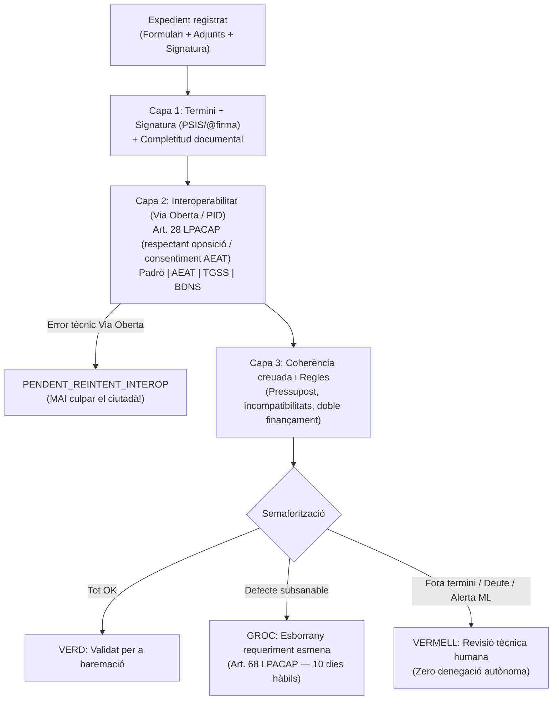

## A. Objectius d'aprenentatge

En completar aquesta lliçó final del Mòdul 6, l'estudiant ha de ser capaç de:

1. **Diferenciar** la **validació documental puntual** (Mòdul 4: validar un NIF/IBAN o la suma d'una factura individual) de la **validació automàtica integral de processos (*End-to-End Process Validation*)**: verificar completitud d'expedient, coherència entre múltiples documents, regles procedimentals (terminis, incompatibilitats, pressupost) i **creuament automàtic amb registres oficials via interoperabilitat**!
2. **Integrar** el **principi «Només una vegada» (*Once-Only* — art. 28.2 i 28.3 Llei 39/2015, LPACAP)** mitjançant consultes automàtiques a **Via Oberta (Consorci AOC)** i la **PID (*Plataforma d'Intermediació de Dades*)**: padró, estar al corrent d'obligacions tributàries (AEAT/ATC) i Seguretat Social (TGSS), títols, família nombrosa o discapacitat — **respectant el dret d'oposició motivada del ciutadà**!
3. **Automatitzar** el flux legal d'**esmena i millora de la sol·licitud (art. 68 LPACAP)**: quan la validació detecta documentació incompleta o defecte formal, generar automàticament l'**esborrany de requeriment d'esmena (10 dies hàbils)** detallant exactament què falta, amb supervisió abans de notificar!
4. **Aplicar** el patró de **semaforització d'expedients (`VERD_STP`, `GROC_ESMENA_O_REVISIO`, `VERMELL_BLOQUEIG_HUMA`)** combinant comprovacions deterministes d'interoperabilitat + senyals de risc ML, amb **zero denegacions definitives autònomes sense supervisió humana**!
5. **Implementar** en Python pur un **validador automàtic d'expedients de subvencions** amb comprovació de completitud documental, consulta simulada a interoperabilitat (Via Oberta / AEAT / TGSS), gestió d'oposició art. 28 LPACAP i generació d'esborrany de requeriment d'esmena (art. 68 LPACAP)!

---

## B. Explicació introductòria

Gran part del col·lapse en la tramitació de subvencions, llicències i contractes no es deu a la resolució final, sinó a la **fase tediosa de revisió i comprovació prèvia**: obrir 6 fitxers adjunts per expediente per mirar si falta la memòria tècnica, si l'entitat està inscrita al registre d'associacions, si està al corrent amb Hisenda i Seguretat Social, si la sol·licitud ha entrat dins de termini i si l'import sol·licitat supera el màxim de la convocatòria!

La **validació automàtica en processos** executa totes aquestes comprovacions de punta a punta en segons —connectant-se directament als registres oficials per interoperabilitat (**Via Oberta / PID**) per estalviar papers al ciutadà!— i classifica cada expedient en un semàfor clar (`VERD`, `GROC` amb esborrany de requeriment d'esmena art. 68 LPACAP, o `VERMELL` per a revisió tècnica), multiplicant la capacitat dels funcionaris sense treure'ls mai el control de la decisió final!

---

## C. Explicació tècnica avançada

### 1. Les 4 capes de la validació automàtica de processos

1. **Capa 1 — Validació de forma i completitud (Admissió inicial)**: la sol·licitud ha entrat dins termini (`data_registre <= data_fi_convocatoria`), porta signatura electrònica vàlida (verificació de certificat/segell via **PSIS / @firma**) i adjunta tots els documents obligatoris (o declara consulta per interoperabilitat).
2. **Capa 2 — Validació per interoperabilitat (*Once-Only*, art. 28 LPACAP)**:
   - Consulta automàtica via **Via Oberta (Consorci AOC)** / **PID** a: **Padró municipal**, **AEAT / ATC** (al corrent tributari), **TGSS** (Seguretat Social), **Registre d'Entitats**, **Títol de Família Nombrosa / Discapacitat**.
   - **Garantia jurídica art. 28.2 LPACAP**: el ciutadà té dret a **NO aportar** documents ja en poder de l'Administració; l'òrgan pot consultar-los llevat que l'interessat **s'hi oposi expressament** (en aquest cas, el validador comprova que hagi adjuntat el certificat vigent en PDF!) o que una llei especial exigeixi **consentiment exprés** (com passa habitualment amb **dades tributàries de l'AEAT**, art. 95.1.k LGT!).
3. **Capa 3 — Validació creuada de negoci i pressupost (BRMS)**: coherència entre tots els documents de l'expedient (ex. pressupost de la memòria = import del formulari; suma de subvencions concurrents `<= 100%` del cost del projecte; comprovació de doble finançament a la **BDNS**!).
4. **Capa 4 — Gestió de defectes i semaforització (art. 68 LPACAP)**:
   - **`VERD (Validat — llest per a baremació/resolució)`**: 100% de validacions OK i sense alertes ML.
   - **`GROC (Esmena art. 68 LPACAP / Revisió puntual)`**: falta un document subsanable o hi ha un error menor → genera automàticament l'**esborrany de requeriment d'esmena (termini legal de 10 dies hàbils)** detallant exactament els punts a corregir!
   - **`VERMELL (Bloqueig / Revisió tècnica humana)`**: fora de termini, deute amb Hisenda/TGSS, possible doble finançament o alerta ML greu → passa directament al tècnic instructor (mai resolució denegatòria autònoma!).

### 2. Gestió de fallades d'interoperabilitat (*Resilience*)

Els serveis externs (AEAT, TGSS, Via Oberta) poden patir talls temporals o retorn de resposta `EN_TRAMIT` (asíncrona). Un validador robust **MAI no pot marcar com a «incompliment del ciutadà» un error tècnic de connexió amb Via Oberta!** Ha de marcar l'estat com a **`PENDENT_REINTENT_INTEROPERABILITAT`**, reintentar automàticament amb *backoff* i alertar el gestor si persisteix.

---

## D. Diagrames i recursos visuals

### Pipeline de validació automàtica de processos amb Via Oberta, art. 28/68 LPACAP i semaforització



---

## E. Aplicació a l'Administració pública

1. **Convocatòries de subvencions a entitats (DIBA / ajuntaments)**: validar automàticament 3.000 expedients en 1 hora (signatura del representant, termini, consulta Via Oberta a AEAT/TGSS/Registre d'Entitats, coherència d'imports i consulta BDNS) i preparar directament els esborranys de requeriment d'esmena (art. 68 LPACAP) reduint en un 60% el temps fins al pagament!
2. **Validació prèvia a la contractació menor i facturació**: comprovar automàticament que el proveïdor no supera el límit anual de contracte menor, disposa de reserva de crèdit (`RC`) i la factura electrònica e.FACT encaixa amb l'albarà de conformitat abans de passar a Intervenció.
3. **Qualitat de dades en origen (*Shift-Left Validation*)**: incorporar el màxim possible de validacions **en temps real dins el formulari electrònic de la Seu** (format NIF/IBAN, suma automàtica del pressupost, avís si falta un adjunt obligatori) evita que un 40% dels defectes arribin mai al registre!

---

## F. Exemple pràctic guiat

Implementem en **Python pur** un **validador automàtic d'expedients de subvencions** que:
1. Comprova termini, signatura i completitud documental (*Shift-Left* + admissió).
2. Aplica **art. 28 LPACAP** (consulta interoperabilitat AEAT/TGSS si hi ha autorització; si el ciutadà s'oposa, verifica certificat adjunt!; i gestiona errors tècnics de Via Oberta sense culpar el ciutadà!).
3. Semaforitza (`VERD`, `GROC` amb esborrany de requeriment **art. 68 LPACAP — 10 dies hàbils**, `PENDENT_REINTENT_INTEROP` o `VERMELL`)!

```python
"""Exemple 6.6: Validador automàtic de processos (Via Oberta, art. 28/68 LPACAP i semaforització)."""
from dataclasses import dataclass, field


@dataclass
class ExpedientSubvencio:
    id: str
    dins_termini: bool
    signatura_valida: bool
    te_memoria_tecnica: bool
    autoritzacio_aeat: bool
    certificat_aeat_adjunt: bool
    estat_via_oberta_aeat: str  # "AL_CORRENT" | "DEUTE" | "TIMEOUT_TECNIC"
    import_sollicitat: float
    import_memoria: float
    alertes: list[str] = field(default_factory=list)


def validar_proces(exp: ExpedientSubvencio) -> dict[str, object]:
    esmenables: list[str] = []
    bloquejos: list[str] = []

    # Capa 1: Termini i forma
    if not exp.dins_termini:
        bloquejos.append("Sol·licitud presentada fora del termini oficial de la convocatòria.")
    if not exp.signatura_valida:
        esmenables.append("Signatura electrònica absent o no verificada (cal esmena art. 68 LPACAP).")
    if not exp.te_memoria_tecnica:
        esmenables.append("Falta adjuntar la memòria tècnica del projecte.")

    # Capa 2: Interoperabilitat (art. 28 LPACAP + art. 95 LGT consentiment AEAT)
    if exp.autoritzacio_aeat:
        if exp.estat_via_oberta_aeat == "TIMEOUT_TECNIC":
            return {
                "id": exp.id,
                "semafor": "PENDENT_REINTENT_INTEROP",
                "detall": "Error transitori Via Oberta (AEAT): reintentar automàticament sense requerir el ciutadà.",
            }
        if exp.estat_via_oberta_aeat == "DEUTE":
            bloquejos.append("Via Oberta (AEAT): no consta al corrent d'obligacions tributàries.")
    elif not exp.certificat_aeat_adjunt:
        esmenables.append("S'oposa/no autoritza consulta AEAT (art. 28 LPACAP) i no adjunta certificat tributari vigent.")

    # Capa 3: Coherència creuada
    if abs(exp.import_sollicitat - exp.import_memoria) > 0.01:
        esmenables.append(
            f"Discrepància d'imports: formulari ({exp.import_sollicitat:.2f} €) vs. memòria ({exp.import_memoria:.2f} €)."
        )

    # Capa 4: Semaforització (zero denegacions definitives autònomes!)
    if bloquejos:
        return {"id": exp.id, "semafor": "VERMELL_REVISIO_TECNICA", "motius": bloquejos + esmenables}
    if esmenables:
        return {
            "id": exp.id,
            "semafor": "GROC_ESBORRANY_ESMENA_ART68",
            "termini_esmena": "10 dies hàbils (art. 68 LPACAP)",
            "punts_a_esmenar": esmenables,
        }
    return {"id": exp.id, "semafor": "VERD_VALIDAT_BAREMACIO", "motius": ["100% comprovacions OK."]}


if __name__ == "__main__":
    lots = [
        ExpedientSubvencio("SUB-01", True, True, True, True, False, "AL_CORRENT", 5000.0, 5000.0),
        ExpedientSubvencio("SUB-02", True, True, False, False, False, "AL_CORRENT", 5000.0, 4800.0),
        ExpedientSubvencio("SUB-03", True, True, True, True, False, "TIMEOUT_TECNIC", 3000.0, 3000.0),
        ExpedientSubvencio("SUB-04", False, True, True, True, False, "AL_CORRENT", 3000.0, 3000.0),
    ]
    for e in lots:
        print(validar_proces(e))
```

### Interpretació dels resultats (execució verificada)

- `SUB-01`: **`VERD_VALIDAT_BAREMACIO`** (100% OK via consulta automàtica Via Oberta sense fer aportar certificats al ciutadà!).
- `SUB-02`: **`GROC_ESBORRANY_ESMENA_ART68`** (termini legal de 10 dies hàbils) detallant els 3 punts exactes a esmenar: falta memòria, oposició AEAT sense certificat adjunt i discrepància `5.000 € vs 4.800 €`!
- `SUB-03`: **`PENDENT_REINTENT_INTEROP`** (davant un *timeout* tècnic de Via Oberta, el sistema **no envia cap requeriment ni culpa el ciutadà**, sinó que reintenta automàticament!).
- `SUB-04`: **`VERMELL_REVISIO_TECNICA`** (fora de termini → passa al tècnic instructor per verificar i dictar resolució motivada, sense denegació autònoma!).

---

## G. Exercici pràctic per resoldre

### Enunciat
Una convocatòria de 2.500 subvencions culturals ha trigat 5 mesos a resoldre's perquè els tècnics han detectat aquests colls d'ampolla:
1. Un 38% dels expedients arriben amb el NIF mal escrit, imports que no sumen igual que la memòria o sense signatura electrònica.
2. Els tècnics demanen en paper a totes les entitats certificats d'Hisenda (AEAT), Seguretat Social (TGSS) i inscripció al Registre d'Entitats, i els comproven un per un a mà!
3. L'any passat van provar un script que consultava Via Oberta, però un dia que l'AEAT va tenir un tall tècnic de 2 hores, l'script va enviar automàticament 90 requeriments d'esmena erronis a entitats que sí que estaven al corrent!

Dissenya el **nou sistema de validació automàtica de punta a punta** (del formulari fins a la baremació) per eliminar els 3 colls d'ampolla amb plenes garanties jurídiques (art. 28 i 68 LPACAP, art. 95 LGT).

### Objectius i restriccions
- Combinar *Shift-Left Validation* al formulari de la Seu, interoperabilitat resilient Via Oberta / PID (respectant consentiment AEAT i oposició art. 28 LPACAP + estat `PENDENT_REINTENT_INTEROP`), semaforització i esborranys de requeriment art. 68 LPACAP supervisats.

:::hint Pista 1 — Colls d'ampolla 1 i 2
(1) ***Shift-Left Validation*** al formulari web de la Seu Electrònica (validar format NIF/IBAN, suma automàtica del pressupost i signatura abans de permetre el registre → retalla el 38% de defectes d'entrada!).
(2) **Interoperabilitat Via Oberta / PID (art. 28 LPACAP)**: consulta automàtica de TGSS i Registre d'Entitats (llevat oposició expressa) i consulta AEAT amb **casella de consentiment exprés (art. 95.1.k LGT)**!
:::

:::hint Pista 2 — Coll d'ampolla 3 + Esmena art. 68
(3) **Resiliència d'interoperabilitat**: separar explícitament `DEUTE` (resultat de negoci) de `TIMEOUT / HTTP 503` (error tècnic → **`PENDENT_REINTENT_INTEROP`** amb *backoff* exponencial; **MAI** generar requeriments per caigudes de serveis externs!). I per als defectes reals subsanables, generar **esborrany de requeriment d'esmena (art. 68 LPACAP, 10 dies hàbils)** validat pel tècnic abans de notificar!
:::

### Criteris d'avaluació
- **35%**: Prevenció en origen (*Shift-Left* al formulari de la Seu Electrònica) + coherència creuada automàtica.
- **35%**: Integració jurídica correcta d'interoperabilitat (Via Oberta / PID, **art. 28 LPACAP** dret a no aportar i oposició, **art. 95.1.k LGT** consentiment exprés AEAT) + separació error tècnic vs. deute (`PENDENT_REINTENT_INTEROP`).
- **30%**: Semaforització `VERD / GROC / VERMELL` + generació d'esborranys de requeriment d'esmena (**art. 68 LPACAP, 10 dies hàbils**) amb supervisió humana abans de notificar o denegar.

### Errors habituals
- Consultar dades tributàries de l'AEAT sense recollir consentiment exprés (o exigir sempre el certificat en paper sense oferir interoperabilitat Via Oberta).

:::solution Solució completa comentada i alternatives
### 1. *Shift-Left Validation* a la Seu Electrònica (elimina el 38% d'errors d'entrada)
- Validar en temps real abans de registrar: dígit de control de NIF/CIF i IBAN, suma automàtica d'imports (evitant discrepàncies formulari vs. pressupost), presència d'adjunts obligatoris i signatura electrònica vàlida.

### 2. Interoperabilitat Via Oberta / PID (art. 28 LPACAP i art. 95.1.k LGT)
- Substituir la petició massiva de certificats en paper per consultes automatitzades a **Via Oberta (AOC) / PID**:
  - **Registre d'Entitats i TGSS**: consulta automàtica per defecte (art. 28.2 LPACAP), respectant el dret d'oposició motivada (si s'oposa, el formulari exigeix adjuntar el certificat).
  - **AEAT / ATC**: incorporar la casella de **consentiment exprés** exigida en matèria tributària (art. 95.1.k LGT); si el dona, consulta automàtica.

### 3. Resiliència davant caigudes externes (evita els 90 requeriments erronis!)
- Distingir estrictament el codi de resposta de negoci (`DEUTE`) d'una errada tècnica (`TIMEOUT`, `503`, `ERROR_XARXA`). Davant error tècnic, marcar `PENDENT_REINTENT_INTEROP`, reintentar amb *backoff* i **bloquejar la generació de requeriments** fins a obtenir resposta definitiva de negoci!

### 4. Semaforització i esmena supervisada (art. 68 LPACAP)
- `VERD` → passa directament a baremació.
- `GROC` (defectes subsanables reals) → genera **esborrany de requeriment d'esmena (10 dies hàbils, art. 68 LPACAP)** llistant exactament cada mancança per a validació ràpida del tècnic abans de notificar.
- `VERMELL` (fora de termini, deute confirmat, doble finançament BDNS) → revisió tècnica humana per a proposta de resolució motivada.
:::

---

## H. Test individual

Resol les 10 preguntes sobre validació integral de processos, *Shift-Left Validation*, principi *Once-Only* (art. 28 LPACAP), Via Oberta / PID, consentiment AEAT (art. 95.1.k LGT), resiliència d'interoperabilitat, esmena (art. 68 LPACAP) i semaforització.

---

## I. Preguntes de desenvolupament

### Pregunta 1
Explica les **4 capes de la validació automàtica integral de processos** i el valor de la **validació en origen (*Shift-Left Validation*)** dins el formulari de la Seu Electrònica.

:::model-answer Resposta model i criteris de correcció (Pregunta 1)
**Resposta model**:
- ***Shift-Left Validation***: traslladar les validacions bàsiques (format NIF/IBAN, obligatorietat d'adjunts, suma automàtica d'imports) al propi formulari web abans del registre, evitant que un 30–40% de defectes formals arribin mai al *back-office* i hagin de generar requeriments d'esmena!
- **Les 4 capes al *back-office***:
  1. **Admissió i forma**: termini oficial, verificació criptogràfica de signatura (PSIS/@firma) i completitud documental.
  2. **Interoperabilitat (*Once-Only*, art. 28 LPACAP)**: consulta automàtica via Via Oberta / PID (Padró, AEAT, TGSS, Registres).
  3. **Coherència creuada i regles de negoci**: consistència d'imports entre formulari i memòria, límits pressupostaris i control de doble finançament (BDNS).
  4. **Semaforització i flux legal**: `VERD` (a baremació), `GROC` (esborrany d'esmena art. 68 LPACAP, 10 dies hàbils) i `VERMELL` (revisió tècnica humana).

**Criteris de correcció (10 punts)**:
- Explicació clara de *Shift-Left Validation*: 3 punts.
- Detall precís de les 4 capes del procés de validació: 7 punts.
:::

### Pregunta 2
Com s'integren jurídicament i tècnicament els **articles 28 i 68 de la Llei 39/2015 (LPACAP)** i l'**article 95.1.k de la LGT** en un validador automàtic connectat a **Via Oberta / PID**?

:::model-answer Resposta model i criteris de correcció (Pregunta 2)
**Resposta model**:
- **Art. 28.2 i 28.3 LPACAP (*Once-Only*)**: reconeix el dret del ciutadà a no aportar documents elaborats per qualsevol Administració; el validador consulta automàticament Via Oberta / PID (padró, TGSS, títols, registres) **llevat que l'interessat s'hi oposi expressament** (cas en què el validador exigeix el certificat vigent adjunt).
- **Art. 95.1.k LGT (dades tributàries)**: per al caràcter reservat de les dades tributàries, la consulta automatitzada a l'AEAT requereix generalment **autorització/consentiment exprés** de l'interessat al formulari; el validador comprova aquesta autorització abans de llançar la crida a Via Oberta.
- **Art. 68 LPACAP (Esmena i millora)**: quan falten documents subsanables o hi ha defectes formals, el sistema **no pot rebutjar directament l'expedient**; genera un **esborrany de requeriment d'esmena amb termini legal de 10 dies hàbils** detallant exactament cada deficiència perquè el tècnic el revisi i notifiqui.

**Criteris de correcció (10 punts)**:
- Art. 28 LPACAP (dret a no aportar + oposició): 3,5 punts.
- Art. 95.1.k LGT (consentiment exprés tributari AEAT): 3 punts.
- Art. 68 LPACAP (requeriment d'esmena de 10 dies hàbils): 3,5 punts.
:::

### Pregunta 3
Per què un validador connectat a serveis externs d'interoperabilitat (Via Oberta / AEAT / TGSS) ha de diferenciar estrictament entre **error tècnic d'interoperabilitat** i **incompliment de requisit del ciutadà**, i com gestiona els talls temporals?

:::model-answer Resposta model i criteris de correcció (Pregunta 3)
**Resposta model**:
- Si un validador tracta una caiguda de xarxa, un *timeout* o un HTTP `503` de Via Oberta/AEAT com si fos un `NO_AL_CORRENT`, envia **requeriments d'esmena falsos o exclou injustament ciutadans** que compleixen tots els requisits, generant indefensió, recursos i descrèdit institucional!
- **Gestió resilient obligatòria**:
  1. Separar explícitament codis de negoci (`AL_CORRENT`, `DEUTE`) d'errors tècnics (`TIMEOUT`, `503`, `SERVEI_NO_DISPONIBLE`).
  2. Davant error tècnic, posar l'expedient en estat **`PENDENT_REINTENT_INTEROP`** (mai `GROC` ni `VERMELL`!) i bloquejar qualsevol requeriment al ciutadà.
  3. Executar **reintents automàtics idempotents amb *backoff* exponencial** i generar alerta a l'equip IT/gestor si la indisponibilitat supera un llindar (ex. > 4 hores).

**Criteris de correcció (10 punts)**:
- Impacte jurídic i ciutadà de confondre error tècnic amb incompliment: 4 punts.
- Disseny tècnic resilient (`PENDENT_REINTENT_INTEROP`, reintents amb *backoff*, bloqueig de requeriments falsos, alertes): 6 punts.
:::

---

## J. Resum per memoritzar

### Conceptes clau
- ***Shift-Left Validation***: validar formats (NIF/IBAN), sumes i adjunts **al formulari web abans de registrar** (elimina el 30–40% de defectes d'entrada!).
- **4 capes de validació de processos**: (1) Termini + Signatura (PSIS/@firma) + Completitud; (2) **Interoperabilitat Via Oberta / PID**; (3) Coherència creuada i pressupost/BDNS; (4) **Semaforització** (`VERD / GROC / VERMELL`).
- **Art. 28 LPACAP (*Once-Only*)**: dret a no aportar documents en poder de l'Administració (respectant oposició expressa) + **consentiment exprés AEAT (art. 95.1.k LGT)**!
- **Art. 68 LPACAP (Esmena)**: els defectes subsanables generen **esborrany de requeriment d'esmena (10 dies hàbils)** supervisat — mai exclusió directa!
- **Resiliència Via Oberta**: *timeout* o `503` → **`PENDENT_REINTENT_INTEROP`** (MAI culpar ni requerir el ciutadà!).

### Definicions essencials
- ***Shift-Left Validation***: desplaçament de les comprovacions de qualitat i coherència al punt més primerenc del procés (el formulari electrònic d'entrada) per prevenir errors abans que entrin al *back-office*.
- **Interoperabilitat (*Once-Only*, art. 28 LPACAP)**: consulta telemàtica automàtica de dades en poder d'altres administracions (Via Oberta / PID) per evitar demanar certificats en paper als ciutadans.

### Errors conceptuals freqüents
1. Confondre un error tècnic (`TIMEOUT`) de Via Oberta amb un deute tributari i enviar requeriments falsos als ciutadans.
2. Consultar dades tributàries AEAT sense recollir consentiment exprés o no respectar el dret d'oposició de l'art. 28 LPACAP.
3. Dictar denegacions definitives automàtiques sense esmena (art. 68 LPACAP) ni supervisió humana.

### Possibles preguntes d'examen
- Dissenya el flux de validació automàtica d'una convocatòria de subvencions integrant *Shift-Left*, Via Oberta (art. 28 LPACAP / art. 95 LGT) i esmena (art. 68 LPACAP).
- Com evites enviar requeriments d'esmena falsos quan cau el servei extern de l'AEAT/Via Oberta?
- Explica el sistema de semaforització `VERD / GROC / VERMELL` i per què no hi ha denegacions definitives autònomes.
