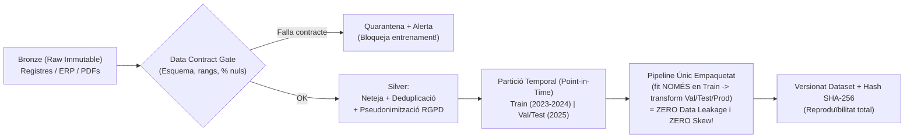

## A. Objectius d'aprenentatge

En completar aquesta lliçó, l'estudiant ha de ser capaç de:

1. **Dissenyar** **pipelines de preparació de dades reproduïbles i idempotents** (del *raw data* a *curated/features* mitjançant arquitectura **Medallion**: *Bronze → Silver → Gold*) evitant scripts manuals en notebooks impossibles de replicar!
2. **Detectar i prevenir** els dos errors més destructius en preparació de dades de producció: la **fuga de dades (*Data Leakage*)** (ex. calcular mitjana/escalador o imputació abans del `train/test split`, o usar variables disponibles només *després* de la decisió!) i el **desajust entrenament-servei (*Training-Serving Skew*)**!
3. **Implementar** **contractes de dades (*Data Contracts*) i validació automàtica d'esquemes** (tipus, rangs, percentatge màxim de nuls, valors permesos — estil *Pydantic / Pandera / Great Expectations*) a l'entrada del pipeline perquè dades corruptes **mai** no contaminin un entrenament!
4. **Aplicar** el **versionat de conjunts de dades (*Data Versioning*, ex. DVC / hashes SHA-256)** i la **minimització/pseudonimització prèvia (RGPD)** abans que les dades entrin a l'entorn d'entrenament o a un *Feature Store*.
5. **Implementar** en Python pur un **pipeline reproduïble amb validació de contracte de dades, partició temporal sense *Data Leakage* i empaquetatge de transformadors ajustats només sobre `train`**!

---

## B. Explicació introductòria

En MLOps hi ha una màxima universal: ***«Garbage In, Garbage Out»*** (si entrenes amb dades brutes, inconsistents o amb fugues, el model fallarà en producció per sofisticat que sigui l'algoritme!). A la pràctica, més del 60% dels errors d'un sistema d'IA en producció no provenen de l'arquitectura del model, sinó de la **preparació de dades**: una columna d'Excel que un departament va canviar de nom (`import_eur` → `Import`), un *null* inesperat, o un càlcul que es fa d'una manera al notebook d'entrenament i d'una altra diferent a l'API de producció (*Training-Serving Skew*).

Un **pipeline de preparació de dades MLOps** converteix la neteja, validació, anonimització i enginyeria de característiques en **codi versionat, automatitzat, determinista i auditable**, capaç de regenerar exactament el mateix dataset d'aquí a dos anys!

---

## C. Explicació tècnica avançada

### 1. Arquitectura *Medallion* + *Data Contracts* + *Feature Store*

- **Bronze (Cru / Immutable)**: còpia exacta de les dades d'origen (registres, CSVs, PDFs) amb segell temporal; mai no es modifica a mà!
- **Silver (Net, Validat i Pseudonimitzat)**: passa els **contractes de dades (*Data Contracts*)** (esquema estricte, rangs, `null_rate < 5%`, deduplicació) i aplica **minimització / pseudonimització RGPD** (eliminant DNI, nom i adreça innecessaris per al model!).
- **Gold (Característiques / *Features* per a ML o *Chunks* per a LLM)**: dades llestes per entrenar o indexar, versionades amb hash criptogràfic (**DVC / LakeFS / SHA-256**).
- ***Feature Store* (ex. Feast)**: repositori centralitzat que serveix exactament la **mateixa definició de característica** tant per a l'entrenament *offline* (històric) com per a la inferència *online* en temps real, eliminant el ***Training-Serving Skew***!

### 2. Els 3 grans enemics silenciosos en preparació de dades

| Enemic | Què és exactament | Exemple administratiu real | Com prevenir-lo |
|---|---|---|---|
| ***Data Leakage* (Fuga de dades)** | Informació del conjunt de test o del **futur** es cola a l'entrenament, inflant artificialment les mètriques | 1) Aplicar `StandardScaler` sobre tot el dataset abans del `split`; 2) Incloure la columna `data_pagament` per predir si una subvenció serà aprovada! | 1) Ajustar (`fit`) escaladors/imputadors **només sobre `train`** (`sklearn.Pipeline`); 2) **Partició temporal (*Time-Based Split*)**; 3) Auditar que cada *feature* existeix **en el moment exacte de la predicció (*Point-in-Time*)**! |
| ***Training-Serving Skew*** | La transformació de dades en producció difereix de la d'entrenament | Entrenament imputa nuls amb la mediana (`450 €`) i normalitza majúscules, però l'API de producció posa `0 €` i no normalitza | Empaquetar **preprocés + model junts** en un únic artefacte (o usar un ***Feature Store*** compartit) + tests unitaris de paritat! |
| **Ruptura d'esquema (*Schema Drift*)** | La font d'origen canvia tipus, nom de columna o codificació sense avisar | El padró passa de codificar sexe `H/D` a `1/2` o arriba una remesa amb 40% de nuls | **Contracte de dades (*Data Contract*)** automatitzat com a porta (*gate*) abans d'entrenar i d'inferir! |

### 3. Preparació de dades específica en **LLMOps** (*Data Curation*)

En LLMOps (RAG i *fine-tuning*), la preparació de dades inclou: extracció neta de text (eliminant capçaleres/peus repetitius de PDFs del BOPB), **deduplicació exacta i aproximada (*MinHash / SimHash*)**, filtratge de baixa qualitat, **neteja PII obligatòria (RGPD)** abans d'entrenar/indexar i control estricte de **llicències i drets d'autor**!

---

## D. Diagrames i recursos visuals

### Pipeline MLOps reproduïble: *Medallion*, *Data Contracts* i prevenció de *Skew*



---

## E. Aplicació a l'Administració pública

1. **Predicció d'impagaments o fraccionaments tributaris (ORGT)**: usar estrictament **partició temporal** (entrenar amb exercicis 2021–2023, validar amb 2024, testar amb 2025 — mai *random split* que barregi el futur amb el passat!) i verificar *Point-in-Time* que cap variable de gestió posterior (ex. `avís_constrenyiment_enviat`) es filtri com a *feature*!
2. **Privacitat des del disseny al pipeline (RGPD art. 25)**: la pseudonimització i eliminació de columnes identificatives (NIF, nom, telèfon) i d'atributs protegits innecessaris s'executa automàticament en passar de **Bronze → Silver**, de manera que els científics de dades treballin sempre sobre dades minimitzades!
3. **Auditabilitat de convocatòries i models públics**: poder demostrar a la Sindicatura de Comptes o a l'APDCAT amb el **hash exacte del dataset (DVC)** i el commit de Git del pipeline exactament amb quines dades i filtres es va entrenar el model `v2.1`!

---

## F. Exemple pràctic guiat

Implementem en **Python pur** un **pipeline de preparació de dades amb validació de *Data Contract*, partició temporal sense *Data Leakage* i empaquetatge del transformador (mitjana/desviació ajustats només sobre `train`)** per garantir zero *Training-Serving Skew*!

```python
"""Exemple 7.1: Data Contract Gate + partició temporal sense Data Leakage + transformador reproduïble."""
import hashlib
import json
import math
from dataclasses import dataclass


@dataclass
class Registre:
    data: str            # YYYY-MM-DD (per partició temporal!)
    import_eur: float | None
    dies_tramit: int
    etiqueta: int


def validar_contracte(registres: list[Registre], max_taxa_nuls: float = 0.25) -> tuple[bool, list[str]]:
    errors = []
    if not registres:
        return False, ["Dataset buit."]
    nuls = sum(1 for r in registres if r.import_eur is None)
    if nuls / len(registres) > max_taxa_nuls:
        errors.append(f"Taxa de nuls excessiva a import_eur: {nuls}/{len(registres)} (>{max_taxa_nuls:.0%}).")
    for i, r in enumerate(registres):
        if r.import_eur is not None and r.import_eur < 0:
            errors.append(f"Fila {i}: import_eur negatiu ({r.import_eur}) viola el contracte.")
        if r.etiqueta not in (0, 1):
            errors.append(f"Fila {i}: etiqueta fora de domini ({r.etiqueta}).")
    return len(errors) == 0, errors


class PreprocessorSenseLeakage:
    """Ajustat (fit) NOMÉS en train; serialitzat i reutilitzat idènticament en test i producció!"""

    def __init__(self) -> None:
        self.mediana_import = 0.0
        self.mitjana_import = 0.0
        self.std_import = 1.0

    def fit(self, train: list[Registre]) -> "PreprocessorSenseLeakage":
        vals = sorted(r.import_eur for r in train if r.import_eur is not None)
        self.mediana_import = vals[len(vals) // 2]
        imputats = [r.import_eur if r.import_eur is not None else self.mediana_import for r in train]
        self.mitjana_import = sum(imputats) / len(imputats)
        var = sum((x - self.mitjana_import) ** 2 for x in imputats) / len(imputats)
        self.std_import = math.sqrt(var) or 1.0
        return self

    def transform(self, dades: list[Registre]) -> list[tuple[float, int]]:
        sortida = []
        for r in dades:
            v = r.import_eur if r.import_eur is not None else self.mediana_import
            z = round((v - self.mitjana_import) / self.std_import, 3)
            sortida.append((z, r.dies_tramit))
        return sortida


if __name__ == "__main__":
    dades = [
        Registre("2024-02-10", 100.0, 5, 0),
        Registre("2024-05-12", 200.0, 12, 0),
        Registre("2024-09-01", None, 20, 1),   # Nul permès (<25%)
        Registre("2025-01-15", 300.0, 8, 0),
        Registre("2025-04-20", 900.0, 35, 1),  # Futur (test temporal!)
    ]
    ok, errs = validar_contracte(dades)
    print("Data Contract OK?:", ok, errs)
    # Partició temporal estricta (<=2024 train, >=2025 test) -> ZERO leakage del futur!
    train = [r for r in dades if r.data < "2025-01-01"]
    test = [r for r in dades if r.data >= "2025-01-01"]

    prep = PreprocessorSenseLeakage().fit(train)
    print("Paràmetres ajustats NOMÉS en train:", round(prep.mediana_import, 2), round(prep.mitjana_import, 2), round(prep.std_import, 2))
    print("Train transformat:", prep.transform(train))
    print("Test transformat :", prep.transform(test))
    hash_ds = hashlib.sha256(json.dumps([r.__dict__ for r in train], sort_keys=True).encode()).hexdigest()[:12]
    print("Hash reproduïble dataset train:", hash_ds)
```

### Interpretació dels resultats (execució verificada)

- El **Data Contract Gate** comprova taxa de nuls (`1/5 = 20% <= 25%`), rangs positius i domini d'etiquetes abans d'entrenar.
- La **partició temporal** (`< 2025` vs `>= 2025`) i l'ajust `prep.fit(train)` exclusiu sobre `train` impedeixen que el valor extrem del futur (`900 €` de 2025) contamini la mediana/mitjana/desviació d'entrenament (**zero *Data Leakage***), i reutilitzar el mateix objecte `prep.transform(...)` a producció elimina el ***Training-Serving Skew***!

---

## G. Exercici pràctic per resoldre

### Enunciat
Un equip de dades ha entrenat un model per predir quines sol·licituds de subvenció necessitaran requeriment d'esmena, aconseguint un **ROC-AUC sorprenent del `0,994`** al notebook. Però en desplegar-lo a producció, el seu rendiment cau en picat fins a **`0,58`**! En revisar el codi trobes 3 detalls:
1. Entre les columnes d'entrada hi ha `dies_fins_resolucio_final` i `num_notificacions_enviades`.
2. L'imputador de nuls i l'`StandardScaler` es van ajustar sobre el 100% del CSV abans del `train_test_split` aleatori (mesclant expedients del 2022–2025).
3. Al microservei FastAPI de producció, un altre desenvolupador va reescriure manualment la normalització dividint per 1000 en lloc d'usar el mateix escalador del notebook!

Identifica amb precisió **els 3 errors MLOps comesos** i proposa la **reestructuració completa del pipeline** (incloent *Data Contracts* i versionat).

### Objectius i restriccions
- Diagnosticar *Target/Future Leakage*, *Preprocessing/Temporal Leakage* i *Training-Serving Skew*, i resoldre-ho amb auditoria *Point-in-Time*, `Pipeline` únic empaquetat, partició temporal, *Data Contracts* i versionat DVC/hash.

:::hint Pista 1 — Identifica els 3 errors exactes
(1) `dies_fins_resolucio_final` i `num_notificacions_enviades` són ***Target / Future Leakage*** (només existeixen *després* d'haver tramitat l'expedient, mai el dia 0 de registre!); (2) `fit` abans del `split` aleatori = ***Preprocessing + Temporal Leakage***; (3) Reescriure la normalització a FastAPI = ***Training-Serving Skew***!
:::

:::hint Pista 2 — Reestructuració MLOps
Auditar cada *feature* amb criteri ***Point-in-Time*** (només variables disponibles al segon 0 del registre), canviar a **partició temporal**, empaquetar **preprocés + model en un únic artefacte** (`sklearn.Pipeline` o *Feature Store*), posar un **Data Contract Gate** a l'entrada i versionar dataset+pipeline amb hash/DVC + tests de paritat!
:::

### Criteris d'avaluació
- **45%**: Diagnòstic exacte dels 3 errors (*Target/Future Leakage*, *Preprocessing+Temporal Leakage*, *Training-Serving Skew*) explicant per què produïen `0,994` en offline i `0,58` en producció.
- **35%**: Disseny del pipeline reproduïble (*Point-in-Time*, partició temporal, `Pipeline` únic empaquetat / *Feature Store*, tests de paritat train-serve).
- **20%**: Governança addicional: *Data Contracts* (esquema/rangs/nuls), pseudonimització Silver (RGPD) i versionat de datasets (DVC/SHA-256).

### Errors habituals
- Culpar l'algoritme (canviar de Random Forest a XGBoost o xarxa neuronal) sense eliminar les columnes amb *Future Leakage* ni el *Training-Serving Skew*.

:::solution Solució completa comentada i alternatives
### 1. Diagnòstic dels 3 errors (per què 0,994 → 0,58)
1. ***Target / Future Leakage* (error principal!)**: `dies_fins_resolucio_final` i `num_notificacions_enviades` només es coneixen *al final* del procediment (si ha tingut requeriment d'esmena, ja té notificacions i més dies!). En producció el dia 0 aquests camps valen `0` o `NULL`, deixant el model completament cec!
2. ***Preprocessing + Temporal Leakage***: ajustar escalador/imputador sobre el 100% del dataset i fer *split* aleatori filtra estadístiques i patrons del conjunt de prova/futur cap a l'entrenament.
3. ***Training-Serving Skew***: reescriure una normalització diferent a FastAPI (`/1000` vs. z-score) passa vectors completament fora d'escala al model en producció!

### 2. Reestructuració MLOps completa
1. **Auditoria *Point-in-Time***: eliminar tota variable generada després de l'instant del registre; conservar només dades realment disponibles al segon 0 (tipologia d'entitat, nombre d'adjunts, coherència inicial, històric d'anys anteriors).
2. **Partició temporal estricta** (ex. train 2022–2023, val 2024, test 2025) + **Data Contract Gate** (Pandera/Pydantic) + capa Silver pseudonimitzada (RGPD).
3. **Zero *Training-Serving Skew***: encapsular preprocés + model dins d'un únic artefacte serialitzat (`sklearn.Pipeline` / ONNX) o compartir lògica via *Feature Store*, verificat amb tests automàtics de paritat entre offline i FastAPI!
4. **Versionat reproduïble**: registrar el hash SHA-256 / DVC del dataset i el commit Git del pipeline en cada experiment.
:::

---

## H. Test individual

Resol les 10 preguntes sobre arquitectura *Medallion* (Bronze/Silver/Gold), *Data Contracts*, *Data Leakage* (*Future* i *Preprocessing*), partició temporal, *Training-Serving Skew*, *Feature Store*, deduplicació en LLMOps i versionat DVC.

---

## I. Preguntes de desenvolupament

### Pregunta 1
Explica amb un exemple administratiu concret la diferència entre ***Data Leakage*** (distingint *Future/Target Leakage* de *Preprocessing Leakage*) i ***Training-Serving Skew***, i indica la mesura tècnica exacta que elimina cadascun.

:::model-answer Resposta model i criteris de correcció (Pregunta 1)
**Resposta model**:
- ***Future / Target Leakage***: incloure a l'entrenament variables que només existeixen *després* de produir-se l'esdeveniment a predir (ex. usar `num_notificacions_enviades` per predir el dia 0 si caldrà esmena). **Solució**: auditoria *Point-in-Time* + partició temporal estricta.
- ***Preprocessing Leakage***: ajustar transformadors (mitjana, mediana, escalador, selecció de variables, TF-IDF) sobre tot el dataset abans de separar `train` i `test`. **Solució**: encapsular tots els transformadors dins d'un `Pipeline` i cridar `fit()` **exclusivament sobre `train`** (i dins cada plec de validació creuada!).
- ***Training-Serving Skew***: discrepància entre com es preparen les dades a l'entrenament (notebook) i com es preparen en temps real a l'API de producció (ex. imputar nuls amb mediana vs. `0`). **Solució**: serialitzar preprocés+model en un **únic artefacte immutable**, usar un ***Feature Store*** compartit i afegir tests automàtics de paritat.

**Criteris de correcció (10 punts)**:
- Definició exacta i exemple de tots tres fenòmens: 6 punts.
- Mesura tècnica concreta i eficaç per eliminar cadascun: 4 punts.
:::

### Pregunta 2
Descriu l'arquitectura de dades ***Medallion* (Bronze → Silver → Gold)** combinada amb **contractes de dades (*Data Contracts*)** i explica on s'aplica la **minimització/pseudonimització RGPD** i el **versionat de datasets**.

:::model-answer Resposta model i criteris de correcció (Pregunta 2)
**Resposta model**:
- **Bronze (Cru / Immutable)**: ingesta tal qual dels sistemes d'origen (registres, ERP, PDFs) amb segell temporal i sense alteracions manuals; permet auditar i reconstruir tot el pipeline.
- **Data Contract Gate (porta Bronze → Silver)**: validació automàtica d'esquema (tipus de columnes, rangs legals, límits màxims de nuls, valors permesos); si falla, posa el lot en quarantena i atura el reentrenament abans de corrompre el model.
- **Silver (Net, Validat i Pseudonimitzat RGPD)**: neteja, deduplicació i aplicació automàtica de **minimització i pseudonimització RGPD** (suprimint NIF, noms, telèfons i atributs sensibles innecessaris) abans que l'equip d'IA accedeixi a les dades.
- **Gold (Features / Chunks)**: conjunts de característiques o chunks llestos per entrenar/indexar, **versionats amb DVC o hash criptogràfic SHA-256** vinculat a cada execució d'entrenament per garantir reproduïbilitat i auditabilitat total.

**Criteris de correcció (10 punts)**:
- Explicació clara de Bronze, Silver, Gold i Data Contract Gate: 6 punts.
- Ubicació correcta de la pseudonimització RGPD i del versionat reproduïble: 4 punts.
:::

### Pregunta 3
Quines tasques específiques exigeix la **preparació de dades en LLMOps** (*Data Curation* per a RAG o *fine-tuning*) respecte del ML tabular clàssic?

:::model-answer Resposta model i criteris de correcció (Pregunta 3)
**Resposta model**:
1. **Extracció i neteja estructural de documents**: eliminar soroll repetitiu de PDFs oficials (capçaleres de pàgina del BOPB, números de pàgina, peus legals repetits) preservant títols, articles i taules.
2. **Deduplicació exacta i aproximada (*Near-Deduplication*, ex. MinHash/SimHash)**: evitar que versions quasi idèntiques d'una ordenança saturin els resultats top-K del RAG o causin memorització/sobreajustament en *fine-tuning*.
3. **Neteja obligatòria de PII (*PII Scrubbing*, RGPD)**: eliminar dades personals abans d'indexar o fer *fine-tuning* (especialment crític en *fine-tuning*, on el model pot memoritzar i regurgitar dades personals!).
4. **Control de vigència, metadades i drets/llicències**: etiquetar cada fragment amb `valid_from`, `valid_until`, font oficial, nivell d'accés ACL i verificar que es disposa de base legal/llicència per al seu ús.

**Criteris de correcció (10 punts)**:
- Cobertura rigorosa dels 4 eixos (neteja estructural, deduplicació, PII scrubbing, vigència/ACL/llicències): 2,5 punts per eix.
:::

---

## J. Resum per memoritzar

### Conceptes clau
- **Medallion**: **Bronze** (cru immutable) → **Data Contract Gate** → **Silver** (net + **pseudonimitzat RGPD**) → **Gold** (features/chunks **versionats amb DVC/SHA-256**).
- ***Data Leakage***: (1) ***Future/Target Leakage*** (variables que només existeixen després de la decisió → auditoria *Point-in-Time* + partició temporal); (2) ***Preprocessing Leakage*** (`fit` abans de `split` → sempre `fit` NOMÉS en `train` dins d'un `Pipeline`!).
- ***Training-Serving Skew***: discrepància de transformacions entre entrenament i producció → **artefacte únic `Pipeline`** o ***Feature Store*** + tests de paritat!
- ***Data Contracts***: validació automàtica d'esquema, rangs i `% nuls` abans d'entrenar (quarantena si falla!).
- **LLMOps Data Curation**: neteja estructural de PDFs + deduplicació (*MinHash*) + *PII scrubbing* obligatori + metadades de vigència/ACL.

### Definicions essencials
- ***Training-Serving Skew***: degradació en producció causada perquè les característiques s'extrauen, imputen o transformen de manera diferent durant la inferència respecte de l'entrenament.
- ***Data Contract***: especificació formal i executable (esquema, tipus, rangs, límits de nuls) que garanteix la qualitat de les dades entre productors i pipelines d'IA.

### Errors conceptuals freqüents
1. Fer `StandardScaler().fit_transform(X)` sobre el 100% del dataset abans del `train_test_split`.
2. Usar partició aleatòria en dades temporals o incloure variables generades després de la data de decisió (infla el ROC-AUC a 0,99 en offline i s'enfonsa a 0,58 en producció!).
3. Reescriure manualment les transformacions de dades a l'API de producció sense compartir el `Pipeline` ni un *Feature Store*.

### Possibles preguntes d'examen
- Diagnostica per què un model passa de `0,994` ROC-AUC al notebook a `0,58` en producció (identificant *Future Leakage*, *Preprocessing Leakage* i *Training-Serving Skew*).
- Dissenya un pipeline *Medallion* amb *Data Contracts*, pseudonimització RGPD i versionat reproduïble.
- Quines diferències té la preparació de dades en LLMOps respecte del ML tabular?
