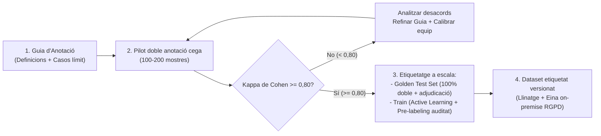

## A. Objectius d'aprenentatge

En completar aquesta lliçó, l'estudiant ha de ser capaç de:

1. **Establir** un **procés rigorós d'etiquetatge (*Data Annotation*)**: redacció de **guies d'anotació (*Annotation Guidelines*)** clares amb exemples límit (*edge cases*), sessió de calibratge pilot, **doble anotació cega** sobre una mostra compartida i adjudicació de discrepàncies per un expert sènior!
2. **Calcular i interpretar** l'**acord inter-anotador (*Inter-Annotator Agreement — IAA*)** mitjançant la **Kappa de Cohen (\(\kappa\))** (2 anotadors) i l'**Alfa de Krippendorff (\(\alpha\))** (múltiples anotadors, dades faltants o escales ordinals), comprenent per què **l'exactitud simple (% d'acord) enganya** en classes desequilibrades!
3. **Combinar** estratègies eficients per reduir el cost d'etiquetatge sense perdre rigor: ***Active Learning*** (mostreig per incertesa/marge), ***Pre-labeling* assistit per IA** (amb prevenció del biaix d'ancoratge!) i **supervisió feble (*Weak Supervision* / funcions d'etiquetatge heurístiques)** — mantenint SEMPRE un ***Golden Test Set* 100% revisat per humans i intocable**!
4. **Aplicar** l'etiquetatge específic de **LLMOps**: parells de preferència humana (`chosen` vs. `rejected`) per a **DPO/RLHF**, conjunts de referència RAG (`pregunta`, `chunks_esperats`, `resposta_referencia`) i rúbriques de puntuació per calibrar *LLM-as-a-Judge*.
5. **Implementar** en Python pur el **càlcul exacte de la Kappa de Cohen (\(\kappa\))**, la detecció dels casos en desacord per a adjudicació i un **selector d'*Active Learning* per marge d'incertesa**!

---

## B. Explicació introductòria

Un model supervisat mai no pot ser millor que les etiquetes amb què ha estat entrenat (*«Sostre de soroll d'etiquetes»*). Si dos funcionaris del Registre General classifiquen la mateixa instància dubtosa en departaments diferents perquè ningú no ha escrit una guia clara sobre on van les «terrasses de bars» (Via Pública o Activitats?), cap xarxa neuronal del món podrà encertar-ho al 95%!

L'**etiquetatge professional (MLOps / LLMOps)** transforma una feina sovint improvisada en Excel en un **procés científic mesurable**: guies amb casos frontera, mesura objectiva de l'**acord inter-anotador (Kappa de Cohen)**, eines dedicades (ex. *Label Studio*, *Argilla* desplegats *on-premise* per RGPD!), *Active Learning* per etiquetar només allò que aporta més valor, i separació estricta del ***Golden Set* d'avaluació**!

---

## C. Explicació tècnica avançada

### 1. Per què la **Kappa de Cohen (\(\kappa\))** és obligatòria (i el % d'acord enganya!)

Imagina un dataset on el 95% dels expedients són `NORMAL` i el 5% són `FRAU`. Si dos anotadors marquen aleatòriament quasi tot `NORMAL`, coincidiran per pur atzar un ~`90,5%` de les vegades, però no s'hauran posat d'acord en quasi cap frau real!
La **Kappa de Cohen** descompta l'acord esperat per atzar (\(p_e\)):

\[
\kappa = \frac{p_o - p_e}{1 - p_e}
\]

on \(p_o\) és la proporció d'acord observat i \(p_e = \sum_c P(A=c)\cdot P(B=c)\) és l'acord esperat per atzar.
- **Interpretació pràctica (Landis & Koch)**: `< 0,40` = guia trencada (aturar i reescriure regles!); `0,40–0,60` = moderat (millorar exemples límit); `0,60–0,80` = substancial; **`> 0,80` = gairebé perfecte (estàndard recomanat per a *Golden Sets*!)**.
- Si intervenen **3 o més anotadors**, anotacions incompletes o escales ordinals (1..5), s'usa **Krippendorff's \(\alpha\)** (o Fleiss' \(\kappa\) per a nominals complets).

### 2. Estratègies modernes d'etiquetatge eficient (*Data-Centric AI*)

| Estratègia | Com funciona | Quan usar-la | Risc principal i mitigació |
|---|---|---|---|
| **Doble anotació + Adjudicació** | 2 experts etiqueten cegament el mateix lot; un 3r resol discrepàncies | **Obligatòria per al *Golden Test Set*** i pilots de calibratge (10–20% del corpus) | Cost alt → reservar per a calibratge, *Golden Set* i classes crítiques |
| ***Active Learning*** | El model selecciona els exemples on té **més incertesa** (menor marge `p1 - p2` o màxima entropia) per prioritzar-los a l'etiquetador | Quan tens 50.000 expedients sense etiquetar i pressupost per etiquetar-ne 1.000 | Pot oblidar zones noves → barrejar 80% incertesa + 20% **mostreig aleatori/divers**! |
| ***Pre-labeling* assistit per IA** | Un model o LLM pre-omple l'etiqueta i l'humà la confirma o corregeix | Accelerar 3× l'etiquetatge de volums mitjans (ex. NER o classificació) | **Biaix d'ancoratge / fatiga**: l'humà fa clic a «Acceptar» sense llegir! → intercalar **exemples «trampa» (*honeypots*)** i auditar *Kappa*! |
| **Supervisió feble (*Weak Supervision*)** | Regles heurístiques/regex (*Labeling Functions*, estil Snorkel) generen etiquetes probabilístiques massives | Arrencar ràpidament un model base (*bootstrapping*) amb molt poc pressupost | Soroll d'etiqueta → usar **només per a `train`**, **MAI per al *Golden Test Set***! |

### 3. Etiquetatge específic en **LLMOps**

- **RAG Golden Set**: conjunt curat per tècnics del domini de `(pregunta_real, doc_ids_esperats, resposta_referencia, ha_d_abstenir_se)` — incloent preguntes **fora de domini** per mesurar que el sistema sap dir *«No tinc evidència»*!
- **Dades de preferència (DPO / RLHF)**: dos candidats de resposta per al mateix prompt ordenats per experts (`chosen > rejected`) segons veracitat, claredat administrativa i to institucional.
- **Privacitat RGPD en l'etiquetatge**: prohibir pujar expedients amb PII a plataformes d'etiquetatge externes o *crowdsourcing* públic; usar eines *open-source* **desplegades *on-premise*** (ex. *Label Studio*, *Argilla*) sobre dades pseudonimitzades!

---

## D. Diagrames i recursos visuals

### Cicle de qualitat d'etiquetatge: Guia → Pilot IAA (Kappa) → *Active Learning* → *Golden Set*



---

## E. Aplicació a l'Administració pública

1. **Taxonomia d'instàncies amb casos frontera reals**: abans d'etiquetar 5.000 instàncies amb personal del Registre, redactar una guia curta (3 pàgines) resolent explícitament les 15 fronteres clàssiques (*«Obra menor amb ocupació de vorera → Urbanisme vs. Via Pública?»*, *«Soroll de bar → Medi Ambient vs. Activitats?»*) i comprovar que els 2 tècnics assoleixen **`Kappa >= 0,80`**!
2. **Construcció del *Golden Set* del chatbot municipal (150–300 preguntes)**: 50% preguntes freqüents de l'OAC/010, 25% casos complexos/normatius amb cites exactes, 15% preguntes d'excepcions/vigència i **10% preguntes sense resposta a la base** (per comprovar abstenció honesta!).
3. **Eines *on-premise* i sobirania de dades**: instal·lar *Label Studio* o *Argilla* dins el CPD propi (amb autenticació corporativa SSO i rols per servei) per evitar enviar cap dada administrativa a serveis SaaS externs!

---

## F. Exemple pràctic guiat

Implementem en **Python pur** el **càlcul exacte de la Kappa de Cohen (\(\kappa\))** entre dos anotadors humans (mostrant com l'% d'acord simple pot semblar alt tot i tenir baixa Kappa en classes desequilibrades!), l'extracció dels casos en desacord per a adjudicació, i un **selector d'*Active Learning*** per marge mínim `p1 - p2`!

```python
"""Exemple 7.2: Càlcul exacte de Kappa de Cohen, detecció de desacords i Active Learning per marge."""
from collections import Counter


def kappa_cohen(anotador_a: list[str], anotador_b: list[str]) -> tuple[float, float, float]:
    n = len(anotador_a)
    assert n == len(anotador_b) and n > 0
    po = sum(1 for a, b in zip(anotador_a, anotador_b) if a == b) / n
    ca, cb = Counter(anotador_a), Counter(anotador_b)
    classes = set(ca) | set(cb)
    pe = sum((ca[c] / n) * (cb[c] / n) for c in classes)
    kappa = (po - pe) / (1.0 - pe) if pe < 1.0 else 1.0
    return po, pe, kappa


def seleccionar_active_learning(prediccions: list[tuple[str, dict[str, float]]], k: int = 2) -> list[str]:
    """Selecciona els k exemples amb menor marge (p1 - p2) = màxima incertesa del model!"""
    def marge(probs: dict[str, float]) -> float:
        top2 = sorted(probs.values(), reverse=True)[:2]
        return top2[0] - top2[1]
    ordenat = sorted(prediccions, key=lambda x: marge(x[1]))
    return [doc_id for doc_id, _ in ordenat[:k]]


if __name__ == "__main__":
    # Cas desequilibrat (10 expedients): 80% acord simple, però baixa Kappa sobre la classe rara FRAU!
    a = ["OK", "OK", "OK", "OK", "OK", "OK", "OK", "OK", "FRAU", "OK"]
    b = ["OK", "OK", "OK", "OK", "OK", "OK", "OK", "OK", "OK", "FRAU"]
    po, pe, k = kappa_cohen(a, b)
    desacords = [i for i, (x, y) in enumerate(zip(a, b)) if x != y]
    print(f"Acord observat (po)={po:.2f} | Acord per atzar (pe)={pe:.2f} | Kappa de Cohen={k:.3f}")
    print("Índexs en desacord per a adjudicació experta:", desacords)

    # Selecció Active Learning sobre 3 expedients sense etiquetar
    pool = [
        ("EXP-10", {"URB": 0.94, "VIA": 0.04, "TRIB": 0.02}),  # Marge 0.90 (molt segur)
        ("EXP-11", {"URB": 0.51, "VIA": 0.47, "TRIB": 0.02}),  # Marge 0.04 (molt dubtós!)
        ("EXP-12", {"URB": 0.42, "VIA": 0.35, "TRIB": 0.23}),  # Marge 0.07 (dubtós!)
    ]
    print("Prioritzats per etiquetar (Active Learning):", seleccionar_active_learning(pool, k=2))
```

### Interpretació dels resultats (execució verificada)

- En el lot desequilibrat de 10 expedients, els anotadors coincideixen en el **`80%`** (`po = 0.80`), però com que l'acord per pur atzar és `pe = 0.82` i no han coincidit en **cap** dels dos casos de `FRAU` (índexs `8` i `9`), la **Kappa de Cohen és `-0.111`** (`< 0`: pitjor que l'atzar!). Si només haguessis mirat el `80%`, hauries aprovat una guia d'etiquetatge completament trencada!
- El selector d'***Active Learning*** tria exactament **`['EXP-11', 'EXP-12']`** (marges `0,04` i `0,07`), evitant malgastar temps humà etiquetant `EXP-10` on el model ja té `0,94` de confiança!

---

## G. Exercici pràctic per resoldre

### Enunciat
Un ajuntament vol crear un dataset de 6.000 expedients per detectar sol·licituds de subvenció amb risc d'irregularitat (classe positiva rara: ~4% dels expedients). El cap de projecte fa tres propostes per estalviar temps:
1. «No perdem temps escrivint guies ni fent doble anotació: repartim 3.000 expedients a la Marta i 3.000 al Pau i llestos!»
2. «Per estalviar encara més, utilitzem un LLM comercial al núvol per etiquetar automàticament tant `train` com el *Golden Test Set* sense revisió humana.»
3. «Com a control de qualitat en un pilot de 100 casos, si coincideixen en el 92% dels casos ja donem l'etiquetatge per perfecte.»

Identifica **tots els errors metodològics i normatius (RGPD)** de les 3 propostes i dissenya el **protocol correcte d'etiquetatge** dins d'un pressupost realista.

### Objectius i restriccions
- Evitar ceguesa del % d'acord en classe rara (usar Kappa de Cohen), impedir contaminació del *Golden Test Set* amb etiquetes sintètiques/feble supervisió, protegir PII (eina *on-premise*), i reduir costos legítimament amb *Active Learning* + *Pre-labeling* auditat!

:::hint Pista 1 — Crítica a les 3 propostes
(1) Sense guia ni doble anotació de calibratge, Marta i Pau tindran criteris incompatibles (soroll d'etiqueta irreparable!); (2) **Mai** enviar expedients amb PII a un LLM SaaS extern (RGPD!), i **MAI** etiquetar el ***Golden Test Set*** només amb LLM/regles sense verificació humana (si no, només mesures si el teu model s'assembla als errors de l'LLM!); (3) En una classe del 4%, dos anotadors que marquen quasi tot `0` coincideixen un 92% per atzar amb **`Kappa ≈ 0`**!
:::

:::hint Pista 2 — Protocol eficient i rigorós
(a) Guia escrita amb casos frontera + eina *on-premise* (Label Studio/Argilla) sobre dades pseudonimitzades; (b) Pilot de 150–200 casos (sobre-mostrejant sospitosos!) amb **doble anotació cega** fins a **`Kappa >= 0,80`**; (c) ***Golden Test Set* 100% doble anotació + adjudicació humana**; (d) Estalviar pressupost en `train` usant ***Active Learning* (80% incertesa + 20% aleatori)** i ***Pre-labeling* local auditat amb *honeypots***!
:::

### Criteris d'avaluació
- **45%**: Desmuntatge precís de les 3 propostes (manca de guia/IAA, contaminació del *Golden Test Set* + bretxa RGPD en LLM extern, trampa del 92% d'acord simple en classe del 4% → Kappa de Cohen).
- **35%**: Protocol rigorós pas a pas (guia, pilot amb estratificació de sospitosos, `Kappa >= 0,80`, *Golden Set* pur humà, eina *on-premise* pseudonimitzada).
- **20%**: Estratègies legítimes d'estalvi per a `train` (*Active Learning* + *Pre-labeling* local amb control anti-ancoratge / *honeypots*).

### Errors habituals
- Acceptar usar un LLM per crear el *Golden Test Set* (destrueix qualsevol mesura fiable del rendiment real en producció!).

:::solution Solució completa comentada i alternatives
### 1. Crítica rigorosa a les 3 propostes
1. **Repartir 3.000/3.000 sense guia ni calibratge**: introdueix biaixos individuals i contradiccions massives (el model aprèn «qui va etiquetar cada expedient» en lloc del risc real!).
2. **LLM extern al núvol per a `train` i *Golden Test Set***: doble error greu: (a) **incompliment RGPD** si s'envien expedients amb PII fora del perímetre controlat, i (b) **contaminació del *Golden Test Set*** (el conjunt d'avaluació final ha de reflectir la veritat jurídica humana, mai les aproximacions o errors d'un altre model!).
3. **Aprovar el pilot amb 92% d'acord simple sobre una classe rara (4%)**: si Marta i Pau només coincideixen en dir `NORMAL`, poden tenir 92% d'acord simple i **`Kappa <= 0`**, sense acord real sobre què és una irregularitat!

### 2. Protocol professional d'etiquetatge eficient
1. **Eina *on-premise* i RGPD**: desplegar *Label Studio* o *Argilla* localment sobre dades de la capa Silver (pseudonimitzades).
2. **Guia d'anotació + Pilot estratificat**: redactar definicions i 15 casos límit; fer doble anotació cega sobre 200 casos (enriquits amb possibles sospitosos) i mesurar **Kappa de Cohen** (no passar a escala fins assolir **`Kappa >= 0,80`**!).
3. ***Golden Test Set* intocable**: 100% revisat per doble anotació humana + adjudicació experta.
4. **Reducció real de cost en `train`**: en lloc d'etiquetar a cegues 6.000 casos (5.760 normals!), usar ***Active Learning*** (80% casos d'incertesa/sospita + 20% mostra aleatòria per diversitat) + ***Pre-labeling* local** amb exemples *honeypot* per evitar el biaix d'ancoratge!
:::

---

## H. Test individual

Resol les 10 preguntes sobre guies d'anotació, Kappa de Cohen vs. acord simple en classes desequilibrades, Krippendorff's alpha, *Active Learning*, *Pre-labeling* i biaix d'ancoratge, *Weak Supervision*, *Golden Test Set* i etiquetatge en LLMOps.

---

## I. Preguntes de desenvolupament

### Pregunta 1
Demostra conceptualment (i amb la fórmula \(\kappa = \frac{p_o - p_e}{1 - p_e}\)) per què el **percentatge d'acord simple enganya** en tasques administratives amb **classes desequilibrades** (ex. 4% d'irregularitats), i explica com s'interpreta la **Kappa de Cohen** durant un pilot d'etiquetatge.

:::model-answer Resposta model i criteris de correcció (Pregunta 1)
**Resposta model**:
- En una classe positiva del 4%, si dos anotadors marquen aleatòriament quasi tot com a negatiu (96% negatiu), coincidiran per pur atzar un \(p_e \approx 0,96^2 + 0,04^2 \approx 92,3\%\) de les vegades encara que no coincideixin en **cap** cas positiu real!
- La **Kappa de Cohen** (\(\kappa = \frac{p_o - p_e}{1 - p_e}\)) resta l'acord esperat per atzar (\(p_e\)) i normalitza per l'acord màxim per sobre de l'atzar (\(1 - p_e\)). Si els dos anotadors no coincideixen en els positius, \(\kappa \le 0\) malgrat un `92%` d'acord simple!
- **Ús pràctic al pilot**: `< 0,40` indica guia ambigua (aturar i reescriure definicions i casos límit); `0,60–0,80` és substancial; **`>= 0,80`** és l'estàndard recomanat abans d'etiquetar a escala i per construir el *Golden Test Set*. (Per a >2 anotadors o escales ordinals, usar **Krippendorff's \(\alpha\)**).

**Criteris de correcció (10 punts)**:
- Explicació clara de la trampa de les classes desequilibrades i fórmula exacta de Kappa: 6 punts.
- Llindars operatius d'interpretació i extensió a Krippendorff's alpha: 4 punts.
:::

### Pregunta 2
Explica les diferències entre ***Active Learning***, ***Pre-labeling* assistit per IA** i ***Weak Supervision***, detallant el risc principal de cadascuna i per què **cap d'aquestes tres** no ha de substituir la doble anotació humana al ***Golden Test Set***.

:::model-answer Resposta model i criteris de correcció (Pregunta 2)
**Resposta model**:
1. ***Active Learning***: prioritza per a l'etiquetador humà els exemples on el model actual té més incertesa (marge `p1 - p2` mínim o alta entropia). *Risc*: pot crear biaix de mostreig oblidant zones noves → mitigar combinant **80% incertesa + 20% mostra aleatòria**.
2. ***Pre-labeling* assistit per IA**: un model local suggereix l'etiqueta i l'humà la valida/corregeix. *Risc*: **biaix d'ancoratge** (l'anotador accepta mecànicament errors del model) → mitigar intercalant casos *honeypot* i audits aleatoris de Kappa.
3. ***Weak Supervision***: regles heurístiques/regex (*Labeling Functions*) etiqueten milers de dades ràpidament. *Risc*: soroll sistemàtic d'etiqueta.
- **Intocabilitat del *Golden Test Set***: el conjunt de prova final mesura la qualitat real del sistema davant la veritat jurídica/operativa; si es crea amb *Weak Supervision* o un LLM sense doble validació humana, només mesuraràs si el model imita els errors de les regles o de l'LLM!

**Criteris de correcció (10 punts)**:
- Explicació + risc + mitigació de les 3 estratègies: 7 punts.
- Justificació rotunda de la puresa humana del *Golden Test Set*: 3 punts.
:::

### Pregunta 3
Com dissenyes un ***Golden Set* d'etiquetatge per a un assistent RAG municipal** (LLMOps) i quines garanties de privacitat RGPD exigeix la selecció de la plataforma d'etiquetatge?

:::model-answer Resposta model i criteris de correcció (Pregunta 3)
**Resposta model**:
- **Estructura del *Golden Set* RAG (150–300 casos)**: cada registre conté `(pregunta_real_ciutadana, chunks_o_doc_ids_esperats, resposta_referencia_validada, requereix_abstencio)`. S'ha d'estratificar equilibradament: consultes freqüents OAC/010, preguntes complexes multi-article, casos de vigència normativa (2025 vs. 2026) i **un 10–15% de preguntes fora de base/sense evidència** (per verificar que el RAG s'absté en lloc d'al·lucinar!).
- **Garanties RGPD**: prohibir pujar expedients o converses amb PII a plataformes SaaS externes o *crowdsourcing* públic; desplegar eines *open-source* ***on-premise*** (*Label Studio*, *Argilla*) integrades amb SSO corporatiu, accés per rols i treballant sempre sobre dades prèviament **pseudonimitzades** de la capa Silver.

**Criteris de correcció (10 punts)**:
- Disseny complet i estratificat del *Golden Set* RAG (incloent casos d'abstenció!): 6 punts.
- Garanties RGPD i sobirania (eina *on-premise*, pseudonimització, SSO): 4 punts.
:::

---

## J. Resum per memoritzar

### Conceptes clau
- **Qualitat d'etiquetatge**: un model mai supera el sostre de soroll de les seves etiquetes!
- **Flux rigorós**: **Guia d'anotació** (amb casos frontera) → **Pilot de doble anotació cega** → **Kappa de Cohen (`>= 0,80`)** → Adjudicació experta → Etiquetatge a escala.
- **Kappa de Cohen (\(\kappa = \frac{p_o - p_e}{1 - p_e}\))**: indispensable en classes desequilibrades (on un `92%` d'acord simple pot tenir `Kappa <= 0`!). Per >2 anotadors o ordinals: **Krippendorff's \(\alpha\)**.
- **Estalvi eficient en `train`**: ***Active Learning*** (80% incertesa/marge mínim + 20% aleatori), ***Pre-labeling* local** (vigilar **biaix d'ancoratge** amb *honeypots*!) i ***Weak Supervision***.
- ***Golden Test Set* intocable**: SEMPRE 100% revisat per humans (doble anotació + adjudicació), MAI etiquetat automàticament amb LLM o regles!
- **RGPD**: eines d'etiquetatge *open-source* ***on-premise*** (*Label Studio*, *Argilla*) sobre dades pseudonimitzades!

### Definicions essencials
- **Kappa de Cohen (\(\kappa\))**: coeficient d'acord inter-anotador entre dos etiquetadors que corregeix l'acord observat descomptant l'acord esperat per pur atzar.
- **Biaix d'ancoratge en *Pre-labeling***: tendència dels anotadors humans a acceptar acríticament les etiquetes pre-emplenades per una IA en lloc d'avaluar cada exemple amb independència.

### Errors conceptuals freqüents
1. Validar un pilot d'etiquetatge en classes rares mirant només el `% d'acord simple` en lloc de la **Kappa de Cohen**.
2. Usar etiquetes generades per un LLM o *Weak Supervision* per construir el ***Golden Test Set***.
3. Pujar expedients administratius amb PII a plataformes d'etiquetatge SaaS externes.

### Possibles preguntes d'examen
- Per què un 92% d'acord simple entre dos anotadors pot amagar una Kappa de Cohen negativa en detecció de frau (classe del 4%)?
- Com combines *Active Learning* i *Pre-labeling* per reduir costos d'etiquetatge sense introduir biaix d'ancoratge ni contaminar el *Golden Test Set*?
- Dissenya la composició d'un *Golden Set* per avaluar un assistent RAG municipal.
